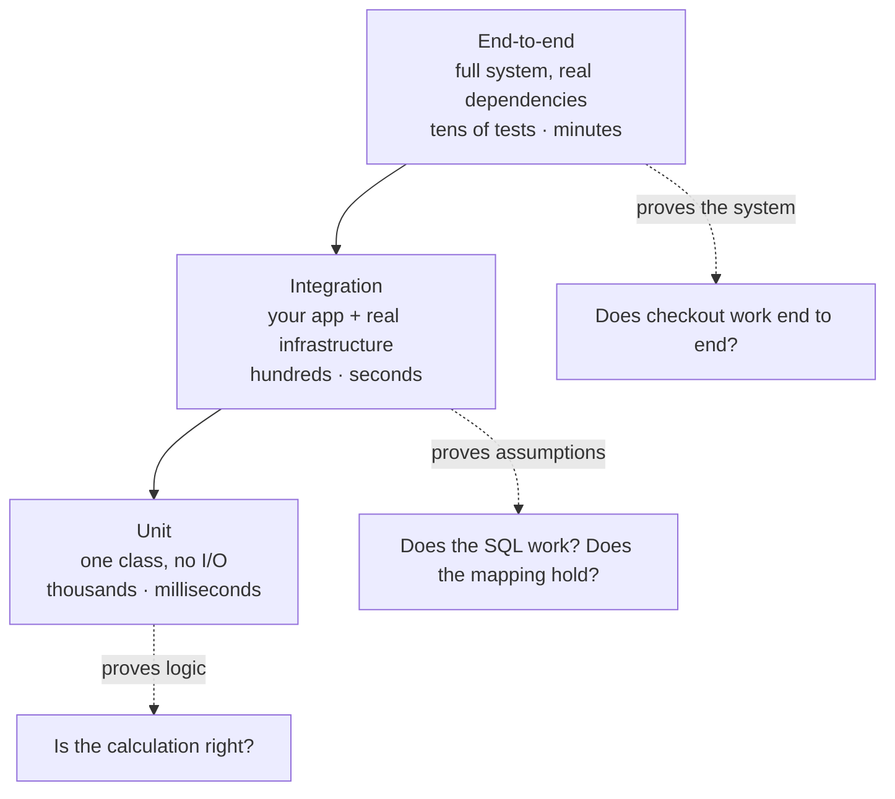
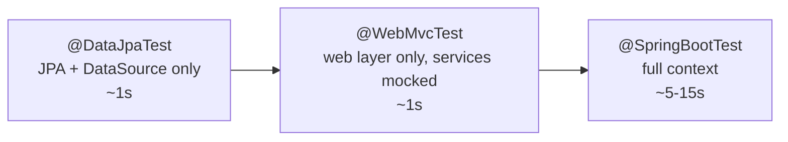
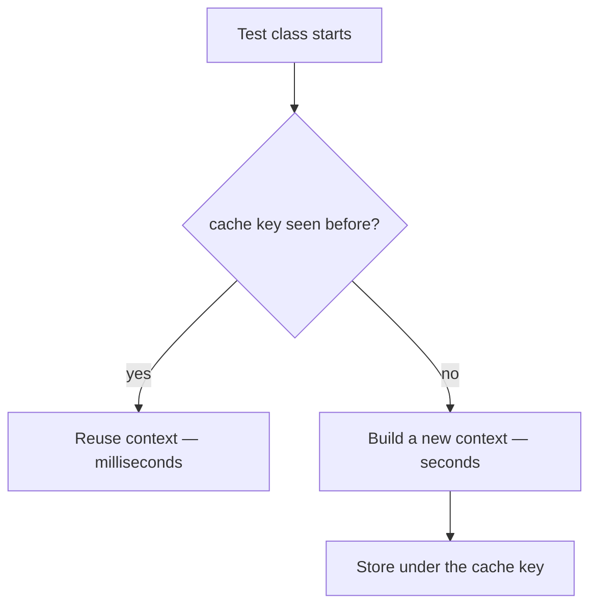
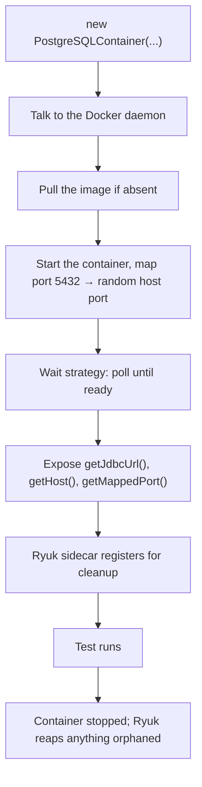

# Integration Testing & Testcontainers

## 1. Purpose & Audience

**Band:** L3 Enterprise · **Prerequisites:** [JUnit 5](41-junit5.md), [Mockito & Test Doubles](42-mockito.md)

Unit tests prove your logic is right. Integration tests prove your *assumptions* are right — that the SQL is valid, the JSON maps the way you think, the transaction boundary is where you drew it, and the vendor's error response does what your handler expects. These are the bugs that unit tests structurally cannot catch, because the mock always behaves the way you told it to.

This chapter answers three questions:

1. **What belongs in an integration test**, and where is the line against unit tests above and end-to-end tests below?
2. **How do you test against real infrastructure** without a shared environment everyone breaks?
3. **Why is the suite slow**, and what actually fixes it?

!!! warning "H2 is not your database"
    The most common integration-testing mistake is swapping Postgres for H2 in tests. Different SQL dialect, different constraint handling, different date and JSON semantics, different locking. Every difference is a class of bug your suite cannot see. Testcontainers exists to remove this compromise.

---

## 2. The Problem

`OrderRepository` finds recent orders for a customer:

```java title="OrderRepository.java"
public interface OrderRepository extends JpaRepository<OrderEntity, UUID> {

    @Query("""
        select o from OrderEntity o
        where o.customerId = :customerId
          and o.placedAt >= :since
        order by o.placedAt desc
        """)
    List<OrderEntity> findRecent(UUID customerId, Instant since);
}
```

A unit test with a mocked repository proves nothing about this. The mock returns whatever you stubbed, so the test passes whether the JPQL is correct, refers to a field that no longer exists, or generates a query that scans the whole table.

The questions only a real database can answer:

- Does the JPQL compile against the current entity mapping?
- Does the unique constraint on `(customer_id, idempotency_key)` actually fire?
- Does `Instant` round-trip through `timestamptz` without losing precision?
- Does the transaction roll back when `PaymentFailedException` propagates?

Each of those has shipped as a production incident somewhere, in a codebase with excellent unit-test coverage.

---

## 3. Mental Model

### 3.1 Where integration tests sit



The useful definition: **an integration test crosses at least one boundary you do not control** — a database, a broker, an HTTP service, the filesystem. Everything else is a unit test, however many classes it involves.

### 3.2 The three levels of Spring test



| Annotation | Loads | Use for |
|---|---|---|
| `@DataJpaTest` | JPA, `DataSource`, transactions | Repository queries, mappings, constraints |
| `@WebMvcTest` | Controllers, filters, JSON — services mocked | Request mapping, validation, status codes, serialization |
| `@JsonTest` | Jackson only | Serialization contracts |
| `@RestClientTest` | `RestClient`/`RestTemplate` + mock server | Outbound HTTP clients |
| `@SpringBootTest` | Everything | Cross-cutting flows, transaction boundaries, wiring |

Slices are not just faster — they are more precise. A `@WebMvcTest` that fails tells you the web layer is wrong. A `@SpringBootTest` that fails tells you something, somewhere, is wrong.

---

## 4. Core API & Syntax

### 4.1 Dependencies

```xml title="pom.xml"
<dependencyManagement>
  <dependencies>
    <dependency>
      <groupId>org.testcontainers</groupId>
      <artifactId>testcontainers-bom</artifactId>
      <version><!-- current 1.x --></version>
      <type>pom</type>
      <scope>import</scope>
    </dependency>
  </dependencies>
</dependencyManagement>

<dependencies>
  <dependency>
    <groupId>org.springframework.boot</groupId>
    <artifactId>spring-boot-starter-test</artifactId>
    <scope>test</scope>
  </dependency>
  <dependency>
    <groupId>org.springframework.boot</groupId>
    <artifactId>spring-boot-testcontainers</artifactId>
    <scope>test</scope>
  </dependency>
  <dependency>
    <groupId>org.testcontainers</groupId>
    <artifactId>postgresql</artifactId>
    <scope>test</scope>
  </dependency>
</dependencies>
```

`spring-boot-testcontainers` is what provides `@ServiceConnection` — the piece that removes most of the wiring boilerplate.

### 4.2 Testcontainers annotations

| Annotation | Purpose |
|---|---|
| `@Testcontainers` | Enables the JUnit 5 extension |
| `@Container` on a **static** field | One container per class |
| `@Container` on an **instance** field | One container **per test method** — rarely what you want |
| `@ServiceConnection` | Auto-wires connection properties into Spring (Boot 3.1+) |
| `@DynamicPropertySource` | Manual property wiring — the pre-3.1 approach |

### 4.3 Spring test annotations

| Annotation | Purpose |
|---|---|
| `@SpringBootTest(webEnvironment = ...)` | `MOCK` (default), `RANDOM_PORT`, `DEFINED_PORT`, `NONE` |
| `@AutoConfigureMockMvc` | `MockMvc` without a real server |
| `@Transactional` | Roll back after each test — see §6.4 for the traps |
| `@Sql("/data/orders.sql")` | Run a script before the test |
| `@ActiveProfiles("test")` | Profile selection |
| `@TestConfiguration` | Test-only beans, **not** picked up by component scan |
| `@MockitoBean` | Replace a bean with a Mockito mock |
| `@MockitoSpyBean` | Wrap a real bean in a spy |

!!! danger "`@MockBean` and `@SpyBean` are gone"
    If you are carrying forward Spring Boot 3 notes: `@MockBean` and `@SpyBean` were deprecated in Boot 3.4 in favour of `@MockitoBean` and `@MockitoSpyBean`, which live in Spring Framework's bean-override support (`org.springframework.test.context.bean.override.mockito`). **They are removed in Spring Boot 4.** The replacement is a straight rename, but the import changes.

### 4.4 Naming and build phases

| Suffix | Plugin | Phase |
|---|---|---|
| `*Test` | Surefire | `test` — fast loop |
| `*IT` or `*ITCase` | Failsafe | `verify` — after packaging |

Separating them is what keeps `mvn test` fast. With Gradle, the equivalent is a dedicated `integrationTest` source set and task.

---

## 5. Worked Examples

### 5.1 Repository test against real Postgres

```java title="OrderRepositoryIT.java"
@DataJpaTest
@AutoConfigureTestDatabase(replace = AutoConfigureTestDatabase.Replace.NONE)
@Testcontainers
class OrderRepositoryIT {

    @Container
    @ServiceConnection
    static final PostgreSQLContainer<?> postgres =
        new PostgreSQLContainer<>("postgres:16-alpine");

    @Autowired OrderRepository repository;
    @Autowired TestEntityManager entityManager;

    @Test
    void findRecent_returnsOnlyOrdersAfterCutoff() {
        UUID customerId = UUID.randomUUID();
        entityManager.persist(order(customerId, Instant.parse("2026-09-01T10:00:00Z")));
        entityManager.persist(order(customerId, Instant.parse("2026-09-18T10:00:00Z")));
        entityManager.flush();

        List<OrderEntity> recent =
            repository.findRecent(customerId, Instant.parse("2026-09-15T00:00:00Z"));

        assertThat(recent)
            .hasSize(1)
            .extracting(OrderEntity::placedAt)
            .containsExactly(Instant.parse("2026-09-18T10:00:00Z"));
    }

    @Test
    void save_duplicateIdempotencyKey_violatesUniqueConstraint() {
        UUID customerId = UUID.randomUUID();
        entityManager.persist(orderWithKey(customerId, "IDEM-1"));
        entityManager.flush();

        entityManager.persist(orderWithKey(customerId, "IDEM-1"));

        assertThrows(PersistenceException.class, entityManager::flush);
    }
}
```

Three deliberate details.

**`@AutoConfigureTestDatabase(replace = NONE)`.** `@DataJpaTest` replaces your `DataSource` with an embedded database by default. Without this line, the container starts and is then ignored — a genuinely confusing failure where the test passes for the wrong reason.

**`@ServiceConnection`.** Spring reads the container's JDBC URL, username, and password and wires them into the context automatically. This replaces the `@DynamicPropertySource` block that older guides show:

```java title="The pre-3.1 approach — no longer needed"
@DynamicPropertySource
static void props(DynamicPropertyRegistry registry) {
    registry.add("spring.datasource.url", postgres::getJdbcUrl);
    registry.add("spring.datasource.username", postgres::getUsername);
    registry.add("spring.datasource.password", postgres::getPassword);
}
```

**The constraint test.** Asserting on `flush()` rather than `persist()` is the point — JPA defers the insert, so a constraint violation only surfaces at flush time. Tests that forget this pass while the constraint is broken.

### 5.2 Web layer in isolation

```java title="OrderControllerTest.java"
@WebMvcTest(OrderController.class)
class OrderControllerTest {

    @Autowired MockMvc mockMvc;
    @MockitoBean OrderService orderService;

    @Test
    void confirm_validRequest_returns201WithLocation() throws Exception {
        Order order = confirmedOrder("ORD-9001");
        when(orderService.confirm(any(), any())).thenReturn(order);

        mockMvc.perform(post("/api/orders")
                .contentType(MediaType.APPLICATION_JSON)
                .content("""
                    {"cartId":"CART-1","customerId":"CUST-1"}
                    """))
            .andExpect(status().isCreated())
            .andExpect(header().string("Location", "/api/orders/ORD-9001"))
            .andExpect(jsonPath("$.status").value("CONFIRMED"));
    }

    @Test
    void confirm_outOfStock_returns409() throws Exception {
        when(orderService.confirm(any(), any()))
            .thenThrow(new OutOfStockException("CART-1"));

        mockMvc.perform(post("/api/orders")
                .contentType(MediaType.APPLICATION_JSON)
                .content("""
                    {"cartId":"CART-1","customerId":"CUST-1"}
                    """))
            .andExpect(status().isConflict())
            .andExpect(jsonPath("$.code").value("OUT_OF_STOCK"));
    }
}
```

This is where exception-handler mapping gets verified — the `@ControllerAdvice` that turns `OutOfStockException` into a 409. A unit test on the service never exercises it, and it is exactly the kind of thing that breaks silently when someone adds a new exception type.

No database, no container, roughly a second.

### 5.3 The full flow

```java title="OrderConfirmationIT.java"
@SpringBootTest(webEnvironment = SpringBootTest.WebEnvironment.RANDOM_PORT)
@Testcontainers
class OrderConfirmationIT {

    @Container
    @ServiceConnection
    static final PostgreSQLContainer<?> postgres =
        new PostgreSQLContainer<>("postgres:16-alpine");

    @Autowired TestRestTemplate restTemplate;
    @Autowired OrderRepository repository;
    @MockitoBean PaymentGateway payments;        // real money — always a double

    @Test
    void confirm_paymentDeclined_persistsNothing() {
        when(payments.charge(any(), any()))
            .thenReturn(PaymentResult.declined("insufficient funds"));

        ResponseEntity<ProblemDetail> response = restTemplate.postForEntity(
            "/api/orders", confirmRequest(), ProblemDetail.class);

        assertThat(response.getStatusCode()).isEqualTo(HttpStatus.CONFLICT);
        assertThat(repository.count()).isZero();     // the real assertion
    }
}
```

`repository.count()` is zero is the test. It verifies that the transaction actually rolled back — a property that involves the transaction manager, the JPA session, the exception type, and the propagation setting, and which no unit test can establish.

Note that `PaymentGateway` stays mocked even in the full-context test. **Mock at the boundary you cannot afford to cross**; use the real thing everywhere you can.

### 5.4 Stubbing an outbound HTTP dependency

The vendor dispatch API is someone else's service. WireMock in a container gives you a real HTTP round trip with controlled responses:

```java title="VendorDispatchIT.java"
@SpringBootTest
@Testcontainers
class VendorDispatchIT {

    @Container
    static final WireMockContainer wiremock =
        new WireMockContainer("wiremock/wiremock:3.9.1");

    @DynamicPropertySource
    static void vendorUrl(DynamicPropertyRegistry registry) {
        registry.add("vendor.base-url", wiremock::getBaseUrl);
    }

    @Autowired VendorClient vendorClient;

    @Test
    void send_vendorReturns503_retriesThenFails() {
        stubFor(post("/dispatch").willReturn(serviceUnavailable()));

        assertThrows(VendorUnavailableException.class,
            () -> vendorClient.send(anOrder()));

        verify(exactly(3), postRequestedFor(urlEqualTo("/dispatch")));
    }
}
```

This is how you test retry policies, timeout handling, and circuit breakers — behaviour that only exists in the interaction with a slow or failing peer. A Mockito mock of `VendorClient` cannot express "responds after 5 seconds" or "fails twice then succeeds".

### 5.5 Testing asynchronous effects

```java title="DispatchEventIT.java"
@Test
void confirm_publishesDispatchEvent() {
    restTemplate.postForEntity("/api/orders", confirmRequest(), Void.class);

    await().atMost(Duration.ofSeconds(5))
           .untilAsserted(() -> assertThat(dispatchListener.received()).hasSize(1));
}
```

Awaitility polls until the condition holds or the deadline passes. The alternative — `Thread.sleep(2000)` — is both slower than necessary on a fast machine and flaky on a loaded CI runner. Never sleep in a test.

---

## 6. Internals

### 6.1 Context caching is the whole performance story

Spring caches the application context per unique configuration. Two test classes with identical configuration share one context; a single differing property creates a second.



The cache key includes: context classes and locations, active profiles, property sources, `@MockitoBean` definitions, initializers, and the web environment. Which yields one practical rule:

> **Standardise your test configuration.** Ten test classes with identical setup cost one context. Ten with slightly different `@TestPropertySource` values cost ten.

`@DirtiesContext` evicts the context, forcing a rebuild for the next test. It is occasionally necessary and usually a sign of state leaking between tests — fix the leak instead. One stray `@DirtiesContext` on a frequently-run class can add minutes to a suite.

### 6.2 What Testcontainers actually does



Two mechanisms worth understanding:

**Random port mapping.** The container's port 5432 is mapped to an arbitrary free host port, which is why tests can run in parallel and on CI agents without port conflicts. Never hard-code a port; always ask the container.

**Ryuk.** A small sidecar container that holds a connection to your JVM and destroys every registered container when that connection drops — including when the JVM is killed. It is why an aborted test run does not leave containers behind. Some CI environments block it; `TESTCONTAINERS_RYUK_DISABLED=true` exists for those, at the cost of doing your own cleanup.

### 6.3 Static versus instance containers, and the singleton pattern

```java
@Container static PostgreSQLContainer<?> db = ...;   // once per class
@Container        PostgreSQLContainer<?> db = ...;   // once per TEST METHOD
```

The instance form restarts the container for every test method. At two seconds of startup and forty tests, that is eighty seconds of pure waiting. Use static unless a test genuinely needs a pristine container.

Across many classes, the **singleton container pattern** goes further — one container for the entire JVM:

```java title="AbstractPostgresIT.java"
public abstract class AbstractPostgresIT {

    static final PostgreSQLContainer<?> POSTGRES =
        new PostgreSQLContainer<>("postgres:16-alpine");

    static {
        POSTGRES.start();      // deliberately never stopped — Ryuk handles cleanup
    }

    @DynamicPropertySource
    static void props(DynamicPropertyRegistry registry) {
        registry.add("spring.datasource.url", POSTGRES::getJdbcUrl);
        registry.add("spring.datasource.username", POSTGRES::getUsername);
        registry.add("spring.datasource.password", POSTGRES::getPassword);
    }
}
```

Every integration test extends this and shares one database. The trade is test isolation: you now need `@Transactional` rollback, truncation between tests, or per-test schemas. For a large suite the time saved is usually worth managing that.

Locally, container **reuse** skips even the first start:

```properties title="~/.testcontainers.properties"
testcontainers.reuse.enable=true
```

with `.withReuse(true)` on the container. This is a developer-machine optimisation — leave it off in CI, where a fresh container per run is the point.

### 6.4 `@Transactional` in tests: two traps

Spring rolls back the transaction after each `@Transactional` test, which gives clean isolation cheaply. It also has two failure modes.

**It does not work with `RANDOM_PORT`.** The test method's transaction lives on the test thread; the HTTP request is handled on a server thread with its own transaction. The rollback applies to the test's transaction, not the server's, so data written through the API persists. Clean up explicitly in those tests.

**It hides commit-time failures.** Constraint violations, deferred checks, and flush-time errors surface at commit — which never happens under rollback. A test that passes under `@Transactional` can fail in production on the same data. Where the commit itself is what you are testing, use `@Commit` and clean up manually.

### 6.5 Why not H2

| | H2 | Real Postgres |
|---|---|---|
| SQL dialect | Compatibility mode, approximate | Exact |
| `jsonb`, arrays, `ltree` | Absent or emulated | Native |
| Window and CTE behaviour | Partial | Full |
| Constraint and error codes | Different | Same as production |
| Locking and isolation | Different implementation | Same as production |
| Startup | Instant | ~2 seconds, once |

The saved two seconds buys a test suite that validates a database you do not run. Every dialect-specific query — and most non-trivial applications have several — is untested.

---

## 7. Production Patterns & Anti-Patterns

### Do this

- **Use the narrowest slice that proves the point.** `@DataJpaTest` for queries, `@WebMvcTest` for the web layer, `@SpringBootTest` only for genuinely cross-cutting flows.
- **Standardise context configuration** so tests share cached contexts. This is the single biggest lever on suite runtime.
- **Static containers, or a singleton base class.** Never instance-level `@Container`.
- **Use `@ServiceConnection`** instead of hand-written `@DynamicPropertySource` for supported containers.
- **Pin image tags** — `postgres:16-alpine`, never `postgres:latest`. A floating tag turns your CI into a moving target.
- **Match the production version.** Testing on Postgres 16 while running 14 reintroduces the problem Testcontainers solved.
- **Run schema migrations in tests.** Flyway or Liquibase against the container proves the migrations work, which is itself a test worth having.
- **Separate phases** — `*Test` in Surefire, `*IT` in Failsafe — so the fast loop stays fast.
- **Use Awaitility for async assertions.** Never `Thread.sleep`.

### Never do this

- **Never use H2 as a stand-in for a real database.** Different engine, different bugs.
- **Never forget `@AutoConfigureTestDatabase(replace = NONE)`** with `@DataJpaTest` plus a container, or the container is silently ignored.
- **Never scatter `@DirtiesContext`.** Each one rebuilds the context; investigate the state leak instead.
- **Never share a database between concurrently running test classes** without per-test isolation — rollback, truncation, or separate schemas.
- **Never call real third-party services.** Slow, rate-limited, sometimes billed, and red builds when someone else deploys.
- **Never depend on test execution order** for data setup. Each test creates what it needs.
- **Never assume `@Transactional` rollback works with `RANDOM_PORT`.** Different thread, different transaction.
- **Never use `latest` image tags**, and never leave a container's wait strategy to chance on a slow-starting service — set an explicit one.
- **Never let integration tests run in the inner loop.** If `mvn test` takes four minutes, developers stop running it.

---

## 8. Version Evolution (Java 8 → 26)

| Version | What changed | Impact |
|---|---|---|
| **Spring Boot 2.1** | JUnit 5 by default; `@ExtendWith(SpringExtension.class)` implied | No more `@RunWith` |
| **Spring Boot 2.2** | Slice test improvements, lazy initialization | Faster contexts |
| **Testcontainers 1.15+** | Reusable containers; richer module catalogue | Faster local loops |
| **Spring Boot 3.1** | `@ServiceConnection`; `ConnectionDetails` abstraction | Removes most Testcontainers wiring boilerplate |
| **Spring Framework 6.2 / Boot 3.4** | Bean override annotations: `@MockitoBean`, `@MockitoSpyBean`, `@TestBean`; `@MockBean`/`@SpyBean` deprecated | The replacement is a rename plus a new import |
| **Spring Boot 4 / Framework 7** | `@MockBean` and `@SpyBean` **removed**; Java 17 baseline | Boot 3 test code must be migrated |
| **Java 16** | Text blocks stabilised (15) and records | Inline JSON payloads and fixtures become readable |
| **Java 21** | Virtual threads | Container startup waits stop consuming platform threads |

### Migration note

Moving a Spring Boot 3 test suite to Boot 4, three changes are mechanical:

1. `@MockBean` → `@MockitoBean`, `@SpyBean` → `@MockitoSpyBean`, with imports moving to `org.springframework.test.context.bean.override.mockito`.
2. Replace `@DynamicPropertySource` blocks with `@ServiceConnection` wherever a supported module exists — less code and it survives property renames.
3. Drop `mockito-inline` if it is still declared (see [Chapter 42](42-mockito.md)).

The one that is not mechanical: if the suite uses H2, migrating to Testcontainers will surface real bugs that H2 was masking. Budget for that — the failures are findings, not regressions.

---

## 9. Interview Questions

### L1 — Foundations

**Q1. What is the difference between a unit test and an integration test?** ⭐ *high frequency*
A unit test exercises one unit of logic with no external dependencies, so it is fast and deterministic and proves the logic is correct. An integration test crosses a boundary you do not control — a database, a broker, an HTTP service — and proves your assumptions about that boundary hold. Mocks make unit tests possible but also mean they can never catch a wrong SQL query or a broken mapping.

**Q2. What does `@SpringBootTest` do?**
It loads the full application context for the test, wiring every bean as production would. That makes it the right tool for cross-cutting flows and the wrong tool for anything narrower, because the context takes seconds to build. Slice annotations like `@WebMvcTest` and `@DataJpaTest` load only the layer you are testing.

**Q3. What is Testcontainers?**
A library that starts real services in Docker containers for the duration of a test run — Postgres, Kafka, Redis, or anything with an image. It replaces in-memory substitutes, so tests run against the same engine as production, and it exposes the container's randomly-mapped host port so tests can run in parallel without conflicts.

### L2 — Professional

**Q4. Why not use H2 instead of a Postgres container?** ⭐ *high frequency*
Because H2 is a different database. Its SQL dialect is an approximation, it lacks or emulates `jsonb`, arrays and several window features, and its constraint errors, locking, and isolation behave differently. Every dialect-specific query in the application is effectively untested, and the bugs surface in production. The container costs about two seconds once per run.

**Q5. When would you use `@WebMvcTest` over `@SpringBootTest`?**
When the thing under test is the web layer: request mapping, validation, status codes, serialization, and exception-handler mapping. It loads only the web slice with services mocked, so it starts in about a second and a failure localises the problem to the controller. `@SpringBootTest` for that work is slower and tells you less.

**Q6. What is `@ServiceConnection` and what did it replace?**
It reads connection details from a Testcontainers container and wires them into the Spring context automatically, so a Postgres container needs no property configuration at all. Before Spring Boot 3.1 you wrote a `@DynamicPropertySource` method registering the JDBC URL, username, and password by hand. The annotation is less code and does not break when property names change.

### L3 — Enterprise

**Q7. Your integration suite takes 25 minutes. Where do you look first?**
Context caching, almost always. Spring caches a context per unique configuration, so test classes with slightly different properties, profiles, or `@MockitoBean` sets each pay full startup cost. Standardising configuration collapses dozens of contexts into a few. Then check for scattered `@DirtiesContext`, instance-level `@Container` fields restarting Docker per method, and full `@SpringBootTest` where a slice would do.

**Q8. What are the traps with `@Transactional` in tests?**
Two. It does not roll back anything written through a real HTTP request under `RANDOM_PORT`, because the server handles the request on a different thread with its own transaction. And it hides commit-time failures — constraint violations and deferred checks surface at commit, which never happens under rollback, so a test can pass on data that would fail in production. Where the commit is the thing under test, use `@Commit` and clean up explicitly.

**Q9. How do you test retry and timeout behaviour against a third-party API?**
Run a stub HTTP server — WireMock, in a container or in-process — and program it to fail, return 503, or respond slowly. Then assert on the observable outcome and the number of requests received. A Mockito mock of the client cannot express "responds after five seconds" or "fails twice then succeeds", which is exactly the behaviour retry policies and circuit breakers exist to handle.

### L4 — Architect

**Q10. How do you keep an integration suite fast enough to run on every merge?**
Treat context count and container count as budgets. Standardise test configuration so contexts are shared; use a singleton container per JVM rather than per class; parallelise at the class level once shared-state leaks are fixed; and keep the tiers separated so the unit loop stays under a minute and integration runs on merge rather than on save. Measure it — the Spring test context cache statistics and container startup logs tell you exactly where the time goes, and teams usually guess wrong.

**Q11. When is a contract test the right tool instead of an integration test?**
When the boundary is another team's service that changes independently. An integration test against their sandbox couples your build to their availability and still only proves the version you ran against. A consumer-driven contract — Pact or Spring Cloud Contract — records your expectations as an artifact the provider verifies in their own pipeline, so a breaking change fails on their side before it reaches you. The same reasoning applies to any fake you maintain: run the contract against both the fake and the real implementation so they cannot drift.

**Q12. A team reports integration tests that pass locally and fail intermittently in CI. How do you diagnose it?**
Start with what differs: CI is slower and more loaded, so fixed sleeps and short wait strategies that pass locally time out there. Then look for shared state — a singleton container plus parallel classes without per-test isolation, fixed ports, or fixed identifiers that collide. Test ordering is another: a suite that depends on execution order passes in the IDE's order and fails in the build's. The fix is almost always to make each test create and clean up its own data, and to replace every sleep with a polled condition.

---

!!! abstract "Cheat Sheet"
    **Integration test = crosses a boundary you don't control** — DB, broker, HTTP, filesystem

    **Slices:** `@DataJpaTest` (queries) · `@WebMvcTest` (web layer) · `@JsonTest` · `@RestClientTest`

    **`@SpringBootTest`** only for cross-cutting flows — it's slow and localises nothing

    **Context caching is the runtime lever** — standardise config; avoid `@DirtiesContext`

    **`@Container` static, not instance** — instance restarts Docker per test method

    **`@ServiceConnection`** replaces hand-written `@DynamicPropertySource` (Boot 3.1+)

    **`@DataJpaTest` + container needs `@AutoConfigureTestDatabase(replace = NONE)`**

    **`@Transactional` rollback doesn't apply across `RANDOM_PORT`** — different thread, different transaction

    **Never H2** as a Postgres stand-in · **never `latest`** image tags

    **Boot 4:** `@MockBean` → `@MockitoBean`, `@SpyBean` → `@MockitoSpyBean`

    **Awaitility, never `Thread.sleep`**

    **`*Test` → Surefire · `*IT` → Failsafe** — keep the fast loop fast
