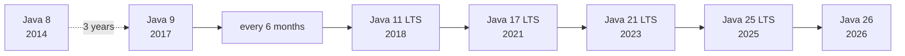
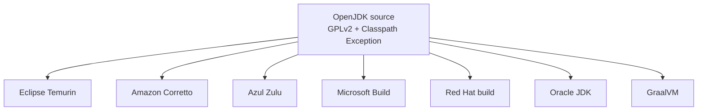
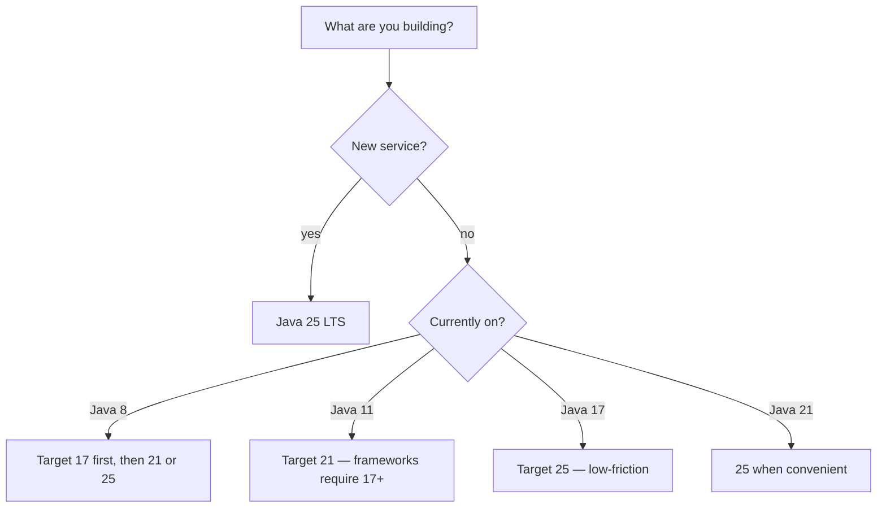
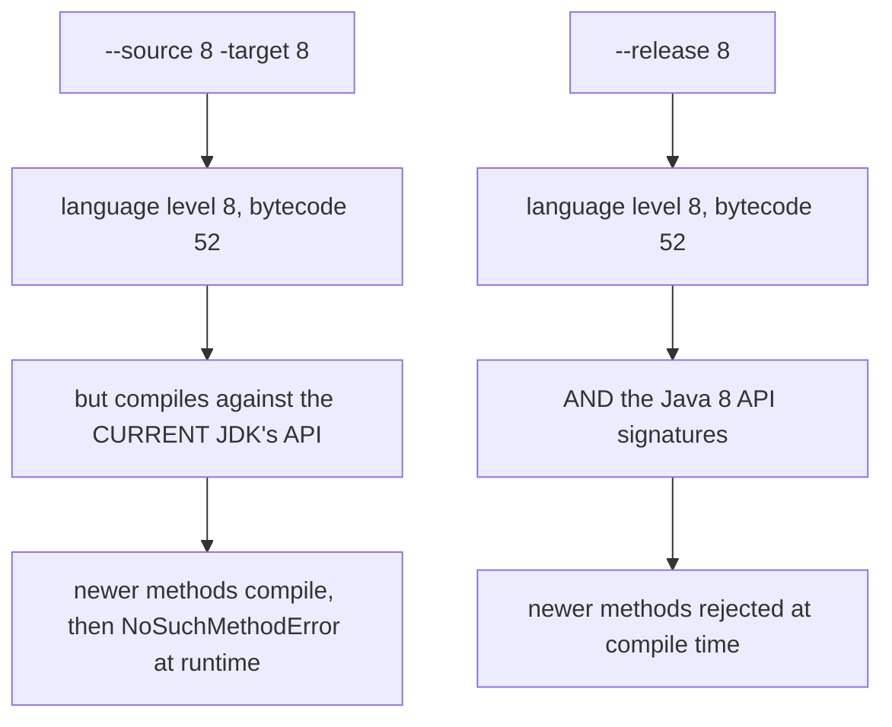

# The JDK Landscape (8 → 26)

## 1. Purpose & Audience

**Band:** L1 Foundations · **Prerequisites:** none

"Which Java should we use?" has become a genuinely hard question. There are six-monthly feature releases, long-term-support releases every two years, a dozen vendor builds of the same source, and a licensing history confusing enough that many organisations stayed on Java 8 for a decade rather than work it out.

This chapter answers three questions:

1. **What is the release model**, and what does LTS actually mean?
2. **Which distribution should you use**, and does the choice matter?
3. **How do you run several JDKs** and target an older one correctly?

---

## 2. The Problem

Three symptoms of the same confusion.

**Version paralysis.** A team on Java 8 in 2026 is twelve years behind, missing virtual threads, records, pattern matching, and a decade of GC improvements. They stayed because the upgrade felt risky and nobody could say which version to go to.

**Licence fear.** Oracle changed its licensing terms twice between 2019 and 2021. Teams who read one announcement and not the next concluded that "Java costs money now", which is false for most builds and true for some.

**The wrong-version error, in production:**

```text
java.lang.UnsupportedClassVersionError: com/grocery/OrderService
has been compiled by a more recent version of the Java Runtime
(class file version 65.0), this version of the Java Runtime only
recognizes class file versions up to 61.0
```

Built on Java 21, deployed onto Java 17. The build succeeded, the tests passed, and the failure arrived at startup in the environment that mattered.

---

## 3. Mental Model

### 3.1 The release train



Since Java 9, a feature release ships every **March and September**, on schedule, with whatever is ready. Features that are not ready wait for the next train rather than delaying the release — which is why the cadence produced previews (see [Chapter 15](../02-language/15-string-templates-postmortem.md)).

**LTS is a vendor concept, not a JDK one.** OpenJDK produces a release; vendors choose which ones to support for years with backported fixes. The industry coordinates on the same ones, so LTS is real in practice — but no part of the JDK behaves differently because a release is labelled LTS.

| Release | Date | Status |
|---|---|---|
| Java 8 | 2014 | Extended support; still widely deployed |
| Java 11 | 2018 | LTS — the first post-9 landing point |
| Java 17 | 2021 | LTS — the current floor for most frameworks |
| **Java 21** | 2023 | LTS — virtual threads, pattern matching |
| **Java 25** | 2025 | **LTS — current** |
| Java 26 | 2026 | Feature release, supported ~6 months |

LTS cadence tightened from three years to two after Java 17, which is why 21 and 25 are only two years apart.

### 3.2 One source, many builds



Every mainstream JDK is built from the same OpenJDK source. They differ in **build cadence, support duration, licence, platform coverage, and occasionally a few extra features** — not in the language or the standard library.

A correct Java program behaves identically on all of them. Choose on support and licensing, not on capability.

---

## 4. Core Reference

### 4.1 Distributions

| Distribution | Licence | Notes |
|---|---|---|
| **Eclipse Temurin** | GPLv2+CPE | The community default; broad platform coverage |
| **Amazon Corretto** | GPLv2+CPE | Free long-term support; natural on AWS |
| **Azul Zulu** | GPLv2+CPE | Widest version range, including very old releases |
| **Microsoft Build of OpenJDK** | GPLv2+CPE | Azure-oriented |
| **Red Hat build** | GPLv2+CPE | Bundled with RHEL subscriptions |
| **Oracle JDK** | NFTC / OTN | **Free for production since 17 under NFTC**, with conditions; older versions need a subscription |
| **GraalVM** | Mixed | Native Image and polyglot; a superset |
| **BellSoft Liberica** | GPLv2+CPE | Includes builds with JavaFX |

!!! note "The licensing summary"
    **GPLv2 with Classpath Exception** is the OpenJDK licence, and it is the one nearly every distribution uses. The Classpath Exception is what allows your proprietary application to link against it without becoming GPL. Under it, use is free — including in production, including commercially.

    Oracle's own builds are the exception worth checking. Oracle JDK 17 and later ship under the No-Fee Terms and Conditions, which permits production use free of charge but carries its own conditions and a defined end date per release. **If you use Oracle JDK specifically, read the current terms.** If you use any GPLv2+CPE build, this question does not arise.

### 4.2 The version string

Since Java 9: `$FEATURE.$INTERIM.$UPDATE.$PATCH`

```text
$ java -version
openjdk version "25.0.2" 2026-01-20
OpenJDK Runtime Environment Temurin-25.0.2+9 (build 25.0.2+9)
OpenJDK 64-Bit Server VM Temurin-25.0.2+9 (build 25.0.2+9, mixed mode, sharing)
```

`25` is the feature release, `0` the interim, `2` the security/bug update. Java 8's `1.8.0_412` scheme is gone.

### 4.3 Class file versions

| Java | Class file major |
|---|---|
| 8 | 52 |
| 11 | 55 |
| 17 | 61 |
| 21 | 65 |
| 25 | 69 |
| 26 | 70 |

Major version = Java version + 44. A JVM refuses any class file with a higher major version than it supports — the `UnsupportedClassVersionError` from §2.

### 4.4 Targeting an older JDK

| Flag | Behaviour |
|---|---|
| `--release N` | **Correct.** Compiles against the Java N API, and rejects newer APIs |
| `-source N -target N` | **Incomplete.** Sets language level and bytecode version but compiles against the *current* JDK's API |

```java title="WhySourceTargetIsWrong.java"
// javac -source 8 -target 8, on a JDK 21
List<String> list = someList.stream().toList();   // compiles
// Runs on JDK 21. On JDK 8: NoSuchMethodError — Stream.toList() didn't exist
```

`--release 8` rejects this at compile time. **Always use `--release`.**

```xml title="pom.xml"
<maven.compiler.release>25</maven.compiler.release>
```

### 4.5 Managing several JDKs

| Tool | Use |
|---|---|
| **SDKMAN!** | Install and switch JDKs per shell — `sdk use java 21.0.5-tem` |
| **jenv** | Per-directory JDK selection |
| **Maven toolchains** | Build with a JDK other than the one running Maven |
| **Gradle toolchains** | `java { toolchain { languageVersion = JavaLanguageVersion.of(25) } }` |
| **Docker** | Pin the exact build in the image |

---

## 5. Worked Examples

### 5.1 Choosing a version



The Java 8 case deserves the two-step. Going 8 → 25 in one jump combines the module system's encapsulation changes, the Java EE module removals, and a decade of library upgrades into one untestable change. Landing on 17 first isolates most of the breakage.

Non-LTS releases are worth running **in CI** even if production stays on LTS — they surface deprecations and removals six months to two years early, turning an LTS upgrade from an investigation into a confirmation.

### 5.2 Choosing a distribution

| Situation | Choose |
|---|---|
| No constraints | Eclipse Temurin |
| Running on AWS | Amazon Corretto |
| Running on Azure | Microsoft Build |
| RHEL with a subscription | Red Hat build |
| Need Java 6 or 7 support | Azul Zulu |
| Native images | GraalVM |
| Already have Oracle support | Oracle JDK |

For most teams the honest answer is **Temurin, and stop thinking about it.** The builds are functionally equivalent; the decision is about who backports security fixes and for how long.

### 5.3 Pinning the JDK in a build

=== "Maven"
    ```xml
    <properties>
      <maven.compiler.release>25</maven.compiler.release>
    </properties>
    ```

=== "Gradle"
    ```groovy
    java {
        toolchain {
            languageVersion = JavaLanguageVersion.of(25)
        }
    }
    ```

=== "Docker"
    ```dockerfile
    FROM eclipse-temurin:25.0.2_9-jre-alpine
    ```

Gradle toolchains are the strongest of the three: Gradle downloads and uses the specified JDK regardless of what is on the machine, so the build is reproducible across developer laptops and CI.

**Pin the patch version in container images.** `eclipse-temurin:25-jre` moves under you; `25.0.2_9-jre` does not. A floating tag means the JDK can change between a passing CI run and a production deploy.

### 5.4 Running two JDKs locally

```bash
sdk install java 21.0.5-tem
sdk install java 25.0.2-tem

sdk use java 21.0.5-tem      # this shell only
sdk default java 25.0.2-tem  # new shells
```

Two habits worth forming: `java -version` before debugging anything version-shaped, and `mvn -version` too — Maven reports the JDK it is actually running on, which is frequently not the one you think.

### 5.5 What is in a JDK

| Tool | Purpose |
|---|---|
| `java` | Launch; also runs single source files directly |
| `javac` | Compile |
| `jshell` | REPL (9+) |
| `jar` | Archive |
| `jlink` | Build a minimal runtime image ([Ch 11](../02-language/11-java-9-to-11.md)) |
| `jpackage` | Build a native installer (14+) |
| `jdeps` | Dependency analysis |
| `jcmd` | The diagnostic entry point — thread dumps, heap dumps, JFR |
| `jfr` | Read Flight Recorder files ([Ch 37](../05-runtime/37-profiling-jfr.md)) |
| `jstat`, `jmap`, `jstack` | Older diagnostics, largely superseded by `jcmd` |

There has been **no separate JRE since Java 11**. Install a JDK, and use `jlink` if you need something smaller.

---

## 6. Internals

### 6.1 How `--release` differs



`--release` works because the JDK ships historical API signatures in `lib/ct.sym`, a compressed record of what each release's API looked like. The compiler validates against that rather than against the running JDK's classes.

This is also why `--release 8` cannot be supported forever: `ct.sym` data for very old releases is eventually dropped, which is one of the quieter forces pushing teams off Java 8.

### 6.2 What LTS means mechanically

Nothing, inside the JVM. The same OpenJDK source produces every release, and no code path checks whether the version is an LTS.

What differs is **vendor behaviour**: for an LTS release, vendors maintain a branch for years, backporting security fixes and critical bugs, and publish quarterly updates. For a non-LTS release, updates stop when the next release ships roughly six months later.

The practical consequence: running a non-LTS release in production means committing to upgrade every six months, or running with known unpatched vulnerabilities. That is a valid choice if the upgrade is automated and tested — and a common failure if it is not.

### 6.3 The licensing history

| Period | Situation |
|---|---|
| Before 2019 | Oracle JDK free for general use under the BCL |
| 2019 (Java 11) | Oracle JDK required a paid subscription for production |
| 2021 (Java 17) | Oracle JDK free again for production under NFTC, with conditions |
| Throughout | **OpenJDK builds always free under GPLv2+CPE** |

The 2019 change caused the alarm, and the 2021 reversal got far less attention — which is why "Java costs money" persists as a belief.

The reliable position: any GPLv2+CPE build is free, permanently, including commercially. The Classpath Exception is the clause that lets your proprietary code link against it without GPL obligations. If you specifically use Oracle's build, read Oracle's current terms, because they have changed twice and carry per-release end dates.

### 6.4 Version detection at runtime

```java title="RuntimeVersion.java"
Runtime.Version version = Runtime.version();
int feature = version.feature();        // 25
```

`Runtime.version()` (Java 9+) is the supported way. Parsing `System.getProperty("java.version")` is the old approach and breaks across the 1.8 → 9 format change — still a live source of bugs in build scripts and installers written before 2017.

---

## 7. Production Patterns & Anti-Patterns

### Do this

- **Default to Java 25 LTS** for new work, Java 21 if a dependency requires it.
- **Use `--release`, never `-source`/`-target`.**
- **Use a GPLv2+CPE distribution** — Temurin unless something specific points elsewhere.
- **Pin the exact patch version** in container images and build toolchains.
- **Run the latest non-LTS release in CI** even when production is on LTS.
- **Use Gradle or Maven toolchains** so the build JDK is declared rather than inherited from the machine.
- **Upgrade in steps from Java 8** — land on 17 first.
- **Check `java -version` and `mvn -version`** before investigating anything version-shaped.

### Never do this

- **Never use `-source`/`-target` to target an older JDK.** It compiles against the current API and fails at runtime.
- **Never run a non-LTS release in production** without an automated six-month upgrade path.
- **Never use a floating image tag** like `temurin:25-jre` for a deployed service.
- **Never assume Oracle JDK and OpenJDK have the same licence.** They are built from the same source under different terms.
- **Never parse `java.version` by hand.** Use `Runtime.version()`.
- **Never jump Java 8 → 25 in one step** on a large codebase.
- **Never mix JDK versions between build and runtime** without a deliberate `--release`.

---

## 8. Version Evolution (Java 8 → 26)

| Version | Date | Significance |
|---|---|---|
| **8** | 2014 | Lambdas, streams, `java.time`. The version that would not die |
| **9** | 2017 | Modules; the six-month cadence begins; version string changes |
| **11** | 2018 | **LTS.** `HttpClient`, `var` in lambdas, Java EE modules removed; no separate JRE |
| **17** | 2021 | **LTS.** Sealed types, records final; Oracle NFTC restores free production use |
| **21** | 2023 | **LTS.** Virtual threads, pattern matching, sequenced collections |
| **25** | 2025 | **LTS.** `ScopedValue`, flexible constructors, compact source files, compact object headers |
| **26** | 2026 | Feature release — HTTP/3, ongoing preview work |

### Migration note

The realistic sequencing from Java 8:

1. **8 → 17.** The hard step. Java EE module removals, JDK-internal encapsulation, and a decade of library upgrades. Most of the work is dependencies, not your code.
2. **17 → 21.** Comparatively easy. Frameworks already target 17, and 21 adds features without removing much.
3. **21 → 25.** Straightforward. Mostly additive.

Run each step to production before starting the next. The temptation to combine them is strongest on the step where it is least safe.

---

## 9. Interview Questions

### L1 — Foundations

**Q1. What does LTS mean?** ⭐ *high frequency*
That vendors commit to supporting the release for years with backported security and bug fixes, typically on a quarterly update schedule. It is a vendor commitment rather than anything in the JDK — the same OpenJDK source produces LTS and non-LTS releases alike, and no code behaves differently. Java 11, 17, 21, and 25 are the LTS releases; since 17 they arrive every two years.

**Q2. What is the difference between Oracle JDK and OpenJDK?**
They are built from the same source. The difference is licensing and support: OpenJDK builds ship under GPLv2 with the Classpath Exception and are free for any use, while Oracle's own build ships under Oracle's terms, which changed in 2019 and again in 2021. Functionally, a correct program behaves identically on either.

**Q3. What causes `UnsupportedClassVersionError`?**
Running a class file compiled by a newer JDK on an older JVM. The class file records a major version — 65 for Java 21, 69 for Java 25 — and a JVM refuses anything higher than it supports. It usually means the build JDK and the runtime JDK differ, and the fix is to align them or compile with `--release`.

### L2 — Professional

**Q4. Why is `--release` better than `-source` and `-target`?** ⭐ *high frequency*
`-source`/`-target` set the language level and bytecode version but still compile against the current JDK's class library, so code using a newer API compiles successfully and fails at runtime with `NoSuchMethodError`. `--release` also restricts the API to that version's signatures, which the JDK ships in `lib/ct.sym`, so the mistake becomes a compile error. There is no reason to use the older flags.

**Q5. Which JDK distribution should a team use?**
For most teams, Eclipse Temurin, because it is a GPLv2+CPE build with broad platform coverage and no licensing question. Cloud-specific alternatives — Corretto on AWS, Microsoft's build on Azure — are equivalent and may align better with support arrangements. The choice is about who backports fixes and for how long, not about capability, since they are all built from the same source.

**Q6. Is Java free to use commercially?**
Yes, for any OpenJDK build under GPLv2 with the Classpath Exception, which is nearly all of them. The Classpath Exception is what allows proprietary code to link against the JDK without GPL obligations. Oracle's own build is the exception worth checking — free for production since 17 under its No-Fee Terms, but with conditions and a defined end date per release.

### L3 — Enterprise

**Q7. How would you plan an upgrade from Java 8?**
In two steps, landing on 17 before going further. The 8 → 17 step carries almost all the risk: the Java EE modules were removed in 11, JDK internals became strongly encapsulated in 16 and 17, and most dependencies need major-version upgrades. Doing it in one jump to 25 combines several independent failure modes into a change nobody can bisect. After 17 is in production, 21 and 25 are comparatively additive.

**Q8. Should a team run non-LTS releases?**
In CI, yes — running the latest release against the test suite surfaces deprecations and removals long before an LTS upgrade forces them, which converts a multi-week investigation into a confirmation. In production, only with an automated and tested six-month upgrade cycle, because updates for a non-LTS release stop when the next one ships. Without that discipline it means running with known unpatched vulnerabilities.

**Q9. Why pin the patch version of a JDK image?**
Because a floating tag like `temurin:25-jre` resolves to whatever is current when the image is pulled, so the JDK can differ between a passing CI run and a production deploy. Pinning `25.0.2_9-jre` makes the runtime a declared, reviewable part of the build. The same argument applies to build toolchains, which is why Gradle's toolchain support downloading a specified JDK is stronger than relying on whatever is installed.

### L4 — Architect

**Q10. How would you set an organisational policy on Java versions?**
Standardise on the current LTS as the default for new services and define a fixed window — say twelve months after an LTS ships — by which existing services must move. Make the build declare its JDK through toolchains rather than inheriting it, and pin patch versions in images so the runtime is reviewable. Then run the latest non-LTS release in CI across the estate, because the cost of an LTS upgrade is dominated by discoveries that could have surfaced two years earlier.

**Q11. A team says they cannot upgrade from Java 8 because of dependencies. How do you assess that?**
Separate the claim into its parts, because it usually collapses. Run `jdeps` to find actual uses of removed or internal APIs, then check each blocking dependency for a current version — most libraries that mattered in 2014 have supported releases now, and the ones that do not are usually unmaintained and a risk in their own right. What remains is typically a small number of genuinely abandoned dependencies, and the decision becomes whether to replace them, which is a different and more tractable conversation than "we cannot upgrade".

**Q12. What is the cost of staying on an old LTS?**
It compounds in three directions. Security fixes eventually stop or become paid, so the platform itself becomes a liability. Libraries and frameworks raise their baselines, so the dependency graph freezes and its own vulnerabilities accumulate. And the upgrade gets harder rather than easier, because each skipped release adds removals and encapsulation changes to the same eventual step. The version-by-version cost of staying current is small and predictable; the cost of a decade's deferral is a project.

---

!!! abstract "Cheat Sheet"
    **Feature release every 6 months** (March, September) · **LTS every 2 years** since 17

    **LTS releases:** 8 · 11 · 17 · 21 · **25 (current)**

    **LTS is a vendor commitment**, not a JDK behaviour

    **All mainstream JDKs are built from the same OpenJDK source** — choose on support, not capability

    **GPLv2 + Classpath Exception = free, including commercial** — nearly every distribution

    **Oracle JDK is the exception** — read its current terms

    **Default choice: Eclipse Temurin**

    **Class file major = Java version + 44** — 52=8 · 55=11 · 61=17 · 65=21 · 69=25

    **`--release N`**, never `-source`/`-target` — `--release` also restricts the API

    **Pin the patch version** in images and toolchains

    **Run non-LTS in CI**, LTS in production

    **8 → 17 → 21/25**, never 8 → 25 in one step

    **`Runtime.version()`**, not parsing `java.version`

    **No separate JRE since 11** — use `jlink`
