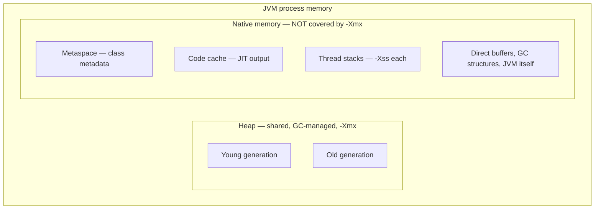
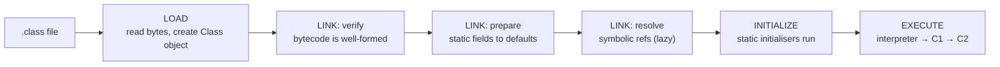
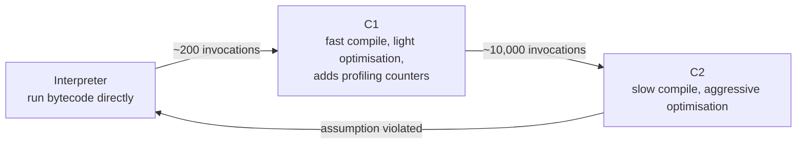
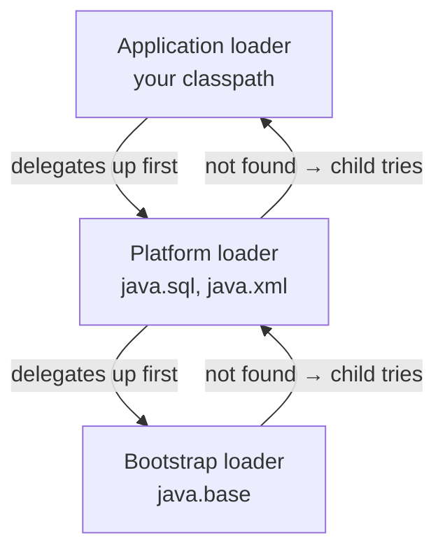

# JVM Runtime Model

<!-- video:start -->
<figure class="pb-video">
<video controls playsinline preload="metadata">
<source src="../../videos/ch02.mp4" type="video/mp4">
<track kind="subtitles" srclang="en" label="English" src="../../videos/ch02.vtt">
</video>
<figcaption>Video walkthrough · 7:28 · subtitles via CC · <a href="../../videos/ch02.mp4" download>Download MP4</a></figcaption>
</figure>
<!-- video:end -->

## 1. Purpose & Audience

**Band:** L2 Professional · **Prerequisites:** [The JDK Landscape](01-jdk-landscape.md)

Most Java developers can work for years without knowing what the JVM does with their code. Then a service dies with an `OutOfMemoryError` naming a memory region they have never heard of, or a container gets killed while the heap graph looks healthy, or a benchmark runs ten times slower for its first thousand iterations — and the model becomes urgent.

This chapter answers three questions:

1. **Where does memory actually go** — and why is `-Xmx` not a limit on the process?
2. **How does a class get loaded**, and what distinguishes the two errors that look identical?
3. **What does the JIT do**, and why is the first run always the slow one?

Garbage collection has its own chapter ([Chapter 34](../05-runtime/34-garbage-collection.md)); this one covers the structure GC operates within.

---

## 2. The Problem

Three failures with the same root cause — no model of the runtime.

**The container is killed while the heap looks fine:**

```text
State: Terminated
Reason: OOMKilled
Exit Code: 137
```

`-Xmx2g` on a 2 GB container. The heap never exceeded 1.8 GB. The kernel killed it anyway, because the heap is not the process.

**Two errors that look the same and are not:**

```text
java.lang.ClassNotFoundException: com.vendor.DispatchClient
java.lang.NoClassDefFoundError: com/vendor/DispatchClient
```

**A benchmark that lies:**

```text
iteration 1:     1,240 ms
iteration 100:      95 ms
iteration 10,000:    8 ms
```

Same code, same data, 150× faster. Nothing changed except how many times the JVM had watched it run.

---

## 3. Mental Model

### 3.1 The runtime data areas



| Region | Holds | Sized by | Failure |
|---|---|---|---|
| **Heap** | All objects and arrays | `-Xmx` | `OutOfMemoryError: Java heap space` |
| **Metaspace** | Class metadata | `-XX:MaxMetaspaceSize` (unbounded by default) | `OutOfMemoryError: Metaspace` |
| **Thread stacks** | Frames, locals, return addresses | `-Xss` per thread | `StackOverflowError` |
| **Code cache** | JIT-compiled machine code | `-XX:ReservedCodeCacheSize` | Compilation disabled, silent slowdown |
| **Direct memory** | `ByteBuffer.allocateDirect`, FFM | `-XX:MaxDirectMemorySize` | `OutOfMemoryError: Direct buffer memory` |

**The single most useful fact in this chapter:** `-Xmx` bounds the heap, not the process. Total footprint is heap + metaspace + code cache + (threads × stack size) + direct buffers + the JVM's own structures. A 2 GB container running `-Xmx2g` will be killed, and the heap graph will look innocent.

### 3.2 Class loading and execution



Two properties matter in practice. **Initialisation is lazy** — a class's static initialiser runs on first active use, not at startup. And **verification is real work**, which is a meaningful share of a large application's startup time.

---

## 4. Core Reference

### 4.1 Essential flags

| Flag | Purpose |
|---|---|
| `-Xmx` / `-Xms` | Maximum / initial heap |
| `-XX:MaxMetaspaceSize` | Cap metaspace — **unbounded by default** |
| `-Xss` | Per-thread stack size (default ~1 MB) |
| `-XX:ReservedCodeCacheSize` | JIT code cache |
| `-XX:MaxDirectMemorySize` | Direct buffer ceiling |
| `-XX:+UseContainerSupport` | Respect cgroup limits — **on by default since 10** |
| `-XX:MaxRAMPercentage` | Heap as a share of container memory |
| `-XX:+HeapDumpOnOutOfMemoryError` | Dump on OOM |
| `-XX:NativeMemoryTracking=summary` | Enable NMT |

### 4.2 Diagnostics

| Command | Shows |
|---|---|
| `jcmd <pid> VM.flags` | Effective flags, including ergonomic defaults |
| `jcmd <pid> GC.heap_info` | Heap usage by generation |
| `jcmd <pid> VM.native_memory summary` | Memory by category (needs NMT) |
| `jcmd <pid> Thread.dump_to_file -format=json` | All threads, virtual included |
| `jcmd <pid> GC.class_histogram` | Live objects by class |
| `jcmd <pid> VM.classloader_stats` | Loaders and class counts |
| `-XX:+PrintCompilation` | JIT compilation events |

`jcmd` supersedes `jstat`, `jmap`, and `jstack`. Learn it.

### 4.3 The two class-loading errors

| | `ClassNotFoundException` | `NoClassDefFoundError` |
|---|---|---|
| Type | Checked exception | Error |
| Raised by | `Class.forName`, `loadClass` | The JVM during linking |
| Means | Explicit lookup failed | Class was present at compile time, absent or unloadable now |
| Typical cause | Wrong name, missing driver JAR | Missing transitive dependency, **or a failed static initialiser** |

The second cause of `NoClassDefFoundError` is the one that wastes hours: if a class's static initialiser throws, the class is marked erroneous, and **every subsequent reference reports `NoClassDefFoundError`** — not the original exception. The real failure appears only in the first occurrence, usually much earlier in the log.

---

## 5. Worked Examples

### 5.1 Sizing a container

```bash
# WRONG — heap equals the container limit
docker run -m 2g eclipse-temurin:25-jre java -Xmx2g -jar orders.jar
```

The process needs more than the heap:

| Component | Typical |
|---|---|
| Heap | 2048 MB |
| Metaspace | 100–250 MB |
| Code cache | 50–250 MB |
| 200 threads × 1 MB | 200 MB |
| Direct buffers | Varies |
| JVM internals, GC structures | 100–200 MB |
| **Total** | **~2.6 GB in a 2 GB container** |

```bash
# BETTER — let the JVM size itself against the cgroup limit
docker run -m 2g eclipse-temurin:25-jre \
  java -XX:MaxRAMPercentage=70 -jar orders.jar
```

Container support is on by default since Java 10, so the JVM reads the cgroup limit rather than the host's memory. `MaxRAMPercentage` then leaves headroom for everything outside the heap. Start around 70% and tune with measurements.

### 5.2 Diagnosing native memory

```bash
java -XX:NativeMemoryTracking=summary -jar orders.jar
jcmd <pid> VM.native_memory summary
```

```text
Total: reserved=3251MB, committed=2104MB
-                 Java Heap (reserved=2048MB, committed=1536MB)
-                     Class (reserved=1076MB, committed=196MB)
-                    Thread (reserved=206MB, committed=206MB)
-                      Code (reserved=248MB, committed=92MB)
-                        GC (reserved=84MB, committed=84MB)
```

The gap between heap and total is what container sizing has to account for. **Committed** is what is actually backed by memory; **reserved** is address space and is usually much larger and harmless.

### 5.3 Tiered compilation in action



That last arrow is **deoptimisation** and it is the part people miss. C2 optimises using assumptions drawn from profiling — that a call site only ever sees one implementation, that a branch is never taken, that a value is never null. If an assumption is later violated, the compiled code is discarded and execution falls back to the interpreter.

This explains the §2 benchmark: the first thousand iterations run interpreted or C1-compiled while profile data accumulates, and only then does C2 produce the fast version. **Any benchmark without a warmup phase measures the wrong thing** — which is why JMH exists.

### 5.4 The static initialiser trap

```java title="ConfigHolder.java"
public final class ConfigHolder {
    private static final Config CONFIG = loadOrThrow();     // throws if a file is missing

    private static Config loadOrThrow() {
        try {
            return Config.parse(Files.readString(Path.of("/etc/orders/config.yaml")));
        } catch (IOException e) {
            throw new UncheckedIOException(e);   // checked exceptions cannot escape a static initialiser
        }
    }
}
```

```text
# First use — the real error
java.lang.ExceptionInInitializerError
Caused by: java.io.UncheckedIOException: java.nio.file.NoSuchFileException: /etc/orders/config.yaml
Caused by: java.nio.file.NoSuchFileException: /etc/orders/config.yaml

# Every use after that — useless
java.lang.NoClassDefFoundError: Could not initialize class ConfigHolder
```

The class is marked erroneous permanently, and subsequent references report only that it could not be initialised. When you see `Could not initialize class X`, **search backwards in the log for the first `ExceptionInInitializerError`** — that is where the cause is.

### 5.5 Class loader delegation



Parent-first delegation is why you cannot shadow `java.lang.String` with your own — the bootstrap loader finds the real one first. It is also why two copies of a library on the classpath resolve to whichever the application loader finds first, which is the classic JAR-hell diagnosis.

A class's identity is **its name plus its loader**. The same bytes loaded by two loaders produce two distinct, incompatible classes:

```text
java.lang.ClassCastException: class com.grocery.Order cannot be cast to
class com.grocery.Order (com.grocery.Order is in unnamed module of loader
'app'; com.grocery.Order is in unnamed module of loader 'plugin')
```

Baffling until you know the rule; obvious after.

### 5.6 Object layout

```java title="Layout.java"
class CartLine {
    private final Sku sku;        // 4 bytes with compressed oops
    private final int quantity;   // 4
    private final long priceInPaise; // 8
}
```

| Component | Bytes (64-bit, compressed oops) |
|---|---|
| Object header | 12 (**8 on Java 25 with compact headers**) |
| `sku` reference | 4 |
| `quantity` | 4 |
| `priceInPaise` | 8 |
| Padding to 8-byte alignment | 0 |
| **Total** | **28 → 32 with alignment** |

Two things shape this. **Compressed oops** store references as 32-bit offsets rather than 64-bit pointers, which works up to about a 32 GB heap and is why heaps above that threshold consume disproportionately more memory. And **compact object headers** (JEP 519, final in Java 25) cut the header from 12 bytes to 8, which is a meaningful reduction on object-heavy heaps — see [Chapter 35](../05-runtime/35-memory-footprint.md).

---

## 6. Internals

### 6.1 Metaspace

Before Java 8, class metadata lived in PermGen, a fixed region inside the heap. Java 8 replaced it with metaspace, allocated from **native memory** and **unbounded by default**.

That default is a trap in one specific scenario: applications that load classes dynamically without unloading them — repeated hot redeploys, heavy runtime proxy generation, dynamic script compilation — grow metaspace until the container or the machine runs out.

```bash
-XX:MaxMetaspaceSize=256m          # fail fast rather than consuming the host
```

Metaspace is reclaimed when a **class loader** becomes unreachable, not when individual classes do. A single lingering reference to one class keeps its entire loader, and therefore every class that loader defined, alive — which is exactly the redeploy leak described in [Chapter 33](../04-concurrency/33-scoped-values.md), where a `ThreadLocal` on a pooled thread pins an old application's loader.

### 6.2 Where the JIT spends its effort

| Optimisation | Effect |
|---|---|
| **Inlining** | Copies a small method's body into the caller — the enabling optimisation for everything else |
| **Escape analysis** | Proves an object never leaves the method; may stack-allocate or scalarise it |
| **Loop unrolling** | Reduces branch overhead |
| **Dead code elimination** | Removes provably unreachable code |
| **Devirtualisation** | Turns a virtual call into a direct one when profiling shows a single implementation |

Escape analysis is the one worth understanding, because it quietly invalidates a lot of folklore. An `Optional` or a small wrapper created and consumed within one method frequently costs nothing — the JIT never allocates it. This is why "avoid allocation" advice needs measurement rather than assumption.

Devirtualisation explains a subtler effect: a call site that has only ever seen one implementation gets compiled to a direct call with a guard. Introducing a second implementation later invalidates that assumption, triggers deoptimisation, and the code is recompiled less aggressively.

### 6.3 Reading `-XX:+PrintCompilation`

```text
  1234  856 %     4  com.grocery.PricingEngine::evaluate @ 12 (86 bytes)
  1240  857       3  com.grocery.Money::plus (15 bytes)
  1890  856 %     4  com.grocery.PricingEngine::evaluate @ -2 (86 bytes)   made not entrant
```

| Column | Meaning |
|---|---|
| `1234` | Milliseconds since start |
| `856` | Compilation id |
| `%` | On-stack replacement — a long-running loop compiled while executing |
| `4` | Tier: 0 interpreted, 1–3 C1, 4 C2 |
| `made not entrant` | **Deoptimised** — an assumption was violated |

Repeated `made not entrant` on the same method is a real signal: the method is being optimised and deoptimised in a cycle, usually because a call site is megamorphic or a rare branch keeps firing.

### 6.4 Stack frames and `StackOverflowError`

Each thread has its own stack, sized by `-Xss`, holding one frame per active call — locals, operand stack, and the return address. Exceeding it throws `StackOverflowError`.

The cause is nearly always unbounded recursion rather than a stack that is too small, and raising `-Xss` usually postpones the failure rather than fixing it. Two cases where raising it is legitimate: deeply recursive parsers over large inputs, and frameworks that generate long proxy chains.

Virtual threads change the picture entirely — their stacks live on the heap and grow on demand, so `-Xss` does not apply. See [Chapter 31](../04-concurrency/31-virtual-threads.md).

### 6.5 The code cache

JIT-compiled machine code lives in the code cache, a fixed native region. When it fills:

```text
CodeCache is full. Compiler has been disabled.
Try increasing the code cache size using -XX:ReservedCodeCacheSize=
```

Everything then runs interpreted. The application does not crash — it gets several times slower, silently, and the message appears once in the log where nobody is looking.

This is rare but real in very large applications, especially with heavy framework proxy generation. It is worth knowing precisely because the symptom (gradual slowdown, no errors) points nowhere useful on its own.

---

## 7. Production Patterns & Anti-Patterns

### Do this

- **Size containers for the whole process**, not the heap. Use `-XX:MaxRAMPercentage` rather than a fixed `-Xmx`.
- **Cap metaspace** with `-XX:MaxMetaspaceSize` so a class-loading leak fails fast.
- **Enable `-XX:+HeapDumpOnOutOfMemoryError`** with a path on a writable volume.
- **Turn on NMT** (`-XX:NativeMemoryTracking=summary`) in any environment where footprint matters.
- **Warm up before measuring.** Use JMH for microbenchmarks; ignore the first interval of any production metric after deploy.
- **Use `jcmd`** as the single diagnostic entry point.
- **Read the first `ExceptionInInitializerError`**, not the fiftieth `NoClassDefFoundError`.
- **Keep heaps under ~32 GB** where possible, to retain compressed oops.

### Never do this

- **Never set `-Xmx` equal to the container limit.** The process needs metaspace, stacks, code cache, and direct buffers on top.
- **Never leave metaspace unbounded** in an application that loads classes dynamically.
- **Never benchmark without warmup.** The first thousand iterations measure the interpreter.
- **Never raise `-Xss` to fix a `StackOverflowError`** without first confirming the recursion is bounded.
- **Never assume `NoClassDefFoundError` means a missing JAR.** It equally means a static initialiser failed.
- **Never ignore "CodeCache is full"** — the application is now several times slower with no other symptom.
- **Never do heavy work in a static initialiser.** Failures poison the class permanently and produce useless errors thereafter.
- **Never assume an allocation costs something** without measuring — escape analysis may remove it entirely.

---

## 8. Version Evolution (Java 8 → 26)

| Version | What changed | Impact |
|---|---|---|
| **8** | PermGen replaced by metaspace | Class metadata moves to native memory, unbounded by default |
| **9** | Compact strings; G1 becomes default (in 9); modular runtime | Lower string footprint |
| **10** | **Container awareness on by default**; `MaxRAMPercentage` | Heaps size against cgroup limits, not host memory |
| **11** | Flight Recorder open-sourced; ZGC and Epsilon experimental | Production profiling without a licence |
| **15** | ZGC and Shenandoah production-ready | Low-pause collectors become viable |
| **17** | Strong encapsulation enforced; biased locking removed | Locking cost profile changes |
| **21** | Virtual threads — heap-allocated stacks; generational ZGC | `-Xss` no longer governs most threads |
| **24** | AOT class loading and linking; `synchronized` no longer pins | Faster startup; virtual-thread caveat removed |
| **25** | **Compact object headers final (JEP 519)**; AOT profiling | 12-byte headers become 8 |
| **26** | Ongoing Leyden work | See [Ch 36](../05-runtime/36-startup-and-leyden.md) |

### Migration note

The most common runtime surprise when moving from Java 8 to a modern release is **container memory**. On Java 8 the JVM read the host's memory and sized the heap against it, so containerised services were routinely misconfigured with explicit `-Xmx` values to compensate. From Java 10 the JVM reads the cgroup limit, which means those hand-tuned flags may now be wrong in the other direction. Re-derive them from `MaxRAMPercentage` rather than carrying them forward.

The second is **metaspace versus PermGen**. Flags such as `-XX:MaxPermSize` are ignored with a warning, and the unbounded default means a leak that used to fail with a clear `PermGen space` error now consumes the container instead.

---

## 9. Interview Questions

### L1 — Foundations

**Q1. What are the main memory areas of the JVM?** ⭐ *high frequency*
The heap holds all objects and arrays and is what garbage collection manages and `-Xmx` bounds. Outside it, in native memory, sit metaspace for class metadata, one stack per thread for frames and locals, the code cache for JIT-compiled code, and direct buffers. The important consequence is that `-Xmx` bounds the heap, not the process.

**Q2. What is the difference between `ClassNotFoundException` and `NoClassDefFoundError`?**
`ClassNotFoundException` is a checked exception thrown when code explicitly asks for a class by name — `Class.forName` or `loadClass` — and it is not found. `NoClassDefFoundError` is thrown by the JVM when a class was present at compile time but cannot be loaded now, either because it is missing at runtime or because its static initialiser previously failed.

**Q3. Why is Java code slow on first execution?**
Because it starts interpreted. The JVM runs bytecode directly while collecting profile data, compiles hot methods with C1 after a few hundred invocations, and only reaches the aggressively optimised C2 tier after thousands. That warmup is why a benchmark without a warmup phase measures the interpreter rather than the code.

### L2 — Professional

**Q4. Your container is OOMKilled but the heap looks fine. What is happening?** ⭐ *high frequency*
The process is larger than the heap. Metaspace, thread stacks, the code cache, direct buffers, and the JVM's own structures all live in native memory outside `-Xmx`, and together they commonly add several hundred megabytes. Setting `-Xmx` equal to the container limit guarantees the kernel kills the process. Use `-XX:MaxRAMPercentage` — around 70% as a starting point — so the JVM sizes the heap against the cgroup limit with headroom.

**Q5. What is deoptimisation?**
When C2 compiles a method it uses assumptions from profiling — that a call site sees one implementation, that a branch is never taken. If an assumption is later violated, the compiled code is discarded and execution falls back to the interpreter, after which the method may be recompiled less aggressively. It shows as `made not entrant` in `-XX:+PrintCompilation`, and a repeating cycle on one method is a real performance signal.

**Q6. Why can two classes with the same name be incompatible?**
Because a class's runtime identity is its fully-qualified name **plus its defining class loader**. The same bytes loaded by two loaders produce two distinct classes, and casting between them throws `ClassCastException` with a message that names the same type twice. It appears in plugin systems, application servers, and anywhere child-first loading is used.

### L3 — Enterprise

**Q7. How do you diagnose a memory problem that is not in the heap?**
Enable Native Memory Tracking with `-XX:NativeMemoryTracking=summary` and read it with `jcmd <pid> VM.native_memory summary`, which breaks the footprint down by category — heap, class, thread, code, GC. The gap between total committed memory and the heap is what container sizing must account for, and the category that is growing tells you what to investigate: a rising class figure points at a class-loading leak, a rising thread figure at thread count or stack size.

**Q8. Why can metaspace grow without bound, and when does it matter?**
Metaspace is allocated from native memory and has no default limit, so class metadata accumulates until the machine or container runs out. It matters wherever classes are loaded dynamically without their loaders becoming unreachable — repeated hot redeploys, heavy proxy generation, dynamic script compilation. Metaspace is reclaimed per class loader, not per class, so one lingering reference keeps every class that loader defined. Setting `-XX:MaxMetaspaceSize` turns a slow container death into a fast, diagnosable failure.

**Q9. What is escape analysis and why does it change how you reason about allocation?**
It is a JIT optimisation that proves an object never escapes the method that created it, allowing the JVM to allocate it on the stack or break it into its fields entirely. The practical effect is that short-lived wrappers — an `Optional`, a small record, an iterator — frequently cost nothing at all. It is why allocation-avoidance advice needs measurement: the code you contorted to avoid an object may have been free already, and the contortion may have prevented the optimisation.

### L4 — Architect

**Q10. How would you approach sizing JVM services across a fleet?**
Set heap as a percentage of the container limit rather than an absolute value, so one configuration scales across instance sizes and the JVM accounts for the cgroup itself. Then bound the unbounded regions — metaspace especially — so leaks fail fast and diagnosably rather than manifesting as OOMKills with no Java-level evidence. Enable NMT and heap dumps everywhere, because the cost is negligible and the alternative is reproducing a production memory problem locally. Finally, treat the gap between heap and total footprint as a measured quantity per service rather than a constant, since thread count and direct buffer use vary enormously between a request-serving API and a batch processor.

**Q11. A service degrades gradually over hours with no errors and no heap growth. Where do you look?**
The absence of errors and heap growth rules out the common causes, so look at the layers that fail silently. A full code cache disables JIT compilation entirely and the application simply runs interpreted — several times slower, with one log line at the moment it happened. Repeated deoptimisation is the subtler version, visible in `PrintCompilation` as methods cycling to `made not entrant`. Beyond the JVM, thread count growth, connection pool exhaustion, and a growing non-heap footprint all produce the same shape, which is why NMT and thread dumps taken minutes apart are the first two things to collect.

**Q12. Why does heap size have a cliff around 32 GB?**
Because compressed oops store object references as 32-bit offsets rather than 64-bit pointers, roughly halving reference memory, and that encoding only works while the heap fits within the addressable range — around 32 GB. Above it the JVM falls back to full 64-bit references, so a heap just over the threshold can hold *fewer* objects than one just under. The architectural consequence is that scaling past that point usually means more JVMs rather than a bigger one, which is a deployment decision rather than a flag.

---

!!! abstract "Cheat Sheet"
    **`-Xmx` bounds the heap, not the process** — metaspace, stacks, code cache, direct buffers are extra

    **Containers:** `-XX:MaxRAMPercentage=70`, not a fixed `-Xmx`; container support on by default since 10

    **Metaspace is native and unbounded by default** — cap it; reclaimed per class loader, not per class

    **Class loading:** load → verify → prepare → resolve → initialise; **initialisation is lazy**

    **`ClassNotFoundException`** = explicit lookup failed · **`NoClassDefFoundError`** = missing at runtime **or a failed static initialiser**

    **Find the first `ExceptionInInitializerError`** — later errors say nothing

    **Class identity = name + loader** — same bytes, two loaders, `ClassCastException`

    **Tiers:** interpreter → C1 (~200 calls) → C2 (~10,000) → deoptimise on violated assumption

    **`made not entrant`** = deoptimised; a repeating cycle is a real signal

    **Escape analysis may make an allocation free** — measure before avoiding one

    **Code cache full = JIT disabled** — silent, severe slowdown, one log line

    **Compressed oops end near 32 GB** — a bigger heap can hold fewer objects

    **`jcmd` for everything** — `VM.flags`, `VM.native_memory`, `GC.heap_info`, `Thread.dump_to_file`
