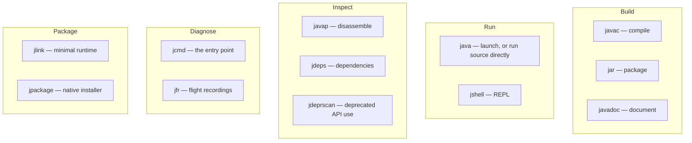
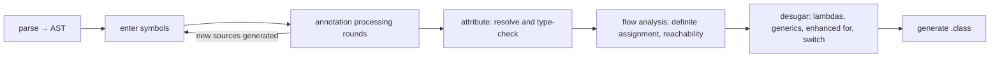

# The Toolchain

## 1. Purpose & Audience

**Band:** L2 Professional · **Prerequisites:** [The JDK Landscape](01-jdk-landscape.md)

Most Java developers interact with the JDK through an IDE and a build tool, and never directly. That is fine until something goes wrong somewhere the IDE is not — a container, a CI runner, a production host — and the only things available are the tools that shipped with the JDK.

This chapter answers three questions:

1. **What is in the `bin` directory**, and which of it will you actually use?
2. **How do you inspect what the compiler produced**, rather than guessing?
3. **How do you run Java without a build tool** — for scripts, spikes, and diagnosis?

Diagnostics and memory tooling are in [Chapter 02](02-jvm-runtime-model.md); profiling is [Chapter 37](../05-runtime/37-profiling-jfr.md).

---

## 2. The Problem

Three situations where the IDE is not available.

**A dependency is behaving unexpectedly in production.** You need to know which version is actually loaded, what the manifest says, and whether it is a multi-release JAR resolving differently on this JDK.

**A colleague asks what a lambda compiles to.** You believe it is not an anonymous class, but you have never looked.

**You want to test a one-line hypothesis** about `Collectors.teeing` — and the options are a scratch project, a JUnit test nobody will keep, or something better.

Each has a JDK tool that answers it in seconds, and each is routinely solved the slow way because the tool is unfamiliar.

---

## 3. Mental Model



The grouping that matters: **build and run** you already use through Maven or Gradle; **inspect and diagnose** are the ones worth learning deliberately, because they answer questions nothing else can.

---

## 4. Core Reference

### 4.1 `javac`

| Option | Purpose |
|---|---|
| `--release N` | Compile for Java N — language, bytecode, **and API** |
| `-d dir` | Output directory |
| `-cp` / `--class-path` | Classpath |
| `--module-path` | Module path |
| `-Xlint:all` | Enable all warnings |
| `-Werror` | Warnings become errors |
| `-parameters` | **Retain parameter names in bytecode** |
| `-g` | Full debug information |
| `--enable-preview` | Preview features (requires `--release` at the current version) |
| `-proc:full` / `-proc:none` | Annotation processing on / off |
| `@argfile` | Read options from a file |

### 4.2 `java`

| Form | Purpose |
|---|---|
| `java -cp app.jar com.grocery.Main` | Classic launch |
| `java -jar app.jar` | Main class from the manifest |
| `java Hello.java` | **Run a single source file** (11+) |
| `java Main.java Helper.java` | Multiple source files (22+) |
| `java --module-path mods -m com.grocery/com.grocery.Main` | Modular launch |
| `java @argfile -jar app.jar` | Options from a file |
| `java --enable-preview -jar app.jar` | Preview at runtime |

### 4.3 Inspection

| Tool | Answers |
|---|---|
| `javap -c -p Class` | What did the compiler produce? |
| `javap -v Class` | Constant pool, attributes, class file version |
| `jdeps --print-module-deps app.jar` | Which JDK modules does this need? |
| `jdeps -jdkinternals app.jar` | What internal APIs does it touch? |
| `jdeprscan --release 25 app.jar` | What deprecated APIs does it use? |
| `jar --describe-module --file app.jar` | Module descriptor or automatic name |
| `jar tf app.jar` | Contents |

### 4.4 Environment variables

| Variable | Applies to | Precedence |
|---|---|---|
| `JDK_JAVA_OPTIONS` | The `java` launcher only (9+) | Prepended before command-line args |
| `JAVA_TOOL_OPTIONS` | **Every** JVM tool | Lowest |
| `_JAVA_OPTIONS` | Every JVM (non-standard) | Highest — overrides the command line |

`JAVA_TOOL_OPTIONS` is the one to use in containers: it applies to the application and is visible in the log at startup. `_JAVA_OPTIONS` overriding explicit command-line flags is the cause of "my flag is being ignored" — check for it before anything else.

---

## 5. Worked Examples

### 5.1 `jshell` for exploration

```bash
$ jshell
|  Welcome to JShell -- Version 25
jshell> var lines = List.of("MILK-1L", "RICE-5KG", "ATTA-10KG")
lines ==> [MILK-1L, RICE-5KG, ATTA-10KG]

jshell> lines.stream().collect(Collectors.teeing(
   ...>     Collectors.counting(),
   ...>     Collectors.joining(", "),
   ...>     (count, joined) -> count + ": " + joined))
$2 ==> "3: MILK-1L, RICE-5KG, ATTA-10KG"
```

Useful commands:

| Command | Does |
|---|---|
| `/list` | Show snippets entered |
| `/vars`, `/methods`, `/types` | Show what is defined |
| `/save session.jsh` | Save the session |
| `/open session.jsh` | Replay a file |
| `/env --class-path app.jar` | Add your own classes |
| `/exit` | Quit |

`/env --class-path` is what makes it a production tool rather than a toy — you can load your application's JAR and interrogate real classes.

### 5.2 `javap`: what a lambda actually compiles to

```java title="LambdaExample.java"
public class LambdaExample {
    public static void main(String[] args) {
        Runnable r = () -> System.out.println("dispatch");
        r.run();
    }
}
```

```bash
javac LambdaExample.java && javap -c -p LambdaExample
```

```text
public static void main(java.lang.String[]);
    Code:
       0: invokedynamic #7,  0    // InvokeDynamic #0:run:()Ljava/lang/Runnable;
       5: astore_1
       ...

private static void lambda$main$0();     // the body, as a private static method
```

Two things this proves, which [Chapter 06](../02-language/06-lambdas-functional-interfaces.md) asserts: the body became a **private static method**, and the call site is an **`invokedynamic`** rather than a `new`. No `LambdaExample$1.class` was generated.

### 5.3 `javap`: string concatenation

```java title="Concat.java"
String message = "Order " + id + " total " + total;
```

=== "Java 8"
    ```text
    0: new           #2   // class java/lang/StringBuilder
    3: dup
    4: invokespecial #3   // StringBuilder."<init>"
    ...append, append, append, toString
    ```

=== "Java 9+"
    ```text
    0: invokedynamic #7,  0   // makeConcatWithConstants
    ```

Java 9 replaced compiler-generated `StringBuilder` chains with an `invokedynamic` call bootstrapped by `StringConcatFactory`, which builds an optimised concatenation strategy at runtime. This is why "always use `StringBuilder` for concatenation" is outdated advice for simple expressions — though it still holds inside loops, where each iteration is a separate concatenation.

### 5.4 `javap`: what a record generates

```bash
javap -p Money.class
```

```text
public final class Money extends java.lang.Record {
  private final java.math.BigDecimal amount;
  private final java.util.Currency currency;
  public Money(java.math.BigDecimal, java.util.Currency);
  public final java.lang.String toString();
  public final int hashCode();
  public final boolean equals(java.lang.Object);
  public java.math.BigDecimal amount();
  public java.util.Currency currency();
}
```

`javap -v` shows that `equals`, `hashCode`, and `toString` are `invokedynamic` call sites bootstrapped by `ObjectMethods`, plus a `Record` attribute listing the components — the mechanism described in [Chapter 12](../02-language/12-java-14-to-17.md).

### 5.5 Single-file and multi-file source launch

```java title="Reconcile.java"
void main() {
    var path = Path.of("orders.csv");
    var count = Files.readAllLines(path).size() - 1;
    IO.println("Rows: " + count);
}
```

```bash
java Reconcile.java                    # compiles in memory, runs, leaves no artifacts
java Reconcile.java Helper.java        # multiple files (Java 22+)
```

For operational scripts this replaces a throwaway Maven module. Combined with compact source files ([Chapter 14](../02-language/14-java-21-to-26.md)) it is a genuine alternative to a shell script — with types.

Add a shebang for an executable script:

```bash
#!/usr/bin/java --source 25
void main() { IO.println("running"); }
```

### 5.6 `jdeps` before an upgrade

```bash
# Which JDK modules does this actually need?
jdeps --print-module-deps --ignore-missing-deps orders.jar
# java.base,java.sql,java.net.http

# What internal APIs does it touch? Run this BEFORE upgrading from 8.
jdeps -jdkinternals orders.jar
```

```text
orders.jar -> JDK removed internal API
   com.grocery.UnsafeCache -> sun.misc.Unsafe    JDK internal API (JDK removed internal API)
Warning: <replacement suggested>
   sun.misc.Unsafe -> Use java.lang.invoke.VarHandle @since 9
```

`-jdkinternals` names both the problem and the supported replacement. Running it is the cheapest first step of any Java 8 migration — see [Chapter 05](05-migration-strategy.md).

### 5.7 `-parameters`, and why frameworks need it

```java title="ParameterNames.java"
Method m = OrderService.class.getMethod("confirm", Cart.class, Customer.class);
System.out.println(m.getParameters()[0].getName());
```

```text
arg0          # without -parameters
cart          # with -parameters
```

By default `javac` discards parameter names. Anything binding by name — JSON deserialisation into records and constructors, dependency injection, request parameter binding, validation messages — needs them retained.

```xml title="pom.xml"
<maven.compiler.parameters>true</maven.compiler.parameters>
```

Most framework starters enable it, which is why it works until you build something without one and hit a baffling "cannot determine parameter name" error.

### 5.8 Argument files

```text title="jvm.args"
-Xms512m
-Xmx2g
-XX:MaxMetaspaceSize=256m
-XX:+HeapDumpOnOutOfMemoryError
-XX:HeapDumpPath=/var/log/orders/
```

```bash
java @jvm.args -jar orders.jar
```

Reviewable in version control, diffable, and it avoids the unreadable single-line command in a Dockerfile or systemd unit.

---

## 6. Internals

### 6.1 What `javac` does



Two stages are worth knowing.

**Annotation processing runs in rounds** before type-checking is complete, and generated sources feed back in. That is why a processor can generate code that the same compilation then uses, and why processor errors appear before ordinary compile errors.

**Desugaring** is where most of the "what does this compile to" answers live — lambdas become `invokedynamic`, generics are erased, enhanced `for` becomes an iterator loop, and switch patterns become a `typeSwitch` bootstrap.

### 6.2 Annotation processing changed

Historically, `javac` scanned the classpath for annotation processors and ran any it found. That implicit behaviour is being removed:

- **Java 21** warns when annotation processing is enabled implicitly.
- **Later releases** disable it by default — you must pass `-proc:full`, or specify `--processor-path` / `-processor` explicitly.

This is the cause of a specific and confusing failure: a build that worked stops generating code, and the errors are about missing methods rather than about processing. Lombok, MapStruct, and Dagger users hit it on upgrade.

```xml title="pom.xml"
<annotationProcessorPaths>
  <path>
    <groupId>org.mapstruct</groupId>
    <artifactId>mapstruct-processor</artifactId>
    <version>${mapstruct.version}</version>
  </path>
</annotationProcessorPaths>
```

Declaring the processor path explicitly is correct regardless of JDK version — it makes the build reproducible instead of dependent on what happens to be on the classpath.

### 6.3 Multi-release JARs

```text
orders.jar
├── com/grocery/Cache.class              ← the baseline
└── META-INF/versions/
    ├── 11/com/grocery/Cache.class       ← used on Java 11+
    └── 21/com/grocery/Cache.class       ← used on Java 21+
```

The JVM selects the highest versioned directory not exceeding the running release. Libraries use this to exploit newer APIs while keeping an older baseline.

The diagnostic consequence: **the class you are debugging may not be the one you decompiled.** `jar tf` shows the layout, and `javap` on the right versioned entry shows what actually runs.

### 6.4 `-Xlint` categories worth enabling

| Category | Catches |
|---|---|
| `unchecked` | Unsafe generic operations |
| `rawtypes` | Raw type usage |
| `deprecation` | Deprecated API calls |
| `removal` | APIs marked for removal — **the important one before an upgrade** |
| `overrides` | Suspicious overrides |
| `serial` | Missing `serialVersionUID` |
| `this-escape` | `this` escaping a constructor (21+) |

```xml title="pom.xml"
<compilerArgs>
  <arg>-Xlint:all,-processing</arg>
  <arg>-Werror</arg>
</compilerArgs>
```

`-Werror` on a greenfield project keeps warnings at zero. On an existing codebase, enable specific categories first — `removal` and `unchecked` have the highest ratio of real findings to noise.

### 6.5 `jlink` and `jpackage`

```bash
# A runtime with only what the application needs
jlink --add-modules $(jdeps --print-module-deps app.jar) \
      --strip-debug --no-man-pages --compress=2 --output runtime

# A platform installer bundling app + runtime
jpackage --name Orders --input target/ --main-jar orders.jar \
         --runtime-image runtime --type deb
```

`jlink` produces a runtime image; `jpackage` (Java 14+) wraps an application and a runtime into a `.deb`, `.rpm`, `.msi`, `.dmg`, or `.pkg`. For a containerised service `jlink` alone is the useful one — it works on classpath applications and typically takes a 200 MB+ JDK to around 45 MB.

---

## 7. Production Patterns & Anti-Patterns

### Do this

- **Learn `javap -c -p`.** It answers "what does this compile to" definitively, in seconds.
- **Run `jdeps -jdkinternals` before any major upgrade.** It names both the problem and the replacement.
- **Enable `-parameters`** in every build — frameworks that bind by name need it.
- **Enable `-Xlint:removal,unchecked`** at minimum; `-Xlint:all -Werror` on new projects.
- **Declare annotation processor paths explicitly** rather than relying on classpath scanning.
- **Use `@argfile`** for JVM options so they are diffable and reviewable.
- **Use `jshell` with `/env --class-path`** to interrogate your own classes.
- **Use `java Script.java`** for operational scripts instead of a throwaway module.

### Never do this

- **Never assume the IDE compiles the same way as the build.** IDEs use their own compiler settings and frequently differ on lint, preview flags, and processor configuration.
- **Never rely on implicit annotation processing.** It warns on Java 21 and is disabled by default later.
- **Never ship without `-parameters`** if anything binds by parameter name.
- **Never set `_JAVA_OPTIONS`** — it silently overrides explicit command-line flags, and finding it costs hours.
- **Never debug a multi-release JAR** without checking `META-INF/versions` first.
- **Never use `-source`/`-target`** where `--release` will do ([Chapter 01](01-jdk-landscape.md)).
- **Never leave `-g:none` on** for a production build — you lose line numbers in every stack trace to save a little disk.

---

## 8. Version Evolution (Java 8 → 26)

| Version | What changed | Impact |
|---|---|---|
| **8** | `-parameters` added | Frameworks can bind by parameter name |
| **9** | `jshell`, `jlink`, `jdeps` modernised; `JDK_JAVA_OPTIONS`; multi-release JARs; `invokedynamic` string concat | The tooling set most people still do not use |
| **11** | **Single-file source launch**; no separate JRE; `jdeprscan` | `java Hello.java` works |
| **14** | `jpackage` | Native installers |
| **17** | Strong encapsulation enforced | `jdeps -jdkinternals` becomes essential before upgrading |
| **21** | JSON thread dumps via `jcmd`; implicit annotation processing warns; `-Xlint:this-escape` | Virtual-thread-aware diagnostics |
| **22** | **Multi-file source launch** | `java Main.java Helper.java` |
| **25** | Compact source files — `java Script.java` with no class | Scripting becomes genuinely practical |

### Migration note

Before any upgrade from Java 8 or 11, run three commands and read the output:

```bash
jdeps -jdkinternals app.jar              # internal APIs that will break
jdeprscan --release 25 app.jar           # deprecated APIs in use
jdeps --print-module-deps app.jar        # what JDK modules are actually needed
```

This takes minutes and produces a concrete work list, which is a better starting point than upgrading and reading stack traces. It is the first step of [Chapter 05](05-migration-strategy.md).

---

## 9. Interview Questions

### L1 — Foundations

**Q1. What does `javap` do?** ⭐ *high frequency*
It disassembles a class file, showing the declared members and — with `-c` — the bytecode. It is the definitive way to answer what the compiler produced: that a lambda became an `invokedynamic` call site and a private static method, that string concatenation uses `StringConcatFactory` since Java 9, or what members a record generated.

**Q2. How do you run a Java file without compiling it first?**
`java Hello.java` compiles it in memory and runs it, since Java 11. Java 22 extended this to multiple source files, and Java 25's compact source files removed the need for a class declaration entirely. It leaves no `.class` files behind and is intended for scripts and small programs.

**Q3. What is `jshell`?**
The JDK's REPL, added in Java 9. You enter expressions and declarations and see results immediately, without a class or a `main` method. With `/env --class-path` you can load your own JARs and interrogate real application classes, which makes it useful for diagnosis rather than only for learning.

### L2 — Professional

**Q4. What does `-parameters` do and why does it matter?** ⭐ *high frequency*
It retains method parameter names in the class file, which `javac` discards by default. Anything that binds by name at runtime needs them — JSON deserialisation into constructors and records, dependency injection, request parameter binding, validation messages. Without it, reflection reports `arg0`, `arg1`, and frameworks fail with errors that do not obviously point at a compiler flag.

**Q5. What is a multi-release JAR?**
A JAR with version-specific class files under `META-INF/versions/N`, where the JVM selects the highest directory not exceeding the running release. Libraries use it to take advantage of newer APIs while keeping an older baseline. The practical consequence is diagnostic: the class actually executing may not be the one at the root of the JAR.

**Q6. How do you find out which JDK modules an application needs?**
`jdeps --print-module-deps app.jar`, which outputs a comma-separated list suitable for passing straight to `jlink --add-modules`. Adding `--ignore-missing-deps` keeps it usable when third-party dependencies are not all present. This is the standard first step in building a minimal runtime image.

### L3 — Enterprise

**Q7. A build stopped generating code after a JDK upgrade. What changed?**
Implicit annotation processing. `javac` historically scanned the classpath for processors and ran whatever it found; Java 21 began warning about it and later releases disable it by default, so a processor on the classpath is no longer enough. The fix — and the correct configuration regardless of version — is to declare the processor path explicitly in the build, which also makes the build reproducible rather than dependent on classpath contents.

**Q8. My JVM flag is being ignored. Where do you look first?**
`_JAVA_OPTIONS`, a non-standard environment variable that takes precedence over command-line arguments. `JAVA_TOOL_OPTIONS` applies to every JVM tool with lowest precedence, and `JDK_JAVA_OPTIONS` applies to the `java` launcher and is prepended to the command line. Checking the environment before the command is the fast path, because the JVM logs picked-up values at startup if you know to look.

**Q9. What do you run before a Java 8 to 17 upgrade?**
`jdeps -jdkinternals` to find uses of internal APIs that are now strongly encapsulated, which reports both the offending call and the supported replacement. `jdeprscan --release <target>` to find deprecated APIs still in use. And `jdeps --print-module-deps` to understand which JDK modules the application actually needs, which also reveals dependencies on modules removed in Java 11. Together they turn a migration from an exploratory exercise into a work list.

### L4 — Architect

**Q10. How do you ensure the IDE, the build, and CI compile identically?**
Make the build the single source of truth and have the IDE import it rather than maintain its own settings — compiler release, lint configuration, annotation processor paths, and preview flags all declared in the POM or build script. Then pin the JDK through Maven or Gradle toolchains so the build downloads and uses a declared version instead of inheriting whatever is installed. Anything left to IDE configuration will drift, and the drift surfaces as a build that passes locally and fails in CI, or vice versa.

**Q11. What would you standardise about JDK tooling across an organisation?**
Three things with high return and low cost: `-parameters` and an agreed `-Xlint` set in a shared parent POM or convention plugin, so every project gets them without deciding; explicit annotation processor paths, so builds do not depend on classpath scanning; and argument files for JVM options, so runtime configuration is reviewable in version control rather than buried in a Dockerfile line. Beyond that, make `jdeps` and `jdeprscan` part of the upgrade checklist rather than tools people rediscover each time.

**Q12. When is `jlink` or `jpackage` worth the complexity?**
`jlink` is worth it wherever image size or cold start matters — a container layer dropping from 200 MB to around 45 MB is a real saving across a fleet, and it works on classpath applications without modularising. `jpackage` is worth it only when you distribute to end users and want a native installer, which is a narrow case for server-side work. For a typical containerised service, `jlink` alone collects the benefit, and adding `jpackage` adds a build step that produces something nobody installs.

---

!!! abstract "Cheat Sheet"
    **`javap -c -p`** — what did the compiler actually produce; **`javap -v`** for the constant pool

    **`jshell`** — REPL; `/env --class-path app.jar` to load your own classes

    **`java Hello.java`** (11) · multi-file (22) · no class declaration (25)

    **`jdeps -jdkinternals`** — internal API use, with suggested replacements. Run before any upgrade

    **`jdeprscan --release N`** — deprecated APIs in use

    **`jdeps --print-module-deps`** → feed straight into `jlink --add-modules`

    **`-parameters`** — required by anything binding by parameter name

    **`-Xlint:removal,unchecked`** minimum; `-Xlint:all -Werror` on new projects

    **Declare annotation processor paths** — implicit processing warns on 21, disabled later

    **`@argfile`** for JVM options — diffable, reviewable

    **`_JAVA_OPTIONS` overrides the command line** — check it when a flag is "ignored"

    **Multi-release JARs** — the running class may not be the one at the JAR root
