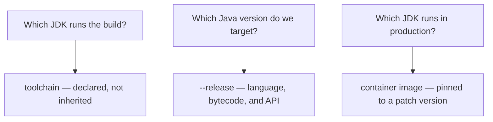
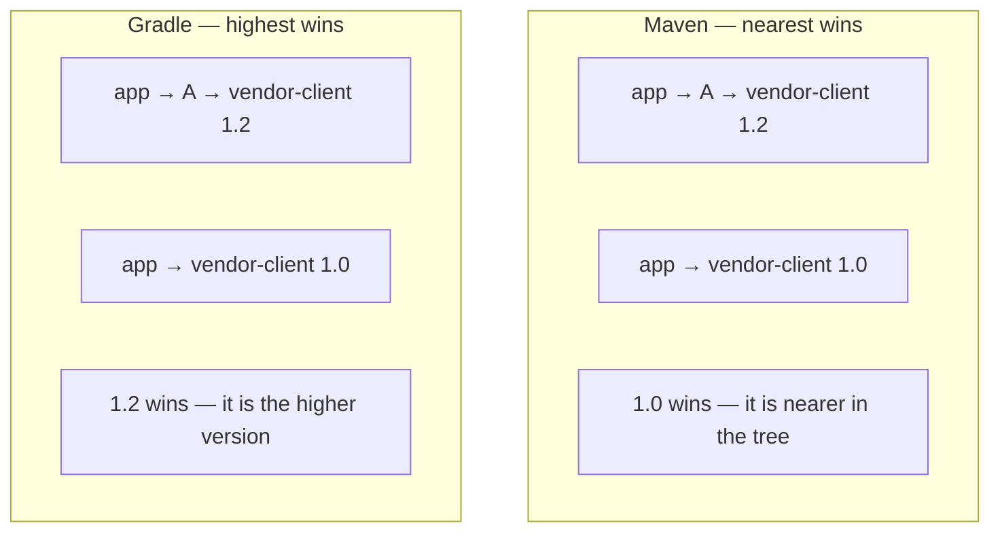
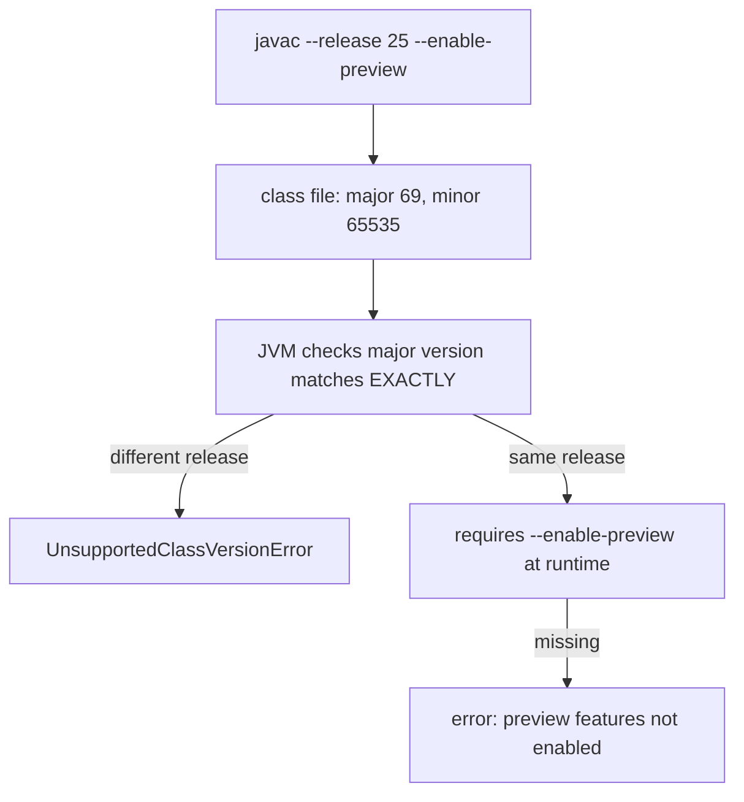

# Builds, Release Flags & Preview Features

<!-- video:start -->
<figure class="pb-video">
<video controls playsinline preload="metadata">
<source src="../../videos/ch04.mp4" type="video/mp4">
<track kind="subtitles" srclang="en" label="English" src="../../videos/ch04.vtt">
</video>
<figcaption>Video walkthrough · 6:20 · subtitles via CC · <a href="../../videos/ch04.mp4" download>Download MP4</a></figcaption>
</figure>
<!-- video:end -->

## 1. Purpose & Audience

**Band:** L2 Professional · **Prerequisites:** [The JDK Landscape](01-jdk-landscape.md), [The Toolchain](03-toolchain.md)

A build is the thing that decides what actually runs. It picks the JDK, resolves every dependency version, sets the compiler flags, and determines whether the artifact produced today is the same as the one produced next month. Most of that happens by default, and most teams discover the defaults only when they cause a problem.

This chapter answers three questions:

1. **How do you pin the JDK and the target version** so the build does not depend on the machine?
2. **How does dependency resolution actually pick a version** — and why do Maven and Gradle disagree?
3. **What does enabling a preview feature commit you to?**

---

## 2. The Problem

Three failures that are all build configuration.

**"Works on my machine."** A developer on Java 25 builds, CI on Java 21 fails. Or worse, both succeed and production fails, because nothing declared a target.

**A transitive dependency changed under you:**

```text
java.lang.NoSuchMethodError: 'void com.vendor.Client.send(com.vendor.Request)'
```

Two libraries each depend on `vendor-client`, at different versions. One of them won, silently, and it was not the one the calling code was compiled against.

**A preview feature escapes:**

```text
java.lang.UnsupportedClassVersionError: Preview features are not enabled
for com/grocery/OrderLoader (class file version 69.65535)
```

Compiled with `--enable-preview`, deployed onto a runtime without the flag — or onto a different JDK release entirely, where the class file will never load.

---

## 3. Mental Model

### 3.1 Three separate version decisions



These are independent and frequently confused. You can run the build on JDK 25, target Java 21 with `--release 21`, and deploy onto a Java 21 runtime. What breaks things is leaving any of the three undeclared and inheriting it from whatever machine is running.

### 3.2 Dependency resolution differs by tool



**Maven picks the version nearest the root** of the dependency tree, with declaration order breaking ties at the same depth. **Gradle picks the highest version** requested by anyone.

Neither is obviously right, and the difference matters when migrating a build between them: the same dependency graph can resolve to different versions, and the failure is a `NoSuchMethodError` at runtime rather than an error at build time.

---

## 4. Core Reference

### 4.1 Declaring the target version

=== "Maven"
    ```xml
    <properties>
      <maven.compiler.release>25</maven.compiler.release>
      <maven.compiler.parameters>true</maven.compiler.parameters>
      <project.build.sourceEncoding>UTF-8</project.build.sourceEncoding>
    </properties>
    ```

=== "Gradle"
    ```groovy
    java {
        toolchain {
            languageVersion = JavaLanguageVersion.of(25)
        }
    }

    tasks.withType(JavaCompile).configureEach {
        options.release = 25
        options.compilerArgs << '-parameters'
        options.encoding = 'UTF-8'
    }
    ```

### 4.2 Toolchains — declaring the build JDK

=== "Maven"
    ```xml
    <plugin>
      <artifactId>maven-toolchains-plugin</artifactId>
      <executions><execution><goals><goal>toolchain</goal></goals></execution></executions>
      <configuration>
        <toolchains><jdk><version>25</version></jdk></toolchains>
      </configuration>
    </plugin>
    ```
    Requires a `~/.m2/toolchains.xml` describing installed JDKs.

=== "Gradle"
    ```groovy
    java {
        toolchain {
            languageVersion = JavaLanguageVersion.of(25)
            vendor = JvmVendorSpec.ADOPTIUM
        }
    }
    ```
    Gradle **downloads** the JDK if it is absent.

Gradle's version is stronger: the build declares its JDK and provisions it, so a fresh machine produces the same result. Maven toolchains require the JDK to already be installed and registered.

### 4.3 Compiler flags worth setting

| Flag | Why |
|---|---|
| `--release N` | Target version, including API — never `-source`/`-target` |
| `-parameters` | Frameworks binding by parameter name |
| `-Xlint:all` | Surface warnings |
| `-Werror` | Warnings become errors (new projects) |
| `-encoding UTF-8` | Platform-independent — **do not rely on the default** |
| `-g` | Full debug info for usable stack traces |

### 4.4 Preview features in a build

Preview requires the flag in **three** places:

=== "Maven"
    ```xml
    <plugin>
      <artifactId>maven-compiler-plugin</artifactId>
      <configuration>
        <release>25</release>
        <compilerArgs><arg>--enable-preview</arg></compilerArgs>
      </configuration>
    </plugin>

    <plugin>
      <artifactId>maven-surefire-plugin</artifactId>
      <configuration>
        <argLine>--enable-preview</argLine>
      </configuration>
    </plugin>
    ```

=== "Runtime"
    ```bash
    java --enable-preview -jar orders.jar
    ```

Forgetting the test configuration is the usual mistake — compilation succeeds and every test fails with "Preview features are not enabled".

### 4.5 Incubator modules

```xml
<compilerArgs>
  <arg>--add-modules</arg><arg>jdk.incubator.vector</arg>
</compilerArgs>
```

Also required at runtime. Incubator modules are less stable than preview features — the API is expected to change — and the Vector API has incubated since Java 16.

---

## 5. Worked Examples

### 5.1 Diagnosing a version conflict

=== "Maven"
    ```bash
    mvn dependency:tree -Dincludes=com.vendor:vendor-client
    ```
    ```text
    [INFO] com.grocery:orders:jar:1.0
    [INFO] +- com.vendor:vendor-client:jar:1.0:compile
    [INFO] \- com.partner:dispatch-sdk:jar:2.3:compile
    [INFO]    \- (com.vendor:vendor-client:jar:1.2:compile - omitted for conflict with 1.0)
    ```

=== "Gradle"
    ```bash
    ./gradlew dependencyInsight --dependency vendor-client
    ```
    ```text
    com.vendor:vendor-client:1.2
       variant "compile" [...]
       Selection reasons:
          - By conflict resolution: between versions 1.2 and 1.0
    ```

Maven chose 1.0 because it is declared directly; Gradle chose 1.2 because it is higher. If `dispatch-sdk` needs a 1.2 method, the Maven build fails at runtime with `NoSuchMethodError`.

The fix is to state the version explicitly:

=== "Maven"
    ```xml
    <dependencyManagement>
      <dependencies>
        <dependency>
          <groupId>com.vendor</groupId>
          <artifactId>vendor-client</artifactId>
          <version>1.2</version>
        </dependency>
      </dependencies>
    </dependencyManagement>
    ```

=== "Gradle"
    ```groovy
    dependencies {
        constraints {
            implementation('com.vendor:vendor-client:1.2') {
                because 'dispatch-sdk 2.3 requires 1.2'
            }
        }
    }
    ```

`dependencyManagement` and `constraints` set the version without adding a dependency, which is the right tool — adding a direct dependency to fix a conflict works by accident and hides the reason.

### 5.2 BOMs

```xml title="pom.xml"
<dependencyManagement>
  <dependencies>
    <dependency>
      <groupId>org.junit</groupId>
      <artifactId>junit-bom</artifactId>
      <version>5.11.4</version>
      <type>pom</type>
      <scope>import</scope>
    </dependency>
  </dependencies>
</dependencyManagement>

<dependencies>
  <dependency>
    <groupId>org.junit.jupiter</groupId>
    <artifactId>junit-jupiter</artifactId>
    <scope>test</scope>
  </dependency>
</dependencies>
```

A BOM declares a set of mutually-compatible versions. Importing one and then omitting versions on individual artifacts is what prevents the classic "Jupiter API 5.11 with engine 5.8" mismatch.

The equivalent in Gradle:

```groovy
dependencies {
    testImplementation platform('org.junit:junit-bom:5.11.4')
    testImplementation 'org.junit.jupiter:junit-jupiter'
}
```

### 5.3 A reproducible build

```xml title="pom.xml"
<properties>
  <project.build.outputTimestamp>2026-01-15T00:00:00Z</project.build.outputTimestamp>
</properties>
```

Reproducibility needs three things:

1. **Pinned plugin versions.** An unpinned plugin resolves to whatever is latest, so the build changes without the source changing.
2. **No version ranges, no `SNAPSHOT` dependencies.** Both mean the artifact depends on when you built it.
3. **A fixed output timestamp**, so JAR entry timestamps do not vary.

Enforce the first two mechanically:

```xml title="maven-enforcer-plugin"
<rules>
  <requireReleaseDeps/>
  <requirePluginVersions/>
  <requireJavaVersion><version>[25,)</version></requireJavaVersion>
  <banDuplicatePomDependencyVersions/>
</rules>
```

### 5.4 CI across JDK versions

```yaml title=".github/workflows/build.yml"
strategy:
  matrix:
    java: [21, 25, 26]      # LTS in production, plus the latest release
steps:
  - uses: actions/setup-java@v4
    with:
      distribution: temurin
      java-version: ${{ matrix.java }}
  - run: ./mvnw --batch-mode verify
```

Running the latest non-LTS release in CI is the cheapest possible early warning. Deprecations, removals, and behaviour changes surface months or years before an LTS upgrade forces them, turning that upgrade from an investigation into a confirmation. Allow the non-LTS job to fail without blocking the build, and treat its failures as a backlog.

### 5.5 Adopting a preview feature safely

```xml title="pom.xml — preview, contained"
<profiles>
  <profile>
    <id>preview</id>
    <build>
      <plugins>
        <plugin>
          <artifactId>maven-compiler-plugin</artifactId>
          <configuration>
            <compilerArgs><arg>--enable-preview</arg></compilerArgs>
          </configuration>
        </plugin>
        <plugin>
          <artifactId>maven-surefire-plugin</artifactId>
          <configuration><argLine>--enable-preview</argLine></configuration>
        </plugin>
      </plugins>
    </build>
  </profile>
</profiles>
```

Putting preview behind a profile means it can be removed in one commit, and that a normal build proves the code still compiles without it.

**The constraint that decides whether you can use preview at all:** a class file compiled with `--enable-preview` carries minor version `65535` and **refuses to load on any JDK other than the exact feature release that produced it**. Not "25 or later" — 25. So:

| Artifact | Preview acceptable? |
|---|---|
| Published library | **Never** — consumers on any other release cannot load it |
| Internal shared library | No — same problem inside the organisation |
| Deployed service | Only with a pinned runtime and a plan to remove it |
| Scripts, spikes, tooling | Yes — rewriting is cheap |

See [Chapter 15](../02-language/15-string-templates-postmortem.md) for what happens when a preview feature is withdrawn.

### 5.6 The wrapper

```bash
./mvnw verify        # not mvn
./gradlew build      # not gradle
```

The wrapper pins the *build tool* version and downloads it if absent, so a fresh clone builds identically without anyone installing anything. Commit it, use it in CI, and make it the documented command — a README that says `mvn verify` invites a different Maven version.

---

## 6. Internals

### 6.1 Maven's nearest-wins, precisely

```text
app
├── vendor-client 1.0          ← depth 1
└── dispatch-sdk 2.3
    └── vendor-client 1.2      ← depth 2
```

Maven picks the shallowest declaration; ties at equal depth are broken by **declaration order in the POM**. That second rule is the surprising one — reordering two dependencies can change which transitive version wins, with no other change.

Neither strategy considers compatibility. Maven can select an older version than a dependency needs, producing `NoSuchMethodError`; Gradle can select a newer one with a breaking change. Explicit version management is the only real answer.

### 6.2 Scopes and configurations

| Maven scope | Compile | Runtime | Transitive | Use |
|---|---|---|---|---|
| `compile` | Yes | Yes | Yes | Default |
| `provided` | Yes | No | No | Supplied by the container |
| `runtime` | No | Yes | Yes | JDBC drivers |
| `test` | Test only | Test only | No | Test libraries |

| Gradle configuration | Visible to consumers | Use |
|---|---|---|
| `api` | **Yes** | Types in your public signatures |
| `implementation` | No | Internal only |
| `compileOnly` | No | Annotations, provided APIs |
| `runtimeOnly` | Runtime only | Drivers |

Gradle's `api`/`implementation` split is the more useful model: it stops a consumer accidentally compiling against your internal dependency, and it speeds up incremental builds because changing an `implementation` dependency does not recompile consumers. Maven has no equivalent — every `compile` dependency leaks.

### 6.3 What `--enable-preview` does to the class file



The minor version `65535` is the preview marker, and the exact-match rule is deliberate: it guarantees nothing compiled against an old preview shape can silently run against a changed one. That is what makes it safe for the JDK to redesign a preview API between releases — as it did repeatedly with `StructuredTaskScope`.

### 6.4 Encoding

```xml
<project.build.sourceEncoding>UTF-8</project.build.sourceEncoding>
```

Before Java 18, `javac` used the platform default encoding, so the same source compiled differently on a machine with a different locale. Java 18 made UTF-8 the default for source files and most APIs (JEP 400), which removed a long-standing class of "works on my machine" bugs involving non-ASCII string literals.

Set it explicitly anyway — it costs one line and documents the assumption for anyone building on an older JDK.

### 6.5 Dependency locking

Transitive dependencies can change without your POM changing, because a direct dependency released a new version that pulls something different. Locking records the fully resolved graph:

=== "Gradle"
    ```groovy
    dependencyLocking { lockAllConfigurations() }
    ```
    ```bash
    ./gradlew dependencies --write-locks
    ```

=== "Maven"
    No built-in equivalent. `mvn dependency:tree` in CI with a committed baseline, or a third-party locking plugin.

Worth it for anything with a compliance or supply-chain requirement, and for any build where "nothing changed but it broke" has happened more than once.

---

## 7. Production Patterns & Anti-Patterns

### Do this

- **Declare the build JDK with a toolchain**, so it is not inherited from the machine.
- **Use `--release`**, never `-source`/`-target`.
- **Commit and use the wrapper** — `./mvnw`, `./gradlew` — everywhere including CI.
- **Pin every plugin version.** An unpinned plugin makes the build non-deterministic.
- **Import BOMs** and omit individual versions for managed artifacts.
- **Fix conflicts with `dependencyManagement` or `constraints`**, with a `because` comment explaining why.
- **Set `-parameters` and `-encoding UTF-8`** in a shared parent or convention plugin.
- **Run the latest non-LTS release in CI** as a non-blocking job.
- **Keep preview behind a build profile** so it can be removed in one commit.

### Never do this

- **Never use version ranges or `SNAPSHOT` dependencies** in anything released. The artifact then depends on when it was built.
- **Never publish a library compiled with `--enable-preview`.** It will not load on any other JDK release.
- **Never forget the test configuration when enabling preview.** Compilation passes, every test fails.
- **Never fix a version conflict by adding a direct dependency.** It works by accident and records no reason.
- **Never let the IDE hold compiler settings the build does not.** Declare them in the build and let the IDE import.
- **Never rely on the default file encoding** on a JDK below 18.
- **Never make `mvn` or `gradle` the documented command** when a wrapper exists.
- **Never leave `-Werror` off and warnings unread.** Either act on them or turn off the categories you have decided to ignore.

---

## 8. Version Evolution (Java 8 → 26)

| Version | What changed | Impact |
|---|---|---|
| **8** | `-parameters` | Name-based binding becomes possible |
| **9** | `--release`; multi-release JARs; module path | Correct cross-version compilation |
| **11** | Preview mechanism formalised | `--enable-preview`, class files bound to one release |
| **17** | Strong encapsulation enforced | `--add-opens` becomes explicit build and runtime configuration |
| **18** | **UTF-8 by default (JEP 400)** | Platform-encoding bugs largely disappear |
| **21** | Implicit annotation processing warns | Processor paths must be declared |
| **23+** | Annotation processing disabled by default | Builds relying on classpath scanning break |
| **25** | Current LTS baseline | — |

### Migration note

Three build changes pay for themselves immediately on an older project:

1. **`-source`/`-target` → `--release`.** One line, and it converts a class of runtime failures into compile errors.
2. **Declare annotation processor paths.** Required on recent JDKs, correct on all of them.
3. **Add a toolchain declaration.** Removes the "which JDK is this building with" question permanently.

The larger piece of work is usually dependency hygiene — eliminating version ranges and snapshots, importing BOMs, and pinning plugins. None of it is difficult; it is tedious, and it is what stands between a build that is reproducible and one that merely appears to be.

---

## 9. Interview Questions

### L1 — Foundations

**Q1. What is the difference between `--release` and `-source`/`-target`?** ⭐ *high frequency*
`-source` sets the accepted language level and `-target` the bytecode version, but both still compile against the current JDK's class library — so code using a newer API compiles and fails at runtime with `NoSuchMethodError`. `--release` additionally restricts the API to that version's signatures, turning the mistake into a compile error. There is no reason to use the older flags.

**Q2. What is a BOM?**
A "bill of materials" — a POM that declares a set of mutually-compatible versions for a family of artifacts. Importing one into `dependencyManagement` and then omitting versions on individual dependencies guarantees they match, which is what prevents mismatches like a JUnit Jupiter API on one version with its engine on another.

**Q3. Why use the Maven or Gradle wrapper?**
Because it pins the build tool version and downloads it if absent, so a fresh clone builds identically without anyone installing anything. Without it, the build depends on whichever version each developer and CI runner happens to have, which is another undeclared input.

### L2 — Professional

**Q4. How do Maven and Gradle resolve version conflicts differently?** ⭐ *high frequency*
Maven picks the version nearest the root of the dependency tree, with declaration order in the POM breaking ties at equal depth. Gradle picks the highest version anyone requested. Neither considers compatibility, so Maven can select an older version than a transitive dependency requires — producing `NoSuchMethodError` — and Gradle can select a newer one with a breaking change. The difference matters most when migrating a build between the two tools.

**Q5. What does enabling a preview feature require?**
The flag at compile time, at test time, and at runtime — and forgetting the test configuration is the usual mistake, since compilation succeeds and every test then fails. More importantly, the resulting class file carries a preview marker and refuses to load on any JDK other than the exact feature release that compiled it, which makes preview features unusable in any published artifact.

**Q6. What is the difference between Gradle's `api` and `implementation`?**
`api` dependencies are visible on the consumer's compile classpath; `implementation` dependencies are not. Using `implementation` for anything that does not appear in your public signatures stops consumers accidentally compiling against your internal choices, and speeds up incremental builds because changing it does not recompile downstream modules. Maven has no equivalent — every `compile`-scoped dependency leaks to consumers.

### L3 — Enterprise

**Q7. What makes a build reproducible, and why does it matter?**
Pinned plugin versions, no version ranges or snapshots, a declared build JDK, and a fixed output timestamp so archive entries do not vary. It matters because without it the artifact depends on *when* it was built as much as on the source, so a rebuild of a tagged release can differ from what was deployed — which defeats bisecting a regression and defeats any supply-chain attestation. The Maven Enforcer plugin can assert most of the conditions mechanically.

**Q8. Why would you run non-LTS JDK releases in CI?**
Because deprecations, removals, and behaviour changes surface there months or years before an LTS upgrade forces them. A failure on the current feature release is a backlog item; the same failure discovered during an LTS migration is an unplanned investigation blocking a deadline. Running it as a non-blocking matrix job costs one CI runner and converts the next upgrade from exploration into confirmation.

**Q9. A build stopped generating code after a JDK upgrade. What changed?**
Implicit annotation processing. `javac` historically scanned the classpath for processors and ran whatever it found; Java 21 began warning about this and later releases disable it by default. The fix is to declare the processor path explicitly in the build, which is the correct configuration in any case because it makes processing a declared input rather than a side effect of classpath contents.

### L4 — Architect

**Q10. How would you standardise builds across many repositories?**
Put the decisions that should never vary into a shared parent POM or a Gradle convention plugin — compiler release, `-parameters`, lint configuration, encoding, annotation processor paths, and an enforcer ruleset banning snapshots and version ranges. Distribute dependency versions through BOMs rather than by copying numbers, so upgrading a family is one change. Then require the wrapper and a toolchain declaration everywhere, which removes the two most common undeclared inputs. The aim is that a repository's build file expresses what is different about that project and nothing else.

**Q11. What policy would you set for preview and incubator features?**
Never in published artifacts, because the class file binds to one exact JDK release and any consumer on a different release simply cannot load it — this applies to internal shared libraries as much as to public ones. In deployed services, only behind a build profile with a pinned runtime and a named owner for removing it. In scripts, tooling, and spikes, freely, because rewriting is cheap and the feedback is the point. The justification is the track record: String Templates were withdrawn after two previews and `StructuredTaskScope` was redesigned after four.

**Q12. How do you decide whether a dependency conflict is a real risk?**
Find out which version was selected and which version the calling code was compiled against, because the risk is entirely in the gap between them. `mvn dependency:tree` or `gradlew dependencyInsight` tells you the selection and the reason; the library's release notes tell you whether the difference is additive or breaking. Where the gap spans a major version, treat it as a real risk and pin explicitly with a documented reason. Where it does not, the cost of pinning is still low — and a `because` comment is what stops the next person removing it.

---

!!! abstract "Cheat Sheet"
    **Three separate decisions:** build JDK (toolchain) · target version (`--release`) · runtime JDK (pinned image)

    **`--release N`**, never `-source`/`-target`

    **Maven = nearest wins** (ties by POM order) · **Gradle = highest wins** — neither checks compatibility

    **Fix conflicts with `dependencyManagement` / `constraints`**, not a direct dependency

    **Import BOMs**, omit individual versions

    **Commit and use the wrapper** — `./mvnw`, `./gradlew`

    **Preview needs the flag three times:** compile, test, runtime

    **Preview class files bind to one exact JDK release** — never publish one

    **Keep preview behind a build profile** — removable in one commit

    **Pin plugin versions · no ranges · no SNAPSHOTs** — or the build is not reproducible

    **Declare annotation processor paths** — implicit processing is going away

    **Gradle `implementation` over `api`** — stops consumers compiling against your internals

    **Run the latest non-LTS in CI**, non-blocking
