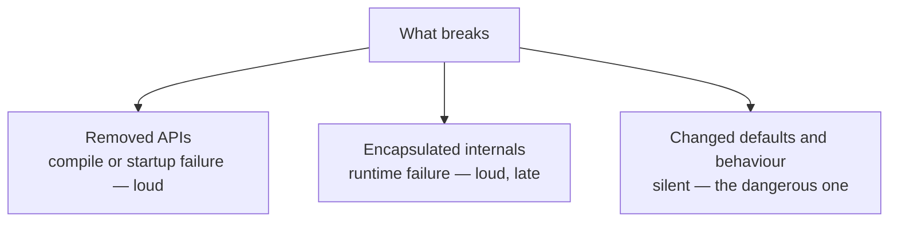
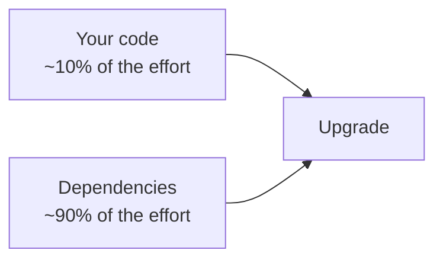
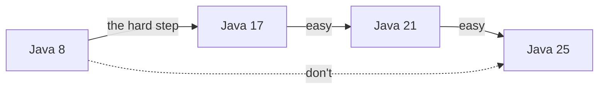
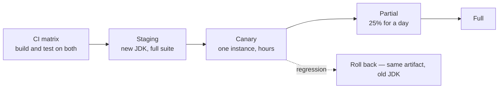
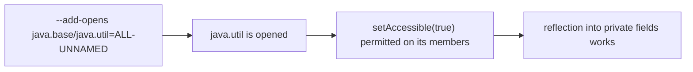

# Migration Strategy 8 → 25

<!-- video:start -->
<figure class="pb-video">
<video controls playsinline preload="metadata">
<source src="../../videos/ch05.mp4" type="video/mp4">
<track kind="subtitles" srclang="en" label="English" src="../../videos/ch05.vtt">
</video>
<figcaption>Video walkthrough · 7:29 · subtitles via CC · <a href="../../videos/ch05.mp4" download>Download MP4</a></figcaption>
</figure>
<!-- video:end -->

## 1. Purpose & Audience

**Band:** L4 Architect · **Prerequisites:** [The JDK Landscape](01-jdk-landscape.md), [The Toolchain](03-toolchain.md), [Builds & Preview Features](04-builds-and-preview-features.md)

A JDK upgrade is not a technical problem so much as a sequencing problem. The individual breakages are well-documented and mostly mechanical; what sinks migrations is attempting them all at once, and discovering late that the real work is in dependencies rather than in your own code.

This chapter answers three questions:

1. **What actually breaks**, and in which release?
2. **What order do you do it in**, and where do you stop and ship?
3. **How do you assess the work before committing to it?**

---

## 2. The Problem

Two failure patterns, both common.

**The stall.** A team has been on Java 8 since 2016. Every year someone proposes upgrading, the estimate is "a quarter, maybe", and it loses to feature work. Meanwhile the dependency graph freezes — libraries raise their baselines past 8, so nothing can be updated, and the CVE backlog grows in the dependencies rather than the JDK.

**The big bang.** A team decides to go 8 → 21 in one branch. Three weeks in, the branch has 400 changed files, the test suite fails in ways nobody can attribute, and it is impossible to tell whether a failure comes from the JDK, a major framework upgrade, a removed API, or a changed default. The branch is abandoned.

Both come from the same mistake: treating the upgrade as one change.

---

## 3. Mental Model

### 3.1 Three kinds of breakage



| Kind | Example | When you find out |
|---|---|---|
| **Removed** | `javax.xml.bind` gone in 11 | Compile or startup |
| **Encapsulated** | `sun.misc.Unsafe` reflection blocked in 17 | Runtime, on the code path that uses it |
| **Changed default** | Locale data switched to CLDR in 9; GC changed to G1 | **Never, until a customer notices** |

The third category is why a migration needs testing rather than only compiling. A date that formats as `Sep 20, 2026` instead of `20-Sep-2026` breaks a downstream parser, and nothing in the build says so.

### 3.2 The work is in dependencies



Your own code rarely uses removed or internal APIs. Your dependencies do — an old bytecode library using `Unsafe`, an XML stack relying on JAXB being in the JDK, a mocking framework manipulating class loaders. The migration is mostly a dependency upgrade project wearing a JDK upgrade's clothes.

That reframing matters for planning: the estimate is driven by how many major dependency versions you are behind, not by the size of your codebase.

### 3.3 Stepped, not direct



Ship each step to production before beginning the next. The temptation to combine is strongest at 8 → 17, where it is least safe.

---

## 4. Core Reference

### 4.1 What was removed, by release

| Release | Removed or disabled |
|---|---|
| **9** | `sun.misc.Unsafe` reflection warned; default locale data switched to CLDR; **G1 becomes the default GC**; `-XX:PermSize` flags ignored |
| **10** | Deprecated GC flag combinations removed |
| **11** | **Java EE modules: JAXB, JAX-WS, JAF, Common Annotations, CORBA, JTA**; Java Mission Control unbundled; `-XX:+AggressiveOpts` |
| **14** | **CMS collector removed** |
| **15** | **Nashorn JavaScript engine removed**; RMI activation deprecated; biased locking disabled |
| **16** | **JDK internals strongly encapsulated by default (JEP 396)** |
| **17** | **`--illegal-access` removed (JEP 403)**; RMI activation removed; Applet API deprecated for removal; Security Manager deprecated |
| **18** | **UTF-8 becomes the default charset (JEP 400)**; finalization deprecated for removal |
| **20** | `Thread.stop`, `suspend`, `resume` throw `UnsupportedOperationException` |
| **21** | Windows 32-bit x86 port deprecated |
| **24** | **Security Manager permanently disabled (JEP 486)**; Windows 32-bit x86 port removed (JEP 479); `Unsafe` memory access warns (JEP 498) |
| **25** | All 32-bit x86 ports removed (JEP 503) |
| **26** | **Applet API removed (JEP 504)**; final-field mutation via reflection warns (JEP 500) |

### 4.2 The assessment commands

```bash
# Internal API usage — names the problem AND the replacement
jdeps -jdkinternals --multi-release 25 app.jar

# Deprecated API usage against a target release
jdeprscan --release 25 app.jar

# Which JDK modules are actually needed
jdeps --print-module-deps --ignore-missing-deps app.jar

# Dependencies that are behind
mvn versions:display-dependency-updates
./gradlew dependencyUpdates
```

### 4.3 The escape-hatch flags

| Flag | Purpose | Status |
|---|---|---|
| `--add-opens m/p=ALL-UNNAMED` | Permit deep reflection into `p` | Supported; a stopgap |
| `--add-exports m/p=ALL-UNNAMED` | Permit access to a non-exported package | Supported; a stopgap |
| `--add-modules m` | Add a module not resolved by default | Supported |
| `--illegal-access=permit` | Blanket permission | **Removed in 17** |

Every `--add-opens` is a library reaching into JDK internals. Treat each as a ticket with a named owner and an upgrade target, not as configuration.

---

## 5. Worked Examples

### 5.1 The assessment pass — one day, before committing

Run this before estimating anything.

```bash
# 1. What internal APIs does the whole dependency set touch?
jdeps -jdkinternals --multi-release 17 -cp "lib/*" app.jar > internals.txt

# 2. What deprecated APIs are in use?
jdeprscan --release 17 --class-path "lib/*" app.jar > deprecated.txt

# 3. How far behind is each dependency?
mvn versions:display-dependency-updates > updates.txt

# 4. Does it even start?
java -jar app.jar      # on a JDK 17, before changing anything
```

```text title="internals.txt — a real shape"
app.jar -> JDK removed internal API
   com.grocery.FastCache -> sun.misc.Unsafe    JDK internal API
lib/asm-5.0.3.jar -> JDK internal API
   ...
Suggested replacements:
   sun.misc.Unsafe -> java.lang.invoke.VarHandle @since 9
```

The output separates cleanly into **your code** (usually a handful of places) and **dependencies** (usually most of it, fixed by upgrading). That split is the estimate.

### 5.2 Step one: 8 → 17

Do these in order, each as its own commit or PR.

**1. Upgrade dependencies while still on Java 8.** Most libraries that support 17 also still support 8, so this de-risks the biggest part of the work without changing the JDK at all. Anything that cannot be upgraded on Java 8 becomes a known blocker before you have committed to anything.

**2. Add the removed Java EE modules as dependencies.**

```xml title="pom.xml"
<dependency>
  <groupId>jakarta.xml.bind</groupId>
  <artifactId>jakarta.xml.bind-api</artifactId>
</dependency>
<dependency>
  <groupId>org.glassfish.jaxb</groupId>
  <artifactId>jaxb-runtime</artifactId>
  <scope>runtime</scope>
</dependency>
```

This is the `NoClassDefFoundError: javax/xml/bind/JAXBException` fix, and it can be done on Java 8 too.

**3. Switch the build to `--release 17`** and fix compile errors. Usually few.

**4. Start the application and collect the reflection failures.**

```text
InaccessibleObjectException: Unable to make field private final java.util.ArrayList.elementData
accessible: module java.base does not "opens java.util" to unnamed module
```

For each one, identify the library and check for a version that does not need it. Where none exists, add the flag — in an argument file, with a comment:

```text title="jvm.args"
# hibernate 5.4 reflects into java.util — remove after upgrading to 6.x
--add-opens java.base/java.util=ALL-UNNAMED
```

**5. Verify the behaviour changes.** This is the step teams skip:

| Change | Check |
|---|---|
| **Locale data → CLDR (Java 9)** | Any formatted date, number, or currency compared as a string |
| **Default GC → G1 (Java 9)** | Latency and throughput profile; heap sizing |
| **CMS removed (14)** | `-XX:+UseConcMarkSweepGC` now fails to start |
| **Nashorn removed (15)** | Any scripted rules engine |
| **TLS defaults** | Old protocol versions disabled; check external integrations |

The CLDR one deserves emphasis. Java 9 switched the default locale data provider from the JDK's own to CLDR, changing output for many locales:

```java title="LocaleChange.java"
DateTimeFormatter.ofLocalizedDate(FormatStyle.MEDIUM)
                 .withLocale(Locale.UK)
                 .format(LocalDate.of(2026, 9, 20));
// Java 8:  20-Sep-2026
// Java 9+: 20 Sep 2026
```

Nothing fails. A downstream parser breaks weeks later. If a JDK-formatted date crosses a system boundary, assert on it in a test — and consider `-Djava.locale.providers=COMPAT` as a temporary bridge while you fix the real issue, noting that the compatibility provider is itself deprecated.

**6. Ship it.** Run Java 17 in production before starting the next step.

### 5.3 Step two: 17 → 21

Comparatively easy. Frameworks already target 17, and 21 removes little.

| Check | |
|---|---|
| Deprecation warnings | `jdeprscan --release 21` |
| Sealed types in dependencies | Exhaustive switches over library types may need recompiling |
| `Thread.stop` calls | Now throw `UnsupportedOperationException` |
| Virtual thread readiness | `synchronized` still pins carriers on 21 — see [Ch 31](../04-concurrency/31-virtual-threads.md) |

The opportunity rather than the obligation: virtual threads, pattern matching, records, and sequenced collections all become available. Resist adopting them in the same PR as the upgrade — a JDK upgrade should change the JDK and nothing else, or you lose the ability to attribute a regression.

### 5.4 Step three: 21 → 25

Mostly additive.

| Check | |
|---|---|
| **Compact object headers (JEP 519)** | Default in 25; re-baseline heap sizing — objects are smaller |
| `--add-opens` inventory | Recheck; many libraries no longer need theirs |
| `synchronized` pinning workarounds | JEP 491 in Java 24 removed pinning — remove `ReentrantLock` conversions made for it |
| Security Manager | Permanently disabled in 24; any use must already be gone |
| `ScopedValue` | Final in 25 — the `ThreadLocal` replacement ([Ch 33](../04-concurrency/33-scoped-values.md)) |

### 5.5 Rollout



The property that makes this safe: **if you compiled with `--release 17`, the same artifact runs on 17 and on 21**. Rollback is a runtime change, not a rebuild. That is worth preserving deliberately — target the lower version for a release or two after the runtime moves, then raise the target once the runtime is proven.

What to watch on canary, in order of how often it matters: GC pause distribution and heap after full GC; memory footprint outside the heap; p99 latency; error rate on anything involving date, number, or currency formatting.

---

## 6. Internals

### 6.1 Why strong encapsulation arrived when it did

Java 9 modularised the JDK but left internal access working with a warning, because breaking every library at once was unacceptable. Java 16 made encapsulation the default; Java 17 removed `--illegal-access` entirely.

The seven-year runway was deliberate, and the direction is one-way. Code that still needs `--add-opens` in 2026 is code whose dependencies have not been maintained for most of a decade — which is a supply-chain finding as much as a compatibility one.

### 6.2 What `--add-opens` actually grants



It does **not** grant compile-time access — that is `--add-exports`. And it is per-package, not per-class, so opening `java.util` opens all of it to all classpath code. Each flag is a hole of known size; the number of them is the measure of how much the application depends on JDK internals.

### 6.3 The default GC change is a silent performance change

Java 8 defaulted to the Parallel collector; Java 9 onward defaults to G1.

| | Parallel | G1 |
|---|---|---|
| Optimises for | Throughput | Pause time |
| Full GC pauses | Longer | Shorter, more predictable |
| Throughput | Slightly higher | Slightly lower |
| Heap overhead | Lower | Higher (region metadata, remembered sets) |

For a latency-sensitive service G1 is an improvement. For a batch job maximising throughput, it may be a regression — and nobody changed a flag. This is the single most common "the upgrade made it slower" report, and the answer is either to accept G1's profile or to set `-XX:+UseParallelGC` explicitly and measure. See [Chapter 34](../05-runtime/34-garbage-collection.md).

### 6.4 `ct.sym` and the `--release` horizon

`--release N` works by validating against historical API signatures stored in `lib/ct.sym`. Those records are eventually dropped for very old releases, so `--release 8` will not be supported forever.

The practical consequence for a library maintainer: the window in which you can build on a current JDK while targeting Java 8 is closing, and when it does the choice is to raise the baseline or to maintain a separate old-JDK build. This is a quiet but real force pushing the ecosystem off Java 8.

### 6.5 Class file version as a one-way door

A class file compiled by a newer JDK cannot run on an older JVM ([Chapter 01](01-jdk-landscape.md)). So raising the build's `--release` is the step that makes rollback require a rebuild.

Keep them separate deliberately:

```text
1. Move the runtime to 21, keep --release 17          ← rollback is a runtime change
2. Run in production for a release cycle
3. Raise --release to 21                               ← now committed
```

Teams that raise both together lose their cheapest rollback at exactly the moment they are most likely to need it.

### 6.6 What `jdeprscan` cannot tell you

It reports uses of APIs deprecated in the JDK. It does not report:

- Deprecations in your dependencies
- Behavioural changes that are not deprecations — CLDR, GC defaults, TLS defaults
- Reflective use of anything, since it analyses bytecode references

So it is a necessary input and not a sufficient one. The behaviour changes in §5.2 step 5 have no tool; they need tests.

---

## 7. Production Patterns & Anti-Patterns

### Do this

- **Assess before estimating.** `jdeps -jdkinternals`, `jdeprscan`, and a dependency-freshness report take a day and produce the actual work list.
- **Upgrade dependencies first, while still on the old JDK.** It de-risks most of the work without changing the runtime.
- **Step: 8 → 17 → 21 → 25**, shipping each to production before starting the next.
- **Separate the runtime move from raising `--release`**, so rollback stays a runtime change.
- **Put every `--add-opens` in an argument file with a comment** naming the library and the version that removes it.
- **Test the silent changes explicitly** — locale formatting, GC profile, TLS, charset.
- **Run a CI matrix** across the current and target JDK for the whole migration.
- **Canary and watch GC, footprint, and p99**, not just error rate.

### Never do this

- **Never go 8 → 21 or 8 → 25 in one step** on a substantial codebase. Attribution becomes impossible.
- **Never adopt new language features in the upgrade PR.** Change the JDK, then change the code.
- **Never treat `--add-opens` as configuration.** Each is a dependency that needs upgrading.
- **Never assume a clean compile means a working application.** The dangerous changes are behavioural.
- **Never skip the canary because staging passed.** GC behaviour and footprint differ under real load and real heap sizes.
- **Never raise `--release` in the same release as the runtime move.** You give up the cheap rollback.
- **Never accept "we can't upgrade" without the assessment output.** The claim usually reduces to two or three abandoned dependencies.

---

## 8. Version Evolution (Java 8 → 26)

| Step | Difficulty | Dominant work |
|---|---|---|
| **8 → 11** | Hard | Java EE module removals, dependency upgrades, first module-system friction |
| **11 → 17** | Moderate | Strong encapsulation enforced, `--illegal-access` gone, CMS and Nashorn removed |
| **8 → 17 direct** | Hard but preferred | Both of the above, without an intermediate production deployment |
| **17 → 21** | Easy | Deprecations; frameworks already support it |
| **21 → 25** | Easy | Compact object headers change footprint; remove pinning workarounds |

### Migration note

Two questions decide whether 8 → 11 → 17 or 8 → 17 direct is right.

**Do your dependencies support 17?** If they do, go direct — an intermediate stop at 11 adds a production deployment without removing work, since the encapsulation changes are in 16 and 17 regardless.

**Is the application large enough that attribution is a problem?** If a failing test could plausibly be caused by four different things, the intermediate step buys you the ability to bisect. For a moderate service, direct to 17 is usually right; for a large monolith with a long dependency tail, the stop at 11 earns its cost.

Either way, **17 is the landing point**, not 21 or 25. Ship it, run it, then continue.

---

## 9. Interview Questions

### L1 — Foundations

**Q1. Why do applications fail on Java 11 with `NoClassDefFoundError: javax/xml/bind/JAXBException`?** ⭐ *high frequency*
Because Java 11 removed the Java EE modules that Java 9 had deprecated — JAXB, JAX-WS, JAF, Common Annotations, CORBA, and JTA. They were bundled with the JDK before and are not any more. The fix is to add them as ordinary dependencies; they continue as Jakarta EE projects.

**Q2. What is `InaccessibleObjectException`?**
It is thrown when code calls `setAccessible` on a member of a package that has not been opened to it — typically a library reflecting into JDK internals. Java 16 made strong encapsulation the default and Java 17 removed the `--illegal-access` escape hatch, so it appears during an upgrade from 8 or 11. The stopgap is `--add-opens`; the fix is a newer version of the library.

**Q3. What order should you upgrade from Java 8?**
In steps, landing on 17 first, then 21, then 25, shipping each to production before starting the next. The 8 → 17 step carries nearly all the risk; the later steps are largely additive. Going directly from 8 to 25 combines several independent failure modes into a change nobody can bisect.

### L2 — Professional

**Q4. What tools do you run before starting a migration?** ⭐ *high frequency*
`jdeps -jdkinternals` to find uses of internal APIs, which reports both the offending call and the supported replacement; `jdeprscan --release N` to find deprecated APIs in use; and `jdeps --print-module-deps` to see which JDK modules are actually needed. Alongside those, a dependency freshness report, because the bulk of migration work is upgrading dependencies rather than changing your own code.

**Q5. Why upgrade dependencies before changing the JDK?**
Because most libraries that support a newer JDK still support the old one, so the upgrade can be done and shipped without changing the runtime at all. That removes the largest source of risk from the JDK step and isolates failures — if something breaks, it is the library, not the JDK. It also surfaces genuinely blocked dependencies before you have committed to a migration.

**Q6. What silent behaviour changes should you test for?**
Locale data switched to CLDR in Java 9, changing formatted date, number, and currency output for many locales. The default collector changed from Parallel to G1 in the same release, changing the latency and throughput profile. The default charset became UTF-8 in Java 18, and TLS defaults have tightened repeatedly. None of these produce an error — they produce different output or different performance, which is why a clean compile proves very little.

### L3 — Enterprise

**Q7. Why keep `--release` at the old version after moving the runtime?**
Because a class file compiled for a newer release cannot run on an older JVM, so raising `--release` is what makes rollback require a rebuild. Moving the runtime while keeping the target lower means the same artifact runs on both, and a regression is reverted by changing the runtime rather than by rebuilding and redeploying. Raise the target a release cycle later, once the new runtime is proven.

**Q8. How do you handle `--add-opens` flags accumulating?**
Treat each as a ticket rather than configuration: record which library needs it and which version would remove it, in an argument file under version control with a comment. Every flag is a library reaching into JDK internals, which means it is either outdated or using an API with a supported replacement such as `VarHandle`. The direction of travel since Java 16 is one-way, so a flag left indefinitely is a bet that a future JDK will keep allowing the access.

**Q9. An upgrade made a batch job slower with no code changes. What is the likely cause?**
The default collector changed from Parallel to G1 in Java 9. G1 optimises for pause time at a small cost in throughput, which is an improvement for a latency-sensitive service and can be a regression for a throughput-bound batch job. Nobody changed a flag, so the change is invisible in the diff. The fix is to measure with `-XX:+UseParallelGC` set explicitly and decide, rather than assuming either default is right for the workload.

### L4 — Architect

**Q10. How would you plan and sequence a fleet-wide migration from Java 8?**
Start with a one-day assessment across the estate — `jdeps -jdkinternals`, `jdeprscan`, and dependency freshness for every service — because that output, not the codebase size, is the estimate. Then run the dependency upgrades as their own programme while everything is still on Java 8, which de-risks most of the work and is independently valuable. Sequence services by risk rather than by size, using a low-traffic one to build the runbook: the flags needed, the behavioural checks, the canary metrics. Land everything on 17 before anyone moves further, so the fleet is on one version rather than spread across four.

**Q11. A team says they cannot upgrade because of a dependency. How do you assess the claim?**
Ask for the `jdeps -jdkinternals` output and the dependency report, because the claim usually collapses under them. Most libraries that mattered in 2014 have supported releases now; what remains is typically two or three genuinely abandoned dependencies, and the question becomes whether to replace them — a bounded piece of work with a clear owner. An abandoned dependency is also a supply-chain risk in its own right, so the conversation is worth having regardless of the JDK. The failure mode to avoid is accepting an unexamined blocker that quietly costs a decade.

**Q12. What is the real cost of staying on an old LTS?**
It compounds in three directions that reinforce each other. Security updates for the platform eventually stop or become paid, so the JDK itself becomes a liability. Libraries raise their baselines, so the dependency graph freezes and accumulates its own vulnerabilities — which is usually the larger exposure. And the upgrade gets harder rather than easier, because each skipped release adds removals and encapsulation changes to the same eventual step, while the pool of people who remember why anything was configured that way shrinks. Staying current costs a predictable amount per release; deferring it converts that into a project with an unbounded estimate.

---

!!! abstract "Cheat Sheet"
    **Step: 8 → 17 → 21 → 25** — ship each to production before the next; never 8 → 25 direct

    **~90% of the work is dependencies** — upgrade them first, while still on the old JDK

    **Assess before estimating:** `jdeps -jdkinternals` · `jdeprscan --release N` · dependency freshness

    **Three kinds of breakage:** removed (loud) · encapsulated (loud, late) · **changed defaults (silent)**

    **Silent ones to test:** CLDR locale data (9) · G1 default (9) · UTF-8 default (18) · TLS defaults

    **Java 11 removed the Java EE modules** — JAXB et al. become dependencies

    **Java 16 encapsulated internals · Java 17 removed `--illegal-access`**

    **`--add-opens` is a ticket** — argument file, comment, named library and target version

    **Separate the runtime move from raising `--release`** — keeps rollback a runtime change

    **Don't adopt new language features in the upgrade PR** — change one thing

    **Canary on GC pauses, footprint, and p99**, not just error rate

    **17 is the landing point** — ship it, run it, then continue
