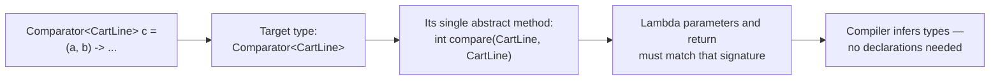
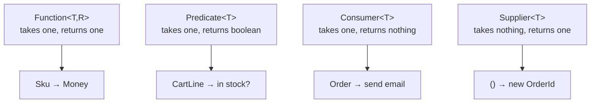
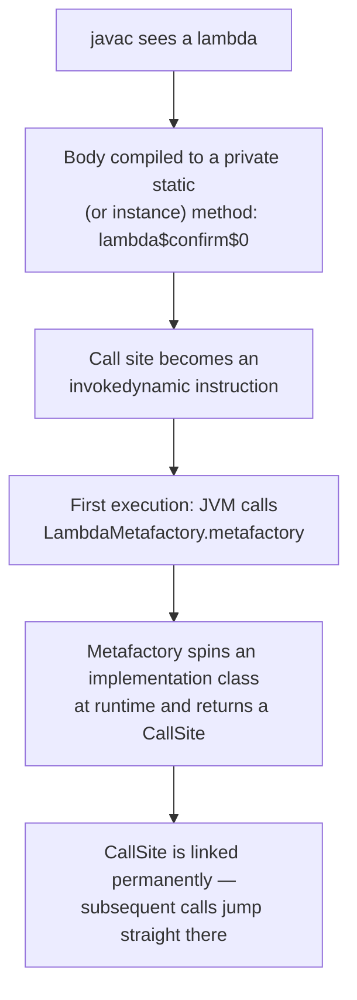

# Lambdas & Functional Interfaces

!!! example "Try it first"
    **[Java 8 by example](../07-examples/java-8.md)** — 13 runnable programs covering every major Java 8 feature, each with its real output.

## 1. Purpose & Audience

**Band:** L1 Foundations · **Prerequisites:** core Java syntax, interfaces

Java 8 added lambdas, and most codebases absorbed them as "shorter anonymous classes". That understates it. Lambdas made *behaviour* a value you can pass, store, and compose — which is what enables streams, `CompletableFuture`, the modern `Map` API, and almost every fluent library written since.

This chapter answers three questions:

1. **What is a lambda actually compiled to?** (Not an anonymous class — and the difference is measurable.)
2. **Which of the forty-odd built-in functional interfaces** do you need to know?
3. **How do you compose behaviour** rather than writing it inline each time?

Streams are [Chapter 07](07-stream-api.md). This chapter is the foundation they stand on.

---

## 2. The Problem

The order engine sorts cart lines several ways: by price, by name, by vendor. Before Java 8, each one is a class:

```java title="PriceComparator.java"
// Java 7
public class PriceComparator implements Comparator<CartLine> {
    @Override
    public int compare(CartLine a, CartLine b) {
        return a.lineTotal().compareTo(b.lineTotal());
    }
}
```

Or an anonymous class at the call site, which is barely better:

```java title="SortingBefore.java"
// Java 7 — six lines to express "by line total"
Collections.sort(lines, new Comparator<CartLine>() {
    @Override
    public int compare(CartLine a, CartLine b) {
        return a.lineTotal().compareTo(b.lineTotal());
    }
});
```

Five of those six lines are ceremony. The actual instruction — *compare by line total* — is one expression buried inside a type declaration, a method declaration, and two sets of braces. That ratio is why Java code of that era used strategy interfaces sparingly: the syntax made passing behaviour expensive enough that people wrote `if`/`else` chains instead.

```java title="SortingAfter.java"
// Java 8
lines.sort(Comparator.comparing(CartLine::lineTotal));
```

---

## 3. Mental Model

A lambda is an **instance of a functional interface**, created from an expression rather than a class declaration.



Two consequences follow immediately.

**A lambda has no type of its own.** `(a, b) -> a.compareTo(b)` means nothing in isolation. It takes its type from the context it appears in — the variable it is assigned to, the parameter it is passed as, the value it is returned as. This is **target typing**, and it is why the same lambda text can be a `Comparator` in one place and a `BiFunction` in another.

**A functional interface is any interface with exactly one abstract method.** `Runnable`, `Callable`, `Comparator`, and your own `PricingRule` all qualify. Default and static methods do not count against the total, which is how `Comparator` can carry twenty helper methods and still be a lambda target.

### 3.1 The shapes that matter

Nearly every built-in functional interface is a variation on four shapes:



Learn those four and the rest are mechanical: add `Bi` for two arguments, add `Int`/`Long`/`Double` for primitives, and `UnaryOperator<T>` / `BinaryOperator<T>` are the special cases where input and output types match.

---

## 4. Core API & Syntax

### 4.1 Lambda syntax

| Form | Example |
|---|---|
| No parameters | `() -> OrderId.random()` |
| One parameter, inferred type | `line -> line.quantity() > 0` |
| One parameter, parentheses optional | `(line) -> ...` — same thing |
| Multiple parameters | `(a, b) -> a.plus(b)` |
| Explicit types | `(CartLine a, CartLine b) -> ...` |
| `var` parameters (Java 11) | `(var a, var b) -> ...` — allows annotations |
| Expression body | `line -> line.quantity()` — implicit return |
| Block body | `line -> { log.debug(...); return line.quantity(); }` — explicit return |

### 4.2 The built-in interfaces worth memorising

| Interface | Signature | Typical use |
|---|---|---|
| `Function<T,R>` | `R apply(T)` | Transformation |
| `BiFunction<T,U,R>` | `R apply(T,U)` | Two-argument transformation |
| `Predicate<T>` | `boolean test(T)` | Filtering |
| `BiPredicate<T,U>` | `boolean test(T,U)` | Two-argument condition |
| `Consumer<T>` | `void accept(T)` | Side effect |
| `BiConsumer<T,U>` | `void accept(T,U)` | `Map.forEach` |
| `Supplier<T>` | `T get()` | Lazy creation, defaults |
| `UnaryOperator<T>` | `T apply(T)` | `Function<T,T>` — `List.replaceAll` |
| `BinaryOperator<T>` | `T apply(T,T)` | `BiFunction<T,T,T>` — `reduce`, `merge` |
| `Runnable` | `void run()` | No input, no output |
| `Callable<V>` | `V call() throws Exception` | Like `Supplier`, but may throw checked |

### 4.3 Primitive specialisations

Every use of `Function<Integer, Integer>` boxes twice. The primitive variants avoid it:

| Generic | Primitive form |
|---|---|
| `Function<Integer,R>` | `IntFunction<R>` |
| `Function<T,Integer>` | `ToIntFunction<T>` |
| `Function<Integer,Integer>` | `IntUnaryOperator` |
| `Predicate<Integer>` | `IntPredicate` |
| `Supplier<Integer>` | `IntSupplier` |
| `Consumer<Integer>` | `IntConsumer` |

Same pattern for `Long` and `Double`. This matters in hot loops and in streams — see [Chapter 07](07-stream-api.md).

### 4.4 Composition

| Interface | Methods |
|---|---|
| `Function` | `andThen(after)`, `compose(before)`, `identity()` |
| `Predicate` | `and`, `or`, `negate`, `not(p)` (Java 11), `isEqual(target)` |
| `Consumer` | `andThen(after)` |
| `Comparator` | `comparing`, `thenComparing`, `reversed`, `nullsFirst`, `nullsLast` |

```java
Function<Sku, Money> base = pricingEngine::evaluate;       // returns Money, not Optional<Money>
Function<Sku, Money> withGst = base.andThen(money -> money.times(1.05));
```

`andThen` runs left to right; `compose` runs right to left. Most people only ever want `andThen`.

### 4.5 Method references

| Kind | Form | Equivalent lambda |
|---|---|---|
| Static | `Integer::parseInt` | `s -> Integer.parseInt(s)` |
| Bound instance | `catalogue::priceFor` | `sku -> catalogue.priceFor(sku)` |
| Unbound instance | `CartLine::lineTotal` | `line -> line.lineTotal()` |
| Constructor | `ArrayList::new` | `() -> new ArrayList<>()` |

The unbound form is the one that confuses people: `CartLine::lineTotal` takes the receiver as its first parameter, so it fits `Function<CartLine, Money>`.

---

## 5. Worked Examples

### 5.1 Behaviour as a parameter

Pricing rules are the natural place for this in the order engine:

```java title="PricingRule.java"
@FunctionalInterface
public interface PricingRule {
    Money apply(Money subtotal);

    default PricingRule andThen(PricingRule next) {
        return subtotal -> next.apply(this.apply(subtotal));
    }

    static PricingRule none() {
        return subtotal -> subtotal;
    }
}
```

```java title="PricingRules.java"
PricingRule bulkDiscount  = subtotal -> subtotal.minusPercent(10);
PricingRule deliveryFee   = subtotal -> subtotal.plus(Money.rupees(40));
PricingRule festiveOffer  = subtotal -> subtotal.minus(Money.rupees(100));

PricingRule checkoutRules = bulkDiscount.andThen(deliveryFee).andThen(festiveOffer);

Money total = checkoutRules.apply(Money.rupees(1000));
```

```text title="Output"
₹840.00        // 1000 → 900 → 940 → 840
```

`@FunctionalInterface` is optional but worth adding. It makes the compiler reject a second abstract method, so nobody breaks every call site by adding one.

### 5.2 Composing predicates

```java title="CartFilters.java"
Predicate<CartLine> inStock    = line -> catalogue.availableQuantity(line.sku()) > 0;
Predicate<CartLine> perishable = line -> catalogue.find(line.sku())
                                                  .map(InventoryItem::perishable)
                                                  .orElse(false);

Predicate<CartLine> needsColdChain = inStock.and(perishable);
Predicate<CartLine> backordered    = inStock.negate();
```

Each predicate is named, testable in isolation, and reusable. The alternative — a compound boolean expression inline at the call site — is none of those things.

`Predicate.not` (Java 11) reads better than `.negate()` when the predicate is a method reference:

```java
lines.stream().filter(Predicate.not(CartLine::isGift));
```

### 5.3 Comparators without the ceremony

```java title="Sorting.java"
// By total, ascending
lines.sort(Comparator.comparing(CartLine::lineTotal));

// By vendor, then by name, descending on price for ties
lines.sort(Comparator.comparing(CartLine::vendorName)
                     .thenComparing(CartLine::productName)
                     .thenComparing(CartLine::lineTotal, Comparator.reverseOrder()));

// Null-safe
lines.sort(Comparator.comparing(CartLine::deliverySlot,
                                Comparator.nullsLast(Comparator.naturalOrder())));
```

Use the primitive-specialised variants when the key is a number — `comparingInt`, `comparingLong`, `comparingDouble` — to avoid boxing every key on every comparison:

```java
lines.sort(Comparator.comparingInt(CartLine::quantity));
```

### 5.4 `Supplier` for laziness

```java title="Laziness.java"
// Eager — builds the message even when the key is present
String vendor = vendorNames.getOrDefault(sku, expensiveLookup(sku));

// Lazy — expensiveLookup runs only on a miss
String vendor = vendorNames.computeIfAbsent(sku, this::expensiveLookup);
```

The same pattern appears in `Optional.orElseGet` versus `orElse`, and in logging:

```java
log.debug("cart state: {}", () -> cart.expensiveSummary());   // only formatted if debug is on
```

Whenever an argument is expensive and might not be needed, a `Supplier` parameter is the fix.

### 5.5 Effectively final capture

```java title="Capture.java"
int discountPercent = 10;
PricingRule rule = subtotal -> subtotal.minusPercent(discountPercent);   // fine

discountPercent = 20;     // COMPILE ERROR: must be effectively final
```

A lambda captures the *value* of a local variable, not the variable itself, so the language forbids reassignment to keep the captured value meaningful. Instance and static fields have no such restriction — they are captured by reference through `this`.

The workaround people reach for is a mutable holder:

```java
int[] count = {0};
lines.forEach(line -> count[0]++);     // compiles, and is a bad idea
```

It compiles, but it is not thread-safe and it signals that you wanted a loop or a `reduce`. Use one of those.

### 5.6 Checked exceptions are the real friction

```java title="CheckedException.java"
// Does not compile — Function.apply cannot throw IOException
Function<Path, String> read = path -> Files.readString(path);
```

None of the standard functional interfaces declare checked exceptions. Three options:

=== "Handle inline"
    ```java
    Function<Path, String> read = path -> {
        try {
            return Files.readString(path);
        } catch (IOException e) {
            throw new UncheckedIOException(e);
        }
    };
    ```

=== "Your own throwing interface"
    ```java
    @FunctionalInterface
    interface ThrowingFunction<T, R, E extends Exception> {
        R apply(T t) throws E;
    }

    static <T, R> Function<T, R> unchecked(ThrowingFunction<T, R, ?> f) {
        return t -> {
            try {
                return f.apply(t);
            } catch (Exception e) {
                throw new RuntimeException(e);
            }
        };
    }
    ```

=== "Keep it a loop"
    ```java
    for (Path path : paths) {
        contents.add(Files.readString(path));   // checked exception propagates normally
    }
    ```

The third is frequently the right answer. A `try`/`catch` wrapper inside every lambda is worse reading than the loop it replaced.

---

## 6. Internals

### 6.1 Lambdas are not anonymous classes

An anonymous class generates a `.class` file — `OrderService$1.class` — and `new`s an instance at every evaluation. A lambda does neither.



Three practical consequences:

- **No class file per lambda.** A class with 200 lambdas ships one class file, not 201. Anonymous classes bloat the jar and slow class loading.
- **Non-capturing lambdas are singletons.** `line -> line.quantity() > 0` captures nothing, so the metafactory returns the same instance every time. `subtotal -> subtotal.minusPercent(percent)` captures `percent` and allocates per evaluation.
- **The strategy is not fixed by the spec.** `invokedynamic` defers the decision to the runtime, which is why lambda performance improved across JDK versions without recompilation.

### 6.2 `this` means different things

```java title="ThisSemantics.java"
public class OrderService {
    private final String name = "order-service";

    void anonymous() {
        Runnable r = new Runnable() {
            public void run() {
                System.out.println(this.getClass());    // the anonymous class
            }
        };
    }

    void lambda() {
        Runnable r = () -> System.out.println(this.getClass());  // OrderService
    }
}
```

A lambda has no `this` of its own — it is lexically scoped, so `this` is the enclosing instance. This is usually what you want, and it is why lambdas cannot be self-referential. A recursive lambda needs a field or a named method.

### 6.3 Default and static methods on interfaces

Lambdas would have been useless without them. Adding `stream()` to `Collection` in Java 8 would have broken every existing implementation — unless the method came with a body.

```java title="DefaultMethods.java"
public interface PricingRule {
    Money apply(Money subtotal);

    default PricingRule andThen(PricingRule next) { ... }   // added later, breaks nobody
}
```

**Resolution when two supertypes provide the same default:**

1. **A class wins over an interface.** A concrete method inherited from a superclass beats any default.
2. **The most specific interface wins.** If `B extends A` and both declare the default, `B`'s is used.
3. **Otherwise it is an error** — the implementing class must override and may delegate explicitly:

```java
class Combined implements A, B {
    @Override public void describe() {
        A.super.describe();      // explicit disambiguation
    }
}
```

Static interface methods (`PricingRule.none()`) are not inherited at all and must be called on the declaring interface.

### 6.4 Overload resolution gets harder

```java title="Ambiguity.java"
void schedule(Runnable task)  { }
void schedule(Callable<?> task) { }

schedule(() -> System.out.println("hi"));   // Runnable — void-compatible
schedule(() -> computeTotal());              // AMBIGUOUS if computeTotal returns a value
```

A lambda with a value-returning expression body is compatible with both a `void` method (the value is discarded) and a value-returning one. When two overloads accept different functional interfaces, the compiler may be unable to choose. Fix it with an explicit cast or by renaming the overloads — renaming is usually the better API.

### 6.5 Debugging and stack traces

Lambda frames appear with synthetic names:

```text
at com.grocery.OrderService.lambda$confirm$2(OrderService.java:47)
at java.base/java.util.stream.ReferencePipeline$3$1.accept(...)
```

Readable, but `lambda$confirm$2` is positional — insert a lambda earlier in the method and the numbering shifts. For a lambda with real logic that you expect to debug, extract it to a named method and use a method reference. The stack trace then names it, and so does the profiler.

---

## 7. Production Patterns & Anti-Patterns

### Do this

- **Annotate your own functional interfaces `@FunctionalInterface`.** It documents intent and stops someone adding a second abstract method.
- **Prefer method references when the lambda just delegates.** `CartLine::lineTotal` over `line -> line.lineTotal()`.
- **Name non-trivial predicates and functions.** `Predicate<CartLine> needsColdChain = ...` reads better at the call site than the expression inlined.
- **Use primitive specialisations** — `comparingInt`, `ToIntFunction`, `IntPredicate` — where a number is involved.
- **Use `Supplier` parameters for expensive optional values**, so the cost is paid only when needed.
- **Compose rather than nest.** `a.andThen(b).andThen(c)` over `c.apply(b.apply(a.apply(x)))`.
- **Extract lambdas longer than about three lines** into named methods. A lambda is an expression; a paragraph is a method.

### Never do this

- **Never mutate captured state from a lambda** via an array or holder object. It is not thread-safe and it means you wanted a loop or a `reduce`.
- **Never write a lambda with side effects where a pure function is expected** — a `Function` passed to `computeIfAbsent` or `map` that writes to a shared collection is a race waiting for a parallel stream.
- **Never wrap every lambda in try/catch for checked exceptions.** If the code throws checked exceptions naturally, a loop is clearer.
- **Never overload methods on different functional interfaces** with the same arity. Callers hit ambiguity errors they cannot easily diagnose.
- **Never use a lambda where a method reference reads better**, and never force a method reference where the lambda is clearer — `x -> x.getA().getB()` cannot be a method reference and should not be contorted into one.
- **Never rely on lambda identity.** Non-capturing lambdas may be cached and capturing ones are not; `==` between two lambdas is unspecified. This also makes lambdas unsuitable as map keys or as listeners you intend to deregister.

---

## 8. Version Evolution (Java 8 → 26)

| Version | What changed | Impact |
|---|---|---|
| **8** | Lambdas, method references, `java.util.function`, default and static interface methods, `Comparator` combinators | Behaviour becomes a value; enables streams and everything downstream |
| **9** | Private interface methods | Default methods can share implementation without exposing it |
| **10** | `var` for locals | `var rule = (PricingRule) subtotal -> ...` — cast still needed, since lambdas have no standalone type |
| **11** | `var` in lambda parameters; `Predicate.not` | Enables annotations on parameters; `not(X::isY)` reads better than `.negate()` |
| **16** | Records | Fewer trivial classes, and value types that compose well with functions |
| **17** | Sealed interfaces | A sealed interface with one abstract method is still a valid lambda target |
| **21** | Pattern matching for `switch` | Replaces some `Map<Type, Function>` dispatch tables with direct language support |
| **26** | No changes to the lambda model | — |

### Migration note

Converting a Java 7 codebase, the high-value targets in order: anonymous `Comparator` classes → `Comparator.comparing`; anonymous `Runnable`/`Callable` → lambdas; single-method strategy interfaces → functional interfaces with composition. Leave anonymous classes alone where they hold state or implement several methods — those are genuinely classes.

One thing not to convert: an anonymous class that relies on its own `this`. A lambda's `this` refers to the enclosing instance, so the conversion changes behaviour silently.

---

## 9. Interview Questions

### L1 — Foundations

**Q1. What is a functional interface?** ⭐ *high frequency*
An interface with exactly one abstract method, which makes it a valid target type for a lambda or method reference. Default and static methods do not count toward that total, which is how `Comparator` carries many helper methods and remains a lambda target. `@FunctionalInterface` makes the compiler enforce the constraint.

**Q2. What is the difference between `Function`, `Predicate`, `Consumer`, and `Supplier`?**
`Function<T,R>` takes one value and returns another. `Predicate<T>` takes one value and returns a boolean, for filtering. `Consumer<T>` takes a value and returns nothing, for side effects. `Supplier<T>` takes nothing and produces a value, typically for lazy or deferred creation. Nearly every other interface in `java.util.function` is a variation of these with more arguments or primitive types.

**Q3. What are the kinds of method reference?**
Four: static (`Integer::parseInt`), bound instance (`catalogue::priceFor`, on a specific object), unbound instance (`CartLine::lineTotal`, where the receiver becomes the first parameter), and constructor (`ArrayList::new`). The unbound form is the one people misread, because the receiver appears as an argument rather than before the dot.

### L2 — Professional

**Q4. How is a lambda different from an anonymous inner class?** ⭐ *high frequency*
An anonymous class produces a separate class file and allocates an instance at every evaluation. A lambda compiles its body to a private method and the call site to `invokedynamic`, so the implementation class is generated at runtime and non-capturing lambdas are cached as singletons. They also differ semantically: `this` inside a lambda refers to the enclosing instance, while inside an anonymous class it refers to the anonymous instance.

**Q5. Why must captured local variables be effectively final?**
Because a lambda captures the *value* of a local, not the variable — locals live on the stack and the lambda may outlive the frame. Allowing reassignment would leave the lambda holding a stale copy with no way to reconcile. Fields are exempt because they are captured through `this` by reference.

**Q6. Why were default methods added to interfaces?**
To allow interface evolution without breaking implementations. Adding `stream()`, `forEach`, and `removeIf` to `Collection` in Java 8 would have broken every existing implementer, unless the new methods shipped with bodies. Multiple inheritance of behaviour is the side effect, resolved by three rules: a class beats an interface, a more specific interface beats a less specific one, and otherwise the implementer must override explicitly.

### L3 — Enterprise

**Q7. What does `invokedynamic` do for lambdas, and why does it matter?**
It defers the decision of how to create the lambda instance to the runtime: on first execution the JVM calls `LambdaMetafactory`, which spins an implementation class and returns a linked call site used for all subsequent calls. This avoids a class file per lambda, allows non-capturing lambdas to be cached as singletons, and — importantly — means the strategy is not fixed by the class file. Lambda performance improved across JDK releases with no recompilation.

**Q8. How do you handle checked exceptions in a lambda?**
None of the standard functional interfaces declare them, so the options are to catch and wrap inside the lambda, to define your own throwing interface plus an adapter that wraps, or to keep the code as an ordinary loop where the checked exception propagates normally. The loop is often the right answer — a `try`/`catch` inside every lambda reads worse than the loop it replaced, and wrapping in `RuntimeException` loses the compiler's help without gaining much.

**Q9. When does a lambda allocate, and when does it not?**
A lambda that captures nothing from its enclosing scope is stateless, so the metafactory can return the same instance on every evaluation — no allocation after the first. A lambda that captures a local or the enclosing `this` needs those values stored, so a new instance is created per evaluation. In a hot loop this is the difference between zero allocation and one object per iteration, which is worth knowing though rarely worth contorting code for.

### L4 — Architect

**Q10. When is a functional interface the right API design, and when is it not?**
It fits when the abstraction genuinely is one operation and callers will supply varied behaviour — a pricing rule, a retry policy, a key extractor. It stops fitting when the abstraction has multiple related operations, needs named implementations for logging and configuration, or benefits from identity for registration and deregistration. Lambdas have unspecified identity and unhelpful `toString`, so a plugin registry keyed on handler instances should take named objects, not lambdas.

**Q11. A team's codebase has `Function<String, Function<Integer, Function<Order, Money>>>` in its API. What is wrong and what do you propose?**
Currying nested functions is idiomatic in languages with the syntax to support it; in Java it produces types nobody can read, no parameter names, no documentation targets, and stack traces full of `lambda$`. Replace it with a named interface whose single method has named parameters, or with a small record carrying the inputs. The functional core is fine — the problem is expressing it through anonymous generic composition rather than through a type with a name.

**Q12. How would you evaluate whether converting loops to lambdas and streams improved a codebase?**
By the same criteria as any refactoring: does the intent read more directly, do failures localise better, and is the performance acceptable. Lambdas win where the loop was ceremony around one expression, and lose where the body is long, throws checked exceptions, mutates several variables, or needs `break` semantics that do not express well. Stack traces and debuggability are a real cost — measure by asking whether a developer unfamiliar with the code can follow a production stack trace back to a line.

---

!!! abstract "Cheat Sheet"
    **Functional interface = exactly one abstract method** — defaults and statics don't count

    **Lambdas have no type of their own** — target typing supplies it

    **Four shapes:** `Function` (T→R) · `Predicate` (T→boolean) · `Consumer` (T→void) · `Supplier` (→T)

    **`Bi` = two args · `Int`/`Long`/`Double` = no boxing · `UnaryOperator`/`BinaryOperator` = same types**

    **Method references:** static · bound (`obj::m`) · unbound (`Type::m`) · constructor (`Type::new`)

    **Compose:** `Function.andThen` · `Predicate.and/or/negate` · `Comparator.comparing().thenComparing()`

    **Not anonymous classes** — `invokedynamic` + `LambdaMetafactory`; no class file per lambda

    **Non-capturing lambdas are cached singletons** — capturing ones allocate

    **`this` in a lambda = enclosing instance** (anonymous class: itself)

    **Captured locals must be effectively final** — fields are exempt

    **No checked exceptions** in standard interfaces — wrap, define your own, or keep the loop

    **Extract lambdas over ~3 lines** — the stack trace names methods, not `lambda$confirm$2`
