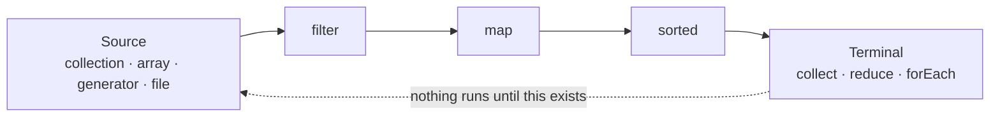
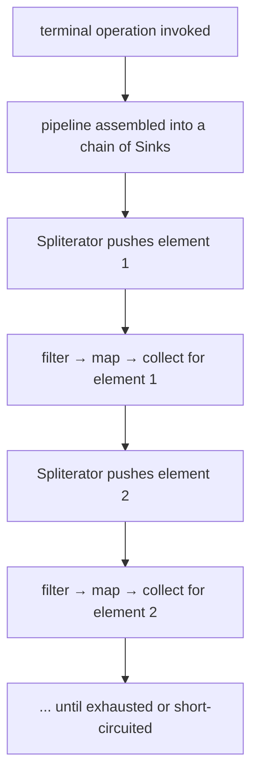

# The Stream API

## 1. Purpose & Audience

**Band:** L2 Professional · **Prerequisites:** [Lambdas & Functional Interfaces](06-lambdas-functional-interfaces.md)

Streams are the most-used and most-misused part of Java 8. The API is easy to learn and the mental model is not, which produces two failure modes: pipelines that are slower than the loop they replaced, and pipelines nobody can read.

This chapter answers three questions:

1. **What is a stream actually doing** — how does laziness change execution order?
2. **When is a stream better than a loop**, and when is it worse?
3. **When does `parallel()` help**, and why does it usually not?

Collectors get their own chapter ([Chapter 08](08-collectors.md)) because `collect` is where most real work happens.

---

## 2. The Problem

Total the value of perishable lines in a cart, by vendor:

```java title="ImperativeTotals.java"
// Java 7
Map<String, BigDecimal> totalsByVendor = new HashMap<>();
for (CartLine line : cart.lines()) {
    if (!line.perishable()) {
        continue;
    }
    BigDecimal current = totalsByVendor.get(line.vendorName());
    if (current == null) {
        current = BigDecimal.ZERO;
    }
    totalsByVendor.put(line.vendorName(), current.add(line.lineTotal().amount()));
}
```

Eleven lines, of which two express the intent — *filter to perishable, sum by vendor*. The rest is iteration mechanics and null handling, and each is a place to make a mistake.

```java title="StreamTotals.java"
// Java 8
Map<String, BigDecimal> totalsByVendor = cart.lines().stream()
    .filter(CartLine::perishable)
    .collect(groupingBy(CartLine::vendorName,
                        reducing(BigDecimal.ZERO, l -> l.lineTotal().amount(), BigDecimal::add)));
```

The win is not fewer lines. It is that the *what* is visible and the *how* is gone.

---

## 3. Mental Model

A stream is **not a collection**. It holds no elements, stores nothing, and cannot be reused. It is a pipeline description that does nothing until a terminal operation pulls elements through it.



| Stage | Returns | Runs |
|---|---|---|
| **Source** | A stream | On demand |
| **Intermediate** | A stream | Lazily — builds the pipeline |
| **Terminal** | A value or nothing | Triggers the whole pipeline |

### 3.1 Laziness changes the execution order

The single most important thing to understand: **elements flow through the whole pipeline one at a time, not stage by stage.**

```java title="LazinessDemo.java"
List<String> skus = List.of("MILK-1L", "RICE-5KG", "ATTA-10KG", "DAL-1KG");

Optional<String> first = skus.stream()
    .peek(s -> System.out.println("filter sees " + s))
    .filter(s -> s.startsWith("A"))
    .peek(s -> System.out.println("map sees " + s))
    .map(String::toLowerCase)
    .findFirst();
```

```text title="Output"
filter sees MILK-1L
filter sees RICE-5KG
filter sees ATTA-10KG
map sees ATTA-10KG
```

Two things that surprise people. `DAL-1KG` is never examined — `findFirst` short-circuits. And `map` runs on the third element *before* `filter` has seen the fourth. A loop-shaped mental model ("filter everything, then map everything") predicts neither.

### 3.2 Streams versus collections

| | Collection | Stream |
|---|---|---|
| Stores elements | Yes | No |
| Reusable | Yes | **No** — one terminal operation only |
| Evaluation | Eager | Lazy |
| Element access | By index or iterator | Only through the pipeline |
| Size | Known | May be infinite |

```java title="StreamReuse.java"
Stream<CartLine> lines = cart.lines().stream();
long count = lines.count();
List<CartLine> list = lines.toList();   // IllegalStateException: stream has already been operated upon
```

---

## 4. Core API & Syntax

### 4.1 Creating streams

| Source | Form |
|---|---|
| Collection | `collection.stream()` / `parallelStream()` |
| Array | `Arrays.stream(array)` |
| Values | `Stream.of(a, b, c)` |
| Range | `IntStream.range(0, n)` / `rangeClosed(1, n)` |
| Nullable | `Stream.ofNullable(maybeNull)` (Java 9) |
| Iteration | `Stream.iterate(seed, next)` — infinite |
| Bounded iteration | `Stream.iterate(seed, hasNext, next)` (Java 9) |
| Generation | `Stream.generate(supplier)` — infinite |
| File lines | `Files.lines(path)` — **must be closed** |
| Characters | `"text".chars()` — an `IntStream` |
| Map | `map.entrySet().stream()` |

### 4.2 Intermediate operations

| Operation | Stateless? | Notes |
|---|---|---|
| `filter(Predicate)` | Stateless | |
| `map(Function)` | Stateless | One-to-one |
| `flatMap(Function)` | Stateless | One-to-many, flattened |
| `mapMulti(BiConsumer)` (16) | Stateless | Push-style alternative to `flatMap` — fewer allocations |
| `peek(Consumer)` | Stateless | **Debugging only** — see §6.3 |
| `distinct()` | **Stateful** | Needs to remember everything seen |
| `sorted()` | **Stateful** | Buffers the entire stream |
| `limit(n)` | Short-circuiting | |
| `skip(n)` | Stateful | |
| `takeWhile(Predicate)` (9) | Short-circuiting | Stops at first false |
| `dropWhile(Predicate)` (9) | Stateful | Drops until first false |

Stateful operations are the ones that break laziness — `sorted()` must consume the entire stream before emitting anything.

### 4.3 Terminal operations

| Operation | Returns |
|---|---|
| `collect(Collector)` | Whatever the collector builds — [Ch 08](08-collectors.md) |
| `toList()` (16) | **Unmodifiable** list; allows nulls |
| `forEach` / `forEachOrdered` | `void` |
| `reduce(identity, accumulator)` | A single value |
| `count()` | `long` |
| `min` / `max(Comparator)` | `Optional<T>` |
| `anyMatch` / `allMatch` / `noneMatch` | `boolean` — short-circuiting |
| `findFirst` / `findAny` | `Optional<T>` — short-circuiting |
| `toArray()` | Array |
| `iterator()` | Escape hatch to imperative code |

### 4.4 Primitive streams

| Method | Effect |
|---|---|
| `mapToInt` / `mapToLong` / `mapToDouble` | `Stream<T>` → primitive stream |
| `boxed()` | Primitive stream → `Stream<Integer>` etc. |
| `sum()` / `average()` / `max()` / `min()` | Available only on primitive streams |
| `summaryStatistics()` | Count, sum, min, max, average in one pass |

```java
IntSummaryStatistics stats = cart.lines().stream()
    .mapToInt(CartLine::quantity)
    .summaryStatistics();
// stats.getCount(), getSum(), getMin(), getMax(), getAverage()
```

---

## 5. Worked Examples

### 5.1 `map` versus `flatMap`

```java title="MapVsFlatMap.java"
List<Order> orders = repository.findRecent(customerId, since);

// map: one order → one list of lines. Result: Stream<List<OrderLine>>
Stream<List<OrderLine>> nested = orders.stream().map(Order::lines);

// flatMap: one order → many lines, flattened. Result: Stream<OrderLine>
List<Sku> allSkus = orders.stream()
    .flatMap(order -> order.lines().stream())
    .map(OrderLine::sku)
    .distinct()
    .toList();
```

The rule: **`map` when the function returns one value, `flatMap` when it returns a stream of values you want merged into the outer stream.** The signature says so — `flatMap` takes a `Function<T, Stream<R>>`.

`flatMap` also flattens `Optional`:

```java
List<InventoryItem> found = skus.stream()
    .map(catalogue::find)                    // Stream<Optional<InventoryItem>>
    .flatMap(Optional::stream)               // Stream<InventoryItem> — Java 9
    .toList();
```

### 5.2 Short-circuiting on an infinite stream

```java title="InfiniteStream.java"
List<OrderId> ids = Stream.generate(OrderId::random)
    .limit(5)
    .toList();

// Bounded iterate — Java 9
List<Integer> batchSizes = Stream.iterate(10, n -> n <= 1000, n -> n * 2).toList();
// [10, 20, 40, 80, 160, 320, 640]
```

An infinite source is safe as long as something downstream short-circuits. Without `limit`, `takeWhile`, or a short-circuiting terminal, the pipeline runs forever.

### 5.3 `takeWhile` versus `filter`

```java title="TakeWhile.java"
List<Order> byDateDesc = repository.findRecent(customerId, since);   // newest first

// filter: examines every element
List<Order> thisMonth1 = byDateDesc.stream()
    .filter(o -> o.placedAt().isAfter(monthStart))
    .toList();

// takeWhile: stops at the first older order — correct only because the list is sorted
List<Order> thisMonth2 = byDateDesc.stream()
    .takeWhile(o -> o.placedAt().isAfter(monthStart))
    .toList();
```

On a sorted stream `takeWhile` is dramatically cheaper. On an unsorted one it is a bug — it stops at the first non-matching element and silently drops later matches.

### 5.4 Primitive streams and boxing

```java title="Boxing.java"
// Boxes every quantity into an Integer
int total1 = cart.lines().stream()
    .map(CartLine::quantity)
    .reduce(0, Integer::sum);

// No boxing, and sum() is available
int total2 = cart.lines().stream()
    .mapToInt(CartLine::quantity)
    .sum();
```

Both produce the same number. The second allocates nothing per element. On a cart of ten lines it is irrelevant; on a batch of a million order lines it is the difference between a GC pause and none.

### 5.5 Reduction

```java title="Reduction.java"
// Two-argument form — identity plus accumulator, returns T
Money total = cart.lines().stream()
    .map(CartLine::lineTotal)
    .reduce(Money.ZERO, Money::plus);

// One-argument form — no identity, so the result may be empty
Optional<Money> largest = cart.lines().stream()
    .map(CartLine::lineTotal)
    .reduce(Money::max);
```

The identity must genuinely be an identity: `identity op x` must equal `x` for every `x`. `Money.ZERO` with `plus` qualifies. `Money.ZERO` with `times` does not, and would silently produce zero for every input — a bug that no test on a non-empty list will catch unless you check the value.

### 5.6 The `Collectors.toMap` duplicate-key trap

```java title="ToMapTrap.java"
// Throws IllegalStateException on a duplicate SKU
Map<Sku, CartLine> bySku = cart.lines().stream()
    .collect(Collectors.toMap(CartLine::sku, line -> line));

// Merge function decides what wins
Map<Sku, CartLine> merged = cart.lines().stream()
    .collect(Collectors.toMap(CartLine::sku, line -> line,
                              (a, b) -> a.withQuantity(a.quantity() + b.quantity())));
```

A cart can legitimately have the same SKU on two lines. The two-argument `toMap` throws on that, at runtime, on the data that triggers it — which is rarely the data in your tests. **Always supply the merge function** unless keys are structurally guaranteed unique.

`toMap` also throws `NullPointerException` on a null value, which `HashMap` accepts. Use `collect(HashMap::new, ...)` or filter nulls first if that matters.

---

## 6. Internals

### 6.1 `Spliterator` — the engine underneath

Every stream is driven by a `Spliterator`, which does two jobs: it traverses elements (`tryAdvance`) and it splits itself in half for parallel work (`trySplit`).

It also reports **characteristics** that the pipeline uses to optimise:

| Characteristic | Meaning | Enables |
|---|---|---|
| `SIZED` | Exact size known | `count()` without traversal |
| `ORDERED` | Encounter order is meaningful | `findFirst`, `forEachOrdered` |
| `DISTINCT` | Elements are already unique | `distinct()` becomes a no-op |
| `SORTED` | Already sorted | `sorted()` becomes a no-op |
| `IMMUTABLE` / `CONCURRENT` | Source safety | Parallel splitting |

This is why the source matters so much for parallel performance. An `ArrayList` splits into exact halves in constant time. A `LinkedList` must be walked to split, so parallelism costs more than it saves. A `HashSet` splits reasonably; a stream from `Files.lines` barely splits at all.

### 6.2 Operation fusion

Intermediate operations do not each traverse the stream. The pipeline is fused into a single pass, with each element pushed through every stage before the next element is read.



One traversal, no intermediate collections. This is why a three-stage stream is not three times slower than a loop — it is one loop with three function calls, and the JIT frequently inlines them all.

### 6.3 Why `peek` is unreliable

`peek` is documented for debugging, and the reason is that the JDK may **skip operations it can prove unnecessary**:

```java title="PeekElision.java"
long n = cart.lines().stream()
    .peek(line -> System.out.println("seen " + line))   // may print nothing
    .count();
```

Since Java 9, `count()` can answer from the source's `SIZED` characteristic without traversing, so the `peek` never runs. That is a legal optimisation and it catches people who used `peek` for side effects rather than diagnostics.

Use `peek` to observe a pipeline while debugging. Never use it to do work.

### 6.4 Parallel streams: the common pool

```java
cart.lines().parallelStream().filter(...).collect(...);
```

Parallel streams run on `ForkJoinPool.commonPool()`, which by default has `availableProcessors() - 1` worker threads and is **shared across the entire JVM**.

That sharing is the problem in a server application. Two requests each running a parallel stream contend for the same pool, and one slow or blocking task starves every other parallel stream in the process. There is no per-call pool parameter — the only override is running the pipeline inside your own `ForkJoinPool`, which works but is obscure enough that it signals you should have used an executor instead.

**Parallelism helps when all of these hold:**

- The dataset is large — think 10,000+ elements, not 100.
- The per-element work is CPU-bound and non-trivial.
- The source splits cheaply — array or `ArrayList`, not `LinkedList` or a generator.
- The operation is associative and stateless.
- The result is not order-sensitive, or the ordering cost is acceptable.

**It hurts when:**

- The work blocks on I/O — the pool threads are consumed waiting, and the pool is small. Use virtual threads or an executor instead.
- The stream is small — split and merge overhead dominates.
- The terminal operation merges expensively — `groupingBy` into a non-concurrent map does a lot of merging.
- You are inside a request thread in a server, where the common pool is already contended.

The default answer is sequential. Add `parallel()` when you have measured, not when the data looks big.

### 6.5 Ordering costs

```java title="ParallelOrdering.java"
List<Integer> nums = List.of(1, 2, 3, 4, 5);

nums.parallelStream().forEach(System.out::print);          // order not guaranteed
nums.parallelStream().forEachOrdered(System.out::print);   // 12345, and slower
```

`forEachOrdered` forces the pipeline to reassemble encounter order, which serialises the tail of the work. `findFirst` on a parallel stream is likewise more expensive than `findAny`. If order does not matter, saying so — `unordered()` — can materially improve parallel throughput.

### 6.6 Streams that must be closed

Most streams need no cleanup. Streams over I/O do:

```java title="FileStream.java"
try (Stream<String> lines = Files.lines(path)) {
    return lines.filter(l -> !l.isBlank()).count();
}   // closes the underlying file handle
```

`Files.lines`, `Files.walk`, and `Files.list` hold an open handle. Without the try-with-resources, the handle leaks until GC — and on a busy service that means running out of file descriptors.

---

## 7. Production Patterns & Anti-Patterns

### Do this

- **Use streams where the loop was ceremony** around a filter, a transform, or an aggregation. Keep the loop where the body is long or does several things.
- **Prefer `toList()`** (Java 16+) over `collect(Collectors.toList())` — shorter, and unmodifiable by default.
- **Use primitive streams** for numeric work: `mapToInt(...).sum()` rather than `map(...).reduce(0, Integer::sum)`.
- **Always supply a merge function to `toMap`** unless key uniqueness is structurally guaranteed.
- **Use `summaryStatistics()`** when you need more than one aggregate — one pass instead of four.
- **Close I/O streams** with try-with-resources.
- **Extract complex pipelines into named methods.** `perishableTotalsByVendor(cart)` reads better at the call site than eight chained operations.
- **Keep lambdas in a pipeline pure.** No mutation of anything outside the lambda.

### Never do this

- **Never reuse a stream.** One terminal operation per stream; `IllegalStateException` otherwise.
- **Never use `peek` for side effects.** It may be elided entirely.
- **Never mutate a shared collection from `forEach`.** Use `collect`. It is correct under parallelism and states the intent.
- **Never add `parallel()` without measuring.** Most of the time it is slower, and in a server it steals from the shared common pool.
- **Never call a blocking operation inside a parallel stream.** The common pool is sized for CPU work and will starve.
- **Never use an infinite source without a short-circuit.** `Stream.generate(...)` with no `limit` hangs.
- **Never use `takeWhile` on an unsorted stream** when you meant `filter` — it silently drops later matches.
- **Never chain more than about five operations** without extracting a method. A pipeline you cannot read in one breath is worse than the loop.
- **Never assume `reduce`'s identity is arbitrary.** It must satisfy `identity op x == x`, or results are silently wrong.

---

## 8. Version Evolution (Java 8 → 26)

| Version | What changed | Impact |
|---|---|---|
| **8** | Stream API, primitive streams, `Collectors`, `parallelStream` | Declarative data processing arrives |
| **9** | `takeWhile`, `dropWhile`, three-argument `Stream.iterate`, `Stream.ofNullable`, `Optional.stream()`; `count()` may skip traversal | Bounded generation without `limit`; `peek` becomes less reliable |
| **10** | `Collectors.toUnmodifiableList/Set/Map` | Immutable results directly |
| **12** | `Collectors.teeing` | Two collectors in one pass |
| **16** | `Stream.toList()`, `mapMulti` | Shorter and allocation-free alternatives |
| **21** | Virtual threads | Blocking work moves off parallel streams onto threads that suit it |
| **22–24** | **Stream Gatherers** — preview in 22, final in 24 (JEP 485) | Custom intermediate operations — windowing, folding, stateful scans. See [Ch 38](../05-runtime/38-stream-gatherers.md) |
| **26** | No stream-specific changes | — |

### Migration note

Three mechanical sweeps on a Java 8-era codebase:

1. `collect(Collectors.toList())` → `.toList()`, **but check for mutation** — the old form returned a mutable `ArrayList` and some code relies on that. The new one throws at runtime, not compile time.
2. `.filter(x -> x.isPresent()).map(x -> x.get())` → `.flatMap(Optional::stream)`.
3. `Stream.iterate(seed, next).limit(n)` → the three-argument form where the bound is a condition rather than a count.

And one thing to look for rather than sweep: `peek` used for logging or side effects. It worked in Java 8 and may silently stop running on 9+.

---

## 9. Interview Questions

### L1 — Foundations

**Q1. What is the difference between intermediate and terminal operations?** ⭐ *high frequency*
Intermediate operations like `filter` and `map` return a stream and are lazy — they build up the pipeline without processing anything. A terminal operation like `collect` or `forEach` triggers execution and produces a result or a side effect. A pipeline with no terminal operation does nothing at all.

**Q2. What is the difference between `map` and `flatMap`?**
`map` applies a one-to-one transformation, so ten elements in gives ten out. `flatMap` applies a function that returns a stream per element and merges them into one flat stream, so ten elements can produce any number. Use `flatMap` when each element expands into several — orders to their lines, or unwrapping `Optional`.

**Q3. Can you reuse a stream?**
No. A stream supports exactly one terminal operation; a second throws `IllegalStateException`. Streams are pipeline descriptions over a source, not containers, so if you need two results from the same data, either collect once and derive both, or create a fresh stream from the source.

### L2 — Professional

**Q4. In what order do stream operations execute?** ⭐ *high frequency*
Element by element through the whole pipeline, not stage by stage. Each element is pushed through `filter`, then `map`, then the terminal sink before the next element is read, which is why short-circuiting works and why a `findFirst` can stop after examining three of a million elements. Stateful operations like `sorted` break this by buffering everything before emitting anything.

**Q5. Why is `peek` unreliable?**
Because the pipeline may elide operations it can prove unnecessary. Since Java 9, `count()` can answer from the source's known size without traversing at all, so a `peek` before it never runs. It is documented for debugging specifically because its execution is not guaranteed, which makes it wrong for any side effect that matters.

**Q6. Why use `mapToInt` instead of `map` for numbers?**
Because `map` on a `Stream<T>` produces a `Stream<Integer>`, boxing every element, while `mapToInt` produces an `IntStream` that works on primitives. It also unlocks `sum`, `average`, and `summaryStatistics`, which only exist on primitive streams. On large datasets the boxing difference is measurable in allocation and GC pressure.

### L3 — Enterprise

**Q7. When does `parallel()` actually help?**
When the dataset is large, the per-element work is CPU-bound and substantial, the source splits cheaply — an array or `ArrayList` rather than a linked structure — and the operation is stateless and associative. Outside that combination the split-and-merge overhead usually exceeds the gain. The default should be sequential, with `parallel()` added after measurement rather than on the assumption that more data means more parallelism.

**Q8. What is the risk of parallel streams in a web application?**
They run on the shared `ForkJoinPool.commonPool()`, sized for CPU work and shared by the entire JVM. Concurrent requests contend for the same small pool, and any blocking operation inside a parallel stream consumes a pool thread while doing nothing, starving every other parallel stream in the process. There is no per-pipeline pool parameter, so the fix is to use an executor or virtual threads for that work instead.

**Q9. What does a `Spliterator` do, and why does the source matter?**
It drives traversal with `tryAdvance` and enables parallelism with `trySplit`, and it reports characteristics — `SIZED`, `ORDERED`, `DISTINCT`, `SORTED` — that the pipeline uses to skip work. The source determines how well it splits: an `ArrayList` halves in constant time, a `LinkedList` must be walked, and a generator barely splits at all. That is why the same parallel pipeline can be fast on one collection and slower than sequential on another.

### L4 — Architect

**Q10. A team has rewritten all loops as streams and performance regressed. How do you approach it?**
Profile before theorising, but the usual causes are predictable: boxing where primitive streams belonged, `parallel()` added on small or blocking workloads, `sorted()` or `distinct()` forcing full buffering in pipelines that were previously short-circuiting, and `Collectors.toMap` or `groupingBy` doing expensive merging under parallelism. The deeper issue is treating the rewrite as an end in itself — a stream that replaces ceremony is an improvement, one that replaces a tight numeric loop usually is not.

**Q11. How would you decide whether a data-processing pipeline belongs in streams, in a loop, or in the database?**
By where the data lives and how much of it moves. Aggregation over a large table belongs in SQL — pulling a million rows into the JVM to `groupingBy` them is the wrong boundary regardless of how the Java reads. Streams fit in-memory transformation of data you already hold, especially where the pipeline reads as a description of the transformation. A loop stays right where the body does several things, throws checked exceptions, or needs early exit with complex state.

**Q12. What do Stream Gatherers change about this picture?**
Until Java 24 the set of intermediate operations was closed — you could write a custom `Collector` for the terminal step, but windowing, running folds, and stateful scans had no expression and got rewritten as loops. Gatherers (JEP 485) make intermediate operations extensible, so sliding windows, fixed batches, and scan-style operations become first-class pipeline stages. It closes the main gap where a stream previously had to be abandoned halfway.

---

!!! abstract "Cheat Sheet"
    **Streams store nothing and are single-use** — a second terminal op throws `IllegalStateException`

    **Lazy:** nothing runs until a terminal operation; elements flow one at a time through all stages

    **Stateful ops buffer:** `sorted` · `distinct` · `skip` — they break laziness

    **Short-circuiting:** `limit` · `takeWhile` · `findFirst` · `anyMatch`

    **`map` = 1→1 · `flatMap` = 1→many, flattened**

    **Primitive streams avoid boxing** — `mapToInt(...).sum()`, `summaryStatistics()`

    **`peek` may never run** — debugging only, never side effects

    **`toMap` throws on duplicate keys** — always pass a merge function

    **`reduce` identity must satisfy `identity op x == x`**

    **`parallel()` uses the shared common pool** — measure first; never with blocking I/O

    **Close `Files.lines` / `walk` / `list`** with try-with-resources

    **Java 16:** `.toList()` — unmodifiable · **Java 24:** Gatherers for custom intermediate ops
