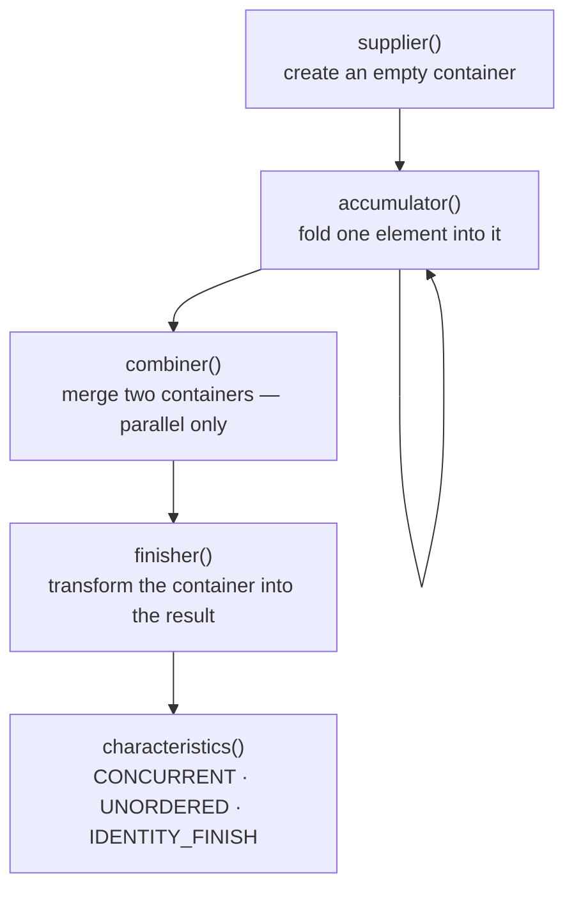
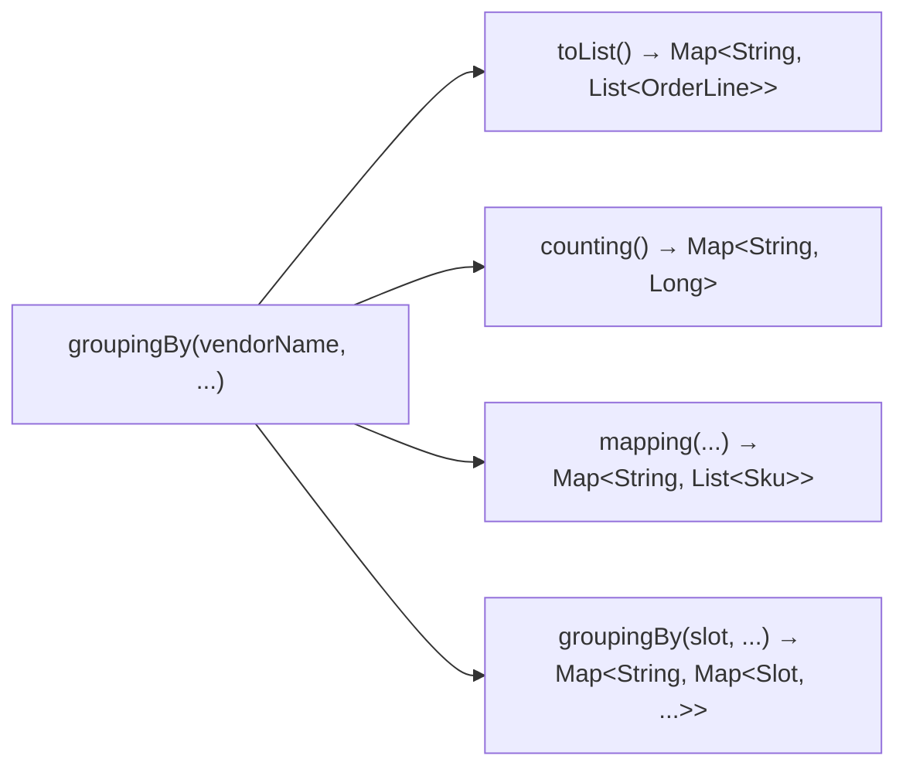
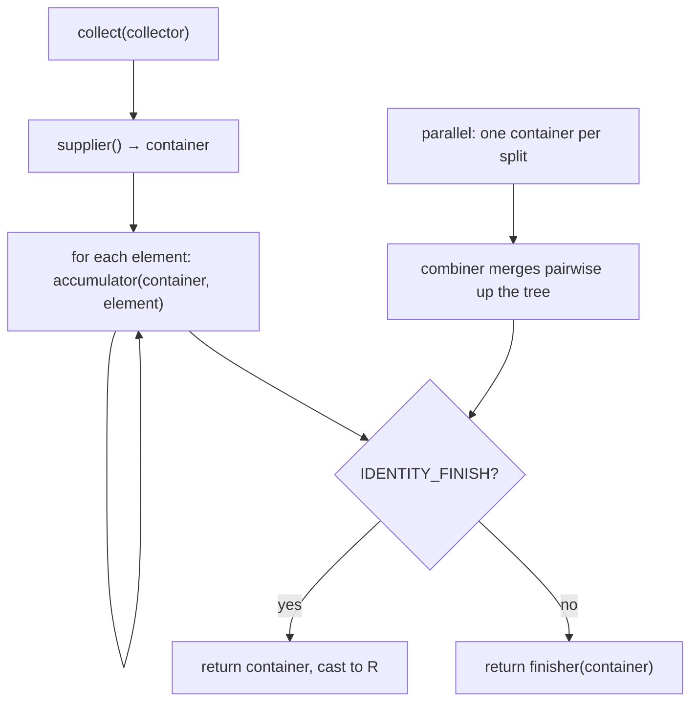

# Collectors & Stream Composition

## 1. Purpose & Audience

**Band:** L2 Professional · **Prerequisites:** [The Stream API](07-stream-api.md)

Most developers learn three collectors — `toList`, `toSet`, `toMap` — and then drop out of the pipeline to finish the job with a loop. That is where streams stop paying off, because the interesting work is exactly what `collect` was designed for: grouping, partitioning, multi-level aggregation, and composing all of those into one pass.

This chapter answers three questions:

1. **What is a `Collector` actually made of**, and why is it not just a function?
2. **How do downstream collectors compose** into multi-level aggregations?
3. **When do you write your own**, and when is that a mistake?

---

## 2. The Problem

Report total revenue per vendor, per delivery slot, for a batch of orders. With `reduce` alone:

```java title="ManualGrouping.java"
Map<String, Map<DeliverySlot, Money>> report = new HashMap<>();
for (Order order : orders) {
    for (OrderLine line : order.lines()) {
        report.computeIfAbsent(line.vendorName(), v -> new HashMap<>())
              .merge(order.slot(), line.lineTotal(), Money::plus);
    }
}
```

That works. It is also six lines of nested container management for one sentence of intent, and every variation — add a third level, filter perishables, count instead of sum — means restructuring the loop.

`reduce` cannot help here. Its signature `reduce(T identity, BinaryOperator<T> op)` requires the accumulator type to be the stream's element type and expects a new value each step. Building a `Map` that way means copying the map on every element:

```java title="ReduceMisuse.java"
// O(n²) — allocates a new map per element
Map<String, Money> totals = lines.stream()
    .reduce(new HashMap<>(),
            (map, line) -> { Map<String, Money> copy = new HashMap<>(map); /* ... */ return copy; },
            (a, b) -> { /* merge */ return a; });
```

`collect` exists for this: **mutable reduction**, where a container is created once and mutated as elements arrive.

---

## 3. Mental Model

A `Collector` is five things, not one.



| Function | Signature | For `toList()` |
|---|---|---|
| `supplier` | `() -> A` | `ArrayList::new` |
| `accumulator` | `(A, T) -> void` | `List::add` |
| `combiner` | `(A, A) -> A` | `(a, b) -> { a.addAll(b); return a; }` |
| `finisher` | `A -> R` | identity — nothing to do |
| `characteristics` | Set of hints | `IDENTITY_FINISH` |

Two consequences follow.

**The combiner only runs in parallel.** A sequential stream uses one container throughout, so `combiner` is never called. That is why a broken combiner produces tests that pass and production that corrupts the moment someone adds `parallel()`.

**`collect` mutates; `reduce` replaces.** That is the whole distinction. Use `reduce` for values (a sum, a maximum), `collect` for containers.

### 3.1 Downstream collectors are the real feature

`groupingBy` takes a second collector that decides what each group becomes. That is what makes the API compose:



Every downstream slot accepts any collector, including another `groupingBy` — which is how arbitrary nesting works without any special support.

---

## 4. Core API & Syntax

### 4.1 To a collection

| Collector | Result | Notes |
|---|---|---|
| `toList()` | `List<T>` | Mutable `ArrayList` — but unspecified. Prefer `stream.toList()` |
| `toSet()` | `Set<T>` | Unspecified implementation |
| `toCollection(supplier)` | Your choice | `toCollection(TreeSet::new)` |
| `toUnmodifiableList/Set()` (10) | Immutable | **Rejects nulls** |
| `toMap(k, v)` | `HashMap` | **Throws on duplicate keys** |
| `toMap(k, v, merge)` | `HashMap` | Merge function resolves collisions |
| `toMap(k, v, merge, supplier)` | Your map type | `TreeMap::new`, `LinkedHashMap::new` |
| `toUnmodifiableMap(...)` (10) | Immutable | Rejects nulls |

### 4.2 Aggregation

| Collector | Result |
|---|---|
| `counting()` | `Long` |
| `summingInt/Long/Double(fn)` | Sum |
| `averagingInt/Long/Double(fn)` | `Double` |
| `summarizingInt/Long/Double(fn)` | `IntSummaryStatistics` — count, sum, min, max, average |
| `minBy/maxBy(comparator)` | `Optional<T>` |
| `reducing(identity, op)` | Folded value — for downstream use |
| `joining()` / `(sep)` / `(sep, prefix, suffix)` | `String` |

### 4.3 Grouping and composition

| Collector | Result |
|---|---|
| `groupingBy(classifier)` | `Map<K, List<T>>` |
| `groupingBy(classifier, downstream)` | `Map<K, D>` |
| `groupingBy(classifier, mapSupplier, downstream)` | Your map type |
| `groupingByConcurrent(...)` | `ConcurrentMap` — for parallel |
| `partitioningBy(predicate)` | `Map<Boolean, List<T>>` — **always both keys** |
| `partitioningBy(predicate, downstream)` | `Map<Boolean, D>` |
| `mapping(fn, downstream)` | Transform before collecting |
| `flatMapping(fn, downstream)` (9) | Flatten before collecting |
| `filtering(predicate, downstream)` (9) | Filter before collecting |
| `collectingAndThen(collector, finisher)` | Post-process the result |
| `teeing(c1, c2, merger)` (12) | Two collectors, one pass |

!!! note "`partitioningBy` always returns both keys"
    Even when no element matches, the result has `true` and `false` entries with empty lists. `groupingBy` on a boolean classifier does not — absent groups are simply missing. That difference is the reason to prefer `partitioningBy` for a yes/no split: `result.get(true)` is never null.

---

## 5. Worked Examples

### 5.1 Grouping with a downstream

```java title="VendorTotals.java"
Map<String, Money> revenueByVendor = orders.stream()
    .flatMap(order -> order.lines().stream())
    .collect(groupingBy(
        OrderLine::vendorName,
        reducing(Money.ZERO, OrderLine::lineTotal, Money::plus)));
```

```text title="Output"
{Amul=₹1,240.00, ITC=₹890.00, Tata=₹3,105.00}
```

The three-argument `reducing` is the one to remember: identity, mapper, operator. Without the mapper you would need `mapping(OrderLine::lineTotal, reducing(Money.ZERO, Money::plus))`, which says the same thing with more parentheses.

### 5.2 Multi-level grouping

The report from §2, in one expression:

```java title="RevenueReport.java"
Map<String, Map<DeliverySlot, Money>> report = orders.stream()
    .flatMap(order -> order.lines().stream()
                           .map(line -> new SlotLine(order.slot(), line)))
    .collect(groupingBy(
        sl -> sl.line().vendorName(),
        groupingBy(
            SlotLine::slot,
            reducing(Money.ZERO, sl -> sl.line().lineTotal(), Money::plus))));
```

Nesting is just a `groupingBy` in the downstream slot. Three levels works the same way — but past two, extract a record and a named method, because the type signature stops being readable.

Sorted output by supplying a map factory:

```java title="SortedReport.java"
Map<String, Money> sorted = lines.stream()
    .collect(groupingBy(
        OrderLine::vendorName,
        TreeMap::new,                                    // sorted keys
        reducing(Money.ZERO, OrderLine::lineTotal, Money::plus)));
```

### 5.3 `mapping`, `filtering`, `flatMapping`

These three transform elements *inside* a group, after classification:

```java title="DownstreamShaping.java"
// Which SKUs does each vendor supply?
Map<String, Set<Sku>> skusByVendor = lines.stream()
    .collect(groupingBy(OrderLine::vendorName,
                        mapping(OrderLine::sku, toSet())));

// Only perishable lines, but keep every vendor as a key (Java 9)
Map<String, List<OrderLine>> perishableByVendor = lines.stream()
    .collect(groupingBy(OrderLine::vendorName,
                        filtering(OrderLine::perishable, toList())));

// Every substitute SKU across each vendor's lines (Java 9)
Map<String, List<Sku>> substitutesByVendor = lines.stream()
    .collect(groupingBy(OrderLine::vendorName,
                        flatMapping(l -> l.substitutes().stream(), toList())));
```

The `filtering` example is the one worth noting. Filtering *before* `groupingBy` drops vendors whose lines are all non-perishable; `filtering` as a downstream keeps them with an empty list. Which you want depends on whether the report should show a vendor with zero perishables — and the two spellings look almost identical, which is how the bug happens.

### 5.4 `partitioningBy` for a yes/no split

```java title="StockSplit.java"
Map<Boolean, List<CartLine>> byStock = cart.lines().stream()
    .collect(partitioningBy(line -> catalogue.availableQuantity(line.sku()) > 0));

List<CartLine> fulfillable = byStock.get(true);
List<CartLine> backordered = byStock.get(false);   // never null, even if empty
```

With a downstream, for counts rather than the lines:

```java
Map<Boolean, Long> counts = cart.lines().stream()
    .collect(partitioningBy(CartLine::perishable, counting()));
```

### 5.5 `toMap` — the traps

```java title="ToMapTraps.java"
// 1. Throws IllegalStateException on a duplicate SKU
Map<Sku, OrderLine> bySku = lines.stream()
    .collect(toMap(OrderLine::sku, identity()));

// 2. Merge function decides the winner
Map<Sku, OrderLine> merged = lines.stream()
    .collect(toMap(OrderLine::sku, identity(),
                   (a, b) -> a.withQuantity(a.quantity() + b.quantity())));

// 3. Preserve encounter order
Map<Sku, OrderLine> ordered = lines.stream()
    .collect(toMap(OrderLine::sku, identity(),
                   (a, b) -> a,
                   LinkedHashMap::new));
```

Three separate failure modes in one collector:

- **Duplicate keys throw at runtime**, on the data that triggers it — rarely the data in your tests. Always supply a merge function unless key uniqueness is structurally guaranteed.
- **Null values throw `NullPointerException`**, even though `HashMap` accepts them. `toMap` calls `map.merge`, which rejects nulls. Filter or default them first.
- **The result is a `HashMap`**, so iteration order is unspecified. Supply `LinkedHashMap::new` if order matters.

### 5.6 `teeing` — two collectors, one pass

```java title="Teeing.java"
record PriceRange(Money cheapest, Money dearest) {}

PriceRange range = lines.stream()
    .map(OrderLine::lineTotal)
    .collect(teeing(
        minBy(Money::compareTo),
        maxBy(Money::compareTo),
        (min, max) -> new PriceRange(min.orElse(Money.ZERO), max.orElse(Money.ZERO))));
```

Before Java 12 this meant either two traversals or a hand-written collector. `teeing` feeds every element to both collectors and merges the two results at the end — one pass, no intermediate collection.

It is also the clean way to compute a ratio:

```java
double perishableShare = lines.stream()
    .collect(teeing(
        filtering(OrderLine::perishable, counting()),
        counting(),
        (perishable, total) -> total == 0 ? 0.0 : (double) perishable / total));
```

### 5.7 `collectingAndThen` for immutability

```java title="Immutable.java"
Map<String, List<OrderLine>> report = lines.stream()
    .collect(groupingBy(OrderLine::vendorName,
                        collectingAndThen(toList(), List::copyOf)));
```

`toUnmodifiableList()` would be simpler for a top-level collect, but it cannot be used as a downstream when you also want the null-tolerance of `toList`. `collectingAndThen` is the general form: collect, then transform.

Be aware it allocates twice — a mutable list, then an immutable copy. For a hot path with large groups, that matters; for a report, it does not.

### 5.8 Writing your own

Only when no composition of the built-ins fits. A bounded top-N collector is a reasonable example, because `sorted().limit(n)` buffers the entire stream:

```java title="TopNCollector.java"
public static <T> Collector<T, ?, List<T>> topN(int n, Comparator<T> comparator) {
    return Collector.of(
        () -> new PriorityQueue<T>(comparator),          // supplier: min-heap of size n
        (queue, item) -> {                                // accumulator
            queue.offer(item);
            if (queue.size() > n) {
                queue.poll();                             // evict the smallest
            }
        },
        (a, b) -> {                                       // combiner — parallel only
            b.forEach(item -> {
                a.offer(item);
                if (a.size() > n) a.poll();
            });
            return a;
        },
        queue -> queue.stream()                           // finisher
                      .sorted(comparator.reversed())
                      .toList());
}
```

```java
List<OrderLine> topFive = lines.stream()
    .collect(topN(5, comparing(OrderLine::lineTotal)));
```

Memory is O(n) rather than O(stream). The combiner is the part people get wrong — and, because it only runs in parallel, the part tests miss.

---

## 6. Internals

### 6.1 How `collect` runs



Sequentially: one container, `n` accumulator calls, maybe a finisher. No copying, no intermediate collections. This is why `collect(groupingBy(...))` on a million elements is roughly the cost of the loop it replaces.

### 6.2 Characteristics

| Characteristic | Meaning | Effect |
|---|---|---|
| `IDENTITY_FINISH` | The container *is* the result | Finisher skipped; unchecked cast |
| `UNORDERED` | Encounter order irrelevant | Parallel merging can be cheaper |
| `CONCURRENT` | One container is safe for all threads | Skips the split-and-merge tree entirely |

`CONCURRENT` is the interesting one. A concurrent collector — `groupingByConcurrent`, `toConcurrentMap` — lets every parallel thread accumulate into **one** shared container, avoiding the merge tree. It only helps when combined with `UNORDERED`, and only when the container's concurrent writes are cheaper than merging, which in practice means large streams with many small groups.

For a sequential stream, `groupingByConcurrent` is strictly worse than `groupingBy` — you pay `ConcurrentHashMap` write costs for no benefit.

### 6.3 Why the combiner is the dangerous part

```java title="BrokenCombiner.java"
Collector.of(
    ArrayList::new,
    List::add,
    (a, b) -> a);          // WRONG — silently drops everything in b
```

Sequentially this is invisible: one container, combiner never called, every test passes. Add `parallel()` and elements vanish non-deterministically — the exact bug profile you never want.

The combiner must satisfy two laws:

- **Associativity.** `combine(combine(a, b), c)` equals `combine(a, combine(b, c))`.
- **Consistency with the accumulator.** Accumulating elements into one container must produce the same result as splitting them, accumulating separately, and combining.

If you cannot state the combiner honestly, the operation may not be parallelisable, and that is worth knowing before you write it.

### 6.4 `toMap` versus `groupingBy`

They look similar and behave differently:

| | `toMap(k, v, merge)` | `groupingBy(k, downstream)` |
|---|---|---|
| Value per key | One, merged | A collection or aggregate |
| Duplicate keys | Merge function, or throws | Always accumulated |
| Null values | Throws NPE | Depends on downstream |
| Absent groups | N/A | Key simply missing |

**The rule:** `toMap` when each key maps to one value, `groupingBy` when a key maps to many. `groupingBy(k, reducing(...))` and `toMap(k, v, merge)` produce the same shape — pick `toMap` when there is genuinely one value per key, since it says so.

### 6.5 What `Collectors.toList()` actually returns

The specification says: no guarantee of type, mutability, serializability, or thread-safety. In practice it returns an `ArrayList`, and a great deal of code relies on that.

`Stream.toList()` (Java 16) is different: explicitly **unmodifiable**, and it permits nulls where `toUnmodifiableList()` does not. That combination is why it is the right default:

| | Mutable | Allows null |
|---|---|---|
| `Collectors.toList()` | Yes in practice, unspecified | Yes |
| `Collectors.toUnmodifiableList()` | No | **No** |
| `Stream.toList()` | No | Yes |

### 6.6 Ordering

`groupingBy` returns a `HashMap` — key order is unspecified and will change between runs. **Values within each group preserve encounter order** if the stream is ordered and the downstream is `toList()`.

For ordered keys, supply the map factory (`TreeMap::new`, `LinkedHashMap::new`). Sorting the result afterwards is a second pass and, on a `HashMap`, discards information you could have kept for free.

---

## 7. Production Patterns & Anti-Patterns

### Do this

- **Always supply a merge function to `toMap`** unless keys are structurally unique.
- **Use `counting()` rather than `summingInt(x -> 1)`.** Same result, clearer, and it returns `Long` rather than `Integer`.
- **Use `summarizingInt` when you need more than one aggregate.** One pass instead of four.
- **Use `teeing` for two aggregates** that need different collectors.
- **Supply a map factory when order matters** — `TreeMap::new` or `LinkedHashMap::new` — rather than sorting afterwards.
- **Prefer `filtering(...)` downstream over filtering upstream** when empty groups should still appear.
- **Extract multi-level groupings into named methods.** `revenueByVendorAndSlot(orders)` beats a five-line nested collector at the call site.
- **Prefer `Stream.toList()`** for simple list results.

### Never do this

- **Never use `reduce` to build a container.** It either copies per element (quadratic) or mutates a shared accumulator (broken in parallel). That is what `collect` is for.
- **Never write a combiner you have not thought about.** It runs only in parallel, so a wrong one passes every sequential test.
- **Never mutate the source collection from inside a collector.** Undefined behaviour, and `ConcurrentModificationException` if you are lucky.
- **Never use `collect` for side effects.** `collect(toList())` then `forEach(repository::save)` is honest; a collector that saves as it accumulates is not.
- **Never use `groupingByConcurrent` on a sequential stream.** You pay concurrent-write costs for nothing.
- **Never assume `groupingBy` key order.** It is a `HashMap`.
- **Never pass a null-producing value mapper to `toMap`.** It throws, unlike `HashMap.put`.
- **Never write a custom collector where composition would do.** `mapping`, `filtering`, `flatMapping`, `collectingAndThen`, and `teeing` cover almost everything.

---

## 8. Version Evolution (Java 8 → 26)

| Version | What changed | Impact |
|---|---|---|
| **8** | `Collectors`, `groupingBy`, `partitioningBy`, `toMap`, `joining`, `mapping`, `collectingAndThen`, `reducing` | Mutable reduction; multi-level aggregation in one pass |
| **9** | `flatMapping`, `filtering` | Downstream shaping without losing empty groups |
| **10** | `toUnmodifiableList/Set/Map` | Immutable results directly, but null-hostile |
| **12** | `teeing` | Two collectors, one traversal |
| **16** | `Stream.toList()` — a terminal operation, **not** a collector | The right default for simple list results |
| **22–24** | **Stream Gatherers** (JEP 485, final in 24) | Custom *intermediate* operations — the mirror of custom collectors. See [Ch 38](../05-runtime/38-stream-gatherers.md) |
| **26** | No collector-specific changes | — |

### Migration note

Two mechanical sweeps on a Java 8-era codebase:

1. `collect(Collectors.toList())` → `.toList()` where the result is not mutated. Check carefully — the old form returned a mutable `ArrayList` and some code adds to it. The new one throws at runtime, not compile time.
2. `.filter(p).collect(groupingBy(k))` → `collect(groupingBy(k, filtering(p, toList())))` **only if** empty groups should be preserved. These are different results, not equivalent spellings.

Do not sweep `collect(toList())` blindly in code that then sorts or adds. The failure is a runtime `UnsupportedOperationException` in whatever path exercises it, which may not be a tested one.

---

## 9. Interview Questions

### L1 — Foundations

**Q1. What is the difference between `reduce` and `collect`?** ⭐ *high frequency*
`reduce` performs an immutable reduction: each step takes the running value and an element and returns a new value, so it suits sums, maxima, and concatenations of value types. `collect` performs a mutable reduction: it creates a container once and mutates it as elements arrive, which is what building a list, set, or map requires. Using `reduce` to build a collection either copies the container per element or shares mutable state unsafely.

**Q2. What does `groupingBy` return?**
A `Map` whose keys come from the classifier function and whose values are, by default, a `List` of the elements in each group. The map is a `HashMap`, so key order is unspecified. A second argument — the downstream collector — decides what each group becomes: a count, a sum, a set, or another grouping.

**Q3. What is the difference between `groupingBy` and `partitioningBy`?**
`partitioningBy` takes a predicate and always produces exactly two entries, `true` and `false`, even when one side is empty. `groupingBy` with a boolean classifier omits a key entirely when no element matches. For a yes/no split, `partitioningBy` is safer because `get(true)` is never null.

### L2 — Professional

**Q4. What are the traps in `Collectors.toMap`?** ⭐ *high frequency*
Three. Duplicate keys throw `IllegalStateException` unless you supply a merge function, and that happens at runtime on data your tests probably do not have. A null value throws `NullPointerException`, even though `HashMap` accepts nulls, because `toMap` uses `merge` internally. And the result is a `HashMap`, so if iteration order matters you must pass a map factory.

**Q5. What is a downstream collector?**
The second argument to `groupingBy` or `partitioningBy`, deciding what each group is reduced to. It can be any collector — `counting()`, `toSet()`, `mapping(...)`, or another `groupingBy`, which is how arbitrary nesting works with no special support in the API. This composability is what makes `collect` more than a list builder.

**Q6. `filtering` downstream versus `filter` upstream — what is the difference?**
Filtering before `groupingBy` removes elements before classification, so a group whose elements are all filtered out disappears from the result entirely. `filtering` as a downstream classifies first and filters within each group, so the key survives with an empty collection. Which you want depends on whether the report should show the empty group, and the two spellings look nearly identical.

### L3 — Enterprise

**Q7. What are the five components of a `Collector`?**
`supplier` creates an empty container, `accumulator` folds one element into it, `combiner` merges two containers, `finisher` converts the container into the final result, and `characteristics` supplies hints such as `IDENTITY_FINISH`, `UNORDERED`, and `CONCURRENT`. The combiner is only invoked for parallel streams, and the finisher is skipped entirely when `IDENTITY_FINISH` is set.

**Q8. Why do custom collectors break only under `parallel()`?**
Because the combiner is never called on a sequential stream — there is one container from start to finish. A combiner that returns the wrong container, drops elements, or is not associative therefore passes every sequential test and fails non-deterministically the moment someone parallelises the pipeline. Writing the combiner and reasoning about associativity is the part that cannot be skipped.

**Q9. When does `groupingByConcurrent` actually help?**
Only on a parallel, unordered stream where the concurrent map's write cost is lower than the cost of building and merging per-thread maps — typically large streams with many small groups. It declares `CONCURRENT`, which lets every thread accumulate into one shared `ConcurrentMap` and skips the merge tree entirely. On a sequential stream it is strictly worse, since you pay concurrent-write overhead for no parallelism.

### L4 — Architect

**Q10. When should you write a custom collector rather than compose existing ones?**
Rarely, and only when the composition genuinely cannot express the operation — a bounded top-N that must not buffer the whole stream, or an accumulation into a domain-specific structure with its own merge semantics. `mapping`, `filtering`, `flatMapping`, `collectingAndThen`, `reducing`, and `teeing` cover nearly everything else. The cost of a custom collector is the combiner: you now own a correctness obligation that only manifests under parallelism.

**Q11. A report pipeline does four passes over the same list to compute four aggregates. How would you restructure it?**
If the aggregates are a count, sum, min, max, and average of one numeric field, `summarizingInt` gives all five in one pass. For two aggregates needing different collectors, `teeing` merges them at the end of a single traversal. Beyond two, a small custom collector or a record accumulator with a three-argument `collect(supplier, accumulator, combiner)` is cleaner than nesting `teeing` calls — at which point it is worth asking whether the aggregation belongs in the database instead.

**Q12. How do Stream Gatherers relate to collectors?**
They are the mirror image. A `Collector` is an extensible *terminal* operation; until Java 24 the set of *intermediate* operations was closed, so windowing, running folds, and stateful scans had no expression in a pipeline and got rewritten as loops. Gatherers make intermediate operations extensible with a similar four-function shape — initializer, integrator, combiner, finisher. Together they close the extensibility gap at both ends of a stream.

---

!!! abstract "Cheat Sheet"
    **`Collector` = supplier · accumulator · combiner · finisher · characteristics**

    **`reduce` replaces values · `collect` mutates a container**

    **Combiner runs only in parallel** — a wrong one passes every sequential test

    **`toMap` throws on duplicate keys and on null values** — always pass a merge function

    **`groupingBy` → many values per key · `toMap` → one value per key**

    **`partitioningBy` always has both `true` and `false`** — `groupingBy` omits empty groups

    **Downstream shaping:** `mapping` · `filtering` (9) · `flatMapping` (9) · `collectingAndThen`

    **`filtering` downstream keeps empty groups; upstream `filter` drops them**

    **`teeing`** (12) — two collectors, one pass · **`summarizing*`** — five aggregates, one pass

    **`counting()`**, not `summingInt(x -> 1)`

    **Map factory for ordered keys** — `TreeMap::new` / `LinkedHashMap::new`

    **`Stream.toList()`** (16) — unmodifiable, null-tolerant; the right default
