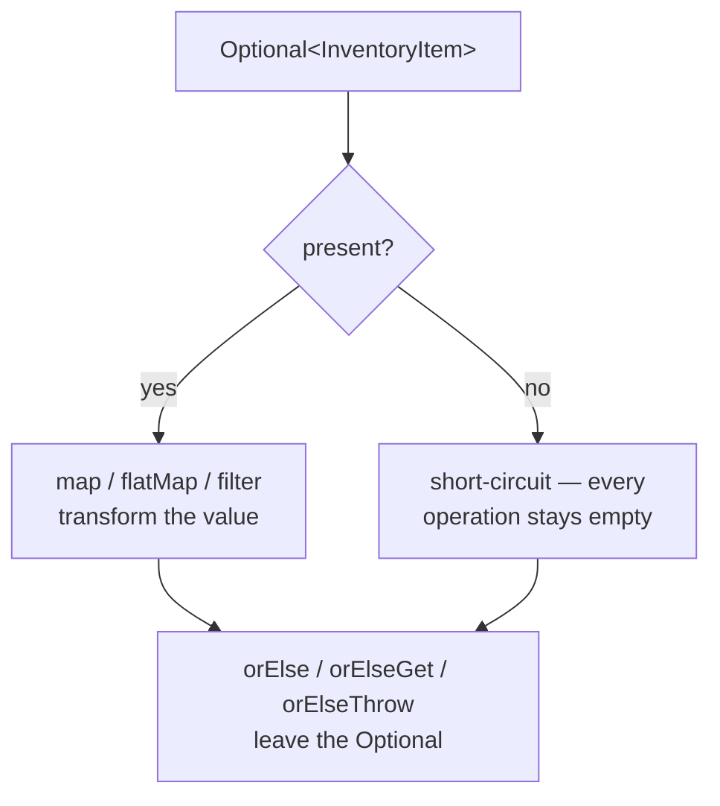
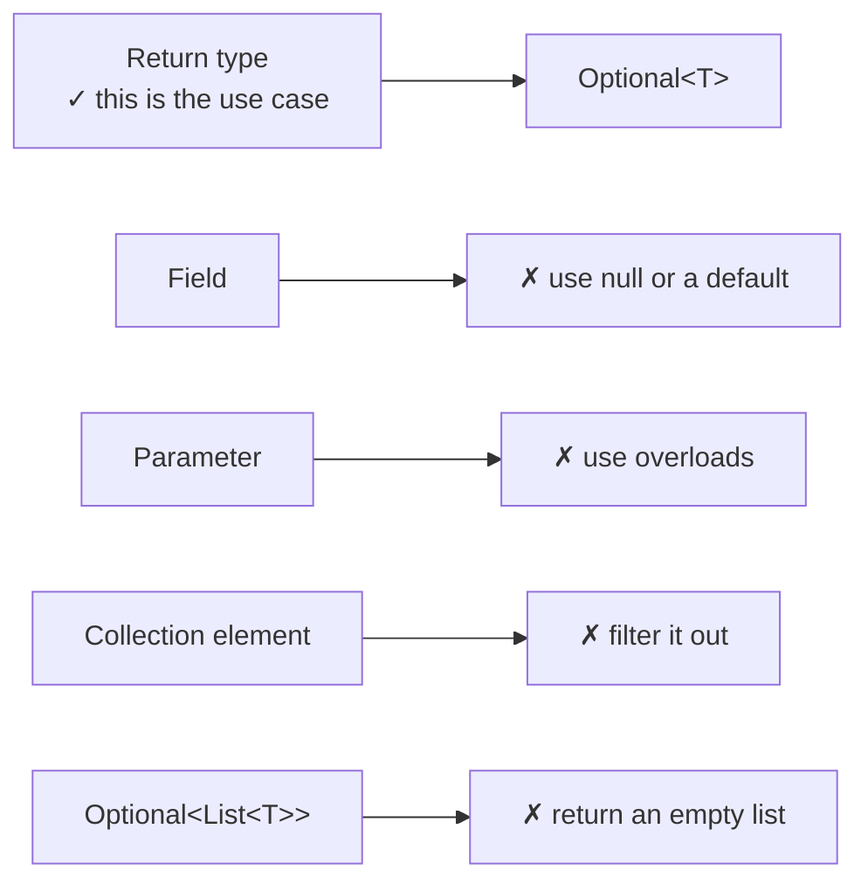

# Optional & Null Strategy

## 1. Purpose & Audience

**Band:** L2 Professional · **Prerequisites:** [Lambdas & Functional Interfaces](06-lambdas-functional-interfaces.md)

`Optional` was added to solve one problem: a method that may have nothing to return should be able to say so in its signature. It was not added to eliminate null from Java, and treating it that way produces codebases with `Optional` fields, `Optional` parameters, and `Optional<List<T>>` — all of which are worse than the null they replaced.

This chapter answers three questions:

1. **What problem does `Optional` actually solve**, and where does it stop?
2. **How do you compose `Optional`** rather than unwrapping it immediately?
3. **What is the rest of a null strategy** — because `Optional` is only part of one?

---

## 2. The Problem

The catalogue lookup may find nothing. In Java 7 the signature cannot say so:

```java title="CatalogueBefore.java"
// Java 7 — does this return null? The signature is silent.
public InventoryItem find(Sku sku) {
    return bySku.get(sku);
}
```

Every caller must either know the answer from documentation or guess:

```java title="CallerBefore.java"
InventoryItem item = catalogue.find(sku);
if (item != null) {
    Vendor vendor = item.vendor();
    if (vendor != null) {
        Address address = vendor.warehouseAddress();
        if (address != null) {
            return address.pincode();
        }
    }
}
return "UNKNOWN";
```

Two failures compound here. The **signature carries no information**, so absence is discovered at runtime by whoever forgot the check. And the **defensive nesting** grows with depth, because each level might be null and there is no way to say "if any step is absent, the answer is absent".

```java title="CatalogueAfter.java"
// Java 8 — the signature states the contract
public Optional<InventoryItem> find(Sku sku) {
    return Optional.ofNullable(bySku.get(sku));
}
```

```java title="CallerAfter.java"
return catalogue.find(sku)
    .map(InventoryItem::vendor)
    .map(Vendor::warehouseAddress)
    .map(Address::pincode)
    .orElse("UNKNOWN");
```

---

## 3. Mental Model

`Optional<T>` is **a return type that says "possibly nothing", with a vocabulary for handling that without branching.**



Two properties do the work:

- **Operations short-circuit on empty.** `map` on an empty `Optional` returns empty without calling the function. That is what collapses the nested `if` chain into a flat pipeline.
- **You must exit deliberately.** There is no implicit unwrap. `orElse`, `orElseGet`, `orElseThrow`, or `ifPresent` — you choose what absence means, at the point where you know.

### 3.1 Where `Optional` belongs



The JDK's own API is the guide: `Optional` appears as a return type on `findFirst`, `min`, `max`, `reduce`, `Map.Entry` stream lookups — and nowhere else. No JDK class has an `Optional` field or parameter.

---

## 4. Core API & Syntax

### 4.1 Creation

| Form | Behaviour |
|---|---|
| `Optional.of(value)` | **Throws NPE** if value is null — use when null is a bug |
| `Optional.ofNullable(value)` | Empty if null — use at the boundary with null-returning code |
| `Optional.empty()` | The empty instance |

The distinction matters: `of` is an assertion, `ofNullable` is a conversion. Using `ofNullable` everywhere hides bugs that `of` would surface immediately.

### 4.2 Transforming — stay inside the Optional

| Method | Signature | Use |
|---|---|---|
| `map(Function<T,R>)` | `Optional<R>` | Transform the value |
| `flatMap(Function<T,Optional<R>>)` | `Optional<R>` | When the function itself returns `Optional` |
| `filter(Predicate<T>)` | `Optional<T>` | Empty if the predicate fails |
| `or(Supplier<Optional<T>>)` (9) | `Optional<T>` | Fall back to another `Optional` |
| `stream()` (9) | `Stream<T>` | Zero or one element — for flat-mapping |

### 4.3 Exiting — unwrap deliberately

| Method | Behaviour |
|---|---|
| `orElse(T other)` | Default value — **always evaluated** |
| `orElseGet(Supplier<T>)` | Lazy default — evaluated only when empty |
| `orElseThrow(Supplier<X>)` | Throw your exception |
| `orElseThrow()` (10) | Throws `NoSuchElementException` |
| `ifPresent(Consumer<T>)` | Side effect when present |
| `ifPresentOrElse(Consumer, Runnable)` (9) | Both branches |
| `get()` | **Avoid** — throws on empty, identical to `orElseThrow()` |
| `isPresent()` / `isEmpty()` (11) | Boolean checks — usually a sign you should have used `map` |

---

## 5. Worked Examples

### 5.1 Chaining instead of nesting

```java title="PincodeLookup.java"
public String warehousePincode(Sku sku) {
    return catalogue.find(sku)
        .map(InventoryItem::vendor)
        .map(Vendor::warehouseAddress)
        .map(Address::pincode)
        .orElse("UNKNOWN");
}
```

Each `map` short-circuits on empty, so a missing SKU, a missing vendor, or a missing address all produce `"UNKNOWN"` with no branching. The nine-line nested version in §2 does the same thing with four places to get the null check wrong.

### 5.2 `map` versus `flatMap`

```java title="MapVsFlatMap.java"
// vendor() returns Vendor — map gives Optional<Vendor>
Optional<Vendor> vendor = catalogue.find(sku).map(InventoryItem::vendor);

// preferredVendor() returns Optional<Vendor> — map would give Optional<Optional<Vendor>>
Optional<Vendor> preferred = catalogue.find(sku)
    .flatMap(InventoryItem::preferredVendor);
```

Same rule as streams: **`flatMap` when the function already returns the wrapper.** If you find yourself writing `Optional<Optional<T>>`, you wanted `flatMap`.

### 5.3 `orElse` versus `orElseGet`

```java title="EagerDefault.java"
// expensiveDefault() runs EVERY TIME, even when the value is present
Money price = catalogue.priceFor(sku).orElse(computeFallbackPrice(sku));

// runs only when empty
Money price = catalogue.priceFor(sku).orElseGet(() -> computeFallbackPrice(sku));
```

`orElse` takes a value, so its argument is evaluated before the call — always. With a constant that is fine; with a method call it is a hidden cost, and with a side-effecting call it is a bug.

The rule: **`orElse` for literals and constants, `orElseGet` for anything computed.**

The same applies to exceptions:

```java
// Constructs the exception even on the happy path
.orElseThrow(new SkuNotFoundException(sku));        // won't compile — but people try

// Correct: a supplier
.orElseThrow(() -> new SkuNotFoundException(sku));
```

### 5.4 Filtering

```java title="Filtering.java"
Optional<InventoryItem> fulfillable = catalogue.find(sku)
    .filter(item -> item.available() > 0)
    .filter(item -> !item.discontinued());
```

`filter` turns a present-but-unsuitable value into empty, which lets a suitability check join the chain rather than interrupting it with an `if`.

### 5.5 `Optional.stream()` in a pipeline

```java title="OptionalStream.java"
// Java 8 — clumsy
List<InventoryItem> found = skus.stream()
    .map(catalogue::find)
    .filter(Optional::isPresent)
    .map(Optional::get)
    .toList();

// Java 9 — one operation
List<InventoryItem> found = skus.stream()
    .map(catalogue::find)
    .flatMap(Optional::stream)
    .toList();
```

`Optional.stream()` produces a stream of zero or one element, so `flatMap` drops the empties and unwraps the rest in a single step. This is the idiom for "look up many things, keep the ones that exist".

### 5.6 `ifPresentOrElse` and `or`

```java title="Branching.java"
catalogue.find(sku).ifPresentOrElse(
    item -> log.info("found {} with {} in stock", sku, item.available()),
    ()   -> log.warn("unknown sku {}", sku));
```

```java title="Fallback.java"
Optional<Vendor> vendor = primaryVendorFor(sku)
    .or(() -> backupVendorFor(sku))
    .or(() -> Optional.of(Vendor.DEFAULT));
```

`or` chains alternative *sources*; `orElseGet` supplies a final *value*. Use `or` while you still want an `Optional`, `orElseGet` when you are leaving.

### 5.7 What not to do

```java title="AntiPatterns.java"
// 1. Optional field — adds a wrapper object per instance, and Optional is not Serializable
public class Order {
    private Optional<DeliverySlot> slot;      // ✗
    private DeliverySlot slot;                 // ✓ null means unscheduled
}

// 2. Optional parameter — the caller must wrap, and you must still handle null
public Order confirm(Cart cart, Optional<Coupon> coupon) { }      // ✗
public Order confirm(Cart cart) { }                                // ✓ overload
public Order confirm(Cart cart, Coupon coupon) { }                 // ✓

// 3. Optional collection — two ways to express "nothing"
public Optional<List<OrderLine>> lines() { }     // ✗ empty Optional or empty list?
public List<OrderLine> lines() { }                // ✓ return an empty list

// 4. isPresent + get — the null check you were trying to avoid
if (found.isPresent()) {                          // ✗
    process(found.get());
}
found.ifPresent(this::process);                   // ✓
```

The parameter case has a specific tell: a caller writing `confirm(cart, Optional.empty())` is doing work the API should have done with an overload.

---

## 6. Internals

### 6.1 `Optional` is a value-based class

`Optional` is declared value-based, which carries real restrictions:

- **Identity is unspecified.** `Optional.of(x) == Optional.of(x)` may be true or false. Never compare with `==`, never synchronise on one, never use one as a lock or a map key where identity matters.
- **`Optional.empty()` is cached**, so all empty instances are likely the same object — but relying on that is relying on unspecified behaviour.
- **It is not `Serializable`.** An `Optional` field breaks serialization, and that is deliberate: the design intent was never fields.

Value-based classes are also the candidates for Project Valhalla's value types, which would make `Optional` allocation-free. That is another reason the restrictions exist.

### 6.2 The allocation cost

Every `Optional` is an object. In a tight loop or a hot lookup path, wrapping a result that is almost always present allocates for nothing:

```java title="HotPath.java"
// A million lookups, a million Optional allocations
for (Sku sku : skus) {
    Money price = catalogue.priceFor(sku).orElse(Money.ZERO);
}
```

Escape analysis often eliminates these — the `Optional` never escapes the method, so the JIT can scalarise it. Often, not always. In a measured hot path returning a nullable value with a documented contract is a legitimate choice; everywhere else, clarity wins.

### 6.3 Why `get()` is a design regret

`get()` throws `NoSuchElementException` on empty. That makes it exactly as unsafe as the null dereference `Optional` was introduced to prevent — with the added problem that its name suggests it is the normal way to extract a value.

The JDK team considered renaming it. `orElseThrow()` was added in Java 10 as the no-argument equivalent with an honest name, and modern static analysis flags bare `get()`. Treat `get()` as deprecated in spirit: use `orElseThrow()` when absence really is a bug, and `orElseGet`/`map` otherwise.

### 6.4 `Optional` short-circuits like a stream

```java title="ShortCircuit.java"
Optional.<InventoryItem>empty()
    .map(item -> { System.out.println("never runs"); return item.vendor(); })
    .filter(v -> { System.out.println("never runs"); return true; })
    .orElse(Vendor.DEFAULT);
```

Once empty, every subsequent operation returns empty without invoking its function. This is the same laziness-on-absence that makes stream pipelines safe, and it is why chaining six `map` calls costs nothing on the empty path.

### 6.5 The rest of a null strategy

`Optional` covers return types. The other three quarters of the problem need different tools:

| Situation | Tool |
|---|---|
| Method may return nothing | `Optional<T>` |
| Parameter must not be null | `Objects.requireNonNull(x, "sku")` at the top of the method |
| Collection result | An **empty collection**, never null |
| Field that may be absent | `null` plus a nullability annotation, or a default value |
| Absence has behaviour | Null Object pattern — `Vendor.NONE` with no-op methods |
| Interop with a null-returning API | Convert at the boundary with `ofNullable` |

```java title="FailFast.java"
public Order confirm(Cart cart, Customer customer) {
    Objects.requireNonNull(cart, "cart");
    Objects.requireNonNull(customer, "customer");
    // ...
}
```

`requireNonNull` fails at the boundary with the parameter name, rather than fifteen frames later with an unhelpful NPE. Java 14's helpful NullPointerException messages narrowed that gap considerably — they name the expression that was null — but failing at the boundary is still better than failing deep.

Nullability annotations (`@Nullable`, `@NonNull`) let static analysis and IDEs check what the compiler cannot. They are not part of the JDK and the ecosystem has several competing sets; pick one per codebase and apply it consistently, or the tooling reports noise.

---

## 7. Production Patterns & Anti-Patterns

### Do this

- **Return `Optional<T>` from methods where absence is a normal, expected outcome** — a lookup that may miss, a search with no result.
- **Use `of` when null would be a bug and `ofNullable` at the boundary** with code that returns null.
- **Chain with `map`, `flatMap`, and `filter`** rather than checking `isPresent`.
- **Use `orElseGet` for anything computed**, `orElse` only for constants.
- **Use `orElseThrow(() -> ...)` when absence genuinely is an error** at that layer — and let the exception carry the key that was missing.
- **Use `Optional.stream()`** to unwrap many lookups in a pipeline.
- **Return empty collections, never `Optional<Collection>`** or null.
- **`Objects.requireNonNull` on public method parameters** that must not be null.

### Never do this

- **Never use `Optional` as a field.** It is not `Serializable`, it allocates per instance, and null or a default expresses the same thing.
- **Never use `Optional` as a parameter.** Overload instead — a caller writing `Optional.empty()` is doing your API's job.
- **Never return `Optional<List<T>>`.** Empty list means empty; you do not need two spellings.
- **Never call `get()` without a preceding check**, and prefer `orElseThrow()` even then — the name is honest.
- **Never write `if (opt.isPresent()) { opt.get() }`.** That is the null check with extra allocation. Use `ifPresent` or `map`.
- **Never put `Optional` in a collection.** `List<Optional<T>>` means two kinds of emptiness; filter first.
- **Never compare `Optional` with `==`.** It is value-based; identity is unspecified.
- **Never use `Optional` to wrap a boolean or a primitive** where a default value is obviously correct. `OptionalInt` exists but rarely earns its place.

---

## 8. Version Evolution (Java 8 → 26)

| Version | What changed | Impact |
|---|---|---|
| **8** | `Optional`, `OptionalInt/Long/Double` | Absence becomes expressible in a signature |
| **9** | `stream()`, `or(Supplier)`, `ifPresentOrElse` | Composition without leaving the `Optional`; the flat-map idiom arrives |
| **10** | `orElseThrow()` with no arguments | An honestly-named replacement for `get()` |
| **11** | `isEmpty()` | Reads better than `!isPresent()` |
| **14** | Helpful NullPointerException messages (JEP 358) | NPEs name the expression that was null — narrows the gap `Optional` was filling |
| **16** | Records | Compact value types reduce the temptation to model absence with nullable fields |
| **21** | Pattern matching for `switch`, sealed types | A sealed result hierarchy — `Found` / `NotFound` — becomes a viable alternative where absence carries a reason |
| **26** | No `Optional` changes | — |

### Migration note

Three mechanical sweeps on a Java 8-era codebase:

1. `.filter(Optional::isPresent).map(Optional::get)` → `.flatMap(Optional::stream)`.
2. `.get()` → `.orElseThrow()` where the intent is "this must be present".
3. `!opt.isPresent()` → `opt.isEmpty()`.

The non-mechanical work is removing `Optional` from fields and parameters where it crept in. Those changes ripple to callers, so do them per class rather than as a sweep — and check for serialization, since an `Optional` field may already be causing a runtime failure nobody traced back.

---

## 9. Interview Questions

### L1 — Foundations

**Q1. What problem does `Optional` solve?** ⭐ *high frequency*
It lets a method signature state that a result may be absent, which a plain reference type cannot. Before it, callers had to learn from documentation or from a production NPE whether a method could return null. It also supplies a vocabulary — `map`, `filter`, `orElse` — for handling absence without nested null checks.

**Q2. What is the difference between `Optional.of` and `Optional.ofNullable`?**
`of` throws `NullPointerException` if given null, so it asserts that the value is present. `ofNullable` converts null to empty, so it adapts code that may legitimately return null. Using `ofNullable` everywhere hides bugs that `of` would surface at the point of creation.

**Q3. What is the difference between `orElse` and `orElseGet`?**
`orElse` takes a value, so its argument is evaluated before the call regardless of whether the `Optional` is present. `orElseGet` takes a supplier, invoked only when empty. Use `orElse` for constants and `orElseGet` for anything computed — otherwise you pay the cost on every call, including the happy path.

### L2 — Professional

**Q4. Why shouldn't `Optional` be used as a field or a parameter?** ⭐ *high frequency*
`Optional` is not `Serializable`, so a field breaks serialization, and it adds a wrapper allocation per instance for information a null or a default already conveys. As a parameter it pushes work onto callers, who must write `Optional.empty()` at call sites where an overload would say the same thing better. The JDK follows this itself: `Optional` appears as a return type throughout the API and as a field or parameter nowhere.

**Q5. When do you use `flatMap` instead of `map` on an `Optional`?**
When the function you are applying already returns an `Optional`. `map` would wrap that result again, producing `Optional<Optional<T>>`; `flatMap` merges the two levels. It is the same rule as streams — if the mapper returns the wrapper type, flat-map it.

**Q6. Why is calling `get()` discouraged?**
Because it throws `NoSuchElementException` on empty, making it exactly as unsafe as the null dereference `Optional` was meant to prevent, while its name suggests it is the normal way to read the value. Java 10 added `orElseThrow()` as an identically-behaving method with an honest name. Where absence really is a bug, use `orElseThrow()`; otherwise use `map`, `orElseGet`, or `ifPresent`.

### L3 — Enterprise

**Q7. What does it mean that `Optional` is a value-based class?**
It means identity is unspecified: two `Optional` instances wrapping equal values may or may not be the same object, so `==` comparison, synchronisation, and identity-sensitive uses are all unsupported. It also signals the class is a candidate for Project Valhalla's value types, which would remove the allocation entirely. The practical rules are to compare with `equals`, never lock on one, and never rely on `Optional.empty()` returning a cached instance.

**Q8. What is a complete null strategy, beyond `Optional`?**
`Optional` covers return types where absence is expected. Parameters use `Objects.requireNonNull` to fail fast at the boundary with a named argument. Collection-returning methods return empty collections rather than null or `Optional`. Fields use null with a nullability annotation, or a default value, or the Null Object pattern where absence has behaviour. Nullability annotations plus static analysis then enforce what the compiler cannot.

**Q9. Does `Optional` have a performance cost worth caring about?**
Every `Optional` is an allocation, so a hot lookup path returning one per call allocates per call. Escape analysis frequently eliminates it — the wrapper usually does not escape the calling method, so the JIT can scalarise it — but not always, and not predictably. In a measured hot path, returning a documented nullable value is a legitimate trade; everywhere else the clarity is worth more than the allocation.

### L4 — Architect

**Q10. How would you introduce `Optional` into a large legacy codebase?**
At API boundaries first, working inward: change lookup and finder methods that currently return null, since those are where callers most often get it wrong, and the compiler forces every caller to confront the change. Do not sweep internal code — an `Optional` on a private method that is always present adds noise. Resist converting fields and parameters entirely. Pair the change with nullability annotations and a static-analysis gate, because `Optional` only documents the cases it covers.

**Q11. When is a sealed result type better than `Optional`?**
When absence has a reason that callers must distinguish. `Optional<InventoryItem>` cannot tell "no such SKU" from "SKU exists but is discontinued" from "catalogue unreachable", and callers that need to react differently end up throwing exceptions for control flow. A sealed interface with `Found`, `Discontinued`, and `Unavailable` variants, consumed with pattern matching for `switch`, makes every case explicit and exhaustively checked by the compiler. `Optional` is the right tool when the only question is present or absent.

**Q12. A team has `Optional` in fields, parameters, and collections throughout. How do you unwind it?**
Start by establishing why: usually someone read "don't use null" as "use `Optional` everywhere", so the fix is a shared convention before a code change. Then prioritise by risk — `Optional` fields on serializable types may already be failing in production, and `Optional` inside collections doubles the emptiness cases callers must handle. Parameters come next, replaced by overloads, since each change ripples to call sites and is best done per class with the compiler enforcing completeness. Leave return types alone: those are the ones that were right.

---

!!! abstract "Cheat Sheet"
    **`Optional` is a return type** — never a field, parameter, or collection element

    **`of` asserts non-null · `ofNullable` converts** at the boundary

    **Chain with `map` / `flatMap` / `filter`** — every operation short-circuits on empty

    **`flatMap`** when the mapper already returns an `Optional`

    **`orElse` evaluates always · `orElseGet` only when empty** — constants vs computation

    **`orElseThrow(() -> ...)`** — supplier form, so the exception isn't built on the happy path

    **Never `isPresent()` + `get()`** — that's the null check with extra allocation

    **`get()` is a design regret** — use `orElseThrow()` (Java 10)

    **`Optional.stream()`** (9) — `flatMap(Optional::stream)` unwraps many lookups

    **Return empty collections**, never `Optional<List<T>>` and never null

    **Value-based** — never `==`, never synchronise on one, not `Serializable`

    **Rest of the strategy:** `requireNonNull` for params · empty collections · Null Object · nullability annotations
