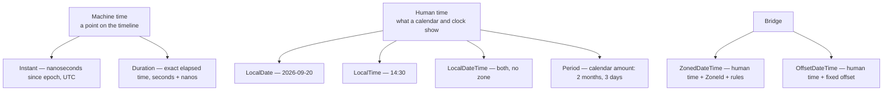
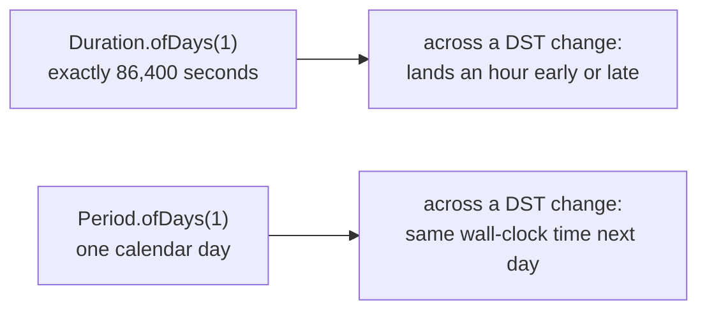

# java.time

## 1. Purpose & Audience

**Band:** L1 Foundations · **Prerequisites:** core Java syntax

`java.time` replaced an API so badly designed that its flaws are a standard interview topic: mutable dates, zero-based months, a year offset of 1900, and a formatter that silently corrupts data under concurrency. The replacement is good — but only if you pick the right type, and most date bugs in modern Java are a `LocalDateTime` where an `Instant` belonged.

This chapter answers three questions:

1. **Which type do you use**, and what does each one actually represent?
2. **What happens across a DST boundary**, and how do you not lose an hour?
3. **How do you make time testable** rather than reaching for a static mock?

---

## 2. The Problem

A delivery slot starts at a wall-clock time on a date, in a city. Expressing that with `java.util.Date`:

```java title="LegacyDate.java"
// Java 7
Calendar cal = Calendar.getInstance(TimeZone.getTimeZone("Asia/Kolkata"));
cal.set(2026, 8, 20, 14, 30, 0);     // month 8 means September — zero-based
cal.set(Calendar.MILLISECOND, 0);
Date slotStart = cal.getTime();

SimpleDateFormat fmt = new SimpleDateFormat("yyyy-MM-dd HH:mm");
String label = fmt.format(slotStart);
```

Four defects in six lines:

- **Zero-based months.** `8` is September. Off-by-one errors that pass review because the number looks right.
- **`Date` is mutable.** Hand one to a caller and they can change it under you; defensive copies everywhere.
- **`Date` is not a date.** It is a millisecond instant with a misleading name and a `getYear()` that returns years since 1900.
- **`SimpleDateFormat` is not thread-safe.** Sharing one across threads produces wrong output, silently — a static formatter field is one of the classic Java production bugs.

```java title="ModernTime.java"
// Java 8
ZonedDateTime slotStart = ZonedDateTime.of(
    LocalDate.of(2026, Month.SEPTEMBER, 20),
    LocalTime.of(14, 30),
    ZoneId.of("Asia/Kolkata"));

String label = slotStart.format(DateTimeFormatter.ofPattern("yyyy-MM-dd HH:mm"));
```

Immutable, one-based months, named types, and a thread-safe formatter.

---

## 3. Mental Model

The single most useful distinction: **machine time versus human time.**



| You want | Use |
|---|---|
| When something happened | `Instant` |
| A birthday, an invoice date | `LocalDate` |
| A shop's opening time | `LocalTime` |
| A slot in a specific city | `ZonedDateTime` |
| A timestamp with a recorded offset | `OffsetDateTime` |
| Elapsed machine time | `Duration` |
| Calendar-aware amount | `Period` |

**`LocalDateTime` has no time zone and is therefore not a timestamp.** Two `LocalDateTime` values cannot be compared across zones, and storing one for an event that happened is the most common mistake in this whole area. It is the right type for a *recurring wall-clock* concept — "the warehouse opens at 09:00 every day" — and nothing else.

### 3.1 `Duration` versus `Period`



This is not pedantry. A delivery scheduled "one day later" means the same clock time tomorrow — `Period`. A timeout of "24 hours" means 86,400 seconds — `Duration`. Using the wrong one produces a bug that appears twice a year.

---

## 4. Core API & Syntax

### 4.1 The core types

| Type | Represents | Example |
|---|---|---|
| `Instant` | Point on the timeline, UTC | `2026-09-20T09:00:00Z` |
| `LocalDate` | Date, no time or zone | `2026-09-20` |
| `LocalTime` | Time, no date or zone | `14:30` |
| `LocalDateTime` | Date + time, **no zone** | `2026-09-20T14:30` |
| `ZonedDateTime` | Date + time + zone with rules | `2026-09-20T14:30+05:30[Asia/Kolkata]` |
| `OffsetDateTime` | Date + time + fixed offset | `2026-09-20T14:30+05:30` |
| `Duration` | Time-based amount | `PT2H30M` |
| `Period` | Date-based amount | `P1M15D` |
| `Year`, `YearMonth`, `MonthDay` | Partials | `2026`, `2026-09`, `--09-20` |
| `DayOfWeek`, `Month` | Enums | `SATURDAY`, `SEPTEMBER` |
| `ZoneId` / `ZoneOffset` | Region with rules / fixed offset | `Asia/Kolkata` / `+05:30` |
| `Clock` | Source of the current time | Injectable |

### 4.2 Creating

| Form | Result |
|---|---|
| `Instant.now()` | Current instant |
| `LocalDate.of(2026, Month.SEPTEMBER, 20)` | A date — **one-based months** |
| `LocalTime.of(14, 30)` | A time |
| `ZonedDateTime.of(date, time, zone)` | Zoned |
| `LocalDate.parse("2026-09-20")` | ISO-8601 by default |
| `Instant.ofEpochMilli(millis)` | From a legacy millisecond value |
| `LocalDate.now(clock)` | **Testable** — see §5.5 |

### 4.3 Manipulating — everything returns a new instance

| Family | Examples |
|---|---|
| `plus` / `minus` | `plusDays(3)`, `minusHours(2)`, `plus(Period.ofMonths(1))` |
| `with` | `withDayOfMonth(1)`, `withHour(9)` |
| `truncatedTo` | `truncatedTo(ChronoUnit.HOURS)` |
| `TemporalAdjusters` | `with(TemporalAdjusters.next(DayOfWeek.MONDAY))`, `firstDayOfMonth()`, `lastDayOfMonth()` |
| Conversion | `atStartOfDay(zone)`, `toLocalDate()`, `atZone(zone)`, `toInstant()` |

### 4.4 Comparing and measuring

| Method | Returns |
|---|---|
| `isBefore` / `isAfter` / `isEqual` | `boolean` |
| `Duration.between(a, b)` | `Duration` — time-based |
| `Period.between(dateA, dateB)` | `Period` — calendar-based |
| `ChronoUnit.DAYS.between(a, b)` | `long` — a single unit |
| `LocalDate.datesUntil(end)` (9) | `Stream<LocalDate>` |

### 4.5 Formatting

| Formatter | Use |
|---|---|
| `DateTimeFormatter.ISO_INSTANT` | `2026-09-20T09:00:00Z` |
| `DateTimeFormatter.ISO_LOCAL_DATE` | `2026-09-20` |
| `ofPattern("dd MMM yyyy")` | Custom |
| `ofLocalizedDateTime(FormatStyle.MEDIUM)` | Locale-aware |
| `.withLocale(...)` / `.withZone(...)` | Adjust an existing formatter |

**`DateTimeFormatter` is immutable and thread-safe.** A `static final` formatter field is correct here, and was a serious bug with `SimpleDateFormat`.

---

## 5. Worked Examples

### 5.1 Picking the right type

```java title="OrderTypes.java"
// Excerpt: the components this chapter needs. The full model is in code/.
public record Order(
    OrderId id,
    Instant placedAt,              // when it happened — machine time
    LocalDate deliveryDate,        // a calendar date the customer chose
    DeliverySlot slot) { }

public record DeliverySlot(
    LocalTime start,               // 14:30 — recurring wall-clock
    LocalTime end,
    ZoneId zone) {                 // the city the slot belongs to

    public ZonedDateTime startOn(LocalDate date) {
        return ZonedDateTime.of(date, start, zone);
    }
}
```

`placedAt` is an `Instant` because it is a fact about the timeline. `deliveryDate` is a `LocalDate` because the customer picked a date, not an instant. `start` is a `LocalTime` because the slot means 2:30 pm every day, not one particular 2:30 pm.

### 5.2 Instant at the boundary, human time at the edge

```java title="Boundaries.java"
// Store and transmit as Instant
Instant placedAt = Instant.now(clock);
repository.save(order.withPlacedAt(placedAt));

// Render in the customer's zone, at the last possible moment
String display = placedAt
    .atZone(customer.zone())
    .format(DateTimeFormatter.ofPattern("dd MMM yyyy, HH:mm"));
```

```text title="Output"
20 Sep 2026, 14:30
```

The rule: **`Instant` in the core and the database, `ZonedDateTime` only at the presentation edge.** Converting early means every downstream comparison has to reason about zones.

### 5.3 DST is where the bugs live

India has no DST, so this is easiest to see with a zone that does:

```java title="DstArithmetic.java"
ZoneId london = ZoneId.of("Europe/London");
ZonedDateTime before = ZonedDateTime.of(
    LocalDate.of(2026, Month.MARCH, 28), LocalTime.of(14, 0), london);

// Period: one calendar day — same wall clock
ZonedDateTime nextDayCalendar = before.plus(Period.ofDays(1));
// 2026-03-29T14:00+01:00[Europe/London]   ← still 14:00

// Duration: exactly 24 hours of elapsed time
ZonedDateTime nextDayExact = before.plus(Duration.ofHours(24));
// 2026-03-29T15:00+01:00[Europe/London]   ← 15:00, an hour "lost" to the clock change
```

Both are correct. They answer different questions. A delivery scheduled for "tomorrow at 2 pm" needs the first; a token expiring "in 24 hours" needs the second.

**Gaps and overlaps.** When the clock springs forward, some wall-clock times do not exist; when it falls back, some occur twice. `ZonedDateTime.of` resolves both without throwing:

```java title="DstEdges.java"
// 01:30 does not exist on this date in London — moved forward by the gap
ZonedDateTime gap = ZonedDateTime.of(
    LocalDate.of(2026, Month.MARCH, 29), LocalTime.of(1, 30), london);
// 2026-03-29T02:30+01:00[Europe/London]

// 01:30 happens twice in October — the EARLIER offset is chosen
ZonedDateTime overlap = ZonedDateTime.of(
    LocalDate.of(2026, Month.OCTOBER, 25), LocalTime.of(1, 30), london);
// 2026-10-25T01:30+01:00[Europe/London]
// withLaterOffsetAtOverlap() selects the second occurrence
```

Silent resolution is usually what you want, but it means a scheduling bug produces a wrong time rather than an exception. If a gap should be an error in your domain, check explicitly with `zone.getRules().getValidOffsets(localDateTime)`.

### 5.4 Business-date arithmetic

```java title="BusinessDates.java"
// Next Monday
LocalDate nextMonday = today.with(TemporalAdjusters.next(DayOfWeek.MONDAY));

// Last day of the billing month
LocalDate billingEnd = today.with(TemporalAdjusters.lastDayOfMonth());

// Every delivery date in a range, excluding Sundays  (datesUntil — Java 9)
List<LocalDate> deliveryDates = start.datesUntil(end)
    .filter(d -> d.getDayOfWeek() != DayOfWeek.SUNDAY)
    .toList();

// Whole days between two dates
long daysOpen = ChronoUnit.DAYS.between(order.deliveryDate(), today);
```

`TemporalAdjusters` covers the calendar questions people otherwise write loops for: first/last day of month or year, first matching day of week, next or previous occurrence.

### 5.5 Making time testable

```java title="ClockInjection.java"
public final class OrderService {

    private final Clock clock;

    public OrderService(Clock clock) {
        this.clock = clock;
    }

    public Order confirm(Cart cart, Customer customer) {
        Instant placedAt = Instant.now(clock);       // not Instant.now()
        LocalDate deliveryBy = LocalDate.now(clock).plusDays(2);
        // ...
    }
}
```

```java title="ClockInTest.java"
Clock fixed = Clock.fixed(Instant.parse("2026-09-20T09:00:00Z"), ZoneOffset.UTC);
OrderService service = new OrderService(fixed);

Order order = service.confirm(cart, customer);
assertEquals(LocalDate.of(2026, 9, 22), order.deliveryBy());
```

Every `now()` method in `java.time` accepts a `Clock`. Injecting one removes the need for static mocking entirely (see [Chapter 42](../06-testing/42-mockito.md)) and makes time an explicit dependency. `Clock.fixed` freezes it; `Clock.offset` shifts it; `Clock.tickMinutes` coarsens it.

In production, inject `Clock.systemUTC()` — or `Clock.system(zone)` if local dates matter.

---

## 6. Internals

### 6.1 Immutability and thread safety

Every type in `java.time` is immutable and final. `plusDays(1)` returns a new object; the receiver is unchanged.

```java title="Immutable.java"
LocalDate date = LocalDate.of(2026, 9, 20);
date.plusDays(1);                       // result discarded — a classic slip
System.out.println(date);               // 2026-09-20
```

The compiler will not warn you about the discarded result. It is the same shape as `String.trim()` used as a statement.

The payoff is thread safety without synchronisation: these values can be shared freely, cached, and used as map keys.

### 6.2 What `Instant` actually stores

An `Instant` is a `long` of seconds since 1970-01-01T00:00:00Z plus an `int` of nanoseconds. No zone, no calendar, no locale.

It uses **UTC-SLS-free, leap-second-ignoring** time: every day is exactly 86,400 seconds. Leap seconds are smeared or ignored depending on the underlying clock, which means `Instant` arithmetic never has to account for them — a deliberate simplification that is right for virtually all applications.

Precision is nanoseconds in the type. What you actually get depends on the platform clock and, importantly, on where you store it:

| Store | Precision |
|---|---|
| `Instant` in memory | Nanoseconds |
| Postgres `timestamptz` | **Microseconds** |
| MySQL `DATETIME(6)` | Microseconds |
| `java.util.Date` | Milliseconds |

Round-tripping an `Instant` with nanosecond precision through a database silently truncates it, which breaks equality assertions. `truncatedTo(ChronoUnit.MICROS)` before persisting makes the truncation explicit rather than surprising.

### 6.3 `ZoneId` versus `ZoneOffset`

| | `ZoneId` | `ZoneOffset` |
|---|---|---|
| Example | `Asia/Kolkata` | `+05:30` |
| Knows DST rules | Yes | No |
| Correct for future events | **Yes** | No |
| Correct for past timestamps | Yes | Yes |

The distinction matters for scheduling. A meeting in London at 14:00 next October must be stored as `Europe/London` plus the local time — if you store `+01:00`, and the government changes the DST rules (which happens), your meeting shifts.

For events that have already happened, an offset is sufficient and often preferable, because it records what the offset actually was rather than depending on the current version of the tz database.

**The tz database updates.** Zone rules change by legislation several times a year, and the JDK ships a snapshot. Long-running systems need either JDK updates or the `tzupdater` tool, or they will schedule against stale rules.

### 6.4 `Duration` and `Period` are not interchangeable

| | `Duration` | `Period` |
|---|---|---|
| Units | Seconds + nanos | Years, months, days |
| `ofDays(1)` | Exactly 86,400 s | One calendar day |
| DST-aware | No | Yes, when added to a `ZonedDateTime` |
| Applies to | `Instant`, `LocalTime`, `ZonedDateTime` | `LocalDate`, `ZonedDateTime` |
| `between` | Time-based difference | Calendar difference (y/m/d) |

`Period.between(LocalDate.of(2026,1,31), LocalDate.of(2026,3,1))` is `P1M1D`, not 29 days — it is a calendar description, not a count. For a count of whole units, `ChronoUnit.DAYS.between` is the right tool.

### 6.5 Legacy interop

| From | To | Conversion |
|---|---|---|
| `Date` | `Instant` | `date.toInstant()` |
| `Instant` | `Date` | `Date.from(instant)` |
| `Calendar` | `ZonedDateTime` | `cal.toZonedDateTime()` |
| `TimeZone` | `ZoneId` | `tz.toZoneId()` |
| `java.sql.Timestamp` | `Instant` | `ts.toInstant()` |
| `java.sql.Date` | `LocalDate` | `sqlDate.toLocalDate()` |

Convert **at the boundary**, in both directions, and keep `java.time` types everywhere inside. A codebase with both APIs in its core is one where every method signature is a small decision about which era you are in.

JDBC 4.2 supports `java.time` types directly — `setObject(1, instant)` and `getObject(1, Instant.class)` — so there is usually no reason for `java.sql.Timestamp` to appear in application code at all.

---

## 7. Production Patterns & Anti-Patterns

### Do this

- **Store and transmit `Instant`** (or `OffsetDateTime` where the original offset matters). Convert to a zone only for display.
- **Use `LocalDate` for dates that are genuinely dates** — birthdays, invoice dates, delivery dates.
- **Inject a `Clock`** and call `Instant.now(clock)`. It makes time testable and explicit.
- **Use `Period` for calendar arithmetic and `Duration` for elapsed time.** "Tomorrow" and "24 hours from now" are different questions.
- **Use `ZoneId`, not `ZoneOffset`, for future events**, so DST rule changes apply.
- **Declare `DateTimeFormatter` as `static final`.** It is immutable and thread-safe.
- **Use `Month` and `DayOfWeek` enums** rather than integers. `Month.SEPTEMBER` cannot be off by one.
- **Truncate explicitly** to the precision your store supports, before persisting.
- **Use `ChronoUnit.X.between`** when you want a count of whole units.

### Never do this

- **Never use `LocalDateTime` for a timestamp.** It has no zone, so it cannot identify a point in time. This is the single most common `java.time` mistake.
- **Never use `java.util.Date`, `Calendar`, or `SimpleDateFormat`** in new code. Convert at the boundary.
- **Never share a `SimpleDateFormat`** if you are stuck with legacy code — it is not thread-safe and corrupts output silently.
- **Never discard the result** of `plusDays`, `withHour`, or any other operation. They return new instances.
- **Never call `TimeZone.setDefault` or rely on the default zone** in server code. It is JVM-global and makes behaviour depend on deployment environment.
- **Never store a fixed offset for a future event.** Store the `ZoneId` and the local time.
- **Never use `Duration.ofDays` for calendar days** across zones with DST.
- **Never compare `LocalDateTime` values from different zones.** They are not comparable in any meaningful sense.
- **Never assume nanosecond precision survives persistence.** Most databases store microseconds.

---

## 8. Version Evolution (Java 8 → 26)

| Version | What changed | Impact |
|---|---|---|
| **8** | `java.time` (JSR-310); legacy conversion methods on `Date`, `Calendar`, `TimeZone` | Immutable, thread-safe, type-correct date-time |
| **9** | `LocalDate.datesUntil`, `Duration.toSeconds`, `dividedBy(Duration)`, `Duration.ofDays` overloads | Streaming over date ranges; better `Duration` arithmetic |
| **12** | `Duration.toSecondsPart`, `toMinutesPart`, `toHoursPart` etc. | Formatting a duration without manual modulo |
| **16** | Day-period formatting support in `DateTimeFormatter` (`B` pattern) | Locale-correct "in the morning" style output |
| **19+** | Ongoing tz database updates shipped with each release | Zone rules track legislation — a reason to keep the JDK current |
| **21** | Records and pattern matching | Date-time values compose cleanly into domain records |
| **26** | No `java.time` API changes | — |

### Migration note

Migrating off `java.util.Date`, work boundary-inward:

1. **Persistence first.** JDBC 4.2 supports `java.time` directly — replace `Timestamp` with `Instant` via `setObject`/`getObject`.
2. **Then the API edge** — serialization, request and response types. ISO-8601 is the default format for `java.time` types and is unambiguous.
3. **Then the core**, removing conversions as the surrounding code stops needing them.

The highest-risk change is any `LocalDateTime` that should be an `Instant`. Search for stored date-times with no zone and ask what zone they were written in — the answer is often "whatever the server default was", which means the existing data is ambiguous and needs a documented assumption to migrate.

---

## 9. Interview Questions

### L1 — Foundations

**Q1. Why was `java.time` introduced when `Date` and `Calendar` existed?** ⭐ *high frequency*
Because the old API was mutable, not thread-safe, and type-confused: `Date` is an instant despite its name, months are zero-based, and `SimpleDateFormat` corrupts output when shared across threads. `java.time` is immutable and thread-safe throughout, uses one-based months and named enums, and separates the concepts — instant, date, time, zoned date-time — into distinct types so the compiler catches misuse.

**Q2. What is the difference between `LocalDateTime` and `ZonedDateTime`?**
`LocalDateTime` is a date and time with no zone, so it does not identify a point on the timeline — 14:30 on 20 September is a different instant in Kolkata than in London. `ZonedDateTime` adds a `ZoneId` with its DST rules, which makes it unambiguous. Use `LocalDateTime` only for recurring wall-clock concepts, never for recording when something happened.

**Q3. What is the difference between `Duration` and `Period`?**
`Duration` measures time in seconds and nanoseconds, so `ofDays(1)` is exactly 86,400 seconds. `Period` measures calendar amounts in years, months, and days, so one day means the same wall-clock time on the next date. Across a DST boundary they give different answers, and choosing the wrong one produces a bug that appears twice a year.

### L2 — Professional

**Q4. What type should you use to store when an order was placed?** ⭐ *high frequency*
`Instant`, or `OffsetDateTime` if the original offset is itself information worth keeping. It is a point on the timeline, independent of any calendar or zone, and it compares and sorts correctly regardless of where it was created. Convert to a `ZonedDateTime` only at the presentation edge, in the viewer's zone.

**Q5. Why is `SimpleDateFormat` dangerous and what replaces it?**
It holds mutable parsing state in instance fields, so a shared instance used concurrently produces wrong results or exceptions — silently, and usually only under load. The replacement, `DateTimeFormatter`, is immutable and thread-safe, so a `static final` field is correct. Legacy code with a static `SimpleDateFormat` is a real bug even when it appears to work.

**Q6. How do you make code that reads the current time testable?**
Inject a `Clock` and use the `now(clock)` overloads that every `java.time` type provides. Tests pass `Clock.fixed` to freeze time or `Clock.offset` to shift it, so date-dependent logic becomes deterministic with no static mocking. It also improves the production code, by making time an explicit dependency rather than ambient state.

### L3 — Enterprise

**Q7. What happens when you construct a `ZonedDateTime` for a time that does not exist?**
During a spring-forward gap, `ZonedDateTime.of` moves the result forward by the length of the gap rather than throwing — 01:30 becomes 02:30. In a fall-back overlap, where a wall-clock time occurs twice, it selects the earlier offset, and `withLaterOffsetAtOverlap()` chooses the second occurrence. Silent resolution is usually what you want, but it means a scheduling bug produces a wrong time instead of an error, so check `getRules().getValidOffsets(...)` if a gap should be rejected in your domain.

**Q8. Why store a `ZoneId` rather than an offset for a future event?**
Because the offset for a given zone changes — with DST, and occasionally by legislation. An event stored as `+01:00` next October keeps that offset even if the rules change, so it drifts relative to local time. Storing `Europe/London` plus the local time lets the current rules resolve the offset at the point it matters. For past events the reverse holds: recording the actual offset is more faithful than depending on the current tz database.

**Q9. What precision issues arise when persisting an `Instant`?**
`Instant` holds nanoseconds, but Postgres `timestamptz` and MySQL `DATETIME(6)` store microseconds, and `java.util.Date` only milliseconds. A value round-tripped through the database comes back truncated, so equality assertions fail and comparisons drift. Truncate explicitly with `truncatedTo(ChronoUnit.MICROS)` before persisting, so the loss is deliberate and the in-memory value matches what was stored.

### L4 — Architect

**Q10. How would you design date-time handling across a distributed system?**
Standardise on `Instant` for everything that records when something happened, serialised as ISO-8601 with an explicit offset, and never depend on any JVM's default zone. Keep `ZoneId` alongside the local time for future scheduled events, since only the zone survives rule changes. Convert to human time at the presentation edge and nowhere else, so services compare and sort on unambiguous values. Then make tz database currency an operational concern — a stale JDK schedules against stale rules.

**Q11. A system stores `LocalDateTime` for order timestamps and is now being deployed in a second region. What is the problem and how do you fix it?**
The stored values are ambiguous: they were written in whatever the original server's default zone was, which is an assumption recorded nowhere. Ordering, filtering, and reporting across regions will silently mix wall-clock times from different offsets. The fix is a migration to `Instant` or `OffsetDateTime`, but it needs a documented assumption about the zone the existing data was written in — and if the original deployment ever changed zones or observed DST, some rows are genuinely unrecoverable and the assumption has to be stated rather than discovered.

**Q12. When is `OffsetDateTime` the right choice over `Instant` or `ZonedDateTime`?**
When you need a point on the timeline *and* the offset that applied where it was recorded, but not the full zone rules. It is the natural type for API payloads and database columns, since it is unambiguous, sorts correctly, and preserves the local context of the event without depending on the tz database. `Instant` is better internally where the offset carries no meaning, and `ZonedDateTime` is required only when future arithmetic must respect DST rules.

---

!!! abstract "Cheat Sheet"
    **Machine time:** `Instant` · `Duration` — **human time:** `LocalDate` · `LocalTime` · `Period`

    **`LocalDateTime` is not a timestamp** — no zone, no point on the timeline

    **Store `Instant`** (or `OffsetDateTime`); convert to `ZonedDateTime` only for display

    **`Period.ofDays(1)`** = same wall clock tomorrow · **`Duration.ofDays(1)`** = 86,400 s

    **`ZoneId` for future events** (DST rules) · **offset for past ones** (what actually applied)

    **DST gap:** shifted forward · **overlap:** earlier offset, or `withLaterOffsetAtOverlap()`

    **All types immutable** — `date.plusDays(1)` returns a new value; discarding it is a silent bug

    **`DateTimeFormatter` is thread-safe** — `static final` is correct (unlike `SimpleDateFormat`)

    **Inject `Clock`** — every `now()` has a `now(clock)` overload; `Clock.fixed` in tests

    **Months are one-based** — use `Month.SEPTEMBER`

    **Precision:** `Instant` nanos, most databases micros — `truncatedTo(MICROS)` before persisting

    **`ChronoUnit.DAYS.between`** for a count; `Period.between` for a calendar description
