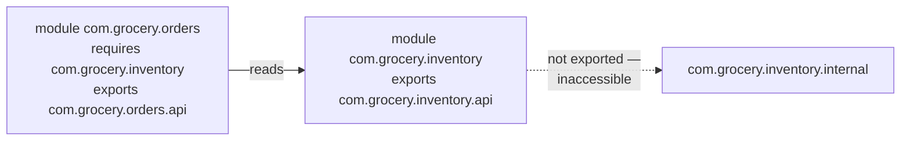
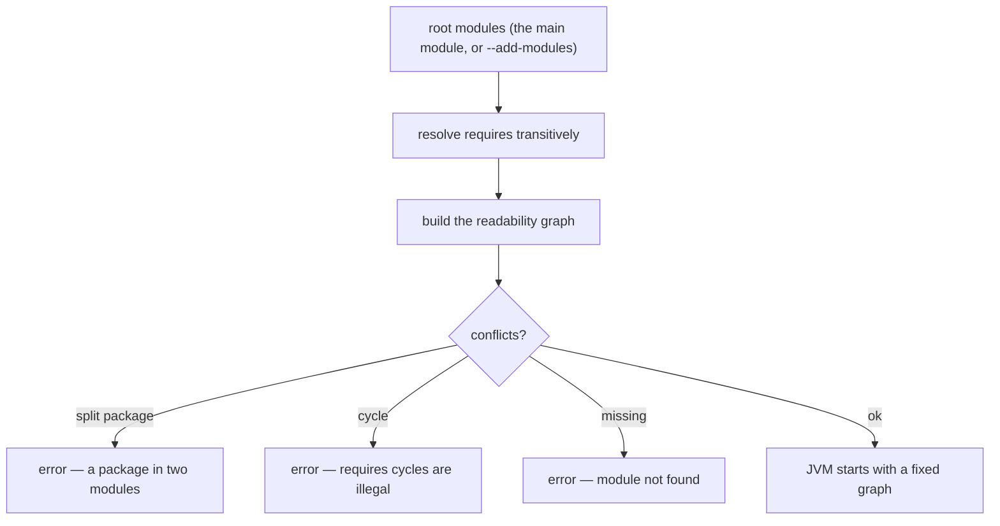

# Java 9–11: Modules, var, HttpClient

!!! example "Try it first"
    **[Java 9–11 by example](../07-examples/java-9-11.md)** — 11 runnable programs, each with its real output.

## 1. Purpose & Audience

**Band:** L3 Enterprise · **Prerequisites:** core Java, build tooling

Java 9 to 11 is the release range most enterprise codebases skipped through without reading. Java 9 shipped the module system, which most applications never adopted; Java 11 became the LTS everyone actually ran. The result is a set of features that are widely *used* and rarely *understood* — `var`, the collection factories, the HTTP client — plus one, JPMS, whose effects you feel whether or not you opted in.

This chapter answers three questions:

1. **What did the module system actually change** for an application that never wrote a `module-info.java`?
2. **Where does `var` improve code**, and where does it hide a bug?
3. **What is in 9–11 that you should be using** and probably are not?

---

## 2. The Problem

Three unrelated pains, addressed in the same release range.

**The classpath is a flat bag with no encapsulation:**

```java title="InternalAccess.java"
// Java 8 — compiles, runs, and breaks on the next JDK
sun.misc.Unsafe unsafe = getUnsafe();
com.sun.image.codec.jpeg.JPEGCodec.createJPEGEncoder(out);
```

Anything public was reachable, including JDK internals never meant for you. Libraries built on them, and every JDK upgrade broke something.

**Every deployment shipped the whole JRE.** A service using `java.base` and `java.sql` still carried CORBA, JAXB, Swing, and the applet API — over 200 MB for what needed 40.

**HTTP required a dependency:**

```java title="HttpBefore.java"
// Java 8 — HttpURLConnection, or add Apache HttpClient / OkHttp
HttpURLConnection conn = (HttpURLConnection) new URL(url).openConnection();
conn.setRequestMethod("POST");
conn.setDoOutput(true);
try (OutputStream os = conn.getOutputStream()) { os.write(body); }
int status = conn.getResponseCode();
// ... read the stream, handle the error stream separately, no HTTP/2, no async
```

---

## 3. Mental Model

### 3.1 Modules: readability and accessibility

A module declares what it needs and what it exposes.



Two rules replace the classpath's single rule of "public means accessible":

- **Readability** — module A can use module B only if A `requires` B.
- **Accessibility** — a public type in B is visible to A only if B `exports` its package.

Public is no longer enough. This is the change that matters even to applications that never modularise, because **the JDK itself is modularised** — `sun.misc.Unsafe` and friends are now behind package boundaries the JVM enforces.

### 3.2 The honest position on adoption

| | Reality |
|---|---|
| JDK is modularised | Always — you cannot opt out |
| Libraries declare `Automatic-Module-Name` | Most do now |
| Applications write `module-info.java` | **Uncommon** |
| Applications use `jlink` | Increasingly, for container images |

Most enterprise applications still run on the classpath, and that is a defensible choice. What you cannot avoid is the *consequences*: strong encapsulation of JDK internals, `--add-opens` flags in your startup script, and reflection libraries needing explicit permission.

---

## 4. Core API & Syntax

### 4.1 `module-info.java`

| Directive | Meaning |
|---|---|
| `requires m` | This module reads `m` |
| `requires transitive m` | Anyone reading this module also reads `m` |
| `requires static m` | Compile-time only — optional at runtime |
| `exports p` | Package `p` is accessible to all readers |
| `exports p to a, b` | Qualified export — only to named modules |
| `opens p` | Deep reflection permitted at runtime |
| `opens p to a` | Qualified open |
| `open module m` | Every package open for reflection |
| `uses S` | Consumes service `S` via `ServiceLoader` |
| `provides S with Impl` | Supplies an implementation |

### 4.2 Path and tooling

| Concept | |
|---|---|
| **Classpath** | Everything lands in the *unnamed module*; no encapsulation |
| **Module path** | Modules resolved by name into a graph |
| **Automatic module** | A plain JAR on the module path; name from `Automatic-Module-Name` or the filename |
| `jdeps` | Analyse dependencies, suggest `module-info` |
| `jlink` | Build a minimal runtime image from modules |
| `--add-opens m/p=ALL-UNNAMED` | Grant reflective access at runtime |
| `--add-exports m/p=ALL-UNNAMED` | Grant compile/run access to a non-exported package |

### 4.3 `var` (Java 10, lambda parameters in 11)

| Allowed | Not allowed |
|---|---|
| Local variables with an initializer | Fields |
| `for` and enhanced-`for` variables | Method parameters |
| try-with-resources variables | Return types |
| Lambda parameters (11) — all or none | Without an initializer |
| | Initialised to `null` alone |
| | Array initialiser shorthand `var a = {1,2}` |

### 4.4 `HttpClient` (Java 11)

| Element | Purpose |
|---|---|
| `HttpClient.newBuilder()` | Version, timeout, redirect policy, executor, proxy |
| `HttpRequest.newBuilder()` | URI, method, headers, body publisher |
| `BodyPublishers.ofString/ofFile/noBody` | Request bodies |
| `BodyHandlers.ofString/ofLines/ofInputStream/discarding` | Response handling |
| `send(...)` | Synchronous |
| `sendAsync(...)` | Returns `CompletableFuture<HttpResponse<T>>` |

HTTP/2 is the default, with automatic fallback to HTTP/1.1.

---

## 5. Worked Examples

### 5.1 The HTTP client

```java title="VendorClient.java"
public final class VendorClient {

    private static final HttpClient CLIENT = HttpClient.newBuilder()
        .version(HttpClient.Version.HTTP_2)
        .connectTimeout(Duration.ofSeconds(5))
        .followRedirects(HttpClient.Redirect.NORMAL)
        .build();

    private final URI baseUri;

    public DispatchReceipt send(Order order) throws IOException, InterruptedException {
        HttpRequest request = HttpRequest.newBuilder(baseUri.resolve("/dispatch"))
            .header("Content-Type", "application/json")
            .timeout(Duration.ofSeconds(10))
            .POST(HttpRequest.BodyPublishers.ofString(toJson(order)))
            .build();

        HttpResponse<String> response = CLIENT.send(request, BodyHandlers.ofString());

        if (response.statusCode() >= 500) {
            throw new VendorUnavailableException(response.statusCode());
        }
        return parse(response.body());
    }
}
```

`HttpClient` is immutable and thread-safe — one instance per application, held in a `static final` field, not created per request. Creating one per call leaks connection pools and defeats HTTP/2 multiplexing.

Note the two timeouts: `connectTimeout` on the client covers establishing the connection, `timeout` on the request covers the whole exchange. Setting only the first is a common omission that leaves a hung read waiting forever.

Asynchronously, on virtual threads you rarely need this — but it exists:

```java title="AsyncRequest.java"
CompletableFuture<DispatchReceipt> future =
    CLIENT.sendAsync(request, BodyHandlers.ofString())
          .thenApply(HttpResponse::body)
          .thenApply(this::parse);
```

### 5.2 `var` where it helps and where it hurts

```java title="VarUsage.java"
// ✓ Type is obvious from the right-hand side
var catalogue = new HashMap<Sku, InventoryItem>();
var orders = repository.findRecent(customerId, since);   // List<Order> — named method
var line = new CartLine(sku, 2, Money.rupees("60"));

// ✓ Removes genuinely redundant noise
for (var entry : totalsByVendor.entrySet()) { }

// ✗ Type is now invisible and the name does not help
var result = process(input);
var data = service.fetch();
var flag = check();

// ✗ Actively wrong — infers ArrayList<Object>
var lines = new ArrayList<>();      // NOT ArrayList<CartLine>
```

The last one is the real trap. The diamond has nothing to infer from, so `var x = new ArrayList<>()` gives `ArrayList<Object>` and every subsequent `add` compiles. Write the type argument: `var lines = new ArrayList<CartLine>()`.

**The test:** can a reader, looking only at this line, name the type? If not, `var` has removed information rather than noise.

### 5.3 Collection factories

```java title="Factories.java"
List<Sku> featured = List.of(milk, rice, atta);
Set<TenantId> active = Set.of(tenantA, tenantB);
Map<Sku, Money> prices = Map.of(milk, Money.rupees("60"), rice, Money.rupees("450"));
Map<Sku, Money> many = Map.ofEntries(entry(milk, price1), entry(rice, price2));
```

Three behaviours that differ from `Arrays.asList` and `Collections.unmodifiableList`:

- **Truly immutable**, not an unmodifiable view over something mutable.
- **Reject nulls** — on creation *and* on lookup. `List.of("a").contains(null)` throws.
- **`Set.of` and `Map.of` randomise iteration order** per JVM run, deliberately, so code cannot depend on it.

`Map.of` handles at most ten pairs; beyond that, `Map.ofEntries`.

### 5.4 String and file convenience

```java title="StringAndFiles.java"
"  ".isBlank();                       // true — isEmpty() is false
"  text  ".strip();                   // Unicode-aware, unlike trim()
"-".repeat(40);
"a\nb\nc".lines().toList();           // Stream<String>, handles all line terminators

String config = Files.readString(path);                  // Java 11
Files.writeString(path, content, StandardCharsets.UTF_8);
```

`strip()` versus `trim()`: `trim()` removes characters below U+0020, which predates Unicode. `strip()` uses `Character.isWhitespace`, so it handles non-breaking spaces and ideographic space correctly. On any input that might not be ASCII, `strip()` is the right one.

### 5.5 What strong encapsulation means in practice

You did not modularise, and yet:

```text
java.lang.reflect.InaccessibleObjectException: Unable to make field private final
java.util.ArrayList.elementData accessible: module java.base does not "opens java.util"
to unnamed module @0x4b1c1ea0
```

Java 16 made JDK internals strongly encapsulated by default (JEP 396), and Java 17 removed the `--illegal-access` escape hatch entirely (JEP 403). Libraries doing deep reflection into `java.base` now need explicit permission:

```bash
java --add-opens java.base/java.util=ALL-UNNAMED -jar orders.jar
```

That flag is a **temporary measure, not configuration**. Each one is a library reaching into JDK internals, and the durable fix is upgrading the library. A startup script accumulating `--add-opens` flags over years is a list of dependencies that need attention.

### 5.6 `jlink` for a smaller runtime

```bash
jdeps --print-module-deps --ignore-missing-deps orders.jar
# java.base,java.sql,java.net.http

jlink --add-modules java.base,java.sql,java.net.http \
      --strip-debug --no-man-pages --no-header-files --compress=2 \
      --output runtime
```

A ~45 MB runtime image instead of a 200 MB+ JDK, which matters for container layers and cold start. This works on a classpath application — `jlink` builds the *runtime*, and your application can still be a plain JAR on the classpath inside it.

This is the JPMS benefit most enterprise teams actually collect.

---

## 6. Internals

### 6.1 Module resolution



The graph is computed at startup and fixed. Two properties follow:

- **Split packages are illegal.** The same package in two modules fails at launch rather than silently shadowing, which is the "JAR hell" case the classpath handled by picking whichever came first.
- **Cycles are forbidden** between named modules, forcing a directed dependency structure.

### 6.2 `exports` versus `opens`

| | Compile-time access | Reflective access to public members | Deep reflection (`setAccessible`) |
|---|---|---|---|
| Not exported | No | No | No |
| `exports p` | Yes | Yes | **No** |
| `opens p` | No | Yes | Yes |
| `exports p` + `opens p` | Yes | Yes | Yes |

The distinction trips people constantly. `exports` is for code that *compiles against* your types. `opens` is for frameworks that reflect into them — JPA setting private fields, Jackson constructing objects, a DI container injecting.

That is why a modularised application using such frameworks needs `opens` on its model packages, and why `open module` exists as the blunt instrument for applications not trying to encapsulate anything from themselves.

### 6.3 Automatic modules

A plain JAR on the module path becomes an automatic module:

- Its name comes from the `Automatic-Module-Name` manifest entry, or is derived from the filename if absent.
- It **exports every package** and reads every other module.

Filename-derived names are the hazard: `commons-lang3-3.12.0.jar` becomes `commons.lang3`, and if the library later publishes a real module with a different name, your `requires` breaks. Depending on an automatic module whose name comes from a filename is depending on a filename.

### 6.4 `var` is not dynamic typing

```java title="VarIsStatic.java"
var sku = new Sku("MILK-1L");
sku = "a string";                 // COMPILE ERROR — sku is Sku
```

`var` is inference, resolved at compile time. The variable has exactly one static type forever; the bytecode is identical to writing the type out.

Two subtleties:

- **Inference uses the initializer's static type**, so `var x = condition ? 1 : 2.0` infers `double`, and `var list = new ArrayList<>()` infers `ArrayList<Object>`.
- **`var` can name types you cannot write** — an anonymous class type or an intersection type from a conditional. Useful occasionally, confusing usually.

### 6.5 The Java EE removal

Java 11 removed six modules deprecated in 9: JAXB, JAX-WS, JAF, Common Annotations, CORBA, and JTA.

This is the concrete reason a Java 8 application fails to start on 11 with `NoClassDefFoundError: javax/xml/bind/JAXBException`. The fix is adding the artifacts as ordinary dependencies — they live on as Jakarta EE projects. Combined with the internal-API encapsulation of 16–17, these two changes account for most of the friction in an 8 → 17 migration.

---

## 7. Production Patterns & Anti-Patterns

### Do this

- **Use one `HttpClient` instance** for the application, in a `static final` field.
- **Set both timeouts** — `connectTimeout` on the client and `timeout` on the request.
- **Use `var` where the right-hand side names the type**, and write the type where it does not.
- **Always give the diamond a type argument under `var`** — `new ArrayList<CartLine>()`.
- **Prefer `List.of` / `Map.of`** for constants; prefer `strip()` over `trim()`.
- **Publish `Automatic-Module-Name`** in any library you ship, even if you never write `module-info.java`.
- **Use `jdeps --print-module-deps` and `jlink`** for container images, regardless of whether you modularise.
- **Treat every `--add-opens` flag as a ticket** — record why it exists and what would remove it.

### Never do this

- **Never create an `HttpClient` per request.** It owns a connection pool and an executor.
- **Never use `var` when the reader cannot name the type** from that line alone.
- **Never write `var x = new ArrayList<>()`** — it infers `Object`.
- **Never assume `List.of` tolerates null.** It throws on creation and on `contains(null)`.
- **Never depend on `Set.of` or `Map.of` iteration order.** It is randomised per JVM run by design.
- **Never leave `--add-opens` as permanent configuration** without knowing which library needs it.
- **Never create a split package** across modules or JARs — it fails at launch on the module path.
- **Never rely on a filename-derived automatic module name** in code you ship.

---

## 8. Version Evolution (Java 8 → 26)

| Version | What changed | Impact |
|---|---|---|
| **9** | JPMS (JEP 261); `List.of`/`Set.of`/`Map.of`; private interface methods; `Optional.stream`; `takeWhile`/`dropWhile`; JShell; Flow API; multi-release JARs | The JDK modularises; internals begin closing |
| **10** | `var` (JEP 286); `List.copyOf`; parallel full GC for G1 | Local type inference |
| **11** | **LTS.** `HttpClient` standard (JEP 321); `var` in lambda params; `isBlank`/`strip`/`lines`/`repeat`; `Files.readString`/`writeString`; single-file source launch; **Java EE modules removed** | The LTS most codebases jumped to |
| **16** | Strong encapsulation of JDK internals by default (JEP 396) | `InaccessibleObjectException` appears |
| **17** | `--illegal-access` removed (JEP 403) | No escape hatch; `--add-opens` becomes explicit |
| **21** | Virtual threads | `HttpClient.send` blocking becomes the natural style |
| **26** | HTTP/3 in `HttpClient` (JEP 517) | See [Ch 40](../05-runtime/40-http-client.md) |

### Migration note

The three things that actually break when moving from Java 8:

1. **`NoClassDefFoundError` on `javax.xml.bind` and friends** — removed in 11, add them as dependencies.
2. **`InaccessibleObjectException`** from reflection libraries — upgrade the library, or add `--add-opens` as a stopgap.
3. **Anything using `sun.misc.Unsafe` or `com.sun.*`** — find the supported replacement, usually `VarHandle` or the FFM API ([Chapter 39](../05-runtime/39-ffm-and-vector-api.md)).

Modularising the application itself is optional and usually not worth it for a service. If you are shipping a **library**, add `Automatic-Module-Name` at minimum so consumers who do modularise get a stable name.

---

## 9. Interview Questions

### L1 — Foundations

**Q1. What is `var` and what are its limits?** ⭐ *high frequency*
Local variable type inference: the compiler infers the type from the initializer, and the variable is statically typed exactly as if you had written the type. It is restricted to local variables, `for` variables, try-with-resources, and lambda parameters — never fields, method parameters, or return types — and it requires an initializer that is not bare `null`.

**Q2. What is the difference between `List.of` and `Arrays.asList`?**
`List.of` returns a genuinely immutable list that rejects nulls, while `Arrays.asList` returns a fixed-size view backed by the array, where `set` works and writes through. `List.of` also throws on `contains(null)` rather than returning false. For a constant list, `List.of` is the right choice.

**Q3. Why was `HttpClient` added to the JDK?**
Because `HttpURLConnection` predates modern HTTP: no HTTP/2, no async, no WebSocket, and an awkward API where errors come from a separate stream. `HttpClient`, standard in Java 11, supports HTTP/2 by default with fallback, offers both synchronous and `CompletableFuture`-based calls, and is immutable and thread-safe so one instance serves the whole application.

### L2 — Professional

**Q4. What is the difference between `exports` and `opens` in a module?** ⭐ *high frequency*
`exports` makes a package accessible at compile time and for ordinary reflection on public members. `opens` permits deep reflection at runtime — `setAccessible` on private members — but grants no compile-time access. Frameworks that inject into private fields or construct objects reflectively need `opens`, which is why a modularised application using JPA or Jackson must open its model packages.

**Q5. Why does `var list = new ArrayList<>()` behave badly?**
The diamond infers from the target type, and with `var` there is no target type to infer from, so it falls back to `Object` and you get `ArrayList<Object>`. Every subsequent `add` compiles regardless of type, and the error surfaces much later as an unexpected cast or a wrong result. Always supply the type argument explicitly under `var`.

**Q6. Why does a Java 8 application fail on Java 11 with `NoClassDefFoundError: javax/xml/bind/JAXBException`?**
Because Java 11 removed the Java EE modules — JAXB, JAX-WS, JAF, Common Annotations, CORBA, and JTA — that Java 9 had deprecated. They were bundled with the JDK before and are not any more. The fix is to add them as ordinary Maven or Gradle dependencies; they continue as Jakarta EE projects.

### L3 — Enterprise

**Q7. What did the module system change for an application that never modularised?**
The JDK itself is modularised, so its internal packages are encapsulated whether or not your code is. From Java 16 that encapsulation is enforced by default, and Java 17 removed the `--illegal-access` escape hatch, so any library reflecting into `java.base` internals now fails with `InaccessibleObjectException` unless granted `--add-opens`. Applications also gain `jlink`, which builds a minimal runtime image even for classpath applications.

**Q8. What is an automatic module and what is the risk?**
A plain JAR placed on the module path, which becomes a module that exports all its packages and reads everything else. Its name comes from the `Automatic-Module-Name` manifest entry if present, and otherwise is derived from the filename. Depending on a filename-derived name is fragile: if the library later ships a real module with a different name, or the filename changes, your `requires` clause breaks.

**Q9. How would you reduce the runtime footprint of a Java service?**
Use `jdeps --print-module-deps` to find the JDK modules actually used, then `jlink` to build a runtime image containing only those, with debug symbols and man pages stripped. That typically takes a 200 MB+ JDK to around 45 MB, which matters for container image size and cold start. It works for classpath applications — `jlink` assembles the runtime, not your application.

### L4 — Architect

**Q10. Is it worth modularising an existing enterprise application?**
Usually not. The cost is real — split packages must be eliminated, every reflective framework needs `opens`, and the build tooling gets more complicated — while the benefit for a deployed service is mostly encapsulation you already get from package conventions and code review. The cases where it pays are libraries, where a stable module name and genuine API boundary help consumers, and applications distributed to end users, where `jlink` with a modular application produces a meaningfully smaller image. For a containerised service, `jlink` alone collects most of the benefit without modularising.

**Q11. How would you decide a team convention for `var`?**
Anchor it on one question: can a reader name the type from that line alone? `new HashMap<Sku, InventoryItem>()` and a well-named method like `findRecentOrders` both pass; `process(input)` and `service.fetch()` do not. Add two hard rules — never bare diamond under `var`, and never where the initializer is a conditional whose branches differ in type — and leave the rest to review. Blanket bans lose real readability in long generic declarations; blanket adoption produces code that requires an IDE to read.

**Q12. A service starts with eight `--add-opens` flags. How do you approach it?**
Treat the list as a dependency audit, not configuration. Each flag names a library reaching into JDK internals, which means that library is either outdated or using an API that has a supported replacement — `VarHandle` for `Unsafe` access, the FFM API for native memory. Work through them by finding which dependency requires each one, upgrading where a fixed version exists, and replacing where it does not. Leaving them indefinitely is a bet that a future JDK will keep allowing the access, and the direction of travel since Java 16 says it will not.

---

!!! abstract "Cheat Sheet"
    **Modules:** `requires` = readability · `exports` = compile access · `opens` = deep reflection

    **`exports` ≠ `opens`** — frameworks reflecting into private fields need `opens`

    **You feel JPMS even unmodularised** — JDK internals encapsulated by default (16), no `--illegal-access` (17)

    **`--add-opens` is a ticket, not config** — each one names a library to upgrade

    **Split packages and `requires` cycles fail at launch**

    **Automatic module name** from `Automatic-Module-Name`, else the filename — publish it

    **`jlink` works for classpath apps** — ~45 MB runtime vs 200 MB+ JDK

    **`var`** — locals only, needs an initializer, statically typed, **never bare diamond**

    **`List.of` is immutable and null-hostile** — even `contains(null)` throws

    **`Set.of`/`Map.of` iteration order is randomised** per JVM run

    **One `HttpClient` per application** — `static final`; set both timeouts; HTTP/2 by default

    **`strip()` not `trim()`** — Unicode-aware

    **Java 11 removed the Java EE modules** — JAXB et al. become dependencies
