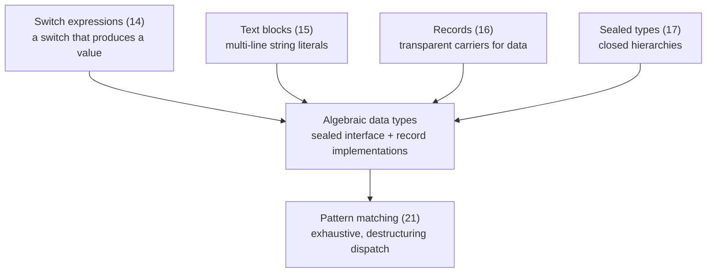

# Java 14–17: Records, Sealed Types, Text Blocks, Switch Expressions

<!-- video:start -->
<figure class="pb-video">
<video controls playsinline preload="metadata">
<source src="../../videos/ch12.mp4" type="video/mp4">
<track kind="subtitles" srclang="en" label="English" src="../../videos/ch12.vtt">
</video>
<figcaption>Video walkthrough · 7:42 · subtitles via CC · <a href="../../videos/ch12.mp4" download>Download MP4</a></figcaption>
</figure>
<!-- video:end -->

!!! example "Try it first"
    **[Java 12–17 by example](../07-examples/java-12-17.md)** — 10 runnable programs, each with its real output.

## 1. Purpose & Audience

**Band:** L2 Professional · **Prerequisites:** core Java syntax, [Lambdas & Functional Interfaces](06-lambdas-functional-interfaces.md)

Between Java 8 and Java 21 sits the set of features that changed how Java models data. Four of them arrived together and were designed to compose: switch expressions, text blocks, records, and sealed types. Individually each removes some boilerplate. Together they give Java algebraic data types — closed hierarchies of immutable values — which is what makes [pattern matching](13-pattern-matching.md) worth having.

This chapter answers three questions:

1. **What does a record actually generate**, and when is it the wrong choice?
2. **What does `sealed` buy** beyond documentation?
3. **Why are switch expressions a different construct**, not nicer syntax for a switch statement?

---

## 2. The Problem

A value object in Java 8 is a page of code that says almost nothing:

```java title="MoneyBefore.java"
// Java 8 — 60 lines to express "an amount and a currency"
public final class Money {
    private final BigDecimal amount;
    private final Currency currency;

    public Money(BigDecimal amount, Currency currency) {
        this.amount = Objects.requireNonNull(amount);
        this.currency = Objects.requireNonNull(currency);
    }

    public BigDecimal getAmount() { return amount; }
    public Currency getCurrency() { return currency; }

    @Override
    public boolean equals(Object o) {
        if (this == o) return true;
        if (!(o instanceof Money)) return false;
        Money other = (Money) o;
        return amount.equals(other.amount) && currency.equals(other.currency);
    }

    @Override
    public int hashCode() { return Objects.hash(amount, currency); }

    @Override
    public String toString() { return "Money{amount=" + amount + ", currency=" + currency + "}"; }
}
```

Every line is mechanical, every line can be got wrong, and the IDE that generated it will not regenerate it when a field is added. The `equals`/`hashCode` pair drifting out of sync with the fields is a standing source of bugs in collections.

Meanwhile a status hierarchy has the opposite problem — it is too open:

```java title="StatusBefore.java"
public interface OrderState { }
// Anyone, anywhere, can implement this. No switch over it can ever be complete.
```

And a SQL query is an exercise in counting quotes:

```java title="SqlBefore.java"
String sql = "select o.id, o.customer_id, o.placed_at\n" +
             "from orders o\n" +
             "where o.customer_id = ?\n" +
             "  and o.placed_at >= ?\n" +
             "order by o.placed_at desc";
```

---

## 3. Mental Model



The through-line: **make the compiler able to reason about your data.** A record tells it "these components are the state". A sealed type tells it "these are all the cases". With both, an exhaustive switch needs no `default` branch — and adding a case becomes a compile error everywhere it matters, instead of a runtime surprise.

### 3.1 Two kinds of modelling

| | Class hierarchy | Sealed + records |
|---|---|---|
| Who may extend | Anyone | A fixed, declared set |
| Adding a case | Silent at compile time | **Compile error** in every switch |
| Behaviour lives | Inside the types | Outside, in switches |
| Best for | Open extension | Closed domains |

Sealed hierarchies are not a replacement for polymorphism. They are the right tool when the set of cases is genuinely closed — order statuses, payment outcomes, parse results — and the behaviour over them is open-ended.

---

## 4. Core API & Syntax

### 4.1 Switch expressions (final in 14)

| Form | Notes |
|---|---|
| `case A -> expr;` | Arrow form — **no fall-through** |
| `case A, B -> expr;` | Multiple labels |
| `case A -> { ... yield v; }` | Block form; `yield` produces the value |
| `default -> ...` | Required unless the switch is exhaustive |
| Old `case A:` with `break` | Still supported; cannot mix with arrow form |

### 4.2 Text blocks (final in 15)

| Feature | Behaviour |
|---|---|
| `"""` … `"""` | Opening delimiter must be followed by a line terminator |
| Incidental whitespace | Common leading indentation is stripped automatically |
| Closing delimiter position | Determines how much indentation is stripped |
| `\` at line end | Suppresses the newline |
| `\s` | A space that prevents trailing-space stripping |
| Escapes | `\n`, `\"`, `\\` still work; `"` needs no escaping |

### 4.3 Records (final in 16)

```java
public record Money(BigDecimal amount, Currency currency) { }
```

| Generated | Detail |
|---|---|
| Private final fields | One per component |
| Canonical constructor | Parameters in declaration order |
| Accessors | `amount()`, not `getAmount()` |
| `equals` / `hashCode` | Component-wise |
| `toString` | `Money[amount=100, currency=INR]` |

| Constraint | |
|---|---|
| Implicitly `final` | Cannot be extended |
| Cannot extend a class | Always extends `java.lang.Record` |
| May implement interfaces | Yes |
| Instance fields | **Only the components** — no extra state |
| Static members | Allowed |
| Nested and local records | Allowed (local records since 16) |

### 4.4 Sealed types (final in 17)

```java
public sealed interface OrderState permits Pending, Confirmed, Cancelled { }
```

| Rule | |
|---|---|
| Every permitted subtype must be | `final`, `sealed`, or `non-sealed` |
| Location | Same module, or same package in the unnamed module |
| `permits` clause | Optional if all subtypes are in the same file |
| Records as subtypes | Implicitly `final` — the common case |

---

## 5. Worked Examples

### 5.1 The record

```java title="Money.java"
public record Money(BigDecimal amount, Currency currency) implements Comparable<Money> {

    public static final Currency INR = Currency.getInstance("INR");   // java.util.Currency has no INR constant
    public static final Money ZERO = new Money(BigDecimal.ZERO, INR);

    // Compact constructor: validation and normalisation, no field assignment
    public Money {
        Objects.requireNonNull(amount, "amount");
        Objects.requireNonNull(currency, "currency");
        amount = amount.setScale(2, RoundingMode.HALF_UP);   // reassigns the parameter
    }

    public static Money rupees(String amount) {
        return new Money(new BigDecimal(amount), INR);
    }

    public Money plus(Money other) {
        requireSameCurrency(other);
        return new Money(amount.add(other.amount), currency);
    }

    @Override
    public int compareTo(Money other) {
        requireSameCurrency(other);
        return amount.compareTo(other.amount);
    }
}
```

Sixty lines became twenty, and the twenty are all behaviour.

The **compact constructor** is the feature people miss. It runs before the fields are assigned and operates on the *parameters*, so reassigning `amount` changes what gets stored. It is where validation, normalisation, and defensive copying belong.

### 5.2 Defensive copying

Records give shallow immutability. A mutable component is still mutable:

```java title="Cart.java"
public record Cart(CartId id, List<CartLine> lines) {

    public Cart {
        lines = List.copyOf(lines);     // defensive copy — without this, callers can mutate
    }
}
```

```java title="WithoutCopy.java"
List<CartLine> mutable = new ArrayList<>(List.of(line1));
Cart cart = new Cart(id, mutable);
mutable.add(line2);                     // without the copy, cart.lines() now has 2 entries
```

This is the single most common record bug. **Any collection or array component needs a defensive copy in the compact constructor**, and `List.copyOf` also rejects nulls, which is usually what you want.

### 5.3 Sealed hierarchy of records

```java title="OrderState.java"
public sealed interface OrderState
        permits Pending, Confirmed, Dispatched, Cancelled {

    Instant since();
}

public record Pending(Instant since) implements OrderState { }

public record Confirmed(Instant since, String paymentReference) implements OrderState { }

public record Dispatched(Instant since, Vendor vendor, String trackingId) implements OrderState { }

public record Cancelled(Instant since, String reason) implements OrderState { }
```

Each state carries exactly the data that state has. (It is named `OrderState` rather than `OrderStatus` because elsewhere in this handbook `OrderStatus` is the plain enum of lifecycle labels — `PENDING`, `CONFIRMED`, `DELIVERED` — used with `EnumSet` and `EnumMap`. The sealed hierarchy is the richer model: a label *plus* its data.) `Pending` has no payment reference because a pending order does not have one — which is a class of bug (nullable fields that are only sometimes populated) removed structurally.

The compiler now knows the set is closed:

```java title="StatusMessage.java"
public String customerMessage(OrderState status) {
    return switch (status) {                      // no default needed
        case Pending p     -> "We're confirming your order.";
        case Confirmed c   -> "Confirmed — payment " + c.paymentReference();
        case Dispatched d  -> "On its way with " + d.vendor().name();
        case Cancelled c   -> "Cancelled: " + c.reason();
    };
}
```

Add a fifth status and **this method stops compiling** — along with every other switch over `OrderState`. That is the whole point: the change surfaces at compile time in every place that needs updating.

### 5.4 Switch expressions

```java title="SwitchExpression.java"
// Old statement form — four ways to get it wrong
int slaHours;
switch (tier) {
    case PREMIUM:
        slaHours = 2;
        break;                    // forget this and you fall through
    case STANDARD:
        slaHours = 24;
        break;
    default:
        slaHours = 72;
}

// Expression form
int slaHours = switch (tier) {
    case PREMIUM  -> 2;
    case STANDARD -> 24;
    default       -> 72;
};
```

Four differences that matter:

- **No fall-through.** The arrow form executes one branch.
- **It is an expression**, so it can initialise a `final` variable — the old form cannot, since the compiler cannot prove assignment.
- **Exhaustiveness is checked** on enums and sealed types; a missing case is a compile error rather than a silent `default`.
- **`yield` for multi-statement branches:**

```java title="Yield.java"
Money deliveryFee = switch (slot.type()) {
    case EXPRESS -> Money.rupees("99");
    case STANDARD -> {
        Money base = Money.rupees("40");
        yield cart.total().isGreaterThan(Money.rupees("500")) ? Money.ZERO : base;
    }
    case SCHEDULED -> Money.ZERO;
};
```

!!! warning "Enum switches are only exhaustive without `default`"
    Adding a `default` branch to an enum or sealed switch **disables the exhaustiveness check** — a new constant silently falls into `default` instead of failing to compile. If you want the compiler's help, omit `default` and handle every case.

### 5.5 Text blocks

```java title="TextBlocks.java"
private static final String FIND_RECENT = """
    select o.id, o.customer_id, o.placed_at, o.total_paise
    from orders o
    where o.customer_id = ?
      and o.placed_at >= ?
    order by o.placed_at desc
    """;
```

The closing `"""` position determines how much indentation is stripped. Aligning it with the content removes all leading indentation; indenting it less preserves the difference.

```java title="TextBlockEscapes.java"
// \ suppresses the newline — one long line, readable source
String url = """
    https://api.vendor.example.com\
    /v2/dispatch\
    ?tenant=%s""".formatted(tenant);

// \s keeps a trailing space that would otherwise be stripped
String padded = """
    name:\s
    """;
```

Text blocks are literals, not templates. There is no interpolation — use `formatted(...)`. (String Templates would have added interpolation; they were withdrawn and ship in no JDK. See [Chapter 15](15-string-templates-postmortem.md).)

### 5.6 When a record is the wrong choice

```java title="RecordMisuse.java"
// ✗ A JPA entity — needs identity, a no-arg constructor, mutable state, and lazy proxies
@Entity
public record OrderEntity(@Id UUID id, String customerId) { }

// ✗ Something with meaningful identity rather than value semantics
public record Connection(String host, int port) { }   // two "equal" connections aren't interchangeable

// ✗ A bag of fifteen loosely-related fields
public record OrderReport(/* 15 components */) { }    // the constructor is unreadable at call sites
```

Records are **transparent carriers for immutable data with value semantics**. Where identity matters, where state must change, or where a framework needs a no-arg constructor and field access, a class is still the answer.

The JPA case is worth stating plainly: entities have identity, mutable state, and lifecycle. A record cannot express any of them. Records work well as JPA *projections* and as DTOs at the API edge — not as entities.

---

## 6. Internals

### 6.1 What a record compiles to

```java
public record Money(BigDecimal amount, Currency currency) { }
```

becomes a `final class Money extends java.lang.Record` with private final fields, accessors, and a `Record` attribute in the class file listing the components.

`equals`, `hashCode`, and `toString` are **not** generated as ordinary bytecode. They are `invokedynamic` call sites bootstrapped by `java.lang.runtime.ObjectMethods`, which builds the implementation from the component list at first use.

Two consequences:

- **The class file is small** regardless of component count.
- **Behaviour is derived from the components**, so it cannot drift from the fields the way hand-written `equals` does.

You may override any of the three. Overriding `equals` without `hashCode` breaks the contract exactly as it does anywhere else.

### 6.2 Records and reflection

The `Record` attribute means frameworks can discover components reliably:

```java
RecordComponent[] components = Money.class.getRecordComponents();
// name, type, generic type, accessor method, annotations
```

Jackson, JPA projections, and most modern serialization libraries use this to construct records through the canonical constructor rather than by field injection. Libraries that predate Java 16 and require a no-arg constructor plus setters cannot handle records at all — which is the usual reason a record "does not work" with an older framework.

### 6.3 What `sealed` puts in the class file

A `PermittedSubclasses` attribute lists the allowed subtypes by name. The JVM enforces it at class load: a class claiming to implement a sealed interface it is not permitted to implement fails with `IncompatibleClassChangeError`.

This is a **runtime** guarantee, not merely a compile-time one — which is what lets the compiler treat exhaustiveness as sound rather than advisory.

The three modifiers on a permitted subtype:

| Modifier | Meaning |
|---|---|
| `final` | The hierarchy ends here — records are implicitly this |
| `sealed` | Continues, with its own `permits` |
| `non-sealed` | **Reopens** the hierarchy at this point |

`non-sealed` is the escape hatch, and using it forfeits exhaustiveness below that branch. It exists for framework base classes that must remain extensible.

### 6.4 Exhaustiveness

The compiler proves a switch exhaustive when the selector is an enum or a sealed type and every case is covered. Then no `default` is required, and the `switch` expression is guaranteed to produce a value.

A subtlety: the compiler still inserts a synthetic default that throws `MatchException`, because the sealed hierarchy could change **between compilations**. If you compile a switch against a three-case sealed interface, then recompile only the interface with a fourth case and do not recompile the switch, the old switch will throw at runtime rather than silently returning null. The compile-time guarantee holds only when everything is compiled together — which is why separately-versioned libraries should be conservative about sealing public API.

### 6.5 Text block whitespace stripping

```text
    select o.id          ← 4 spaces
    from orders o        ← 4 spaces
    """                  ← 4 spaces
```

The algorithm takes the **minimum indentation across all non-blank lines and the closing delimiter**, and removes that much from every line. Trailing whitespace on each line is stripped unconditionally — which is why `\s` exists.

The consequence to know: **moving the closing delimiter changes the string.** Reindenting a method can silently alter a SQL statement's whitespace. Harmless for SQL, not harmless for anything whitespace-sensitive such as YAML or a diff fixture. `String::stripIndent` and explicit `\n` are the safer options there.

---

## 7. Production Patterns & Anti-Patterns

### Do this

- **Use records for DTOs, value objects, API payloads, and projections.** That is what they are for.
- **Validate and normalise in the compact constructor.** It is the one place that runs for every construction path.
- **Defensively copy every collection or array component** — `List.copyOf` in the compact constructor.
- **Model closed domains as a sealed interface of records.** Each case carries exactly its own data.
- **Omit `default` from enum and sealed switches** so the compiler enforces exhaustiveness.
- **Prefer switch expressions over switch statements** when the switch produces a value.
- **Use text blocks for SQL, JSON, and XML literals**, and keep the closing delimiter aligned with the content.
- **Give records static factory methods** where the canonical constructor's parameter order is ambiguous at call sites.

### Never do this

- **Never use a record as a JPA entity.** Entities need identity, mutability, a no-arg constructor, and proxies. Records have none.
- **Never assume a record is deeply immutable.** A mutable component is mutable; copy it.
- **Never add `default` to a sealed or enum switch** that you want checked — it silences the check permanently.
- **Never use a record where identity matters** rather than value equality.
- **Never let a record grow past a handful of components.** Positional construction stops being readable; use a builder or split the type.
- **Never use `non-sealed` casually.** It reopens the hierarchy and forfeits exhaustiveness below that point.
- **Never rely on text block indentation surviving a reformat.** Moving the closing delimiter changes the value.
- **Never mix arrow and colon forms** in one switch — it does not compile.

---

## 8. Version Evolution (Java 8 → 26)

| Version | What changed | Impact |
|---|---|---|
| **14** | Switch expressions final (JEP 361); records preview; helpful NPE messages (JEP 358) | `switch` becomes an expression; NPEs name the null expression |
| **15** | Text blocks final (JEP 378); sealed classes preview; records second preview | Multi-line literals |
| **16** | **Records final (JEP 395)**; `instanceof` pattern final (JEP 394); local records | Data classes arrive; see [Ch 13](13-pattern-matching.md) |
| **17** | **Sealed classes final (JEP 409)** | Closed hierarchies; the last piece before pattern matching |
| **21** | Pattern matching for `switch` and record patterns final | Sealed + records become genuinely useful |
| **22** | Unnamed variables and patterns (JEP 456) | `_` for components you do not bind |
| **25** | Flexible constructor bodies final (JEP 513) | Statements before `this()`/`super()` — validation without static helpers |
| **26** | No changes to these features | — |

### Migration note

Records are the highest-return change in this set, and the safest order is **outside-in**: API request and response types first, then internal DTOs, then value objects. Each is a self-contained swap where the compiler finds every accessor call — though the rename from `getAmount()` to `amount()` touches call sites, so expect a mechanical but wide diff.

Sealed types are the opposite: introduce them only where the domain is genuinely closed, and do it in one commit per hierarchy, because sealing a previously-open interface will break any external implementation.

Switch expressions convert mechanically wherever the old switch assigns a single variable. When converting an enum switch, **delete the `default` branch** if you want exhaustiveness checking — keeping it preserves the old silent-fallthrough behaviour in a new syntax.

---

## 9. Interview Questions

### L1 — Foundations

**Q1. What does a record generate for you?** ⭐ *high frequency*
Private final fields for each component, a canonical constructor, accessor methods named after the components, and component-wise `equals`, `hashCode`, and `toString`. The class is implicitly final and extends `java.lang.Record`, so it cannot extend anything else, though it may implement interfaces.

**Q2. What is the difference between a switch statement and a switch expression?**
A switch expression produces a value and can be assigned, so it can initialise a `final` variable. The arrow form has no fall-through, and on enums or sealed types the compiler checks exhaustiveness so a missing case is a compile error. A switch statement performs side effects and falls through unless you `break`.

**Q3. What does `sealed` do?**
It restricts which types may extend or implement a class or interface, to a list declared in the `permits` clause. Every permitted subtype must be `final`, `sealed`, or `non-sealed`. Because the set is closed and enforced at class load, the compiler can verify that a switch over the hierarchy covers every case.

### L2 — Professional

**Q4. Are records immutable?** ⭐ *high frequency*
Shallowly. The component fields are final and cannot be reassigned, but a component that is itself mutable — a `List`, an array, a mutable object — can still be changed by anyone holding a reference. The fix is a defensive copy in the compact constructor, such as `lines = List.copyOf(lines)`, which also rejects nulls.

**Q5. What is a compact constructor and when do you use it?**
A constructor declared without a parameter list that runs before the fields are assigned and operates on the constructor parameters. Reassigning a parameter inside it changes what gets stored, so it is where validation, normalisation, and defensive copying belong. It runs for every construction path, which a static factory does not.

**Q6. Why would you add `default` to a sealed switch, and why usually shouldn't you?**
You would add it to handle unexpected cases at runtime. You usually should not, because adding `default` disables the compiler's exhaustiveness check — a new permitted subtype then falls into `default` silently instead of failing the build in every switch that needs updating. Losing that is losing the main benefit of sealing the hierarchy.

### L3 — Enterprise

**Q7. Why is a record a poor fit for a JPA entity?**
Entities have identity rather than value semantics, mutable state that the persistence context tracks, and a lifecycle involving lazy proxies — none of which a record can express. JPA also requires a no-arg constructor and field or property access, and records have neither. Records work well on both sides of the entity: as constructor-based projections from queries, and as DTOs at the API boundary.

**Q8. How are a record's `equals` and `hashCode` implemented?**
Not as ordinary generated bytecode. They are `invokedynamic` call sites bootstrapped by `java.lang.runtime.ObjectMethods`, which derives the implementation from the record's component list at first use. That keeps the class file small regardless of component count and, more importantly, means the behaviour cannot drift from the fields — the recurring bug with hand-written or IDE-generated implementations.

**Q9. What does sealing guarantee at runtime, as opposed to compile time?**
The class file carries a `PermittedSubclasses` attribute and the JVM enforces it at class load: a class claiming to implement a sealed type it is not permitted to implement fails with `IncompatibleClassChangeError`. That runtime enforcement is what makes the compiler's exhaustiveness reasoning sound rather than advisory, since the hierarchy cannot be widened by something appearing on the classpath.

### L4 — Architect

**Q10. When is a sealed hierarchy the right model, and when is polymorphism better?**
Sealed hierarchies fit closed domains where the set of cases is known and stable but the operations over them are open-ended — order statuses, payment outcomes, parse results. New behaviour is a new switch, and the compiler shows you every place a new case must be handled. Ordinary polymorphism fits the reverse: a fixed set of operations with an open set of implementations, such as a plugin or strategy interface. Choosing wrongly shows up as either a growing `instanceof` chain or an interface that every implementer must change.

**Q11. What is the risk of sealing a type in a published library?**
Exhaustiveness is only sound when the switch and the hierarchy are compiled together. A consumer who compiles a switch against three permitted subtypes, then upgrades to a library version with four without recompiling, gets a `MatchException` at runtime rather than a compile error. Sealing also removes extension as an option for consumers permanently, so it should be reserved for types where the closed set is genuinely part of the contract — and versioned carefully, because adding a permitted subtype is a breaking change in practice even though it compiles.

**Q12. How would you sequence introducing these features into a Java 8 codebase?**
Switch expressions and text blocks first — they are local, mechanical, and carry no design commitment. Records next, outside-in from API types through DTOs to value objects, accepting that the accessor rename produces a wide but safe diff. Sealed types last and selectively, only where the domain is closed, because sealing a previously-open interface is a breaking change and the payoff only arrives once pattern matching is used over it. The ordering matters because the first two are refactorings and the last is a modelling decision.

---

!!! abstract "Cheat Sheet"
    **Record** = final, extends `java.lang.Record`, component-wise `equals`/`hashCode`/`toString`

    **Accessors are `amount()`**, not `getAmount()`

    **Compact constructor** — runs before assignment, reassign parameters to normalise

    **Shallow immutability** — `List.copyOf(lines)` in the compact constructor, always

    **Not for JPA entities** — no identity, no mutability, no no-arg constructor

    **`sealed ... permits`** — subtypes must be `final`, `sealed`, or `non-sealed`

    **Runtime-enforced** via the `PermittedSubclasses` attribute

    **Sealed + records = algebraic data types** — each case carries exactly its own data

    **Switch expression:** arrow form, no fall-through, `yield` in blocks, assignable

    **`default` disables exhaustiveness checking** — omit it on enum and sealed switches

    **Text blocks:** closing delimiter sets the indent stripped · `\` joins lines · `\s` keeps a space

    **No interpolation** — use `formatted(...)`; String Templates were withdrawn
