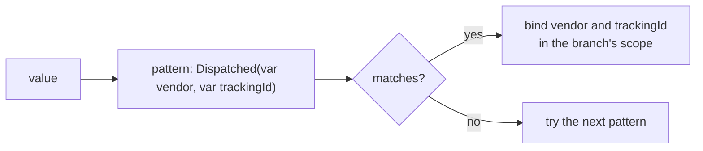
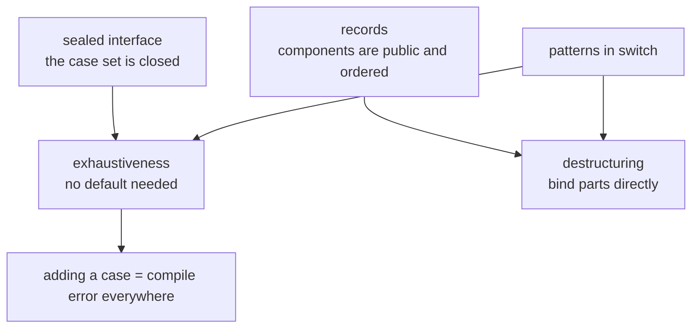
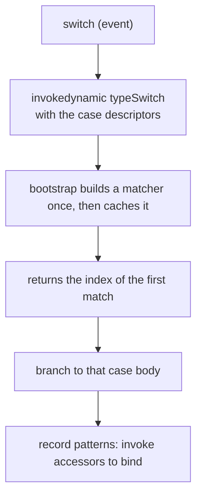
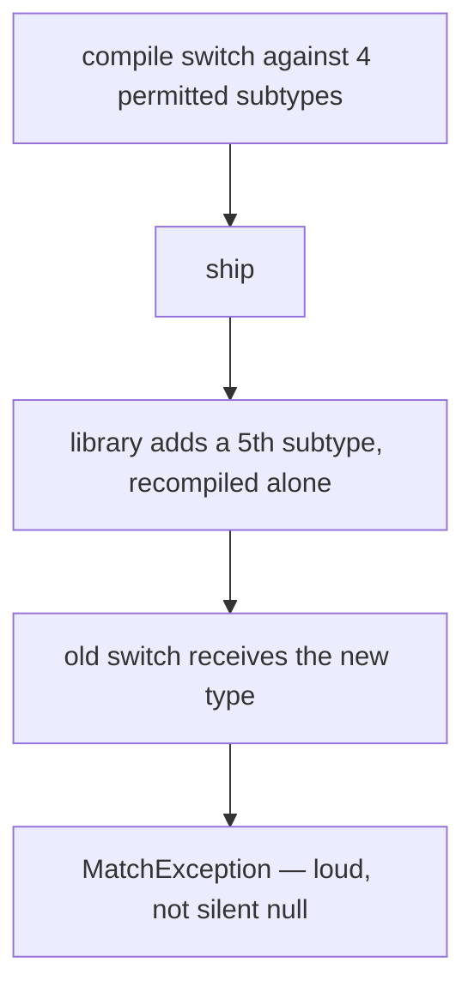

# Pattern Matching

## 1. Purpose & Audience

**Band:** L2 Professional · **Prerequisites:** [Java 14–17: Records, Sealed Types](12-java-14-to-17.md)

Pattern matching arrived in three instalments — `instanceof` patterns in 16, then `switch` patterns and record patterns together in 21 — and only becomes compelling when all three are combined with sealed types. At that point Java can dispatch on shape, destructure in the same step, and have the compiler prove you handled every case.

This chapter answers three questions:

1. **What is a pattern**, and how does flow scoping decide where a binding is visible?
2. **How does exhaustiveness work**, and what happens when it is violated at runtime?
3. **When is pattern matching the wrong tool** — because polymorphism is still the right answer more often than the enthusiasm suggests?

---

## 2. The Problem

The order engine processes events from the dispatch pipeline. In Java 8, dispatching on type means casting:

```java title="EventHandlerBefore.java"
// Java 8 — test, cast, repeat
public void handle(OrderEvent event) {
    if (event instanceof StockReserved) {
        StockReserved e = (StockReserved) event;          // the cast repeats the type
        ledger.record(e.sku(), e.quantity());

    } else if (event instanceof PaymentCaptured) {
        PaymentCaptured e = (PaymentCaptured) event;
        ledger.credit(e.reference(), e.amount());

    } else if (event instanceof DispatchFailed) {
        DispatchFailed e = (DispatchFailed) event;
        if (e.retryable()) {                               // nested condition
            retryQueue.add(e.orderId());
        } else {
            alerting.raise(e.reason());
        }

    } else {
        throw new IllegalArgumentException("unknown event: " + event);
    }
}
```

Four problems:

- **The type is written twice** per branch — once to test, once to cast.
- **Nothing checks completeness.** Add a fifth event type and this compiles, then throws in production.
- **Accessing components requires a second step** after the cast.
- **The `else` throw is a confession** that the compiler could not help.

The classical alternative is the Visitor pattern, which achieves exhaustiveness at the cost of an `accept` method on every type and a new visitor interface method for every operation — pushing the change into the data types every time you add behaviour.

---

## 3. Mental Model

A **pattern** is a test plus a binding. It asks "does this value have this shape?" and, if so, names the parts.



Three kinds:

| Pattern | Example | Binds |
|---|---|---|
| **Type pattern** | `case Confirmed c` | The value, typed |
| **Record pattern** | `case Confirmed(Instant at, String ref)` | The components |
| **Nested record pattern** | `case Dispatched(var at, Vendor(var name, _), var id)` | Components of components |

### 3.1 The three pillars



Pattern matching without sealed types is nicer `instanceof`. With them, the compiler becomes a checklist that updates itself.

---

## 4. Core API & Syntax

### 4.1 `instanceof` patterns (final in 16)

```java
if (event instanceof DispatchFailed failed && failed.retryable()) {
    retryQueue.add(failed.orderId());
}
```

| Feature | Behaviour |
|---|---|
| Binding variable | In scope where the pattern is known to have matched |
| `&&` chaining | The binding is visible in the right operand |
| Negation | `if (!(x instanceof T t)) return;` — `t` is in scope **after** the `if` |
| `null` | Never matches a type pattern |

### 4.2 `switch` patterns (final in 21)

| Form | Meaning |
|---|---|
| `case Confirmed c ->` | Type pattern |
| `case Confirmed c when c.isLate() ->` | Guarded pattern |
| `case Confirmed(var at, var ref) ->` | Record pattern |
| `case null ->` | Explicitly match null |
| `case null, default ->` | Null and everything else |
| `default ->` | Everything else — **disables exhaustiveness checking** |

### 4.3 Record patterns (final in 21)

```java
case Dispatched(Instant at, Vendor vendor, String trackingId) -> ...
case Dispatched(var at, Vendor(var name, var rating), var id) -> ...   // nested
case Dispatched(var at, _, var id) -> ...                               // unnamed (22)
```

| Rule | |
|---|---|
| Component count must match exactly | No partial destructuring |
| `var` infers the component type | Preferred for readability |
| Nesting | Arbitrarily deep |
| `_` unnamed pattern (Java 22) | For components you do not use |

### 4.4 Null handling

```java title="NullInSwitch.java"
String label = switch (status) {
    case null        -> "no status";      // without this, a null selector throws NPE
    case Pending p   -> "pending";
    case Confirmed c -> "confirmed";
    // ... remaining cases
};
```

**A `switch` with patterns throws `NullPointerException` on a null selector unless there is a `case null`.** This preserves the behaviour of the old switch, which also NPEs. `case null, default ->` is the compact way to treat null as "anything else".

---

## 5. Worked Examples

### 5.1 The event handler, rewritten

```java title="OrderEvent.java"
public sealed interface OrderEvent
        permits StockReserved, PaymentCaptured, DispatchFailed, OrderCancelled {
    Instant occurredAt();
}

public record StockReserved(Instant occurredAt, Sku sku, int quantity) implements OrderEvent { }
public record PaymentCaptured(Instant occurredAt, String reference, Money amount) implements OrderEvent { }
public record DispatchFailed(Instant occurredAt, OrderId orderId, String reason, boolean retryable) implements OrderEvent { }
public record OrderCancelled(Instant occurredAt, OrderId orderId, String reason) implements OrderEvent { }
```

```java title="EventHandler.java"
public void handle(OrderEvent event) {
    switch (event) {
        case StockReserved(var at, var sku, var quantity) ->
            ledger.record(sku, quantity);

        case PaymentCaptured(var at, var reference, var amount) ->
            ledger.credit(reference, amount);

        case DispatchFailed(var at, var orderId, var reason, boolean retryable) when retryable ->
            retryQueue.add(orderId);

        case DispatchFailed(var at, var orderId, var reason, var retryable) ->
            alerting.raise(reason);

        case OrderCancelled(var at, var orderId, var reason) ->
            ledger.reverse(orderId);
    }
}
```

No casts, no `else` throw, and **no `default`** — the compiler proves the switch is complete. Add a fifth event type and this method stops compiling, along with every other switch over `OrderEvent`.

The two `DispatchFailed` cases show guards doing the work the nested `if` did before, at the same level as every other branch.

### 5.2 Guards and ordering

```java title="Guards.java"
String priority(OrderEvent event) {
    return switch (event) {
        case DispatchFailed f when !f.retryable()          -> "P1";
        case DispatchFailed f when f.occurredAt().isBefore(cutoff) -> "P2";
        case DispatchFailed f                               -> "P3";
        case OrderCancelled c                               -> "P4";
        case StockReserved _, PaymentCaptured _             -> "INFO";   // Java 22+: several patterns need `_`
    };
}
```

Cases are tested **in order**, so guarded patterns must precede the unguarded pattern for the same type. The compiler enforces this:

```java title="Dominance.java"
switch (event) {
    case DispatchFailed f          -> "P3";
    case DispatchFailed f when !f.retryable() -> "P1";   // COMPILE ERROR
}
// error: this case label is dominated by a preceding case label
```

Note the last case. Several patterns in one label **cannot declare named bindings** — only one will match, so the other variable would be unassigned — which is why it uses `_` (Java 22+). `case StockReserved s, PaymentCaptured p` does not compile in any version.

**Dominance checking** catches unreachable branches at compile time — the same class of bug that in an `if`/`else if` chain simply never fires.

### 5.3 Nested destructuring

```java title="Nested.java"
sealed interface PaymentResult permits Approved, Declined { }
record Approved(String reference, Money amount, Card card) implements PaymentResult { }
record Declined(String reason, Card card) implements PaymentResult { }
record Card(String network, String lastFour) { }

String describe(PaymentResult result) {
    return switch (result) {
        case Approved(var ref, var amount, Card("VISA", var last4)) ->
            "Visa ..." + last4 + " charged " + amount;

        case Approved(var ref, var amount, Card(var network, var last4)) ->
            network + " ..." + last4 + " charged " + amount;

        case Declined(var reason, Card(_, var last4)) ->
            "Declined on ..." + last4 + ": " + reason;
    };
}
```

`Card("VISA", var last4)` matches on a *constant component* and binds the other — a test and a destructure in one pattern. The `_` in the last case is an unnamed pattern (Java 22) for a component that is not used.

### 5.4 `instanceof` patterns in ordinary code

```java title="InstanceOfPattern.java"
// The negation form — binding is in scope AFTER the if
public Money totalFor(Object payload) {
    if (!(payload instanceof Cart cart)) {
        throw new IllegalArgumentException("expected a cart");
    }
    return cart.total();       // cart is in scope here
}
```

This flow-scoping rule surprises people. The binding is in scope wherever the compiler can prove the pattern matched — which after an early return means the rest of the method. It makes guard-clause style work naturally.

```java title="EqualsWithPattern.java"
@Override
public boolean equals(Object o) {
    return o instanceof Sku other && code.equals(other.code);
}
```

The single most common use, and a genuine improvement: no separate cast line, no null check (null never matches a type pattern).

### 5.5 When not to use it

```java title="PreferPolymorphism.java"
// ✗ Pattern matching as a dispatch table for behaviour the types should own
Money fee(PricingRule rule) {
    return switch (rule) {
        case FlatDiscount f    -> f.amount();
        case PercentDiscount p -> subtotal.times(p.percent());
        case FreeDelivery fd   -> Money.ZERO;
    };
}

// ✓ The types own their behaviour
interface PricingRule {
    Money apply(Money subtotal);
}
```

If every branch does the same *kind* of thing with each type's own data, that is polymorphism, and an interface method is better: new implementations require no change to existing code.

**Pattern matching earns its place when the operation lives outside the types** — serialisation, rendering, routing, reporting — and when the case set is closed so exhaustiveness is worth having. The distinction is the classic expression problem: polymorphism makes adding types easy, pattern matching makes adding operations easy, and you choose based on which axis actually changes.

---

## 6. Internals

### 6.1 Flow scoping

The binding variable's scope is not lexical — it is wherever the compiler can prove the pattern matched.

```java title="FlowScoping.java"
if (event instanceof DispatchFailed f && f.retryable()) {
    // f in scope — proven matched
} else {
    // f NOT in scope — may not have matched
}

if (!(event instanceof DispatchFailed f)) {
    return;
}
// f IS in scope — the only way to reach here is a match

if (event instanceof DispatchFailed f || f.retryable()) {   // COMPILE ERROR
    // || means the right side runs when the pattern did NOT match
}
```

The compiler performs definite-matching analysis, the same shape as the definite-assignment analysis that has always governed `final` locals. Each rule follows from "could this code be reached without a match?"

### 6.2 How a pattern switch compiles

A switch on patterns does not become a `tableswitch`. It compiles to an `invokedynamic` call to a bootstrap in `java.lang.runtime.SwitchBootstraps`, which returns an index identifying the first matching case; the compiler then branches on that index.



Two consequences worth knowing:

- **It is not a linear chain of `instanceof`.** The bootstrap can build a more efficient decision structure, and it is linked once per call site.
- **Record destructuring calls the accessors.** A record component with an expensive or side-effecting accessor is invoked by the pattern match — another reason accessors should be trivial.

### 6.3 Exhaustiveness and `MatchException`

When the selector is a sealed type and every permitted subtype is covered, no `default` is required. But the compiler still emits a synthetic default that throws `MatchException`.

That branch exists for **separate compilation**:



The compile-time guarantee is only sound when the hierarchy and its switches are compiled together. Across a library boundary, sealing a public type means adding a permitted subtype is effectively a breaking change — it compiles, and it breaks consumers at runtime.

### 6.4 Null, deliberately

| Construct | Null behaviour |
|---|---|
| `x instanceof T t` | `false` — never matches |
| `switch` with patterns, no `case null` | Throws `NullPointerException` |
| `switch` with `case null` | Matches that branch |
| `case null, default ->` | Null joins the default branch |

The NPE is backwards-compatible: the old `switch` on a `String` or boxed value also threw on null, so pattern switches kept it rather than silently routing null to `default`. The result is that null handling is always explicit — you either wrote `case null` or you get an exception, and neither is silent.

### 6.5 Dominance

A case label is *dominated* if an earlier label would always match first. The compiler rejects it.

| Earlier label | Later label | Result |
|---|---|---|
| `Object o` | anything | Dominated — compile error |
| `DispatchFailed f` | `DispatchFailed f when ...` | Dominated |
| `DispatchFailed f when g` | `DispatchFailed f` | Fine — guard first |
| `Approved(var r, var a, var c)` | `Approved(var r, var a, Card("VISA", var l))` | Dominated |

This turns a whole class of ordering bugs into compile errors. The equivalent `if`/`else if` chain has no such check — the unreachable branch just never runs.

---

## 7. Production Patterns & Anti-Patterns

### Do this

- **Use `instanceof` patterns in `equals`.** `o instanceof Sku other && code.equals(other.code)` is the idiom.
- **Use the negation form for guard clauses** — `if (!(x instanceof T t)) return;` and `t` is in scope afterwards.
- **Pair sealed interfaces with record implementations** so each case carries exactly its own data.
- **Omit `default` from sealed switches** so the compiler enforces completeness.
- **Put guarded cases before the unguarded case** for the same type — the compiler will tell you if you forget.
- **Use `var` in record patterns.** Repeating component types adds noise without safety.
- **Use `_` for components you do not bind** (Java 22+); it documents the intent.
- **Handle null explicitly** with `case null` wherever the selector can be null.

### Never do this

- **Never use pattern matching where polymorphism fits.** If every branch does the same kind of thing with each type's own data, put a method on the interface.
- **Never add `default` to a sealed switch** you want checked — it permanently silences exhaustiveness.
- **Never nest destructuring more than about two levels.** `A(B(C(var x, _), _), _)` is write-only code.
- **Never put side effects in a record accessor.** Pattern destructuring invokes them.
- **Never assume a pattern switch handles null.** It throws unless you wrote `case null`.
- **Never seal a public library type casually** — adding a permitted subtype later breaks consumers at runtime with `MatchException`.
- **Never use a guard to re-test something the pattern already established.** `case Confirmed c when c instanceof Confirmed` is noise.

---

## 8. Version Evolution (Java 8 → 26)

| Version | What changed | Impact |
|---|---|---|
| **14** | `instanceof` pattern preview; switch expressions final | First patterns |
| **16** | **`instanceof` patterns final (JEP 394)**; records final | Test-and-cast collapses into one construct |
| **17** | Sealed classes final; pattern switch preview | The case set becomes closed |
| **19–20** | Record patterns preview; pattern switch refinement | Destructuring appears |
| **21** | **Pattern matching for `switch` final (JEP 441)**; **record patterns final (JEP 440)** | The complete feature |
| **22** | **Unnamed variables and patterns final (JEP 456)** | `_` for unused bindings |
| **23–25** | Primitive types in patterns — **still preview** | `case int i` and primitive `instanceof`; verify status against your JDK |
| **26** | Ongoing preview work | — |

!!! warning "Primitive patterns are not final"
    Patterns over primitive types — `case int i`, `x instanceof byte b` — have been in preview across several releases and are **not final**. Code using them needs `--enable-preview` and may need rewriting. Everything else in this chapter is final as of Java 22.

### Migration note

Two mechanical sweeps, both safe:

1. **Test-and-cast → `instanceof` pattern.** `if (x instanceof T) { T t = (T) x; ... }` becomes `if (x instanceof T t) { ... }`. Highest density in `equals` methods.
2. **`if`/`else if` type chains → pattern switch**, once the hierarchy is sealed. Do the sealing first; converting to a switch before the type is sealed gains you syntax but not exhaustiveness.

The non-mechanical question is which `if` chains *should* become switches. One that ends in `else throw new IllegalArgumentException("unknown type")` is the strongest candidate — that throw is exactly the runtime check the compiler can now do instead.

---

## 9. Interview Questions

### L1 — Foundations

**Q1. What is an `instanceof` pattern?** ⭐ *high frequency*
A combined type test and cast: `if (x instanceof Sku sku)` tests the type and, on success, binds `sku` as a variable of that type. It removes the separate cast line that repeated the type name, and because null never matches a type pattern, it also removes the null check. The commonest use is in `equals` methods.

**Q2. What is a record pattern?**
A pattern that matches a record and destructures it in the same step: `case Confirmed(var at, var reference)` binds each component to a variable. The component count must match exactly, and patterns can nest, so a component that is itself a record can be destructured inline.

**Q3. What happens when a pattern switch receives null?**
It throws `NullPointerException`, unless there is an explicit `case null`. This matches the behaviour of the older switch on strings and boxed types, which also threw. Adding `case null` or `case null, default ->` makes the handling explicit, and there is no silent path where null falls into `default`.

### L2 — Professional

**Q4. What is flow scoping?** ⭐ *high frequency*
The rule that a pattern's binding variable is in scope wherever the compiler can prove the pattern matched, rather than within a fixed lexical block. So after `if (!(x instanceof T t)) return;` the variable `t` is in scope for the rest of the method, because the only way to reach there is a match. It is the same kind of analysis as definite assignment, applied to matching.

**Q5. Why must guarded cases come before the unguarded case for the same type?**
Because cases are tested in order, so an unguarded `case DispatchFailed f` would match everything of that type and the guarded one below it could never run. The compiler detects this as dominance and rejects it, which turns a silent unreachable-branch bug into a compile error — something the equivalent `if`/`else if` chain never gives you.

**Q6. When does a pattern switch need a `default`?**
Only when the selector type is not sealed, or when the cases do not cover every permitted subtype. On a sealed hierarchy with every case covered, `default` is unnecessary and should be omitted, because adding it disables the exhaustiveness check and lets a future subtype fall through silently instead of failing the build.

### L3 — Enterprise

**Q7. How does a pattern switch compile?**
Not to a `tableswitch`. The compiler emits an `invokedynamic` call to a bootstrap in `java.lang.runtime.SwitchBootstraps`, which builds a matcher once per call site and returns the index of the first matching case; the compiler branches on that index. Record patterns then invoke the record's accessors to bind components — which is a practical reason accessors should be trivial and free of side effects.

**Q8. What is `MatchException` and when does it occur?**
It is thrown by the synthetic default branch the compiler emits for an exhaustive switch. That branch exists because exhaustiveness is only proven at compile time: if a sealed hierarchy gains a permitted subtype and is recompiled without recompiling the switches over it, the old switch can receive a value it has no case for. Throwing loudly is preferable to returning null silently, but it means separately-compiled code loses the guarantee.

**Q9. What is the risk of sealing a type in a published library?**
Adding a permitted subtype later compiles fine but breaks consumers at runtime with `MatchException`, because their switches were compiled against the smaller set and were exhaustive then. So a sealed public type's permitted list is effectively part of the API contract, and extending it is a breaking change in practice. Seal public types only where the closed set is genuinely permanent.

### L4 — Architect

**Q10. When is pattern matching the wrong tool?**
When the operation belongs to the types. If every branch does the same kind of thing with each type's own data — computing a price, rendering itself, validating — that is polymorphism, and an interface method means new implementations require no change to existing code. Pattern matching fits when the operation lives outside the types and the case set is closed: serialisation, routing, reporting. Choosing wrongly produces either a growing switch that must be edited for every new type, or an interface every implementer must change for every new operation.

**Q11. How does this relate to the expression problem?**
The expression problem is that you want to add both new types and new operations without modifying existing code, and mainstream languages let you have one easily but not both. Polymorphism makes adding types cheap — a new class, nothing else changes — while adding an operation touches every class. Pattern matching over a sealed hierarchy inverts it: a new operation is a new switch, while a new type breaks every switch. Java now offers both and the design decision becomes explicit: seal when the type set is stable and the operations are open, use an open interface when the reverse holds.

**Q12. How would you introduce pattern matching into an existing Java 8 codebase?**
Start with the mechanical sweep — test-and-cast into `instanceof` patterns, which is local and risk-free, and densest in `equals` methods. Then look for `if`/`else if` type chains that end in a throw for the unknown case, because that throw is precisely the runtime check the compiler can take over. But converting those requires sealing the hierarchy first, which is a modelling decision rather than a refactoring: it closes the type to external extension permanently and, in a published API, makes the permitted list part of the contract. The syntax change is cheap; the design commitment underneath it is not.

---

!!! abstract "Cheat Sheet"
    **Pattern = test + binding** — type patterns, record patterns, nested patterns

    **`x instanceof T t`** — no separate cast, and null never matches

    **Flow scoping:** binding is in scope wherever a match is proven — including after `if (!(x instanceof T t)) return;`

    **`case T t when guard ->`** — guarded cases must precede the unguarded one

    **Dominance is a compile error** — unreachable branches are caught

    **`case Confirmed(var at, var ref)`** — destructure; `var` preferred; `_` for unused (22)

    **Exhaustive over a sealed type = no `default` needed**

    **`default` disables exhaustiveness checking** — omit it

    **Null throws NPE** unless `case null` — never silent

    **Compiles to `invokedynamic`** via `SwitchBootstraps`; destructuring calls accessors

    **`MatchException`** — separate compilation broke an exhaustive switch

    **Polymorphism for open types · pattern matching for open operations** — the expression problem
