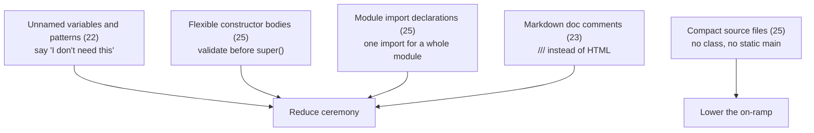
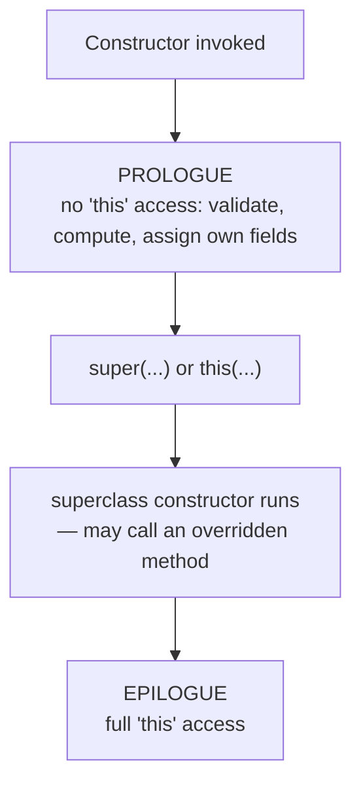
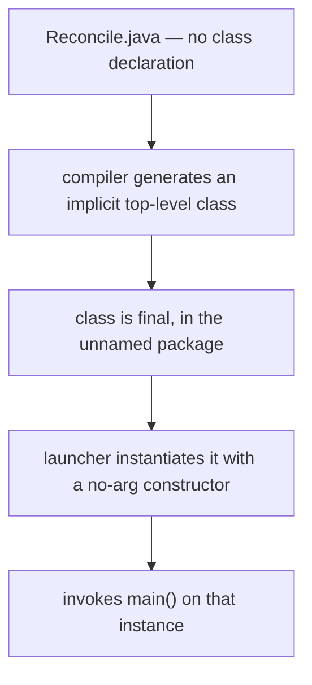

# Java 21–26 Language Features

<!-- video:start -->
<figure class="pb-video">
<video controls playsinline preload="metadata">
<source src="../../videos/ch14.mp4" type="video/mp4">
<track kind="subtitles" srclang="en" label="English" src="../../videos/ch14.vtt">
</video>
<figcaption>Video walkthrough · 6:58 · subtitles via CC · <a href="../../videos/ch14.mp4" download>Download MP4</a></figcaption>
</figure>
<!-- video:end -->

!!! example "Try it first"
    **[Java 18–21 by example](../07-examples/java-18-21.md)** — 7 runnable programs, including virtual threads timed against platform threads, each with its real output.

## 1. Purpose & Audience

**Band:** L3 Enterprise · **Prerequisites:** [Java 14–17](12-java-14-to-17.md), [Pattern Matching](13-pattern-matching.md)

Java 21 and 25 are the LTS releases most teams will run for the rest of the decade. The headline features — virtual threads, pattern matching — have their own chapters. This one covers what else landed: a set of smaller language changes that remove long-standing papercuts, plus one significant shift in what a Java source file can look like.

This chapter answers three questions:

1. **What became final in Java 22–25**, and which of it should you actually adopt?
2. **What changed about writing a constructor**, and why was the old rule there?
3. **Which of these belong in production code**, and which are for teaching and scripts?

---

## 2. The Problem

Four unrelated irritations, each older than most of the codebase they annoy.

**Bindings you must name but never use:**

```java title="UnusedBindings.java"
// Java 21 — every component must be named, used or not
switch (event) {
    case DispatchFailed(var occurredAt, var orderId, var reason, var retryable) ->
        alerting.raise(reason);      // three of four bindings unused
}

try (var ignored = lock.acquire()) { ... }        // "ignored" by convention only
catch (NumberFormatException ignored) { }          // the compiler doesn't know
```

**Validation must happen after `super()`:**

```java title="ConstructorOrder.java"
// Java 21 — illegal: nothing may precede super()
public Money(BigDecimal amount, Currency currency) {
    if (amount == null) throw new IllegalArgumentException();   // COMPILE ERROR
    super();
}

// So you write this instead
public Money(BigDecimal amount, Currency currency) {
    super(validate(amount));                       // static helper, purely to satisfy the rule
    this.currency = currency;
}
```

**Import blocks nobody reads:**

```java title="ImportBlock.java"
import java.util.List;
import java.util.Map;
import java.util.Set;
import java.util.Optional;
import java.util.stream.Collectors;
// ... twenty more lines the IDE manages and no human reads
```

**A "hello world" that requires four concepts:**

```java title="HelloBefore.java"
public class Hello {                                  // class
    public static void main(String[] args) {          // static, String[], public
        System.out.println("Hello");
    }
}
```

---

## 3. Mental Model



Two distinct motivations run through these, and they have different implications for your codebase.

**Removing ceremony** — unnamed variables, flexible constructors, Markdown javadoc — applies everywhere and should be adopted as normal practice.

**Lowering the on-ramp** — compact source files, module imports — is aimed at learners, scripts, and single-file programs. Useful there, and mostly wrong in a large codebase, for reasons §5.4 and §5.3 make concrete.

---

## 4. Core API & Syntax

### 4.1 Unnamed variables and patterns (final in 22)

| Context | Form |
|---|---|
| Record pattern component | `case Point(var x, _)` |
| Local variable | `var _ = queue.poll();` |
| Enhanced `for` | `for (var _ : orders) count++;` |
| `catch` parameter | `catch (NumberFormatException _) { }` |
| try-with-resources | `try (var _ = lock.acquire()) { }` |
| Lambda parameter | `(_, value) -> value.trim()` |
| **Not** a field or method parameter | — |

`_` may appear more than once in the same scope, which a named variable cannot.

### 4.2 Flexible constructor bodies (final in 25)

```java
public Child(int value) {
    if (value < 0) throw new IllegalArgumentException();   // prologue — now legal
    super(value * 2);
    this.cached = compute();                                // epilogue — as before
}
```

| In the prologue (before `super()`/`this()`) | Allowed? |
|---|---|
| Validate arguments | Yes |
| Compute values to pass to `super()` | Yes |
| Assign this class's own fields | Yes |
| Read this class's fields | **No** |
| Call instance methods | **No** |
| Reference `this` | **No** |

### 4.3 Module import declarations (final in 25)

```java
import module java.base;        // every package that java.base exports
import module java.sql;
```

| Rule | |
|---|---|
| Imports all packages exported by that module | Including transitive `requires transitive` |
| Ambiguity is an error | Resolve with a single-type import |
| Works from the classpath | The file need not be in a module |

### 4.4 Compact source files and instance main methods (final in 25)

```java title="Hello.java"
void main() {
    IO.println("Hello");
}
```

| Relaxation | |
|---|---|
| No enclosing class declaration | An implicit class is generated |
| `main` need not be `static` | An instance is created |
| `main` need not be `public` | — |
| `String[] args` optional | Both signatures accepted |
| `java.base` implicitly imported | No import block needed |
| `IO.println` / `IO.readln` | Console I/O without `System.out` |

Run directly: `java Hello.java`.

### 4.5 Markdown documentation comments (final in 23)

```java
/// Reserves stock for every line in the cart.
///
/// - Returns `true` when all lines were reserved
/// - Returns `false` if any line is short
///
/// @param lines the cart lines to reserve
/// @see InventoryItem#available()
public boolean reserveAll(List<CartLine> lines) { ... }
```

`///` comments use Markdown instead of HTML. Javadoc tags still work. `{@link}` is replaced by standard Markdown link syntax pointing at a reference.

---

## 5. Worked Examples

### 5.1 Unnamed variables

```java title="UnnamedPatterns.java"
// Before — three bindings you must name and never use
case DispatchFailed(var occurredAt, var orderId, var reason, var retryable) ->
    alerting.raise(reason);

// After — the shape is still checked, the intent is explicit
case DispatchFailed(_, _, var reason, _) ->
    alerting.raise(reason);
```

The record pattern still verifies the component count, so this is not shorthand for "ignore the shape" — it is shorthand for "I do not need these parts".

Elsewhere:

```java title="UnnamedElsewhere.java"
// Side effect only
for (var _ : expiredReservations) {
    releasedCount++;
}

// The exception type is the information; the object is not
try {
    return Integer.parseInt(input);
} catch (NumberFormatException _) {
    return defaultValue;
}

// A resource acquired for its side effect
try (var _ = tenantContext.bind(tenant)) {
    process(order);
}

// Only the second lambda parameter matters
map.forEach((_, item) -> audit.record(item));
```

The `catch` and try-with-resources cases are the clearest wins: `ignored` was always a convention that tooling could not verify, and `_` states it to the compiler.

### 5.2 Flexible constructor bodies

```java title="Validation.java"
public record Money(BigDecimal amount, Currency currency) { }

public final class DiscountedMoney extends MoneyBase {

    private final Money original;

    public DiscountedMoney(Money original, int percent) {
        // Prologue — validation before super(), now legal
        Objects.requireNonNull(original, "original");
        if (percent < 0 || percent > 100) {
            throw new IllegalArgumentException("percent out of range: " + percent);
        }

        super(original.amount().multiply(BigDecimal.valueOf(100 - percent))
                               .divide(BigDecimal.valueOf(100)));

        this.original = original;
    }
}
```

Before Java 25 this required a `private static` validating helper called from inside the `super(...)` argument — a workaround so common it became idiom. The failure now happens at the line that detected it, with a stack trace pointing there.

**Why the rule existed.** A superclass constructor may call an overridable method, which dispatches to the subclass override before the subclass's fields are initialised. Letting subclass code run before `super()` would widen that hole. The prologue is therefore restricted to statements that cannot observe `this`: you may validate parameters and assign your own fields, but not read them or call instance methods.

```java title="PrologueLimits.java"
public Child(int value) {
    this.field = value;         // ✓ assigning own field is allowed
    int x = this.field;         // ✗ reading is not
    validate();                 // ✗ instance method call
    super(value);
}
```

### 5.3 Module imports

```java title="ModuleImport.java"
import module java.base;

void main() {
    List<String> skus = List.of("MILK-1L", "RICE-5KG");
    Map<String, Integer> counts = new HashMap<>();
    var joined = skus.stream().collect(Collectors.joining(", "));
}
```

One line replaces the import block. The risk is ambiguity:

```java title="Ambiguity.java"
import module java.base;      // java.util.Date
import module java.sql;       // java.sql.Date

Date d = ...;                  // COMPILE ERROR: ambiguous
```

The fix is a single-type import, which takes precedence:

```java
import module java.base;
import module java.sql;
import java.sql.Date;          // disambiguates
```

**Where this belongs.** Scripts, teaching material, and single-file programs — yes. A large codebase — probably not: explicit imports document dependencies, make unused ones visible, and never become ambiguous when a JDK release adds a class. The convenience is real and the information loss is real.

### 5.4 Compact source files

```java title="Reconcile.java"
void main() {
    var orders = loadOrders(Path.of("orders.csv"));
    var total = orders.stream()
                      .map(Order::total)
                      .reduce(Money.ZERO, Money::plus);
    IO.println("Reconciled " + orders.size() + " orders, total " + total);
}

List<Order> loadOrders(Path path) throws IOException {
    return Files.readAllLines(path).stream().skip(1).map(Order::parse).toList();
}
```

```bash
java Reconcile.java        # no javac, no class declaration, no static
```

This is genuinely useful for operational scripts — a reconciliation check, a data fix, a one-off migration — where the alternative was a shell script or a throwaway Maven module. The file is ordinary Java, so it has types, the standard library, and your IDE.

It is **not** for application code. Everything in a compact source file is in the unnamed package, so nothing else can import it, and the moment it needs a second type or a test it becomes a normal class anyway. Treat it as the replacement for a Bash script, not for a class.

### 5.5 Markdown javadoc

```java title="MarkdownDoc.java"
/// Reserves stock for every line in the cart.
///
/// Reservation is all-or-nothing: if any line cannot be satisfied,
/// nothing is reserved.
///
/// ```java
/// boolean ok = inventory.reserveAll(cart.lines());
/// ```
///
/// | Outcome | Meaning |
/// |---------|---------|
/// | `true`  | every line reserved |
/// | `false` | at least one line short |
///
/// @param lines the cart lines to reserve
/// @throws IllegalArgumentException if `lines` is empty
/// @see InventoryItem#available()
public boolean reserveAll(List<CartLine> lines) { ... }
```

Compare with the HTML equivalent — `<p>`, `<pre>{@code ...}</pre>`, `<table><tr><th>` — which is why most Java documentation is a single unformatted paragraph. Markdown removes the excuse.

Migration is incremental: `///` and `/** */` coexist, so convert as you touch files.

---

## 6. Internals

### 6.1 `_` became a keyword the long way round

`_` was a legal identifier through Java 8. Java 9 made using it alone a compile error — deliberately, to reserve it. Java 21 previewed it as an unnamed variable, and Java 22 finalised it.

That fifteen-year lead time is why the change is source-compatible: any code still using `_` as a name stopped compiling in Java 9, long before the meaning changed.

Unnamed variables declare no binding at all, which is why `_` may repeat in one scope while a named variable cannot.

### 6.2 The constructor prologue

The JVM has always permitted bytecode before the `super()` invocation; the restriction was a *language* rule, not a verifier rule. JEP 513 relaxed the language rule while keeping the safety property that motivated it.



The prologue cannot read fields or call instance methods, so it cannot observe the partially-constructed object. The hazard the original rule guarded against — a superclass constructor dispatching to a subclass override that sees uninitialised fields — is unchanged, and still a reason to avoid calling overridable methods from constructors.

Assigning your own fields in the prologue is a genuine addition: a field assigned there is already set when the superclass constructor calls an override.

### 6.3 How compact source files are compiled



Consequences:

- **Unnamed package** — no other compilation unit can import it.
- **The class is real** — it has a name derived from the file, visible in stack traces.
- **Instance `main` means fields and instance methods work** normally, without `static` on everything.
- **`java.base` is implicitly imported**, which is the module-import mechanism applied automatically.

The `IO` class providing `println` and `readln` exists so that a first program needs neither `System.out` nor an understanding of streams.

### 6.4 Module import resolution

Module imports sit between on-demand imports (`java.util.*`) and single-type imports in precedence:

| Precedence | Form |
|---|---|
| Highest | Single-type: `import java.sql.Date;` |
| Middle | On-demand: `import java.util.*;` |
| Lowest | Module: `import module java.base;` |

Two module imports offering the same simple name is an error only **at the point of use**, not at the import — so a file can import two conflicting modules and compile, until someone writes `Date`.

That is also the upgrade hazard: a future JDK release adding a class to an exported package can introduce an ambiguity in code that previously compiled. Single-type imports do not have this failure mode, which is the argument against module imports in long-lived code.

### 6.5 Sequenced collections belong here too

Java 21 also added `SequencedCollection`, `SequencedSet`, and `SequencedMap` (JEP 431) — `getFirst`, `getLast`, `addFirst`, `reversed()` and friends. They are covered in [Chapter 21](../03-collections/21-sequenced-collections.md).

The point worth repeating: **`HashMap` does not implement `SequencedMap`**. It has no encounter order. `LinkedHashMap` and `TreeMap` do.

---

## 7. Production Patterns & Anti-Patterns

### Do this

- **Use `_` for unused record components, `catch` parameters, and resources acquired for their side effect.** It states intent to the compiler, not just to a reader.
- **Validate in the constructor prologue** rather than in a static helper.
- **Assign your own fields before `super()`** when a superclass constructor may call an overridden method — though avoiding such calls remains better.
- **Adopt Markdown javadoc** for new and touched documentation; the two forms coexist.
- **Use compact source files for operational scripts** — the replacement for a Bash script, not for a class.
- **Keep explicit imports in application code.** The block is generated and maintained by tooling; its information value outlives the typing cost.

### Never do this

- **Never use compact source files for application code.** The unnamed package makes them unimportable, and the first test forces a rewrite.
- **Never use module imports in a long-lived codebase.** A future JDK adding a class can introduce an ambiguity in code that compiled yesterday.
- **Never call an instance method in the constructor prologue.** It does not compile, and the reason is that the object does not exist yet.
- **Never assume the prologue makes constructors safe.** Calling overridable methods from a constructor is still a design error.
- **Never use `_` where a name would inform the reader.** It says "not needed", and if that is untrue it misleads.
- **Never mix `///` and `/** */` on the same declaration** — one doc comment per element.
- **Never use primitive type patterns in production yet.** They remain preview; see §8.

---

## 8. Version Evolution (Java 8 → 26)

| Version | What changed | Impact |
|---|---|---|
| **9** | `_` alone becomes a compile error | Reserves the identifier fifteen years ahead |
| **21** | **LTS.** Virtual threads, pattern matching for `switch`, record patterns, sequenced collections (JEP 431) | The largest language release since 8 |
| **22** | **Unnamed variables and patterns final (JEP 456)** | `_` everywhere it makes sense |
| **23** | **Markdown doc comments final (JEP 467)**; String Templates dropped | Readable javadoc; see [Ch 15](15-string-templates-postmortem.md) |
| **25** | **LTS.** Flexible constructor bodies (JEP 513), module import declarations (JEP 511), compact source files and instance main methods (JEP 512), `ScopedValue` final (JEP 506) | The current LTS baseline |
| **26** | Structured concurrency 6th preview (JEP 525); primitive patterns 4th preview (JEP 530); Lazy Constants 2nd preview (JEP 526) | Verify preview status against your JDK |

!!! warning "Still preview"
    Primitive types in patterns — `case int i`, `x instanceof byte b` — have been in preview across several releases and are **not final**. So is `StructuredTaskScope` ([Chapter 32](../04-concurrency/32-structured-concurrency.md)). Preview features require `--enable-preview` at compile and run time, and the resulting class files refuse to load on a different JDK version.

### Migration note

On Java 25, three changes are safe sweeps:

1. **Unused bindings → `_`.** Mechanical, and `catch (X ignored)` is the densest site.
2. **Static validation helpers → constructor prologues.** Remove the helper, move the check, keep the message.
3. **Javadoc → Markdown** as files are touched. Not worth a dedicated pass.

Two are not sweeps: module imports and compact source files are for new, small, standalone code, not for converting what exists.

One thing to check before upgrading a Java 21 codebase to 25: any identifier still named `_` has not compiled since Java 9, so there is nothing to fix — but code generators occasionally emit it, and those will now fail with a different message.

---

## 9. Interview Questions

### L1 — Foundations

**Q1. What is the unnamed variable `_` for?** ⭐ *high frequency*
It declares that a binding is deliberately unused — in a record pattern component, a `catch` parameter, a loop variable, a lambda parameter, or a resource acquired only for its side effect. Because it declares no binding at all, it may appear several times in one scope, unlike a named variable. It replaces the `ignored` naming convention with something the compiler understands.

**Q2. What changed about constructors in Java 25?**
Statements may now appear before `super()` or `this()` — the constructor prologue. You can validate arguments, compute values to pass up, and assign your own fields there. What you still cannot do is read fields, call instance methods, or reference `this`, because the object is not yet constructed.

**Q3. What is a compact source file?**
A source file with no class declaration, containing methods directly, with a `main` that need not be static, public, or take arguments. The compiler generates an implicit class, `java.base` is imported automatically, and the file runs with `java Hello.java`. It is aimed at learning and scripting.

### L2 — Professional

**Q4. Why was code forbidden before `super()`, and why is it allowed now?** ⭐ *high frequency*
Because a superclass constructor can call an overridable method, which dispatches to the subclass override before the subclass's fields are initialised — so allowing arbitrary subclass code to run first would widen that hole. Java 25 relaxed the language rule while preserving the safety property: the prologue may not read fields, call instance methods, or reference `this`, so it cannot observe the partially-built object. The JVM always permitted it; the restriction was a language rule.

**Q5. Should you use module imports in application code?**
Generally no. `import module java.base` replaces an import block with one line, which suits scripts and teaching, but explicit imports document what a file depends on, make unused imports visible, and never become ambiguous. Module imports can break on a JDK upgrade: if a release adds a class whose simple name collides with one from another imported module, code that compiled yesterday fails at the point of use.

**Q6. Where can `_` not be used?**
As a field name or a method parameter — both need a name because they are referenced elsewhere or form part of a signature. It is allowed for local variables, `for` variables, `catch` parameters, try-with-resources variables, lambda parameters, and record pattern components. The distinction is whether anything outside the declaration needs to refer to it.

### L3 — Enterprise

**Q7. What is the risk of adopting a preview feature in production?**
Preview features require `--enable-preview` at both compile and run time, and the resulting class files carry a marker that makes them refuse to load on a different JDK version — so an upgrade forces recompilation, and a library built this way is unusable by anyone on another release. The API can also change between previews, as `StructuredTaskScope` did substantially, or be withdrawn entirely, as String Templates were. The reasonable position is to experiment in application code you can rewrite, and never in a published library.

**Q8. How is a compact source file actually compiled?**
The compiler generates an implicit top-level class in the unnamed package containing the declared methods, and the launcher instantiates it with a no-arg constructor before invoking `main` on that instance. The class is real and appears in stack traces. Because it is in the unnamed package, nothing else can import it — which is the structural reason it does not scale beyond a single file.

**Q9. What does assigning a field in the constructor prologue give you?**
A field set before the superclass constructor runs, so if that constructor calls an overridable method which the subclass overrides, the override sees an initialised value rather than the default. It narrows a long-standing hazard without eliminating it — calling overridable methods from a constructor is still a design error, because the prologue can only initialise fields whose values do not depend on the superclass.

### L4 — Architect

**Q10. How should a team decide which of these features to adopt?**
Separate them by intent. Unnamed variables, flexible constructor bodies, and Markdown javadoc reduce ceremony in code you already write and should simply become the convention, since each removes a workaround rather than adding a concept. Compact source files and module imports lower the on-ramp for learners and scripts, and in a large codebase they trade information for brevity — explicit imports document dependencies and never become ambiguous. The test is whether the feature removes noise or removes information.

**Q11. What does the six-month release cadence change about how a team tracks Java?**
It moves the unit of decision from "which version do we migrate to" to "which features have reached final". Between LTS releases, most changes arrive as previews that may change shape or be withdrawn, so tracking JEP status matters more than tracking release numbers — a feature written about in 2023 may not exist, as String Templates did not. The practical discipline is to run non-LTS releases in CI to catch deprecations early, adopt only final features in production code, and treat any tutorial without a JDK version as suspect.

**Q12. A team wants to use compact source files for internal tooling. Is that reasonable?**
Yes, with a boundary. They are a genuine improvement over shell scripts for operational tasks — a reconciliation check or a data fix gets types, the standard library, and IDE support, with no build file. The boundary is the moment a script needs a second type, a unit test, or to be imported: everything is in the unnamed package, so that forces a rewrite into a normal class. The right rule is that anything expected to live longer than a few months, or to be depended on, starts as a normal class.

---

!!! abstract "Cheat Sheet"
    **`_` (22):** record components · `catch` params · loop vars · lambda params · resources — **not** fields or method params

    **`_` may repeat in a scope** — it declares no binding

    **Flexible constructors (25):** validate and assign own fields before `super()`

    **Prologue cannot:** read fields · call instance methods · reference `this`

    **`import module java.base` (25)** — lowest precedence; ambiguity errors at the point of use

    **Module imports and compact source files are for scripts**, not application code

    **Compact source file:** implicit class, unnamed package, instance `main`, `java Hello.java`

    **Markdown javadoc `///` (23)** — coexists with `/** */`, one per declaration

    **Java 21 LTS · Java 25 LTS** — the two baselines that matter

    **Still preview:** primitive type patterns · `StructuredTaskScope`

    **Preview class files refuse to load on another JDK** — never in a published library
