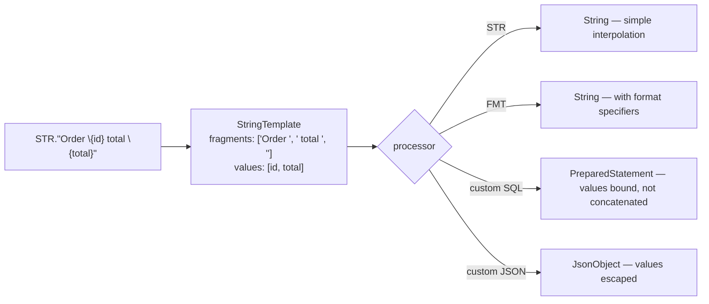
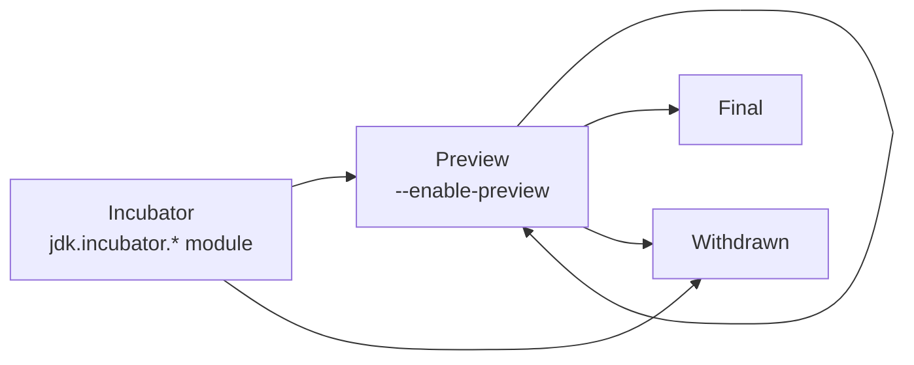
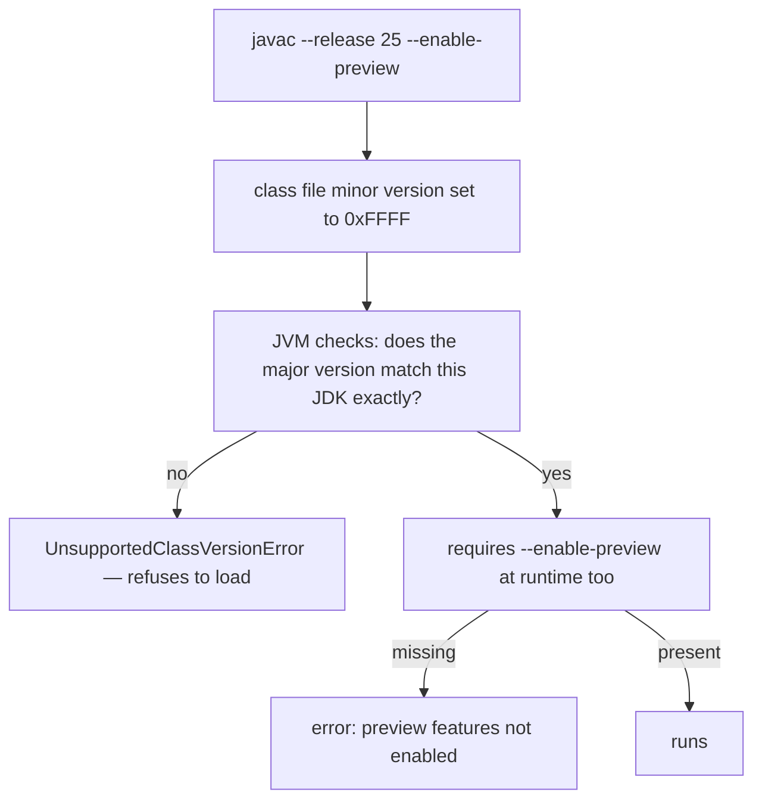

# String Templates: A Post-Mortem

## 1. Purpose & Audience

**Band:** L4 Architect · **Prerequisites:** [Java 14–17](12-java-14-to-17.md), [Java 21–26](14-java-21-to-26.md)

String Templates were previewed in Java 21, previewed again in 22, and then **removed**. They ship in no released JDK and there is no supported way to use them today. A great deal of material written in 2023 and 2024 describes them as though they are part of the language.

That makes them the best available case study for something every senior Java developer now needs: **how to consume a six-month release cadence without betting on features that do not arrive.**

This chapter answers three questions:

1. **What were String Templates**, and what problem did they solve that `formatted` does not?
2. **Why were they withdrawn** after two previews?
3. **How should a team evaluate preview features**, given that this can happen?

---

## 2. The Problem

String interpolation is the most-requested Java feature that Java does not have.

```java title="Concatenation.java"
String message = "Order " + order.id() + " for " + customer.name()
               + " totalling " + order.total() + " will arrive on "
               + order.deliveryDate();
```

Readable enough at three fragments, unreadable at six, and the `+` operators carry no information. The alternatives each trade one problem for another:

```java title="Alternatives.java"
// formatted — placeholders separate from values; positional and easy to misalign
String a = "Order %s for %s totalling %s arriving %s"
    .formatted(order.id(), customer.name(), order.total(), order.deliveryDate());

// MessageFormat — locale-aware, but verbose and quoting rules surprise people
String b = MessageFormat.format("Order {0} for {1}", order.id(), customer.name());

// StringBuilder — explicit, and nobody reads it
String c = new StringBuilder().append("Order ").append(order.id())
    .append(" for ").append(customer.name()).toString();
```

But the deeper problem was never readability. It was **safety**:

```java title="Injection.java"
// SQL injection
String sql = "select * from orders where customer_id = '" + customerId + "'";

// XSS
String html = "<div>" + userSuppliedName + "</div>";
```

Every language with plain interpolation makes this *easier* to write. That tension — make concatenation convenient without making injection convenient — is what String Templates tried to resolve, and ultimately what sank them.

---

## 3. Mental Model

### 3.1 What was proposed

```java title="ProposedSyntax.java"
// NOT VALID IN ANY RELEASED JDK
String message = STR."Order \{order.id()} for \{customer.name()}";
```

The key design decision: **a template was not a string.** It was an object carrying two lists — the literal fragments and the evaluated expression values — handed to a *template processor* that decided what to produce.



That indirection was the whole point. A `SQL` processor could return a `PreparedStatement` with the values **bound as parameters**, making the safe form the convenient one:

```java title="SafeByConstruction.java"
// NOT VALID — but this was the goal
PreparedStatement ps = SQL."select * from orders where customer_id = \{customerId}";
```

Injection would become hard to write rather than easy. No other mainstream language's interpolation does this.

### 3.2 Why it did not ship

The feature was withdrawn after its second preview. The stated reasons centred on the design not having settled:

| Concern | |
|---|---|
| **Processor ergonomics** | `STR.` on every template — required a static import and read as noise for the common case |
| **The `\{}` syntax** | Unusual among languages, and interacts with existing escaping |
| **Scope confusion** | Was the feature about interpolation, or about safe construction? The design served both and excelled at neither |
| **Finality is forever** | Once final, the syntax and the processor SPI could never change |

The JDK team chose to withdraw rather than finalise a design they expected to regret. A revised design may return; nothing has been announced, and **no timeline should be assumed**.

---

## 4. What to do instead

### 4.1 For readability

| Need | Use |
|---|---|
| A few values in a message | `"...%s...".formatted(a, b)` |
| Multi-line with values | Text block + `.formatted(...)` |
| Locale-sensitive output | `MessageFormat` or `java.text` |
| Logging | Parameterised logging — `log.info("order {} total {}", id, total)` |
| Building in a loop | `StringBuilder`, or `Collectors.joining` |

```java title="TextBlockFormatted.java"
String receipt = """
    Order:    %s
    Customer: %s
    Total:    %s
    Delivery: %s
    """.formatted(order.id(), customer.name(), order.total(), order.deliveryDate());
```

This is the closest thing to the templated version available today, and the combination is good enough that the absence of interpolation is a papercut rather than a wound.

### 4.2 For safety — which was the real goal

**Never build these by concatenation, templated or not:**

```java title="SafeConstruction.java"
// SQL — parameters, always
PreparedStatement ps = connection.prepareStatement(
    "select * from orders where customer_id = ?");
ps.setObject(1, customerId);

// HTML — an escaping template engine, not string building
// JSON — a serializer, never string assembly
String json = objectMapper.writeValueAsString(order);

// URLs — proper encoding
URI uri = URI.create(base).resolve("?sku=" + URLEncoder.encode(sku, UTF_8));
```

The important point for anyone who read about String Templates and is waiting: **the safety they promised is already available**, through APIs that separate structure from data. The feature would have made the safe path more convenient. It was never the only safe path.

---

## 5. The general lesson: consuming the release cadence

### 5.1 The stages



| Stage | Stability | Use it for |
|---|---|---|
| **Incubator** | API will change | Experiments only |
| **Preview** | Complete but may change or vanish | Evaluation; application code you can rewrite |
| **Final** | Permanent | Production |

There is **no commitment** at the preview stage. That is what preview means, and it is exactly what String Templates demonstrated.

### 5.2 What the preview mechanism enforces

Preview features are not merely a documentation warning:

- `--enable-preview` is required at **compile and run time**.
- Class files are marked with a preview minor version, and **refuse to load on a different JDK release**.
- The flag is all-or-nothing per compilation unit.

That last property is the practical constraint. A library compiled with preview enabled on Java 25 cannot be used by anyone on Java 26 — which makes shipping preview features in a published artifact effectively impossible, and is deliberate.

### 5.3 A track record worth knowing

Preview is not theoretical instability. Recent history:

| Feature | What happened |
|---|---|
| **String Templates** | Two previews, then withdrawn entirely |
| **Structured concurrency** | Five-plus previews; the API was **substantially redesigned** — Java 21 code does not compile on 25 |
| **Scoped values** | Incubator, then several previews with API changes; final in 25 |
| **Vector API** | Incubating since Java 16 — a decade of non-finality, pending Valhalla |
| **Records, sealed types, pattern matching** | Previewed, refined, finalised — the process working as intended |

Two of those five cost real rework for anyone who adopted early. That is the base rate to plan against.

### 5.4 A workable policy

| Code | Policy |
|---|---|
| Published libraries | **Never** preview features |
| Production services | Final features only; preview behind a flag you can remove |
| Internal tooling and scripts | Preview is fine — rewriting is cheap |
| Spikes and evaluation | Preview is the point |

And for reading: **treat any Java article without a JDK version as suspect.** The single most useful habit the six-month cadence demands is checking the JEP status of a feature before believing a tutorial about it.

---

## 6. Internals

### 6.1 How preview compilation works



The mechanism is deliberately unforgiving. A preview class file is bound to the exact JDK feature release that produced it — not "Java 25 or later", but Java 25. That is what makes preview features safe to change: nothing compiled against the old shape can silently run on the new one.

### 6.2 What a `StringTemplate` would have been

For understanding the design, not for use:

```java title="ConceptualModel.java"
// CONCEPTUAL — no longer exists
public interface StringTemplate {
    List<String> fragments();     // the literal pieces
    List<Object> values();        // the evaluated expressions

    interface Processor<R, E extends Throwable> {
        R process(StringTemplate st) throws E;
    }
}
```

The separation of fragments from values is the whole safety property: a processor receives the *structure* and the *data* separately and can treat them differently. `STR` concatenated them; a `SQL` processor would have bound the values as parameters and never let them reach the query text.

This is the same principle as a `PreparedStatement`, as parameterised logging, and as any template engine that escapes by default. String Templates would have put it in the language.

### 6.3 Why "just add interpolation" was rejected

Plain interpolation — `"text ${value}"` producing a `String` — would have been simple to specify and is what most requests asked for.

The objection was that it makes the unsafe pattern maximally convenient. Every SQL-injection and XSS example in §2 becomes shorter and more natural to write, and the language would have shipped a feature whose primary effect in real codebases was more injection vulnerabilities.

Whether the processor design was the right answer is a separate question, and the withdrawal suggests the team concluded it was not. But the refusal to ship plain interpolation is a consistent position, not an oversight — and it is why Java is unlikely ever to get bare `"${x}"` regardless of what replaces this proposal.

---

## 7. Production Patterns & Anti-Patterns

### Do this

- **Use text blocks with `.formatted(...)`** for multi-line messages with values.
- **Use parameterised logging** — `log.info("order {} total {}", id, total)` — which also avoids building the string when the level is disabled.
- **Use `PreparedStatement` parameters for every SQL value.** Never concatenate, however convenient the syntax becomes.
- **Use a serializer for JSON and an escaping engine for HTML.** String assembly is the vulnerability, not the syntax.
- **Check JEP status before adopting** anything you read about — final, preview, or withdrawn.
- **Run non-LTS releases in CI** to catch deprecations and removals before an LTS upgrade.
- **Confine preview features to code you can rewrite in an afternoon.**

### Never do this

- **Never use String Templates.** They exist in no released JDK; `STR."..."` will not compile.
- **Never ship a preview feature in a published library.** The class files will not load on any other JDK release.
- **Never treat a preview API as stable** because it has been previewed several times. Structured concurrency was redesigned after four.
- **Never trust an undated Java article.** The cadence makes "current" a moving target, and 2023 material may describe a feature that no longer exists.
- **Never build SQL, HTML, or JSON by concatenation**, whatever syntax is available.
- **Never enable `--enable-preview` "just in case"** — it changes the class file format and constrains where the artifact can run.

---

## 8. Version Evolution (Java 8 → 26)

| Version | What happened |
|---|---|
| **8** | `String.format`, `MessageFormat` — the existing options |
| **11** | `String.repeat`, `strip`, `lines` |
| **13** | Text blocks preview; `String.formatted` |
| **15** | **Text blocks final (JEP 378)** — the part of the problem that was solved |
| **21** | String Templates **first preview** (JEP 430) |
| **22** | String Templates **second preview** (JEP 459) |
| **23** | String Templates **dropped** — no JEP, no replacement announced |
| **25** | Current LTS — no interpolation feature |
| **26** | No interpolation feature |

### Migration note

If you have a branch, a spike, or a training deck using `STR."..."`, it will not compile on any current JDK. The conversion is mechanical:

```java
// Was (preview, Java 21–22)
STR."Order \{order.id()} total \{order.total()}"

// Now
"Order %s total %s".formatted(order.id(), order.total())
```

And the general audit worth running once: anywhere a team adopted a preview feature between Java 21 and 25, check which of them are final now. Records and pattern matching are; `StructuredTaskScope` is not, and its API changed; String Templates are gone.

---

## 9. Interview Questions

### L1 — Foundations

**Q1. Does Java have string interpolation?** ⭐ *high frequency*
No. String Templates were previewed in Java 21 and 22 and then withdrawn, so they ship in no released JDK. The current options are `String.formatted`, `MessageFormat`, and text blocks combined with `formatted`, plus parameterised logging for log statements.

**Q2. What is a preview feature?**
A complete, specified language or API feature made available for feedback before it is finalised. It requires `--enable-preview` at both compile and run time, the API may change between releases, and it may be withdrawn entirely. It is not a commitment to ship.

**Q3. What should you use instead of concatenation for a multi-line message?**
A text block with `.formatted(...)`. The text block keeps the layout readable and the format placeholders keep the values separate from the structure, which is the closest available equivalent to interpolation.

### L2 — Professional

**Q4. Why can't you ship a preview feature in a library?** ⭐ *high frequency*
Because the class file is marked with a preview minor version and refuses to load on any JDK other than the exact feature release that compiled it. So a library built with preview enabled on Java 25 is unusable by anyone on 26. That is deliberate: it guarantees nothing compiled against an old preview shape can silently run against a new one.

**Q5. What problem were String Templates actually solving?**
Not readability — safety. A template was not a string but an object carrying the literal fragments and the evaluated values separately, handed to a processor. A SQL processor could bind the values as parameters rather than concatenating them, making the injection-safe form the convenient one. Plain interpolation, by contrast, makes the unsafe pattern shorter to write.

**Q6. How do you write safe SQL today?**
With `PreparedStatement` parameters — the query text contains placeholders and the values are bound separately, so they never become part of the SQL. The same principle applies elsewhere: a serializer for JSON, an escaping template engine for HTML, proper encoding for URLs. In every case the fix is separating structure from data, which is exactly what String Templates would have brought into the language.

### L3 — Enterprise

**Q7. What does the withdrawal of String Templates tell you about preview features?**
That preview means what it says: no commitment. The feature went through two full previews, which is more validation than many features receive, and was still removed because the team judged the design not settled enough to finalise permanently. Structured concurrency makes the same point differently — five-plus previews with a substantial API redesign, so Java 21 code does not compile on 25. Both cost rework for anyone who adopted early.

**Q8. What policy would you set for preview features in an organisation?**
Never in published libraries, because the class files will not load elsewhere. Final features only in production services, with any preview usage behind a flag and confined to call sites you could rewrite in an afternoon. Internal tooling and spikes are fine, since rewriting is cheap and the feedback is the point. And run non-LTS releases in CI regardless, so removals and deprecations surface before an LTS upgrade rather than during one.

**Q9. Why is Java unlikely to add plain `${x}` interpolation?**
Because the objection to it was never technical difficulty. Bare interpolation makes the SQL-injection and XSS patterns shorter and more natural to write, so the language's main observable effect would be more injection vulnerabilities in real code. The processor design was an attempt to get convenience and safety together; whatever replaces it is likely to preserve that constraint rather than abandon it.

### L4 — Architect

**Q10. How has the six-month cadence changed how a team should track Java?**
The unit of decision moves from release to feature. Between LTS versions most changes arrive as previews with no guarantee, so tracking JEP status matters more than version numbers — and a feature described confidently in a 2023 article may not exist. The practical discipline is to adopt only final features in production, run the latest release in CI to surface removals early, and treat undated material as unreliable. The cadence delivers more, faster, at the cost of requiring the reader to check.

**Q11. A team has been waiting for String Templates to fix their SQL-building code. How do you redirect them?**
By separating the two things they conflated. The readability problem is solved today with text blocks and `formatted`, and the gap is a papercut rather than a blocker. The safety problem was never waiting on a language feature: `PreparedStatement` parameters have existed since JDBC and are the correct fix, and any code currently concatenating values into SQL is a live vulnerability, not a deferred improvement. The redirect is to treat it as a security finding with a known remedy rather than a feature request.

**Q12. What is the broader lesson for adopting new platform features?**
That the cost of early adoption is paid at upgrade time, and that cost scales with how far the feature has spread through the codebase. A preview feature confined to a handful of call sites is a cheap experiment that yields real feedback; the same feature diffused through a domain model is a rewrite when the API changes. So the question to ask before adopting is not "is this good" but "what does it cost me if this changes or disappears" — and that question has a different answer for a library, a service, and a script.

---

!!! abstract "Cheat Sheet"
    **String Templates do not exist** — previewed in 21 and 22, withdrawn in 23, in no released JDK

    **`STR."..."` will not compile** on any current JDK

    **Use instead:** text block + `.formatted(...)` · `MessageFormat` · parameterised logging

    **The real goal was safety**, not readability — a template carried fragments and values separately

    **Safe construction today:** `PreparedStatement` parameters · serializers for JSON · escaping engines for HTML

    **Preview = no commitment** — may change shape or be withdrawn

    **Preview class files bind to one exact JDK release** — never ship them in a library

    **Track record:** String Templates withdrawn · structured concurrency redesigned after four previews · Vector API incubating since 16

    **Policy:** final only in production · preview in scripts and spikes · never in published artifacts

    **Check the JEP status** before believing any Java article — and distrust undated ones
