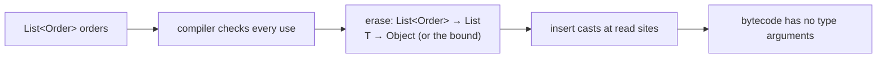
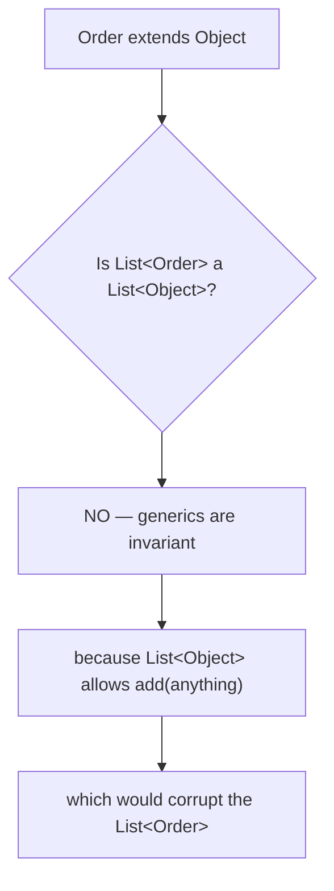
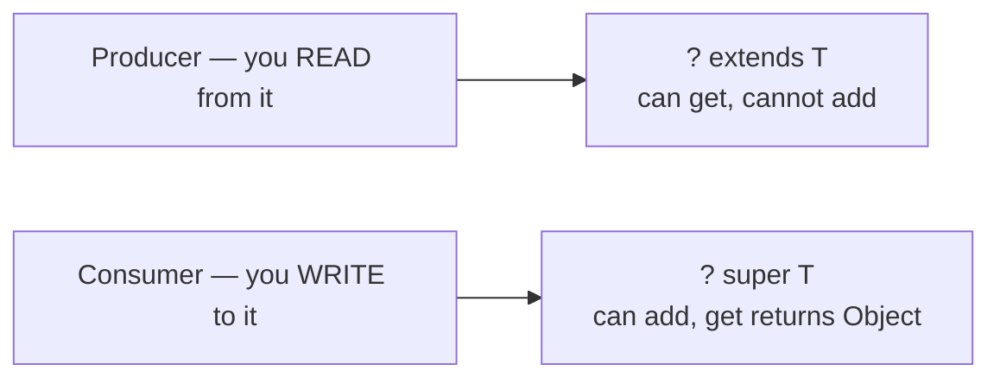

# Generics in Depth

<!-- video:start -->
<figure class="pb-video">
<video controls playsinline preload="metadata">
<source src="../../videos/ch16.mp4" type="video/mp4">
<track kind="subtitles" srclang="en" label="English" src="../../videos/ch16.vtt">
</video>
<figcaption>Video walkthrough · 7:25 · subtitles via CC · <a href="../../videos/ch16.mp4" download>Download MP4</a></figcaption>
</figure>
<!-- video:end -->

## 1. Purpose & Audience

**Band:** L3 Enterprise · **Prerequisites:** core Java, [Collections](../03-collections/17-choosing-a-collection.md)

Most developers use generics fluently for twenty years and never learn the model underneath — which is fine until they write an API rather than consume one. Then the questions arrive all at once: why `List<String>` is not a `List<Object>`, why `new T[]` is illegal, why a wildcard is needed in one signature and not another, and why the compiler is complaining about something called capture.

This chapter answers three questions:

1. **What is erasure**, and which restrictions follow from it?
2. **How do you choose between `T`, `? extends T`, and `? super T`** in a signature?
3. **Where do generics and arrays interact badly**, and how do you avoid it?

---

## 2. The Problem

Before generics, every collection was a bag of `Object`:

```java title="PreGenerics.java"
// Java 1.4
List orders = new ArrayList();
orders.add(new Order(...));
orders.add("oops");                       // compiles fine

Order first = (Order) orders.get(0);      // cast on every read
Order second = (Order) orders.get(1);     // ClassCastException — far from the add
```

Two costs. The **cast on every read** is noise, and the **error surfaces at the wrong place**: the bug was the `add`, the exception is at the `get`, possibly in a different class written by a different person.

Generics moved the check to compile time:

```java title="WithGenerics.java"
List<Order> orders = new ArrayList<>();
orders.add("oops");                       // compile error, at the mistake
Order first = orders.get(0);              // no cast
```

The design constraint was **binary backward compatibility**: Java 5 code had to interoperate with existing libraries and run on existing VMs. That constraint produced erasure, and erasure produced every restriction in §6.

---

## 3. Mental Model

### 3.1 Erasure

At compile time the compiler checks types. Then it **discards them**.



```java
// What you write                    // What the JVM sees
List<Order> orders = ...;            List orders = ...;
Order first = orders.get(0);         Order first = (Order) orders.get(0);
```

So `List<String>` and `List<Order>` are the **same class at runtime**. `List<String>.class` does not exist, `x instanceof List<String>` does not compile, and `new T[10]` is illegal — none of these have anything to check against.

### 3.2 Invariance



```java title="WhyInvariant.java"
List<Order> orders = new ArrayList<>();
List<Object> objects = orders;         // if this compiled...
objects.add("a string");                // ...this would poison the list
Order o = orders.get(0);                // ClassCastException
```

Invariance is what makes generics safe. Wildcards are how you get flexibility back without losing that safety.

### 3.3 PECS



**Producer Extends, Consumer Super.** A parameter you read from takes `? extends T`; a parameter you write to takes `? super T`. If you do both, use `T` exactly.

---

## 4. Core API & Syntax

### 4.1 Declaring

| Form | Meaning |
|---|---|
| `class Box<T>` | Generic class |
| `<T> T first(List<T> list)` | Generic method — `<T>` before the return type |
| `class Repo<T extends Entity>` | Upper bound |
| `<T extends Comparable<T> & Serializable>` | Multiple bounds — class first, then interfaces |
| `<T extends Comparable<T>>` | Recursive (F-bounded) |
| `Box<?>` | Unbounded wildcard |
| `Box<? extends Number>` | Upper-bounded wildcard |
| `Box<? super Integer>` | Lower-bounded wildcard |

### 4.2 What you cannot do, and why

| Illegal | Reason |
|---|---|
| `new T()` | No type at runtime |
| `new T[10]` | Array needs a runtime component type |
| `x instanceof List<String>` | Erased — nothing to test |
| `List<String>.class` | One class object for all instantiations |
| `class X<T> extends Throwable` | `catch` needs a runtime type |
| `static T field;` | Static members are shared across instantiations |
| Overloads differing only in type argument | Same erasure — same signature |

### 4.3 Wildcard capture

```java
// Cannot swap through a wildcard directly
void swap(List<?> list, int i, int j) {
    list.set(i, list.get(j));      // COMPILE ERROR
}

// Capture helper: the wildcard is captured as T
void swap(List<?> list, int i, int j) {
    swapHelper(list, i, j);
}
private <T> void swapHelper(List<T> list, int i, int j) {
    list.set(i, list.set(j, list.get(i)));
}
```

The compiler cannot prove that the `?` on the read and the `?` on the write are the same type. Delegating to a generic method gives that type a name, and the proof follows.

---

## 5. Worked Examples

### 5.1 A generic repository

```java title="Repository.java"
public interface Repository<T extends Entity<ID>, ID> {
    Optional<T> findById(ID id);
    T save(T entity);
    List<T> findAll();
}

public interface Entity<ID> {
    ID id();
}
```

```java title="OrderRepository.java"
public record Order(OrderId id, CustomerId customerId, List<OrderLine> lines)
        implements Entity<OrderId> { }                  // satisfies T extends Entity<ID>

public interface OrderRepository extends Repository<Order, OrderId> {
    List<Order> findRecent(CustomerId customerId, Instant since);
}
```

The bound `T extends Entity<ID>` ties the two parameters together, so `Repository<Order, String>` will not compile when `Order` declares `OrderId id()`. A bound that relates parameters is doing real work; one that exists only to call `toString()` is not.

### 5.2 PECS in practice

```java title="PecsExample.java"
public final class CartTotals {

    // PRODUCER — we only read from source
    public static Money sum(Collection<? extends CartLine> lines) {
        Money total = Money.ZERO;
        for (CartLine line : lines) {          // reading is fine
            total = total.plus(line.lineTotal());
        }
        return total;
        // lines.add(...) would not compile — we don't know the exact element type
    }

    // CONSUMER — we only write to destination
    public static void collectSkus(Cart cart, Collection<? super Sku> destination) {
        for (CartLine line : cart.lines()) {
            destination.add(line.sku());        // writing is fine
        }
        // Sku s = destination.get(0) — would give Object
    }
}
```

The payoff is at the call site:

```java title="CallSite.java"
List<PerishableLine> perishable = ...;         // a CartLine subtype
Money total = CartTotals.sum(perishable);       // works because of ? extends

List<Object> audit = new ArrayList<>();
CartTotals.collectSkus(cart, audit);            // works because of ? super
```

Without the wildcards, both calls fail. `Collection<CartLine>` does not accept a `List<PerishableLine>`, and `Collection<Sku>` does not accept a `List<Object>`.

The JDK follows this everywhere — `Collections.copy(List<? super T> dest, List<? extends T> src)` is the canonical example, with both wildcards in one signature.

### 5.3 A generic result type

```java title="Result.java"
public sealed interface Result<T> permits Success, Failure {

    static <T> Result<T> success(T value) { return new Success<>(value); }
    static <T> Result<T> failure(String reason) { return new Failure<>(reason); }

    default <R> Result<R> map(Function<? super T, ? extends R> mapper) {
        return switch (this) {
            case Success<T>(var value) -> Result.success(mapper.apply(value));
            case Failure<T>(var reason) -> Result.failure(reason);
        };
    }
}

record Success<T>(T value) implements Result<T> { }
record Failure<T>(String reason) implements Result<T> { }
```

Note the `map` signature: `Function<? super T, ? extends R>`. The function **consumes** `T`, so `? super T` — a `Function<Object, String>` is a perfectly good mapper for a `Result<Order>`. It **produces** `R`, so `? extends R`. This is PECS applied to a functional parameter, and it is how every `map` in the JDK is declared.

### 5.4 Arrays and generics do not mix

```java title="ArrayCovariance.java"
// Arrays are COVARIANT — and unsound
Object[] objects = new Order[10];
objects[0] = "a string";           // compiles; throws ArrayStoreException at runtime

// Generics are INVARIANT — checked at compile time
List<Object> list = new ArrayList<Order>();   // compile error
```

Array covariance is a Java 1.0 decision that predates generics, and its unsoundness is patched with a runtime check on every array store. Generics chose compile-time safety instead — which is why they do not agree.

```java title="GenericArray.java"
// Illegal: the JVM cannot check stores into an array of an erased type
T[] items = new T[10];                        // compile error

// The two workarounds
@SuppressWarnings("unchecked")
T[] items = (T[]) new Object[10];             // keep it private — never expose it

List<T> items = new ArrayList<>();            // preferred
```

The cast version is what `ArrayList` itself does internally, with the array held in a private field and never returned as `T[]`. Returning it would produce a `ClassCastException` at the caller — the classic generic-array leak.

### 5.5 Heap pollution and `@SafeVarargs`

```java title="HeapPollution.java"
@SafeVarargs
static <T> List<T> listOf(T... items) {       // varargs of T creates a T[]
    return List.of(items);
}
```

A `T...` parameter is a `T[]`, which cannot exist safely — so the compiler warns about *potential heap pollution* at every declaration and call. `@SafeVarargs` suppresses it, and asserts that the method does not store anything unsafe into the array or let it escape.

```java title="UnsafeVarargs.java"
@SafeVarargs                                   // A LIE
static <T> T[] unsafe(T... items) {
    return items;                              // escapes — caller gets an Object[]
}
String[] strings = unsafe("a", "b");           // ClassCastException
```

The annotation is a promise you make to the compiler. Apply it only when the array is read and never stored or returned.

### 5.6 Type tokens

Erasure means a method cannot know its own `T` — unless you pass it:

```java title="TypeToken.java"
public <T> T readConfig(Path path, Class<T> type) throws IOException {
    return mapper.readValue(Files.readString(path), type);
}

Config config = readConfig(path, Config.class);
```

`Class<T>` works for simple types but cannot express `List<Order>`, since `List.class` loses the argument. Libraries solve that with a **super type token**:

```java title="SuperTypeToken.java"
public abstract class TypeRef<T> {
    private final Type type;

    protected TypeRef() {
        Type superclass = getClass().getGenericSuperclass();
        this.type = ((ParameterizedType) superclass).getActualTypeArguments()[0];
    }
    public Type type() { return type; }
}

var ref = new TypeRef<List<Order>>() { };      // anonymous subclass — note the {}
```

The trick is that **generic information about a superclass is retained in the class file**, even though instance-level type arguments are erased. Creating an anonymous subclass captures `List<Order>` in the `Signature` attribute where reflection can read it. This is exactly how Jackson's `TypeReference` and Guice's `TypeLiteral` work.

---

## 6. Internals

### 6.1 What erasure actually does

| Declaration | Erased to |
|---|---|
| `List<Order>` | `List` |
| `T` (unbounded) | `Object` |
| `T extends Entity` | `Entity` |
| `T extends Comparable<T> & Serializable` | `Comparable` (the leftmost bound) |
| `List<? extends Number>` | `List` |

The compiler then inserts checked casts wherever a generic value is read. Those casts are real bytecode — generics are not free, though the cost is negligible and the JIT usually removes them.

### 6.2 The `Signature` attribute

Erasure removes type arguments from the *bytecode*, but the class file keeps a `Signature` attribute recording the generic declaration.

```java
Method m = OrderRepository.class.getMethod("findAll");
m.getGenericReturnType();       // java.util.List<com.grocery.Order>
m.getReturnType();               // interface java.util.List
```

This is why reflection can report generic signatures of fields, methods, and superclasses, and why the super type token in §5.6 works — but **not** for the runtime type arguments of an *instance*, which genuinely do not exist.

### 6.3 Bridge methods

```java title="Bridge.java"
class OrderComparator implements Comparator<Order> {
    public int compare(Order a, Order b) { ... }
}
```

After erasure, `Comparator.compare` has the signature `(Object, Object)int`, but the class declares `(Order, Order)int`. The compiler generates a synthetic **bridge method**:

```java
// Generated
public int compare(Object a, Object b) {
    return compare((Order) a, (Order) b);       // casts, then delegates
}
```

This is how polymorphism survives erasure. Two visible effects: reflection lists methods you never wrote (check `Method.isBridge()`), and a `ClassCastException` can originate from a frame in a method that does not appear in your source.

### 6.4 Why static members cannot use `T`

```java
class Box<T> {
    static T instance;         // COMPILE ERROR
}
```

There is one `Box` class at runtime, shared by `Box<Order>` and `Box<Sku>`, so a static field typed `T` would have to be simultaneously `Order` and `Sku`. Static *methods* may declare their own parameter — `static <U> Box<U> empty()` — because that one belongs to the method, not the class.

### 6.5 Capture, and why the error message is opaque

```java title="Capture.java"
void process(List<?> list) {
    Object first = list.get(0);      // fine — ? is at least Object
    list.add(first);                  // ERROR: capture of ?
}
```

The compiler gives each wildcard occurrence a fresh name — `capture#1 of ?` — and cannot prove two occurrences are the same type. Reading is safe because everything is an `Object`; writing is not, because the list might be a `List<Sku>` and `first` might be a `Money`.

The fix is always the same: delegate to a generic method, which names the type once and lets the compiler unify the read and the write.

Two exceptions are permitted: you may always add `null`, and you may always call `clear()` or `remove()`.

### 6.6 What Valhalla may change

Erasure was chosen for migration compatibility in 2004 and is now the constraint behind `List<int>` being impossible, generic arrays being illegal, and specialisation being unavailable. Project Valhalla is working on value types and specialised generics, which would allow `List<int>` without boxing.

It is not delivered, and any timeline is speculation. The relevant point today is that **the restrictions in this chapter are consequences of one decision**, not an arbitrary list — which makes them easier to reason about than to memorise.

---

## 7. Production Patterns & Anti-Patterns

### Do this

- **Apply PECS to every parameter.** Read from it → `? extends T`; write to it → `? super T`; both → `T`.
- **Use wildcards in parameters, concrete types in return values.** A wildcard in a return type pushes capture problems onto every caller.
- **Bound type parameters only when the bound does work** — when you call a method on `T` or relate two parameters.
- **Prefer `List<T>` over `T[]`.** Generic arrays are illegal for a reason and the workarounds leak.
- **Use `@SafeVarargs` only when the array is read and never stored or returned.**
- **Pass `Class<T>` when a method needs its own type**; use a super type token for parameterised types.
- **Name type parameters meaningfully** in domain APIs — `<ID>` beats `<T>` for an identifier.
- **Turn on `-Xlint:unchecked`** and treat the warnings as findings.

### Never do this

- **Never use raw types.** `List` instead of `List<?>` disables generic checking for the *whole expression*, not just that argument.
- **Never suppress an unchecked warning without a comment** explaining why the cast is safe.
- **Never return `T[]` from a generic method** built by casting an `Object[]` — the caller gets a `ClassCastException`.
- **Never rely on `instanceof` with type arguments** — it does not compile, and the raw form tells you nothing.
- **Never overload on erasure-identical signatures** — `f(List<String>)` and `f(List<Order>)` are the same method.
- **Never use a wildcard in a field type.** Capture makes the field nearly unusable.
- **Never mix arrays and generics in an API.** Array covariance and generic invariance disagree, and the runtime check is `ArrayStoreException`.
- **Never `@SafeVarargs` a method that lets the array escape.** The annotation is an assertion, and the compiler believes it.

---

## 8. Version Evolution (Java 8 → 26)

| Version | What changed | Impact |
|---|---|---|
| **5** | Generics, erasure, wildcards, bridge methods | The model everything else builds on |
| **7** | Diamond operator | `new HashMap<>()` |
| **8** | Target typing improvements; generic functional interfaces | Inference works through lambda chains |
| **9** | Diamond on anonymous classes; private interface methods | `new Comparator<>() { ... }` |
| **10** | `var` | Inference for locals — but **never** with a bare diamond |
| **16** | Records | Generic records work; components are typed normally |
| **17** | Sealed types | Generic sealed hierarchies — see `Result<T>` in §5.3 |
| **21** | Record patterns with generic inference | `case Success<T>(var value)` infers correctly |
| **26** | No generics changes; Valhalla continues | Specialised generics remain future work |

### Migration note

The highest-value sweep on an older codebase is **eliminating raw types**, because a raw type disables generic checking across the whole expression rather than at one argument. Enable `-Xlint:rawtypes,unchecked`, treat the output as a work list, and fix from the API boundary inward.

Second: audit every `@SuppressWarnings("unchecked")` for a comment justifying it. An unchecked cast with no explanation is either safe and undocumented or unsafe and undetected, and you cannot tell which without rereading the code.

Third, when adding wildcards to existing signatures — a source-compatible change for callers that widens what you accept — do it on parameters only. Adding a wildcard to a return type is not compatible in practice, because callers assigning the result now face capture.

---

## 9. Interview Questions

### L1 — Foundations

**Q1. What is type erasure?** ⭐ *high frequency*
The compiler checks generic types and then removes them, replacing each type parameter with its bound — `Object` if unbounded — and inserting casts where generic values are read. So `List<String>` and `List<Order>` are the same class at runtime. It was chosen so Java 5 generics could interoperate with existing libraries and run on existing VMs.

**Q2. Why can't you write `List<Object> list = new ArrayList<String>()`?**
Because generics are invariant. If it compiled, you could add any `Object` through the `List<Object>` reference and corrupt the underlying `List<String>`, producing a `ClassCastException` at some unrelated read. Invariance is what makes the compile-time guarantee sound; wildcards give back the flexibility safely.

**Q3. What does `? extends T` mean?**
An unknown type that is `T` or a subtype. You can read from such a collection — everything in it is at least a `T` — but you cannot add to it, because the compiler does not know the exact element type. It is the wildcard for a parameter you only read from.

### L2 — Professional

**Q4. What is PECS?** ⭐ *high frequency*
Producer Extends, Consumer Super: a parameter you read from is declared `? extends T`, a parameter you write to is `? super T`, and one you do both with is plain `T`. `Collections.copy(List<? super T> dest, List<? extends T> src)` is the canonical example. Applying it to parameters widens what callers can pass without weakening safety.

**Q5. Why can't you create `new T[10]`?**
Because an array carries its component type at runtime and checks every store against it, and after erasure there is no `T` to check against. The workaround is casting an `Object[]` to `T[]`, which `ArrayList` does internally — but the array must stay private, because returning it as `T[]` gives the caller a `ClassCastException`. Using a `List<T>` avoids the problem entirely.

**Q6. What is a bridge method?**
A synthetic method the compiler generates so that overriding survives erasure. When a class implements `Comparator<Order>`, the interface method erases to `compare(Object, Object)` while the class declares `compare(Order, Order)`, so the compiler emits a bridge with the erased signature that casts and delegates. They show up in reflection — `Method.isBridge()` — and in stack traces for methods you never wrote.

### L3 — Enterprise

**Q7. What is wildcard capture and how do you work around it?**
When the compiler encounters a wildcard it gives that occurrence a fresh name, `capture#1 of ?`, and cannot prove two occurrences refer to the same type — so reading from a `List<?>` is fine but writing back what you read is not. The standard fix is to delegate to a private generic method taking `List<T>`, which names the type once so the compiler can unify the read and the write. Adding `null` and calling `clear()` are the only writes always permitted through a wildcard.

**Q8. How do libraries like Jackson handle `List<Order>` given erasure?**
With a super type token: an anonymous subclass such as `new TypeReference<List<Order>>() {}`. Instance-level type arguments are erased, but generic information about a *superclass* is retained in the class file's `Signature` attribute, so the anonymous subclass captures `List<Order>` where reflection can read it via `getGenericSuperclass`. Guice's `TypeLiteral` uses the same mechanism.

**Q9. Why are raw types worse than they look?**
Using a raw type disables generic checking for the entire expression, not just the argument you left raw — so calling a generic method on a raw receiver erases the whole call's type information and produces unchecked warnings downstream. They exist only for Java 5 migration compatibility. `List<?>` is the right way to express "a list of something unknown", and it stays type-safe.

### L4 — Architect

**Q10. How do you design a generic API that will not need breaking changes?**
Put wildcards on parameters and concrete types on returns — widening a parameter with `? extends` later is source-compatible for callers, while adding a wildcard to a return type forces capture on everyone assigning it. Bound type parameters only where the bound does work, since a bound is part of the contract and tightening it later breaks implementers. And avoid exposing arrays of generic types altogether, because array covariance and generic invariance disagree and the mismatch surfaces at the caller as `ArrayStoreException`.

**Q11. What would reified generics change, and what did Java trade to avoid them?**
Reification would let `T` exist at runtime, enabling `new T()`, `instanceof List<String>`, generic arrays, and specialisation such as `List<int>` without boxing. Java traded all of that for migration compatibility: in 2004, erased generics meant existing libraries and VMs kept working, which C# did not need to preserve when it reified. The bill is every restriction in this chapter, and Project Valhalla is the long-running attempt to recover specialisation without breaking the compatibility that erasure bought.

**Q12. A codebase has hundreds of `@SuppressWarnings("unchecked")` annotations. How do you approach it?**
Treat each as an unverified assertion rather than a style issue, because the annotation tells the compiler to stop checking and says nothing about whether the cast is sound. Triage by blast radius: casts inside private methods where the array or collection never escapes are usually safe and just need a comment; casts on values crossing an API boundary are where the real `ClassCastException`s come from. The systematic fix is usually to introduce a type token or a properly parameterised signature so the cast disappears, and to require a justifying comment on every remaining one so the next reader can tell the two cases apart.

---

!!! abstract "Cheat Sheet"
    **Erasure:** type arguments removed at compile time; `T` → its bound (or `Object`); casts inserted

    **Same class at runtime** — no `List<String>.class`, no `instanceof List<String>`, no `new T[]`

    **Generics are invariant** — `List<Order>` is not a `List<Object>`

    **PECS:** read → `? extends T` · write → `? super T` · both → `T`

    **Wildcards on parameters, concrete types on returns**

    **Capture:** the compiler can't prove two `?` are the same — delegate to a generic method

    **Arrays are covariant and unsound** (`ArrayStoreException`); generics are invariant and checked

    **`@SafeVarargs`** — only when the array is read, never stored or returned

    **Bridge methods** make overriding survive erasure — visible in reflection and stack traces

    **No `static T`** — one class shared across all instantiations

    **Type tokens:** `Class<T>` for simple types · super type token for `List<Order>`

    **Never raw types** — they disable checking for the whole expression, not one argument
