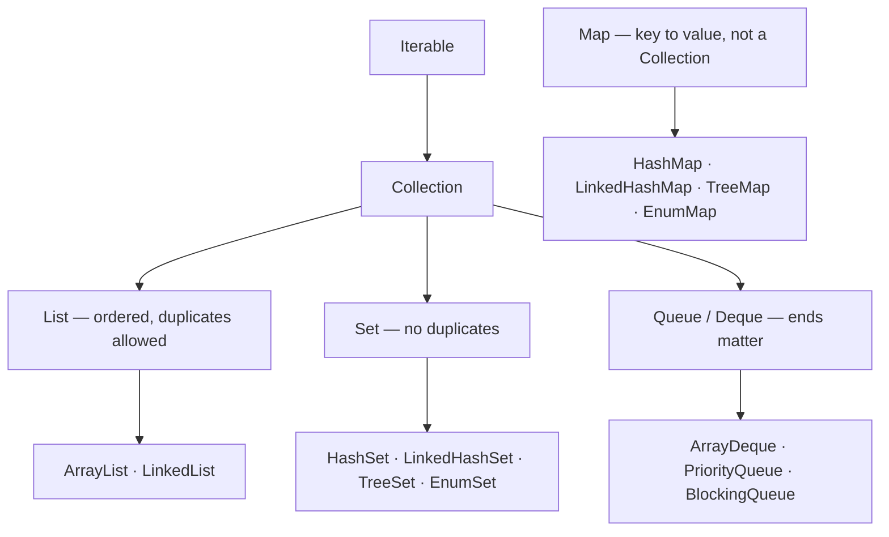
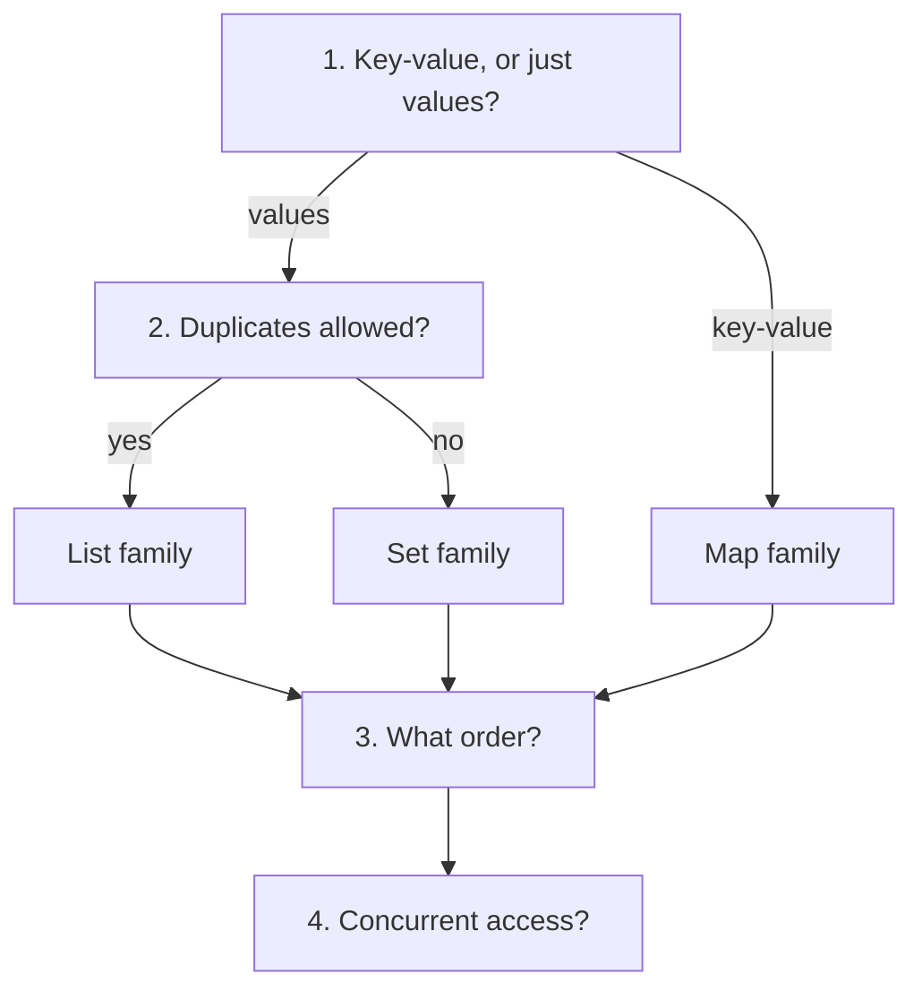

# Choosing the Right Collection

<!-- video:start -->
<figure class="pb-video">
<video controls playsinline preload="metadata">
<source src="../../videos/ch17.mp4" type="video/mp4">
<track kind="subtitles" srclang="en" label="English" src="../../videos/ch17.vtt">
</video>
<figcaption>Video walkthrough · 6:36 · subtitles via CC · <a href="../../videos/ch17.mp4" download>Download MP4</a></figcaption>
</figure>
<!-- video:end -->

## 1. Purpose & Audience

**Band:** L1 Foundations · **Prerequisites:** core Java, generics basics

Most Java code uses three collections: `ArrayList`, `HashMap`, and occasionally `HashSet`. That is usually right, which is why the habit persists — and it is why the cases where it is wrong go unnoticed until something is slow, or iterates in a surprising order, or throws on a null.

This chapter answers three questions:

1. **What questions do you ask** to pick a collection, in what order?
2. **What does each implementation actually guarantee** about ordering, nulls, and complexity?
3. **Which ones should you never use**, and why are they still in the JDK?

The internals of the main implementations are [Chapter 18](18-list-internals.md) and [Chapter 19](19-hashmap-internals.md); concurrent collections are [Chapter 30](../04-concurrency/30-concurrent-collections.md).

---

## 2. The Problem

Four defects, each from picking a structure without asking a question.

```java title="Defects.java"
// 1. O(n) membership test in a loop — quadratic overall
List<Sku> discontinued = loadDiscontinued();          // 40,000 entries
for (CartLine line : cart.lines()) {
    if (discontinued.contains(line.sku())) { ... }     // scans 40,000 every time
}

// 2. Iteration order assumed, never guaranteed
Map<String, Money> prices = new HashMap<>();
prices.forEach((sku, price) -> writeCsvRow(sku, price));   // order changes between runs

// 3. NullPointerException on a lookup
Map<Sku, Money> prices = Map.of(milk, price1);
prices.get(null);                                       // throws — Map.of is null-hostile

// 4. Wrong structure for the access pattern
List<Order> queue = new LinkedList<>();
Order next = queue.get(queue.size() - 1);               // O(n) on a linked list
```

None is a subtle bug. Each is one question unasked.

---

## 3. Mental Model

### 3.1 The type hierarchy



`Map` is deliberately not a `Collection` — it holds pairs, not elements, so `add(E)` has no meaning for it.

### 3.2 The four questions, in order



| Question | Decides |
|---|---|
| **Key-value or values?** | `Map` versus `Collection` |
| **Duplicates?** | `List` versus `Set` |
| **What order?** | Insertion, sorted, or unspecified |
| **Concurrent?** | Plain, concurrent, or immutable |

Answer those four and the implementation is nearly always determined. Most wrong choices come from skipping question three, where "unspecified" gets mistaken for "insertion".

---

## 4. Core Reference

### 4.1 Complexity

| Implementation | Add | Contains / get | Remove | Ordered by |
|---|---|---|---|---|
| `ArrayList` | O(1)* | O(n) | O(n) | Insertion |
| `LinkedList` | O(1) | O(n) | O(n) | Insertion |
| `ArrayDeque` | O(1)* | O(n) | O(1) at ends | Insertion |
| `PriorityQueue` | O(log n) | O(n) | O(log n) head | Comparator |
| `HashSet` | O(1) | O(1) | O(1) | **Unspecified** |
| `LinkedHashSet` | O(1) | O(1) | O(1) | Insertion |
| `TreeSet` | O(log n) | O(log n) | O(log n) | Comparator |
| `EnumSet` | O(1) | O(1) | O(1) | Enum declaration |
| `HashMap` | O(1) | O(1) | O(1) | **Unspecified** |
| `LinkedHashMap` | O(1) | O(1) | O(1) | Insertion or access |
| `TreeMap` | O(log n) | O(log n) | O(log n) | Comparator |
| `EnumMap` | O(1) | O(1) | O(1) | Enum declaration |

\* amortised

### 4.2 Null tolerance — the table people need

| Implementation | Null element / key | Null value |
|---|---|---|
| `ArrayList`, `LinkedList` | Yes | — |
| `HashSet`, `LinkedHashSet` | Yes (one) | — |
| `TreeSet` | **No** | — |
| `ArrayDeque` | **No** | — |
| `HashMap`, `LinkedHashMap` | Yes (one key) | Yes |
| `TreeMap` | **No** key | Yes |
| `ConcurrentHashMap` | **No** | **No** |
| `List.of` / `Set.of` / `Map.of` | **No** | **No** |

Two of these cause real bugs. `List.of("a").contains(null)` **throws** rather than returning false. And `ConcurrentHashMap` rejecting nulls means swapping a `HashMap` for it can break code that stored null values ([Chapter 30](../04-concurrency/30-concurrent-collections.md)).

### 4.3 Iteration order

| Implementation | Order |
|---|---|
| `ArrayList`, `LinkedList`, `ArrayDeque` | Insertion |
| `LinkedHashSet`, `LinkedHashMap` | Insertion (or access order, if configured) |
| `TreeSet`, `TreeMap` | Sorted |
| `EnumSet`, `EnumMap` | Enum declaration order |
| `HashSet`, `HashMap` | **Unspecified** — varies with capacity and content |
| `Set.of`, `Map.of` | **Randomised per JVM run**, deliberately |
| `PriorityQueue` | **Not sorted on iteration** — only `poll()` is ordered |

`PriorityQueue` is the trap: it is a heap, so iterating it gives you heap order, not sorted order. Only repeated `poll()` produces the sequence.

### 4.4 Choosing, by intent

| You need | Use |
|---|---|
| A sequence, indexed access | `ArrayList` |
| A queue, stack, or deque | `ArrayDeque` |
| Uniqueness, order irrelevant | `HashSet` |
| Uniqueness, insertion order | `LinkedHashSet` |
| Uniqueness, sorted, range queries | `TreeSet` |
| Key-value lookup | `HashMap` |
| Key-value, insertion or access order | `LinkedHashMap` |
| Key-value, sorted, range queries | `TreeMap` |
| Enum keys | `EnumMap` / `EnumSet` |
| Highest-priority item next | `PriorityQueue` |
| Producer–consumer across threads | `BlockingQueue` |
| Shared mutable map | `ConcurrentHashMap` |
| Small, fixed, never modified | `List.of` / `Set.of` / `Map.of` |

---

## 5. Worked Examples

### 5.1 The four questions applied

```java title="OrderEngineCollections.java"
public final class Cart {
    // Sequence, duplicates allowed (same SKU on two lines), insertion order
    private final List<CartLine> lines = new ArrayList<>();
}

public final class DispatchQueue {
    // Ends matter, no duplicates concern, FIFO
    private final Deque<Order> pending = new ArrayDeque<>();
}

public final class Catalogue {
    // Key-value, no order needed, single-threaded build then read
    private final Map<Sku, InventoryItem> bySku = HashMap.newHashMap(200_000);
}

public final class DeliverySchedule {
    // Key-value, sorted, range queries ("slots between 09:00 and 12:00")
    private final NavigableMap<LocalTime, DeliverySlot> byStart = new TreeMap<>();
}

public final class OrderStatusCounts {
    // Enum keys — array-backed, no hashing
    private final Map<OrderStatus, Integer> counts = new EnumMap<>(OrderStatus.class);
}
```

Each line answers the four questions. `DeliverySchedule` is the one worth noting: it uses `TreeMap` not for sorted iteration but for **range queries** — `subMap`, `floorKey`, `ceilingEntry` — which no hash structure offers at any price.

### 5.2 Fixing the quadratic lookup

```java title="MembershipTest.java"
// O(n) per check, O(n·m) overall
List<Sku> discontinued = loadDiscontinued();
boolean stopped = discontinued.contains(line.sku());

// O(1) per check
Set<Sku> discontinued = Set.copyOf(loadDiscontinued());
boolean stopped = discontinued.contains(line.sku());
```

One word changed, and a 40,000-element scan per cart line becomes a hash lookup. **If a collection exists only to answer "is this in it", it should be a `Set`.**

### 5.3 Range queries need a sorted structure

```java title="RangeQueries.java"
NavigableMap<LocalTime, DeliverySlot> slots = new TreeMap<>();

// Every slot in a window
SortedMap<LocalTime, DeliverySlot> morning =
    slots.subMap(LocalTime.of(9, 0), LocalTime.of(12, 0));

// The next slot at or after a time
Map.Entry<LocalTime, DeliverySlot> next = slots.ceilingEntry(LocalTime.of(10, 15));

// The last slot before closing
Map.Entry<LocalTime, DeliverySlot> last = slots.lowerEntry(LocalTime.of(21, 0));
```

`HashMap` cannot answer any of these without scanning everything. The O(log n) cost of `TreeMap` buys an entire category of query — which is the real reason to choose it, not sorted iteration.

### 5.4 `EnumMap` and `EnumSet`

```java title="EnumCollections.java"
Map<OrderStatus, Integer> counts = new EnumMap<>(OrderStatus.class);
Set<OrderStatus> terminal = EnumSet.of(OrderStatus.DELIVERED, OrderStatus.CANCELLED);
Set<OrderStatus> active = EnumSet.complementOf(EnumSet.copyOf(terminal));
```

`EnumMap` is backed by an array indexed by ordinal — no hashing, no collisions, no boxing of the key. `EnumSet` is a bitset, so a set of up to 64 constants is a single `long`, and `contains` is one bit test.

For enum keys these are strictly better than `HashMap` and `HashSet` in speed and memory. They are also underused, largely because the default habit wins.

### 5.5 `PriorityQueue` iterates in heap order

```java title="PriorityQueueTrap.java"
PriorityQueue<Order> byPriority = new PriorityQueue<>(comparing(Order::priority));
byPriority.addAll(orders);

for (Order o : byPriority) { ... }         // NOT in priority order

while (!byPriority.isEmpty()) {            // correct
    Order next = byPriority.poll();
}
```

The heap guarantees only that the **head** is the minimum. Iteration walks the underlying array, which is heap order. Any report that iterates a `PriorityQueue` expecting sorted output is wrong, and often looks right on small inputs.

### 5.6 Immutable, unmodifiable, and views

```java title="Immutability.java"
List<Sku> a = List.of(milk, rice);                       // immutable, null-hostile
List<Sku> b = List.copyOf(mutableList);                   // immutable snapshot
List<Sku> c = Collections.unmodifiableList(mutableList);  // read-only VIEW

mutableList.add(atta);
// b is unchanged — it is a copy
// c now has three elements — it is a view
```

The distinction matters for API design. Returning `unmodifiableList` prevents the caller from writing but still leaks every later mutation into the reference they hold. Returning `List.copyOf` is a genuine snapshot. For accessors, **copy**.

### 5.7 The ones never to use

| Legacy | Why | Use instead |
|---|---|---|
| `Vector` | Synchronises every method; Java 1.0 | `ArrayList`, or `CopyOnWriteArrayList` if shared |
| `Hashtable` | Same, plus null-hostile | `HashMap`, or `ConcurrentHashMap` |
| `Stack` | Extends `Vector`; **iterates bottom-to-top**, unlike a stack | `ArrayDeque` |
| `LinkedList` | Almost always slower than `ArrayList`; poor cache locality | `ArrayList`, or `ArrayDeque` for queues |

`Stack`'s iteration order is the sharpest of these: it iterates from the bottom of the stack upward, which is the opposite of pop order. They all remain in the JDK for compatibility, and none belongs in new code.

---

## 6. Internals

### 6.1 Program to the interface

```java title="Interfaces.java"
// ✓ The field's type states the contract, not the implementation
private final List<CartLine> lines = new ArrayList<>();
private final Map<Sku, InventoryItem> catalogue = new HashMap<>();

// ✗ Locks in the implementation at every call site
private final ArrayList<CartLine> lines = new ArrayList<>();
```

Declaring the interface keeps the implementation swappable — `HashMap` to `LinkedHashMap` when order starts mattering, or to `ConcurrentHashMap` when the field becomes shared — without touching a single caller.

The exception is where you need the subtype's contract: declare `Deque` when you use `addFirst`, `NavigableMap` when you use `ceilingEntry`.

### 6.2 `RandomAccess`

`ArrayList` implements the marker interface `RandomAccess`; `LinkedList` does not. JDK algorithms branch on it:

```java title="Branching.java"
if (list instanceof RandomAccess) {
    for (int i = 0; i < list.size(); i++) { ... }   // index loop is cheap
} else {
    for (E element : list) { ... }                   // iterate instead
}
```

Generic code that index-loops over an arbitrary `List` is O(n²) on a linked implementation. Either check the marker or use an iterator — see [Chapter 18](18-list-internals.md).

### 6.3 Fail-fast versus weakly consistent

| Family | Iterator behaviour on concurrent modification |
|---|---|
| `ArrayList`, `HashMap`, `TreeMap`, … | **Fail-fast** — `ConcurrentModificationException`, best-effort |
| `ConcurrentHashMap`, `CopyOnWriteArrayList`, … | **Weakly consistent** — never throws, may or may not see updates |

Fail-fast is a **bug detector, not a synchronisation mechanism** — the documentation says explicitly that it cannot be guaranteed. Never write logic that depends on the exception being thrown.

### 6.4 Sequenced collections

Java 21 added `SequencedCollection`, `SequencedSet`, and `SequencedMap` (JEP 431), giving a uniform vocabulary for the ends of an ordered collection: `getFirst`, `getLast`, `addFirst`, `addLast`, `removeFirst`, `removeLast`, `reversed()`.

| Implements sequenced? | |
|---|---|
| `List`, `Deque`, `LinkedHashSet`, `SortedSet`, `LinkedHashMap`, `SortedMap` | **Yes** |
| `HashSet`, `HashMap` | **No** — they have no encounter order |

That last row is a correction worth stating plainly, because notes circulate claiming otherwise. Full treatment in [Chapter 21](21-sequenced-collections.md).

### 6.5 Sizing

```java title="Sizing.java"
new ArrayList<>(expectedSize);          // avoids growth copies
HashMap.newHashMap(expectedSize);       // Java 19+; accounts for load factor
new HashMap<>((int)(n / 0.75f) + 1);    // pre-19 equivalent
```

`new HashMap<>(n)` takes a **capacity**, not an expected size, so passing the entry count under-allocates and forces a resize at 75% — which `HashMap.newHashMap(n)` exists to prevent.

For an `ArrayList`, the default grows 10 → 15 → 22 → 33 → …, so reaching 1,000 elements costs twelve array copies. Sizing correctly costs none.

---

## 7. Production Patterns & Anti-Patterns

### Do this

- **Ask the four questions**: key-value or values, duplicates, order, concurrency.
- **Use a `Set` for membership tests.** If a collection exists to answer "is this in it", it is a `Set`.
- **Use `TreeMap`/`TreeSet` for range queries**, not merely for sorted iteration.
- **Use `EnumMap` and `EnumSet` for enum keys** — array- and bitset-backed, strictly better.
- **Declare fields as interfaces**, except where a subtype's contract is used.
- **Size collections when the count is known.**
- **Return `List.copyOf(...)` from accessors** — a snapshot, not a view.
- **Use `ArrayDeque` for stacks and queues**, never `Stack` or `LinkedList`.

### Never do this

- **Never rely on `HashMap` or `HashSet` iteration order.** It is unspecified and changes with capacity.
- **Never assume `Set.of` or `Map.of` iteration order** — it is randomised per JVM run by design.
- **Never call `contains(null)` on `List.of`.** It throws rather than returning false.
- **Never iterate a `PriorityQueue` expecting sorted order.** Only `poll()` is ordered.
- **Never use `Vector`, `Hashtable`, or `Stack`.** All are Java 1.0 legacy; `Stack` even iterates the wrong way.
- **Never use `LinkedList` by default.** `ArrayList` wins on cache locality; `ArrayDeque` wins for queues.
- **Never index-loop over an arbitrary `List`** without checking `RandomAccess`.
- **Never treat `ConcurrentModificationException` as a guarantee.** It is best-effort detection.

---

## 8. Version Evolution (Java 8 → 26)

| Version | What changed | Impact |
|---|---|---|
| **8** | `forEach`, `removeIf`, `replaceAll`, `compute*`, `merge`, `stream()` | Bulk operations on the interfaces |
| **9** | `List.of`, `Set.of`, `Map.of` | Immutable factories; null-hostile, order-randomised sets and maps |
| **10** | `List.copyOf`, `Set.copyOf`, `Map.copyOf` | One-call snapshots |
| **19** | `HashMap.newHashMap(n)` and friends | Correct sizing without the load-factor arithmetic |
| **21** | **Sequenced collections (JEP 431)** | A uniform vocabulary for ordered collections — not for `HashMap` |
| **25** | Compact object headers | Node-heavy collections shrink |
| **26** | No collection changes | — |

### Migration note

Two mechanical sweeps worth running on an older codebase:

1. **`Vector`, `Hashtable`, `Stack` → `ArrayList`, `HashMap`, `ArrayDeque`.** Check for reliance on their synchronisation first — if a `Vector` really was shared, the replacement needs an explicit locking decision rather than a direct swap.
2. **`new HashMap<>(n)` → `HashMap.newHashMap(n)`** on Java 19+, which fixes the widely-copied sizing error.

And one thing to look for rather than sweep: code iterating a `HashMap` where the output order matters — a CSV export, a generated file, a hash of the output. It works until the map resizes or the JDK changes, and the failure is a diff nobody can explain.

---

## 9. Interview Questions

### L1 — Foundations

**Q1. What is the difference between a `List`, a `Set`, and a `Map`?** ⭐ *high frequency*
A `List` is an ordered sequence that allows duplicates and supports indexed access. A `Set` holds unique elements, with ordering depending on the implementation. A `Map` holds key-value pairs and is not a `Collection` at all, because it stores pairs rather than elements.

**Q2. When would you use a `TreeMap` instead of a `HashMap`?**
When you need ordering or range queries — sorted iteration, `subMap` for a window, or `ceilingKey` to find the next key at or above a value. `HashMap` cannot answer those without scanning everything. The cost is O(log n) per operation instead of O(1), and `TreeMap` rejects null keys.

**Q3. Which collections allow null?**
`ArrayList` and `LinkedList` allow null elements; `HashSet` and `HashMap` allow one null element or key and null values. `TreeSet`, `TreeMap` keys, and `ArrayDeque` reject null. `ConcurrentHashMap` and all the `of` factories reject nulls entirely — and `List.of("a").contains(null)` throws rather than returning false.

### L2 — Professional

**Q4. How do you choose a collection?** ⭐ *high frequency*
Four questions in order: is it key-value or just values, are duplicates allowed, what ordering is required, and is it accessed concurrently. Those determine the family and usually the implementation. The one most often skipped is ordering, where people assume `HashMap` preserves insertion order — it does not, and the order changes with capacity and contents.

**Q5. Why use `EnumMap` instead of `HashMap` for enum keys?**
Because `EnumMap` is backed by an array indexed by the enum's ordinal, so there is no hashing, no collisions, and no key boxing — lookups are an array access. `EnumSet` goes further and uses a bitset, so a set of up to 64 constants is a single `long`. Both are faster and smaller than the hash-based equivalents, and neither is used as often as it should be.

**Q6. What is wrong with `Vector`, `Hashtable`, and `Stack`?**
They are Java 1.0 classes that synchronise every method, which costs performance and still does not make compound operations safe. `Hashtable` also rejects nulls, and `Stack` extends `Vector` and iterates from the bottom upward — the opposite of pop order, which is a genuine bug source. Use `ArrayList`, `HashMap`, and `ArrayDeque`, with `ConcurrentHashMap` or explicit locking where sharing is real.

### L3 — Enterprise

**Q7. Why can iterating a `PriorityQueue` give unsorted output?**
Because it is a binary heap, which guarantees only that the head is the minimum — the rest of the array satisfies the heap property, not total ordering. Iteration walks that array, so it yields heap order. Only repeated `poll()` produces the sorted sequence, and code that iterates a `PriorityQueue` for a report often looks correct on small inputs and fails on larger ones.

**Q8. What is the difference between `Collections.unmodifiableList` and `List.copyOf`?**
`unmodifiableList` returns a read-only **view** over the original, so the caller cannot write but does see every subsequent mutation of the underlying list. `List.copyOf` returns an independent immutable snapshot. For an accessor returning internal state, the copy is correct — the view leaks your mutations into a reference the caller believes is stable, which is also a data race if they read it from another thread.

**Q9. What does `RandomAccess` tell you?**
That indexed access is roughly constant time. It is a marker interface with no methods, and JDK algorithms such as `Collections.binarySearch` and `shuffle` test for it to choose between an index loop and an iterator walk. Generic code that index-loops over an arbitrary `List` is O(n²) on a linked implementation, so it should either check the marker or iterate.

### L4 — Architect

**Q10. How would you set collection conventions for a team?**
Keep it to a few rules that prevent the common defects rather than a taxonomy nobody reads: declare fields as interfaces so implementations stay swappable; use a `Set` for anything whose purpose is membership; return copies not views from accessors; and never rely on `HashMap` iteration order. Add a lint rule banning `Vector`, `Hashtable`, and `Stack`, since those are mechanical to detect and always wrong in new code. The aim is that a code review argument about collections happens once, not per pull request.

**Q11. A report's output order changes between runs and nobody changed the code. What happened?**
Almost certainly iteration over a `HashMap` or `HashSet`, whose order depends on capacity, hash codes, and insertion history — so it can change when the data grows enough to resize, or on a different JDK. If the collection came from `Set.of` or `Map.of`, the order is randomised per JVM run deliberately, to stop exactly this dependency forming. The fix is to make the ordering explicit: `LinkedHashMap` for insertion order, `TreeMap` for sorted, or sort at the point of output.

**Q12. When does the choice of collection stop mattering and something else start?**
When the data outgrows the process. A structure holding millions of entries is dominated by object headers, references, and container overhead rather than by algorithmic complexity — `HashMap` costs around 37 bytes per entry before the key and value ([Chapter 35](../05-runtime/35-memory-footprint.md)) — so the question becomes whether the data belongs in the JVM at all. At that point a database index, a cache outside the heap, or a primitive-collections library is a larger win than any choice within `java.util`, and picking between `HashMap` and `TreeMap` is optimising the wrong layer.

---

!!! abstract "Cheat Sheet"
    **Four questions:** key-value or values · duplicates · **what order** · concurrent

    **Membership test → `Set`.** If it exists to answer "is this in it", it is a `Set`

    **Range queries → `TreeMap`/`TreeSet`** — `subMap`, `ceilingKey`, `floorEntry`

    **Enum keys → `EnumMap` / `EnumSet`** — array- and bitset-backed, strictly better

    **Queue or stack → `ArrayDeque`** — never `Stack`, never `LinkedList`

    **`HashMap`/`HashSet` order is unspecified** · **`Set.of`/`Map.of` order is randomised per run**

    **`PriorityQueue` iterates in heap order** — only `poll()` is sorted

    **Nulls rejected by:** `TreeSet`, `TreeMap` keys, `ArrayDeque`, `ConcurrentHashMap`, all `of` factories

    **`List.of(...).contains(null)` throws** — it does not return false

    **`unmodifiableList` is a view · `List.copyOf` is a snapshot** — accessors return copies

    **Declare interfaces**, not implementations

    **Size when known:** `HashMap.newHashMap(n)` (19+), `new ArrayList<>(n)`

    **Never:** `Vector` · `Hashtable` · `Stack` (iterates bottom-up) · `LinkedList` by default
