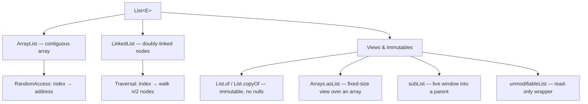
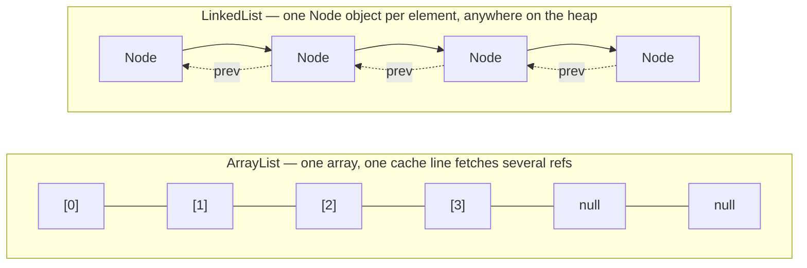

# List Internals & CustomArrayList

<!-- video:start -->
<figure class="pb-video">
<video controls playsinline preload="metadata">
<source src="../../videos/ch18.mp4" type="video/mp4">
<track kind="subtitles" srclang="en" label="English" src="../../videos/ch18.vtt">
</video>
<figcaption>Video walkthrough · 6:43 · subtitles via CC · <a href="../../videos/ch18.mp4" download>Download MP4</a></figcaption>
</figure>
<!-- video:end -->

## 1. Purpose & Audience

**Band:** L2 Professional · **Prerequisites:** [Choosing the Right Collection](17-choosing-a-collection.md)

`List` is the collection you reach for without thinking. That reflex is usually right and occasionally expensive — an `ArrayList` in the wrong shape allocates and copies far more than you expect, and a `LinkedList` chosen from a complexity table will lose to `ArrayList` on the very workload the table says it should win.

This chapter answers three questions:

1. **How does `ArrayList` actually grow**, and what does that cost under load?
2. **When is `LinkedList` the right choice?** (The honest answer is: almost never.)
3. **What are the view semantics** of `subList`, `Arrays.asList`, `List.of`, and `unmodifiableList` — and which of them will bite you?

The second half implements `CustomArrayList<E>` from scratch. Writing one is the fastest route to understanding the real thing, and it is a standing interview exercise.

---

## 2. The Problem

A cart in the order engine is a sequence. Order matters — the customer sees the lines in the order they added them — and the same SKU can legitimately appear twice.

An array almost works:

```java title="FixedCart.java"
// Java 8 — fixed-size, which is the whole problem
public final class FixedCart {

    private final CartLine[] lines = new CartLine[50];   // why 50?
    private int count;

    public void add(CartLine line) {
        if (count == lines.length) {
            throw new IllegalStateException("Cart full");   // unacceptable
        }
        lines[count++] = line;
    }

    public void removeAt(int index) {
        System.arraycopy(lines, index + 1, lines, index, count - index - 1);
        lines[--count] = null;
    }
}
```

Every problem here is a sizing problem. Pick 50 and a wholesale buyer hits the ceiling; pick 10,000 and every cart in memory wastes 80 KB. And you are now maintaining shift logic, bounds checks, and a `count` that must never drift from reality.

A `List` is that code, written once, correctly. The interesting question is what it does when the array fills up — which is §6.

---

## 3. Mental Model

`List` is an interface with two structurally different implementations in the JDK, plus a family of immutable and view types that look like lists but do not behave like them.



The distinction that actually predicts performance is not "array vs nodes" — it is **contiguous vs scattered**. An `ArrayList` stores its element references in one block of memory, so walking it streams cleanly through CPU cache lines. A `LinkedList` scatters a `Node` object per element across the heap, so every step is a potential cache miss. This is why `LinkedList` loses benchmarks it should win on paper.



---

## 4. Core API & Syntax

### 4.1 Construction

| Expression | Result | Since | Notes |
|---|---|---|---|
| `new ArrayList<>()` | Lazily allocates capacity 10 on first `add` | 1.2 | Shares a static empty array until then |
| `new ArrayList<>(int)` | Exact capacity | 1.2 | **Use when the size is known** |
| `new ArrayList<>(Collection)` | Sized to the source | 1.2 | Copy, not a view |
| `new LinkedList<>()` | Empty; no capacity concept | 1.2 | Also a `Deque` |
| `List.of(...)` | Immutable; **rejects nulls** | 9 | Randomised iteration order for `Set`, not `List` |
| `List.copyOf(c)` | Immutable snapshot | 10 | Returns the same instance if `c` is already immutable |
| `Arrays.asList(...)` | Fixed-size **view** over the array | 1.2 | `set` works; `add`/`remove` throw |
| `Collections.unmodifiableList(l)` | Read-only **view** | 1.2 | Source mutations still visible |
| `stream.toList()` | Unmodifiable; **allows nulls** | 16 | Preferred over `collect(toList())` |
| `Collectors.toUnmodifiableList()` | Unmodifiable; **rejects nulls** | 10 | Note the null difference above |

### 4.2 Core operations and their real cost

| Signature | ArrayList | LinkedList | Notes |
|---|---|---|---|
| `E get(int)` | O(1) | O(n) | `LinkedList` walks from the nearer end |
| `E set(int, E)` | O(1) | O(n) | |
| `boolean add(E)` | Amortised O(1) | O(1) | Append |
| `void add(int, E)` | O(n) | O(n) | Shift vs traverse |
| `E remove(int)` | O(n) | O(n) | |
| `boolean remove(Object)` | O(n) | O(n) | Uses `equals` |
| `boolean contains(Object)` | O(n) | O(n) | |
| `boolean removeIf(Predicate)` | O(n) | O(n) | Single pass — see §7 |
| `void clear()` | O(n) | O(n) | Nulls references for GC |

### 4.3 Sequenced Collections (Java 21)

JEP 431 gave `List` a first-class vocabulary for its ends:

| Method | Behaviour | Equivalent before 21 |
|---|---|---|
| `E getFirst()` | First element; `NoSuchElementException` if empty | `get(0)` |
| `E getLast()` | Last element | `get(size() - 1)` |
| `void addFirst(E)` | Insert at head | `add(0, e)` |
| `void addLast(E)` | Append | `add(e)` |
| `E removeFirst()` | Remove and return head | `remove(0)` |
| `E removeLast()` | Remove and return tail | `remove(size() - 1)` |
| `List<E> reversed()` | **View**, not a copy | `Collections.reverse(new ArrayList<>(l))` |

!!! warning "`reversed()` is a view"
    `list.reversed()` is a live, writable window onto the same data in the opposite direction. Writing through it writes through to the original. If you want an independent reversed copy, wrap it: `new ArrayList<>(list.reversed())`.

Covered in full in [Sequenced Collections](21-sequenced-collections.md).

### 4.4 Searching and positional iteration

| Signature | Behaviour | Cost | Since |
|---|---|---|---|
| `int indexOf(Object)` | Index of the first `equals` match, or `-1` | O(n) | 1.2 |
| `int lastIndexOf(Object)` | Index of the last `equals` match, or `-1` | O(n) | 1.2 |
| `boolean containsAll(Collection)` | Every element present | O(n·m) | 1.2 |
| `ListIterator<E> listIterator()` | Bidirectional cursor from the start | O(1) | 1.2 |
| `ListIterator<E> listIterator(int)` | Cursor whose first `next()` returns the element at that index | O(1) `ArrayList`, O(n) `LinkedList` | 1.2 |
| `void forEachRemaining(Consumer)` | Drains the rest of any `Iterator` | O(n) | 8 |

A `ListIterator` adds what a plain `Iterator` lacks: `hasPrevious()` / `previous()` to walk backwards, `nextIndex()` / `previousIndex()` to know where the cursor is, and `set(E)` / `add(E)` to edit the list **through** the cursor without tripping `modCount`.

```java title="Finding and rewriting entries in a pick list"
List<Sku> pickList = new ArrayList<>(List.of(
        Sku.of("MILK-1L"), Sku.of("BREAD-400G"), Sku.of("EGGS-12"), Sku.of("MILK-1L")));

int first = pickList.indexOf(Sku.of("MILK-1L"));      // 1st match → 0
int last  = pickList.lastIndexOf(Sku.of("MILK-1L"));  // last match → 3
int none  = pickList.indexOf(Sku.of("RICE-5KG"));     // absent → -1

// Walk backwards from the end, replacing in place: set() is not a structural change
ListIterator<Sku> cursor = pickList.listIterator(pickList.size());
while (cursor.hasPrevious()) {
    Sku sku = cursor.previous();
    if (sku.code().startsWith("MILK")) {
        cursor.set(Sku.of(sku.code() + "-CHILLED"));
    }
}
// codes now: MILK-1L-CHILLED, BREAD-400G, EGGS-12, MILK-1L-CHILLED
```

!!! note "Searches use `equals`"
    `indexOf(Sku.of("MILK-1L"))` finds a *different* `Sku` instance because `Sku` is a record and records get value-based `equals`. A class without `equals` would only match the identical object. See [equals, hashCode & Comparators](23-equality-and-ordering.md).

---

## 5. Worked Examples

### 5.1 Sizing a cart line list

```java title="Cart.java"
public final class Cart {

    private final List<CartLine> lines;

    public Cart(int expectedLines) {
        this.lines = new ArrayList<>(expectedLines);   // no growth copies
    }

    public void addLine(CartLine line) {
        lines.add(line);
    }

    public List<CartLine> lines() {
        return List.copyOf(lines);      // immutable snapshot, not a view
    }
}
```

The `List.copyOf` in the accessor is deliberate. Returning `lines` directly hands callers a handle to your internal state; returning `Collections.unmodifiableList(lines)` stops them writing but still leaks your later mutations into their reference.

### 5.2 Batch chunking for the dispatch pipeline

Orders are dispatched to vendors in batches of 100:

```java title="BatchSplitter.java"
public static <T> List<List<T>> chunk(List<T> source, int size) {
    List<List<T>> batches = new ArrayList<>((source.size() + size - 1) / size);
    for (int i = 0; i < source.size(); i += size) {
        batches.add(new ArrayList<>(
            source.subList(i, Math.min(i + size, source.size()))));
    }
    return batches;
}
```

```text title="Output for 250 orders, size 100"
batches.size() = 3      // 100, 100, 50
```

The `new ArrayList<>(...)` around `subList` is not optional — see §5.4.

### 5.3 Filtering without quadratic cost

Remove every out-of-stock line:

=== "Correct — single pass"
    ```java
    lines.removeIf(line -> catalogue.availableQuantity(line.sku()) == 0);
    ```

=== "Wrong — O(n²) and a CME"
    ```java
    for (CartLine line : lines) {
        if (catalogue.availableQuantity(line.sku()) == 0) {
            lines.remove(line);        // ConcurrentModificationException
        }
    }
    ```

`ArrayList.removeIf` marks doomed indices in a bit set and compacts the array in one `System.arraycopy` pass. Calling `remove` in a loop shifts the tail on every removal — quadratic, and it breaks the iterator besides.

### 5.4 The `subList` trap

`subList` returns a **view**, and views hold a reference to their parent:

```java title="SubListTrap.java"
List<Order> allOrders = loadMillionOrders();     // ~200 MB
List<Order> firstTen = allOrders.subList(0, 10);
allOrders = null;                                 // hoping for GC

// firstTen still references the parent's backing array.
// All 200 MB stays reachable. Nothing is collected.
```

And structural modification of the parent invalidates the view:

```java
List<CartLine> window = lines.subList(0, 3);
lines.add(newLine);                 // structural change to parent
System.out.println(window.size());  // ConcurrentModificationException
```

!!! tip "The rule"
    Treat `subList` as a short-lived argument, never as a stored field. If it escapes the method, copy it: `new ArrayList<>(list.subList(a, b))`.

### 5.5 The overload that removes the wrong thing

```java title="RemoveOverload.java"
List<Integer> quantities = new ArrayList<>(List.of(10, 20, 30));

quantities.remove(1);                    // remove(int index)   → removes 20
quantities.remove(Integer.valueOf(10));  // remove(Object)      → removes value 10
```

`remove(int)` and `remove(Object)` are different methods, and an `int` literal binds to the index version. This is the single most common `List` bug in code that stores `Integer`.

### 5.6 `Arrays.asList` is not an `ArrayList`

```java title="AsListTrap.java"
List<String> skus = Arrays.asList("MILK-1L", "RICE-5KG");
skus.set(0, "MILK-2L");     // works — writes through to the array
skus.add("ATTA-10KG");      // UnsupportedOperationException
```

It returns a private `Arrays$ArrayList`, unrelated to `java.util.ArrayList`. It is fixed-size, writable by index, and backed by the original array — so mutating the array changes the list and vice versa. To get a real mutable list: `new ArrayList<>(Arrays.asList(...))`, or just `List.of(...)` if you want it immutable.

Also note `List.of` rejects nulls **on read as well as write**: `List.of("a").contains(null)` throws `NullPointerException` rather than returning false.

---

## 6. Internals

### 6.1 `ArrayList` growth

The two fields that matter:

```java title="java.util.ArrayList (JDK source)"
transient Object[] elementData;   // the backing store
private int size;                 // elements in use, always <= elementData.length
```

A default `ArrayList` does **not** allocate on construction. It points `elementData` at a shared static empty array and allocates capacity 10 on the first `add`. This makes empty lists nearly free — which matters when you hold millions of mostly-empty carts.

Growth is 1.5×:

```java title="ArrayList.grow (paraphrased)"
int newCapacity = oldCapacity + (oldCapacity >> 1);
```

So a default list's capacity walks: **10 → 15 → 22 → 33 → 49 → 73 → 109 → …**

Reaching 1,000 elements takes **12 grow operations** and copies a cumulative ~2,900 element references. Sizing correctly with `new ArrayList<>(1000)` does zero.

!!! note "1.5× vs 2×"
    Doubling reaches a target capacity in fewer copies but overshoots more, and — because each new array is larger than the sum of all previous ones — freed blocks can never be reused for the next growth. The 1.5× factor wastes less memory and allows the allocator to reuse earlier blocks. `CustomArrayList` below uses the same factor for the same reason.

There is an edge case worth knowing: `new ArrayList<>(0)` uses a *different* static empty array than `new ArrayList<>()`, and grows 0 → 1 → 2 → 3 → 4 → 6 → 9. Passing 0 to "save memory" produces the worst possible growth profile.

### 6.2 Insert and remove

Both are `System.arraycopy` — an intrinsic the JIT compiles to a vectorised memory move, not a Java loop:

```java title="ArrayList.add(int, E) (paraphrased)"
System.arraycopy(elementData, index, elementData, index + 1, size - index);
elementData[index] = element;
size++;
```

This is why "O(n) insert" is misleading in practice. Shifting 10,000 references is one bulk memory operation measured in microseconds. Inserting at the head of a 10,000-element `ArrayList` frequently beats inserting into a `LinkedList` at a known index, because the `LinkedList` had to *find* that index first.

Removing by value takes two steps. `remove(Object)` scans for the first `equals` match (with a separate `null` branch, because `ArrayList` permits nulls), then hands the index to a private helper that skips the bounds check and doesn't bother fetching the old value:

```java title="ArrayList.remove(Object) and fastRemove (paraphrased)"
public boolean remove(Object o) {
    int i = 0;
    found: {
        if (o == null) {
            for (; i < size; i++) if (elementData[i] == null) break found;
        } else {
            for (; i < size; i++) if (o.equals(elementData[i])) break found;
        }
        return false;
    }
    fastRemove(elementData, i);
    return true;
}

private void fastRemove(Object[] es, int i) {
    modCount++;
    int newSize = size - 1;
    if (newSize > i) {
        System.arraycopy(es, i + 1, es, i, newSize - i);
    }
    es[size = newSize] = null;
}
```

That's why `remove(Object)` returns `boolean` while `remove(int)` returns the removed element: the by-value path never needed to read it.

Removal nulls the vacated trailing slot (`elementData[--size] = null`) so the element becomes collectable. The array itself never shrinks — a list that peaked at a million entries and now holds three still owns a million-slot array until you call `trimToSize()`.

### 6.3 `modCount` and fail-fast iteration

Every structural modification — anything that changes `size` — increments `modCount`. Iterators snapshot it and compare on each `next()`:

```java title="ArrayList.Itr (paraphrased)"
final void checkForComodification() {
    if (modCount != expectedModCount) {
        throw new ConcurrentModificationException();
    }
}
```

`set()` is not structural and does not increment it, which is why replacing elements during iteration is legal while adding or removing is not. Fail-fast is best-effort detection, explicitly documented as unreliable — never write logic that depends on the exception firing.

### 6.4 `RandomAccess`

`ArrayList` implements the marker interface `RandomAccess`; `LinkedList` does not. Library code branches on it:

```java title="Collections.binarySearch (paraphrased)"
if (list instanceof RandomAccess || list.size() < THRESHOLD) {
    return indexedBinarySearch(list, key);      // get(i) is cheap
} else {
    return iteratorBinarySearch(list, key);     // walk with a ListIterator
}
```

If you write a generic algorithm over `List`, check `RandomAccess` before writing an index loop. Indexing a `LinkedList` in a `for (int i...)` loop is O(n²).

### 6.5 Why `LinkedList` loses

Each `LinkedList.Node` is a separate heap object: header, `item`, `next`, `prev`. On a 64-bit JVM with compressed oops that is **24 bytes of overhead per element**, versus about **4–6 bytes per slot** for `ArrayList` including load-factor slack.

A one-million-element list:

| | Overhead | Locality |
|---|---|---|
| `ArrayList` | ~5 MB | One contiguous block; prefetcher-friendly |
| `LinkedList` | ~24 MB | 1M scattered objects; a cache miss per step |

The complexity table says `LinkedList` wins on head insertion. In practice it wins only when you already hold the node (via a `ListIterator`) and the list is large enough that shifting dominates — a narrow band most code never enters.

!!! tip "The practical rule"
    Use `ArrayList` by default. If you need a queue or a stack, use `ArrayDeque`, which beats `LinkedList` on both memory and speed for those operations. `LinkedList` is a reasonable choice mainly when you need `List` **and** `Deque` semantics on the same object, which is rare.

### 6.6 Building `CustomArrayList`

Implementing one makes the mechanics concrete: capacity is not size, growth is amortised, and every index operation needs a bounds check.

```java title="CustomArrayList.java"
public class CustomArrayList<E> {

    private static final int DEFAULT_CAPACITY = 10;

    private Object[] elementData;
    private int size;

    public CustomArrayList() {
        this.elementData = new Object[DEFAULT_CAPACITY];
    }

    public CustomArrayList(int initialCapacity) {
        if (initialCapacity < 0) {
            throw new IllegalArgumentException("Illegal capacity: " + initialCapacity);
        }
        this.elementData = new Object[initialCapacity];
    }

    public int size() { return size; }

    public boolean isEmpty() { return size == 0; }

    @SuppressWarnings("unchecked")
    public E get(int index) {
        rangeCheck(index);
        return (E) elementData[index];
    }

    @SuppressWarnings("unchecked")
    public E set(int index, E element) {
        rangeCheck(index);
        E old = (E) elementData[index];
        elementData[index] = element;
        return old;
    }

    public void add(E element) {
        ensureCapacity(size + 1);
        elementData[size++] = element;
    }

    public void add(int index, E element) {
        rangeCheckForAdd(index);
        ensureCapacity(size + 1);
        System.arraycopy(elementData, index, elementData, index + 1, size - index);
        elementData[index] = element;
        size++;
    }

    @SuppressWarnings("unchecked")
    public E remove(int index) {
        rangeCheck(index);
        E old = (E) elementData[index];
        int moved = size - index - 1;
        if (moved > 0) {
            System.arraycopy(elementData, index + 1, elementData, index, moved);
        }
        elementData[--size] = null;     // let GC reclaim the element
        return old;
    }

    public int indexOf(Object o) {
        for (int i = 0; i < size; i++) {
            if (Objects.equals(o, elementData[i])) {
                return i;
            }
        }
        return -1;
    }

    public boolean contains(Object o) { return indexOf(o) >= 0; }

    public void clear() {
        Arrays.fill(elementData, 0, size, null);
        size = 0;
    }

    private void ensureCapacity(int minCapacity) {
        if (elementData.length < minCapacity) {
            grow(minCapacity);
        }
    }

    private void grow(int minCapacity) {
        int oldCapacity = elementData.length;
        int newCapacity = oldCapacity + (oldCapacity >> 1);   // 1.5x
        if (newCapacity < minCapacity) newCapacity = minCapacity;
        if (newCapacity == 0) newCapacity = DEFAULT_CAPACITY;
        elementData = Arrays.copyOf(elementData, newCapacity);
    }

    private void rangeCheck(int index) {
        if (index < 0 || index >= size) {
            throw new IndexOutOfBoundsException("Index: " + index + ", Size: " + size);
        }
    }

    private void rangeCheckForAdd(int index) {
        if (index < 0 || index > size) {
            throw new IndexOutOfBoundsException("Index: " + index + ", Size: " + size);
        }
    }
}
```

Note `rangeCheck` versus `rangeCheckForAdd`: inserting **at** `size` is legal (append), reading at `size` is not.

### 6.7 What the real `ArrayList` has that this does not

This is the part interviewers probe, because it separates "I implemented a dynamic array" from "I understand the JDK class".

| Feature | `CustomArrayList` | `java.util.ArrayList` |
|---|---|---|
| Implements `List<E>` | No | Yes — works with the whole ecosystem |
| `RandomAccess` marker | No | Yes — library algorithms branch on it |
| Fail-fast iterators (`modCount`) | No | Yes |
| `Iterator` / `ListIterator` | No | Yes, including bidirectional |
| `subList` view | No | Yes, with parent invalidation |
| `trimToSize`, `ensureCapacity` (public) | No | Yes |
| `removeIf` bit-set single pass | No | Yes |
| Serialization (custom `writeObject`) | No | Yes — writes only `size` elements, not capacity |
| `Spliterator` for parallel streams | No | Yes |
| `Arrays.copyOf` intrinsics | Used | Used |

The serialization detail is a good one to know: `ArrayList` is `Serializable` but `elementData` is `transient`, with a hand-written `writeObject` that emits only the in-use elements. Serializing the raw array would ship the empty tail slots too.

---

## 7. Production Patterns & Anti-Patterns

### Do this

- **Size the list when the count is known.** `new ArrayList<>(expected)`. Growth copies are the only avoidable O(n) cost in a list's life.
- **Default to `ArrayList`.** Reach for `ArrayDeque` for queue/stack work, and `LinkedList` essentially never.
- **Use `removeIf` for conditional bulk removal.** One pass, no iterator hazard.
- **Return `List.copyOf(...)` from accessors.** Snapshot, not view; callers cannot mutate and cannot observe your later mutations.
- **Use `stream.toList()`** (Java 16+) rather than `collect(Collectors.toList())` — shorter, unmodifiable, and it allows nulls where `toUnmodifiableList()` does not.
- **Declare fields as `List<E>`**, not `ArrayList<E>`, so the implementation stays swappable.
- **Call `trimToSize()`** on long-lived lists that shrank dramatically and will not grow again.

### Never do this

- **Never store a `subList`.** It pins the parent's entire backing array and breaks on the parent's next structural change.
- **Never call `remove(int)` on a `List<Integer>`** without deciding which overload you want. Wrap explicitly: `remove(Integer.valueOf(x))`.
- **Never index a `LinkedList` in a counted loop.** O(n²). Use an iterator or an enhanced `for`.
- **Never treat `Arrays.asList` as mutable.** Fixed-size view; `add` and `remove` throw.
- **Never assume `Collections.unmodifiableList` is a snapshot.** It is a view — the underlying list can still change beneath your caller.
- **Never share a `List` across threads without synchronisation.** Concurrent structural modification corrupts `size` and the array. Use `CopyOnWriteArrayList` for read-heavy sharing, or an explicit lock.
- **Never call `list.contains(null)` on a `List.of(...)`.** It throws `NullPointerException` rather than returning false.

### Choosing an implementation

| Need | Use |
|---|---|
| General-purpose sequence | `ArrayList` |
| Queue, stack, deque | `ArrayDeque` |
| `List` **and** `Deque` on one object | `LinkedList` |
| Read-heavy, rarely written, shared across threads | `CopyOnWriteArrayList` |
| Small, fixed, immutable | `List.of(...)` |
| Immutable snapshot of a mutable list | `List.copyOf(...)` |
| Primitive elements, boxing-sensitive | `int[]` or a primitive-collections library |

---

## 8. Version Evolution (Java 8 → 26)

| Version | What changed | Impact |
|---|---|---|
| **8** | `forEach`, `removeIf`, `replaceAll`, `sort(Comparator)`, `stream()`, `spliterator()` | Bulk operations move onto the interface; `removeIf` makes single-pass filtering the default |
| **9** | `List.of(...)` immutable factories | Immutable lists without `Collections.unmodifiableList(Arrays.asList(...))` |
| **10** | `List.copyOf(c)` | One-call defensive snapshot; returns the same instance if already immutable |
| **11** | `toArray(IntFunction)` — `list.toArray(String[]::new)` | Cleaner than `toArray(new String[0])` |
| **16** | `Stream.toList()` | Replaces `collect(Collectors.toList())`; unmodifiable, null-tolerant |
| **21** | `SequencedCollection` (JEP 431): `getFirst`, `getLast`, `addFirst`, `addLast`, `removeFirst`, `removeLast`, `reversed()` | Ends of a list get names; `reversed()` is a view, not a copy |
| **25** | Compact object headers (JEP 519) | `LinkedList.Node` overhead drops; `ArrayList` largely unaffected since it stores references, not nodes |
| **26** | No `List`-specific changes | — |

### Migration note

Three mechanical upgrades worth running across a legacy codebase:

1. `collect(Collectors.toList())` → `.toList()` where the result is not mutated.
2. Loop-with-`remove` → `removeIf`.
3. `list.get(list.size() - 1)` → `list.getLast()` on Java 21+.

Check (1) carefully: `Collectors.toList()` historically returned a mutable `ArrayList`, and some code mutates the result. `.toList()` is unmodifiable and will throw at runtime, not compile time.

---

## 9. Interview Questions

### L1 — Foundations

**Q1. What is the difference between `ArrayList` and `LinkedList`?** ⭐ *high frequency*
`ArrayList` stores elements in a resizable array, giving O(1) indexed access and amortised O(1) append, with O(n) insertion or removal in the middle because of shifting. `LinkedList` uses doubly-linked nodes, giving O(1) insertion at a known position but O(n) access by index. In practice `ArrayList` wins most real workloads because its contiguous layout is far friendlier to CPU cache.

**Q2. What happens when an `ArrayList` runs out of space?**
It allocates a new array 1.5× the old capacity, copies the existing elements across with `Arrays.copyOf`, and points at the new array. The old array becomes garbage. Growth is why `add` is *amortised* O(1) rather than strictly O(1).

**Q3. How do you create an immutable list?**
`List.of(...)` for literals, or `List.copyOf(existing)` to snapshot a mutable list. Both reject null elements and throw `UnsupportedOperationException` on any modification attempt. `Collections.unmodifiableList` is different — it is a read-only *view*, and changes to the underlying list still show through.

### L2 — Professional

**Q4. Why does `list.remove(1)` on a `List<Integer>` not remove the value 1?**
`List` declares two overloads, `remove(int index)` and `remove(Object o)`. An `int` literal matches the index version exactly, so no autoboxing happens and the element at position 1 is removed. To remove by value, force the other overload: `remove(Integer.valueOf(1))`.

**Q5. What does `subList` return, and why is that dangerous?**
It returns a view backed by the parent list, not a copy. Writes through the view reach the parent, any structural change to the parent invalidates the view with a `ConcurrentModificationException`, and holding the view keeps the parent's entire backing array reachable — a memory leak if the parent is large. Copy it with `new ArrayList<>(list.subList(a, b))` if it will outlive the method.

**Q6. Why is removing inside an enhanced `for` loop a bug, and what should you do instead?**
The enhanced `for` uses an iterator that compares `modCount` on each step; calling `list.remove` directly bumps `modCount` without the iterator's knowledge, so the next `next()` throws `ConcurrentModificationException`. Use `removeIf`, or an explicit `Iterator` and call `it.remove()`, which updates the iterator's expected count.

### L3 — Enterprise

**Q7. Implement a dynamic array. What are the key decisions?** ⭐ *high frequency*
You need an `Object[]` plus a `size` field, with the invariant `0 <= size <= array.length`. Appending checks capacity and grows by a constant factor — 1.5× or 2× — so that amortised cost stays O(1); a fixed +1 growth would make it O(n²). Insert and remove use `System.arraycopy` to shift, and removal must null the vacated trailing slot so the element can be collected. Bounds checking differs between read (`index < size`) and insert (`index <= size`).

**Q8. Why 1.5× growth rather than 2×?**
Doubling reaches a given capacity in fewer copies but overshoots more, wasting memory. More subtly, with doubling each new array is larger than the sum of all previously freed ones, so the allocator can never reuse that freed space for the next growth. A 1.5× factor eventually allows reuse and keeps the overshoot smaller, at the cost of slightly more copy operations.

**Q9. When would you actually choose `LinkedList`?**
Rarely. For queue or stack semantics, `ArrayDeque` is faster and uses far less memory. The genuine case is needing both `List` and `Deque` on the same object, or performing many insertions at a position you already hold via a `ListIterator` in a very large list. Choosing it from a complexity table without measuring usually makes things slower.

### L4 — Architect

**Q10. A service holds one hundred million records in a `List`. What breaks, and what do you do?**
Per-element overhead and GC pressure dominate. An `ArrayList` of boxed `Integer` costs roughly 16 bytes per box plus 4–8 bytes per reference; a `LinkedList` adds 24 bytes of node overhead per element on top. The fixes, in order: use primitive arrays or a primitive-collections library to eliminate boxing; stream from the source rather than materialising the whole list; or push the aggregation into the database. If the list must exist, pre-size it exactly — growth copies of a hundred-million-element array will trigger full GCs.

**Q11. How does `RandomAccess` change how you write generic list algorithms?**
It is a marker interface with no methods, signalling that `get(i)` is roughly constant-time. JDK algorithms like `Collections.binarySearch` and `Collections.shuffle` test for it and switch between an index loop and a `ListIterator` walk. Generic code that index-loops over an arbitrary `List` is O(n²) on a linked implementation, so either check the marker or iterate.

**Q12. Your API returns `Collections.unmodifiableList(internalList)` and a caller reports data changing under them. What happened?**
`unmodifiableList` returns a view, not a snapshot — it blocks the caller's writes but does nothing about yours. Every mutation of the internal list is visible through the wrapper they are holding, which is a data race if they read it from another thread. Return `List.copyOf(internalList)` instead, which is a genuine immutable snapshot.

---

!!! abstract "Cheat Sheet"
    **ArrayList growth:** 1.5× — `old + (old >> 1)`; default capacity 10, allocated lazily on first `add`

    **Costs:** `get`/`set` O(1) · `add` amortised O(1) · `add(i,e)`/`remove(i)` O(n) via `System.arraycopy`

    **LinkedList:** ~24 B overhead per node, scattered heap, cache-hostile — prefer `ArrayDeque` for queues

    **Views, not copies:** `subList`, `Arrays.asList`, `reversed()`, `unmodifiableList`

    **Snapshots:** `List.copyOf(...)`, `new ArrayList<>(...)`, `stream.toList()`

    **`List.of`** rejects nulls on read *and* write — `contains(null)` throws NPE

    **`remove(int)` vs `remove(Object)`** — the `Integer` list trap

    **Java 21:** `getFirst`/`getLast`/`addFirst`/`addLast`/`removeFirst`/`removeLast`/`reversed()`

    **Java 16:** prefer `stream.toList()` over `collect(toList())` — but it is unmodifiable

    **`trimToSize()`** — the array never shrinks on its own
