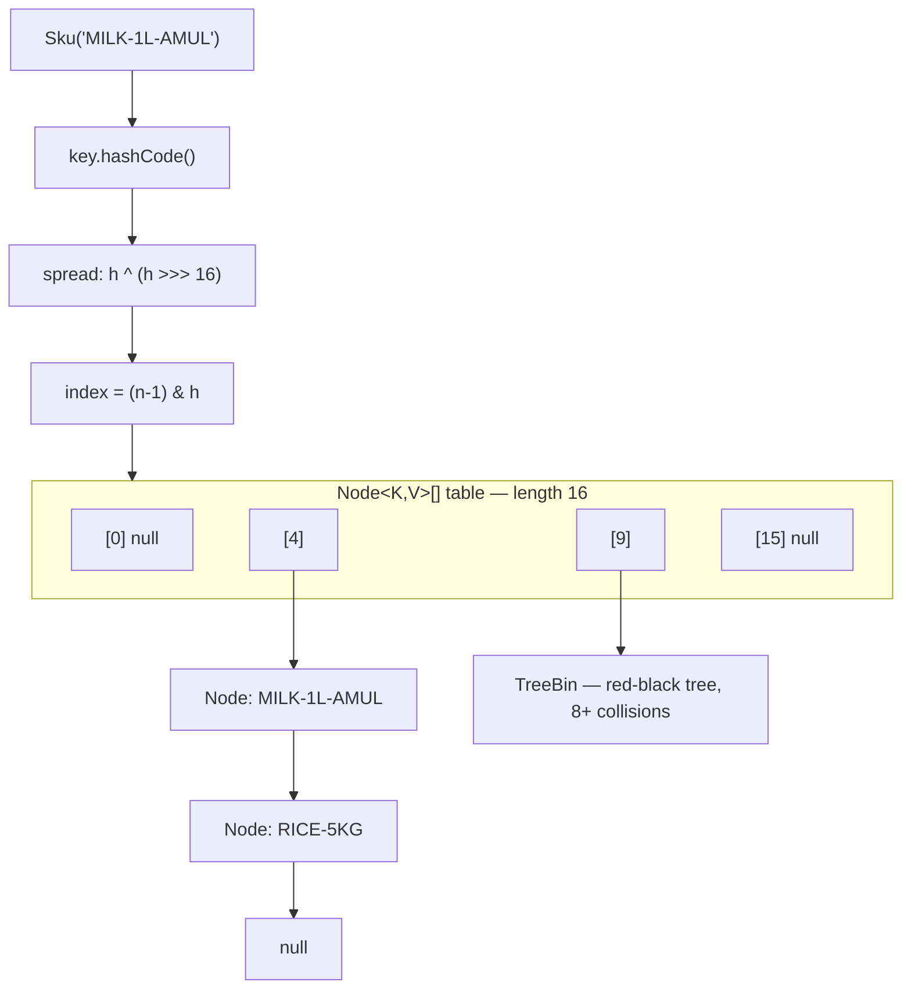
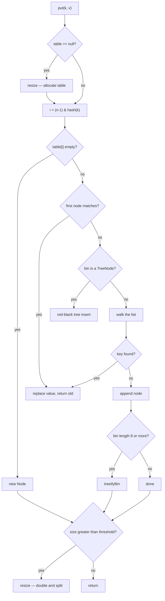

# HashMap Internals

<!-- video:start -->
<figure class="pb-video">
<video controls playsinline preload="metadata">
<source src="../../videos/ch19.mp4" type="video/mp4">
<track kind="subtitles" srclang="en" label="English" src="../../videos/ch19.vtt">
</video>
<figcaption>Video walkthrough · 7:26 · subtitles via CC · <a href="../../videos/ch19.mp4" download>Download MP4</a></figcaption>
</figure>
<!-- video:end -->

!!! example "Try it first"
    **[HashMap — how it works inside](../07-examples/hashmap-internals.md)** — 7 runnable programs, including ones that look inside a real HashMap as it resizes and treeifies, each with its real output.

## 1. Purpose & Audience

**Band:** L2 Professional · **Prerequisites:** [Choosing the Right Collection](17-choosing-a-collection.md), [equals, hashCode & Comparators](23-equality-and-ordering.md)

`HashMap` is the most-used data structure in enterprise Java and the most-misunderstood. Most developers can say "it's O(1)" and stop there. That answer is incomplete in ways that produce real production incidents: maps that silently lose entries, lookups that degrade to linear scans, and rehashing storms during traffic spikes.

This chapter answers three questions:

1. **What actually happens** when you call `put` and `get` — hashing, bucket indexing, collision resolution, treeification.
2. **When does the O(1) guarantee break**, and what does it degrade to?
3. **How do you size, key, and tune** a `HashMap` for production load?

!!! danger "Correction to earlier notes"
    If you are carrying forward notes that say *"HashMap implements `SequencedMap` in Java 21"* — that is **wrong**. JEP 431 gave `SequencedMap` to `LinkedHashMap` and to `NavigableMap` (hence `TreeMap`). `HashMap` has **no defined encounter order** and therefore does not implement it. See [Sequenced Collections](21-sequenced-collections.md).

---

## 2. The Problem

The order & inventory engine needs to answer one question millions of times an hour: *given a SKU, what is the current inventory record?*

Without a hash table, you scan:

```java title="LinearCatalogue.java"
// Java 8 — the naive version
public final class LinearCatalogue {

    private final List<InventoryItem> items = new ArrayList<>();

    public InventoryItem findBySku(Sku sku) {
        for (InventoryItem item : items) {      // O(n) on every lookup
            if (item.sku().equals(sku)) {
                return item;
            }
        }
        return null;
    }
}
```

At 200,000 SKUs, a single cart of 30 lines costs six million `equals` calls. Sorting the list and binary-searching gets you to O(log n) — around 18 comparisons — but insertion becomes O(n) and you need a total ordering on `Sku`.

A hash table trades **memory** for **time**: spend extra array slots, and you compute the location of a key directly rather than searching for it. The cost of that trade is a set of obligations most bugs come from ignoring — a correct `hashCode`, immutable keys, and a sensible capacity.

---

## 3. Mental Model

A `HashMap` is an **array of bins**. The key's hash decides which bin. Each bin holds either nothing, a short linked list, or — under heavy collision — a red-black tree.



Three ideas carry the whole chapter:

- **Spreading.** The raw `hashCode` is mixed before use, because the index calculation only looks at the low bits.
- **Bins, not slots.** A bucket is not one entry. It is a container that changes shape as it fills.
- **Resizing is amortised.** Growth is rare but expensive, and it is the only operation that touches every entry.

### 3.1 The constants that govern behaviour

These are `private static final` fields in `java.util.HashMap`. Knowing them is the difference between an L1 and an L3 answer.

| Constant | Value | Meaning |
|---|---|---|
| `DEFAULT_INITIAL_CAPACITY` | 16 | Table length of a default map, allocated lazily |
| `DEFAULT_LOAD_FACTOR` | 0.75 | Resize when `size > capacity × 0.75` |
| `TREEIFY_THRESHOLD` | 8 | Bin converts list → tree at this length |
| `UNTREEIFY_THRESHOLD` | 6 | Bin converts tree → list when it shrinks to this |
| `MIN_TREEIFY_CAPACITY` | 64 | Below this table length, **resize instead of treeify** |
| `MAXIMUM_CAPACITY` | 2³⁰ | Hard ceiling on table length |

The gap between 8 and 6 is deliberate hysteresis: without it, a bin hovering at the boundary would convert back and forth on every insert and remove.

---

## 4. Core API & Syntax

### 4.1 Construction

| Constructor / factory | Resulting capacity | Since | Notes |
|---|---|---|---|
| `new HashMap<>()` | 16 (lazy) | 1.2 | Table allocated on first `put` |
| `new HashMap<>(int initialCapacity)` | `tableSizeFor(n)` — next power of two ≥ n | 1.2 | **Argument is capacity, not expected size** |
| `new HashMap<>(int, float)` | as above | 1.2 | Custom load factor; rarely justified |
| `new HashMap<>(Map<K,V> m)` | sized for `m` | 1.2 | Copy constructor |
| `HashMap.newHashMap(int numMappings)` | sized so `numMappings` fit **without resize** | 19 | **Prefer this.** Does the `/0.75` for you |

### 4.2 Core operations

| Signature | Behaviour | Since |
|---|---|---|
| `V put(K, V)` | Insert or replace; returns previous value or `null` | 1.2 |
| `V putIfAbsent(K, V)` | Insert only if absent **or mapped to null**; returns current value | 8 |
| `V get(Object)` | Value or `null` | 1.2 |
| `V getOrDefault(Object, V)` | Value or supplied default; does not insert | 8 |
| `boolean containsKey(Object)` | O(1) average | 1.2 |
| `boolean containsValue(Object)` | **O(n)** — full scan | 1.2 |
| `V remove(Object)` | Removes and returns, or `null` | 1.2 |
| `boolean remove(Object, Object)` | Removes only on key-and-value match | 8 |
| `void putAll(Map<? extends K, ? extends V>)` | Copies every mapping; existing keys are overwritten | 1.2 |

### 4.3 Compute and merge

The single most valuable group of methods in the API, and the least used.

| Signature | Behaviour | Since |
|---|---|---|
| `V computeIfAbsent(K, Function<K,V>)` | Computes and inserts only if absent; returns the resulting value | 8 |
| `V computeIfPresent(K, BiFunction)` | Recomputes only if present; `null` result removes the entry | 8 |
| `V compute(K, BiFunction)` | Always recomputes; `null` result removes | 8 |
| `V merge(K, V, BiFunction)` | Inserts value if absent, else merges old and new | 8 |

!!! warning "Recursive update is not permitted"
    Modifying the same map inside a `computeIfAbsent` mapping function is undefined behaviour. In `HashMap` this has thrown `ConcurrentModificationException` since Java 9, but before that it silently corrupted the table. Compute the value first, then insert.

### 4.4 Immutable and copy factories

| Expression | Result | Since |
|---|---|---|
| `Map.of(k1, v1, ...)` | Immutable, up to 10 pairs, **rejects null** | 9 |
| `Map.ofEntries(Map.entry(...), ...)` | Immutable, any size | 9 |
| `Map.copyOf(map)` | Immutable snapshot | 10 |
| `Collections.unmodifiableMap(map)` | Unmodifiable **view** — source changes still show through | 1.2 |

!!! note "Randomised iteration order"
    `Map.of` returns an implementation whose iteration order is randomised per JVM run via an internal salt. This is intentional — it stops code from depending on an order that was never guaranteed. Tests that assert on `Map.of` iteration order will pass locally and fail on the next JVM start.

---

### 4.5 Views and bulk operations

| Signature | Behaviour | Since |
|---|---|---|
| `Set<K> keySet()` | Live **view** of the keys; removing from it removes the mapping | 1.2 |
| `Collection<V> values()` | Live view of the values | 1.2 |
| `Set<Map.Entry<K,V>> entrySet()` | Live view of the pairs; `entry.setValue` writes through | 1.2 |
| `void forEach(BiConsumer<K,V>)` | Visits every pair, no `Map.Entry` boilerplate | 8 |
| `void replaceAll(BiFunction<K,V,V>)` | Rewrites every value in place | 8 |
| `Map.Entry.comparingByKey()` / `comparingByValue()` | `Comparator` over entries; overloads take a value comparator | 8 |

A `HashMap` has no order, so "sort the map" always means *stream the entries, sort them, and collect into something that keeps order*:

```java title="Best sellers: sorting stock entries by value"
Map<Sku, Integer> unitsSold = new HashMap<>(Map.of(
        Sku.of("MILK-1L"), 120, Sku.of("BREAD-400G"), 45, Sku.of("EGGS-12"), 80));

// Top two SKUs, highest first
List<Sku> bestSellers = unitsSold.entrySet().stream()
        .sorted(Map.Entry.<Sku, Integer>comparingByValue().reversed())
        .limit(2)
        .map(Map.Entry::getKey)
        .toList();                                   // codes: MILK-1L, EGGS-12

// The whole map, re-ordered by value: collect into a LinkedHashMap to keep the order
Map<Sku, Integer> byUnits = unitsSold.entrySet().stream()
        .sorted(Map.Entry.comparingByValue())
        .collect(Collectors.toMap(Map.Entry::getKey, Map.Entry::getValue,
                (a, b) -> a, LinkedHashMap::new));   // BREAD-400G=45, EGGS-12=80, MILK-1L=120

// The single maximum doesn't need a sort at all
Optional<Sku> topSeller = unitsSold.entrySet().stream()
        .max(Map.Entry.comparingByValue())
        .map(Map.Entry::getKey);                     // the MILK-1L Sku

// Apply a 10% uplift to every forecast in place
unitsSold.replaceAll((sku, units) -> units + units / 10);
```

!!! tip "Sorting by key? Use a `TreeMap`"
    If the map should *always* be ordered by key, `new TreeMap<>(unitsSold)` keeps it sorted on every insert, with no stream needed. Sort entries in a stream only for one-off reports, or when ordering by value.

The `(a, b) -> a` merge function is required by the four-argument `toMap` but never runs here, because the keys are already unique. See [Collectors](../02-language/08-collectors.md) for why the three-argument form throws on duplicates.

---

## 5. Worked Examples

### 5.1 The SKU catalogue

```java title="SkuCatalogue.java"
public final class SkuCatalogue {

    private final Map<Sku, InventoryItem> bySku;

    public SkuCatalogue(List<InventoryItem> items) {
        // Sized so all items fit without a single resize.
        this.bySku = HashMap.newHashMap(items.size());
        for (InventoryItem item : items) {
            bySku.put(item.sku(), item);
        }
    }

    public Optional<InventoryItem> find(Sku sku) {
        return Optional.ofNullable(bySku.get(sku));
    }

    public int availableQuantity(Sku sku) {
        return find(sku).map(InventoryItem::available).orElse(0);
    }
}
```

The `newHashMap` call matters more than it looks. Building a 200,000-entry catalogue with `new HashMap<>()` triggers **15 resizes**, rehashing a cumulative several hundred thousand entries. With correct sizing, zero.

### 5.2 Aggregating order lines with `merge`

A cart can contain the same SKU on multiple lines. Collapse them:

```java title="CartAggregator.java"
public static Map<Sku, Integer> quantityBySku(Cart cart) {
    Map<Sku, Integer> totals = new HashMap<>();
    for (CartLine line : cart.lines()) {
        totals.merge(line.sku(), line.quantity(), Integer::sum);
    }
    return totals;
}
```

```text title="Output"
{Sku[MILK-1L-AMUL]=3, Sku[RICE-5KG-INDIA]=1, Sku[ATTA-10KG]=2}
```

Compare the pre-Java-8 form, which is longer and has a null-handling bug waiting in it:

```java title="CartAggregator.java (Java 7 style)"
Integer current = totals.get(line.sku());
totals.put(line.sku(), current == null ? line.quantity() : current + line.quantity());
```

### 5.3 Grouping with `computeIfAbsent`

Index orders by delivery slot for the dispatch board:

```java title="DispatchBoard.java"
public static Map<DeliverySlot, List<Order>> byDeliverySlot(List<Order> orders) {
    Map<DeliverySlot, List<Order>> board = new HashMap<>();
    for (Order order : orders) {
        board.computeIfAbsent(order.slot(), slot -> new ArrayList<>())
             .add(order);
    }
    return board;
}
```

The lambda runs **only on first encounter** of a slot. The equivalent `putIfAbsent(slot, new ArrayList<>())` allocates a list on every single iteration and throws all but the first away.

### 5.4 The mutable-key bug

This is the defect that reaches production most often. Suppose `Sku` were mutable:

```java title="MutableKeyDemo.java"
class MutableSku {
    private String code;
    MutableSku(String code) { this.code = code; }
    void setCode(String code) { this.code = code; }

    @Override public boolean equals(Object o) {
        return o instanceof MutableSku s && Objects.equals(code, s.code);
    }
    @Override public int hashCode() { return Objects.hash(code); }
}

var key = new MutableSku("MILK-1L");
Map<MutableSku, Integer> stock = new HashMap<>();
stock.put(key, 40);

key.setCode("MILK-2L");            // hash changes; the entry does not move

System.out.println(stock.get(key));         // null
System.out.println(stock.containsKey(key)); // false
System.out.println(stock.size());           // 1  ← entry is still in there
```

```text title="Output"
null
false
1
```

The entry is stranded in the bin computed from the *old* hash. It is unreachable by lookup, unremovable by `remove`, and still counted by `size()` — a permanent leak.

!!! tip "The rule"
    Map keys must be immutable, or at least immutable with respect to every field used in `hashCode` and `equals`. Records are the cleanest way to guarantee this: `record Sku(String code) {}`.

### 5.5 Watching a resize

```java title="ResizeObserver.java"
Map<Integer, String> map = new HashMap<>();   // capacity 16, threshold 12
for (int i = 1; i <= 13; i++) {
    map.put(i, "v" + i);
}
// At the 13th put, size (13) exceeds threshold (12):
// table doubles 16 → 32, threshold becomes 24,
// and all 13 entries are redistributed in one pass.
```

---

## 6. Internals

### 6.1 Hash spreading

```java title="java.util.HashMap (JDK source)"
static final int hash(Object key) {
    int h;
    return (key == null) ? 0 : (h = key.hashCode()) ^ (h >>> 16);
}
```

Two things happen here.

**Null keys hash to 0**, which is why a `HashMap` supports exactly one null key: it always lands in bin 0.

**The high 16 bits are XORed down into the low 16.** This exists because the index calculation is `(n - 1) & hash` — a bitmask that, for a table of length 16, looks at only the bottom four bits. A `hashCode` that varies only in its upper bits would map every key to the same bin. Spreading costs one XOR and one shift, and rescues hash codes that are well-distributed in the high bits but not the low.

**Index:**

```java
int index = (table.length - 1) & hash;
```

This is a cheap modulo that only works because table length is always a power of two — which is why `new HashMap<>(17)` gives you a table of 32, not 17.

### 6.2 The put path



Note the ordering: the fast path compares hashes *before* calling `equals`. Two keys are only compared with `equals` when their spread hashes are identical. This is why a cheap `hashCode` matters more than a cheap `equals`.

### 6.3 Treeification, and the trap inside it

When a bin reaches 8 nodes, `treeifyBin` is called. But it does not always treeify:

```java title="java.util.HashMap (paraphrased)"
if (tab == null || tab.length < MIN_TREEIFY_CAPACITY)   // 64
    resize();      // grow instead — collisions are probably a sizing problem
else
    // convert the bin to a red-black tree
```

Below a table length of 64, a long bin is far more likely to mean *the table is too small* than *the hash function is bad*, so the map grows instead. Treeification only occurs at capacity ≥ 64 **and** bin length ≥ 8.

Inside a tree bin, nodes are ordered by hash; when hashes tie, by `Comparable` if the key type implements it, and otherwise by a deterministic fallback. Lookup within the bin is O(log k) where k is the bin size.

This is the mechanism that defends against **hash collision DoS** — an attacker submitting thousands of keys engineered to collide. Pre-Java-8, that degraded the map to a linked list and turned an O(1) lookup into O(n). Post-Java-8, it degrades to O(log n).

!!! note "The honest complexity statement"
    `get` and `put` are **O(1) average**, **O(log n) worst case** since Java 8, assuming a hash function that is not pathologically bad. The old "O(n) worst case" answer describes Java 7.

### 6.4 Resize: the expensive operation

When `size` exceeds `threshold`, capacity doubles and every entry is redistributed. Java 8 does this with a trick worth knowing.

Because capacity is always a power of two and doubles exactly, an entry's new index is either **the same** or **old index + old capacity**. Which one is decided by a single bit:

```java
if ((e.hash & oldCap) == 0) {
    // stays at index j          → "lo" list
} else {
    // moves to index j + oldCap → "hi" list
}
```

Each bin is split into a lo-list and a hi-list in one pass, with **no rehashing** — the cached `hash` field in each `Node` is reused — and relative order within each list is preserved.

That order preservation is not cosmetic. Java 7 reversed the list during transfer, and under concurrent resize two threads could build a circular reference, producing a `get()` that spun forever at 100% CPU. Java 8 eliminated that specific failure mode. **`HashMap` is still not thread-safe** — concurrent writes lose updates and corrupt state in other ways — but the infamous infinite loop is gone.

### 6.5 Fail-fast iteration

Every structural modification increments `modCount`. Iterators capture it at creation and compare on every `next()`; a mismatch throws `ConcurrentModificationException`.

```java title="FailFast.java"
Map<Sku, Integer> stock = new HashMap<>();
stock.put(new Sku("MILK-1L"), 1);
stock.put(new Sku("ATTA-10KG"), 0);

for (Sku sku : stock.keySet()) {
    if (stock.get(sku) == 0) {
        stock.remove(sku);          // CME on the next iteration
    }
}
```

Correct alternatives:

=== "Iterator.remove"
    ```java
    Iterator<Map.Entry<Sku, Integer>> it = stock.entrySet().iterator();
    while (it.hasNext()) {
        if (it.next().getValue() == 0) {
            it.remove();
        }
    }
    ```

=== "removeIf (Java 8)"
    ```java
    stock.entrySet().removeIf(e -> e.getValue() == 0);
    ```

Fail-fast is a **best-effort bug detector**, not a synchronisation mechanism. It is explicitly documented as unreliable — never write logic that depends on the exception being thrown.

### 6.6 Memory footprint

Each entry costs a `Node` object: object header, `hash` int, three references (`key`, `value`, `next`). On a 64-bit JVM with compressed oops that is **32 bytes**, before the key and value objects themselves. Add the table array — at load factor 0.75, roughly 1.33 slots per entry, about 5.3 bytes of array per entry.

A one-million-entry `HashMap<Sku, InventoryItem>` therefore costs roughly 37 MB of overhead before a single domain object. `TreeNode` is larger still — six references instead of one.

Java 25's compact object headers (JEP 519) shrink the header from 12 bytes to 8, taking `Node` to 24 bytes — a meaningful reduction on map-heavy heaps. See [Memory Footprint & Object Layout](../05-runtime/35-memory-footprint.md).

---

## 7. Production Patterns & Anti-Patterns

### Do this

- **Size the map when you know the count.** `HashMap.newHashMap(n)` (Java 19+) or `new HashMap<>((int)(n / 0.75f) + 1)` on older baselines. Resizes are the only O(n) operation in the map's life.
- **Use records as keys.** Immutable, correct `equals`/`hashCode` for free, and impossible to mutate into a stranded entry.
- **Prefer `merge` and `computeIfAbsent`** over get-check-put. Fewer lookups, no null-handling bug, and clearer intent.
- **Return `Map.copyOf(...)`** from accessors that hand out internal maps. `unmodifiableMap` returns a *view* — the caller cannot modify it, but they still see your later mutations.
- **Declare fields as `Map<K,V>`, not `HashMap<K,V>`.** It keeps the door open to `LinkedHashMap` or `ConcurrentHashMap` without touching call sites.

### Never do this

- **Never share a `HashMap` across threads**, even read-mostly, unless it is fully populated before publication *and* safely published (final field, or via a concurrent structure). An unsafely published map can appear half-built to another thread.
- **Never use a mutable key.** See §5.4 — the entry becomes unreachable and unremovable.
- **Never tune the load factor without measurement.** Lowering it to 0.5 costs substantially more memory for a marginal collision improvement; raising it to 0.9 saves memory and lengthens bins. The default is well-chosen; changing it is nearly always cargo cult.
- **Never rely on iteration order.** It is not insertion order, not hash order, and it changes on resize. Use `LinkedHashMap` when order matters.
- **Never use `containsValue` in a hot path.** It is O(n). Maintain a reverse index instead.
- **Never use `Double`/`Float` keys** where NaN or `-0.0` can occur. `Double.valueOf(Double.NaN).equals(Double.NaN)` is `true`, but `Double.NaN == Double.NaN` is `false` — the map and the language disagree.
- **Never mutate the map inside a `compute*` function.** Undefined behaviour; throws CME since Java 9.

### Choosing between the map implementations

| Need | Use |
|---|---|
| General-purpose, single-threaded | `HashMap` |
| Insertion or access order preserved | `LinkedHashMap` |
| Sorted keys, range queries | `TreeMap` |
| Concurrent read/write | `ConcurrentHashMap` — see [Ch 30](../04-concurrency/30-concurrent-collections.md) |
| Small, fixed, immutable | `Map.of` / `Map.ofEntries` |
| Enum keys | `EnumMap` — array-backed, far faster |
| Identity semantics | `IdentityHashMap` |

---

## 8. Version Evolution (Java 8 → 26)

| Version | What changed | Impact |
|---|---|---|
| **8** | Treeification of bins; resize preserves order; `getOrDefault`, `putIfAbsent`, `compute*`, `merge`, `forEach`, `replaceAll` | Worst case improves O(n) → O(log n); the concurrent-resize infinite loop is eliminated; the API becomes usable without null checks |
| **9** | `Map.of`, `Map.entry`, `Map.ofEntries`; recursive update in `computeIfAbsent` now throws CME | Immutable maps without a builder; a silent corruption becomes a loud failure |
| **10** | `Map.copyOf` | Defensive snapshots in one call |
| **19** | `HashMap.newHashMap(int numMappings)` | Correct sizing without the `/0.75` arithmetic everyone got wrong |
| **21** | `SequencedMap` (JEP 431) added to `LinkedHashMap` and `NavigableMap` — **not** `HashMap` | If you want `firstEntry`/`putFirst`/`reversed`, change the implementation type |
| **25** | Compact object headers final (JEP 519) | `Node` shrinks 32 → 24 bytes; less overhead on map-heavy heaps |
| **26** | No `HashMap`-specific changes | — |

### Migration note

The highest-value change when moving a legacy codebase forward is replacing get-check-put chains with `merge` / `computeIfAbsent`, and replacing hand-rolled `new HashMap<>(n * 4 / 3 + 1)` sizing with `HashMap.newHashMap(n)`. Both are mechanical and both remove a class of bug.

If you are on Java 21+ and find code calling `firstEntry()` on something declared as `Map`, check the runtime type — it compiles only if the static type is `SequencedMap` or `LinkedHashMap`.

---

## 9. Interview Questions

### L1 — Foundations

**Q1. How does `HashMap` achieve O(1) lookup?** ⭐ *high frequency*
It computes the key's hash, derives an array index from it, and goes straight to that bucket instead of searching. Because the index calculation and array access are both constant-time, lookup does not depend on the number of entries. The guarantee holds on average; it assumes keys are spread reasonably evenly across buckets.

**Q2. Can a `HashMap` have a null key?**
Yes — exactly one. `HashMap.hash()` returns 0 for null rather than calling `hashCode`, so the null key always lands in bucket 0. Null values are unrestricted. `ConcurrentHashMap` and `Map.of` both reject nulls entirely, so code that relies on null keys will break when swapped to either.

**Q3. What is the difference between `HashMap` and `Hashtable`?**
`Hashtable` synchronises every method, rejects nulls, and is a legacy class from Java 1.0. `HashMap` is unsynchronised and allows nulls. For concurrent use the answer is `ConcurrentHashMap`, which locks per bin rather than the whole table; `Hashtable` should not appear in new code.

### L2 — Professional

**Q4. What happens when two keys have the same hash code?** ⭐ *high frequency*
They land in the same bucket, forming a collision. The map stores them as a linked list within that bin, comparing with `equals` to distinguish them. If the bin reaches 8 entries and the table is at least 64 long, the bin is converted to a red-black tree, keeping lookups at O(log k) instead of O(k).

**Q5. Why must table capacity be a power of two?**
Because the bucket index is computed as `(n - 1) & hash` — a bitwise AND that is equivalent to modulo only when `n` is a power of two, and is far cheaper than a division. It also makes resizing efficient: doubling means an entry either stays put or moves by exactly the old capacity, decided by one bit of its hash.

**Q6. What breaks if you use a mutable object as a key?**
If a field used in `hashCode` changes after insertion, the entry stays in the bucket derived from the old hash. Lookups compute the new hash, land in a different bucket, and find nothing — so `get` returns null and `remove` fails, while `size()` still counts the entry. It becomes a permanent, unreachable leak.

### L3 — Enterprise

**Q7. Why is the hash code spread with `h ^ (h >>> 16)`?**
Because the index only uses the low bits of the hash — for a 16-slot table, just four of them. A `hashCode` well-distributed in its high bits but constant in its low bits would collide on every key. XORing the top 16 bits into the bottom 16 mixes that entropy downward for the cost of two instructions, without the expense of a full hash function.

**Q8. How should you size a `HashMap` you know will hold one million entries?**
Use `HashMap.newHashMap(1_000_000)`, which accounts for the load factor internally. On pre-19 baselines, `new HashMap<>((int)(1_000_000 / 0.75f) + 1)`. Passing 1,000,000 directly gives a table of 1,048,576 which hits its threshold at about 786,000 entries and resizes once more — the bug the `newHashMap` factory exists to prevent.

**Q9. Is it safe to read from a `HashMap` concurrently if nothing writes to it?**
Only if the map was fully populated and then **safely published** — via a final field, a volatile write, or a static initialiser. Without safe publication, another thread can observe a partially constructed table. Concurrent reads against a map that is still being written are never safe: the map provides no visibility guarantees.

### L4 — Architect

**Q10. Walk through what happens during a resize, and why Java 8 changed it.**
Capacity doubles and each bin is split into two lists: entries where `(hash & oldCap) == 0` stay at the same index, the rest move to `index + oldCap`. No hashes are recomputed — the `Node` caches its hash — and relative order within each split list is preserved. Java 7 reversed the order during transfer, which allowed two threads resizing concurrently to create a cycle in a bin and make subsequent `get` calls spin forever. Java 8's order-preserving split removed that failure mode, though the map remains unsafe for concurrent writes.

**Q11. How does treeification defend against a denial-of-service attack?**
An attacker who controls keys — HTTP parameter names, JSON fields — can craft thousands that collide in the same bucket. Pre-Java-8 that turned every lookup into a linear scan, so a single request could consume quadratic CPU. Treeification caps the degradation at O(log n). It is mitigation rather than a fix: the real defences are bounding the number of parsed parameters and not using attacker-controlled data as map keys at scale.

**Q12. When would you deliberately choose something other than `HashMap` for a high-throughput lookup?**
`EnumMap` when keys are enum constants — it is array-indexed and does no hashing at all. `ConcurrentHashMap` under concurrent write load, where per-bin locking beats any external synchronisation. An open-addressing primitive map (Eclipse Collections, fastutil) when keys are `int` or `long` and boxing dominates the profile. And `TreeMap` when range queries matter, accepting O(log n) to gain ordering.

---

!!! abstract "Cheat Sheet"
    **Index:** `(n-1) & (h ^ h>>>16)` · table length always a power of two

    **Defaults:** capacity 16 · load factor 0.75 · threshold = cap × lf

    **Treeify:** bin ≥ 8 **and** table ≥ 64 → red-black tree; untreeify at 6

    **Resize:** doubles; split by `(hash & oldCap)`; no rehash; order preserved

    **Complexity:** get/put O(1) avg, O(log n) worst (Java 8+); `containsValue` O(n)

    **Nulls:** one null key (bucket 0), many null values; `Map.of` rejects both

    **Sizing:** `HashMap.newHashMap(n)` — Java 19+

    **Memory:** ~32 B/Node (24 B on Java 25 with compact headers) + ~5 B table

    **Not a `SequencedMap`** — that is `LinkedHashMap` and `TreeMap`

    **Keys must be immutable** — mutating a key strands the entry forever
