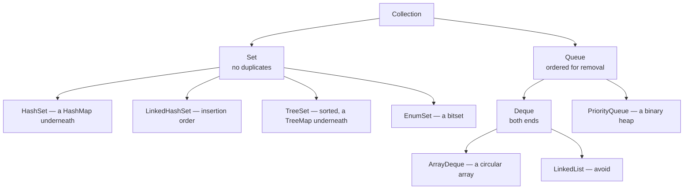
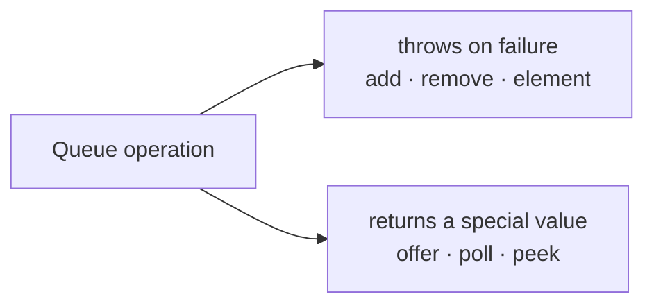
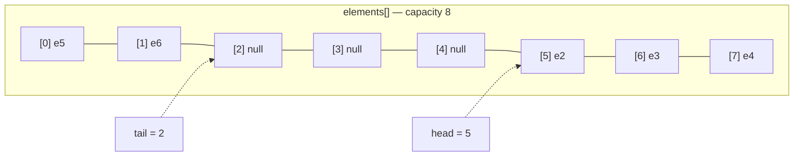
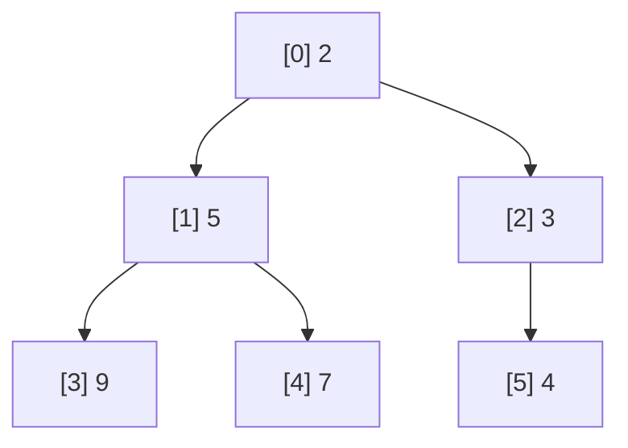

# Set, Queue & Deque

<!-- video:start -->
<figure class="pb-video">
<video controls playsinline preload="metadata">
<source src="../../videos/ch20.mp4" type="video/mp4">
<track kind="subtitles" srclang="en" label="English" src="../../videos/ch20.vtt">
</video>
<figcaption>Video walkthrough · 6:13 · subtitles via CC · <a href="../../videos/ch20.mp4" download>Download MP4</a></figcaption>
</figure>
<!-- video:end -->

## 1. Purpose & Audience

**Band:** L2 Professional · **Prerequisites:** [Choosing the Right Collection](17-choosing-a-collection.md), [HashMap Internals](19-hashmap-internals.md)

`List` and `Map` get most of the attention. The other three interfaces — `Set`, `Queue`, and `Deque` — cover problems that code routinely solves badly with a `List`: membership tests, deduplication, work queues, stacks, and "give me the most urgent item next".

This chapter answers three questions:

1. **How are the `Set` implementations built**, and what does each one cost?
2. **Why does `Queue` have two methods for every operation?**
3. **When is `PriorityQueue` the right tool**, and why does it behave unlike every other collection when you iterate it?

---

## 2. The Problem

Four jobs, each done with the wrong structure.

```java title="WrongStructures.java"
// Deduplication with a List — O(n²)
List<Sku> unique = new ArrayList<>();
for (Sku sku : incoming) {
    if (!unique.contains(sku)) unique.add(sku);        // scans the list every time
}

// A stack with java.util.Stack — synchronised, and iterates bottom-up
Stack<Action> undo = new Stack<>();

// A queue with LinkedList — a node allocation per element
Queue<Order> pending = new LinkedList<>();

// "Most urgent next" by re-sorting a list on every insert
orders.add(order);
orders.sort(comparing(Order::priority));                 // O(n log n) per insert
Order next = orders.remove(0);
```

Each works. Each is slower than it needs to be by an order of magnitude or more, and two carry correctness traps besides.

---

## 3. Mental Model

### 3.1 The three interfaces



### 3.2 Every `Set` is a `Map` in disguise

| Set | Backed by |
|---|---|
| `HashSet` | A `HashMap` whose values are a shared dummy object |
| `LinkedHashSet` | A `LinkedHashMap` |
| `TreeSet` | A `TreeMap` |
| `EnumSet` | A bit vector — not a map |

So everything true of the map is true of the set: `HashSet` has `HashMap`'s O(1) average and unspecified order; `TreeSet` has `TreeMap`'s O(log n) and sorted order, and uses only `compareTo` for equality ([Chapter 23](23-equality-and-ordering.md)).

### 3.3 `Queue` has two methods for everything



| | Throws | Returns special value |
|---|---|---|
| **Insert** | `add(e)` — `IllegalStateException` if full | `offer(e)` — `false` if full |
| **Remove** | `remove()` — `NoSuchElementException` if empty | `poll()` — `null` if empty |
| **Examine** | `element()` — `NoSuchElementException` if empty | `peek()` — `null` if empty |

The split exists because a queue being empty or full is often **normal**, not exceptional. A worker draining a queue expects it to run dry; bounded queues expect to fill. The special-value methods let that be ordinary control flow.

---

## 4. Core Reference

### 4.1 Set operations

| Method | Set algebra |
|---|---|
| `a.addAll(b)` | Union, into `a` |
| `a.retainAll(b)` | Intersection, into `a` |
| `a.removeAll(b)` | Difference, into `a` |
| `a.containsAll(b)` | Subset test |

All four **mutate `a`**. For a non-destructive result, copy first: `var both = new HashSet<>(a); both.retainAll(b);`.

### 4.2 `NavigableSet` — what `TreeSet` adds

| Method | Returns |
|---|---|
| `first()` / `last()` | Lowest / highest |
| `floor(e)` | Greatest ≤ e |
| `ceiling(e)` | Least ≥ e |
| `lower(e)` / `higher(e)` | Strictly less / strictly greater |
| `headSet(e)` / `tailSet(e)` | Everything below / at-or-above — **views** |
| `subSet(from, to)` | A range — **a view** |
| `descendingSet()` | Reverse order — a view |
| `pollFirst()` / `pollLast()` | Remove and return an end |

### 4.3 `Deque`

| Operation | Head | Tail |
|---|---|---|
| Insert | `addFirst` / `offerFirst` | `addLast` / `offerLast` |
| Remove | `removeFirst` / `pollFirst` | `removeLast` / `pollLast` |
| Examine | `getFirst` / `peekFirst` | `getLast` / `peekLast` |

| Used as | Methods |
|---|---|
| **Stack (LIFO)** | `push` = `addFirst`, `pop` = `removeFirst`, `peek` = `peekFirst` |
| **Queue (FIFO)** | `offer` = `offerLast`, `poll` = `pollFirst` |

### 4.4 `PriorityQueue`

| Operation | Cost |
|---|---|
| `offer(e)` | O(log n) |
| `poll()` | O(log n) — returns the **minimum** by comparator |
| `peek()` | O(1) |
| `remove(Object)` | **O(n)** — linear search, then sift |
| `contains(Object)` | **O(n)** |
| Iteration | **Heap order — not sorted** |

---

## 5. Worked Examples

### 5.1 Deduplication that keeps order

```java title="Dedupe.java"
// O(n), preserves first-seen order
Set<Sku> unique = new LinkedHashSet<>(incoming);

// Or as a stream
List<Sku> unique = incoming.stream().distinct().toList();   // also first-seen order
```

`LinkedHashSet` is the answer to "deduplicate, but keep the order things arrived in" — which is the requirement far more often than the plain `HashSet` people reach for, since a `HashSet` scrambles order.

`Stream.distinct()` on an ordered stream is internally a `LinkedHashSet`, so the two are equivalent.

### 5.2 Set algebra for reconciliation

```java title="Reconciliation.java"
Set<Sku> inCatalogue = catalogue.skus();
Set<Sku> inWarehouse = warehouse.skus();

// SKUs we sell but the warehouse doesn't have
Set<Sku> unstocked = new HashSet<>(inCatalogue);
unstocked.removeAll(inWarehouse);

// SKUs the warehouse holds that we no longer sell
Set<Sku> orphaned = new HashSet<>(inWarehouse);
orphaned.removeAll(inCatalogue);

// SKUs in both
Set<Sku> matched = new HashSet<>(inCatalogue);
matched.retainAll(inWarehouse);
```

Each operation is O(n) with a hash set. The same logic over two lists — nested `contains` calls — is O(n × m), which for two sets of 200,000 SKUs is 40 billion comparisons.

The copy before each operation is essential: `removeAll` and `retainAll` mutate their receiver, so without it the second calculation would run against the first's result.

### 5.3 Range queries with `TreeSet`

```java title="Slots.java"
NavigableSet<LocalTime> slotStarts = new TreeSet<>(List.of(
    LocalTime.of(9, 0), LocalTime.of(11, 0), LocalTime.of(14, 0), LocalTime.of(17, 0)));

LocalTime requested = LocalTime.of(12, 30);

slotStarts.ceiling(requested);                  // 14:00 — the next available slot
slotStarts.floor(requested);                    // 11:00 — the latest one already started
slotStarts.subSet(LocalTime.of(10, 0), LocalTime.of(15, 0));   // [11:00, 14:00]
slotStarts.headSet(LocalTime.NOON);             // morning slots
```

`ceiling` answers "what's the next slot at or after this time" in O(log n). A `HashSet` would require checking every element. **The reason to choose a `TreeSet` is almost always these queries**, not sorted iteration — which you could get by sorting once.

`subSet`, `headSet`, and `tailSet` return **views**: adding to the underlying set within the range shows up in the view, and adding to the view outside its range throws.

### 5.4 `ArrayDeque` as a stack and as a queue

```java title="ArrayDequeUsage.java"
// Stack — undo history for a cart
Deque<CartAction> undo = new ArrayDeque<>();
undo.push(new AddLine(line));
undo.push(new ChangeQuantity(line, 3));
CartAction last = undo.pop();            // ChangeQuantity — LIFO

// Queue — pending dispatches
Queue<Order> pending = new ArrayDeque<>();
pending.offer(order1);
pending.offer(order2);
Order next = pending.poll();             // order1 — FIFO
```

`ArrayDeque` is the right implementation for both. Compared with the alternatives:

| | `ArrayDeque` | `Stack` | `LinkedList` |
|---|---|---|---|
| Backing | Circular array | Array (via `Vector`) | Node per element |
| Synchronised | No | **Yes — every method** | No |
| Memory per element | ~4 bytes | ~4 bytes | ~24 bytes + element |
| Iteration order as a stack | **Top first** | **Bottom first** | Top first |
| Nulls | Rejected | Allowed | Allowed |

`Stack` iterating from the bottom up is a genuine trap: `for (Action a : stack)` visits the oldest action first, the opposite of pop order.

### 5.5 `PriorityQueue` for dispatch

```java title="DispatchPriority.java"
Queue<Order> byUrgency = new PriorityQueue<>(
    Comparator.comparing(Order::priority).reversed()     // highest priority first
              .thenComparing(Order::placedAt));           // then oldest

byUrgency.addAll(incoming);

while (!byUrgency.isEmpty()) {
    dispatch(byUrgency.poll());                            // always the most urgent remaining
}
```

`PriorityQueue` is a **min-heap** by its comparator — `poll()` returns the smallest. To get the largest first, reverse the comparator.

It is ideal when items arrive over time and you repeatedly need the next-most-urgent, because each insert and removal is O(log n). If you have all the items up front and need them once in order, sorting a list is simpler and just as fast.

### 5.6 Top-K without sorting everything

The ten highest-value orders from a million:

```java title="TopK.java"
PriorityQueue<Order> topTen = new PriorityQueue<>(comparing(Order::total));   // MIN-heap

for (Order order : allOrders) {
    topTen.offer(order);
    if (topTen.size() > 10) {
        topTen.poll();            // evict the smallest of the current top eleven
    }
}

List<Order> result = new ArrayList<>(topTen);
result.sort(comparing(Order::total).reversed());      // heap order → sorted
```

Keeping a **min-heap of size k** means the heap always holds the k largest seen so far, with the smallest of them at the head ready to be evicted. Cost is O(n log k) and memory is O(k) — against O(n log n) time and O(n) memory for sorting everything.

Note the final sort. Iterating the heap gives heap order, not sorted order, so the result must be sorted explicitly.

### 5.7 `EnumSet`

```java title="EnumSetUsage.java"
Set<OrderStatus> terminal = EnumSet.of(OrderStatus.DELIVERED, OrderStatus.CANCELLED);
Set<OrderStatus> active   = EnumSet.complementOf(EnumSet.copyOf(terminal));
Set<DayOfWeek>   weekdays = EnumSet.range(DayOfWeek.MONDAY, DayOfWeek.FRIDAY);

boolean done = terminal.contains(order.status());      // one bit test
```

For any set of enum constants, `EnumSet` is strictly better than `HashSet`: smaller, faster, and iterating in declaration order. `complementOf` and `range` have no `HashSet` equivalent at all.

---

## 6. Internals

### 6.1 `HashSet` is a `HashMap`

```java title="HashSetSource.java"
// java.util.HashSet, simplified
private transient HashMap<E, Object> map;
private static final Object PRESENT = new Object();

public boolean add(E e) {
    return map.put(e, PRESENT) == null;     // null previous value ⇒ newly added
}
public boolean contains(Object o) {
    return map.containsKey(o);
}
```

Every element is a key in an internal `HashMap`, mapped to one shared dummy object. That is why `HashSet` has exactly `HashMap`'s characteristics — O(1) average, treeified buckets, unspecified iteration order, one permitted null — and why each element costs a full `HashMap.Node` of about 32 bytes ([Chapter 35](../05-runtime/35-memory-footprint.md)).

It also means everything in [Chapter 19](19-hashmap-internals.md) applies directly: mutating an element after insertion strands it, and a bad `hashCode` degrades the set exactly as it degrades a map.

### 6.2 `ArrayDeque`'s circular buffer



Two indices move around a fixed array, wrapping at the end. Adding at either end moves one index; nothing is shifted. When the array fills, it doubles and the elements are copied out into order.

Two design consequences:

- **Both ends are O(1)** with no per-element allocation — which is why it beats `LinkedList` on memory and cache locality.
- **Nulls are forbidden** because `null` in a slot means "empty". Allowing null elements would make an empty slot indistinguishable from a stored null.

### 6.3 `PriorityQueue`'s binary heap



The heap is stored in an array: element *i* has children at *2i+1* and *2i+2*. The only invariant is that each parent is ≤ its children — so the root is the minimum, but siblings and cousins are in no particular order.

| Operation | Mechanism |
|---|---|
| `offer` | Append at the end, then **sift up** — swap with the parent while smaller |
| `poll` | Take the root, move the last element to the root, then **sift down** |
| `remove(Object)` | Linear scan to find it — **O(n)** — then sift |

Iteration walks the array: `[2, 5, 3, 9, 7, 4]`. That is **heap order**, and it is why iterating a `PriorityQueue` looks nearly sorted on small inputs and clearly unsorted on large ones ([Chapter 17](17-choosing-a-collection.md)).

The O(n) `remove(Object)` matters when a queue item must be cancelled — a dispatch revoked before it runs. With many cancellations, either mark items cancelled and skip them on `poll`, or use a `TreeSet`, which removes arbitrary elements in O(log n).

### 6.4 `EnumSet`'s bit vector

| Enum constants | Implementation | Storage |
|---|---|---|
| ≤ 64 | `RegularEnumSet` | **One `long`** |
| > 64 | `JumboEnumSet` | A `long[]` |

Membership is a single bit test against the constant's ordinal; `addAll` between two sets is one bitwise OR; `retainAll` is one AND. A set of every constant of a 10-value enum is 10 bits of a `long` plus an object header — against ten `HashMap.Node`s for a `HashSet`.

`EnumSet` is abstract and has no public constructor, which is why it is created only through its static factories.

### 6.5 Blocking queues

For producer–consumer work across threads, `Queue` is not enough — a consumer needs to *wait* for an element rather than receive `null`. `BlockingQueue` adds that:

| Method | On empty / full |
|---|---|
| `put(e)` / `take()` | **Blocks** until possible |
| `offer(e, timeout)` / `poll(timeout)` | Blocks up to a timeout |

The implementations — `ArrayBlockingQueue`, `LinkedBlockingQueue`, `SynchronousQueue`, `DelayQueue` — are covered in [Chapter 30](../04-concurrency/30-concurrent-collections.md). The rule to carry from this chapter: **an `ArrayDeque` or `PriorityQueue` shared between threads is a data race**; the concurrent versions exist for that.

---

## 7. Production Patterns & Anti-Patterns

### Do this

- **Use a `Set` for membership and deduplication**, never `List.contains` in a loop.
- **Use `LinkedHashSet`** when deduplicating and the original order matters.
- **Copy before `retainAll`/`removeAll`** unless you intend to mutate the receiver.
- **Use `TreeSet` for range and neighbour queries** — `ceiling`, `floor`, `subSet`.
- **Use `ArrayDeque`** for every stack and every single-threaded queue.
- **Use `offer`/`poll`/`peek`** where empty or full is a normal outcome.
- **Use a size-k min-heap for top-k** rather than sorting everything.
- **Use `EnumSet`** for any set of enum constants.

### Never do this

- **Never use `java.util.Stack`.** It is synchronised and iterates bottom-up.
- **Never use `LinkedList` as a queue** — `ArrayDeque` is faster and smaller.
- **Never iterate a `PriorityQueue` expecting sorted order.** Only `poll` is ordered.
- **Never call `PriorityQueue.remove(Object)` in a hot loop.** It is O(n).
- **Never put `null` in an `ArrayDeque`.** It throws; `null` means empty internally.
- **Never mutate an element's hash-relevant fields** while it is in a `HashSet`.
- **Never share an `ArrayDeque` or `PriorityQueue` across threads** — use a `BlockingQueue` or `PriorityBlockingQueue`.
- **Never assume `TreeSet` keeps elements that compare equal.** The second is silently dropped.

---

## 8. Version Evolution (Java 8 → 26)

| Version | What changed | Impact |
|---|---|---|
| **1.2** | `HashSet`, `TreeSet`, `LinkedList` | The original set and list implementations |
| **5** | `Queue`, `PriorityQueue`, `EnumSet`, `BlockingQueue` | Queue semantics and bitset-backed enum sets |
| **6** | **`Deque`, `ArrayDeque`, `NavigableSet`** | Double-ended queues and neighbour queries |
| **8** | `removeIf`, `Collection.stream()`, `Stream.distinct()` | Bulk operations on sets and queues |
| **9** | `Set.of` | Immutable sets; iteration order randomised per run |
| **10** | `Set.copyOf` | Immutable snapshots |
| **21** | **Sequenced collections** — `Deque`, `LinkedHashSet`, `SortedSet` gain `reversed()` and friends | A uniform vocabulary; see [Chapter 21](21-sequenced-collections.md) |
| **26** | No changes | — |

### Migration note

Three sweeps, each mechanical:

1. **`Stack` → `ArrayDeque`.** Check for code iterating the stack, because the iteration order reverses — `Stack` goes bottom-up and `ArrayDeque` top-down. Also check for pushed nulls, which `ArrayDeque` rejects.
2. **`LinkedList` used as a `Queue` or `Deque` → `ArrayDeque`.** Same null check.
3. **`List.contains` inside a loop → a `Set`.** Often the single largest performance win available in older code.

---

## 9. Interview Questions

### L1 — Foundations

**Q1. What is the difference between `offer` and `add` on a `Queue`?** ⭐ *high frequency*
They both insert, but on failure `add` throws `IllegalStateException` while `offer` returns `false`. The same split exists for removal — `remove` throws when empty, `poll` returns `null` — and examination — `element` throws, `peek` returns `null`. The special-value forms exist because an empty or full queue is often a normal state rather than an error.

**Q2. How is `HashSet` implemented?**
As a `HashMap` whose keys are the set's elements, each mapped to a single shared dummy value. So it inherits `HashMap`'s O(1) average operations, its unspecified iteration order, and its dependence on correct `equals` and `hashCode`, and each element costs a full map node in memory.

**Q3. Why use `ArrayDeque` instead of `Stack`?**
`Stack` extends `Vector`, so every method is synchronised, which costs performance in single-threaded code and still does not make compound operations safe. It also iterates from the bottom of the stack upward — the opposite of pop order. `ArrayDeque` is unsynchronised, faster, and iterates top-first. Its only restriction is that it rejects null elements.

### L2 — Professional

**Q4. Why does iterating a `PriorityQueue` not give sorted output?** ⭐ *high frequency*
Because it is a binary heap stored in an array, and the heap property only guarantees that each parent is no larger than its children — so the root is the minimum, but the rest is not in total order. Iteration walks the array, which yields heap order. Only repeated `poll()` produces the sorted sequence, and code that iterates the queue often looks correct on small inputs and fails on larger ones.

**Q5. When would you choose a `TreeSet` over a `HashSet`?**
When you need ordering-based queries: the next element at or above a value with `ceiling`, the previous with `floor`, or a range with `subSet`. A `HashSet` can answer none of those without scanning everything. The cost is O(log n) per operation instead of O(1), and a `TreeSet` treats elements that compare equal as duplicates — it uses only the comparator, never `equals`.

**Q6. How would you find the top ten orders by value from a million?**
Keep a min-heap of size ten: offer each order, and whenever the heap exceeds ten, poll the smallest. The heap always holds the ten largest seen so far, at O(n log k) time and O(k) memory, against O(n log n) time and O(n) memory for sorting everything. The result needs a final sort, because iterating the heap gives heap order.

### L3 — Enterprise

**Q7. Why does `ArrayDeque` reject null elements?**
Because it is a circular array in which a `null` slot means empty. If null elements were allowed, a stored null would be indistinguishable from an unused slot, and `poll` returning null would be ambiguous between "empty" and "the element was null". The same reasoning is why `Queue.poll` returning null to mean empty is only reliable on implementations that forbid null elements.

**Q8. What is the cost of removing an arbitrary element from a `PriorityQueue`?**
O(n): the heap has no index, so it must linearly scan the array to find the element before removing it and restoring the heap property. That matters for cancellation — revoking a queued dispatch before it runs. With frequent cancellations, either mark items cancelled and discard them when they reach the head, or use a `TreeSet`, which removes arbitrary elements in O(log n) at the cost of rejecting compare-equal duplicates.

**Q9. Why is `EnumSet` faster than `HashSet` for enums?**
It is a bit vector indexed by the constant's ordinal — a single `long` for enums of up to 64 constants. Membership is one bit test, union and intersection are single bitwise operations, and there is no hashing, boxing, or node allocation. It also iterates in declaration order and offers `complementOf` and `range`, which `HashSet` has no equivalent for.

### L4 — Architect

**Q10. A reconciliation job comparing two lists of 200,000 SKUs takes hours. How do you fix it?**
Convert them to hash sets and use set algebra. Nested `contains` calls over two lists are O(n × m) — forty billion comparisons at that size — while `removeAll` and `retainAll` over hash sets are O(n). The one subtlety is that those operations mutate the receiver, so each calculation needs its own copy. If the data lives in a database, the better answer is to push the comparison down as a join or `EXCEPT` query and avoid moving 400,000 rows into the JVM at all.

**Q11. When is a `PriorityQueue` the wrong choice for scheduling work?**
When items need to be cancelled or re-prioritised often, because both require an O(n) scan. When the queue is shared between threads, because it is not thread-safe — `PriorityBlockingQueue` is the concurrent equivalent. When items become eligible at specific times, where `DelayQueue` fits better. And when all items are known up front and consumed once, where sorting a list is simpler and no slower. It suits the case where items arrive continuously and the most urgent must repeatedly be taken next.

**Q12. Why is it useful to know that `HashSet` and `TreeSet` are maps underneath?**
Because every property of the set follows from the map, so there is nothing separate to learn. `HashSet`'s behaviour with mutable elements, bad hash codes, and iteration order is exactly `HashMap`'s; `TreeSet`'s use of the comparator as its sole definition of equality is exactly `TreeMap`'s; and the memory cost per element is a full map node. It also explains design choices: a set of keys from a map — `keySet()` — is simply a view of the same structure, not a separate collection.

---

!!! abstract "Cheat Sheet"
    **Every `Set` is a `Map` underneath** — `HashSet`→`HashMap`, `TreeSet`→`TreeMap`; `EnumSet` is a bitset

    **Dedupe keeping order → `LinkedHashSet`** (or `stream().distinct()`)

    **Set algebra:** `addAll` ∪ · `retainAll` ∩ · `removeAll` − — **all mutate the receiver; copy first**

    **`TreeSet` for queries:** `ceiling` · `floor` · `subSet` — views, O(log n)

    **Queue methods:** throw (`add`/`remove`/`element`) vs special value (`offer`/`poll`/`peek`)

    **`ArrayDeque` for every stack and queue** — circular array, O(1) both ends, **no nulls**

    **`Stack`:** synchronised and iterates **bottom-up** — never use it

    **`PriorityQueue` is a min-heap** — `poll` O(log n), **`remove(Object)` O(n)**, iteration is **heap order**

    **Top-k → min-heap of size k** — O(n log k), then sort the result

    **`EnumSet`** — one `long` for ≤ 64 constants; strictly better than `HashSet`

    **Shared across threads → `BlockingQueue` / `PriorityBlockingQueue`**, never the plain versions
