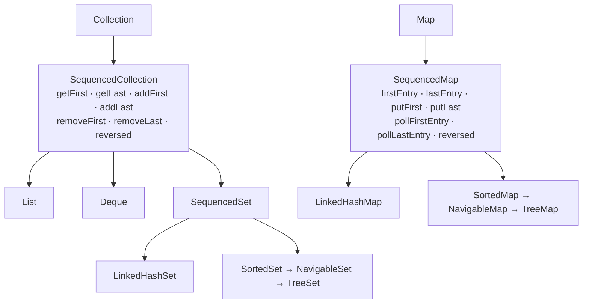
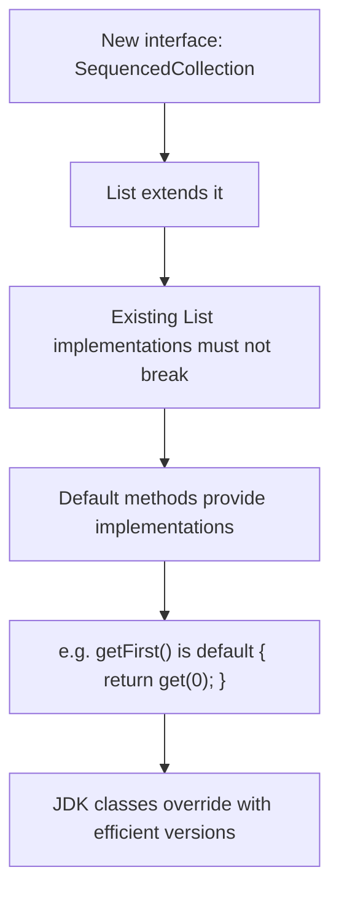
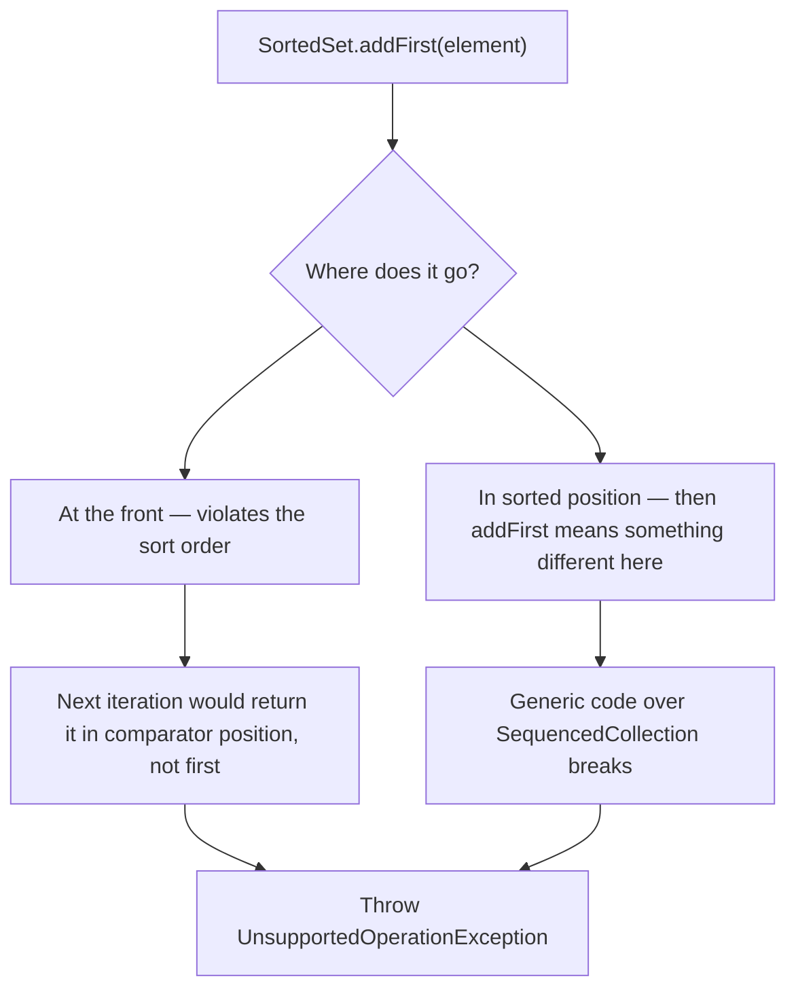

# Sequenced Collections

<!-- video:start -->
<figure class="pb-video">
<video controls playsinline preload="metadata">
<source src="../../videos/ch21.mp4" type="video/mp4">
<track kind="subtitles" srclang="en" label="English" src="../../videos/ch21.vtt">
</video>
<figcaption>Video walkthrough · 6:05 · subtitles via CC · <a href="../../videos/ch21.mp4" download>Download MP4</a></figcaption>
</figure>
<!-- video:end -->

## 1. Purpose & Audience

**Band:** L2 Professional · **Prerequisites:** [Choosing the Right Collection](17-choosing-a-collection.md), [List Internals](18-list-internals.md)

For twenty-five years the Java collections framework had ordered collections but no common vocabulary for their ends. Getting the last element of a `List`, a `LinkedHashSet`, and a `SortedSet` required three different incantations, one of which was O(n). There was no way to iterate backwards without copying.

JEP 431 fixed that in Java 21 by retrofitting three interfaces into the hierarchy. The feature is small; the retrofit is interesting, and it comes with one correction that circulating notes get wrong.

This chapter answers three questions:

1. **What do the three interfaces add**, and which collections implement them?
2. **Why is `reversed()` a view**, and what does that mean for your code?
3. **Why does `addFirst` throw on a `SortedSet`** — and why is that correct?

---

## 2. The Problem

Getting the first and last element, before Java 21:

```java title="EndsBefore.java"
// List
CartLine firstLine = lines.get(0);
CartLine lastLine  = lines.get(lines.size() - 1);

// Deque
Order firstOrder = deque.getFirst();
Order lastOrder  = deque.getLast();

// LinkedHashSet — no accessor at all
Sku firstSku = skus.iterator().next();
Sku lastSku  = null;
for (Sku sku : skus) { lastSku = sku; }        // O(n) — iterate the whole thing

// SortedSet
Sku lowest  = sortedSkus.first();
Sku highest = sortedSkus.last();
```

Four ordered collections, four different spellings, one of them O(n) and one requiring a loop that looks like a mistake.

Reverse iteration was worse:

```java title="ReverseBefore.java"
List<Order> reversed = new ArrayList<>(orders);
Collections.reverse(reversed);                  // copies the whole list
for (Order order : reversed) { ... }

// LinkedHashMap in reverse: no supported way at all
```

Each type had *some* notion of first and last. None of them shared an interface, so no generic code could use it.

---

## 3. Mental Model

### 3.1 Three interfaces, retrofitted



The defining property is an **encounter order**: a collection has a first element, a last element, and a well-defined sequence between them. Not "sorted" — insertion order qualifies, and so does a `Deque`'s.

### 3.2 Who is in and who is out

| Implements | Does not |
|---|---|
| `ArrayList`, `LinkedList` (via `List`) | **`HashSet`** |
| `ArrayDeque`, `LinkedList` (via `Deque`) | **`HashMap`** |
| `LinkedHashSet` | `ConcurrentHashMap` |
| `TreeSet` (via `SortedSet`) | `PriorityQueue` |
| `LinkedHashMap` | |
| `TreeMap` (via `SortedMap`) | |

!!! danger "`HashMap` is not a `SequencedMap`"
    Notes and blog posts circulate claiming Java 21 gave `HashMap` methods like `firstEntry` and `putFirst`. **It did not.** `HashMap` and `HashSet` have no encounter order at all — their iteration order is unspecified and changes with capacity and contents — so there is no meaningful "first". `LinkedHashMap` and `TreeMap` are the sequenced maps; `LinkedHashSet` and `TreeSet` the sequenced sets.

`PriorityQueue` is excluded for a subtler reason: it guarantees only that `poll()` returns the minimum. Its iteration order is heap order, which is not an encounter order.

---

## 4. Core Reference

### 4.1 `SequencedCollection<E>`

| Method | Behaviour |
|---|---|
| `E getFirst()` | First element; `NoSuchElementException` if empty |
| `E getLast()` | Last element |
| `void addFirst(E)` | Insert at the front |
| `void addLast(E)` | Append |
| `E removeFirst()` | Remove and return the front |
| `E removeLast()` | Remove and return the back |
| `SequencedCollection<E> reversed()` | **A reverse-ordered view** |

### 4.2 `SequencedSet<E>`

Same methods, with `reversed()` returning a `SequencedSet<E>`. Adds no new operations — it exists so the return type of `reversed()` stays a `Set`.

### 4.3 `SequencedMap<K,V>`

| Method | Behaviour |
|---|---|
| `Map.Entry<K,V> firstEntry()` | First entry, or `null` if empty |
| `Map.Entry<K,V> lastEntry()` | Last entry, or `null` |
| `Map.Entry<K,V> pollFirstEntry()` | Remove and return the first |
| `Map.Entry<K,V> pollLastEntry()` | Remove and return the last |
| `V putFirst(K, V)` | Insert or move to the front |
| `V putLast(K, V)` | Insert or move to the back |
| `SequencedMap<K,V> reversed()` | Reverse-ordered view |
| `SequencedSet<K> sequencedKeySet()` | Keys, as a sequenced set |
| `SequencedCollection<V> sequencedValues()` | Values, in order |
| `SequencedSet<Map.Entry<K,V>> sequencedEntrySet()` | Entries, in order |

Note the asymmetry: `getFirst` on a collection **throws** when empty, while `firstEntry` on a map **returns null**. The map methods follow the existing `NavigableMap` convention.

### 4.4 Unsupported operations

| Collection | Unsupported | Why |
|---|---|---|
| `SortedSet` / `TreeSet` | `addFirst`, `addLast` | Position is determined by the comparator |
| `SortedMap` / `TreeMap` | `putFirst`, `putLast` | Same |
| Immutable (`List.of`) | All mutators | Immutable |

These throw `UnsupportedOperationException`. See §6.3.

---

## 5. Worked Examples

### 5.1 The ends, uniformly

```java title="EndsAfter.java"
CartLine firstLine = lines.getFirst();
CartLine lastLine  = lines.getLast();

Order firstOrder = deque.getFirst();
Order lastOrder  = deque.getLast();

Sku firstSku = skus.getFirst();      // LinkedHashSet — was iterator().next()
Sku lastSku  = skus.getLast();       // was an O(n) loop

Sku lowest  = sortedSkus.getFirst(); // TreeSet — first() still works too
Sku highest = sortedSkus.getLast();
```

One vocabulary across every ordered collection. The `LinkedHashSet` case is the biggest improvement: `getLast()` replaces a full iteration, and it is O(1) because `LinkedHashSet` maintains a doubly-linked list of entries.

`lines.getLast()` also removes the off-by-one risk in `get(size() - 1)`.

### 5.2 Generic code over ordered collections

The real win is that a method can now accept any ordered collection:

```java title="Generic.java"
public static <T> Optional<T> mostRecent(SequencedCollection<T> collection) {
    return collection.isEmpty() ? Optional.empty() : Optional.of(collection.getLast());
}

mostRecent(recentOrders);          // ArrayList
mostRecent(dispatchQueue);         // ArrayDeque
mostRecent(uniqueSkusSeen);        // LinkedHashSet
mostRecent(slotsByStart);          // needs the map's sequencedValues()
```

Before Java 21 this method could not be written — there was no type that meant "ordered collection".

### 5.3 `reversed()` is a view

```java title="ReversedView.java"
List<Order> orders = new ArrayList<>(List.of(a, b, c));
List<Order> backwards = orders.reversed();

System.out.println(backwards);          // [c, b, a]

backwards.set(0, d);                     // writes through
System.out.println(orders);              // [a, b, d]  ← the ORIGINAL changed

orders.add(e);
System.out.println(backwards);           // [e, d, b, a]  ← the view sees it
```

`reversed()` returns a **live, writable view**, not a copy. This is the single most important thing to know about the feature, and it is exactly the same semantics as `subList` ([Chapter 18](18-list-internals.md)).

Two consequences: it is O(1) to create, no matter how large the collection — and if you want an independent reversed copy, wrap it:

```java
List<Order> independent = new ArrayList<>(orders.reversed());
```

### 5.4 Reverse iteration without copying

```java title="ReverseIteration.java"
// Before
List<Order> copy = new ArrayList<>(orders);
Collections.reverse(copy);
for (Order order : copy) { ... }

// After — no copy, no allocation
for (Order order : orders.reversed()) { ... }

// Works on maps too
for (var entry : slotsByStart.reversed().entrySet()) { ... }

// And composes with streams
List<Order> lastFive = orders.reversed().stream().limit(5).toList();
```

The `LinkedHashMap` case is the one with no previous answer at all — there was no supported way to iterate one backwards.

### 5.5 `putFirst` on a `LinkedHashMap`

```java title="RecentlyUsed.java"
public final class RecentSkus {

    private final SequencedMap<Sku, Instant> recent = new LinkedHashMap<>();
    private final int capacity;

    public void record(Sku sku) {
        recent.putFirst(sku, Instant.now());      // insert, or MOVE to the front
        while (recent.size() > capacity) {
            recent.pollLastEntry();                // evict the oldest
        }
    }

    public List<Sku> mostRecent(int n) {
        return recent.sequencedKeySet().stream().limit(n).toList();
    }
}
```

`putFirst` on an existing key **moves** it to the front rather than leaving it in place. That makes a most-recently-used structure a few lines, where previously it meant `LinkedHashMap`'s access-order constructor plus an overridden `removeEldestEntry`, or a hand-rolled linked list.

The access-order constructor is still there and still useful — `new LinkedHashMap<>(16, 0.75f, true)` reorders on every `get` — but `putFirst` makes the explicit version readable.

### 5.6 What throws, and why

```java title="Unsupported.java"
SortedSet<Sku> sorted = new TreeSet<>(Set.of(milk, rice));
sorted.getFirst();                  // ✓ lowest
sorted.getLast();                   // ✓ highest
sorted.reversed();                  // ✓ descending view
sorted.addFirst(atta);              // ✗ UnsupportedOperationException

List<Sku> immutable = List.of(milk, rice);
immutable.reversed();               // ✓ a reversed view, also immutable
immutable.addFirst(atta);           // ✗ UnsupportedOperationException
```

A sorted collection determines position from the comparator, so "insert at the front" is a contradiction — the element would immediately be in the wrong place. Throwing is the honest answer; silently inserting in sorted position would make `addFirst` mean something different per implementation.

---

## 6. Internals

### 6.1 Retrofitting without breaking anyone

Adding methods to `List` and `Map` in 2023 had to leave every existing implementation compiling — including implementations outside the JDK that nobody could change.



`getFirst()` has a default body of `get(0)`, and `getLast()` a default of `get(size() - 1)`, so any third-party `List` inherits working — if not always optimal — implementations. JDK classes override where they can do better: `LinkedList.getLast()` is O(1) against the default's O(n).

This is the same interface-evolution mechanism that made Java 8's `stream()` possible ([Chapter 06](../02-language/06-lambdas-functional-interfaces.md)). Without default methods, this JEP could not have been written.

### 6.2 `Deque` was already there

`Deque` has had `addFirst`, `getLast`, and the rest since Java 6 — with exactly the right signatures. Retrofitting was largely a matter of declaring `Deque extends SequencedCollection`.

The one collision: `Deque.removeFirst()` and `SequencedCollection.removeFirst()` had compatible semantics, but `Deque.reversed()` did not exist and had to be added, where `descendingIterator()` already gave part of the capability.

### 6.3 Why `addFirst` throws on sorted collections



Both alternatives are worse than throwing. Putting it at the front would break the sorted invariant; putting it in sorted position would make the method's contract implementation-dependent, defeating the point of a shared interface.

This is the same reasoning as `Arrays.asList(...).add(...)` throwing — an operation the interface declares but this implementation cannot honour. The Java collections framework has always preferred an honest `UnsupportedOperationException` to a silently different meaning.

### 6.4 How `reversed()` works

The returned view holds a reference to the backing collection and inverts the direction of every operation: its `getFirst()` calls the original's `getLast()`, its iterator walks backwards, its `add` appends at the other end.

| Property | Value |
|---|---|
| Creation cost | **O(1)** — no copying, whatever the size |
| Memory | One small wrapper object |
| Writes | **Write through** to the original |
| Structural changes to the original | Visible in the view |
| Mutability | Matches the source — an immutable source gives an immutable view |

For a doubly-linked structure — `LinkedHashMap`, `LinkedHashSet`, `LinkedList` — reversed iteration is naturally efficient, because the backing list already has `previous` pointers. For `ArrayList` it is index arithmetic.

`reversed().reversed()` is permitted and returns something equivalent to the original, though implementations may or may not return the identical object.

### 6.5 The view semantics are a pattern, not an exception

`reversed()` joins a family:

| Expression | Returns |
|---|---|
| `list.subList(a, b)` | A view |
| `map.keySet()`, `values()`, `entrySet()` | Views |
| `Collections.unmodifiableList(l)` | A view |
| `Arrays.asList(array)` | A view over the array |
| `collection.reversed()` | A view |
| `List.copyOf(l)`, `new ArrayList<>(l)` | **Copies** |

The rule worth internalising: **almost everything in `java.util` that returns a collection derived from another returns a view.** The copies are the ones with `copy` or a constructor in their name. Storing a view in a field, or returning one from an accessor, leaks mutability in both directions.

---

## 7. Production Patterns & Anti-Patterns

### Do this

- **Use `getFirst()` and `getLast()`** instead of `get(0)` and `get(size() - 1)` — clearer, and no off-by-one.
- **Use `reversed()` for reverse iteration** instead of copying and calling `Collections.reverse`.
- **Accept `SequencedCollection` or `SequencedMap`** in generic code that needs ordering.
- **Use `putFirst` and `pollLastEntry`** on a `LinkedHashMap` for most-recently-used structures.
- **Wrap `reversed()` in a constructor** when you need an independent copy.
- **Declare `SequencedMap` or `NavigableMap`** when using these methods, not `Map`.
- **Use `sequencedKeySet()` and `sequencedValues()`** when the order of a map's views matters.

### Never do this

- **Never expect `HashMap` or `HashSet` to have these methods.** They have no encounter order and do not implement the interfaces.
- **Never treat `reversed()` as a copy.** It is a live view; writes go through to the original.
- **Never store a `reversed()` view in a field** unless you intend the aliasing.
- **Never call `addFirst` on a `TreeSet` or `putFirst` on a `TreeMap`.** They throw, correctly.
- **Never call `getFirst()` on a possibly-empty collection** without checking — it throws `NoSuchElementException`, while the map's `firstEntry()` returns null.
- **Never assume a third-party `List` has an efficient `getLast()`** — it may be inheriting the O(n) default.

---

## 8. Version Evolution (Java 8 → 26)

| Version | What changed | Impact |
|---|---|---|
| **6** | `Deque` with `addFirst`, `getLast`, `descendingIterator` | The shape that was later generalised |
| **8** | Default methods on interfaces | The mechanism that makes retrofitting possible |
| **8** | `LinkedHashMap.removeEldestEntry`, access-order mode | The old way to build an MRU structure |
| **21** | **`SequencedCollection`, `SequencedSet`, `SequencedMap` (JEP 431)** | A uniform vocabulary for ordered collections |
| **25** | No changes | — |
| **26** | No changes | — |

### Migration note

On Java 21+, three mechanical replacements:

1. `list.get(list.size() - 1)` → `list.getLast()`
2. `new ArrayList<>(l)` + `Collections.reverse(...)` → `l.reversed()` — **but only where a view is acceptable**
3. The `LinkedHashSet` last-element loop → `getLast()`, which also removes an O(n) scan

The second needs care: the old idiom produced a copy, so any code that then mutated the reversed list was safely isolated. Replacing it with `reversed()` makes those writes hit the original. Where the result is only read, the swap is free and removes an allocation.

Also worth a grep: code calling `firstEntry()` on something declared as `Map`. It compiles only if the static type is `SequencedMap`, `NavigableMap`, or `LinkedHashMap` — so a widening of a field's declared type can break it.

---

## 9. Interview Questions

### L1 — Foundations

**Q1. What are sequenced collections?** ⭐ *high frequency*
Three interfaces added in Java 21 — `SequencedCollection`, `SequencedSet`, and `SequencedMap` — that give a uniform vocabulary for collections with a defined encounter order: `getFirst`, `getLast`, `addFirst`, `addLast`, `removeFirst`, `removeLast`, and `reversed()`. Before them, getting the last element of a `List`, a `LinkedHashSet`, and a `TreeSet` needed three different spellings, one of which was O(n).

**Q2. Which collections implement them?**
`List` and `Deque` implementations, `LinkedHashSet`, `TreeSet` via `SortedSet`, `LinkedHashMap`, and `TreeMap` via `SortedMap`. `HashSet` and `HashMap` do **not**, because their iteration order is unspecified and changes with capacity and contents, so there is no meaningful first or last element.

**Q3. What does `reversed()` return?**
A reverse-ordered **view** of the collection, not a copy. It is O(1) to create regardless of size, writes through to the original, and reflects later changes to it. If you need an independent reversed copy, wrap it in a constructor: `new ArrayList<>(list.reversed())`.

### L2 — Professional

**Q4. Does `HashMap` have `firstEntry()` and `putFirst()`?** ⭐ *high frequency*
No. `HashMap` has no encounter order — iteration order is unspecified and changes with capacity and contents — so it does not implement `SequencedMap` and those methods do not exist on it. The sequenced maps are `LinkedHashMap` and `TreeMap`. This is worth stating explicitly because notes circulate claiming otherwise, and code written against them will not compile.

**Q5. Why does `addFirst` throw on a `TreeSet`?**
Because a sorted collection determines an element's position from its comparator, so "insert at the front" is a contradiction — either the sort invariant breaks, or the method silently means "insert in sorted position", which would make its contract implementation-dependent and defeat the point of a shared interface. Throwing `UnsupportedOperationException` is the honest answer, and matches how the framework has always handled operations an implementation cannot honour.

**Q6. How was this added without breaking existing implementations?**
Through default methods. `getFirst()` has a default body of `get(0)` and `getLast()` of `get(size() - 1)`, so any third-party `List` inherits working implementations without changing. JDK classes override where they can do better — `LinkedList.getLast()` is O(1) against the default's O(n). It is the same interface-evolution mechanism that let Java 8 add `stream()` to `Collection`.

### L3 — Enterprise

**Q7. What is the practical benefit beyond shorter code?**
Generic code. Before Java 21 there was no type meaning "ordered collection", so a method wanting the last element of any ordered collection could not be written — you needed overloads per type or an `Object`-typed hack. Now a method can accept `SequencedCollection<T>` and work for `ArrayList`, `ArrayDeque`, `LinkedHashSet`, and `TreeSet` alike. That is the structural improvement; the shorter spelling of `getLast()` is a side benefit.

**Q8. How would you build a most-recently-used structure with these?**
`LinkedHashMap` with `putFirst`, which moves an existing key to the front rather than leaving it in place, and `pollLastEntry` to evict the oldest once capacity is exceeded — a handful of lines. Previously this meant either the access-order constructor with an overridden `removeEldestEntry`, or a hand-rolled linked list. The access-order mode still exists and reorders on every `get`, which `putFirst` does not, so they suit slightly different definitions of "used".

**Q9. What is the risk when replacing `Collections.reverse` with `reversed()`?**
The old idiom copied the list first, so any mutation of the reversed result was isolated from the original. `reversed()` returns a live view, so those writes now reach the source collection — and structural changes to the source appear in the view. Where the reversed result is only read, the replacement is free and removes an allocation; where it is mutated, wrapping in a constructor preserves the old semantics.

### L4 — Architect

**Q10. `reversed()` is a view, like `subList` and `keySet`. What is the general rule?**
That almost everything in `java.util` returning a collection derived from another returns a view rather than a copy — `subList`, `keySet`, `values`, `entrySet`, `unmodifiableList`, `Arrays.asList`, and now `reversed`. The copies are the ones that say so: `List.copyOf` and the copy constructors. The design consequence is that views must not escape: storing one in a field or returning one from an accessor creates aliasing in both directions, and with `subList` it additionally pins the parent's entire backing array. An API that returns internal state should return a copy.

**Q11. What does this JEP illustrate about evolving a 25-year-old API?**
That the constraint is compatibility with implementations you do not control, and that default methods are what make it tractable — the new interfaces ship with working bodies so every existing `List` in the world keeps compiling, while JDK classes override for efficiency. It also shows the discipline of admitting where an operation does not fit: `addFirst` on a sorted collection throws rather than being redefined, because a shared interface whose methods mean different things per implementation is worse than one with honest gaps. Both choices cost elegance and buy adoption.

**Q12. Is there a performance reason to prefer these methods?**
Occasionally, and it is worth knowing which. `LinkedHashSet.getLast()` replaces a full O(n) iteration with an O(1) access, which matters on large sets. `reversed()` replaces a copy-and-reverse with an O(1) view, removing an allocation proportional to the collection size. But on an `ArrayList`, `getLast()` and `get(size() - 1)` compile to the same thing, and a third-party `List` may be inheriting the O(n) default — so the gains are specific rather than general, and readability is the better reason to adopt them.

---

!!! abstract "Cheat Sheet"
    **Three interfaces (Java 21, JEP 431):** `SequencedCollection` · `SequencedSet` · `SequencedMap`

    **Methods:** `getFirst` · `getLast` · `addFirst` · `addLast` · `removeFirst` · `removeLast` · `reversed()`

    **Map adds:** `firstEntry` · `lastEntry` · `putFirst` · `putLast` · `pollFirstEntry` · `pollLastEntry`

    **In:** `List` · `Deque` · `LinkedHashSet` · `TreeSet` · `LinkedHashMap` · `TreeMap`

    **Out: `HashMap` and `HashSet`** — no encounter order, so no first or last

    **`reversed()` is a live view** — O(1), writes through, not a copy

    **Independent copy:** `new ArrayList<>(list.reversed())`

    **`addFirst`/`putFirst` throw on sorted collections** — position comes from the comparator

    **`getFirst()` throws when empty · `firstEntry()` returns null**

    **`putFirst` moves an existing key** — an MRU cache in a few lines

    **Retrofitted with default methods** — `getFirst()` defaults to `get(0)`

    **Almost everything derived in `java.util` is a view** — copies say `copyOf`
