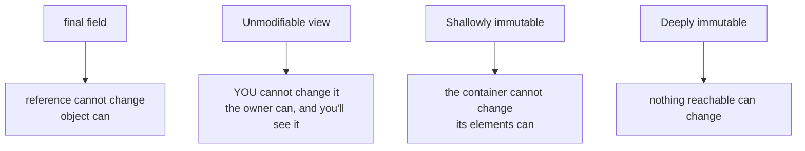
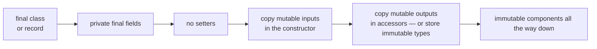

# Immutability & Defensive Copying

## 1. Purpose & Audience

**Band:** L3 Enterprise · **Prerequisites:** [Choosing the Right Collection](17-choosing-a-collection.md), [Java 14–17: Records](../02-language/12-java-14-to-17.md)

Immutability removes whole categories of bugs at once: nothing can change an object after construction, so it cannot be corrupted by a caller, cannot be observed half-updated by another thread, and cannot drift from an invariant checked in its constructor. The cost is mostly a discipline, not performance.

The discipline is where it goes wrong. `final` does not mean immutable, `unmodifiableList` does not mean immutable, and a record is only as immutable as its components. Most "immutable" classes in real codebases have a hole.

This chapter answers three questions:

1. **What does immutable actually require** — and how do the common shortcuts fall short?
2. **Where do defensive copies go**, and when can you skip them?
3. **What does immutability cost**, and when is it the wrong choice?

---

## 2. The Problem

An order aggregate that looks safe:

```java title="LeakyOrder.java"
public final class Order {
    private final OrderId id;
    private final List<OrderLine> lines;          // final — so it's immutable?

    public Order(OrderId id, List<OrderLine> lines) {
        this.id = id;
        this.lines = lines;                        // stores the caller's list
    }

    public List<OrderLine> lines() {
        return lines;                               // hands out the internal list
    }

    public Money total() { ... }
}
```

Three ways to change it after construction, none of which touch the class:

```java title="Mutations.java"
List<OrderLine> input = new ArrayList<>(List.of(line1));
Order order = new Order(id, input);

input.add(line2);                  // 1. the caller keeps a reference to the stored list
order.lines().add(line3);          // 2. the accessor hands out the internal list
order.lines().get(0).setQty(99);   // 3. the elements themselves are mutable
```

`final` on the field prevents reassigning the reference. It does nothing about what the reference points to. The order's total now disagrees with whatever was validated at construction, and if another thread was reading it, that thread may have seen any intermediate state.

---

## 3. Mental Model

### 3.1 Four different things called "immutable"



| | Reassign reference | Modify via this reference | Changes by others visible | Elements mutable |
|---|---|---|---|---|
| `final List` field | No | Yes | Yes | Yes |
| `Collections.unmodifiableList(l)` | — | No | **Yes** | Yes |
| `List.copyOf(l)` | — | No | No | **Yes** |
| `List.copyOf(l)` of records | — | No | No | No |

Only the last row is actually immutable. The rest are useful, and each has a hole.

### 3.2 The recipe



| Rule | Prevents |
|---|---|
| **Class is `final`** (or a record) | A subclass adding mutable state or overriding accessors |
| **Fields are `private final`** | Reassignment, and — with safe construction — gives final-field visibility |
| **No mutators** | The obvious |
| **Copy mutable inputs** | Caller retaining a reference to your state |
| **Copy or wrap mutable outputs** | Caller modifying your state through the accessor |
| **Components are immutable** | Modification through the elements |

---

## 4. Core Reference

### 4.1 The immutable collection toolkit

| Expression | Immutable? | Copies? | Nulls | Notes |
|---|---|---|---|---|
| `List.of(a, b)` | Yes | — | **Rejected** | Literals |
| `List.copyOf(c)` | Yes | Yes — **unless already immutable** | Rejected | The defensive-copy tool |
| `Set.copyOf(c)`, `Map.copyOf(m)` | Yes | Yes | Rejected | Order randomised |
| `stream.toList()` | Yes | — | **Allowed** | Java 16 |
| `Collectors.toUnmodifiableList()` | Yes | — | Rejected | |
| `Collections.unmodifiableList(l)` | **No** — a view | No | Allowed | Owner's changes show through |
| `Arrays.asList(arr)` | **No** — fixed-size view | No | Allowed | `set` writes through to the array |
| `new ArrayList<>(c)` | No | Yes | Allowed | A mutable copy |

### 4.2 Immutable JDK types worth knowing

| Type | Immutable | Mutable alternative to avoid |
|---|---|---|
| `String` | Yes | — |
| Boxed primitives, `BigDecimal`, `BigInteger` | Yes | — |
| `java.time.*` | Yes | `java.util.Date`, `Calendar` |
| `UUID`, `URI`, `Path` | Yes | `java.net.URL` has surprising `equals` |
| Records | **Shallowly** | — |
| Arrays | **Never** | — |

`java.util.Date` is the classic trap: every `Date` field in an "immutable" class needs a defensive copy in both directions. Replacing it with `Instant` or `LocalDate` ([Chapter 10](../02-language/10-java-time.md)) removes the problem.

---

## 5. Worked Examples

### 5.1 The order, fixed

```java title="Order.java"
// Excerpt: the components this chapter needs. The full model is in code/.
public record Order(OrderId id, CustomerId customer, List<OrderLine> lines, Instant placedAt) {

    public Order {
        Objects.requireNonNull(id, "id");
        Objects.requireNonNull(customer, "customer");
        Objects.requireNonNull(placedAt, "placedAt");
        lines = List.copyOf(lines);          // defensive copy IN — also rejects nulls
        if (lines.isEmpty()) {
            throw new IllegalArgumentException("order has no lines");
        }
    }

    public Money total() {
        return lines.stream().map(OrderLine::lineTotal).reduce(Money.ZERO, Money::plus);
    }
}

public record OrderLine(Sku sku, int quantity, Money unitPrice) {
    public OrderLine {
        if (quantity <= 0) throw new IllegalArgumentException("quantity must be positive");
    }
    public Money lineTotal() { return unitPrice.times(quantity); }
}
```

The three mutations from §2 are now impossible:

1. **The caller's list** — `List.copyOf` took a snapshot; later changes to `input` do not reach the order.
2. **The accessor** — `lines()` returns the immutable copy; `add` throws `UnsupportedOperationException`.
3. **The elements** — `OrderLine` is a record of immutable components, so there is nothing to mutate.

No copy is needed in the accessor, because the stored list is already immutable. **Copy on the way in, store an immutable type, and the way out takes care of itself.**

### 5.2 `List.copyOf` does not always copy

```java title="CopyOfIdentity.java"
List<OrderLine> immutable = List.of(line1, line2);
List<OrderLine> copy = List.copyOf(immutable);

System.out.println(copy == immutable);      // true — no copy was made
```

`List.copyOf` returns its argument unchanged if it is already an immutable list from the JDK's own factories. That is safe — there is nothing to protect against — and it makes defensive copying nearly free when inputs are already immutable, which in a codebase that uses records and `List.of` throughout, they usually are.

It **does** copy an `unmodifiableList` view, correctly, since a view can still change underneath.

### 5.3 Arrays in records

```java title="ArrayComponent.java"
// Shallowly immutable at best — the array is always mutable
public record Signature(byte[] bytes) { }

Signature sig = new Signature(original);
original[0] = 0;                        // changes sig's contents
sig.bytes()[1] = 0;                     // so does this
```

Records do not help with arrays. Either avoid them as components, or copy both ways:

```java title="ArrayComponentFixed.java"
public record Signature(byte[] bytes) {
    public Signature {
        bytes = bytes.clone();          // copy in
    }
    @Override
    public byte[] bytes() {
        return bytes.clone();           // copy out — overriding the accessor
    }
    // Also override equals/hashCode: the generated ones compare array IDENTITY
}
```

That final comment matters: a record's generated `equals` uses `Objects.equals` on components, which for arrays is reference identity. Two `Signature`s with identical bytes are not equal unless you override it — see [Chapter 23](23-equality-and-ordering.md). Usually the better answer is a `List<Byte>` — or better, a dedicated immutable type wrapping the data.

### 5.4 "Withers" for modification

Immutable objects are changed by creating new ones:

```java title="Withers.java"
public record CartLine(Sku sku, int quantity, Money unitPrice) {

    public CartLine withQuantity(int newQuantity) {
        return new CartLine(sku, newQuantity, unitPrice);
    }

    public CartLine withUnitPrice(Money newPrice) {
        return new CartLine(sku, quantity, newPrice);
    }
}

CartLine updated = line.withQuantity(line.quantity() + 1);
```

Each wither returns a new instance and leaves the original untouched — which is exactly what makes it safe to share. The compact constructor re-runs on every `with`, so validation cannot be bypassed.

For aggregates, the same shape applies:

```java title="CartWithers.java"
public record Cart(CartId id, List<CartLine> lines) {
    public Cart { lines = List.copyOf(lines); }

    public Cart withLine(CartLine line) {
        var updated = new ArrayList<>(lines);
        updated.add(line);
        return new Cart(id, updated);          // copyOf in the constructor makes it immutable again
    }
}
```

### 5.5 Building complex immutable objects

When there are many optional components, positional construction becomes unreadable. A builder assembles the state mutably and produces an immutable result:

```java title="Builder.java"
public record DispatchRequest(OrderId order, Vendor vendor, DeliverySlot slot,
                              List<String> notes, Priority priority) {

    public DispatchRequest { notes = List.copyOf(notes); }

    public static Builder builder(OrderId order) { return new Builder(order); }

    public static final class Builder {
        private final OrderId order;
        private Vendor vendor;
        private DeliverySlot slot;
        private final List<String> notes = new ArrayList<>();
        private Priority priority = Priority.NORMAL;

        private Builder(OrderId order) { this.order = order; }

        public Builder vendor(Vendor v)       { this.vendor = v; return this; }
        public Builder slot(DeliverySlot s)   { this.slot = s; return this; }
        public Builder note(String n)         { this.notes.add(n); return this; }
        public Builder priority(Priority p)   { this.priority = p; return this; }

        public DispatchRequest build() {
            return new DispatchRequest(order, vendor, slot, notes, priority);
        }
    }
}
```

The builder is mutable and single-threaded; the product is immutable and shareable. The record's compact constructor still validates and copies, so the builder cannot produce an invalid or leaky object.

### 5.6 Unmodifiable views are for a different job

```java title="Views.java"
public final class Catalogue {
    private final Map<Sku, InventoryItem> items = new HashMap<>();

    // A live, read-only window — callers see updates, cannot make them
    public Map<Sku, InventoryItem> liveView() {
        return Collections.unmodifiableMap(items);
    }

    // A snapshot — callers see the state as of now, forever
    public Map<Sku, InventoryItem> snapshot() {
        return Map.copyOf(items);
    }
}
```

Views are legitimate when a caller genuinely needs to observe changes and the owner controls threading — a single-threaded component exposing its state to a renderer, say. They are wrong as a default accessor: the caller believes they have a stable value and they do not, and if they read it from another thread, it is a data race ([Chapter 26](../04-concurrency/26-java-memory-model.md)).

---

## 6. Internals

### 6.1 Why immutable objects are thread-safe

An immutable object with all-final fields, properly constructed, is **safe to share between threads with no synchronisation at all** — however the reference is published.

That follows from the Java Memory Model's final-field semantics ([Chapter 26](../04-concurrency/26-java-memory-model.md)): the constructor's writes to final fields, and everything reachable through them at the end of the constructor, are guaranteed visible to any thread that obtains the reference. No lock, no `volatile`.

Two conditions carry it. **`this` must not escape during construction**, or another thread can see the object before the freeze. And the guarantee covers state **as of the end of the constructor** — which is precisely why the defensive copy must happen *inside* the constructor, not after.

That makes immutability the cheapest concurrency strategy there is: shared mutable state needs synchronisation; shared immutable state needs none.

### 6.2 What `List.of` actually is

The `of` and `copyOf` factories return implementations from `java.util.ImmutableCollections`, specialised by size:

| Size | Implementation |
|---|---|
| 0 | A shared empty singleton |
| 1–2 | `List12` — two fields, no array |
| 3+ | `ListN` — a compact array |

So `List.of(a, b)` is a single object with two fields — smaller than an `ArrayList`, which always has a backing array. Immutable collections are frequently cheaper in memory than their mutable equivalents, not more expensive.

They also reject nulls **everywhere**, including in `contains` and `indexOf`, which is why `List.of("a").contains(null)` throws rather than returning false ([Chapter 17](17-choosing-a-collection.md)).

### 6.3 The cost of copying

| Operation | Cost |
|---|---|
| `List.copyOf` of an already-immutable list | **Zero** — returns the argument |
| `List.copyOf` of a mutable list | O(n) array copy |
| A wither on a record | One small allocation |
| Adding one element to an immutable aggregate | O(n) — copy the list |

The last row is the real cost. Appending to an immutable list of a million elements copies a million references. For large collections that change incrementally, that is prohibitive.

Two responses. For most domain objects — an order has tens of lines, not millions — it does not matter, and the allocations are short-lived and cheap to collect ([Chapter 34](../05-runtime/34-garbage-collection.md)). For genuinely large, frequently-updated collections, **persistent data structures** (from libraries such as Vavr or PCollections) share structure between versions, making an "update" O(log n) rather than O(n).

### 6.4 Final classes and inheritance

```java title="SubclassHole.java"
public class Money {                          // NOT final
    private final BigDecimal amount;
    public BigDecimal amount() { return amount; }
}

public class MutableMoney extends Money {
    private BigDecimal override;
    @Override public BigDecimal amount() { return override; }   // now "immutable" Money changes
    public void set(BigDecimal v) { override = v; }
}
```

Code that accepts a `Money` and assumes it cannot change is broken by a subclass it never sees. That is why the recipe requires a `final` class — or a record, which is implicitly final — or at minimum a private constructor with static factories.

It is also the reason `BigDecimal` and `BigInteger` are a known wart: they are not final, so strictly, a method receiving one cannot trust it to be immutable without copying.

### 6.5 Identity and value-based classes

Immutable objects are natural **values**: two `Money` instances holding ₹100 are interchangeable. Code should compare them with `equals`, never `==`, and should not depend on their identity — not synchronise on them, not use them as identity-hash keys.

The JDK formalises this as **value-based classes** — `Optional`, the `java.time` types, the boxed primitives. Project Valhalla's value classes would take it further, removing identity entirely and allowing such objects to be stored inline without headers ([Chapter 35](../05-runtime/35-memory-footprint.md)). Designing domain values as immutable records today is the posture that will benefit from that.

---

## 7. Production Patterns & Anti-Patterns

### Do this

- **Default to records** for values and DTOs, with `List.copyOf` in the compact constructor for every collection component.
- **Copy mutable inputs in the constructor**, not after — that is where final-field guarantees apply.
- **Store immutable types** so accessors need no copy.
- **Use withers** to express change as a new instance.
- **Use a builder** when there are many optional components.
- **Replace `Date` and `Calendar` with `java.time`** — it removes the most common defensive-copy obligation.
- **Return snapshots from accessors**; return views only when observing live changes is the intent.
- **Make value classes `final`** — or records.

### Never do this

- **Never assume `final` means immutable.** It fixes the reference, not the object.
- **Never return a mutable internal collection** from an accessor.
- **Never store a caller's collection without copying it.**
- **Never put arrays in a record** without copying both ways and overriding `equals`/`hashCode`.
- **Never treat `unmodifiableList` as a snapshot.** It is a view; changes show through.
- **Never use `Arrays.asList` as an immutable list.** `set` writes through to the array.
- **Never let `this` escape an immutable object's constructor.** It voids the visibility guarantee.
- **Never copy on every append to a large collection** in a hot path — use a mutable builder or a persistent collection.

---

## 8. Version Evolution (Java 8 → 26)

| Version | What changed | Impact |
|---|---|---|
| **1.2** | `Collections.unmodifiable*` | Views, not immutability |
| **5** | JSR-133 final-field semantics | Immutable objects become safely shareable without locks |
| **8** | `java.time` | Immutable date-time replaces mutable `Date` |
| **9** | **`List.of`, `Set.of`, `Map.of`** | Genuinely immutable, compact, null-hostile |
| **10** | **`List.copyOf`**, `Collectors.toUnmodifiable*` | The defensive-copy tool; free when already immutable |
| **16** | **Records**; `Stream.toList()` | Immutable carriers with compact-constructor validation |
| **17** | Sealed types | Closed hierarchies of immutable values |
| **26** | JEP 500 — warnings on reflective final-field mutation | Toward final genuinely meaning final |

### Migration note

The highest-value sweep on an older codebase is **accessors returning internal collections**. Search for getters whose body is `return this.someList;` or `return someMap;` on a field backed by a mutable collection. Each is a leak; each fix is either `List.copyOf` in the constructor (preferred) or a copy in the accessor.

Second, **`Collections.unmodifiableList` used as if it were immutable** — typically in a constructor, wrapping the caller's list. That protects against nothing, since the caller still holds the underlying list. Replace with `List.copyOf`.

Third, converting value classes to records is worthwhile and largely mechanical — but check each collection and array component for the missing defensive copy, which the conversion will not add for you.

---

## 9. Interview Questions

### L1 — Foundations

**Q1. How do you make a class immutable?** ⭐ *high frequency*
Make the class final, or a record; make every field private and final; provide no setters; defensively copy any mutable input in the constructor; and either store only immutable types or copy mutable state on the way out of accessors. Every component must itself be immutable, or the object is only shallowly so.

**Q2. Does `final` make a field immutable?**
No. It prevents the reference from being reassigned but does nothing about the object it points to. A `final List` can still have elements added and removed, and a `final Date` can still have its time changed. Immutability comes from the types being immutable, not from the keyword.

**Q3. What is the difference between `List.of` and `Collections.unmodifiableList`?**
`List.of` creates a genuinely immutable list. `unmodifiableList` returns a read-only view over an existing list: you cannot modify it through the view, but the owner can modify the underlying list and the view reflects those changes. Only the first is immutable.

### L2 — Professional

**Q4. Are records immutable?** ⭐ *high frequency*
Shallowly. Their fields are private and final and there are no setters, but a component that is itself mutable — a `List`, an array, a `Date` — can still be changed by anyone holding a reference. The fix is a defensive copy in the compact constructor, such as `lines = List.copyOf(lines)`; for arrays, a copy both in and out plus overridden `equals` and `hashCode`, since the generated ones compare arrays by identity.

**Q5. Where should defensive copies go?**
In the constructor, for inputs, so the caller cannot retain a reference to your internal state — and specifically inside the constructor, because final-field visibility guarantees cover state as of the end of construction. If the stored copy is itself immutable, accessors can return it directly with no further copy. Only if you store a mutable collection do you need to copy on the way out as well.

**Q6. Why are immutable objects thread-safe?**
Because nothing can change after construction, so there is no write for another thread to race with. The Java Memory Model guarantees that final fields — and everything reachable through them at the end of the constructor — are visible to any thread that obtains the reference, however it was published. That requires the object to be properly constructed, meaning `this` did not escape the constructor.

### L3 — Enterprise

**Q7. Does `List.copyOf` always copy?**
No — if the argument is already an immutable list from the JDK's own factories, it returns the argument unchanged, since there is nothing to protect against. It does copy anything else, including an `unmodifiableList` view, which can still change underneath. The practical consequence is that defensive copying is nearly free in a codebase that uses records and `List.of` consistently.

**Q8. Why must an immutable class be final?**
Because a subclass can add mutable state or override accessors to return changing values, and code that received the supertype and assumed it could not change is then broken by a class it never sees. Making the class final — or using a record, which is implicitly final — closes that hole. `BigDecimal` and `BigInteger` are the well-known exceptions in the JDK: they are not final, so strictly a method receiving one cannot trust it without copying.

**Q9. How do you modify an immutable object?**
You create a new one. "Wither" methods such as `withQuantity(int)` return a new instance with one component changed and leave the original untouched, which is what makes the original safe to share. On a record the compact constructor runs again, so validation cannot be bypassed. For objects with many optional parts, a mutable builder assembles the state and produces an immutable result.

### L4 — Architect

**Q10. What does immutability cost, and when is it the wrong choice?**
Each change allocates a new object, and adding to an immutable collection copies it — O(n) per update. For typical domain objects that is negligible: the collections are small and the allocations short-lived, which the garbage collector handles cheaply. It becomes wrong for large collections updated incrementally in a hot path, where copying a million references per append is prohibitive; there, a mutable structure confined to one thread, or a persistent data structure that shares structure between versions at O(log n) per update, is the better choice.

**Q11. How would you introduce immutability into a codebase built on mutable entities?**
From the edges inward. API request and response types first, as records, since they cross trust boundaries and have no identity. Then internal value objects — money, identifiers, addresses — which are values by nature and benefit most. Leave entities with genuine identity and lifecycle, such as persisted aggregates, mutable where the persistence framework requires it, but stop their internal collections leaking through accessors. The aim is not everything immutable; it is a clear boundary between values, which should be, and entities, which may not be.

**Q12. Why does immutability matter for concurrency design at scale?**
Because it is the only strategy that needs no coordination. Shared mutable state requires every access to be synchronised correctly, and every lock is a potential contention point, deadlock, or visibility bug. Shared immutable state requires nothing: publish it once, read it from any number of threads. Designs that push mutation to a small number of well-defined owners — a single writer that publishes new immutable snapshots through a `volatile` reference — scale further and are far easier to reason about than designs that share mutable objects under locks.

---

!!! abstract "Cheat Sheet"
    **`final` ≠ immutable** — it fixes the reference, not the object

    **View ≠ copy** — `unmodifiableList` shows the owner's changes; `List.copyOf` does not

    **Recipe:** final class or record · private final fields · no setters · copy in · immutable components

    **Copy in the constructor** — that is where final-field visibility applies

    **Store immutable types** and accessors need no copy

    **Records are shallowly immutable** — `List.copyOf` every collection component

    **Arrays are never immutable** — copy both ways *and* override `equals`/`hashCode`

    **`List.copyOf` is free** when the argument is already immutable

    **Withers** return new instances; the compact constructor re-validates

    **Immutable + properly constructed = thread-safe with no synchronisation**

    **Cost:** O(n) per append to a large immutable collection — use a builder or persistent structure

    **Replace `Date`/`Calendar` with `java.time`** — removes the classic defensive-copy obligation
