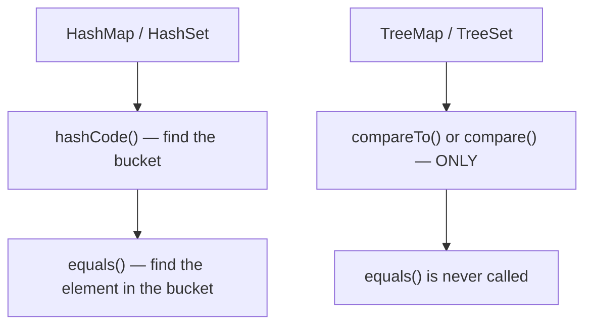
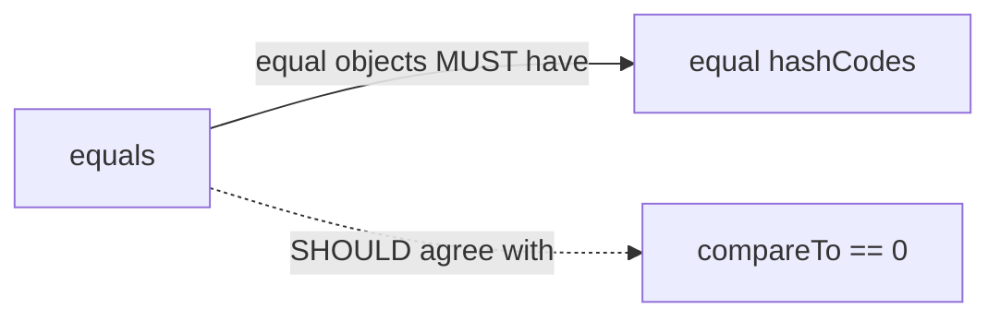
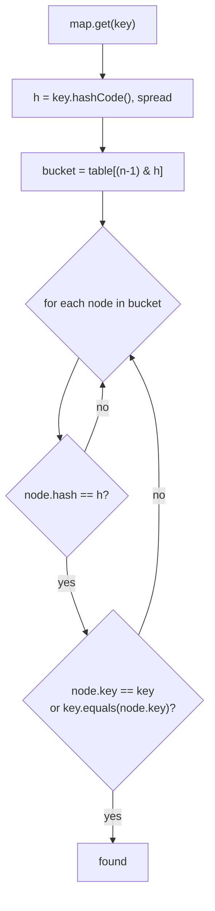
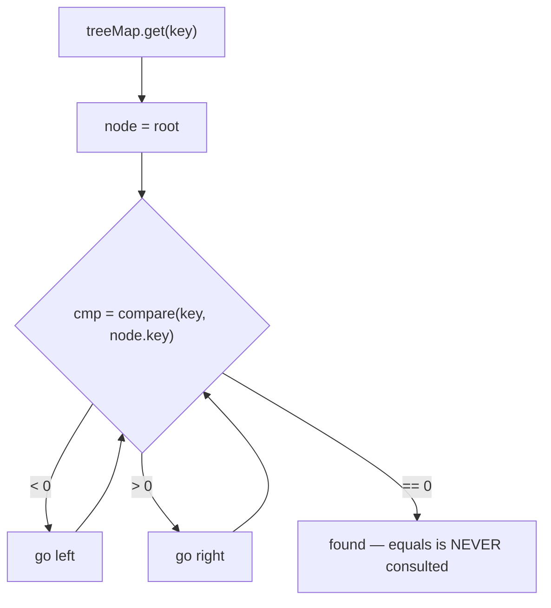

# equals, hashCode & Comparators

## 1. Purpose & Audience

**Band:** L2 Professional · **Prerequisites:** [Choosing the Right Collection](17-choosing-a-collection.md)

Every hash-based and sorted collection in the JDK is built on four methods you write yourself: `equals`, `hashCode`, `compareTo`, and `compare`. The collections trust them completely. When they break their contracts, the collections do not throw — they silently lose entries, keep duplicates, or drop elements, and the bug surfaces far from its cause.

This chapter answers three questions:

1. **What exactly are the contracts**, and why does each clause exist?
2. **How do hash-based and sorted collections use them differently** — and why can the same objects behave differently in a `HashSet` and a `TreeSet`?
3. **How do you write them correctly** without relitigating it for every class?

---

## 2. The Problem

Four failures, all produced by collections working exactly as designed.

```java title="Failures.java"
// 1. equals overridden, hashCode not — a HashSet keeps "duplicates"
Set<Sku> skus = new HashSet<>();
skus.add(new Sku("MILK-1L"));
skus.add(new Sku("MILK-1L"));
skus.size();                              // 2

// 2. The same values, different collections, different answers
Set<BigDecimal> hashed = new HashSet<>(List.of(new BigDecimal("1.0"), new BigDecimal("1.00")));
Set<BigDecimal> sorted = new TreeSet<>(List.of(new BigDecimal("1.0"), new BigDecimal("1.00")));
hashed.size();                            // 2
sorted.size();                            // 1

// 3. A comparator that overflows
Comparator<Order> byTotal = (a, b) -> (int) (a.totalPaise() - b.totalPaise());   // wrong for large values

// 4. A mutated key — the entry is stranded
Map<MutableSku, Integer> stock = new HashMap<>();
stock.put(key, 40);
key.setCode("MILK-2L");
stock.get(key);                           // null — and size() is still 1
```

None throws. Each produces a collection that is subtly wrong, and each has a single-line cause.

---

## 3. Mental Model

### 3.1 Hash collections use two methods; sorted collections use one



This is the fact that explains the `BigDecimal` result in §2. `HashSet` asks `equals`, and `new BigDecimal("1.0").equals(new BigDecimal("1.00"))` is **false** — they differ in scale. `TreeSet` asks `compareTo`, which returns **0** — they are numerically equal. Same objects, two definitions of "the same", two different set sizes.

### 3.2 The dependency between the contracts



| Relationship | Strength | Consequence of violation |
|---|---|---|
| `a.equals(b)` ⇒ `a.hashCode() == b.hashCode()` | **Mandatory** | Hash collections lose or duplicate entries |
| `a.compareTo(b) == 0` ⇔ `a.equals(b)` | Strongly recommended | Hash and sorted collections disagree |
| Equal hash ⇒ equal objects | **Not required** | Collisions are legal, just slower |

The first is the one that breaks things. The converse — unequal objects may share a hash — is simply a collision, and every hash table handles it.

---

## 4. Core Reference

### 4.1 The `equals` contract

| Property | Rule |
|---|---|
| **Reflexive** | `x.equals(x)` is true |
| **Symmetric** | `x.equals(y)` ⇔ `y.equals(x)` |
| **Transitive** | `x.equals(y)` and `y.equals(z)` ⇒ `x.equals(z)` |
| **Consistent** | Repeated calls return the same result, if nothing used in the comparison changes |
| **Non-null** | `x.equals(null)` is false, never throws |

### 4.2 The `hashCode` contract

| Rule | |
|---|---|
| Equal objects produce equal hash codes | **Mandatory** |
| Consistent while the fields used by `equals` are unchanged | Mandatory |
| Unequal objects produce different hash codes | Desirable, not required |

**Use the same fields in both methods.** A field in `hashCode` but not `equals` breaks the mandatory rule; a field in `equals` but not `hashCode` is legal but increases collisions.

### 4.3 The `compareTo` / `compare` contract

| Property | Rule |
|---|---|
| **Antisymmetric** | `sgn(x.compareTo(y)) == -sgn(y.compareTo(x))` |
| **Transitive** | `x > y` and `y > z` ⇒ `x > z` |
| **Consistent** | `x.compareTo(y) == 0` ⇒ `sgn(x.compareTo(z)) == sgn(y.compareTo(z))` |
| **Consistent with equals** | Recommended: `compareTo == 0` ⇔ `equals` |

Only the **sign** of the result matters, never its magnitude. Returning `-1`, `0`, `1` is conventional, not required.

### 4.4 `Comparator` combinators

| Method | Use |
|---|---|
| `Comparator.comparing(keyFn)` | Order by an extracted key |
| `comparingInt`, `comparingLong`, `comparingDouble` | Primitive keys — no boxing |
| `.thenComparing(keyFn)` | Tie-breaker |
| `.reversed()` | Invert |
| `Comparator.naturalOrder()` / `reverseOrder()` | For `Comparable` types |
| `Comparator.nullsFirst(c)` / `nullsLast(c)` | Null-safe wrapper |
| `Integer.compare(a, b)`, `Long.compare(a, b)` | Correct primitive comparison |

---

## 5. Worked Examples

### 5.1 A correct `equals` and `hashCode`

```java title="Sku.java"
public final class Sku {
    private final String code;
    private final String vendorId;

    @Override
    public boolean equals(Object o) {
        return this == o
            || o instanceof Sku other                         // pattern matching; null never matches
               && code.equals(other.code)
               && vendorId.equals(other.vendorId);
    }

    @Override
    public int hashCode() {
        return 31 * code.hashCode() + vendorId.hashCode();   // same fields as equals
    }
}
```

The pattern-matching form ([Chapter 13](../02-language/13-pattern-matching.md)) handles the null case for free — `null instanceof Sku` is false — and removes the separate cast.

Better still, for a value type:

```java title="SkuRecord.java"
public record Sku(String code, String vendorId) { }
```

A record generates both methods from its components, using the same fields in each, so they cannot drift apart. **For value types this should be the default**, and hand-written `equals` should be the exception that needs a reason.

### 5.2 The inheritance trap

```java title="SymmetryViolation.java"
public class Money {
    protected final long paise;
    @Override public boolean equals(Object o) {
        return o instanceof Money m && paise == m.paise;
    }
}

public class TaxedMoney extends Money {
    private final String taxCode;
    @Override public boolean equals(Object o) {
        return o instanceof TaxedMoney t && paise == t.paise && taxCode.equals(t.taxCode);
    }
}

Money plain  = new Money(10_000);
Money taxed  = new TaxedMoney(10_000, "GST");

plain.equals(taxed);        // true  — taxed IS a Money
taxed.equals(plain);        // false — plain is NOT a TaxedMoney
```

**Symmetry is broken.** A collection containing one may or may not report containing the other, depending on which object's `equals` is called — which varies by implementation.

There is **no way** to extend an instantiable class, add a value component, and preserve the `equals` contract. The options:

| Option | Trade |
|---|---|
| **Composition** — `TaxedMoney` *has* a `Money` | Correct; the usual answer |
| `getClass() != o.getClass()` in equals | Symmetric, but a subclass is never equal to its parent — breaks substitutability |
| Make the class `final`, or a record | Removes the problem |

Records are final, which is one more reason they suit value types.

### 5.3 `BigDecimal` — inconsistent with equals

```java title="BigDecimalEquality.java"
BigDecimal a = new BigDecimal("1.0");
BigDecimal b = new BigDecimal("1.00");

a.equals(b);           // false — scale differs
a.compareTo(b);        // 0     — numerically equal

new HashSet<>(List.of(a, b)).size();    // 2
new TreeSet<>(List.of(a, b)).size();    // 1
```

`BigDecimal` is the JDK's best-known type whose natural ordering is **inconsistent with equals**, and it is documented as such. For money this bites in a specific way: a `Map<BigDecimal, ...>` keyed by price treats ₹10.0 and ₹10.00 as different keys.

The fix is to normalise at the boundary:

```java title="NormaliseScale.java"
public record Money(BigDecimal amount, Currency currency) {
    public Money {
        amount = amount.setScale(2, RoundingMode.HALF_UP);    // one scale, always
    }
}
```

With a fixed scale, `equals` and `compareTo` agree, and the record's generated methods behave as expected.

### 5.4 The subtraction comparator

```java title="OverflowComparator.java"
// WRONG — overflows for large or negative-signed values
Comparator<Order> byTotal = (a, b) -> (int) (a.totalPaise() - b.totalPaise());

long big = 3_000_000_000L;                       // ₹3 crore in paise
long small = -1;
// big - small = 3,000,000,001 → cast to int → negative
// → sorts the largest order BEFORE the smallest
```

Subtraction overflows, and the sign flips. It looks correct, passes every test with small values, and fails on real data.

```java title="CorrectComparator.java"
Comparator<Order> byTotal = Comparator.comparingLong(Order::totalPaise);
// or
Comparator<Order> byTotal = (a, b) -> Long.compare(a.totalPaise(), b.totalPaise());
```

**Never compute a comparison by subtraction.** Use `Integer.compare`, `Long.compare`, or the `comparing` combinators.

### 5.5 Composed comparators

```java title="Composed.java"
Comparator<Order> dispatchOrder = Comparator
    .comparing(Order::priority).reversed()                  // high priority first
    .thenComparing(Order::placedAt)                          // then oldest first
    .thenComparing(Order::id);                               // stable tie-breaker

orders.sort(dispatchOrder);
```

A careful point about `reversed()`: it reverses **everything built so far**, not just the last key. Calling `.reversed()` after `.thenComparing(...)` inverts the whole chain.

```java title="ReversedScope.java"
// Reverses BOTH priority and placedAt — probably not intended
Comparator.comparing(Order::priority).thenComparing(Order::placedAt).reversed();

// Reverses only placedAt
Comparator.comparing(Order::priority)
          .thenComparing(Order::placedAt, Comparator.reverseOrder());
```

The final `thenComparing(Order::id)` makes the ordering **total** — no two distinct orders compare equal — which matters for a `TreeSet`, where comparing equal means "same element" and the second is silently dropped.

### 5.6 A `TreeSet` that loses elements

```java title="TreeSetLoss.java"
Set<Order> byPriority = new TreeSet<>(Comparator.comparing(Order::priority));
byPriority.add(orderA);        // priority HIGH
byPriority.add(orderB);        // priority HIGH — compares equal to orderA
byPriority.size();             // 1 — orderB was never added
```

A `TreeSet` uses the comparator as its definition of equality. Two orders with the same priority are "the same element" to it, so the second `add` returns `false` and nothing is stored.

This is the consistency-with-equals clause in action. The fix is a total order — add a unique tie-breaker, such as the order ID, as in §5.5.

---

## 6. Internals

### 6.1 How `HashMap` uses the two methods



Three consequences:

- **A missing `hashCode` override** means two equal keys have different identity hashes, land in different buckets, and `equals` is never even called. The map holds both. This is failure 1 in §2.
- **A cheap `hashCode` matters more than a cheap `equals`**, because the hash is compared first and `equals` runs only on a hash match.
- **A mutated key** has a new hash, so lookups go to a different bucket from where the entry lives. Failure 4. Full detail in [Chapter 19](19-hashmap-internals.md).

### 6.2 How `TreeMap` uses one method



A `TreeMap` never calls `equals`. Its notion of "same key" is `compare == 0`, full stop. That is why a comparator inconsistent with equals produces a map that disagrees with `HashMap` about the same keys — and why `Set` interface methods on a `TreeSet` can violate the `Set` contract, which is defined in terms of `equals`. The documentation says so explicitly.

### 6.3 What `Objects.hash` costs

```java title="ObjectsHash.java"
@Override public int hashCode() {
    return Objects.hash(code, vendorId);     // allocates an Object[] every call
}
```

`Objects.hash` takes varargs, so every call allocates an array and boxes any primitive arguments. For a key hashed in a hot loop that is measurable garbage.

Escape analysis often removes the allocation, but not reliably. For hot keys, hand-roll it — `31 * a.hashCode() + b.hashCode()` — or use a record, whose generated `hashCode` is an `invokedynamic` bootstrap that avoids the array entirely ([Chapter 12](../02-language/12-java-14-to-17.md)).

### 6.4 Floating-point equality

| Expression | `==` | `Double.equals` |
|---|---|---|
| `NaN` vs `NaN` | **false** | **true** |
| `0.0` vs `-0.0` | **true** | **false** |

`Double.equals` and `Double.compare` treat `NaN` as equal to itself and `0.0` as distinct from `-0.0` — the opposite of `==` in both cases. They do this deliberately, so that `equals` is reflexive and hashing works; `==` cannot put `NaN` in a set at all.

The practical rule: **never use `double` or `float` as a map key or in `equals` for domain values.** For money use `BigDecimal` with a fixed scale, or a `long` of minor units. For measurements, compare within a tolerance rather than exactly.

### 6.5 Arrays and identity

```java title="ArrayEquality.java"
int[] a = {1, 2, 3};
int[] b = {1, 2, 3};

a.equals(b);                 // false — arrays inherit Object.equals, i.e. identity
Arrays.equals(a, b);         // true
Arrays.hashCode(a);          // content-based
```

Arrays never override `equals` or `hashCode`. That makes them unusable as map keys by content, and it silently breaks records with array components, whose generated `equals` compares the arrays by reference ([Chapter 22](22-immutability.md)).

---

## 7. Production Patterns & Anti-Patterns

### Do this

- **Use records for value types.** Both methods are generated from the same fields and cannot drift.
- **Override `equals` and `hashCode` together**, always, using the same fields.
- **Use `instanceof` pattern matching** in hand-written `equals` — it handles null and the cast.
- **Prefer composition to inheritance** for value types with extra components.
- **Normalise `BigDecimal` scale** at construction so `equals` and `compareTo` agree.
- **Use `Comparator.comparing` and `Long.compare`** — never subtraction.
- **End sort orders with a unique tie-breaker** so they are total, especially for `TreeSet` and `TreeMap`.
- **Use immutable keys** — records are ideal.

### Never do this

- **Never override `equals` without `hashCode`.** Hash collections will hold duplicates.
- **Never compute a comparison by subtraction.** It overflows and flips the sign.
- **Never extend an instantiable class and add a value component** used in `equals`. Symmetry breaks.
- **Never use a mutable object as a map key**, or mutate a key after insertion.
- **Never use `double` or `float` as keys** or in exact domain equality.
- **Never use arrays as keys**, or as record components without overriding `equals`/`hashCode`.
- **Never assume `TreeSet` and `HashSet` agree** unless the ordering is consistent with equals.
- **Never call `.reversed()` at the end of a chain** unless you mean to reverse every key.

---

## 8. Version Evolution (Java 8 → 26)

| Version | What changed | Impact |
|---|---|---|
| **7** | `Objects.equals`, `Objects.hash` | Null-safe helpers; `hash` allocates |
| **8** | **`Comparator.comparing`, `thenComparing`, `reversed`, `nullsFirst`** | Composed comparators replace hand-written ones |
| **8** | `Integer.compare`, `Long.compare` promoted in practice | Safe primitive comparison |
| **16** | **Records** | `equals`/`hashCode` generated from components — cannot drift |
| **16** | **`instanceof` patterns** | Shorter, null-safe `equals` |
| **21** | Record patterns | Destructuring in comparisons and matching |
| **26** | No changes | — |

### Migration note

Three sweeps, in order of how many bugs they find:

1. **Classes overriding `equals` but not `hashCode`** — static analysis finds these instantly, and every one is a correctness bug if the class is ever put in a hash collection.
2. **Comparators using subtraction** — search for `a.get...() - b.get...()` inside `compare` or `compareTo`. Replace with `Integer.compare`, `Long.compare`, or `Comparator.comparing`.
3. **Value classes with hand-written `equals`/`hashCode`** — convert to records where the class is a pure value, which removes the possibility of the two methods drifting apart when a field is added.

---

## 9. Interview Questions

### L1 — Foundations

**Q1. Why must you override `hashCode` when you override `equals`?** ⭐ *high frequency*
Because the contract requires equal objects to have equal hash codes, and hash-based collections rely on it. If two equal objects have different hashes — which is what happens when only `equals` is overridden, since `hashCode` still uses identity — they land in different buckets, `equals` is never called to compare them, and a `HashSet` ends up holding both as duplicates.

**Q2. What are the properties of `equals`?**
Reflexive, so an object equals itself; symmetric, so `x.equals(y)` matches `y.equals(x)`; transitive across three objects; consistent across repeated calls while nothing changes; and `x.equals(null)` must return false rather than throw.

**Q3. Can two unequal objects have the same hash code?**
Yes. That is a collision, and it is legal — every hash table handles it by comparing with `equals` within the bucket. Frequent collisions only hurt performance. The mandatory rule runs one way: equal objects must share a hash code; unequal objects may or may not.

### L2 — Professional

**Q4. Why is `(a, b) -> a.value() - b.value()` a bad comparator?** ⭐ *high frequency*
Because subtraction can overflow. For values of opposite sign or large magnitude, the difference exceeds the integer range, wraps around, and flips sign — so the comparator reports the wrong order. It passes every test with small values and fails on real data. Use `Integer.compare`, `Long.compare`, or `Comparator.comparingInt`.

**Q5. Why might a `HashSet` and a `TreeSet` of the same objects have different sizes?**
Because `HashSet` uses `equals` and `hashCode`, while `TreeSet` uses only `compareTo` or the supplied comparator and never calls `equals`. If the ordering is inconsistent with equals, they disagree about which elements are duplicates. `BigDecimal` is the classic case: `1.0` and `1.00` are unequal by `equals`, because scale differs, but compare as zero — so a `HashSet` keeps both and a `TreeSet` keeps one.

**Q6. Why is a record a good choice for a map key?**
Because its `equals` and `hashCode` are generated from the same components, so they cannot drift apart when a field is added, and because it is final and its fields are final, so a key cannot change after insertion — which would strand the entry in the wrong bucket. The caveat is that its components must themselves be immutable and have value-based equality; an array component is compared by identity.

### L3 — Enterprise

**Q7. Can you extend a class, add a field used in `equals`, and keep the contract?**
Not for an instantiable class. If the subclass's `equals` checks the extra field, then a parent instance equals a child instance but not vice versa, breaking symmetry. Using `getClass()` instead of `instanceof` restores symmetry but means a subclass instance is never equal to a parent instance, breaking substitutability. The usual answer is composition — the new type holds the old one rather than extending it — or making value types final, which records are.

**Q8. What does "consistent with equals" mean for an ordering, and when does it matter?**
It means `compareTo` returns zero exactly when `equals` returns true. It matters for sorted collections, which use only the comparison: a `TreeSet` treats compare-equal elements as duplicates and silently drops the second, and a `TreeMap` treats compare-equal keys as the same key. An ordering inconsistent with equals makes those collections violate the `Set` and `Map` contracts, which are defined in terms of `equals`, and makes them disagree with their hash-based equivalents.

**Q9. Why does `Double.equals` differ from `==`?**
`Double.equals` treats `NaN` as equal to itself and `0.0` as different from `-0.0`, whereas `==` does the opposite in both cases. It does this so `equals` is reflexive — `NaN == NaN` is false, which would make `NaN` impossible to find in a set — and so hashing is consistent. The practical conclusion is to avoid floating-point values as keys or in exact domain equality entirely.

### L4 — Architect

**Q10. How would you prevent equality bugs across a large codebase?**
Make the correct thing the default and the incorrect thing detectable. Standardise on records for value types, so `equals` and `hashCode` are generated from one field list and cannot drift. Turn on static analysis that fails the build for `equals` without `hashCode`, for subtraction inside comparators, and for mutable fields in classes used as keys. And normalise the known troublemakers at their boundary — `BigDecimal` scale at construction, floating-point values never used as keys. Most of these bugs are mechanical, so tooling catches them far more reliably than review does.

**Q11. A map keyed by price shows two entries for what looks like the same price. What happened?**
Almost certainly `BigDecimal` scale. Prices parsed from different sources — `"10.0"` from one system and `"10.00"` from another — produce `BigDecimal`s that are numerically equal but unequal by `equals`, because scale is part of `BigDecimal`'s equality. They hash differently and occupy separate entries. The fix is to normalise scale when the value enters the domain, typically inside a `Money` type's constructor, so equality and ordering agree everywhere downstream.

**Q12. When is it acceptable for an ordering to be inconsistent with equals?**
When the ordering is used only for sorting a list, never as the definition of identity in a sorted set or map. Sorting orders by delivery time is fine even though many orders share a time; putting them in a `TreeSet` ordered by delivery time silently discards all but one per time. `BigDecimal` shows it can be a legitimate design choice for a type — numerical ordering is genuinely useful — but it must be documented, and callers must choose collections accordingly. For your own types, the safe default is a total ordering with a unique tie-breaker.

---

!!! abstract "Cheat Sheet"
    **Override `equals` and `hashCode` together** — same fields in both

    **Equal ⇒ equal hash (mandatory) · equal hash ⇏ equal (collisions are legal)**

    **`equals`:** reflexive · symmetric · transitive · consistent · `equals(null)` is false

    **Records generate both from the same components** — the default for value types

    **Hash collections use `hashCode` then `equals` · sorted collections use only `compare`**

    **`BigDecimal("1.0")` vs `"1.00"`:** not `equals`, but `compareTo == 0` — `HashSet` 2, `TreeSet` 1

    **Normalise `BigDecimal` scale** at construction

    **Never compare by subtraction** — overflow flips the sign; use `Long.compare` / `comparingLong`

    **`reversed()` reverses the whole chain** built so far

    **End with a unique tie-breaker** — a `TreeSet` drops compare-equal elements

    **Inheritance + value component in `equals` breaks symmetry** — use composition

    **Never key on `double`, arrays, or mutable objects**

    **`Objects.hash` allocates** — hand-roll or use a record for hot keys
