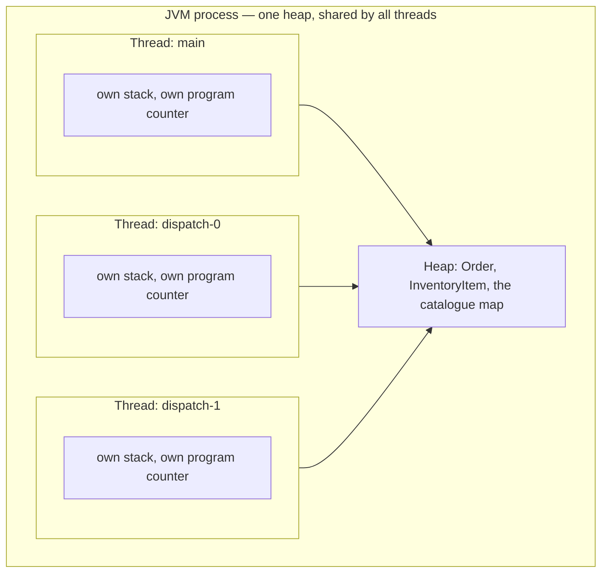
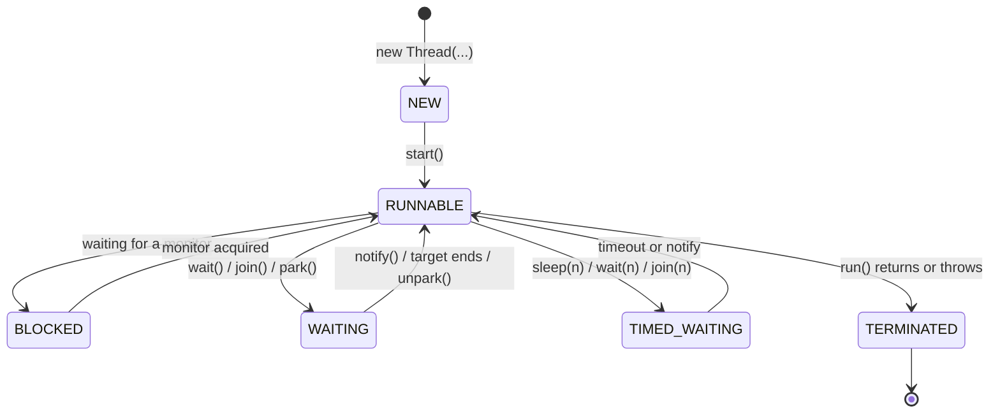
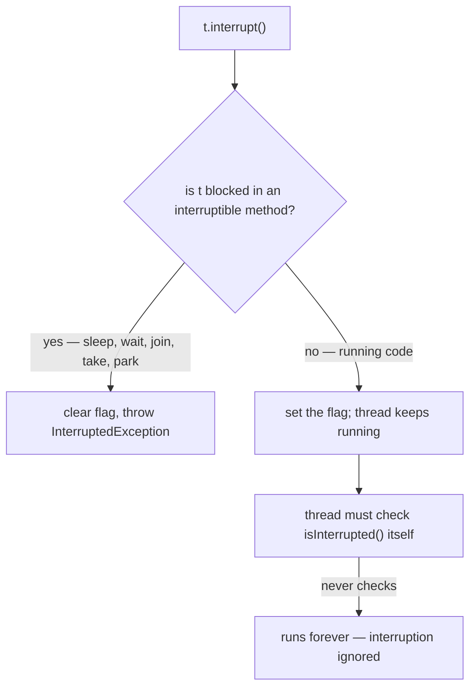

# Threading Fundamentals

<!-- video:start -->
<figure class="pb-video">
<video controls playsinline preload="metadata">
<source src="../../videos/ch24.mp4" type="video/mp4">
<track kind="subtitles" srclang="en" label="English" src="../../videos/ch24.vtt">
</video>
<figcaption>Video walkthrough · 6:49 · subtitles via CC · <a href="../../videos/ch24.mp4" download>Download MP4</a></figcaption>
</figure>
<!-- video:end -->

!!! example "Try it first"
    **[Concurrency toolkit by example](../07-examples/concurrency-toolkit.md)** — 9 runnable programs: threads, locks, atomics, latches, semaphores, each with its real output.

## 1. Purpose & Audience

**Band:** L1 Foundations · **Prerequisites:** none beyond core Java syntax

Almost nobody writes `new Thread(...)` in application code any more — executors and virtual threads sit on top of it. But every abstraction above leaks: thread dumps show states, interruption propagates through pool APIs, and a thread that dies silently takes your background job with it.

This chapter answers three questions:

1. **What is a thread**, what does it cost, and what are its lifecycle states?
2. **How do you stop one?** (You don't — you ask, and it cooperates.)
3. **Why does an exception in a thread vanish without a trace**, and how do you stop that happening?

This chapter deliberately covers only a single thread's own lifecycle. Everything about *shared* state — races, `synchronized`, `volatile`, deadlock — is [Chapter 25](25-shared-state.md). Pools are [Chapter 28](28-executors.md); virtual threads are [Chapter 31](31-virtual-threads.md).

---

## 2. The Problem

The dispatch engine sends confirmed orders to vendor systems. Each call takes 200 ms. Done sequentially, a batch of 500 orders takes 100 seconds:

```java title="SequentialDispatcher.java"
public void dispatchAll(List<Order> orders) {
    for (Order order : orders) {
        vendorClient.send(order);      // 200ms of waiting, doing nothing
    }
}
```

The CPU is idle for almost all of those 100 seconds. It is waiting on a network socket. A thread is the mechanism that lets the program do something else while one path of execution waits.

Threads are also the source of every hard bug in this part of the handbook. The order matters: understand one thread's lifecycle first, then what happens when two of them touch the same data.

---

## 3. Mental Model

A **process** owns memory. A **thread** is one path of execution through that memory. Every Java program starts with one, named `main`.



Each thread has its **own stack** — local variables and method frames are private and need no protection. Everything on the **heap** is shared, which is where all the danger lives.

### 3.1 Lifecycle states



| State | Meaning | Common cause |
|---|---|---|
| `NEW` | Constructed, not started | `new Thread(task)` |
| `RUNNABLE` | Executing, ready to execute, **or blocked in OS-level I/O** | Running code; reading a socket |
| `BLOCKED` | Waiting to enter a `synchronized` region | Lock contention |
| `WAITING` | Waiting indefinitely for another thread | `wait()`, `join()`, `LockSupport.park()` |
| `TIMED_WAITING` | Same, with a deadline | `sleep(n)`, `wait(n)`, `join(n)` |
| `TERMINATED` | `run()` has returned or thrown | Finished |

!!! warning "`RUNNABLE` includes blocked I/O"
    A thread blocked in `socketRead0` reports `RUNNABLE`, because the JVM cannot distinguish it from running code — it is blocked in the OS, not in the JVM. This surprises people reading thread dumps: a service doing nothing but waiting on 200 HTTP calls shows 200 `RUNNABLE` threads. `BLOCKED` means *contending for a Java monitor*, nothing else.

---

## 4. Core API & Syntax

### 4.1 Creating threads

| Approach | Form | Verdict |
|---|---|---|
| Implement `Runnable` | `new Thread(() -> ...)` | **Preferred** — task and execution stay separate |
| Extend `Thread` | `class Worker extends Thread` | Avoid — burns your one superclass, conflates task with thread |
| Platform builder | `Thread.ofPlatform().name("dispatch-0").start(task)` | **Preferred since 21** — named, configurable |
| Virtual builder | `Thread.ofVirtual().start(task)` | See [Ch 31](31-virtual-threads.md) |
| Thread factory | `Thread.ofPlatform().name("dispatch-", 0).factory()` | For executors — auto-numbered names |

### 4.2 Lifecycle methods

| Signature | Behaviour | Notes |
|---|---|---|
| `void start()` | Creates the OS thread, then invokes `run()` on it | `IllegalThreadStateException` if called twice |
| `void run()` | Just a method call | Calling it directly runs on the **current** thread |
| `void join()` | Block until the target terminates | Throws `InterruptedException` |
| `boolean join(Duration)` | Bounded wait | Java 19+; returns whether it finished |
| `static void sleep(Duration)` | Pause the current thread | **Does not release any lock** |
| `void interrupt()` | Request cancellation | Cooperative — see §6.2 |
| `boolean isInterrupted()` | Read the flag | Does **not** clear it |
| `static boolean interrupted()` | Read and **clear** the current thread's flag | Easy to misuse |
| `void setDaemon(boolean)` | Mark as non-JVM-keeping | Must be set before `start()` |
| `void setName(String)` | Name for diagnostics | Set it. Always. |
| `void setUncaughtExceptionHandler(...)` | Last-chance error handling | See §6.4 |

### 4.3 Removed and deprecated

| API | Status | Replacement |
|---|---|---|
| `Thread.stop()` | Throws `UnsupportedOperationException` since Java 20; being removed | Cooperative interruption |
| `Thread.suspend()` / `resume()` | Same — deadlock-prone by design | Wait/notify or a lock |
| `ThreadGroup` | Deprecated for removal | Thread pools, structured concurrency |
| `Thread.countStackFrames()` | Removed | — |

`Thread.stop()` was unsafe because it threw an asynchronous exception at an arbitrary bytecode, releasing every lock the thread held while its data was half-updated. There was never a safe way to use it.

---

## 5. Worked Examples

### 5.1 Concurrent dispatch

```java title="ParallelDispatcher.java"
public void dispatchAll(List<Order> orders) throws InterruptedException {
    List<Thread> workers = new ArrayList<>(orders.size());

    for (Order order : orders) {
        Thread t = Thread.ofPlatform()
                         .name("dispatch-" + order.id())
                         .start(() -> vendorClient.send(order));
        workers.add(t);
    }

    for (Thread t : workers) {
        t.join();                      // wait for all to finish
    }
}
```

This works and it is wrong in production — 500 platform threads means 500 OS threads and roughly 500 MB of reserved stack. It is the exact motivation for [thread pools](28-executors.md) and [virtual threads](31-virtual-threads.md). Shown here because the lifecycle it demonstrates — create, start, join — is what those abstractions manage for you.

### 5.2 `start()` versus `run()`

```java title="StartVsRun.java"
Runnable task = () -> System.out.println("running on " + Thread.currentThread().getName());

new Thread(task, "worker-1").start();   // new thread
new Thread(task, "worker-2").run();     // NOT a new thread
```

```text title="Output"
running on worker-1
running on main
```

`run()` is an ordinary method. Calling it gives you a plain method call with no concurrency at all — and no error, which is what makes it a real bug rather than a typo.

### 5.3 Stopping a worker cleanly

There is no way to kill a thread. You set a condition and the thread checks it.

```java title="DispatchWorker.java"
public final class DispatchWorker implements Runnable {

    private static final Logger log = LoggerFactory.getLogger(DispatchWorker.class);   // SLF4J

    private final BlockingQueue<Order> queue;
    private final VendorClient vendorClient;

    public DispatchWorker(BlockingQueue<Order> queue, VendorClient vendorClient) {
        this.queue = queue;
        this.vendorClient = vendorClient;
    }

    @Override
    public void run() {
        try {
            while (!Thread.currentThread().isInterrupted()) {
                Order order = queue.take();        // throws InterruptedException
                vendorClient.send(order);
            }
        } catch (InterruptedException e) {
            Thread.currentThread().interrupt();    // restore the flag
        } finally {
            log.info("dispatch worker stopping");
        }
    }
}
```

Shutting it down:

```java
Thread worker = Thread.ofPlatform().name("dispatch").start(new DispatchWorker(queue, vendorClient));
// ... later ...
worker.interrupt();
worker.join(Duration.ofSeconds(5));
```

Two checks, deliberately. The `isInterrupted()` test catches interruption between iterations; the `InterruptedException` from `take()` catches it while blocked. A worker that only does one of these either ignores interruption while waiting, or spins.

### 5.4 The swallowed interrupt

This is the most common concurrency bug in enterprise Java, and it is almost always written by an IDE quick-fix:

```java title="SwallowedInterrupt.java"
// WRONG — the cancellation request is destroyed
try {
    Thread.sleep(1000);
} catch (InterruptedException e) {
    // ignored
}
```

When a blocking method throws `InterruptedException`, it **clears the interrupt flag**. Swallowing the exception therefore erases all evidence that cancellation was requested, and every caller up the stack continues as if nothing happened. A shutdown that should take milliseconds hangs until a timeout fires.

Two correct responses:

=== "Propagate (preferred)"
    ```java
    void dispatch() throws InterruptedException {
        Thread.sleep(1000);      // let the caller decide
    }
    ```

=== "Restore the flag"
    ```java
    try {
        Thread.sleep(1000);
    } catch (InterruptedException e) {
        Thread.currentThread().interrupt();   // re-arm for callers
        return;                                // and stop doing work
    }
    ```

Restoring the flag without also stopping is only half a fix — you preserved the signal but ignored it.

### 5.5 Daemon threads

```java title="DaemonDemo.java"
Thread housekeeping = Thread.ofPlatform()
    .daemon(true)
    .name("cache-evictor")
    .start(() -> {
        try {
            while (!Thread.currentThread().isInterrupted()) {
                evictExpiredPrices();
                Thread.sleep(Duration.ofMinutes(1));    // Runnable cannot throw InterruptedException
            }
        } catch (InterruptedException e) {
            Thread.currentThread().interrupt();          // restore the flag and exit
        }
    });
```

The JVM exits when the last **non-daemon** thread ends; daemon threads are killed abruptly at that point, with no `finally` block and no chance to flush. Use them for genuinely disposable background work — cache eviction, metrics sampling. Never for anything that writes data.

---

## 6. Internals

### 6.1 What a platform thread costs

`Thread.start()` makes a system call that creates a real OS thread. That carries three costs:

- **Stack reservation.** Default is typically 1 MB on 64-bit platforms (`-Xss` changes it). Reserved virtual address space, committed lazily — but 10,000 threads still reserve 10 GB of address space.
- **Creation latency.** Tens to hundreds of microseconds. Enough that creating one per request is measurable.
- **Scheduling overhead.** Context switches go through the OS at roughly 1–10 µs each, and every switch pollutes CPU caches.

This is the arithmetic behind every pooling decision in the JDK, and the problem [virtual threads](31-virtual-threads.md) were built to remove.

### 6.2 How interruption actually works

Interruption is a single boolean per thread, plus a convention.



The JVM cannot stop running code. If your loop body never checks the flag and never calls a blocking method, `interrupt()` does nothing at all.

Two traps worth naming:

- **`Thread.interrupted()` clears the flag.** It is a static read-and-reset. `isInterrupted()` is the instance read that leaves it alone. Using the wrong one silently consumes the cancellation signal.
- **Blocking I/O is mostly not interruptible.** `InputStream.read` on a socket ignores interruption entirely. `InterruptibleChannel` responds by closing the channel. To cancel a blocked socket read, you close the socket.

### 6.3 `sleep` does not release locks

```java title="SleepHoldsLocks.java"
synchronized (inventory) {
    Thread.sleep(5_000);      // holds the monitor for the full 5 seconds
}
```

Every other thread wanting that monitor waits the full five seconds. `Object.wait()` is the method that releases the monitor while waiting — the distinction is a standing interview question and a real source of stalls. See [Chapter 25](25-shared-state.md).

### 6.4 Uncaught exceptions vanish

```java title="SilentDeath.java"
Thread.ofPlatform().start(() -> {
    throw new IllegalStateException("vendor endpoint unreachable");
});
// main continues. Nothing is logged by your application.
```

An uncaught exception terminates **only that thread**. The default handler prints to `System.err`, which in a containerised service with structured logging frequently goes nowhere anyone is watching. Your background worker is dead and your monitoring shows nothing.

Fix it at both levels:

```java title="ExceptionHandling.java"
// Per-thread
Thread.ofPlatform()
      .uncaughtExceptionHandler((t, e) -> log.error("thread {} died", t.getName(), e))
      .start(task);

// JVM-wide safety net
Thread.setDefaultUncaughtExceptionHandler(
    (t, e) -> log.error("uncaught in {}", t.getName(), e));
```

Inside an `ExecutorService` the failure mode differs again: the exception is captured in the returned `Future` and surfaces only when you call `get()`. If you ignore the `Future`, the exception is never seen at all. That is [Chapter 28](28-executors.md).

### 6.5 Thread names are an operational feature

```java
Thread.ofPlatform().name("dispatch-", 0).factory();   // dispatch-0, dispatch-1, ...
```

The default is `Thread-0`, `Thread-1` — useless in a thread dump at 3 a.m. Named threads make `jcmd <pid> Thread.print` immediately readable:

```text
"dispatch-7" #42 prio=5 BLOCKED on java.lang.Object@5e2de80c
    owned by "dispatch-3" #38
```

That two-line excerpt identifies both the victim and the lock holder. With default names it identifies nothing.

---

## 7. Production Patterns & Anti-Patterns

### Do this

- **Name every thread**, including every pool's factory. It is free and it is the difference between a diagnosable and an undiagnosable thread dump.
- **Set an uncaught exception handler** — per-thread for workers, plus a JVM-wide default as a net.
- **Propagate `InterruptedException`** wherever you can. If you truly cannot, restore the flag *and* stop working.
- **Check `isInterrupted()` in long loops**, not only at blocking calls.
- **Use `join(Duration)`** rather than unbounded `join()` during shutdown, so a stuck worker cannot hang the exit.
- **Prefer executors and virtual threads** over raw `Thread` in application code. Raw threads are for the rare long-lived dedicated worker.

### Never do this

- **Never call `run()` when you meant `start()`.** It compiles, it runs, and nothing is concurrent.
- **Never swallow `InterruptedException`.** It clears the flag and destroys the cancellation signal.
- **Never use `Thread.stop`, `suspend`, or `resume`.** They throw `UnsupportedOperationException` on modern JDKs and were never safe.
- **Never make a thread a daemon if it writes data.** Daemons are killed without `finally`, mid-write.
- **Never create one platform thread per request.** 1 MB of stack each; use a pool or virtual threads.
- **Never rely on `Thread.sleep` for coordination.** It is a guess. Use `join`, a latch, or a `BlockingQueue`.
- **Never assume `sleep` releases a lock.** Only `wait` does.

---

## 8. Version Evolution (Java 8 → 26)

| Version | What changed | Impact |
|---|---|---|
| **8** | Lambdas make `Runnable` a one-liner | `new Thread(() -> ...)` becomes idiomatic |
| **9** | `Thread.onSpinWait()` | Hint for busy-wait loops |
| **19** | `Thread.join(Duration)`, `Thread.sleep(Duration)` | Typed durations instead of raw millis |
| **20** | `Thread.stop`, `suspend`, `resume` throw `UnsupportedOperationException` | Unsafe APIs finally inert |
| **21** | `Thread.ofPlatform()` / `ofVirtual()` builders; virtual threads final (JEP 444) | Named, configurable creation; the thread-per-request model becomes viable |
| **24** | JEP 491 — virtual threads no longer pin the carrier inside `synchronized` | Removes a major virtual-thread caveat |
| **25** | `ScopedValue` final (JEP 506) | The replacement for `ThreadLocal` — see [Ch 33](33-scoped-values.md) |
| **26** | No changes to the base threading API | — |

### Migration note

On Java 21+, replace `new Thread(task, "name")` with `Thread.ofPlatform().name("name").start(task)` — same semantics, and the builder also exposes daemon status, priority, stack size, and the exception handler in one place. Anything still calling `Thread.stop()` will now throw at runtime rather than corrupt data, which is an improvement but still a crash: those call sites need rewriting as cooperative cancellation.

---

## 9. Interview Questions

### L1 — Foundations

**Q1. What is the difference between `start()` and `run()`?** ⭐ *high frequency*
`start()` asks the JVM to create a new thread of execution, which then invokes `run()`. Calling `run()` directly is just an ordinary method call on the current thread, so nothing runs concurrently. The code compiles and executes either way, which is what makes the mistake easy to miss.

**Q2. What is the difference between a process and a thread?**
A process has its own memory space; the JVM is one process. Threads live inside a process and share its heap, while each keeps a private stack for local variables and call frames. Sharing the heap makes communication between threads cheap and makes unsynchronised access dangerous.

**Q3. What is a daemon thread?**
One that does not keep the JVM alive: once only daemon threads remain, the JVM exits and kills them abruptly, skipping `finally` blocks. They suit disposable background work like cache eviction or metrics sampling. Anything that writes data must be a user thread with an orderly shutdown.

### L2 — Professional

**Q4. How do you stop a running thread?** ⭐ *high frequency*
You ask it to stop and it cooperates — there is no safe way to force it. Call `interrupt()`, which sets a flag and causes blocking methods like `sleep`, `join`, and `take` to throw `InterruptedException`. The thread's own code must check `isInterrupted()` in its loops and treat the exception as a cancellation request. `Thread.stop()` existed for this and throws `UnsupportedOperationException` on modern JDKs because it released locks mid-update.

**Q5. What should you do when you catch `InterruptedException`?**
Prefer to let it propagate so the caller can decide. If the method signature cannot throw it, restore the flag with `Thread.currentThread().interrupt()` and stop doing work. Swallowing it is a real bug: the throwing method clears the interrupt flag, so ignoring the exception erases the cancellation signal for every caller above you.

**Q6. Does `Thread.sleep()` release the lock?**
No. `sleep` pauses the thread while holding every monitor it owns, so anyone waiting on those monitors waits for the full duration. `Object.wait()` is the method that releases the monitor and reacquires it on wake. Confusing the two produces stalls that look like deadlock in a thread dump.

### L3 — Enterprise

**Q7. A background thread stopped working and nothing was logged. What happened?**
An uncaught exception terminated it. Only that thread dies, and the default handler prints to `System.err`, which in a container with structured logging often goes unmonitored. Set an `UncaughtExceptionHandler` on the thread and a JVM-wide default as a backstop. Inside an executor the failure mode differs — the exception is trapped in the `Future` and never surfaces unless something calls `get()`.

**Q8. In a thread dump, what does `RUNNABLE` actually tell you?**
Less than people assume. It covers threads executing, threads ready to execute, and threads blocked in OS-level I/O such as a socket read, because the JVM cannot distinguish the last case from running code. `BLOCKED` specifically means contending for a Java monitor. A service waiting on hundreds of HTTP calls shows hundreds of `RUNNABLE` threads while using almost no CPU.

**Q9. How much does a platform thread cost, and why does it matter?**
Roughly 1 MB of reserved stack by default, tens to hundreds of microseconds to create, plus a context switch of about 1–10 µs each time it is scheduled. That arithmetic caps a typical service at a few thousand threads, which is why blocking thread-per-request architectures hit a concurrency ceiling well below what the hardware could handle. It is the entire motivation for pooling, for reactive programming, and ultimately for virtual threads.

### L4 — Architect

**Q10. Why was `Thread.stop()` unsafe, and what is the correct model?**
It threw an asynchronous `ThreadDeath` at an arbitrary bytecode boundary and released every monitor the thread held — so other threads immediately observed data that was half-updated, with no way to detect it. There is no safe point the caller can choose from outside. The correct model is cooperative: the thread defines its own safe cancellation points, checks a flag or handles `InterruptedException` there, and unwinds cleanly with its invariants intact.

**Q11. Your service must shut down within 30 seconds. How do you structure thread termination?**
Signal first, wait second, escalate third: interrupt every worker, then `join` each with a bounded duration rather than indefinitely, and log anything still alive at the deadline. Workers must treat interruption as a cancellation request and must not hold unbounded blocking calls that ignore it — notably socket reads, which need the socket closed rather than the thread interrupted. Anything that writes data must be a user thread, so the JVM does not exit out from under it.

**Q12. When is a raw `Thread` still the right choice on Java 21+?**
For a small number of long-lived, dedicated, always-running workers — a log shipper, a scheduler loop, a single consumer pinned to one resource — where you want explicit lifecycle control and no pool semantics. For anything request-scoped or bursty, an executor or a virtual thread is better, because the cost model and the cancellation semantics are already solved. The deciding question is whether the thread's lifetime matches the application's or the task's.

---

!!! abstract "Cheat Sheet"
    **`start()` creates a thread; `run()` is just a method call**

    **States:** NEW · RUNNABLE · BLOCKED · WAITING · TIMED_WAITING · TERMINATED

    **`RUNNABLE` includes blocked I/O** — `BLOCKED` means monitor contention only

    **Interruption is cooperative** — a flag plus a convention; running code must check it

    **`InterruptedException` clears the flag** — propagate it, or restore and stop

    **`Thread.interrupted()` clears · `isInterrupted()` does not**

    **`sleep` holds locks · `wait` releases the monitor**

    **Uncaught exception kills one thread silently** — set a handler, always

    **Daemon threads die without `finally`** — never use them for writes

    **Platform thread ≈ 1 MB stack** — pool them, or go virtual

    **`Thread.stop/suspend/resume`** throw `UnsupportedOperationException` since Java 20

    **Name every thread** — thread dumps are unreadable otherwise
