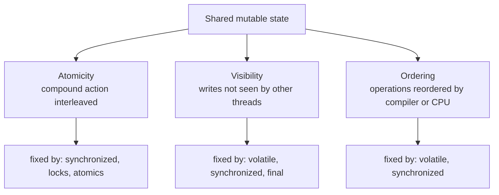

# Shared State & Synchronization

<!-- video:start -->
<figure class="pb-video">
<video controls playsinline preload="metadata">
<source src="../../videos/ch25.mp4" type="video/mp4">
<track kind="subtitles" srclang="en" label="English" src="../../videos/ch25.vtt">
</video>
<figcaption>Video walkthrough · 6:49 · subtitles via CC · <a href="../../videos/ch25.mp4" download>Download MP4</a></figcaption>
</figure>
<!-- video:end -->

## 1. Purpose & Audience

**Band:** L2 Professional · **Prerequisites:** [Threading Fundamentals](24-threading-fundamentals.md)

One thread is simple. Two threads touching the same object is where Java gets hard — and where the bugs do not reproduce, do not appear in tests, and surface once a week in production under load.

This chapter answers three questions:

1. **What exactly goes wrong** when two threads share data — and why it is three separate problems, not one?
2. **What do `synchronized` and `volatile` each fix**, and what does neither of them fix?
3. **How do deadlocks form**, and how do you find one in a running service?

This is the practical treatment. The formal rules — the happens-before relation, safe publication, final-field semantics — are [Chapter 26](26-java-memory-model.md). `ReentrantLock` and the atomics are [Chapter 27](27-locks-and-atomics.md).

---

## 2. The Problem

The inventory engine tracks available stock. Two checkout threads reserve the last two units of the same SKU:

```java title="UnsafeInventory.java"
public final class UnsafeInventory {

    private int available = 100;

    public void reserve(int quantity) {
        available = available - quantity;   // looks like one step. It is three.
    }

    public int available() {
        return available;
    }
}
```

Run it with two threads doing 10,000 single-unit reservations each:

```java title="LostUpdateDemo.java"
UnsafeInventory inventory = new UnsafeInventory();
Runnable task = () -> { for (int i = 0; i < 10_000; i++) inventory.reserve(1); };

Thread t1 = Thread.ofPlatform().start(task);
Thread t2 = Thread.ofPlatform().start(task);
t1.join(); t2.join();

System.out.println(inventory.available());
```

```text title="Output (varies every run)"
-19847     ← expected -19900
```

Entries are lost. `available = available - quantity` compiles to **read, subtract, write** — three operations — and two threads can read the same value before either writes. In the inventory engine this means overselling: two customers both reserve the last unit and one order cannot be fulfilled.

This is one of three distinct failure modes, and they need distinguishing before any fix makes sense.

---

## 3. Mental Model

### 3.1 Three separate problems



| Problem | What it looks like | Fixed by |
|---|---|---|
| **Atomicity** | Lost updates, `count++` losing increments | `synchronized`, `Lock`, atomics |
| **Visibility** | A loop never sees `running = false` and spins forever | `volatile`, `synchronized`, `final` |
| **Ordering** | Half-constructed object visible to another thread | `volatile`, `synchronized` |

The reason this matters: **`volatile` fixes visibility and ordering but not atomicity.** Most misuse of `volatile` comes from not separating these.

### 3.2 Why visibility is a real problem

Each CPU core has its own caches, and the JIT keeps values in registers. Without a memory barrier, a write by one thread may remain invisible to another indefinitely:

```java title="NeverStops.java"
// WRONG — may loop forever
private boolean running = true;

public void stop() { running = false; }

public void run() {
    while (running) {          // JIT may hoist this read out of the loop
        processNextOrder();
    }
}
```

The JIT is entitled to observe that nothing *in this thread* writes `running`, hoist the read out of the loop, and compile it to `while (true)`. This is a legal optimisation and it is why the bug appears only in production — with the interpreter, or under a debugger, it usually works.

---

## 4. Core API & Syntax

### 4.1 `synchronized`

| Form | Lock acquired |
|---|---|
| `synchronized void m()` | `this` |
| `static synchronized void m()` | The `Class` object |
| `synchronized (obj) { ... }` | `obj`'s monitor |

Properties:

- **Mutual exclusion.** One thread at a time per monitor.
- **Reentrant.** A thread already holding a monitor can reacquire it; the JVM counts depth.
- **Establishes happens-before.** Everything done before releasing a monitor is visible to the next thread that acquires it. This is why `synchronized` fixes visibility as well as atomicity.
- **Not interruptible, no timeout, no fairness.** For any of those, use `ReentrantLock` — [Chapter 27](27-locks-and-atomics.md).

### 4.2 `volatile`

| Guarantees | Does not guarantee |
|---|---|
| Reads always see the most recent write | Atomicity of compound actions |
| No reordering across the access | Mutual exclusion |
| 64-bit `long`/`double` writes are not torn | Anything involving read-then-write |

`volatile` is correct for exactly one shape: **one writer, many readers, and the new value does not depend on the old.** Status flags, cached references, `double`-checked-locking holders.

### 4.3 `wait` / `notify`

| Signature | Behaviour |
|---|---|
| `void wait()` | Releases the monitor, blocks until notified |
| `void wait(long)` | Same, with a timeout |
| `void notify()` | Wakes **one** arbitrary waiter |
| `void notifyAll()` | Wakes **all** waiters |

Three non-negotiable rules:

1. You must hold the monitor to call any of them, or you get `IllegalMonitorStateException`.
2. Always wait in a **`while` loop**, never an `if` — spurious wakeups are permitted by the specification.
3. Prefer `notifyAll` unless you can prove every waiter is interchangeable.

!!! tip "Prefer a `BlockingQueue`"
    Almost every correct use of `wait`/`notify` in application code is reimplementing `ArrayBlockingQueue` or `LinkedBlockingQueue`, less well. Know the mechanism — it is asked about constantly — but reach for the collection. See [Ch 30](30-concurrent-collections.md).

---

## 5. Worked Examples

### 5.1 Fixing the lost update

```java title="SafeInventory.java"
public final class SafeInventory {

    private final Object lock = new Object();    // private lock, not `this`
    private int available = 100;

    public boolean reserve(int quantity) {
        synchronized (lock) {
            if (available < quantity) {
                return false;
            }
            available -= quantity;
            return true;
        }
    }

    public int available() {
        synchronized (lock) {                    // reads need the lock too
            return available;
        }
    }
}
```

```text title="Output"
-19900     ← every run
```

Two things are deliberate.

**The read is synchronised.** Without it, `available()` may return a stale value — the lock provides visibility, not just exclusion. Synchronising only writes is a half-fix that appears to work.

**The lock is a private object, not `this`.** Locking on `this` publishes your lock: any caller holding a reference can `synchronized (inventory)` and stall your internals, or deadlock against you. A private final lock object cannot be acquired from outside.

### 5.2 The volatile flag

```java title="DispatchLoop.java"
public final class DispatchLoop implements Runnable {

    private volatile boolean running = true;     // one writer, many readers

    public void stop() {
        running = false;
    }

    @Override
    public void run() {
        while (running) {
            processNextOrder();
        }
    }
}
```

This is the canonical correct use. `running = false` is a single write that does not depend on the old value, so no atomicity is needed — only visibility, which `volatile` provides.

### 5.3 Where `volatile` is not enough

```java title="VolatileNotAtomic.java"
private volatile int reservationCount;

public void record() {
    reservationCount++;      // STILL a race: read, increment, write
}
```

`volatile` makes each read and each write visible. It does nothing about the gap between them. Correct options:

=== "Atomic (preferred)"
    ```java
    private final AtomicInteger reservationCount = new AtomicInteger();

    public void record() {
        reservationCount.incrementAndGet();
    }
    ```

=== "LongAdder for high write contention"
    ```java
    private final LongAdder reservationCount = new LongAdder();

    public void record() {
        reservationCount.increment();
    }
    ```

=== "synchronized"
    ```java
    private int reservationCount;

    public synchronized void record() {
        reservationCount++;
    }
    ```

### 5.4 The check-then-act race

The same shape as the lost update, but harder to see because no arithmetic is involved:

```java title="CheckThenAct.java"
// WRONG — two threads can both pass the check
if (!reservations.containsKey(orderId)) {
    reservations.put(orderId, reservation);
}
```

Any sequence of *test* followed by *act* on shared state is a race unless the whole sequence is atomic. Either hold a lock across both, or use a single atomic operation — `putIfAbsent`, `compute`, or a conditional `replace`. See [Ch 30](30-concurrent-collections.md), where this is the central theme.

### 5.5 Producer–consumer with `wait`/`notify`

```java title="OrderBuffer.java"
public final class OrderBuffer {

    private final Queue<Order> queue = new ArrayDeque<>();
    private final int capacity;

    public OrderBuffer(int capacity) {
        this.capacity = capacity;
    }

    public synchronized void put(Order order) throws InterruptedException {
        while (queue.size() == capacity) {     // while, never if
            wait();
        }
        queue.add(order);
        notifyAll();
    }

    public synchronized Order take() throws InterruptedException {
        while (queue.isEmpty()) {              // while, never if
            wait();
        }
        Order order = queue.remove();
        notifyAll();
        return order;
    }
}
```

The `while` is the whole lesson. On waking, the thread must re-check its condition, because it may have been woken spuriously, or another thread may have consumed the item between the notify and this thread reacquiring the monitor. An `if` here produces a `NoSuchElementException` roughly once a month.

In production this class is `new ArrayBlockingQueue<>(capacity)`.

### 5.6 A deadlock you can reproduce

```java title="TransferDeadlock.java"
// WRONG — lock order depends on the arguments
public void transfer(InventoryItem from, InventoryItem to, int quantity) {
    synchronized (from) {
        synchronized (to) {
            from.decrease(quantity);
            to.increase(quantity);
        }
    }
}
```

Thread A calls `transfer(milk, rice, 5)`; thread B calls `transfer(rice, milk, 3)`. A holds `milk` and wants `rice`; B holds `rice` and wants `milk`. Neither will ever proceed.

The fix is a **global lock order** — any consistent total ordering will do:

```java title="TransferOrdered.java"
public void transfer(InventoryItem from, InventoryItem to, int quantity) {
    InventoryItem first  = from.sku().code().compareTo(to.sku().code()) < 0 ? from : to;
    InventoryItem second = (first == from) ? to : from;

    synchronized (first) {
        synchronized (second) {
            from.decrease(quantity);
            to.increase(quantity);
        }
    }
}
```

Every thread now acquires locks in the same order, so the circular wait cannot form.

---

## 6. Internals

### 6.1 What `synchronized` compiles to

An instance method marked `synchronized` carries the `ACC_SYNCHRONIZED` flag; a `synchronized` block compiles to `monitorenter` / `monitorexit` bytecodes, with a second `monitorexit` on the exception path so the lock is released even when the body throws.

Every object has a monitor, reachable through its header. The JVM does not jump straight to an OS mutex — it escalates:

| Level | When | Cost |
|---|---|---|
| Thin / lightweight lock | No contention | A CAS on the object header — nanoseconds |
| Inflated / heavyweight | Real contention | An OS monitor; blocked threads are parked |

This is why "`synchronized` is slow" is outdated advice. Uncontended synchronisation costs a CAS. It is *contention* that is expensive, and no locking mechanism avoids that.

!!! note "Biased locking is gone"
    Biased locking, which made repeated acquisition by the same thread nearly free, was disabled by default in Java 15 and removed in Java 18. Code written around it no longer has the profile it assumed.

### 6.2 What `volatile` compiles to

A volatile write emits a store barrier; a volatile read emits a load barrier. On x86 the write becomes a locked instruction and the read is an ordinary load, so **volatile reads are essentially free and volatile writes cost roughly a CAS**.

The barrier does two things: it forces the value out to where other cores will see it, and it prevents the compiler and CPU from moving other memory operations across it. That second property is what makes double-checked locking work:

```java title="DoubleCheckedLocking.java"
private volatile PricingRuleEngine engine;      // volatile is mandatory here

public PricingRuleEngine engine() {
    PricingRuleEngine result = engine;          // one volatile read on the fast path
    if (result == null) {
        synchronized (this) {
            result = engine;
            if (result == null) {
                engine = result = new PricingRuleEngine();
            }
        }
    }
    return result;
}
```

Without `volatile`, the constructor's field writes can be reordered after the assignment of the reference, so another thread can observe a non-null `engine` whose fields are still zero. This idiom was **broken before Java 5** and is correct now only with `volatile`.

### 6.3 Word tearing on `long` and `double`

The specification permits a 64-bit non-volatile write to be performed as two 32-bit writes. A concurrent reader can therefore see a value that was never written — the high half of one value with the low half of another.

```java
private long totalRevenuePaise;        // may tear
private volatile long safeTotal;       // never tears
```

Rare on 64-bit JVMs, but it is a specification guarantee you do not have, not a hardware detail you can rely on.

### 6.4 The four conditions for deadlock

All four must hold simultaneously. Breaking any one prevents it:

| Condition | How to break it |
|---|---|
| Mutual exclusion | Use immutable data or atomics — no lock to hold |
| Hold and wait | Acquire everything at once, or nothing |
| No preemption | `tryLock(timeout)` — give up and retry |
| Circular wait | **Impose a global lock order** — the usual fix |

Lock ordering is the practical answer because it is a static property you can review, rather than a runtime behaviour you have to test for.

### 6.5 Finding a deadlock in a running service

```bash
jcmd <pid> Thread.print
```

The JVM detects monitor deadlocks and reports them explicitly:

```text
Found one Java-level deadlock:
=============================
"dispatch-3":
  waiting to lock monitor 0x00007f8b (a InventoryItem),
  which is held by "dispatch-7"
"dispatch-7":
  waiting to lock monitor 0x00007f8c (a InventoryItem),
  which is held by "dispatch-3"
```

Two things make this useful: named threads (see [Ch 24](24-threading-fundamentals.md)), and monitor deadlocks being detectable at all. Deadlocks built from `ReentrantLock` are **not** reported this way — another argument for `synchronized` where you do not need the extra features.

### 6.6 Livelock and starvation

**Deadlock** is threads stopped. Two cousins are not:

- **Livelock** — threads are running and responding to each other, but no one makes progress. Two threads that each detect contention, back off, and retry in lockstep. Fix with randomised backoff.
- **Starvation** — one thread never gets the lock because others keep taking it. `synchronized` is not fair by design; `new ReentrantLock(true)` is fair at a significant throughput cost.

Neither appears in a deadlock report. Both show as high CPU with no throughput, or one consistently slow caller.

---

## 7. Production Patterns & Anti-Patterns

### Do this

- **Prefer no shared mutable state at all.** Immutable objects, records, confinement to one thread, or message passing through a queue. Every lock you do not need is a bug you cannot have.
- **Lock on a private final object**, never on `this` or on a class you do not own.
- **Synchronise reads as well as writes.** The lock is what gives you visibility.
- **Keep critical sections short.** No I/O, no remote calls, no callbacks into unknown code while holding a lock.
- **Impose a global lock order** whenever a code path can hold two locks.
- **Use `volatile` only for single-writer flags** where the new value does not depend on the old.
- **Document the policy.** One comment — "guarded by `lock`" — on each shared field saves the next reader an hour.

### Never do this

- **Never assume `volatile` makes `count++` safe.** It is read-modify-write; use an atomic.
- **Never use `wait()` inside an `if`.** Spurious wakeups are legal. `while`, always.
- **Never call `wait`/`notify` without holding the monitor.** `IllegalMonitorStateException`.
- **Never synchronise on a `String` literal, a boxed primitive, or `Class` objects you do not own.** They are interned and shared JVM-wide — you are locking against unrelated code.
- **Never hold a lock across a network call.** A 30-second timeout becomes a 30-second stall for every waiting thread.
- **Never lock in an order that depends on arguments.** That is the deadlock in §5.6.
- **Never let `this` escape the constructor** — registering a listener or starting a thread from inside one publishes a half-built object.
- **Never use `Thread.sleep` to "avoid" a race.** It narrows the window and hides the bug until load changes.

---

## 8. Version Evolution (Java 8 → 26)

| Version | What changed | Impact |
|---|---|---|
| **8** | `LongAdder`, `LongAccumulator`; `ConcurrentHashMap` rewrite | Contended counters stop being a bottleneck |
| **9** | `VarHandle` (JEP 193); `Thread.onSpinWait()` | Typed low-level access replacing `sun.misc.Unsafe` |
| **15** | Biased locking disabled by default | Repeated uncontended locking slightly more expensive |
| **18** | Biased locking removed | Performance assumptions from that era no longer hold |
| **21** | Virtual threads final; `synchronized` **pins** the carrier thread | Heavy `synchronized` contention hurts virtual-thread services |
| **24** | JEP 491 — `synchronized` no longer pins virtual threads | The main reason to prefer `ReentrantLock` on virtual threads disappears |
| **25** | Compact object headers (JEP 519) | Object header changes; locking semantics unaffected |
| **26** | JEP 500 — warnings for deep reflection mutating final fields | Prepares for final actually meaning final, which strengthens safe publication |

### Migration note

If you are on **Java 21 or 22** and running virtual threads, `synchronized` blocks that block — on I/O, on a contended monitor — pin the carrier platform thread and can starve the scheduler. The Java 21-era guidance was to replace those specific blocks with `ReentrantLock`. **On Java 24+ that guidance is obsolete**; JEP 491 removed pinning, and `synchronized` is again the simpler default. Do not carry the workaround forward into a Java 25 codebase without knowing why it is there.

---

## 9. Interview Questions

### L1 — Foundations

**Q1. What is a race condition?** ⭐ *high frequency*
It is when the result depends on the timing of thread interleaving rather than on the program's logic. The classic case is `count++`, which is really three operations — read, add, write — so two threads can read the same value and one increment is lost. The defining symptom is that the code is correct in isolation and wrong only under concurrency.

**Q2. What does `synchronized` guarantee?**
Two things: only one thread executes the guarded region per monitor, and everything a thread did before releasing the monitor is visible to the next thread that acquires it. That second guarantee is why synchronising only writes is a bug — readers need the lock too, or they may see stale values.

**Q3. What is the difference between `synchronized` and `volatile`?**
`synchronized` provides mutual exclusion plus visibility and can protect a multi-step operation. `volatile` provides visibility and ordering for a single field but no exclusion, so it cannot make a read-modify-write safe. Use `volatile` for a flag written by one thread; use `synchronized` or an atomic when the new value depends on the old.

### L2 — Professional

**Q4. Is `volatile int count; count++;` thread-safe?** ⭐ *high frequency*
No. `volatile` guarantees that each read sees the latest write and that the write is visible immediately, but `count++` is read, increment, write — three separate accesses. Two threads can read the same value and both write back the same result, losing an increment. Use `AtomicInteger.incrementAndGet()`, or `LongAdder` if writes are heavily contended.

**Q5. Why must `wait()` be called inside a `while` loop?**
Because a thread can wake without a matching `notify` — the specification explicitly permits spurious wakeups — and because another thread may consume the condition between the notify and this thread reacquiring the monitor. Re-checking in a loop makes the code correct under both. An `if` produces failures that appear rarely and only under load.

**Q6. Why is locking on `this` considered poor practice?**
It makes your lock part of your public API: any caller holding a reference to the object can synchronise on it, block your methods, or deadlock against your internals, and you have no way to prevent it. A `private final Object lock` cannot be acquired from outside, so the locking policy stays under the class's control.

### L3 — Enterprise

**Q7. How do you prevent deadlock?**
The practical answer is a global lock ordering: every code path that acquires more than one lock acquires them in the same defined order, which makes a circular wait impossible. Alternatives break one of the other three conditions — `tryLock` with a timeout allows preemption, acquiring all locks at once removes hold-and-wait, and immutable data removes the lock entirely. Ordering is preferred because it is a static property you can review rather than a behaviour you must test for.

**Q8. Explain double-checked locking and why `volatile` is required.**
It checks the field without a lock, takes the lock only on the null path, and re-checks inside — so the common case costs one read instead of a lock acquisition. Without `volatile`, the writes initialising the new object can be reordered after the write that publishes its reference, so another thread can see a non-null field pointing at an object whose fields are still default values. The `volatile` write establishes the ordering that makes the published object fully constructed.

**Q9. A service is at 100% CPU but processing nothing. What are you looking for?**
Not deadlock — deadlocked threads consume no CPU and are reported explicitly by `jcmd Thread.print`. This pattern points at livelock, where threads detect contention, back off, and retry in lockstep without progressing, or at a spin loop reading a non-volatile flag that the JIT hoisted out of the loop. Take several thread dumps a few seconds apart and compare stacks; threads stuck at the same line while burning CPU identify both cases.

### L4 — Architect

**Q10. How would you eliminate locking from a hot path entirely?**
Remove the sharing rather than guard it. Confine mutable state to a single thread and communicate by passing immutable messages through a queue; or make the state immutable and publish new versions by atomic reference swap; or partition by key so each partition is owned by one thread, which is how per-SKU inventory would be structured. Where a single variable must be shared, a compare-and-swap loop over an atomic avoids blocking altogether. Each of these trades a lock for a design constraint, which is usually the better trade.

**Q11. What changed for `synchronized` with virtual threads, and how does it affect design?**
On Java 21 and 22 a virtual thread blocking inside `synchronized` pinned its carrier platform thread, so heavy monitor contention could exhaust the small carrier pool and stall the whole scheduler — the guidance then was to replace those blocks with `ReentrantLock`, which parks without pinning. JEP 491 in Java 24 removed the restriction, so `synchronized` is once again the simpler default. The design consequence is version-dependent, which makes it worth knowing which baseline a codebase targets before reviewing its locking.

**Q12. How do you decide between `synchronized`, `ReentrantLock`, and atomics?**
Start with atomics when the state is a single variable and the operation is a compare-and-swap — no blocking, no deadlock possible. Use `synchronized` for anything more complex, because it is scoped to a block, released automatically on exception, and the only form the JVM reports in deadlock detection. Reach for `ReentrantLock` when you specifically need what it adds: timed or interruptible acquisition, fairness, multiple condition variables, or a lock whose scope is not a block. Choosing `ReentrantLock` by default trades automatic release for features most code never uses.

---

!!! abstract "Cheat Sheet"
    **Three problems:** atomicity · visibility · ordering — different fixes

    **`synchronized`:** exclusion + visibility + ordering; reentrant; auto-released on exception

    **`volatile`:** visibility + ordering, **no atomicity** — one writer, value independent of old

    **`count++` is read-modify-write** — `volatile` does not save it; use `AtomicInteger`/`LongAdder`

    **Synchronise reads too** — the lock is what publishes the value

    **Lock on a private final object**, never `this`, never a `String` literal

    **`wait` in a `while`, never an `if`** — spurious wakeups are legal

    **`wait` releases the monitor · `sleep` does not**

    **Deadlock = four conditions** — break circular wait with a global lock order

    **Find it:** `jcmd <pid> Thread.print` — monitors are reported, `ReentrantLock` is not

    **DCL needs `volatile`** or the reference publishes before the constructor finishes

    **Java 24 (JEP 491):** `synchronized` no longer pins virtual threads
