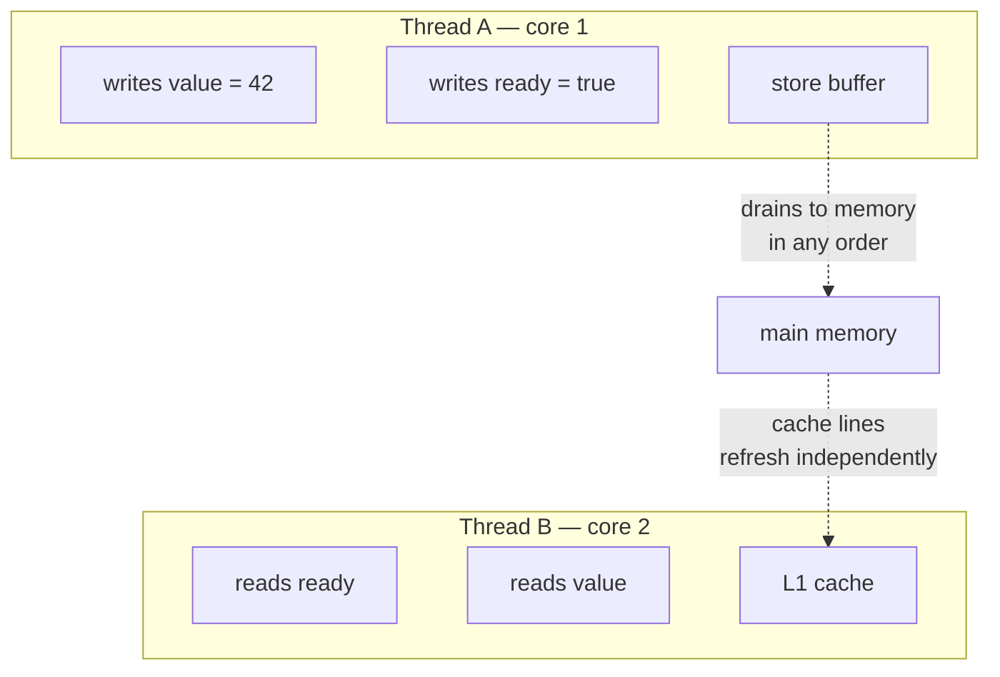
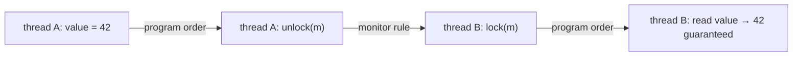
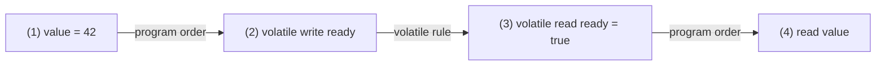
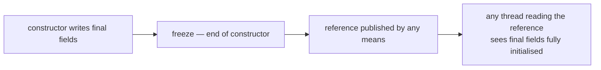

# The Java Memory Model

<!-- video:start -->
<figure class="pb-video">
<video controls playsinline preload="metadata">
<source src="../../videos/ch26.mp4" type="video/mp4">
<track kind="subtitles" srclang="en" label="English" src="../../videos/ch26.vtt">
</video>
<figcaption>Video walkthrough · 6:55 · subtitles via CC · <a href="../../videos/ch26.mp4" download>Download MP4</a></figcaption>
</figure>
<!-- video:end -->

## 1. Purpose & Audience

**Band:** L4 Architect · **Prerequisites:** [Shared State & Synchronization](25-shared-state.md)

[Chapter 25](25-shared-state.md) gave the practical rules: synchronise reads as well as writes, use `volatile` for flags, never let `this` escape a constructor. This chapter gives the reason those rules are sufficient — the formal model that says what a Java program is permitted to observe.

Most developers never need it. You need it when code that passed every test on a laptop fails intermittently on an ARM server, when you are reviewing lock-free code, or when someone argues that a data race is "benign".

This chapter answers three questions:

1. **What does the JVM actually promise** about when one thread sees another's writes?
2. **What is happens-before**, and how do you use it to prove code correct?
3. **Why does code that works on x86 break on ARM**?

---

## 2. The Problem

This program can print `0`:

```java title="Reordering.java"
class Publisher {
    int value;
    boolean ready;

    void publish() {             // thread A
        value = 42;
        ready = true;
    }

    void consume() {             // thread B
        if (ready) {
            System.out.println(value);    // may print 0
        }
    }
}
```

Thread B sees `ready == true` and `value == 0`. The writes appear to have happened in the wrong order.

Nothing is broken. The compiler may reorder the two writes because, within thread A, their order is unobservable. The CPU may reorder them through its store buffer. And thread B's cached view of memory may update `ready` before `value`. All three are legal, and on some hardware all three happen.

Worse, it is **platform-dependent**. On x86, which has a strong memory model, this particular reordering almost never appears. On ARM — including cloud instances and Apple Silicon development machines — it does. Code tested on one and deployed to the other is where these bugs surface.

---

## 3. Mental Model

### 3.1 There is no global "now"



Each core has its own store buffer and caches. A write becomes visible to other cores **eventually, and not necessarily in program order**. Without explicit synchronisation there is no guarantee about *when*, or in *what order*, another thread observes your writes.

The Java Memory Model (JMM) does not describe hardware. It defines an abstract contract: which values a read is **permitted** to return. The JVM then implements that contract on whatever hardware it runs on, inserting barriers where the hardware is weaker than the contract requires.

### 3.2 Happens-before

The contract is built on one relation. If action X **happens-before** action Y, then X's effects are visible to Y and X is ordered before Y.



Happens-before is **transitive**. That is what makes it usable: you chain individual rules into a path from a write to a read, and if a path exists, the read sees the write.

### 3.3 The key theorem

**A correctly synchronised program behaves as if sequentially consistent.** This is the DRF-SC guarantee — data-race-free implies sequential consistency.

A **data race** is two accesses to the same variable, at least one a write, from different threads, with no happens-before ordering between them. Eliminate every data race and you may reason about your program as if statements executed one at a time in some interleaving — which is the model most developers assume anyway.

That is the practical payoff of the whole chapter. You do not need to reason about store buffers and caches. You need to ensure every shared variable is accessed under a happens-before relationship, and then the intuitive model holds.

---

## 4. Core Reference

### 4.1 The happens-before rules

| Rule | Guarantee |
|---|---|
| **Program order** | Each action in a thread happens-before every later action in that thread |
| **Monitor lock** | An unlock of monitor *m* happens-before every subsequent lock of *m* |
| **Volatile** | A write to volatile *v* happens-before every subsequent read of *v* |
| **Thread start** | `t.start()` happens-before every action in *t* |
| **Thread termination** | Every action in *t* happens-before another thread detects *t* ended (`join`, `isAlive`) |
| **Interruption** | `t.interrupt()` happens-before *t* detects the interrupt |
| **Finalizer** | Constructor end happens-before the finalizer starts |
| **Transitivity** | If A hb B and B hb C, then A hb C |

### 4.2 `java.util.concurrent` guarantees

The concurrency library documents its own happens-before edges, which is what makes it composable:

| Operation | Happens-before |
|---|---|
| `BlockingQueue.put(x)` | The `take()` that retrieves *x* |
| `ExecutorService.submit(task)` | The task's execution |
| Task completion | `Future.get()` returning |
| `CountDownLatch.countDown()` | `await()` returning |
| `ConcurrentHashMap.put(k, v)` | A subsequent `get(k)` returning *v* |
| `Semaphore.release()` | A subsequent `acquire()` |
| `CompletableFuture` completion | Dependent stages |

This is why handing an object through a `BlockingQueue` is safe without any other synchronisation: the queue supplies the edge.

### 4.3 Safe publication idioms

An object is **safely published** when the reference and the object's state become visible together. The four idioms:

| Idiom | Example |
|---|---|
| Static initialiser | `static final Config CONFIG = load();` |
| `volatile` or `AtomicReference` field | `private volatile Config config;` |
| `final` field of a properly constructed object | `private final Config config;` set in the constructor |
| Field guarded by a lock | Written and read under the same `synchronized` |

Plus anything that goes through a `java.util.concurrent` handoff from §4.2.

### 4.4 `VarHandle` access modes

| Mode | Guarantees | Cost |
|---|---|---|
| Plain | Nothing across threads | Cheapest |
| Opaque | Eventually visible; no tearing; per-variable coherence | Low |
| Acquire / Release | One-directional ordering | Medium |
| Volatile | Full sequential consistency for that variable | Highest |

Most code needs only plain (single-threaded) or volatile (shared). The intermediate modes exist for lock-free data structures, where a release write paired with an acquire read is sufficient and cheaper than full volatile semantics.

---

## 5. Worked Examples

### 5.1 Fixing the publisher with `volatile`

```java title="VolatilePublisher.java"
class Publisher {
    int value;
    volatile boolean ready;          // the only change

    void publish() {
        value = 42;                  // (1)
        ready = true;                // (2) volatile write
    }

    void consume() {
        if (ready) {                 // (3) volatile read
            System.out.println(value);   // (4) always 42
        }
    }
}
```

The proof, as a happens-before chain:



(1) hb (2) by program order; (2) hb (3) by the volatile rule, because (3) read the value (2) wrote; (3) hb (4) by program order; so by transitivity (1) hb (4), and (4) must see 42.

Note what `value` did *not* need: it is not volatile. The volatile write to `ready` "piggybacks" the earlier plain write. This is how nearly all correct concurrent code works — one synchronised access carrying the visibility of everything before it.

### 5.2 Safe publication of an immutable object

```java title="UnsafePublication.java"
class PriceTable {
    private Map<Sku, Money> prices;            // NOT volatile, NOT final

    PriceTable(Map<Sku, Money> prices) {
        this.prices = new HashMap<>(prices);
    }
    Money priceFor(Sku sku) { return prices.get(sku); }
}

class Holder {
    PriceTable table;                           // plain field

    void refresh() { table = new PriceTable(load()); }    // thread A
    Money lookup(Sku s) { return table.priceFor(s); }      // thread B
}
```

Thread B can see a non-null `table` whose `prices` field is still null — or a `HashMap` whose internal table is partially constructed. The reference was published, but the object's state was not published *with* it.

Two independent fixes, either sufficient:

=== "Make the field final"
    ```java
    class PriceTable {
        private final Map<Sku, Money> prices;     // final
        ...
    }
    ```
    Final-field semantics guarantee any thread seeing the `PriceTable` reference sees `prices` fully initialised — see §6.2.

=== "Make the reference volatile"
    ```java
    class Holder {
        volatile PriceTable table;
    }
    ```
    The volatile write publishes everything written before it, including the constructor.

The first is better: it makes `PriceTable` safe **however** it is published, rather than depending on every holder getting it right.

### 5.3 Double-checked locking, and why `volatile` is mandatory

```java title="DoubleCheckedLocking.java"
private volatile PricingEngine engine;         // remove volatile and this is broken

PricingEngine engine() {
    PricingEngine local = engine;              // one volatile read on the fast path
    if (local == null) {
        synchronized (this) {
            local = engine;
            if (local == null) {
                engine = local = new PricingEngine();
            }
        }
    }
    return local;
}
```

Without `volatile`, the object's construction and the assignment of its reference are two sequences of writes with no ordering between them for a thread that never takes the lock. A thread on the fast path can see the reference before the constructor's writes — a non-null engine with default-valued fields.

The `volatile` write creates the happens-before edge: the constructor's writes precede the volatile write, which precedes any volatile read that sees the reference.

The simpler alternative is usually better:

```java title="HolderIdiom.java"
private static class Holder {
    static final PricingEngine ENGINE = new PricingEngine();
}
static PricingEngine engine() { return Holder.ENGINE; }
```

Class initialisation is guaranteed thread-safe by the JVM and lazy — `Holder` is not initialised until `engine()` is first called. No `volatile`, no lock, no subtlety.

### 5.4 `this` escaping the constructor

```java title="ThisEscape.java"
class OrderMonitor {
    private final Map<OrderId, Order> tracked;

    OrderMonitor(EventBus bus) {
        bus.register(this);                 // `this` escapes — constructor not finished
        this.tracked = new HashMap<>();
    }

    void onEvent(OrderEvent e) {
        tracked.put(e.orderId(), e.order());   // may run before tracked is assigned
    }
}
```

If the bus delivers an event on another thread before the constructor finishes, `tracked` is null. Final-field guarantees do not help: they apply only to objects **properly constructed** — meaning `this` did not escape during construction.

The fix is to separate construction from registration:

```java title="NoEscape.java"
class OrderMonitor {
    private final Map<OrderId, Order> tracked = new HashMap<>();

    private OrderMonitor() { }                        // registers nothing — `this` cannot escape

    static OrderMonitor create(EventBus bus) {
        OrderMonitor monitor = new OrderMonitor();    // fully constructed
        bus.register(monitor);                        // then published
        return monitor;
    }

    void onEvent(OrderEvent e) {
        tracked.put(e.orderId(), e.order());
    }
}
```

Java 21's `-Xlint:this-escape` warns about the most common forms at compile time.

### 5.5 A "benign" race, and why to be wary

```java title="StringHashCode.java"
// Simplified from java.lang.String
private int hash;           // not volatile

public int hashCode() {
    int h = hash;
    if (h == 0) {
        h = computeHash();  // deterministic — same result every time
        hash = h;
    }
    return h;
}
```

This is a genuine data race, and it is correct. Every thread either reads 0 and recomputes the same value, or reads the cached value. The worst case is redundant work, never a wrong answer — because an `int` write cannot tear, the computation is deterministic, and the local variable prevents a second read seeing a different value.

It is also the canonical example of why "benign race" arguments are dangerous. Change `int` to `long` and word tearing becomes possible. Read `hash` twice instead of into a local and the second read can return 0 after the first returned a value. Make the computation depend on mutable state and it is simply wrong. **The JDK authors can justify it; most application code cannot.**

---

## 6. Internals

### 6.1 How `volatile` is implemented

The JVM inserts memory barriers around volatile accesses:

| Barrier | Prevents |
|---|---|
| **LoadLoad** | A later load moving before an earlier load |
| **StoreStore** | A later store moving before an earlier store |
| **LoadStore** | A later store moving before an earlier load |
| **StoreLoad** | A later load moving before an earlier store — **the expensive one** |

A volatile write needs StoreStore before it and StoreLoad after; a volatile read needs LoadLoad and LoadStore after.

What each costs depends entirely on the hardware:

| | x86 (TSO) | ARM (weak) |
|---|---|---|
| Volatile read | **Plain load** — x86 already orders loads | Load + barrier |
| Volatile write | Locked instruction (StoreLoad) | Store + barriers |
| Plain reordering visible | Rarely — only store-then-load | Freely |

This is the whole reason for the x86-versus-ARM difference. x86's Total Store Order means the hardware already provides most of the guarantees, so missing synchronisation often goes unpunished. ARM provides very few, so the same missing synchronisation manifests. The JMM is the same on both; what differs is how much the hardware forgives.

### 6.2 Final field semantics



The JMM specifies a **freeze** at the end of the constructor. Any thread that obtains a reference to the object — through *any* publication, even an unsafe one — is guaranteed to see the final fields as the constructor left them, **and** anything reachable through them as of the freeze.

Three conditions:

- The object must be **properly constructed** — `this` must not escape during construction.
- The guarantee covers final fields and what they reference at freeze time, not later mutations.
- **Non-final fields get nothing** from this rule.

This is why immutable objects with all-final fields are thread-safe to share with no synchronisation at all, and why the record-plus-`List.copyOf` pattern in [Chapter 12](../02-language/12-java-14-to-17.md) is not just stylistic.

Java 26's JEP 500 begins warning when deep reflection mutates final fields — a step toward final genuinely meaning final, which strengthens exactly this guarantee.

### 6.3 Word tearing

The JLS permits a non-volatile write to a `long` or `double` to be performed as two separate 32-bit writes. A concurrent reader can then observe a value that was never written — the high half of one and the low half of another.

```java
private long totalPaise;            // may tear
private volatile long safeTotal;    // never tears
```

Every modern 64-bit JVM in practice writes 64-bit values atomically, but it is a specification permission, not a guarantee you hold. References and every other primitive type never tear.

### 6.4 What the compiler may do

Beyond hardware, the JIT reorders, hoists, and eliminates operations freely where single-threaded semantics are preserved:

```java title="Hoisting.java"
while (!stopped) {        // non-volatile read
    processNextOrder();
}
```

If `processNextOrder` is inlined and the JIT can see it never writes `stopped`, it may read `stopped` **once** before the loop and compile it as `while (true)`. The loop never terminates, and nothing is wrong with the JVM — the program had a data race, so the JMM permits this.

This is why visibility bugs often appear only after the JIT has compiled the method — in production, after warmup, never in a debugger running interpreted code.

### 6.5 Opaque, acquire, and release

`VarHandle` exposes weaker modes than volatile, for code that needs ordering without full sequential consistency:

```java title="AcquireRelease.java"
private static final VarHandle READY = ...;

void publish() {
    value = 42;
    READY.setRelease(this, true);      // earlier writes cannot move after this
}

void consume() {
    if ((boolean) READY.getAcquire(this)) {   // later reads cannot move before this
        use(value);
    }
}
```

Release/acquire provides exactly what the publisher pattern needs — the "one-directional" fence — and avoids the StoreLoad barrier that full volatile imposes. On ARM this is measurably cheaper.

**These modes are for writers of lock-free data structures.** Application code should use `volatile`, locks, and `java.util.concurrent`; the reasoning required to use weaker modes correctly is substantially harder, and the gain is rarely worth it outside a hot path in library code.

---

## 7. Production Patterns & Anti-Patterns

### Do this

- **Eliminate data races** rather than reasoning about them. A race-free program is sequentially consistent.
- **Make shared objects immutable with all-final fields.** They are safe to share however they are published.
- **Prove visibility with a happens-before chain** when reviewing concurrent code — name the rule at each step.
- **Use `java.util.concurrent` handoffs** — queues, futures, latches — which document their edges.
- **Use the holder-class idiom** for lazy singletons instead of double-checked locking.
- **Separate construction from publication**: build the object, then register it.
- **Test concurrent code on ARM** as well as x86, or with stress tools that expose reordering.
- **Enable `-Xlint:this-escape`** on Java 21+.

### Never do this

- **Never argue a data race is "benign"** in application code. The JDK can justify `String.hashCode`; you usually cannot.
- **Never write double-checked locking without `volatile`.** It publishes a partially constructed object.
- **Never let `this` escape a constructor.** It voids final-field guarantees.
- **Never assume x86 behaviour generalises.** Its strong ordering hides bugs that ARM exposes.
- **Never rely on non-volatile `long`/`double` being atomic** across threads.
- **Never use `VarHandle` acquire/release modes** in application code without a measured reason and a proof.
- **Never trust a passing test as proof of thread-safety.** Races manifest on specific hardware, under specific JIT decisions.

---

## 8. Version Evolution (Java 8 → 26)

| Version | What changed | Impact |
|---|---|---|
| **5** | **JSR-133 — the JMM rewritten** | Happens-before, final-field semantics, a working `volatile`; DCL becomes fixable |
| **8** | `StampedLock`; `LongAdder` | New synchronisers with documented edges |
| **9** | **`VarHandle` (JEP 193)** | Explicit access modes: plain, opaque, acquire/release, volatile |
| **21** | Virtual threads; `-Xlint:this-escape` | Same JMM applies to virtual threads; compiler flags constructor escape |
| **24** | JEP 491 — `synchronized` no longer pins virtual threads | Monitor semantics unchanged |
| **26** | **JEP 500 — warnings on reflective final-field mutation** | Toward final meaning final, strengthening safe publication |

### Migration note

The JMM has been stable since Java 5; nothing in a modern upgrade changes what a correct program may observe. What changes is **where the code runs**. Moving from x86 servers to ARM instances — increasingly common for cost reasons — is effectively a concurrency audit, because ARM's weaker ordering exposes data races that x86 tolerated.

Before such a move, grep for the usual suspects: double-checked locking without `volatile`, non-volatile flags polled in loops, objects published through plain fields, and anything described in a comment as a benign race.

---

## 9. Interview Questions

### L1 — Foundations

**Q1. What is the Java Memory Model?** ⭐ *high frequency*
The specification of what values a read may return when multiple threads access shared memory. It does not describe hardware; it defines an abstract contract built on the happens-before relation, and the JVM implements that contract on each platform by inserting memory barriers where the hardware is weaker than the contract requires.

**Q2. What is happens-before?**
A partial ordering between actions: if X happens-before Y, then X's effects are visible to Y and X is ordered before it. It is established by rules — program order within a thread, unlock before lock of the same monitor, a volatile write before a later read of it, thread start and join — and it is transitive, so individual rules chain into a path from a write to a read.

**Q3. What is a data race?**
Two accesses to the same variable from different threads, at least one a write, with no happens-before ordering between them. A program with no data races is guaranteed to behave as if sequentially consistent, which is the model most developers assume without realising it depends on correct synchronisation.

### L2 — Professional

**Q4. Why can a thread see `ready == true` but `value == 0`?** ⭐ *high frequency*
Because without synchronisation the two writes have no ordering visible to another thread. The compiler may reorder them, the CPU's store buffer may drain them out of order, and the reading core's cache may update one before the other — all legal. Making `ready` volatile fixes it: the earlier plain write to `value` happens-before the volatile write by program order, which happens-before the volatile read that sees it, so by transitivity the reader must see 42.

**Q5. What does safe publication mean?**
Making an object's reference and its fully-constructed state visible to other threads together. The standard idioms are a static initialiser, a `volatile` or `AtomicReference` field, a `final` field of a properly constructed object, a field guarded by a lock, or a handoff through a `java.util.concurrent` structure. Publishing through a plain field risks another thread seeing a non-null reference to an object whose fields are still defaults.

**Q6. Why does double-checked locking require `volatile`?**
Because a thread on the fast path reads the field without taking the lock, so nothing orders the constructor's writes against the assignment of the reference. It can see the reference before the object is initialised. The volatile write establishes the happens-before edge: constructor writes precede it by program order, and it precedes any volatile read that observes the reference. The holder-class idiom avoids the problem entirely.

### L3 — Enterprise

**Q7. What do final fields guarantee?**
That any thread obtaining a reference to a properly constructed object sees its final fields — and everything reachable through them as of the end of the constructor — fully initialised, regardless of how the reference was published. The JMM specifies a freeze at constructor end. The conditions matter: `this` must not escape during construction, the guarantee covers only final fields, and it does not extend to mutations after the freeze.

**Q8. Why does concurrent code that works on x86 fail on ARM?**
Because x86 has a strong memory model — Total Store Order — that already provides most of the ordering the JMM requires, so missing synchronisation frequently goes unpunished. ARM has a weak model that reorders freely, so the same data race manifests. The JMM is identical on both; what differs is how much the hardware forgives. Migrating to ARM instances is effectively a concurrency audit.

**Q9. Why might a loop polling a non-volatile flag never terminate?**
Because the JIT may observe that nothing in the loop writes the flag, hoist the read out of the loop, and compile it as an infinite loop. That is permitted: the program has a data race, so the JMM places no constraint on what the read returns. It typically appears only after the method is JIT-compiled — in production, after warmup — and never in a debugger running interpreted code, which is why it is so hard to reproduce.

### L4 — Architect

**Q10. Someone argues a data race in your codebase is benign. How do you evaluate it?**
Require the argument to hold under every permitted behaviour, not just the likely one. `String.hashCode` is benign because the field is an `int` that cannot tear, the computation is deterministic, the value is read once into a local, and the worst outcome is redundant recomputation. Change any of those — a `long`, two reads of the field, a computation depending on mutable state — and it is simply wrong. The practical position is that application code should not contain intentional races: the analysis is subtle, fragile under refactoring, and the cost of synchronising is almost always negligible.

**Q11. How would you review a piece of lock-free code?**
Demand a happens-before argument for every shared access, naming the rule at each step, because lock-free code has no lock to provide the edges implicitly. Check that every compare-and-set loop handles contention and the ABA problem where references are reused, that weaker `VarHandle` modes are justified by measurement and accompanied by a proof, and that there is a stress test — ideally with a tool that exposes reorderings — run on weakly-ordered hardware. Then ask whether it needs to be lock-free at all, since a `ConcurrentHashMap` or a lock is usually fast enough and far easier to verify.

**Q12. What is the most important consequence of DRF-SC for day-to-day engineering?**
That you do not have to reason about caches, store buffers, and compiler reordering — provided you eliminate data races. Every shared variable accessed under a happens-before relationship, whether through a lock, a volatile, a final field, or a concurrent collection, restores the intuitive model where statements execute one at a time in some interleaving. That turns concurrency correctness from a hardware question into a discipline question: identify shared mutable state, and ensure every access to it is ordered. Everything subtler is only necessary when you deliberately step outside that discipline.

---

!!! abstract "Cheat Sheet"
    **The JMM defines what a read may return** — an abstract contract, not a hardware description

    **Happens-before:** program order · unlock → lock · volatile write → read · start · join · **transitive**

    **Data race** = two accesses, one a write, different threads, no happens-before

    **DRF-SC:** no data races ⇒ behaves as sequentially consistent — the one theorem that matters

    **Volatile piggybacking** — one volatile write publishes every plain write before it

    **Safe publication:** static init · volatile/`AtomicReference` · final field · lock · j.u.c. handoff

    **Final fields freeze at constructor end** — visible however published, *if* `this` didn't escape

    **DCL needs `volatile`** — or use the holder-class idiom and skip it

    **x86 (TSO) forgives, ARM does not** — moving to ARM is a concurrency audit

    **JIT may hoist non-volatile reads** out of loops — infinite loop, legally

    **`long`/`double` may tear** without `volatile` — a spec permission

    **`VarHandle` acquire/release** is for lock-free library code, not applications
