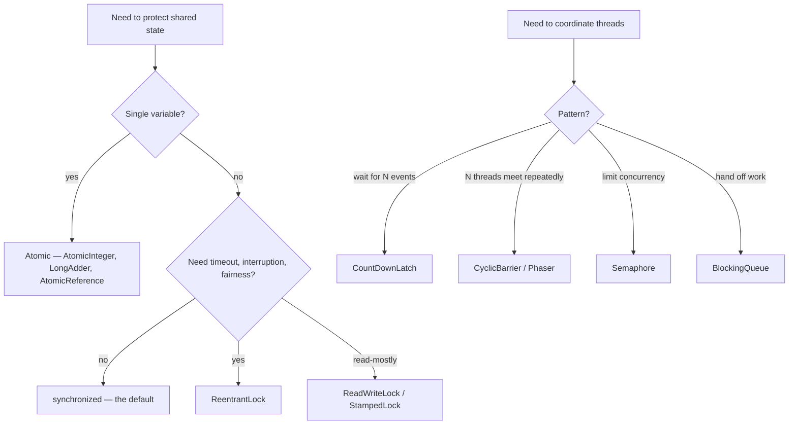
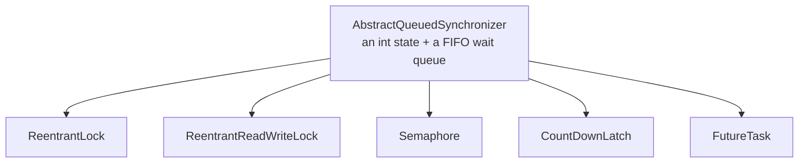
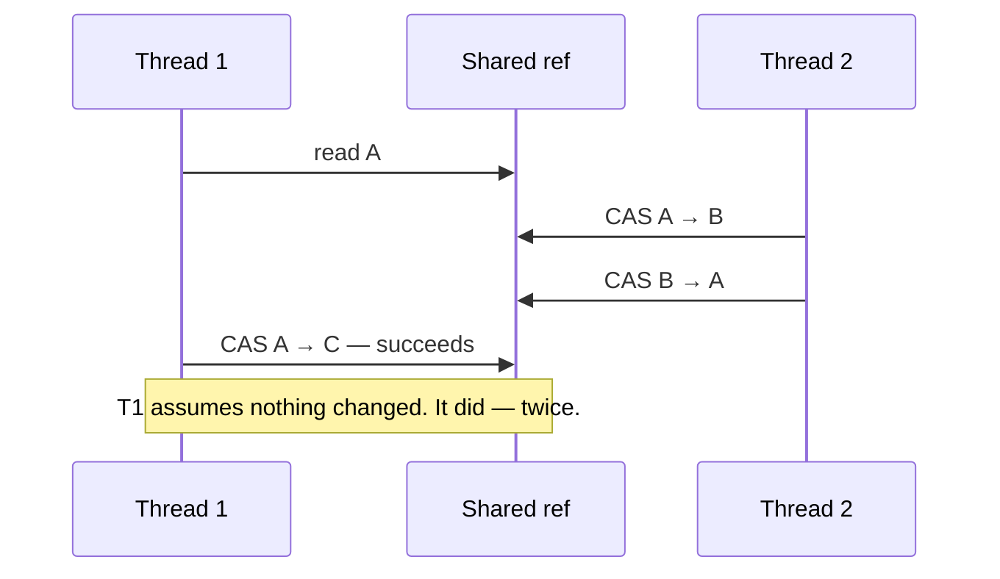
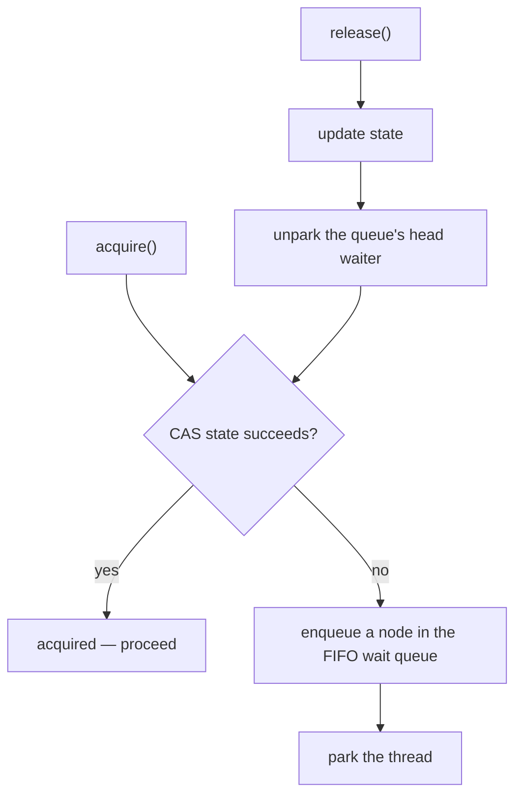
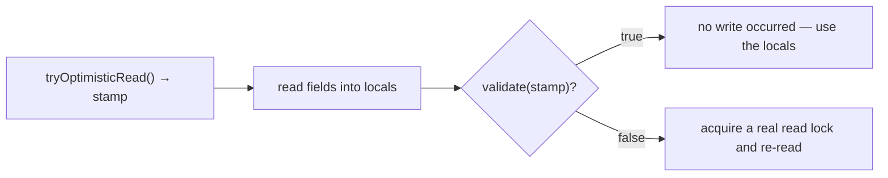

# Locks, Atomics & java.util.concurrent

<!-- video:start -->
<figure class="pb-video">
<video controls playsinline preload="metadata">
<source src="../../videos/ch27.mp4" type="video/mp4">
<track kind="subtitles" srclang="en" label="English" src="../../videos/ch27.vtt">
</video>
<figcaption>Video walkthrough · 5:54 · subtitles via CC · <a href="../../videos/ch27.mp4" download>Download MP4</a></figcaption>
</figure>
<!-- video:end -->

## 1. Purpose & Audience

**Band:** L3 Enterprise · **Prerequisites:** [Shared State & Synchronization](25-shared-state.md), [The Java Memory Model](26-java-memory-model.md)

`synchronized` covers most locking needs, and it should be the default. But it has fixed limits — no timeout, no interruption, no fairness, one condition per monitor, and a lifetime tied to a block. `java.util.concurrent` exists for the cases that hit those limits, plus a set of coordination tools that express common patterns more clearly than any lock.

This chapter answers three questions:

1. **When does `synchronized` stop being enough**, and what replaces it?
2. **When do atomics beat locks** — and what is the ABA problem?
3. **Which synchroniser fits which coordination pattern?**

---

## 2. The Problem

Four requirements `synchronized` cannot express.

**Give up after a timeout.** Reserving stock during checkout must not block forever if another thread holds the lock — the customer is waiting.

```java
synchronized (inventory) { ... }      // waits indefinitely, cannot be cancelled
```

**Let readers proceed concurrently.** The price table is read thousands of times per second and updated once a minute. `synchronized` serialises every read.

**Wait for something to happen.** Start dispatching only after all five vendor connections are established.

**Limit concurrency.** At most 20 concurrent calls to the warehouse API.

Each has a purpose-built answer. Reaching for `synchronized` plus `wait`/`notify` to build them yourself produces code that is longer, slower, and wrong more often.

---

## 3. Mental Model

### 3.1 The toolbox



### 3.2 Locks versus atomics

| | Lock | Atomic (CAS) |
|---|---|---|
| Scope | Any block of code | One variable |
| On contention | Threads **wait** | Threads **retry** |
| Deadlock possible | Yes | No |
| Composes across variables | Yes | No |
| Best under | High contention, long critical sections | Low-to-moderate contention, single-variable updates |

The retry-versus-wait distinction is the core. A CAS loop never blocks, so it cannot deadlock and never parks a thread — but under heavy contention every thread spins retrying, burning CPU. A lock parks waiters, which is cheaper when the critical section is long or contention is high.

### 3.3 Everything is built on one class



`ReentrantLock`, `Semaphore`, `CountDownLatch`, and most of the rest are thin layers over **AQS**: an atomic integer meaning something different to each, and a queue of parked threads. Understanding AQS explains all of them at once — see §6.1.

---

## 4. Core Reference

### 4.1 `ReentrantLock`

| Method | Behaviour |
|---|---|
| `lock()` | Acquire, waiting indefinitely |
| `tryLock()` | Acquire if free, otherwise return `false` immediately |
| `tryLock(timeout, unit)` | Wait up to the timeout |
| `lockInterruptibly()` | Wait, but respond to interruption |
| `unlock()` | Release — **always in `finally`** |
| `newCondition()` | A `Condition` — multiple per lock |
| `new ReentrantLock(true)` | Fair — FIFO order, much lower throughput |

### 4.2 Read-write locks

| Lock | Readers | Writers | Reentrant | Notes |
|---|---|---|---|---|
| `ReentrantReadWriteLock` | Concurrent | Exclusive | Yes | Readers can starve writers |
| `StampedLock` | Concurrent, **or optimistic** | Exclusive | **No** | Fastest for read-mostly; easy to misuse |

### 4.3 Atomics

| Class | Use |
|---|---|
| `AtomicInteger`, `AtomicLong` | Counters, sequence numbers |
| `AtomicBoolean` | Once-only flags |
| `AtomicReference<V>` | Swapping an immutable object |
| `LongAdder`, `DoubleAdder` | **High-contention counters** — striped |
| `LongAccumulator` | Striped with a custom function (max, min) |
| `AtomicStampedReference<V>` | CAS with a version stamp — solves ABA |
| `AtomicIntegerArray` etc. | Per-element atomicity |

Key methods:

| Method | Behaviour |
|---|---|
| `get()` / `set(v)` | Volatile read / write |
| `compareAndSet(expected, new)` | CAS; returns success |
| `incrementAndGet()` | Atomic increment |
| `updateAndGet(fn)` | CAS loop with a function — **`fn` may run repeatedly** |
| `accumulateAndGet(x, fn)` | Same, combining with `x` |

### 4.4 Synchronisers

| Synchroniser | Pattern | Reusable |
|---|---|---|
| `CountDownLatch(n)` | Wait until *n* events have occurred | **No** — one-shot |
| `CyclicBarrier(n)` | *n* threads wait for each other, repeatedly | Yes |
| `Phaser` | Barrier with a dynamic number of parties | Yes |
| `Semaphore(n)` | At most *n* concurrent holders | Yes |
| `Exchanger<V>` | Two threads swap objects | Yes |

---

## 5. Worked Examples

### 5.1 Timed lock acquisition

```java title="StockReservation.java"
public final class InventoryItem {

    private final ReentrantLock lock = new ReentrantLock();
    private int available;

    public ReservationResult reserve(int quantity) throws InterruptedException {
        if (!lock.tryLock(200, TimeUnit.MILLISECONDS)) {
            return ReservationResult.busy();          // fail fast; the customer is waiting
        }
        try {
            if (available < quantity) {
                return ReservationResult.insufficient(available);
            }
            available -= quantity;
            return ReservationResult.reserved(quantity);
        } finally {
            lock.unlock();                             // ALWAYS in finally
        }
    }
}
```

`tryLock` with a timeout turns a potential indefinite hang into a bounded, reportable failure. It also breaks one of the four deadlock conditions — no preemption — because a thread that cannot acquire gives up rather than holding what it has while waiting.

The `finally` is non-negotiable. With `synchronized`, the JVM releases the monitor on any exit including exceptions. With `ReentrantLock`, **nothing releases it unless you do**, and a missed `unlock()` on an exception path leaves the lock held forever.

### 5.2 Read-mostly data with `StampedLock`

```java title="PriceTable.java"
public final class PriceTable {

    private final StampedLock lock = new StampedLock();
    private Map<Sku, Money> prices = Map.of();

    public Money priceFor(Sku sku) {
        long stamp = lock.tryOptimisticRead();          // no lock taken at all
        Map<Sku, Money> snapshot = prices;
        if (!lock.validate(stamp)) {                    // a write happened meanwhile
            stamp = lock.readLock();                    // fall back to a real read lock
            try {
                snapshot = prices;
            } finally {
                lock.unlockRead(stamp);
            }
        }
        return snapshot.get(sku);
    }

    public void replace(Map<Sku, Money> updated) {
        long stamp = lock.writeLock();
        try {
            prices = Map.copyOf(updated);
        } finally {
            lock.unlockWrite(stamp);
        }
    }
}
```

The optimistic read takes **no lock**: it reads a stamp, reads the data, and validates that no write occurred in between. In the common case — no concurrent writer — it costs almost nothing. Only on a conflict does it fall back to a real read lock.

Two cautions. **`StampedLock` is not reentrant**, so acquiring it twice on one thread deadlocks. And the data read optimistically must be read into locals and validated *before* use, because it may be inconsistent.

For this particular shape — replace the whole table rarely, read it constantly — a simpler answer often wins:

```java title="VolatileSwap.java"
private volatile Map<Sku, Money> prices = Map.of();

public Money priceFor(Sku sku) { return prices.get(sku); }
public void replace(Map<Sku, Money> updated) { prices = Map.copyOf(updated); }
```

An immutable map behind a volatile reference: readers take no lock, writers swap atomically. When updates replace the whole value, this beats any lock.

### 5.3 CAS and `updateAndGet`

```java title="AtomicCounters.java"
private final AtomicLong nextOrderNumber = new AtomicLong(100_000);

public long allocate() {
    return nextOrderNumber.incrementAndGet();
}

// Track the highest order value seen
private final AtomicReference<Money> highestOrder = new AtomicReference<>(Money.ZERO);

public void record(Money value) {
    highestOrder.updateAndGet(current -> current.max(value));
}
```

`updateAndGet` is a CAS loop: read, compute, compare-and-set, retry on failure. Under contention **the function runs more than once**, which means it must be **pure** — no side effects, no logging, no I/O:

```java title="SideEffectInCas.java"
counter.updateAndGet(c -> {
    auditLog.record(c);        // WRONG — may be recorded several times
    return c + 1;
});
```

### 5.4 `LongAdder` for contended counters

```java title="Metrics.java"
private final LongAdder reservationsAttempted = new LongAdder();

public void onReservation() {
    reservationsAttempted.increment();
}

public long total() {
    return reservationsAttempted.sum();     // not a snapshot under concurrent writes
}
```

Under heavy write contention `AtomicLong` degrades badly: every thread CASes the same memory location and most fail and retry. `LongAdder` stripes across cells — each thread tends to update its own — and sums on read.

| | `AtomicLong` | `LongAdder` |
|---|---|---|
| Write under contention | Degrades | Scales |
| Read | Exact, cheap | Sums every cell; not a point-in-time snapshot |
| Use for | Sequence numbers, exact values | Metrics, statistics |

The rule: `AtomicLong` when you need an exact value per operation — an ID — and `LongAdder` for anything you only read occasionally.

### 5.5 Coordinating with synchronisers

```java title="Synchronisers.java"
// Wait until all vendor connections are up — one-shot
CountDownLatch ready = new CountDownLatch(vendors.size());
for (Vendor vendor : vendors) {
    executor.submit(() -> {
        vendor.connect();
        ready.countDown();
    });
}
if (!ready.await(30, TimeUnit.SECONDS)) {
    throw new IllegalStateException("vendors not ready");
}

// Limit concurrent calls to the warehouse API
Semaphore warehouseSlots = new Semaphore(20);
public InventoryStatus status(Sku sku) throws InterruptedException {
    warehouseSlots.acquire();
    try {
        return warehouseClient.statusFor(sku);
    } finally {
        warehouseSlots.release();
    }
}
```

`CountDownLatch` counts down once and cannot be reset — for repeated rendezvous use `CyclicBarrier` or `Phaser`. `Semaphore` is the right tool for bounding concurrency against a downstream limit, and it composes naturally with virtual threads ([Chapter 31](31-virtual-threads.md)): ten thousand virtual threads can exist while twenty hold permits.

### 5.6 The ABA problem



A CAS checks only that the value **equals** what was read, not that it was never changed. If the value went A → B → A, the CAS succeeds and the thread proceeds on a stale assumption.

It matters mostly in lock-free data structures that recycle nodes — a stack whose head node is popped, freed, and reallocated at the same address. For values that are immutable and never reused, it does not arise.

```java title="StampedReference.java"
AtomicStampedReference<Node> head = new AtomicStampedReference<>(initial, 0);

int[] stampHolder = new int[1];
Node current = head.get(stampHolder);
head.compareAndSet(current, next, stampHolder[0], stampHolder[0] + 1);
```

`AtomicStampedReference` pairs the reference with a version counter, so A-with-stamp-1 and A-with-stamp-3 are different values and the CAS fails correctly.

---

## 6. Internals

### 6.1 AbstractQueuedSynchronizer



AQS holds a single `volatile int state` and a queue of waiting threads. Each synchroniser defines what `state` means:

| Synchroniser | `state` means |
|---|---|
| `ReentrantLock` | Hold count — 0 is free, >0 is the reentrancy depth |
| `Semaphore` | Available permits |
| `CountDownLatch` | Remaining count |
| `ReentrantReadWriteLock` | High 16 bits readers, low 16 bits writer depth |

That is why these classes behave so consistently: the parking, queuing, interruption, and timeout logic is written once in AQS and inherited by all of them.

### 6.2 Why `ReentrantLock` parks rather than pins

Blocked threads in AQS are parked with `LockSupport.park()`, which virtual threads handle by unmounting from their carrier ([Chapter 31](31-virtual-threads.md)). So on Java 21–23, where `synchronized` pinned carriers, `ReentrantLock` did not — which is why the Java 21-era advice was to switch hot `synchronized` blocks to it.

**Java 24 removed that difference** (JEP 491). `synchronized` now unmounts correctly too, so the choice between them is back to features — timeout, interruption, fairness, multiple conditions — rather than virtual-thread compatibility.

### 6.3 How CAS works

`compareAndSet` compiles to a single hardware instruction — `LOCK CMPXCHG` on x86, a load-exclusive/store-exclusive pair on ARM. It atomically compares memory against an expected value and writes the new value only on a match.

It is **non-blocking** but not free. Under contention, cache lines holding the variable bounce between cores, and each failed CAS is wasted work. That is the whole motivation for `LongAdder`: spread writes across several cache lines so cores stop fighting over one.

### 6.4 Fairness

```java
new ReentrantLock(true);      // fair
new ReentrantLock();          // unfair — the default
```

A fair lock grants access in arrival order. An unfair lock lets a newly arriving thread "barge" ahead of queued waiters if the lock happens to be free.

Unfair is the default because it is dramatically faster: barging avoids a context switch when the lock is released and immediately re-acquired, which is the common case. Fairness costs throughput — often by an order of magnitude under contention — to prevent starvation, which is rarely the actual problem. Use it only where starvation has been observed.

`synchronized` has no fairness guarantee at all.

### 6.5 `StampedLock`'s optimistic read



The stamp is essentially a version number. A write increments it; `validate` checks whether it changed. No lock is taken on the optimistic path, so readers never block writers and never contend with each other.

The costs are in the rules: reads must go into locals before validating, because the data may be torn or inconsistent until validation succeeds; the lock is not reentrant; and it has no `Condition` support. It rewards careful use in genuinely read-dominated hot paths and punishes casual use.

---

## 7. Production Patterns & Anti-Patterns

### Do this

- **Default to `synchronized`.** It is scoped, auto-released, and reported by deadlock detection.
- **Use `ReentrantLock` for its features** — `tryLock` with a timeout, interruptibility, fairness, or several conditions.
- **Always `unlock()` in `finally`**, immediately after acquiring.
- **Use an immutable object behind a `volatile` reference** when updates replace the whole value.
- **Use `LongAdder` for contended metrics**, `AtomicLong` for exact values like IDs.
- **Keep `updateAndGet` functions pure** — they may run several times.
- **Use `Semaphore` to bound concurrency** against a downstream limit.
- **Use `CountDownLatch` for one-shot waits**, `CyclicBarrier` or `Phaser` for repeated ones.

### Never do this

- **Never call `unlock()` outside `finally`.** An exception leaves the lock held forever.
- **Never reacquire a `StampedLock` on the same thread.** It is not reentrant and will deadlock.
- **Never use a fair lock by default.** It costs substantial throughput to prevent a starvation problem you probably do not have.
- **Never put side effects in a CAS update function.**
- **Never reuse a `CountDownLatch`.** It is one-shot.
- **Never build a synchroniser from `wait`/`notify`** when `java.util.concurrent` has one.
- **Never use an atomic to coordinate several variables.** Atomics protect one variable; use a lock or an immutable swap.
- **Never convert `synchronized` to `ReentrantLock` for virtual threads on Java 24+.** JEP 491 made it unnecessary.

---

## 8. Version Evolution (Java 8 → 26)

| Version | What changed | Impact |
|---|---|---|
| **5** | `java.util.concurrent` — locks, atomics, synchronisers, AQS | The toolbox arrives |
| **7** | `Phaser`, `ForkJoinPool`, `TransferQueue` | Dynamic barriers and work stealing |
| **8** | **`StampedLock`**, **`LongAdder`**, `LongAccumulator`, atomic `updateAndGet` | Optimistic reads and striped counters |
| **9** | `VarHandle` | Low-level atomic access without `Unsafe` |
| **21** | Virtual threads; `synchronized` pins, j.u.c. locks do not | `ReentrantLock` briefly preferred for virtual threads |
| **24** | **JEP 491 — `synchronized` no longer pins** | The virtual-thread reason for `ReentrantLock` disappears |
| **26** | No changes | — |

### Migration note

On a codebase moving to Java 24+, look for `ReentrantLock` conversions made on Java 21–23 purely to avoid virtual-thread pinning. They are now unnecessary, and `synchronized` is simpler — auto-released on exceptions, and reported by `jcmd Thread.print` deadlock detection, which `ReentrantLock` is not. Revert them where no other feature is used.

Separately, a sweep worth doing on any codebase: `AtomicLong` used purely for metrics under concurrent writes → `LongAdder`, which removes a contention point with no semantic change for code that only reads occasionally.

---

## 9. Interview Questions

### L1 — Foundations

**Q1. What is the difference between `synchronized` and `ReentrantLock`?** ⭐ *high frequency*
Both provide mutual exclusion and are reentrant. `ReentrantLock` adds timed acquisition with `tryLock`, interruptible waiting, optional fairness, and multiple condition variables. The cost is that you must release it yourself, in a `finally` block, whereas `synchronized` is released automatically on any exit. Default to `synchronized` and switch only when you need one of those features.

**Q2. What is an atomic variable?**
A variable whose updates are performed atomically without a lock, using a hardware compare-and-swap instruction. `AtomicInteger.incrementAndGet()` is safe across threads where `count++` is not. Atomics protect a single variable; coordinating several requires a lock.

**Q3. What is a `CountDownLatch`?**
A one-shot synchroniser initialised with a count. Threads call `countDown()` as events occur and other threads call `await()` to block until the count reaches zero. It cannot be reset — for repeated coordination use `CyclicBarrier` or `Phaser`.

### L2 — Professional

**Q4. Why must `unlock()` be in a `finally` block?** ⭐ *high frequency*
Because nothing else releases a `ReentrantLock`. If an exception is thrown between `lock()` and `unlock()`, the lock stays held permanently and every other thread waiting on it blocks forever. `synchronized` does not have this problem — the JVM releases the monitor on any exit — which is one reason it should remain the default.

**Q5. When would you use `LongAdder` instead of `AtomicLong`?**
For counters with heavy concurrent writes and occasional reads, such as metrics. `AtomicLong` has every thread CAS the same memory location, so under contention most attempts fail and retry. `LongAdder` stripes updates across cells and sums on read, which scales far better, at the cost of `sum()` not being a point-in-time snapshot. Use `AtomicLong` where each operation needs an exact value, such as allocating IDs.

**Q6. What is the risk in `AtomicReference.updateAndGet`?**
The function passed to it may run more than once, because it is a compare-and-set loop that retries on contention. It must therefore be pure — no logging, no I/O, no mutation of anything else — or those effects will happen a variable number of times. The same applies to `accumulateAndGet` and the equivalent methods on every atomic class.

### L3 — Enterprise

**Q7. What is the ABA problem?**
A compare-and-set checks only that a value equals what was previously read, not that it was never changed. If another thread changes it from A to B and back to A, the CAS succeeds and the first thread proceeds on a stale assumption. It matters chiefly in lock-free structures that recycle nodes; `AtomicStampedReference` solves it by pairing the reference with a version counter so the CAS fails when the stamp has moved.

**Q8. How does `StampedLock`'s optimistic read work?**
`tryOptimisticRead` returns a stamp without taking any lock; you read fields into locals, then call `validate(stamp)` to check that no write occurred meanwhile. If validation succeeds, the reads are consistent and no locking happened at all; if it fails, you fall back to a real read lock and re-read. It is the fastest read-mostly option but it is not reentrant, has no condition support, and requires reading into locals before validating because the data may be inconsistent until then.

**Q9. What is AQS and why does it matter?**
`AbstractQueuedSynchronizer` is the framework under `ReentrantLock`, `Semaphore`, `CountDownLatch`, `ReentrantReadWriteLock`, and `FutureTask`. It provides a single atomic `int` state, whose meaning each synchroniser defines — hold count, permits, remaining count — plus a FIFO queue of parked threads. Parking, queuing, interruption, and timeouts are implemented once and inherited by all of them, which is why they behave so consistently.

### L4 — Architect

**Q10. How do you choose between a lock, an atomic, and an immutable swap?**
An atomic when the state is a single variable and the update is a compare-and-set — it cannot deadlock and never blocks. An immutable object behind a volatile reference when updates replace the whole value, because readers take no lock at all and writers swap atomically, which beats any read-write lock for read-mostly data. A lock when an invariant spans several variables, since neither alternative can protect a multi-variable invariant. The ordering reflects increasing cost and increasing generality.

**Q11. Should locks be fair?**
Rarely. A fair lock grants access in arrival order, preventing starvation, but it forces a context switch on every handoff that barging would avoid, and it commonly costs an order of magnitude in throughput under contention. Starvation is seldom the actual failure mode, so fairness should be introduced in response to observed starvation rather than as a precaution. It is also worth noting `synchronized` offers no fairness guarantee at all, so fairness is a positive reason to choose `ReentrantLock`, not a default.

**Q12. How did virtual threads change the choice between `synchronized` and `ReentrantLock`?**
Briefly, and then back again. On Java 21 to 23, a virtual thread blocking inside `synchronized` pinned its carrier platform thread, while `ReentrantLock` parked through AQS and unmounted correctly — so the guidance was to convert contended `synchronized` blocks. Java 24's JEP 491 removed pinning for `synchronized`, restoring it as the simpler default. The lasting lesson is that platform constraints produce workarounds that outlive them, so conversions made for Java 21 should be reverted where they bought nothing else.

---

!!! abstract "Cheat Sheet"
    **Default: `synchronized`** — scoped, auto-released, reported by deadlock detection

    **`ReentrantLock` for features:** `tryLock(timeout)` · `lockInterruptibly` · fairness · multiple `Condition`s

    **`unlock()` in `finally`, always** — nothing else releases it

    **Read-mostly:** immutable map behind `volatile` beats any lock when updates replace the whole value

    **`StampedLock`:** optimistic reads, fastest — **not reentrant**, read into locals, then validate

    **Atomics = one variable, retry not wait** — cannot deadlock

    **`LongAdder` for contended metrics · `AtomicLong` for exact values (IDs)**

    **`updateAndGet` functions may run repeatedly** — keep them pure

    **ABA:** CAS checks equality, not history → `AtomicStampedReference`

    **`CountDownLatch` one-shot · `CyclicBarrier`/`Phaser` repeat · `Semaphore` bounds concurrency**

    **Everything sits on AQS** — one `int` state + a FIFO queue of parked threads

    **Unfair is the default** for good reason — fairness costs throughput

    **Java 24:** `synchronized` no longer pins — revert Java 21-era `ReentrantLock` conversions
