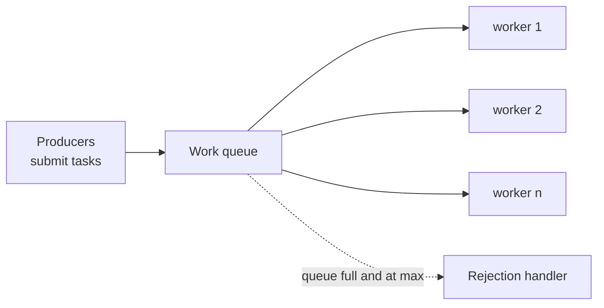
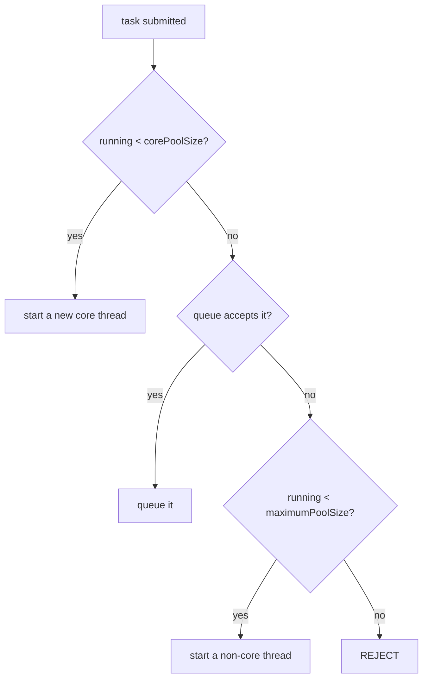
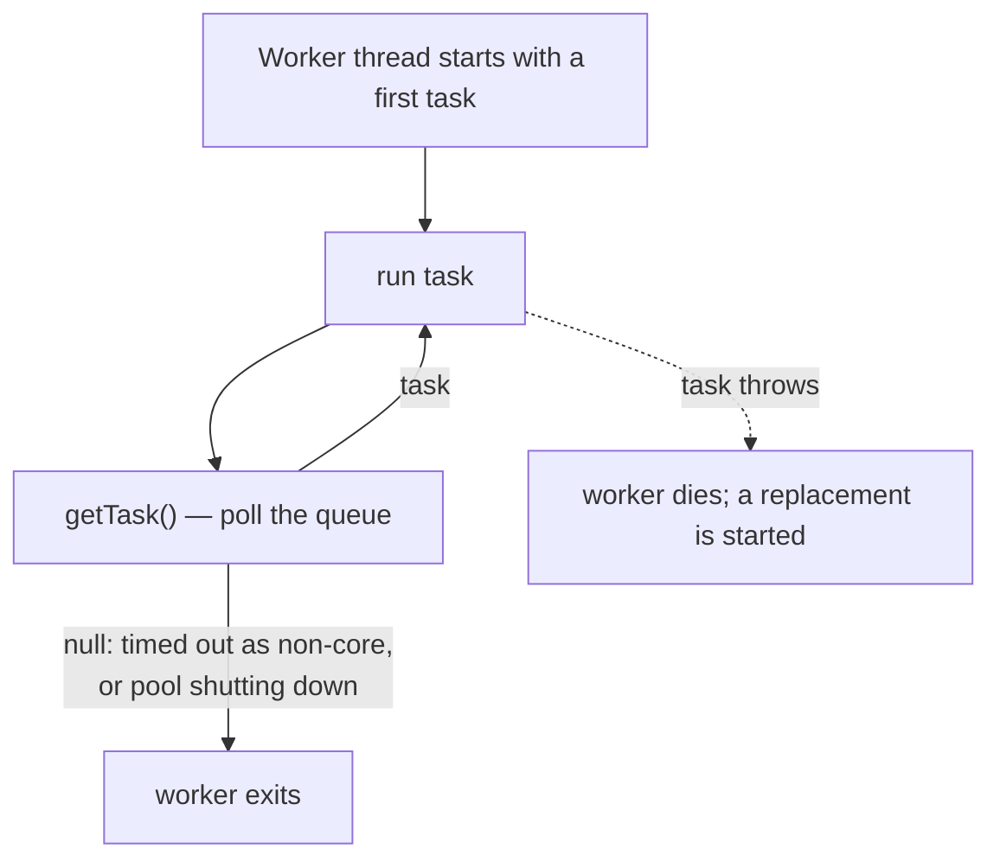
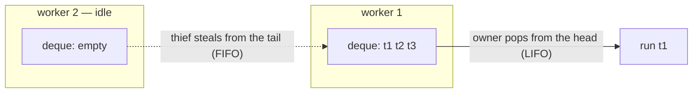

# Executors & Thread Pool Design

<!-- video:start -->
<figure class="pb-video">
<video controls playsinline preload="metadata">
<source src="../../videos/ch28.mp4" type="video/mp4">
<track kind="subtitles" srclang="en" label="English" src="../../videos/ch28.vtt">
</video>
<figcaption>Video walkthrough · 6:09 · subtitles via CC · <a href="../../videos/ch28.mp4" download>Download MP4</a></figcaption>
</figure>
<!-- video:end -->

## 1. Purpose & Audience

**Band:** L3 Enterprise · **Prerequisites:** [Threading Fundamentals](24-threading-fundamentals.md), [Locks, Atomics & java.util.concurrent](27-locks-and-atomics.md)

The `Executors` factory methods are among the most-used and most-dangerous APIs in the JDK. Two of the four common ones have unbounded components that turn a load spike into an `OutOfMemoryError`, and all of them swallow exceptions in a way that makes failed tasks invisible.

Virtual threads changed a large part of this chapter's advice — for I/O-bound work you no longer size a pool at all. But CPU-bound work, scheduled work, and bulkheading still need pools, and the construction rules have not changed.

This chapter answers three questions:

1. **How does a `ThreadPoolExecutor` actually decide** whether to queue a task or start a thread?
2. **How big should a pool be** — and when is that the wrong question?
3. **Where do exceptions go**, and why do scheduled tasks stop silently?

---

## 2. The Problem

Three production incidents, one cause each.

**Out of memory under load:**

```java title="Unbounded.java"
ExecutorService pool = Executors.newFixedThreadPool(20);
// Backed by an UNBOUNDED LinkedBlockingQueue.
// When producers outpace 20 workers, the queue grows until the heap is gone.
```

**Thread explosion:**

```java title="Cached.java"
ExecutorService pool = Executors.newCachedThreadPool();
// Unbounded thread count. A burst of slow tasks creates thousands of platform threads.
```

**A nightly job that stopped running — and nobody noticed for a week:**

```java title="SilentSchedule.java"
scheduler.scheduleAtFixedRate(this::reconcile, 0, 1, TimeUnit.HOURS);
// reconcile() threw once. The schedule was cancelled. No log line.
```

Each is the default behaviour of a factory method, working as documented.

---

## 3. Mental Model

### 3.1 Decoupling submission from execution



An executor separates *what to run* from *which thread runs it*. The pool owns the threads; you own the tasks. That separation is what lets you bound concurrency, reuse threads, and shut everything down in one call.

### 3.2 The counterintuitive ordering

`ThreadPoolExecutor` has a core size, a maximum size, and a queue. People assume it grows toward the maximum before queuing. **It does the opposite.**



**Core threads first, then the queue, then extra threads.** Extra threads are only created when the queue refuses a task.

The consequence: with an **unbounded** queue, the queue never refuses, so `maximumPoolSize` is **never reached** and has no effect at all. `newFixedThreadPool` sets core and max equal, which hides this — but a hand-built pool with core 10, max 100, and an unbounded queue will run exactly 10 threads forever while its queue grows without limit.

### 3.3 The three kinds of work

| Workload | Constraint | Right tool |
|---|---|---|
| **CPU-bound** | Cores | Fixed pool ≈ core count |
| **I/O-bound** | Downstream capacity | **Virtual threads** + a `Semaphore` |
| **Scheduled** | Time | `ScheduledExecutorService` |
| **Divide-and-conquer** | Cores | `ForkJoinPool` |

Most sizing advice written before Java 21 is about the second row, and virtual threads have made it largely obsolete ([Chapter 31](31-virtual-threads.md)).

---

## 4. Core Reference

### 4.1 `ThreadPoolExecutor`'s parameters

| Parameter | Meaning |
|---|---|
| `corePoolSize` | Threads kept alive even when idle |
| `maximumPoolSize` | Ceiling — **only reached when the queue is full** |
| `keepAliveTime` | How long non-core threads idle before exiting |
| `workQueue` | Where tasks wait |
| `threadFactory` | Creates threads — **set it, to name them** |
| `handler` | What to do when saturated |

### 4.2 The factory methods and their hazards

| Factory | Queue | Threads | Hazard |
|---|---|---|---|
| `newFixedThreadPool(n)` | **Unbounded** `LinkedBlockingQueue` | Fixed *n* | OOM under sustained overload |
| `newCachedThreadPool()` | `SynchronousQueue` (no capacity) | **Unbounded** | Thread explosion on a burst |
| `newSingleThreadExecutor()` | **Unbounded** | 1 | OOM; serialises everything |
| `newScheduledThreadPool(n)` | Unbounded delay queue | Fixed *n* | Silent schedule cancellation |
| `newWorkStealingPool()` | Per-worker deques | ≈ cores | ForkJoin semantics |
| `newVirtualThreadPerTaskExecutor()` | None | One virtual thread per task | Unbounded concurrency — bound with a `Semaphore` |

For a production service, **construct `ThreadPoolExecutor` directly** with a bounded queue, a named thread factory, and a chosen rejection policy.

### 4.3 Queue types

| Queue | Capacity | Effect |
|---|---|---|
| `LinkedBlockingQueue()` | Unbounded | `max` ignored; unbounded memory |
| `LinkedBlockingQueue(n)` | Bounded | Backpressure once full |
| `ArrayBlockingQueue(n)` | Bounded, fixed array | Same, with lower allocation |
| `SynchronousQueue` | Zero — direct hand-off | Every task needs a free thread, or a new one |
| `PriorityBlockingQueue` | Unbounded | Tasks run by priority |

### 4.4 Rejection policies

| Policy | On saturation |
|---|---|
| `AbortPolicy` (default) | Throws `RejectedExecutionException` |
| `CallerRunsPolicy` | **The submitting thread runs the task itself** — natural backpressure |
| `DiscardPolicy` | Silently drops the task |
| `DiscardOldestPolicy` | Drops the oldest queued task, retries |

`CallerRunsPolicy` is the most useful and least known: when the pool is full, the producer is slowed down by having to do the work, which throttles submission automatically. The two discard policies lose work silently and are rarely what anyone wants.

### 4.5 Lifecycle

| Method | Behaviour |
|---|---|
| `shutdown()` | Stop accepting; finish queued and running tasks |
| `awaitTermination(timeout)` | Block until done or timeout |
| `shutdownNow()` | Interrupt running tasks; return the queued ones |
| `close()` (19+) | `shutdown` + wait — enables try-with-resources |

---

## 5. Worked Examples

### 5.1 A production-grade CPU pool

```java title="PricingPool.java"
int cores = Runtime.getRuntime().availableProcessors();

ThreadPoolExecutor pricingPool = new ThreadPoolExecutor(
    cores,                                         // core
    cores,                                         // max — CPU work gains nothing from more
    0L, TimeUnit.MILLISECONDS,
    new ArrayBlockingQueue<>(500),                 // BOUNDED
    Thread.ofPlatform().name("pricing-", 0).factory(),
    new ThreadPoolExecutor.CallerRunsPolicy());    // backpressure, not rejection
```

Every choice here addresses one of the §2 incidents. The bounded queue caps memory. Core equals max because CPU-bound work cannot benefit from more threads than cores. The named factory makes thread dumps readable. And `CallerRunsPolicy` means a saturated pool slows producers down instead of failing or dropping work.

`availableProcessors()` respects container CPU limits since Java 10, so this sizes correctly in a container with a fractional quota — which also means a container with a 0.5 CPU limit gets a pool of 1.

### 5.2 Sizing — and when not to

For CPU-bound work, the pool size is the core count. More threads add context-switching with no extra throughput.

For I/O-bound work, the classic formula:

```text
threads = cores × (1 + wait time / compute time)
```

A task that computes for 5 ms and waits on a database for 95 ms on an 8-core machine suggests 8 × 20 = 160 threads.

**On Java 21+, for I/O-bound work, do not do this.** Use virtual threads and bound the actual constraint:

```java title="IoBound.java"
private final Semaphore warehouseLimit = new Semaphore(40);    // what the downstream tolerates

try (var executor = Executors.newVirtualThreadPerTaskExecutor()) {
    for (Sku sku : skus) {
        executor.submit(() -> {
            warehouseLimit.acquire();
            try {
                return warehouseClient.statusFor(sku);
            } finally {
                warehouseLimit.release();
            }
        });
    }
}
```

The pool-size formula was always an indirect way of expressing a downstream limit through thread economics. A `Semaphore` expresses the limit directly, and virtual threads remove the reason the thread count ever mattered.

### 5.3 Where exceptions go

```java title="ExceptionVisibility.java"
ExecutorService pool = ...;

// execute(): exception reaches the thread's UncaughtExceptionHandler — logged, at least
pool.execute(() -> { throw new IllegalStateException("boom"); });

// submit(): exception is CAPTURED in the Future — invisible unless someone calls get()
pool.submit(() -> { throw new IllegalStateException("boom"); });
```

`submit` wraps the task in a `FutureTask`, which catches every exception and stores it. If the returned `Future` is discarded — and it very often is — **the failure is never seen**.

```java title="SurfacingFailures.java"
Future<Receipt> future = pool.submit(() -> dispatch(order));
try {
    Receipt receipt = future.get(10, TimeUnit.SECONDS);
} catch (ExecutionException e) {
    log.error("dispatch failed", e.getCause());        // the real exception
} catch (TimeoutException e) {
    future.cancel(true);
}
```

Either consume every `Future`, use `execute` for fire-and-forget tasks so the uncaught-exception handler sees failures, or wrap tasks in a try/catch that logs.

### 5.4 Scheduled tasks die silently

```java title="ScheduledSafe.java"
ScheduledExecutorService scheduler = Executors.newSingleThreadScheduledExecutor(
    Thread.ofPlatform().name("reconciler").factory());

// WRONG — one exception cancels every future run
scheduler.scheduleAtFixedRate(this::reconcile, 0, 1, TimeUnit.HOURS);

// RIGHT — catch inside the task so the schedule survives
scheduler.scheduleAtFixedRate(() -> {
    try {
        reconcile();
    } catch (Exception e) {
        log.error("reconciliation failed; will retry next run", e);
    }
}, 0, 1, TimeUnit.HOURS);
```

The documented behaviour: if any execution throws, **subsequent executions are suppressed.** The exception sits in the returned `ScheduledFuture`, which nobody holds. The job stops, silently, and stays stopped until the process restarts.

This is one of the most common production failures in Java, and the fix is a try/catch in every scheduled task.

A related distinction:

| Method | Timing |
|---|---|
| `scheduleAtFixedRate(task, delay, period)` | Start-to-start — runs may bunch up if one is slow |
| `scheduleWithFixedDelay(task, delay, delay)` | End-to-start — guaranteed gap between runs |

For anything that must not overlap or pile up, use fixed delay.

### 5.5 Bulkheads

```java title="Bulkheads.java"
ExecutorService paymentPool  = boundedPool("payment", 10, 100);
ExecutorService vendorPool   = boundedPool("vendor", 20, 200);
ExecutorService reportPool   = boundedPool("report", 2, 10);
```

Separate pools per downstream dependency means a slow vendor API saturates the vendor pool and nothing else — payments keep flowing. One shared pool lets any slow dependency starve every other.

With virtual threads the same isolation comes from **separate semaphores** rather than separate pools, which is cheaper and expresses the limit more directly. The principle is unchanged: isolate failure domains so one cannot exhaust shared capacity.

### 5.6 Shutting down properly

```java title="Shutdown.java"
void shutdown(ExecutorService pool) {
    pool.shutdown();                                        // stop accepting
    try {
        if (!pool.awaitTermination(30, TimeUnit.SECONDS)) {
            List<Runnable> dropped = pool.shutdownNow();     // interrupt running tasks
            log.warn("forced shutdown; {} tasks never started", dropped.size());
            if (!pool.awaitTermination(10, TimeUnit.SECONDS)) {
                log.error("pool did not terminate");
            }
        }
    } catch (InterruptedException e) {
        pool.shutdownNow();
        Thread.currentThread().interrupt();
    }
}
```

On Java 19+, a short-lived executor can use try-with-resources — `close()` performs `shutdown` and waits:

```java
try (ExecutorService pool = Executors.newVirtualThreadPerTaskExecutor()) {
    ...
}
```

`shutdownNow` interrupts running tasks, which only helps if they respond to interruption ([Chapter 24](24-threading-fundamentals.md)). A task that swallows `InterruptedException` will keep the pool alive past its deadline.

---

## 6. Internals

### 6.1 The `ctl` field

`ThreadPoolExecutor` packs two values into a single `AtomicInteger`:

```text
ctl:  [ runState (3 bits) | workerCount (29 bits) ]
```

| runState | Meaning |
|---|---|
| `RUNNING` | Accepting and processing |
| `SHUTDOWN` | Not accepting; draining the queue |
| `STOP` | Not accepting, not draining, interrupting |
| `TIDYING` | All tasks done, running `terminated()` |
| `TERMINATED` | Done |

Packing both into one atomic lets the pool check and update state and worker count in a single CAS, which is what makes `execute` safe without a global lock.

### 6.2 The worker loop



Two behaviours follow. Non-core threads poll with `keepAliveTime` as a timeout and exit if idle — which is how the pool shrinks. And **a task throwing through `execute` kills its worker**, which the pool replaces; that is harmless but means a stream of failing tasks causes constant thread churn.

### 6.3 Why `newCachedThreadPool` explodes

It uses a `SynchronousQueue`, which has no capacity — an offer succeeds only if a thread is waiting to take it. So when no idle thread exists, the queue refuses, and the pool starts a new thread, up to `Integer.MAX_VALUE`.

Under a burst of slow tasks, every submission finds no idle thread and creates one. A thousand concurrent 2-second calls means a thousand platform threads, with a megabyte of stack each.

It was designed for many short-lived tasks where threads are recycled quickly. For that shape on Java 21+, virtual threads are strictly better.

### 6.4 ForkJoinPool and work stealing



Each worker has its own deque. A worker pushes and pops its own subtasks from one end; an idle worker **steals** from the other end of a busy worker's deque. Owners and thieves touch opposite ends, so contention is rare.

This suits recursive divide-and-conquer — split, fork, join — which is what `RecursiveTask` and parallel streams do. It suits blocking I/O badly: a blocked worker cannot steal, and the pool is sized for cores.

`ForkJoinPool.commonPool()` is shared JVM-wide by parallel streams and `CompletableFuture`'s default async executor, which is why blocking in either is a system-wide problem ([Chapter 07](../02-language/07-stream-api.md), [Chapter 29](29-completable-future.md)).

### 6.5 Observing a pool

```java title="PoolMetrics.java"
ThreadPoolExecutor pool = ...;
gauge("pool.active",    pool::getActiveCount);
gauge("pool.size",      pool::getPoolSize);
gauge("pool.queued",    () -> pool.getQueue().size());
gauge("pool.completed", pool::getCompletedTaskCount);
```

Queue depth is the leading indicator. A queue that grows steadily means producers outpace consumers, and whatever happens next — rejection, memory exhaustion, latency — is already inevitable. Alert on sustained queue growth, not on rejection, which is the lagging signal.

Override `beforeExecute` and `afterExecute` for per-task timing and to log exceptions from `execute`-submitted tasks centrally.

---

## 7. Production Patterns & Anti-Patterns

### Do this

- **Construct `ThreadPoolExecutor` directly** in production code, with every parameter chosen.
- **Bound every queue.** An unbounded queue converts overload into an OOM.
- **Name threads** through the thread factory.
- **Use `CallerRunsPolicy`** where backpressure is acceptable.
- **Size CPU-bound pools to the core count**; use virtual threads plus a `Semaphore` for I/O-bound work.
- **Catch exceptions inside every scheduled task.**
- **Use `scheduleWithFixedDelay`** where runs must not overlap.
- **Consume every `Future`**, or use `execute` for fire-and-forget.
- **Separate pools or semaphores per dependency** — bulkheads.
- **Alert on queue depth**, the leading indicator.

### Never do this

- **Never use `newFixedThreadPool` or `newSingleThreadExecutor` in a service** without accepting an unbounded queue.
- **Never use `newCachedThreadPool` for slow tasks.** It creates a thread per concurrent task.
- **Never set `maximumPoolSize` above core with an unbounded queue** and expect it to do anything.
- **Never let a scheduled task throw.** The schedule is cancelled silently.
- **Never discard a `Future` from `submit`** if failure matters — the exception is trapped in it.
- **Never pool virtual threads.** Bound the resource, not the thread count.
- **Never block in `ForkJoinPool.commonPool()`.** It is shared by the whole JVM.
- **Never forget to shut a pool down.** Non-daemon threads keep the JVM alive.

---

## 8. Version Evolution (Java 8 → 26)

| Version | What changed | Impact |
|---|---|---|
| **5** | `ExecutorService`, `ThreadPoolExecutor`, `ScheduledExecutorService` | Pools replace raw threads |
| **7** | `ForkJoinPool` | Work-stealing, divide-and-conquer |
| **8** | `newWorkStealingPool`; common pool backs parallel streams and `CompletableFuture` | A shared JVM-wide pool with system-wide consequences |
| **10** | `availableProcessors()` respects container CPU limits | Pool sizing correct in containers |
| **19** | **`ExecutorService` becomes `AutoCloseable`** | try-with-resources shutdown |
| **21** | **`newVirtualThreadPerTaskExecutor()`**; `Thread.ofPlatform().factory()` | I/O pool sizing becomes largely obsolete |
| **24** | `synchronized` no longer pins virtual threads | Virtual-thread executors lose their main caveat |
| **26** | No changes | — |

### Migration note

Two sweeps worth doing on any Java service:

1. **Every `Executors.newFixedThreadPool` and `newCachedThreadPool` in production code.** Replace with an explicitly constructed `ThreadPoolExecutor` with a bounded queue — or, where the work is I/O-bound and you are on Java 21+, with a virtual-thread executor and a semaphore.
2. **Every `scheduleAtFixedRate` and `scheduleWithFixedDelay`.** Check that the task body catches exceptions. This one finds real bugs in almost every codebase.

On Java 21+, I/O-bound pools whose size came from the `cores × (1 + wait/compute)` formula are candidates for replacement. The size was always a proxy for a downstream limit; a semaphore states it directly.

---

## 9. Interview Questions

### L1 — Foundations

**Q1. Why use a thread pool instead of creating threads?** ⭐ *high frequency*
Creating a platform thread is expensive — an OS thread, a megabyte of reserved stack, and noticeable latency — so reusing a fixed set amortises that cost. A pool also bounds concurrency, preventing an unbounded number of threads under load, and gives a single point to shut everything down. On Java 21+ the cost argument no longer applies to virtual threads, which should not be pooled.

**Q2. What is the difference between `execute` and `submit`?**
`execute` takes a `Runnable` and returns nothing; an exception propagates to the thread's uncaught-exception handler and is at least logged. `submit` returns a `Future` and captures any exception inside it, so the failure is invisible unless someone calls `get()`. Discarding the `Future` from `submit` is a common way to lose errors silently.

**Q3. What does `shutdown()` do versus `shutdownNow()`?**
`shutdown` stops accepting new tasks but lets queued and running ones finish. `shutdownNow` additionally interrupts running tasks and returns the queued ones without running them. Interruption is cooperative, so `shutdownNow` only stops tasks that respond to it.

### L2 — Professional

**Q4. What is wrong with `Executors.newFixedThreadPool`?** ⭐ *high frequency*
It is backed by an unbounded `LinkedBlockingQueue`. When producers submit faster than the fixed number of workers can process, the queue grows without limit until the heap is exhausted — a load spike becomes an `OutOfMemoryError`. For a production service, construct a `ThreadPoolExecutor` directly with a bounded queue and an explicit rejection policy.

**Q5. In what order does a `ThreadPoolExecutor` add threads and queue tasks?**
Core threads first, then the queue, then extra threads up to the maximum — only when the queue refuses a task. That is counterintuitive, and it means that with an unbounded queue, which never refuses, the pool never grows beyond its core size and `maximumPoolSize` has no effect at all.

**Q6. Why did my scheduled job stop running?**
Because one execution threw an exception. `ScheduledExecutorService` documents that an exception suppresses all subsequent executions, and the exception is stored in the returned `ScheduledFuture`, which usually nobody holds — so the job stops silently. The fix is to catch exceptions inside the task body so the schedule survives a failed run.

### L3 — Enterprise

**Q7. How do you size a thread pool?**
For CPU-bound work, roughly the number of cores — more threads add context switching without throughput. For I/O-bound work, the classic answer is cores × (1 + wait time / compute time), derived from Little's law. But on Java 21+ the better answer for I/O-bound work is not to size a pool at all: use virtual threads and bound the real constraint — the downstream service's capacity — with a `Semaphore`. The formula was always an indirect way of expressing that limit.

**Q8. What is `CallerRunsPolicy` and when would you use it?**
A rejection policy that, when the pool is saturated, runs the task on the submitting thread instead of rejecting it. That slows the producer down by occupying it with the work, which throttles submission naturally — backpressure without dropping tasks or throwing. It suits cases where producers can tolerate being slowed, and is unsuitable where the submitting thread is itself latency-critical, such as a request-handling thread.

**Q9. What is a bulkhead and how do you implement one?**
Isolation of capacity per dependency, so a slow or failing downstream exhausts only its own resources rather than a shared pool. Traditionally that meant a separate thread pool per dependency. With virtual threads it is cheaper to use a separate `Semaphore` per dependency, which bounds concurrent calls to each downstream while sharing the essentially free virtual-thread capacity.

### L4 — Architect

**Q10. How did virtual threads change thread pool design?**
They split it in two. For I/O-bound work, pool sizing becomes obsolete: blocking is cheap, so one virtual thread per task is correct and pooling them is harmful, while the actual constraint — a downstream's capacity — is expressed directly with a semaphore. For CPU-bound work nothing changed, since cores remain the limit and a fixed platform pool is still right. Scheduled work still needs a `ScheduledExecutorService`. The practical consequence is that most of the pool-sizing folklore in older codebases can be deleted, and the remaining pools become simpler to reason about.

**Q11. How would you make a service's executors observable?**
Expose active count, pool size, queue depth, and completed-task count as gauges for each pool, and alert on sustained queue growth rather than on rejection — growth is the leading indicator that producers are outpacing consumers, while rejection is the lagging one. Name every thread through the factory so dumps attribute work to the right pool. And override `afterExecute` to log exceptions from `execute`-submitted tasks centrally, since the default handler writes to standard error, which in a container is often unmonitored.

**Q12. What is the risk of `ForkJoinPool.commonPool()`?**
It is shared by the whole JVM — parallel streams and `CompletableFuture`'s default async executor both use it — and it is sized for CPU work at roughly one thread per core. Any blocking operation submitted to it occupies one of a small number of workers, so a single slow call inside a parallel stream or an unqualified `supplyAsync` can starve unrelated code elsewhere in the process. The mitigation is never to block there: pass an explicit executor to `CompletableFuture` methods, and use virtual threads or `mapConcurrent` rather than parallel streams for I/O.

---

!!! abstract "Cheat Sheet"
    **Order:** core threads → **queue** → extra threads → reject — max only matters when the queue is full

    **Unbounded queue ⇒ `maximumPoolSize` is ignored** and memory is unbounded

    **`newFixedThreadPool` / `newSingleThreadExecutor`** — unbounded queue → OOM under overload

    **`newCachedThreadPool`** — unbounded threads → explosion on slow bursts

    **Production:** build `ThreadPoolExecutor` directly — bounded queue, named factory, chosen policy

    **`CallerRunsPolicy`** = backpressure by making producers do the work

    **CPU-bound: size ≈ cores · I/O-bound (21+): virtual threads + `Semaphore`**, no pool

    **`submit` traps exceptions in the `Future`** — consume it, or use `execute`

    **A scheduled task that throws is cancelled silently** — catch inside the task

    **Fixed rate = start-to-start · fixed delay = end-to-start**

    **Bulkheads:** separate pools — or separate semaphores — per dependency

    **Alert on queue depth**, not rejection

    **Never block in `commonPool()`** — shared by parallel streams and `CompletableFuture`
