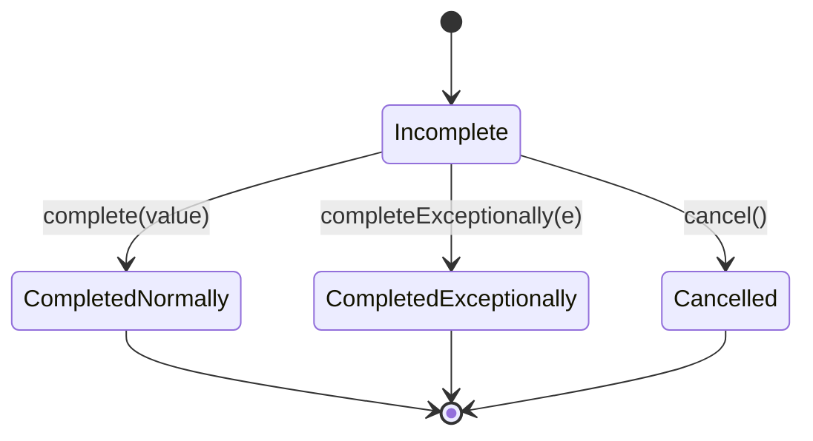
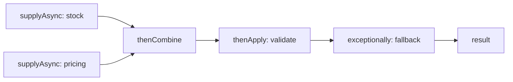
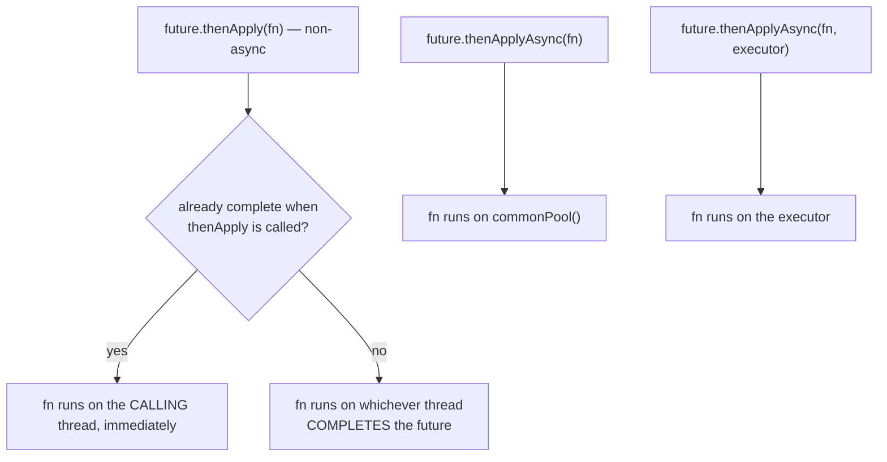

# CompletableFuture

!!! example "Try it first"
    **[CompletableFuture by example](../07-examples/completablefuture.md)** — 16 runnable programs, from a single supplyAsync to a fan-out with timeouts and fallbacks, each with its real output.

## 1. Purpose & Audience

**Band:** L3 Enterprise · **Prerequisites:** [Executors & Thread Pool Design](28-executors.md), [Lambdas](../02-language/06-lambdas-functional-interfaces.md)

`CompletableFuture` arrived in Java 8 to make asynchronous composition possible without callback nesting. For a decade it was the standard way to fan out I/O without holding a thread per call. Then virtual threads made blocking cheap, and structured concurrency began offering fan-out with proper lifetimes.

It is still the right tool for some things. This chapter is about knowing which things — and about the traps that make it one of the easier APIs to misuse.

This chapter answers three questions:

1. **Which thread runs each stage** — and why does the answer surprise people?
2. **How do exceptions travel** through a chain, and why do they arrive wrapped?
3. **When is `CompletableFuture` still the right choice** now that virtual threads exist?

---

## 2. The Problem

`Future` from Java 5 can only be waited on:

```java title="PlainFuture.java"
Future<StockStatus>     stock   = pool.submit(() -> inventory.statusFor(cart));
Future<PricingSnapshot> pricing = pool.submit(() -> pricingEngine.snapshot(cart));

StockStatus s     = stock.get();      // blocks
PricingSnapshot p = pricing.get();    // blocks
OrderContext ctx  = new OrderContext(s, p);
```

There is no way to say "when both are done, combine them", "if this fails, use a fallback", or "give up after two seconds and use a default" — except by blocking a thread and writing it by hand. Every composition needs a waiting thread.

`CompletableFuture` makes each of those an operation on the future itself:

```java title="Composed.java"
CompletableFuture<OrderContext> context =
    supplyAsync(() -> inventory.statusFor(cart), ioPool)
        .thenCombine(supplyAsync(() -> pricingEngine.snapshot(cart), ioPool),
                     OrderContext::new)
        .orTimeout(2, TimeUnit.SECONDS)
        .exceptionally(e -> OrderContext.unavailable());
```

No thread waits for any of it.

---

## 3. Mental Model

### 3.1 A promise that completes once



A `CompletableFuture` is a container that is completed **exactly once** — with a value, an exception, or cancellation. Every later attempt to complete it is ignored. Dependent stages registered on it run when it completes.

### 3.2 A chain is a dependency graph



Each method returns a **new** future representing that stage. The chain is a graph of stages, each triggered by the completion of its inputs.

### 3.3 The method naming grammar

| Suffix / prefix | Meaning |
|---|---|
| `thenApply` | Transform the value — `map` |
| `thenAccept` | Consume the value, return nothing |
| `thenRun` | Run after, ignoring the value |
| `thenCompose` | The function returns a future — `flatMap` |
| `thenCombine` | Combine with another future's value |
| `...Async` | Run the stage on an executor rather than the completing thread |
| `...Async(fn, executor)` | Run on **this** executor |

Every transformation comes in three forms — plain, `Async`, and `Async` with an executor. Knowing which one runs where is the whole of §6.1.

---

## 4. Core Reference

### 4.1 Creating

| Method | Result |
|---|---|
| `supplyAsync(supplier)` | Runs on **`ForkJoinPool.commonPool()`** |
| `supplyAsync(supplier, executor)` | Runs on your executor — **prefer this** |
| `runAsync(runnable[, executor])` | No result |
| `completedFuture(value)` | Already completed |
| `failedFuture(ex)` (9) | Already failed |
| `new CompletableFuture<>()` + `complete(v)` | Complete manually — bridging callback APIs |

### 4.2 Transforming and combining

| Method | Shape |
|---|---|
| `thenApply(fn)` | `T → U` |
| `thenCompose(fn)` | `T → CompletableFuture<U>` — flattened |
| `thenCombine(other, fn)` | `(T, U) → V` |
| `thenAcceptBoth(other, consumer)` | `(T, U) → void` |
| `applyToEither(other, fn)` | Whichever completes first |
| `allOf(futures...)` | `CompletableFuture<Void>` — all done |
| `anyOf(futures...)` | `CompletableFuture<Object>` — first done |

### 4.3 Errors

| Method | Runs when | Can recover? |
|---|---|---|
| `exceptionally(fn)` | Only on failure | Yes — returns a replacement value |
| `exceptionallyCompose(fn)` (12) | Only on failure | Yes — returns a replacement future |
| `handle((value, ex) -> …)` | Always | Yes — sees both, returns a value |
| `whenComplete((value, ex) -> …)` | Always | **No** — observes, passes the result through |

### 4.4 Timeouts and inspection

| Method | Behaviour |
|---|---|
| `orTimeout(t, unit)` (9) | Complete exceptionally with `TimeoutException` |
| `completeOnTimeout(v, t, unit)` (9) | Complete with a default value |
| `join()` | Block; throws unchecked `CompletionException` |
| `get()` / `get(t, unit)` | Block; throws checked `ExecutionException` |
| `getNow(default)` | Non-blocking |
| `state()` (19) | `RUNNING`, `SUCCESS`, `FAILED`, `CANCELLED` |
| `resultNow()` / `exceptionNow()` (19) | For already-completed futures |

---

## 5. Worked Examples

### 5.1 Fan-out and combine

```java title="OrderContextLoader.java"
public CompletableFuture<OrderContext> load(Cart cart, CustomerId customer) {
    var stock   = supplyAsync(() -> inventory.statusFor(cart), ioExecutor);
    var pricing = supplyAsync(() -> pricingEngine.snapshot(cart), ioExecutor);
    var profile = supplyAsync(() -> customers.profile(customer), ioExecutor);

    return CompletableFuture.allOf(stock, pricing, profile)
        .thenApply(_ -> new OrderContext(stock.join(), pricing.join(), profile.join()));
}
```

`allOf` returns `CompletableFuture<Void>` — it signals completion but carries no values — so you read them from the original futures inside the continuation. `join()` there does not block, because `allOf` has already guaranteed they are all complete.

For exactly two inputs `thenCombine` is cleaner; for three or more, `allOf` then `join` is the standard idiom.

### 5.2 `thenApply` versus `thenCompose`

```java title="ApplyVsCompose.java"
// thenApply with an async function: CompletableFuture<CompletableFuture<Receipt>>
var nested = loadOrder(id).thenApply(order -> dispatchAsync(order));

// thenCompose flattens: CompletableFuture<Receipt>
var receipt = loadOrder(id).thenCompose(order -> dispatchAsync(order));
```

The same rule as `map` and `flatMap` on streams and `Optional`: if the function already returns the wrapper, compose it. A `CompletableFuture<CompletableFuture<T>>` in a signature is always a missed `thenCompose`.

### 5.3 Exceptions arrive wrapped

```java title="Wrapping.java"
supplyAsync(() -> { throw new VendorUnavailableException(); }, ioExecutor)
    .exceptionally(e -> {
        System.out.println(e.getClass());      // CompletionException — not VendorUnavailableException
        return fallback();
    });
```

An exception thrown inside a stage is wrapped in `CompletionException` as it propagates to dependent stages. Code matching on the exception type fails silently:

```java title="Unwrapping.java"
.exceptionally(e -> {
    Throwable cause = (e instanceof CompletionException && e.getCause() != null)
        ? e.getCause() : e;
    return switch (cause) {
        case VendorUnavailableException _ -> DispatchReceipt.deferred();
        case TimeoutException _           -> DispatchReceipt.timedOut();
        default -> throw new CompletionException(cause);
    };
});
```

Similarly, `join()` throws `CompletionException` and `get()` throws `ExecutionException`, both wrapping the real cause. **Always unwrap before inspecting.**

### 5.4 Timeouts and fallbacks

```java title="Timeouts.java"
// Fail if the vendor takes longer than 2 seconds
CompletableFuture<Quote> strict = quoteFrom(vendor).orTimeout(2, SECONDS);

// Use a default instead of failing
CompletableFuture<Quote> lenient = quoteFrom(vendor)
    .completeOnTimeout(Quote.standardRate(), 2, SECONDS);

// First of several vendors to answer
CompletableFuture<Object> fastest = CompletableFuture.anyOf(
    quoteFrom(vendorA), quoteFrom(vendorB), quoteFrom(vendorC));
```

Two cautions. `orTimeout` completes the *future* — it does **not** stop the underlying work, which keeps running and consuming its thread and the downstream's capacity. And `anyOf` returns `CompletableFuture<Object>`, so the result needs a cast, and the losing calls also keep running. Structured concurrency's `anySuccessfulResultOrThrow` cancels the losers ([Chapter 32](32-structured-concurrency.md)).

### 5.5 Recovering versus observing

```java title="HandleVsWhenComplete.java"
// handle: sees success or failure, returns the replacement result
future.handle((receipt, ex) -> ex == null ? receipt : DispatchReceipt.failed(ex));

// whenComplete: observes, cannot change the result
future.whenComplete((receipt, ex) -> {
    if (ex != null) metrics.increment("dispatch.failed");
});
// the original exception still propagates downstream
```

`whenComplete` is for side effects — metrics, logging — that must not alter the outcome. `handle` and `exceptionally` are for recovery. Using `whenComplete` expecting it to swallow an error is a common mistake: the failure continues down the chain.

### 5.6 Bridging a callback API

```java title="Bridge.java"
public CompletableFuture<Receipt> dispatch(Order order) {
    CompletableFuture<Receipt> result = new CompletableFuture<>();
    legacyVendorSdk.send(order, new Callback() {
        public void onSuccess(Receipt r)   { result.complete(r); }
        public void onFailure(Exception e) { result.completeExceptionally(e); }
    });
    return result;
}
```

This is still one of `CompletableFuture`'s clearest uses: adapting a callback-based SDK into something composable. Nothing in virtual threads or structured concurrency replaces it, because the callback API is asynchronous by construction.

### 5.7 The same fan-out, on Java 21+

```java title="VirtualThreadEquivalent.java"
// Structured concurrency (preview) — see Chapter 32
try (var scope = StructuredTaskScope.open(Joiner.<Object>allSuccessfulOrThrow())) {
    var stock   = scope.fork(() -> inventory.statusFor(cart));
    var pricing = scope.fork(() -> pricingEngine.snapshot(cart));
    var profile = scope.fork(() -> customers.profile(customer));
    scope.join();
    return new OrderContext(stock.get(), pricing.get(), profile.get());
}
```

Compare with §5.1. This version preserves stack traces, cancels siblings on failure, and reads as sequential code — the three things `CompletableFuture` is weakest at. The trade-off is that it blocks the calling thread, which on a virtual thread costs almost nothing.

---

## 6. Internals

### 6.1 Which thread runs a stage

This is the part of the API most people get wrong.



A **non-async** stage runs either on the caller's thread (if the future is already done) or on the thread that completes it. That means:

- A stage attached to a future completed by an HTTP client callback runs **on the HTTP client's I/O thread**. A slow stage there blocks the client.
- A stage attached to an already-complete future runs **synchronously in the caller**, which can surprise code that expected asynchrony.

The fix for anything non-trivial is an explicit executor on the `...Async` variant.

### 6.2 The common pool trap

```java title="CommonPool.java"
supplyAsync(() -> warehouseClient.statusFor(sku));    // no executor argument
```

With no executor, `supplyAsync` and every `...Async` method use `ForkJoinPool.commonPool()` — shared by the whole JVM, including parallel streams, and sized at roughly one thread per core ([Chapter 28](28-executors.md)).

Blocking I/O there occupies one of a handful of workers. Enough concurrent calls exhaust the pool, and every parallel stream and default-async stage in the process stalls. It is the most common `CompletableFuture` production incident.

**Always pass an executor for anything that blocks.** On Java 21+, a virtual-thread executor is the natural choice:

```java
private static final Executor IO = Executors.newVirtualThreadPerTaskExecutor();
supplyAsync(() -> warehouseClient.statusFor(sku), IO);
```

### 6.3 Cancellation does not interrupt

```java title="Cancel.java"
CompletableFuture<Quote> future = supplyAsync(() -> slowQuote(), ioExecutor);
future.cancel(true);        // the mayInterruptIfRunning argument is IGNORED
```

`cancel` completes the future with a `CancellationException`, and dependent stages see that. But the task **keeps running** — `CompletableFuture` has no reference to the thread executing it, so it cannot interrupt it. The documentation says so explicitly.

This is a genuine limitation. Timeouts, `anyOf` losers, and cancellation all leave work running. Structured concurrency's cancellation interrupts subtasks, which is one of its concrete advantages.

### 6.4 Stack traces

```text
java.util.concurrent.CompletionException: VendorUnavailableException
    at java.base/java.util.concurrent.CompletableFuture.encodeThrowable(...)
    at java.base/java.util.concurrent.CompletableFuture.completeThrowable(...)
    at java.base/java.util.concurrent.CompletableFuture$AsyncSupply.run(...)
    at java.base/java.util.concurrent.ForkJoinWorkerThread.run(...)
Caused by: VendorUnavailableException
    at com.grocery.VendorClient.quote(VendorClient.java:44)
```

The trace begins at a pool worker. There is no frame showing **which request** started this chain or which method composed it — the stage was registered on one thread and executed on another, and the call stack does not survive the hop.

That is the structural cost of asynchronous composition, and it is the main argument for virtual threads: a blocking call on a virtual thread produces a complete stack from the request handler down to the failing line.

### 6.5 Memory visibility

`CompletableFuture` documents a happens-before edge: actions before completion happen-before dependent stages run, and before `join()` or `get()` return ([Chapter 26](26-java-memory-model.md)). So a value written by the producing task is visible to every continuation without further synchronisation.

That guarantee covers the value passed through the future. It does not cover **other shared state** the stages both touch — a mutable object captured by two concurrently-running stages still needs its own synchronisation.

---

## 7. Production Patterns & Anti-Patterns

### Do this

- **Always pass an executor** to `supplyAsync` and the `...Async` methods when the work blocks.
- **Use `thenCompose`** when the function returns a future.
- **Unwrap `CompletionException`** before inspecting an exception's type.
- **Set a timeout** — `orTimeout` or `completeOnTimeout` — on every future that depends on a remote call.
- **Use `handle` or `exceptionally` to recover**, `whenComplete` only to observe.
- **Use `CompletableFuture` to adapt callback APIs** — it is the natural bridge.
- **On Java 21+, prefer blocking code on virtual threads** for straightforward fan-out.

### Never do this

- **Never block in the common pool** — `supplyAsync` without an executor on I/O work.
- **Never call `join()` or `get()` inside a stage.** It blocks a pool thread waiting for another pool task — the path to pool exhaustion and deadlock.
- **Never discard a returned future** whose failure matters. The exception is stored in it and never surfaces.
- **Never assume `cancel(true)` interrupts.** The argument is ignored.
- **Never assume `orTimeout` stops the work.** It completes the future; the task keeps running.
- **Never put slow code in a non-async stage** attached to a future completed by an I/O thread.
- **Never match on exception type without unwrapping** `CompletionException`.
- **Never call `get()` without a timeout** in production code.

---

## 8. Version Evolution (Java 8 → 26)

| Version | What changed | Impact |
|---|---|---|
| **5** | `Future` — wait only | No composition |
| **8** | **`CompletableFuture`**, `CompletionStage` | Non-blocking composition; defaults to the common pool |
| **9** | `orTimeout`, `completeOnTimeout`, `failedFuture`, `completeAsync`, `copy`, `minimalCompletionStage` | Timeouts without a scheduler |
| **12** | `exceptionallyCompose`, `exceptionallyAsync` | Async recovery |
| **19** | `state()`, `resultNow()`, `exceptionNow()` | Inspect a completed future cleanly |
| **21** | **Virtual threads** | Blocking fan-out becomes cheap; the main motivation for `CompletableFuture` weakens |
| **21–26** | Structured concurrency previews | Lexically-scoped fan-out with real cancellation |

### Migration note

On Java 21+, review `CompletableFuture` chains in two categories.

**Chains that exist only to avoid blocking** — fan-out with `allOf`, simple transformation — are candidates for plain blocking code on virtual threads, which recovers stack traces and ordinary exception handling. Do this opportunistically when the code is touched anyway.

**Chains that are genuinely compositional** — callback adapters, `anyOf` races, timeouts with fallbacks, dependent asynchronous steps — should stay. `CompletableFuture` remains the best tool the JDK has for those.

Independently of the Java version, audit every `supplyAsync` and `...Async` call without an executor argument. Any that block are a latent common-pool exhaustion incident.

---

## 9. Interview Questions

### L1 — Foundations

**Q1. What is the difference between `Future` and `CompletableFuture`?** ⭐ *high frequency*
`Future` can only be waited on with `get()`, which blocks. `CompletableFuture` can be composed without blocking — transformed with `thenApply`, chained with `thenCompose`, combined with `thenCombine`, and recovered with `exceptionally` — and it can be completed manually, which makes it usable for adapting callback-based APIs.

**Q2. What is the difference between `thenApply` and `thenCompose`?**
`thenApply` transforms the value with a function returning a plain value. `thenCompose` takes a function that itself returns a `CompletableFuture` and flattens the result, so you get `CompletableFuture<T>` rather than `CompletableFuture<CompletableFuture<T>>`. It is the same distinction as `map` versus `flatMap`.

**Q3. What does `allOf` return?**
`CompletableFuture<Void>`, which completes when all its inputs complete but carries none of their values. You read the values from the original futures inside the continuation, where calling `join()` does not block because `allOf` guarantees they are already complete.

### L2 — Professional

**Q4. What executor does `supplyAsync` use by default, and why does it matter?** ⭐ *high frequency*
`ForkJoinPool.commonPool()`, which is shared by the whole JVM — including parallel streams — and sized at roughly one thread per core. Blocking I/O there occupies one of a handful of workers, and enough concurrent calls exhaust the pool and stall unrelated code elsewhere in the process. Always pass an explicit executor for anything that blocks; on Java 21+ a virtual-thread executor is the natural choice.

**Q5. Why is the exception in `exceptionally` a `CompletionException`?**
Because exceptions thrown inside a stage are wrapped in `CompletionException` as they propagate to dependent stages, and `join()` throws it too, while `get()` wraps in `ExecutionException`. Code that matches on the original exception type silently fails to match. Always unwrap via `getCause()` before inspecting.

**Q6. What is the difference between `handle` and `whenComplete`?**
Both run whether the stage succeeded or failed and receive both the value and the exception. `handle` returns a new result, so it can recover from a failure. `whenComplete` returns nothing and passes the original outcome through unchanged, so it is for side effects such as metrics or logging — using it expecting to swallow an error leaves the failure propagating downstream.

### L3 — Enterprise

**Q7. Which thread runs a non-async stage like `thenApply`?**
Either the calling thread, if the future is already complete when the stage is registered, or whichever thread completes the future. That means a stage attached to a future completed by an HTTP client callback runs on the client's I/O thread, where slow work blocks the client. Using the `...Async` variant with an explicit executor makes the thread deterministic.

**Q8. Does `cancel(true)` stop the running task?**
No. It completes the future with a `CancellationException` so dependent stages see cancellation, but the `mayInterruptIfRunning` argument is ignored — `CompletableFuture` holds no reference to the executing thread and cannot interrupt it. The same applies to `orTimeout` and the losers of `anyOf`: the future completes, the work keeps running. Structured concurrency's cancellation does interrupt subtasks, which is a concrete advantage.

**Q9. Why is calling `join()` inside a stage dangerous?**
Because it blocks a pool thread waiting for another task that may need a pool thread to run. In a small pool — especially the common pool — enough such stages occupy every worker, and the tasks they are waiting on can never start. It is a classic route to pool exhaustion and outright deadlock. Compose with `thenCompose` or `thenCombine` instead of waiting inside a stage.

### L4 — Architect

**Q10. Is `CompletableFuture` still relevant on Java 21+?**
Yes, for a narrower set of problems. Its original main job — fanning out I/O without holding a platform thread per call — is now done better by blocking code on virtual threads, which keeps stack traces and ordinary control flow, and by structured concurrency, which adds lifetimes and real cancellation. What remains is genuine composition: adapting callback-based SDKs, racing alternatives with `anyOf`, timeouts with fallback values, and chains of dependent asynchronous steps. The decision is whether the code is asynchronous by nature or only to avoid blocking.

**Q11. What is the observability cost of asynchronous composition?**
Stack traces stop at a pool worker. A stage is registered on one thread and executed on another, so the trace shows the worker and the failing line but nothing about which request initiated the chain or which method composed it. Correlating a failure with its cause then depends on explicit context propagation — trace IDs passed through or bound with `ScopedValue` — rather than the call stack. That cost, more than performance, is the strongest argument for moving straightforward fan-out to virtual threads.

**Q12. How would you audit a codebase's use of `CompletableFuture`?**
Start with executor choice, since it produces the most incidents: every `supplyAsync` or `...Async` without an executor argument that performs blocking work is a latent common-pool exhaustion. Then check exception handling for unwrapped `CompletionException` type matches, discarded futures whose failures are never observed, and `join()` or `get()` inside stages. Finally, classify chains by whether they are compositional or merely avoiding blocking, and plan to migrate the second group to virtual threads as the code is touched. The first three are bugs; the last is modernisation.

---

!!! abstract "Cheat Sheet"
    **Completes exactly once** — value, exception, or cancellation

    **`thenApply` = map · `thenCompose` = flatMap · `thenCombine` = zip**

    **`allOf` returns `CompletableFuture<Void>`** — then `join()` the originals, which no longer blocks

    **Default executor is `commonPool()`** — **always pass one for blocking work**

    **Non-async stages run on the completing thread** — or the caller, if already complete

    **Exceptions arrive as `CompletionException`** — unwrap `getCause()` before matching

    **`handle` recovers · `whenComplete` only observes**

    **`cancel(true)` does not interrupt** — the flag is ignored; work keeps running

    **`orTimeout` completes the future, not the work** — `anyOf` losers keep running too

    **Never `join()`/`get()` inside a stage** — pool exhaustion, deadlock

    **Stack traces stop at a pool worker** — the request that started it is gone

    **Still right for:** callback adapters · `anyOf` races · timeouts with fallback · dependent async steps

    **Java 21+:** straightforward fan-out → blocking code on virtual threads
