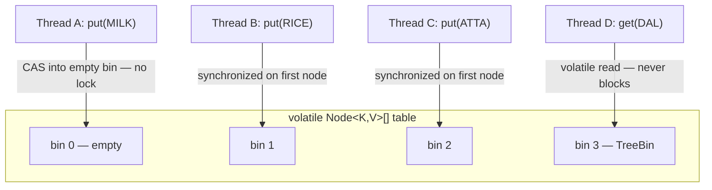
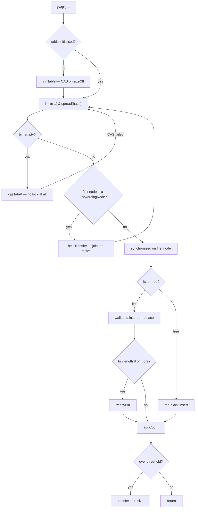

# ConcurrentHashMap & Concurrent Collections

!!! example "Try it first"
    **[ConcurrentHashMap — how it works inside](../07-examples/concurrenthashmap-internals.md)** — 7 runnable programs showing lost updates, check-then-act races, and the atomic methods that fix them, each with its real output.

## 1. Purpose & Audience

**Band:** L3 Enterprise · **Prerequisites:** [HashMap Internals](../03-collections/19-hashmap-internals.md), [Shared State & Synchronization](25-shared-state.md), [Locks, Atomics & java.util.concurrent](27-locks-and-atomics.md)

`ConcurrentHashMap` is where most enterprise Java meets concurrency. It is the default answer for caches, registries, counters, and per-tenant state — and the default source of a specific class of bug, because *thread-safe operations* and *thread-safe logic* are not the same thing.

This chapter answers three questions:

1. **How does it achieve concurrency** without locking the whole map — CAS, per-bin locks, cooperative resize?
2. **Which operations are atomic**, and which compound sequences only look atomic?
3. **What else is in `java.util.concurrent`**, and when does each collection earn its place?

!!! danger "The core misconception"
    "`ConcurrentHashMap` is thread-safe, so my code using it is thread-safe" is wrong, and it is the reason most of §5 exists. Each *individual* operation is atomic. A sequence of two operations is not.

---

## 2. The Problem

The inventory engine reserves stock. Multiple threads handle checkout concurrently, and each one needs to decrement available quantity for a SKU — but never below zero.

With a plain `HashMap`, the map itself corrupts. So the obvious fix is to synchronise:

```java title="LockedInventory.java"
// Java 8 — correct, and a throughput disaster
public final class LockedInventory {

    private final Map<Sku, Integer> available = new HashMap<>();

    public synchronized boolean reserve(Sku sku, int quantity) {
        int current = available.getOrDefault(sku, 0);
        if (current < quantity) {
            return false;
        }
        available.put(sku, current - quantity);
        return true;
    }
}
```

This is correct. It is also a single global lock across 200,000 SKUs: a thread reserving milk blocks a thread reserving rice, for no reason at all. Under 500 concurrent checkouts the lock becomes the bottleneck, threads queue, and throughput collapses to roughly one reservation at a time.

`Collections.synchronizedMap(new HashMap<>())` does not help — it is the same single lock, just moved inside. What we want is **per-key** contention, not per-map.

---

## 3. Mental Model

`ConcurrentHashMap` is a `HashMap` where each **bin** is independently guarded. Reads are lock-free. Writes lock only the bin they touch.



Three properties follow from this design and explain nearly all of its behaviour:

- **Reads never lock.** `table` is `volatile` and each `Node.val` / `Node.next` is `volatile`, so a reader sees a consistent, recent view without acquiring anything. A `get` during a concurrent `put` to the same bin is safe.
- **Writes contend only per bin.** Two threads writing different bins never interact. Contention is proportional to collisions, not to map size.
- **There is no global state to lock.** Which is exactly why `size()` cannot be exact, and why iteration cannot be fail-fast.

### 3.1 Java 7 vs Java 8 — the rewrite

| | Java 7 | Java 8+ |
|---|---|---|
| Structure | 16 `Segment` objects, each a mini hash table | One table, per-bin locking |
| Write lock | `ReentrantLock` per segment | CAS on empty bin; `synchronized` on first node otherwise |
| Concurrency ceiling | `concurrencyLevel` (default 16) | Number of bins |
| Worst-case bin | Linked list, O(n) | Red-black tree, O(log n) |
| `size()` | Locks all segments and sums | Striped counters, approximate |

The `concurrencyLevel` constructor argument survives for compatibility but is now only a sizing hint. If you see code tuning it, it is doing nothing useful.

---

## 4. Core API & Syntax

### 4.1 Atomic operations — the ones that matter

These are the reason to use `ConcurrentHashMap` rather than a synchronised wrapper. Each executes as a single atomic unit under the bin lock.

| Signature | Behaviour | Returns |
|---|---|---|
| `V putIfAbsent(K, V)` | Inserts only if absent | Existing value, or `null` if inserted |
| `boolean replace(K, V old, V new)` | Compare-and-set on the value | `true` if replaced |
| `V replace(K, V)` | Replaces only if present | Previous value or `null` |
| `boolean remove(Object k, Object v)` | Removes only on key-and-value match | `true` if removed |
| `V computeIfAbsent(K, Function)` | Computes and inserts only if absent | Current (possibly new) value |
| `V computeIfPresent(K, BiFunction)` | Recomputes only if present; `null` removes | New value or `null` |
| `V compute(K, BiFunction)` | Always recomputes; `null` removes | New value or `null` |
| `V merge(K, V, BiFunction)` | Inserts if absent, else merges | Resulting value |

### 4.2 Sizing and counting

| Signature | Behaviour | Since |
|---|---|---|
| `int size()` | Approximate; saturates at `Integer.MAX_VALUE` | 1.5 |
| `long mappingCount()` | Approximate; correct beyond 2³¹ entries | 8 |
| `boolean isEmpty()` | Approximate | 1.5 |

!!! warning "Counts are estimates"
    Size is maintained as a striped set of counters (`baseCount` plus a `CounterCell[]`), summed on demand — the same technique as `LongAdder`. Under concurrent writes the sum is a snapshot of something that was true at no single instant. Use it for metrics and logging. Never use it in a conditional that affects correctness.

### 4.3 Bulk parallel operations (Java 8)

Each comes in `keys`, `values`, `entries`, and whole-map forms. The first argument is a **parallelism threshold**: below this many elements the operation runs sequentially on the calling thread; above it, work is split across the common ForkJoinPool.

| Method | Purpose |
|---|---|
| `forEach(long, BiConsumer)` | Traverse |
| `search(long, BiFunction)` | Return the first non-null result and stop |
| `reduce(long, BiFunction, BiFunction)` | Fold to a single value |
| `reduceValues(long, BiFunction)` | Fold values only |

Pass `Long.MAX_VALUE` to force sequential execution — usually what you want, since the common pool is shared with parallel streams across the whole JVM.

### 4.4 Views and companions

| Expression | Result |
|---|---|
| `ConcurrentHashMap.newKeySet()` | A concurrent `Set<E>` backed by a CHM |
| `map.keySet(defaultValue)` | A `KeySetView` where `add` is permitted, mapping to the default |
| `map.keySet()` / `values()` / `entrySet()` | Weakly consistent views |

There is no `ConcurrentHashSet` class — `newKeySet()` is it.

!!! warning "`putAll` and `clear` are thread-safe, not atomic"
    Each individual `put` inside `putAll(other)` is atomic, but the copy as a whole is not: a concurrent reader can see some of the new mappings and not others, and `clear()` can race with writers that are still inserting. If readers must see all the changes or none, build a new map and publish it through a single `volatile` or `AtomicReference` write instead of mutating the shared one.

---

## 5. Worked Examples

### 5.1 Stock reservation, done correctly

The `LockedInventory` from §2, rewritten with no lock of our own:

```java title="InventoryReservations.java"
public final class InventoryReservations {

    private final ConcurrentMap<Sku, Integer> available = new ConcurrentHashMap<>();

    public void stock(Sku sku, int quantity) {
        available.merge(sku, quantity, Integer::sum);
    }

    public boolean reserve(Sku sku, int quantity) {
        // compute() holds the bin lock for this key only.
        // The returned value tells us whether the reservation succeeded.
        Integer result = available.compute(sku, (k, current) -> {
            if (current == null || current < quantity) {
                return current;                  // unchanged — refuse
            }
            return current - quantity;
        });
        return result != null && hasRoom(result, quantity);
    }

    private boolean hasRoom(int after, int requested) {
        return after >= 0;
    }
}
```

Contention is now per-SKU. Two threads reserving different SKUs never touch each other. Two threads reserving the same SKU serialise on one bin, which is exactly the serialisation the business rule requires.

### 5.2 The check-then-act bug

This is the defect that survives code review because every individual call is thread-safe:

```java title="CheckThenAct.java"
// WRONG — two atomic operations do not make an atomic sequence
if (!reservations.containsKey(orderId)) {      // thread A and B both see false
    reservations.put(orderId, reservation);    // both write; one is lost
}
```

```java title="CheckThenAct.java"
// CORRECT — one atomic operation
StockReservation existing = reservations.putIfAbsent(orderId, reservation);
if (existing != null) {
    // someone else won the race; handle it
}
```

The same shape appears as `get` → modify → `put`, and as `containsKey` → `remove`. Every one of them is a race. **If your logic reads the map and then writes based on what it read, you need a single `compute*`, `merge`, `putIfAbsent`, or conditional `replace`/`remove` call.**

### 5.3 A read-through cache with `computeIfAbsent`

```java title="PriceCache.java"
public final class PriceCache {

    private final ConcurrentMap<Sku, Money> prices = new ConcurrentHashMap<>();
    private final PricingRuleEngine engine;

    public Money priceFor(Sku sku) {
        return prices.computeIfAbsent(sku, engine::evaluate);
    }

    public void invalidate(Sku sku) {
        prices.remove(sku);
    }
}
```

`computeIfAbsent` guarantees the mapping function runs **at most once per key**, even under a thundering herd of concurrent misses. The naive alternative —

```java
Money price = prices.get(sku);
if (price == null) {
    price = engine.evaluate(sku);     // every thread evaluates
    prices.put(sku, price);
}
```

— runs `evaluate` once per contending thread, which is precisely the stampede the cache exists to prevent.

### 5.4 What `computeIfAbsent` must never do

The mapping function runs **while holding the bin's lock**. That imposes two hard rules.

**Never touch the same map inside it:**

```java title="RecursiveUpdate.java"
// IllegalStateException: Recursive update
prices.computeIfAbsent(sku, k -> {
    prices.put(relatedSku, someValue);    // same map — deadlock territory
    return engine.evaluate(k);
});
```

`ConcurrentHashMap` detects this and throws `IllegalStateException`. `HashMap` throws `ConcurrentModificationException` since Java 9; before that it silently corrupted the table.

**Never do slow I/O inside it:**

```java title="SlowMapping.java"
// Blocks the bin — every other key hashing here waits on a network call
inventory.computeIfAbsent(sku, k -> warehouseClient.fetchStock(k));   // 200ms
```

For expensive or remote loads, either accept a possible duplicate computation, or store a `CompletableFuture` so the lock is held only long enough to register the in-flight work:

```java title="FutureCache.java"
private final ConcurrentMap<Sku, CompletableFuture<Money>> inFlight =
    new ConcurrentHashMap<>();

public CompletableFuture<Money> priceFor(Sku sku) {
    return inFlight.computeIfAbsent(sku,
        k -> CompletableFuture.supplyAsync(() -> engine.evaluate(k), executor));
}
```

The lock now covers only the creation of the future, not its completion.

### 5.5 Per-SKU counters

```java title="ReservationMetrics.java"
private final ConcurrentMap<Sku, LongAdder> reservationCounts = new ConcurrentHashMap<>();

public void recordReservation(Sku sku) {
    reservationCounts.computeIfAbsent(sku, k -> new LongAdder()).increment();
}

public long countFor(Sku sku) {
    LongAdder adder = reservationCounts.get(sku);
    return adder == null ? 0 : adder.sum();
}
```

`LongAdder` over `AtomicLong` is deliberate. `AtomicLong` retries its CAS under contention, so throughput degrades as threads increase. `LongAdder` stripes across cells and sums on read — dramatically better for write-heavy counters, at the cost of a slightly more expensive and momentarily inexact read. Counters are exactly that trade.

### 5.6 The mutable-value trap

Thread-safe map, unsafe contents:

```java title="MutableValueTrap.java"
// WRONG — the map is safe; the ArrayList inside it is not
ConcurrentMap<DeliverySlot, List<Order>> board = new ConcurrentHashMap<>();
board.computeIfAbsent(slot, s -> new ArrayList<>()).add(order);   // race on the list
```

The `computeIfAbsent` is atomic; the `.add()` that follows happens **outside** the lock. Two threads can hold the same `ArrayList` and corrupt it.

Fixes, in order of preference:

=== "Concurrent value type"
    ```java
    ConcurrentMap<DeliverySlot, Queue<Order>> board = new ConcurrentHashMap<>();
    board.computeIfAbsent(slot, s -> new ConcurrentLinkedQueue<>()).add(order);
    ```

=== "Immutable value, atomic swap"
    ```java
    ConcurrentMap<DeliverySlot, List<Order>> board = new ConcurrentHashMap<>();
    board.merge(slot, List.of(order),
        (oldList, one) -> Stream.concat(oldList.stream(), one.stream()).toList());
    ```

`ConcurrentHashMap` guarantees safe publication of the *reference* it stores. It guarantees nothing about the object on the other end of it.

---

## 6. Internals

### 6.1 The write path



Two details carry most of the performance story.

**Inserting into an empty bin takes no lock.** It is a single `compareAndSwap` on the table slot. In a well-sized map most bins are empty, so most first-writes are lock-free.

**The lock is the first node object itself**, via `synchronized`. This costs nothing when uncontended — the JVM uses a lightweight lock — and there is no separate lock object to allocate.

### 6.2 Why no nulls

`ConcurrentHashMap` throws `NullPointerException` for null keys and null values. `HashMap` permits both. The reason is not an oversight.

In a single-threaded `HashMap`, `get(k) == null` is ambiguous — absent, or present-and-mapped-to-null — but you can disambiguate with `containsKey(k)`. In a concurrent map you cannot: between the `get` and the `containsKey`, another thread may have inserted or removed the key. The ambiguity would be permanently unresolvable, so the API removes it at the source.

### 6.3 Cooperative resize

Resizing a map with millions of entries on one thread while others block would be catastrophic. Instead, threads help.

When the table grows, bins are migrated from old to new. A migrated bin is replaced with a **`ForwardingNode`** pointing at the new table. Any thread that encounters one knows a resize is running and calls `helpTransfer`, claiming a stride of bins from a shared `transferIndex` and migrating them itself.

Meanwhile, readers arriving at a `ForwardingNode` are redirected to the new table and complete normally. **Resize never blocks reads**, and write throughput degrades gracefully rather than stalling.

### 6.4 Why `size()` is approximate

There is no single counter, because one would be a contention point on every write — precisely what the design avoids.

Instead the count is striped: a `baseCount` field plus a `CounterCell[]` array, each cell on its own cache line to avoid false sharing. A write CASes `baseCount`; on failure it falls back to its thread's cell. `size()` sums `baseCount` plus every cell.

The sum is not taken atomically, so under concurrent modification it reflects no single instant. This is the same mechanism as `LongAdder`, and the same trade: cheap writes, approximate reads.

### 6.5 Weakly consistent iterators

A CHM iterator never throws `ConcurrentModificationException`. It reflects the state of the map at some point at or after creation, and may or may not observe updates made during traversal. It will never see corrupted state, never skip an element that was present throughout, and never return the same element twice.

This is a genuine guarantee, but a weak one. Iteration is **not** a snapshot. If you need a consistent view — for a report, or a checkpoint — copy first:

```java
Map<Sku, Integer> snapshot = Map.copyOf(available);   // still not atomic, but stable once taken
```

Even that copy is assembled while the map may change. If you need a truly atomic view, `ConcurrentHashMap` is the wrong tool and you need an explicit lock or an immutable-swap design.

### 6.6 Virtual threads and the bin lock

Writes hold a `synchronized` block. On Java 21 and 22, a virtual thread that blocked inside `synchronized` **pinned** its carrier platform thread, which could starve the scheduler under heavy write contention.

JEP 491 in Java 24 removed that restriction: virtual threads now block inside `synchronized` without pinning the carrier. On Java 24+ this consideration is gone, and CHM is safe to hammer from virtual threads. On Java 21 — still a common enterprise baseline — it remains worth knowing when profiling a virtual-thread service that writes heavily to a shared map. See [Virtual Threads](31-virtual-threads.md).

---

## 7. Production Patterns & Anti-Patterns

### Do this

- **Express every read-modify-write as a single call.** `compute`, `merge`, `putIfAbsent`, or the two-argument `replace`/`remove`. If you wrote `if (map.containsKey(...))`, stop and rewrite it.
- **Use `computeIfAbsent` for single-flight loading**, and keep the mapping function fast, local, and free of any access to the same map.
- **Store concurrent or immutable values.** `ConcurrentLinkedQueue`, `LongAdder`, `List.copyOf` — never a bare `ArrayList` you intend to mutate.
- **Prefer `LongAdder` over `AtomicLong`** for write-heavy counters.
- **Size the map** with `new ConcurrentHashMap<>(expectedSize)` when known — resizes are cooperative but not free.
- **Declare the field as `ConcurrentMap<K,V>`**, which documents the concurrency contract at the type level in a way `Map` does not.
- **Bound anything used as a cache.** CHM has no eviction; an unbounded cache is a memory leak with a delay fuse. Use Caffeine or an explicit size policy.

### Never do this

- **Never use `size()`, `isEmpty()`, or `mappingCount()` in correctness logic.** They are estimates. Capacity checks built on them will be wrong under load.
- **Never do I/O, acquire another lock, or touch the same map inside `compute*`.** You are holding a bin lock; the last of these throws `IllegalStateException`.
- **Never assume iteration is a snapshot.** Weakly consistent means what it says.
- **Never use `Collections.synchronizedMap` as an equivalent.** It is one global lock, and it still requires external synchronisation for iteration.
- **Never mutate a stored mutable value without its own synchronisation.** The map protects the reference, not the object.
- **Never use bulk parallel operations with a low threshold casually.** They run on the shared common ForkJoinPool; a slow function there stalls parallel streams elsewhere in the JVM.
- **Never store nulls.** They throw — including a `merge` whose remapping function returns null for a key that was absent.

---

### 7.1 The rest of `java.util.concurrent`

| Collection | Use when | Notes |
|---|---|---|
| `ConcurrentHashMap` | Shared keyed state — the default | Per-bin locking, lock-free reads |
| `ConcurrentHashMap.newKeySet()` | Concurrent `Set` | There is no `ConcurrentHashSet` class |
| `CopyOnWriteArrayList` | Many reads, very few writes — listener lists | Every write copies the whole array; iteration is a true snapshot |
| `ConcurrentLinkedQueue` | Unbounded non-blocking queue | Lock-free; `size()` is O(n) |
| `ArrayBlockingQueue` | Bounded producer–consumer | Fixed capacity; natural backpressure |
| `LinkedBlockingQueue` | Producer–consumer, optionally bounded | Separate head/tail locks |
| `SynchronousQueue` | Direct hand-off, zero capacity | Used by `newCachedThreadPool` |
| `LinkedTransferQueue` | Hand-off with optional blocking on the producer side | Superset of the above |
| `PriorityBlockingQueue` | Ordered work items | Unbounded; ordering by comparator |
| `DelayQueue` | Scheduled or retry-after work | Elements emerge when their delay expires |
| `ConcurrentSkipListMap` / `Set` | Concurrent **sorted** map or set | O(log n); the concurrent `TreeMap` |

!!! tip "`CopyOnWriteArrayList` sizing rule"
    A write copies the entire backing array. At a few dozen elements and a handful of writes per hour — configuration listeners, registered handlers — it is ideal, and its iterator is a genuine immutable snapshot. At thousands of elements or any meaningful write rate it is a disaster. Measure the write frequency before choosing it.

---

## 8. Version Evolution (Java 8 → 26)

| Version | What changed | Impact |
|---|---|---|
| **8** | Complete rewrite: segments removed, per-bin CAS + `synchronized`, treeification, `mappingCount()`, bulk parallel `forEach`/`search`/`reduce`, `newKeySet()`, `compute*`/`merge` | Concurrency ceiling rises from 16 to the bin count; worst case O(n) → O(log n) |
| **9** | `ConcurrentHashMap` recursive-update detection tightened | `IllegalStateException` instead of undefined behaviour |
| **11** | Minor performance work on `computeIfAbsent` fast path | Fewer redundant lookups on hit |
| **21** | `SequencedMap` (JEP 431) — **not** implemented by `ConcurrentHashMap` | No `firstEntry`/`reversed`; use `ConcurrentSkipListMap` if you need order |
| **24** | JEP 491 — virtual threads no longer pin the carrier inside `synchronized` | Removes the write-contention pinning concern for virtual-thread services |
| **25** | Compact object headers (JEP 519) | Lower per-`Node` overhead on map-heavy heaps |
| **26** | No CHM-specific changes | — |

### Migration note

Two mechanical sweeps pay for themselves on a legacy codebase:

1. Replace `Collections.synchronizedMap(new HashMap<>())` with `ConcurrentHashMap`, **then audit every caller** — synchronised-map code often relies on an external `synchronized` block for compound operations, and those blocks must be rewritten as atomic `compute*` calls, not simply deleted.
2. Replace `get`-null-check-`put` cache patterns with `computeIfAbsent`. This is where the duplicate-work stampedes live.

If you are on Java 21 and profiling shows virtual threads pinning inside `ConcurrentHashMap` writes, the fix is Java 24+, not a redesign.

---

## 9. Interview Questions

### L1 — Foundations

**Q1. Why use `ConcurrentHashMap` instead of `HashMap`?** ⭐ *high frequency*
`HashMap` is not thread-safe: concurrent writes lose updates and can corrupt its internal state. `ConcurrentHashMap` makes every individual operation atomic while allowing many threads to write different parts of the map simultaneously. It does this without a global lock, so it scales with the number of threads rather than serialising them.

**Q2. Why does `ConcurrentHashMap` reject null keys and values?**
Because `get` returning null would be ambiguous — absent, or mapped to null — and in a concurrent map you cannot disambiguate it. In a `HashMap` you would follow up with `containsKey`, but between the two calls another thread could change the mapping, so the answer would never be reliable. Forbidding nulls removes the ambiguity entirely.

**Q3. What is the difference between `ConcurrentHashMap` and `Collections.synchronizedMap`?**
`synchronizedMap` wraps a map and guards every method with one global lock, so only one thread operates on it at a time and iteration still needs external synchronisation. `ConcurrentHashMap` locks individual bins, leaves reads lock-free, and provides atomic compound methods like `putIfAbsent` and `merge`. Throughput under concurrency is not comparable.

### L2 — Professional

**Q4. Is this code thread-safe: `if (!map.containsKey(k)) map.put(k, v);`?** ⭐ *high frequency*
No. Both calls are individually atomic, but the sequence is not — two threads can both see the key absent and both write, and one write is silently lost. The correct form is a single atomic call, `map.putIfAbsent(k, v)`, whose return value tells you whether you won the race.

**Q5. What does "weakly consistent iterator" mean?**
It means the iterator never throws `ConcurrentModificationException` and never exposes corrupt state, but it reflects the map at some point at or after creation and may or may not see concurrent updates. It is not a snapshot. Code that needs a consistent view must copy, or use a structure like `CopyOnWriteArrayList` whose iterator genuinely is a snapshot.

**Q6. Why is `size()` unreliable, and what should you use instead?**
The count is striped across multiple counter cells to avoid contention on a single field, and `size()` sums them without taking a global lock, so the result corresponds to no single instant. Use it for metrics and logging. For correctness — capacity limits, emptiness checks that gate behaviour — restructure the logic so it does not depend on a count, or hold an explicit lock.

### L3 — Enterprise

**Q7. How does `ConcurrentHashMap` achieve concurrent writes without a global lock?**
The table is an array of bins and each bin is guarded independently. Inserting into an empty bin is a single compare-and-swap on the table slot with no lock at all; inserting into an occupied bin synchronises on that bin's first node. Reads take no lock because the table reference and each node's value and next pointer are volatile. Two threads writing different bins never interact.

**Q8. What are the constraints on the `computeIfAbsent` mapping function, and why?**
It runs while the bin's lock is held, so it must be fast and must not block. It must not access the same map — `ConcurrentHashMap` detects this and throws `IllegalStateException`, because it would otherwise deadlock or corrupt. It should not perform I/O or acquire other locks, since that blocks every other key hashing to the same bin. For slow loads, cache a `CompletableFuture` so only its creation happens under the lock.

**Q9. How does resizing work without blocking readers?**
Migrated bins are replaced with a `ForwardingNode` that points to the new table. Readers hitting one are redirected and complete normally against the new table. Writers hitting one call `helpTransfer`, claim a stride of bins from a shared index, and migrate them — so resizing is cooperative across whichever threads happen to be active, rather than one thread doing all the work while everyone waits.

### L4 — Architect

**Q10. Your service uses `ConcurrentHashMap` as a cache and memory grows without bound. Diagnose it.**
`ConcurrentHashMap` has no eviction policy, no size bound, and no TTL — it is a map, not a cache. Every distinct key ever requested is retained for the life of the map, so any unbounded or attacker-influenced key space grows forever. The fix is a real cache with a size or time policy such as Caffeine, or an explicit bound enforced on write. A weak-value map is rarely the answer, because it makes eviction timing depend on GC.

**Q11. When would you choose `ConcurrentSkipListMap` over `ConcurrentHashMap`?**
When you need ordering: sorted iteration, range queries, floor or ceiling lookups — the concurrent equivalent of `TreeMap`. It costs O(log n) instead of O(1) per operation and uses more memory per entry, so it is a deliberate trade for the ordering. It is also the only concurrent map in the JDK that implements `SequencedMap`, since `ConcurrentHashMap` has no defined encounter order.

**Q12. A team replaced `synchronizedMap` with `ConcurrentHashMap` and now sees intermittent data corruption. What is the likely cause?**
Almost certainly compound operations that used to be protected by an external `synchronized` block around several map calls. Swapping the implementation removed the global lock, so those multi-call sequences are now races even though each individual call is atomic. The fix is to rewrite each sequence as a single atomic `compute`, `merge`, or `putIfAbsent`. The same bug appears when a mutable value stored in the map is mutated outside any lock.

---

!!! abstract "Cheat Sheet"
    **Design:** per-bin locking — CAS into empty bins, `synchronized` on the first node otherwise; reads are lock-free

    **Atomic:** `putIfAbsent` · `compute` · `computeIfAbsent` · `computeIfPresent` · `merge` · `replace(k,old,new)` · `remove(k,v)`

    **Not atomic:** any sequence of two calls — `containsKey` then `put` is a race

    **No nulls** — keys or values; `get` ambiguity is unresolvable concurrently

    **`size()` is an estimate** — striped counters, `LongAdder`-style; never gate logic on it

    **Iterators are weakly consistent** — never CME, never a snapshot

    **`computeIfAbsent`:** holds the bin lock — no I/O, no other locks, never the same map (`IllegalStateException`)

    **Values:** the map protects the reference, not the object — store concurrent or immutable values

    **Resize is cooperative** — `ForwardingNode` + `helpTransfer`; reads never block

    **Not a cache** — no eviction, no TTL; bound it or use Caffeine

    **Java 24 (JEP 491):** `synchronized` no longer pins virtual threads
