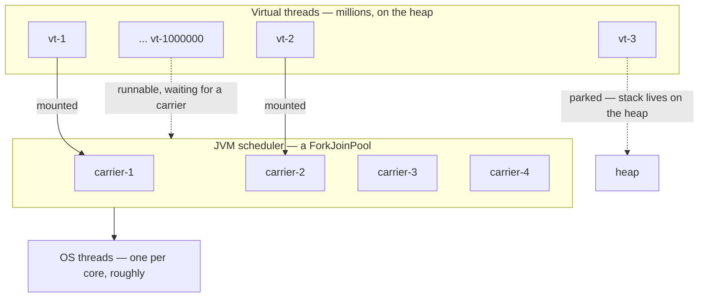
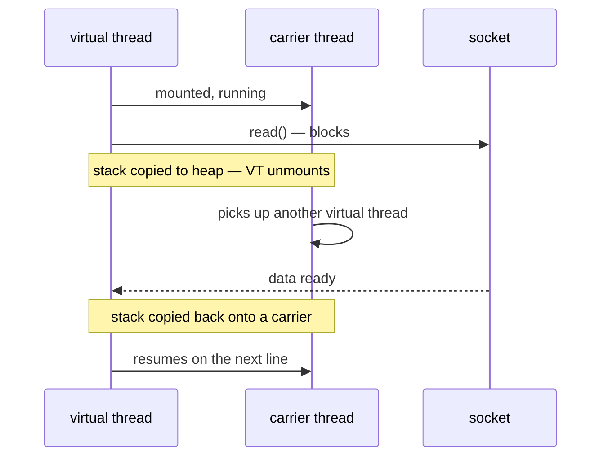

# Virtual Threads

## 1. Purpose & Audience

**Band:** L3 Enterprise · **Prerequisites:** [Threading Fundamentals](24-threading-fundamentals.md), [Executors & Thread Pool Design](28-executors.md)

Virtual threads are the largest change to Java's concurrency model since Java 5. They do not make any single task faster — they remove the reason blocking code could not scale, which means the simple thread-per-request style becomes viable again at concurrency levels that previously required reactive programming.

This chapter answers three questions:

1. **What is a virtual thread**, mechanically, and how does blocking stop costing an OS thread?
2. **What changes in your code**, and — more often — what should not change?
3. **Where do they not help**, and what are the remaining traps?

---

## 2. The Problem

The dispatch service calls a vendor API per order. Each call blocks for 200 ms:

```java title="PooledDispatcher.java"
private final ExecutorService pool = Executors.newFixedThreadPool(200);

public void dispatchAll(List<Order> orders) {
    for (Order order : orders) {
        pool.submit(() -> vendorClient.send(order));     // 200ms blocking
    }
}
```

Two hundred platform threads is already aggressive — roughly 200 MB of reserved stack — and it caps throughput at 200 concurrent calls. Each thread spends 199.9 ms of every 200 ms parked, holding an OS thread that is doing nothing.

Raising the pool size does not scale: platform threads cost about 1 MB of stack each and the OS scheduler degrades well before you reach tens of thousands. The pre-Java-21 escapes were both unappealing:

- **Reactive** — `CompletableFuture` chains or WebFlux. Scales beautifully, and costs you readable stack traces, debuggability, and the ability to use a `try`/`catch` or a `for` loop.
- **Accept the ceiling** — and buy more machines.

Virtual threads remove the dilemma. The blocking code stays exactly as it is, and the thread it blocks costs almost nothing.

---

## 3. Mental Model

A platform thread is a thin wrapper over an OS thread — 1:1. A virtual thread is a Java object scheduled by the JVM onto a small pool of platform threads — M:N.



The operation that matters is **unmounting**. When a virtual thread blocks on something the JDK understands — socket I/O, `sleep`, a lock, a `BlockingQueue` — its stack is copied to the heap and the carrier thread is released to run another virtual thread. When the blocking call completes, the stack is copied back onto some carrier and execution resumes on the next line.



**From the code's point of view nothing happened.** `socket.read()` blocked and returned. That is the entire design goal: blocking syntax, non-blocking cost.

### 3.1 What changes and what does not

| | Platform thread | Virtual thread |
|---|---|---|
| Backed by | An OS thread | A heap object |
| Stack | ~1 MB reserved, fixed | Grows and shrinks on the heap |
| Creation cost | Tens to hundreds of µs | Sub-microsecond |
| Practical count | Thousands | Millions |
| Blocking cost | Holds an OS thread | Releases the carrier |
| Pooling | Essential | **Harmful** |
| `ThreadLocal` | Fine | Works, but multiplied by thread count |
| CPU-bound work | Same | Same — no benefit |

---

## 4. Core API & Syntax

### 4.1 Creating

| Form | Use |
|---|---|
| `Thread.ofVirtual().start(runnable)` | One-off, started immediately |
| `Thread.ofVirtual().unstarted(runnable)` | Build now, start later |
| `Thread.ofVirtual().name("dispatch-", 0).factory()` | A `ThreadFactory` |
| `Thread.startVirtualThread(runnable)` | Shorthand |
| `Executors.newVirtualThreadPerTaskExecutor()` | **The usual choice** |

```java
try (ExecutorService executor = Executors.newVirtualThreadPerTaskExecutor()) {
    executor.submit(task);
}   // close() waits for all submitted tasks — it is an AutoCloseable
```

That executor is not a pool. It creates one virtual thread per task and discards it. The `ExecutorService` interface is reused because it already expresses submit-and-await, not because anything is pooled.

### 4.2 Inspecting

| Expression | Returns |
|---|---|
| `Thread.currentThread().isVirtual()` | `boolean` (Java 21) |
| `thread.getName()` | Empty by default — name them |
| `Thread.ofVirtual().name("x")` | Names for diagnostics |

### 4.3 Tuning

| Property | Effect |
|---|---|
| `jdk.virtualThreadScheduler.parallelism` | Carrier count; defaults to `availableProcessors()` |
| `jdk.virtualThreadScheduler.maxPoolSize` | Ceiling when carriers are blocked |

Both exist for pathological cases. The defaults are correct for almost every application, and tuning them usually means something else is wrong.

!!! warning "Preview history"
    Virtual threads were preview in Java 19 and 20 and **final in Java 21** (JEP 444). Code samples from 2022–23 may still show `--enable-preview`; that is no longer required.

---

## 5. Worked Examples

### 5.1 The dispatcher, rewritten

```java title="VirtualDispatcher.java"
public void dispatchAll(List<Order> orders) {
    try (ExecutorService executor = Executors.newVirtualThreadPerTaskExecutor()) {
        for (Order order : orders) {
            executor.submit(() -> vendorClient.send(order));
        }
    }   // close() blocks until every task finishes
}
```

Ten thousand orders now means ten thousand concurrent virtual threads. The blocking `vendorClient.send` is unchanged — same code, same stack traces, same `try`/`catch`. What changed is that the 200 ms of waiting no longer occupies an OS thread.

The `try`-with-resources matters: `ExecutorService` became `AutoCloseable` in Java 19, and `close()` performs an orderly shutdown-and-await. Forgetting it means the method returns before the work completes.

### 5.2 Do not pool virtual threads

```java title="PoolingAntiPattern.java"
// WRONG — reintroduces the ceiling you just removed
ExecutorService pool = Executors.newFixedThreadPool(200,
    Thread.ofVirtual().factory());
```

A fixed pool caps concurrency at 200 regardless of what the threads are made of. Pooling exists because platform threads are expensive to create; virtual threads are not, so pooling adds a queue and a limit while removing nothing.

**Pool the scarce resource, not the thread.** If the vendor API tolerates 50 concurrent calls, say that:

```java title="Semaphore.java"
private final Semaphore vendorLimit = new Semaphore(50);

public void send(Order order) throws InterruptedException {
    vendorLimit.acquire();
    try {
        vendorClient.send(order);     // still one virtual thread per order
    } finally {
        vendorLimit.release();
    }
}
```

Ten thousand virtual threads exist; fifty are in the vendor call; the rest are parked on the semaphore at essentially no cost. The limit now expresses a real constraint rather than an accident of thread economics.

### 5.3 The database is still the limit

```java title="ConnectionPool.java"
// 10,000 virtual threads, 20 connections
try (ExecutorService executor = Executors.newVirtualThreadPerTaskExecutor()) {
    for (Order order : orders) {
        executor.submit(() -> {
            try (Connection c = dataSource.getConnection()) {   // 9,980 wait here
                insertOrder(c, order);          // JDBC write on this connection
            }
            return null;
        });
    }
}
```

Virtual threads remove the *thread* ceiling and expose whatever ceiling was behind it. A connection pool of 20 still admits 20 concurrent queries; the other 9,980 threads simply queue cheaply instead of not existing.

This is usually an improvement — the queue is explicit and the database is protected — but it means **throughput gains are bounded by your slowest shared resource**, and teams that expected a linear speedup are surprised.

### 5.4 `ThreadLocal` becomes expensive

```java title="ThreadLocalTrap.java"
// One 8 KB buffer per platform thread was fine. Per virtual thread is not.
private static final ThreadLocal<byte[]> BUFFER =
    ThreadLocal.withInitial(() -> new byte[8192]);
```

With 200 platform threads that is 1.6 MB. With a million virtual threads it is 8 GB.

`ThreadLocal` still *works* — each virtual thread gets its own value, and it is cleaned up when the thread ends. The problem is that thread count is no longer a small number. Audit every `ThreadLocal` that holds anything non-trivial, and prefer [`ScopedValue`](33-scoped-values.md) for request context, which shares an immutable binding rather than copying per thread.

### 5.5 CPU-bound work gains nothing

```java title="CpuBound.java"
// No benefit — there are still only N cores
try (ExecutorService executor = Executors.newVirtualThreadPerTaskExecutor()) {
    for (PricingRule rule : tenThousandRules) {
        executor.submit(() -> rule.evaluateExpensively(cart));
    }
}
```

Virtual threads multiplex *waiting*, not computing. Ten thousand virtual threads doing arithmetic contend for the same carriers, which contend for the same cores, plus scheduling overhead. For CPU-bound work, a fixed platform-thread pool sized near the core count remains correct.

The test: **is the task waiting or working?** Waiting scales with virtual threads. Working scales with cores.

---

## 6. Internals

### 6.1 The scheduler

Virtual threads run on a dedicated `ForkJoinPool` in FIFO mode — separate from the common pool used by parallel streams. Default parallelism is `availableProcessors()`.

This is deliberate: a small carrier pool is sufficient because carriers are never blocked for long. A virtual thread that blocks unmounts, freeing its carrier immediately.

It also means a carrier that *is* blocked — because of pinning, §6.3 — is disproportionately damaging. With eight carriers, eight pinned virtual threads stall everything.

### 6.2 Continuations and the heap stack

A virtual thread's stack lives on the heap as a **stack chunk object**, not as a fixed OS stack allocation.


Three consequences:

- **Stacks grow and shrink on demand**, so a shallow task costs a few hundred bytes rather than a reserved megabyte.
- **Freeze and thaw cost CPU** proportional to stack depth. Deep recursion in a task that blocks frequently is more expensive than it looks.
- **Virtual thread stacks are garbage-collectable**, which is what makes millions of them viable.

The JDK rewired its blocking operations — `Socket`, `InetAddress`, `java.util.concurrent` locks, `Thread.sleep`, `BlockingQueue` — to unmount rather than block the carrier. That rewiring is most of what Project Loom actually shipped.

### 6.3 Pinning

A pinned virtual thread blocks its carrier instead of unmounting. The causes, historically:

| Cause | Status |
|---|---|
| Blocking inside `synchronized` | **Fixed in Java 24 (JEP 491)** |
| `Object.wait()` | **Fixed in Java 24** |
| Native frames — JNI calls | Still pins |
| Class initialisation blocking | Still pins |

On **Java 21–23**, `synchronized` was the big one. A virtual thread that blocked inside a monitor held its carrier, so heavy contention on a shared lock could starve the whole scheduler. The Java 21-era guidance was to replace those specific blocks with `ReentrantLock`, which parks without pinning.

**On Java 24+ that guidance is obsolete.** JEP 491 made `synchronized` unmount correctly. `ReentrantLock` remains useful for its own features — timeouts, interruptible acquisition, fairness, multiple conditions — but not as a pinning workaround.

Detecting pinning:

```bash
# JFR event, available on modern JDKs
jfr print --events jdk.VirtualThreadPinned recording.jfr
```

The older `-Djdk.tracePinnedThreads=full` flag still exists on some releases but is being retired in favour of the JFR event.

### 6.4 Thread dumps

`jstack` does not show virtual threads — there are potentially millions, and they are not OS threads. The replacement:

```bash
jcmd <pid> Thread.dump_to_file -format=json threads.json
```

This produces a JSON dump including every virtual thread, grouped by the structured-concurrency scope that created it where one exists. That grouping is a large part of why [structured concurrency](32-structured-concurrency.md) matters operationally — an unstructured fan-out of ten thousand virtual threads produces a flat, unreadable dump.

### 6.5 What virtual threads are not

- **Not faster per task.** A single request takes the same time. The gain is in how many can be in flight.
- **Not a replacement for reactive everywhere.** Reactive still wins where backpressure is a first-class requirement or the pipeline is genuinely event-driven. Virtual threads win where the code is fundamentally sequential and blocking.
- **Not always pooled — never pooled.** See §5.2.
- **Not a fix for a slow downstream.** They expose the real bottleneck rather than removing it.
- **Not free of memory cost.** A parked virtual thread still holds its heap stack and whatever it references. A million idle threads holding request state is still a heap problem.

---

## 7. Production Patterns & Anti-Patterns

### Do this

- **Use `Executors.newVirtualThreadPerTaskExecutor()`** in a try-with-resources for fan-out work.
- **Write plain blocking code.** That is the point. Keep `try`/`catch`, loops, and readable stack traces.
- **Limit the scarce resource with a `Semaphore`**, not by sizing a thread pool.
- **Name your virtual threads** when they are long-lived, so dumps are readable.
- **Audit `ThreadLocal` usage** for anything heavy, and prefer `ScopedValue` for request context.
- **Keep CPU-bound work on a platform-thread pool** sized near the core count.
- **Use `jcmd Thread.dump_to_file -format=json`** rather than `jstack`.
- **Review your connection pool and downstream limits** — they become the visible ceiling.

### Never do this

- **Never pool virtual threads.** A fixed pool of virtual threads reintroduces the cap and adds a queue.
- **Never use `ThreadLocal` as a cache** for large objects. One per thread was fine at 200 threads.
- **Never assume a throughput win** without checking what is actually limiting you — usually a connection pool or a downstream service.
- **Never use virtual threads for CPU-bound parallelism.** Cores are the limit, not threads.
- **Never carry forward Java 21-era `synchronized` workarounds** into a Java 24+ codebase without knowing why they are there.
- **Never call blocking JNI from a virtual thread** in a hot path — native frames still pin the carrier.
- **Never forget to close the executor.** Without try-with-resources the method returns before the tasks finish.

---

## 8. Version Evolution (Java 8 → 26)

| Version | What changed | Impact |
|---|---|---|
| **8** | `CompletableFuture` | The async escape hatch that virtual threads largely replace |
| **19** | Virtual threads preview (JEP 425); `ExecutorService` becomes `AutoCloseable` | First availability, behind `--enable-preview` |
| **20** | Second preview (JEP 436) | API stabilises |
| **21** | **Final (JEP 444)**; `Thread.ofVirtual()`, `isVirtual()`, JSON thread dumps | Production-ready. `synchronized` still pins |
| **22–23** | Scheduler and observability improvements | Better diagnostics |
| **24** | **JEP 491 — `synchronized` no longer pins** | The main adoption caveat disappears |
| **25** | `ScopedValue` final (JEP 506) | The `ThreadLocal` replacement virtual threads needed |
| **26** | Ongoing structured-concurrency work | See [Ch 32](32-structured-concurrency.md) |

### Migration note

Adopting virtual threads on an existing service is usually a small diff and a large review:

1. **Replace fixed pools with the per-task executor** where the work is I/O-bound.
2. **Convert pool sizes into semaphores** wherever the size expressed a downstream limit rather than a thread budget.
3. **Audit `ThreadLocal`** for anything larger than a reference.
4. **Re-examine connection pool sizing** — it is now the ceiling, and the right size may have changed.

If you are on **Java 21–23**, profile for pinning before rolling out widely, and know that upgrading to 24 removes the largest cause. If you are on **24+**, the `synchronized` concern is gone and you should remove any `ReentrantLock` conversions that existed only for it.

---

## 9. Interview Questions

### L1 — Foundations

**Q1. What is a virtual thread?** ⭐ *high frequency*
A thread managed by the JVM rather than the operating system, scheduled onto a small pool of platform threads called carriers. Because its stack lives on the heap and grows on demand, creating one costs almost nothing and millions can exist at once. From the code's perspective it is an ordinary `Thread` — the same API, the same blocking calls.

**Q2. Do virtual threads make code faster?**
Not per task — a single request takes exactly as long. They increase how many tasks can be in flight simultaneously, so they improve throughput for I/O-bound work rather than latency. For CPU-bound work they give no benefit at all, since the limit is cores.

**Q3. How do you create one?**
`Thread.ofVirtual().start(task)` for a single thread, or `Executors.newVirtualThreadPerTaskExecutor()` for fan-out, used in a try-with-resources so `close()` waits for the submitted tasks. The executor is not a pool: it creates one virtual thread per task and discards it afterwards.

### L2 — Professional

**Q4. Why should you not pool virtual threads?** ⭐ *high frequency*
Pooling exists because platform threads are expensive to create and limited in number, neither of which is true of virtual threads. A fixed pool of virtual threads caps concurrency exactly as before and adds a queue, giving back the scalability you adopted them for. If you need to limit concurrency against a downstream service, use a `Semaphore`, which expresses the real constraint.

**Q5. What happens when a virtual thread blocks on I/O?**
Its stack is copied from the carrier to the heap and the carrier is released to run another virtual thread. When the I/O completes, the stack is copied back onto some carrier and execution resumes on the next line. The JDK rewired its blocking operations — sockets, locks, `sleep`, blocking queues — to do this, which is why the calling code needs no changes.

**Q6. What is pinning?**
A situation where a virtual thread blocks without unmounting, so it holds its carrier and reduces the scheduler's effective parallelism. Historically the main cause was blocking inside a `synchronized` block, which JEP 491 fixed in Java 24; native frames from JNI still pin. Because the carrier pool is small — one per core by default — a handful of pinned threads can stall a service.

### L3 — Enterprise

**Q7. You switched to virtual threads and throughput barely improved. Why?**
Because the thread count was not the bottleneck. Virtual threads remove the thread ceiling and expose whatever was behind it — usually a connection pool, a rate-limited downstream service, or a lock. Ten thousand threads waiting on twenty connections still yields twenty concurrent queries. The work is to identify the real limiting resource and decide whether it can or should be raised.

**Q8. What is the risk of `ThreadLocal` with virtual threads?**
Memory. A `ThreadLocal` holding an 8 KB buffer across 200 platform threads costs 1.6 MB; across a million virtual threads it is 8 GB. The mechanism still works correctly — each thread has its own value, cleaned up when the thread ends — but the assumption that thread count is small no longer holds. `ScopedValue`, final in Java 25, shares an immutable binding instead and is the right tool for request context.

**Q9. How do you observe a service running millions of virtual threads?**
Not with `jstack`, which only reports platform threads. Use `jcmd <pid> Thread.dump_to_file -format=json`, which includes virtual threads and groups them by structured-concurrency scope where one exists. For pinning specifically, the `jdk.VirtualThreadPinned` JFR event identifies where a carrier was held, replacing the older `jdk.tracePinnedThreads` flag.

### L4 — Architect

**Q10. When would you still choose reactive over virtual threads?**
When backpressure is a first-class requirement rather than an afterthought — a streaming pipeline where a slow consumer must signal upstream — or where the domain is genuinely event-driven rather than request-shaped. Reactive also remains the answer where an existing system is already built that way and the rewrite cost exceeds the benefit. For ordinary request-per-thread services with blocking clients, virtual threads deliver the scalability without giving up stack traces, debuggers, and `try`/`catch`.

**Q11. How would you decide whether to adopt virtual threads in a large service?**
Start by classifying the workload: if threads spend most of their time waiting on I/O, the gain is real; if they are computing, there is none. Then find the true bottleneck, because virtual threads only move the ceiling to the next constraint, and if that is a shared database the change may increase queueing rather than throughput. Audit `ThreadLocal` usage and any `synchronized` blocks that block, and check the JDK version — on 21 to 23 pinning needs profiling, on 24+ it largely does not. The code change is usually small; the review is about what breaks when concurrency rises by two orders of magnitude.

**Q12. What is the design trade-off Loom made, and what did it cost?**
It chose to preserve the blocking programming model and change the runtime underneath, rather than change the programming model as reactive did. The cost was a substantial rewiring of the JDK's blocking operations, a period where `synchronized` pinned carriers, and an ongoing obligation that any code reaching native frames still blocks a carrier. What it bought is that existing blocking code, debuggers, profilers, and stack traces all continue to work — which is why adoption is a configuration change rather than a rewrite, and why it is likely to displace reactive for the majority of server workloads.

---

!!! abstract "Cheat Sheet"
    **M:N** — millions of virtual threads on a few carrier threads (`ForkJoinPool`, FIFO, one per core)

    **Blocking unmounts** — stack copied to the heap, carrier released, resumed later

    **Not faster per task** — more tasks in flight; I/O-bound only, no gain for CPU-bound

    **Never pool them** — `Executors.newVirtualThreadPerTaskExecutor()` in try-with-resources

    **Limit the resource, not the thread** — `Semaphore`, not a fixed pool

    **Connection pools become the visible ceiling** — review sizing after adopting

    **`ThreadLocal` × 1M threads** = a heap problem — prefer `ScopedValue` (final in 25)

    **Pinning:** `synchronized` pinned on 21–23, **fixed in 24 (JEP 491)**; JNI still pins

    **Diagnose:** `jcmd Thread.dump_to_file -format=json` · JFR `jdk.VirtualThreadPinned`

    **Final in Java 21 (JEP 444)** — no `--enable-preview`

    **Don't carry Java 21-era `ReentrantLock` workarounds** into a Java 24+ codebase
