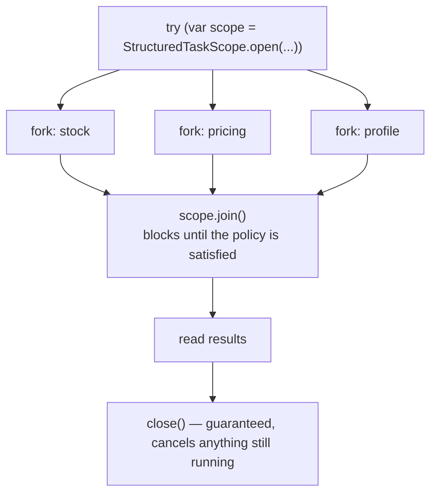
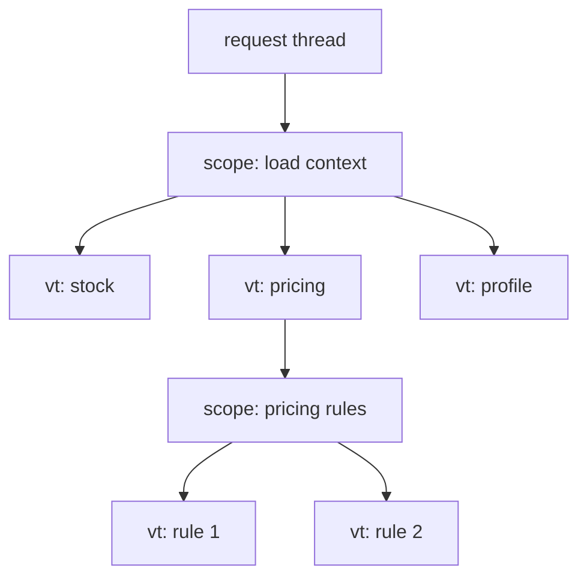
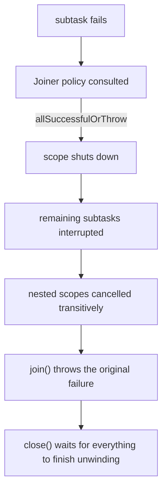

# Structured Concurrency

## 1. Purpose & Audience

**Band:** L4 Architect · **Prerequisites:** [Virtual Threads](31-virtual-threads.md), [Executors & Thread Pool Design](28-executors.md), [CompletableFuture](29-completable-future.md)

Structured concurrency does for concurrent tasks what blocks and braces did for `goto`: it makes the lifetime of a subtask visible in the code that starts it. A scope cannot be exited while its subtasks are still running, so there are no orphans, no leaks, and no forgotten cancellation.

This chapter answers three questions:

1. **What is unstructured about `ExecutorService`**, and what does that cost?
2. **How does `StructuredTaskScope` change error handling and cancellation?**
3. **How do you write it today**, given the API changed shape between Java 21 and Java 25?

!!! danger "This is still a preview API"
    `StructuredTaskScope` has been in preview since Java 21 and **its API changed substantially**. Java 21-era code using `StructuredTaskScope.ShutdownOnFailure` will not compile on Java 25. Section 4.1 covers both shapes. Because preview APIs may change again, verify method signatures against the JDK you are targeting before copying any sample — including these.

---

## 2. The Problem

Confirming an order needs three independent lookups: stock, pricing, and the customer's delivery profile. All three must succeed; if any fails, the others are wasted work.

```java title="UnstructuredFanOut.java"
// The conventional approach — and every line of it is a hazard
public OrderContext load(Cart cart, CustomerId customerId) throws Exception {
    ExecutorService executor = Executors.newVirtualThreadPerTaskExecutor();

    Future<StockStatus>      stock   = executor.submit(() -> inventory.statusFor(cart));
    Future<PricingSnapshot>  pricing = executor.submit(() -> pricingEngine.snapshot(cart));
    Future<DeliveryProfile>  profile = executor.submit(() -> customers.profile(customerId));

    return new OrderContext(stock.get(), pricing.get(), profile.get());
}
```

Four defects, none of them obvious:

- **No cancellation on failure.** If `stock.get()` throws, the other two keep running to completion. Their work is discarded and their load on downstream services is not.
- **Leaked executor.** The method exits on exception without shutting the executor down.
- **Sequential blocking.** `stock.get()` completes before `pricing.get()` is even called, so a failure in pricing is discovered last.
- **No relationship in the runtime.** A thread dump shows three unrelated threads. Nothing records that they belong to one request.

The `CompletableFuture` version fixes the last point and loses the stack traces:

```java title="CompletableFutureVersion.java"
CompletableFuture<StockStatus> stock =
    CompletableFuture.supplyAsync(() -> inventory.statusFor(cart), executor);
// ... allOf, exceptionally, join — and a stack trace that starts in the ForkJoinPool
```

---

## 3. Mental Model

A scope is a **block with a lifetime**. Subtasks forked inside it cannot outlive it.



The structure mirrors the code. An opening brace starts concurrency; the closing brace ends it. That is the whole idea, and everything else follows:

| Property | Consequence |
|---|---|
| Subtasks cannot outlive the scope | No leaks, no orphans |
| Failure cancels siblings | No wasted work |
| The owner thread waits at `join()` | Errors surface where they were caused |
| Scopes nest | The task tree is a real tree |
| The runtime knows the tree | Thread dumps group by scope |

### 3.1 Against the alternatives

| | `ExecutorService` | `CompletableFuture` | Structured concurrency |
|---|---|---|---|
| Lifetime | Unbounded | Unbounded | Lexically scoped |
| Cancel siblings on failure | Manual | `allOf` + manual | Automatic |
| Stack traces | Partial | Poor | Complete |
| Reads like sequential code | No | No | **Yes** |
| Thread-dump grouping | No | No | Yes |
| Debugger stepping | Awkward | Very awkward | Normal |

---

## 4. Core API & Syntax

### 4.1 The API changed — know which one you are reading

=== "Java 25+ (current preview)"
    ```java
    // Static factory plus a Joiner that encodes the policy
    try (var scope = StructuredTaskScope.open(Joiner.<T>allSuccessfulOrThrow())) {
        Subtask<StockStatus> stock = scope.fork(() -> inventory.statusFor(cart));
        Subtask<PricingSnapshot> pricing = scope.fork(() -> pricingEngine.snapshot(cart));

        scope.join();                      // throws if the policy was not satisfied

        return new OrderContext(stock.get(), pricing.get());
    }
    ```

=== "Java 21–23 (obsolete)"
    ```java
    // Subclass-per-policy — removed in later previews
    try (var scope = new StructuredTaskScope.ShutdownOnFailure()) {
        StructuredTaskScope.Subtask<StockStatus> stock =
            scope.fork(() -> inventory.statusFor(cart));

        scope.join();
        scope.throwIfFailed();             // separate step

        return stock.get();
    }
    ```

| | Java 21 shape | Java 25 shape |
|---|---|---|
| Construction | `new StructuredTaskScope.ShutdownOnFailure()` | `StructuredTaskScope.open(Joiner...)` |
| Policy | Chosen by subclass | Chosen by `Joiner` |
| Await | `join()` then `throwIfFailed()` | `join()` throws directly |
| Fail-fast | `ShutdownOnFailure` | `Joiner.allSuccessfulOrThrow()` |
| First success | `ShutdownOnSuccess` | `Joiner.anySuccessfulResultOrThrow()` |
| Collect all outcomes | Custom subclass | `Joiner.awaitAll()` / `allUntil(predicate)` |
| Timeout | `joinUntil(Instant)` | Configured on `open` |

The redesign replaced subclassing with composition: a `Joiner` decides when `join()` returns and what it throws, so the common policies are values rather than types you extend.

### 4.2 Policies

| Joiner | Semantics |
|---|---|
| `allSuccessfulOrThrow()` | All must succeed; first failure cancels the rest and throws |
| `anySuccessfulResultOrThrow()` | First success wins, others cancelled; throws if all fail |
| `awaitAll()` | Wait for every subtask; inspect outcomes individually |
| `allUntil(predicate)` | Wait until the predicate says stop — for partial results |

### 4.3 Subtask handles

| Member | Meaning |
|---|---|
| `Subtask.get()` | The result — **only valid after `join()` and only if successful** |
| `Subtask.exception()` | The failure, if any |
| `Subtask.state()` | `UNAVAILABLE`, `SUCCESS`, or `FAILED` |

Calling `get()` before `join()` throws `IllegalStateException`. That is the API enforcing the structure: you cannot read a result that may not exist yet.

### 4.4 Enabling preview

```bash
javac --release 25 --enable-preview OrderContextLoader.java
java  --enable-preview OrderContextLoader
```

```xml title="pom.xml"
<plugin>
  <artifactId>maven-compiler-plugin</artifactId>
  <configuration>
    <compilerArgs><arg>--enable-preview</arg></compilerArgs>
  </configuration>
</plugin>
```

Preview features require the flag at compile *and* run time, and class files compiled with preview enabled refuse to load on a different JDK version. That alone is a reason to keep preview usage out of shared libraries.

---

## 5. Worked Examples

### 5.1 Fan-out with fail-fast

The §2 loader, structured:

```java title="OrderContextLoader.java"
public OrderContext load(Cart cart, CustomerId customerId)
        throws InterruptedException {

    try (var scope = StructuredTaskScope.open(Joiner.<Object>allSuccessfulOrThrow())) {

        Subtask<StockStatus>     stock   = scope.fork(() -> inventory.statusFor(cart));
        Subtask<PricingSnapshot> pricing = scope.fork(() -> pricingEngine.snapshot(cart));
        Subtask<DeliveryProfile> profile = scope.fork(() -> customers.profile(customerId));

        scope.join();      // returns when all succeed; throws on the first failure

        return new OrderContext(stock.get(), pricing.get(), profile.get());
    }
}
```

Compare against §2 line by line. If pricing fails at 40 ms, stock and profile are cancelled immediately rather than running to completion. The scope closes on every path, including exceptions. The three subtasks run on virtual threads, and a thread dump groups them under this scope.

And the method reads like sequential code — three calls, then a result.

### 5.2 First successful result

Three vendors can fulfil the order; take whichever answers first:

```java title="FastestVendor.java"
public DispatchQuote fastestQuote(Order order) throws InterruptedException {
    try (var scope = StructuredTaskScope.open(
             Joiner.<DispatchQuote>anySuccessfulResultOrThrow())) {

        for (Vendor vendor : order.eligibleVendors()) {
            scope.fork(() -> vendor.quote(order));
        }

        return scope.join();       // first success; the rest are cancelled
    }
}
```

The losers are cancelled the moment one succeeds, so two of the three vendor calls stop mid-flight rather than completing and being discarded. Writing this with `CompletableFuture.anyOf` gives you the first result but leaves the others running.

### 5.3 Partial results

Sometimes a missing input is acceptable — recommendations, say, where a timeout should degrade rather than fail:

```java title="PartialResults.java"
public OrderContext loadTolerant(Cart cart, CustomerId customerId)
        throws InterruptedException {

    try (var scope = StructuredTaskScope.open(Joiner.<Object>awaitAll())) {

        Subtask<StockStatus>      stock  = scope.fork(() -> inventory.statusFor(cart));
        Subtask<List<Sku>>        recs   = scope.fork(() -> recommender.forCart(cart));

        scope.join();      // waits for both, throws nothing

        if (stock.state() != Subtask.State.SUCCESS) {
            throw new InventoryUnavailableException(stock.exception());
        }

        List<Sku> recommendations = recs.state() == Subtask.State.SUCCESS
            ? recs.get()
            : List.of();                        // degrade quietly

        return new OrderContext(stock.get(), recommendations);
    }
}
```

`awaitAll()` collects every outcome without throwing, so you decide per-subtask which failures matter. This is the shape for "required plus optional" fan-out.

### 5.4 Nesting

Scopes compose, and the tree is real:

```java title="NestedScopes.java"
public DispatchPlan planDispatch(List<Order> orders) throws InterruptedException {
    try (var outer = StructuredTaskScope.open(Joiner.<List<VendorAssignment>>allSuccessfulOrThrow())) {

        List<Subtask<List<VendorAssignment>>> perOrder = orders.stream()
            .map(order -> outer.fork(() -> assignVendors(order)))    // each forks its own scope
            .toList();

        outer.join();

        return new DispatchPlan(perOrder.stream().flatMap(s -> s.get().stream()).toList());
    }
}

private List<VendorAssignment> assignVendors(Order order) throws InterruptedException {
    try (var inner = StructuredTaskScope.open(Joiner.<VendorAssignment>allSuccessfulOrThrow())) {
        order.lines().forEach(line -> inner.fork(() -> assign(line)));
        inner.join();
        // ...
    }
}
```

Cancelling the outer scope cancels every inner scope transitively. With raw executors this requires bookkeeping you would have to write and maintain; here it is the structure.

### 5.5 The rules the API enforces

```java title="Violations.java"
try (var scope = StructuredTaskScope.open(Joiner.<String>allSuccessfulOrThrow())) {
    Subtask<String> task = scope.fork(() -> load());

    task.get();          // IllegalStateException — join() has not run

    scope.join();
    scope.fork(() -> more());   // IllegalStateException — cannot fork after join
}
```

Also enforced: **only the owner thread may fork and join.** Passing a scope to another thread throws. These are not arbitrary restrictions — each one is a way the structure could be broken, closed off at the API rather than left as a convention.

---

## 6. Internals

### 6.1 The scope is a tree node

Each scope records its owner thread and its subtasks, and each subtask records its scope. The result is a real tree the runtime can traverse — which is why `jcmd <pid> Thread.dump_to_file -format=json` can group virtual threads by scope instead of listing ten thousand flat entries.



This is the operational payoff. An unstructured fan-out of virtual threads produces a dump you cannot reason about; a structured one produces a call tree.

### 6.2 Cancellation propagation



Cancellation is **interruption**, which means subtasks must be interruptible for it to work. A subtask blocked in a non-interruptible native call will not stop; the scope will wait for it at `close()`. This is the same constraint as [Chapter 24](24-threading-fundamentals.md) — cooperative cancellation is still cooperative.

### 6.3 Subtasks are virtual threads

Every `fork` creates a virtual thread by default, which is what makes the model affordable: forking a hundred subtasks costs roughly a hundred small heap allocations rather than a hundred OS threads.

The two features were designed together. Structured concurrency without virtual threads would be limited by the same thread ceiling as everything else; virtual threads without structure produce the unreadable flat dumps described above.

### 6.4 `ScopedValue` flows into subtasks

```java title="ContextPropagation.java"
private static final ScopedValue<RequestContext> CONTEXT = ScopedValue.newInstance();

ScopedValue.where(CONTEXT, requestContext).run(() -> {
    try (var scope = StructuredTaskScope.open(Joiner.<Object>allSuccessfulOrThrow())) {
        scope.fork(() -> {
            RequestContext ctx = CONTEXT.get();     // inherited — no copying
            return inventory.statusFor(ctx.cart());
        });
        scope.join();
    }
});
```

`ScopedValue` bindings are visible to subtasks forked inside the scope, which is how tracing IDs, tenant context, and security principals propagate without `ThreadLocal`'s inheritance cost. See [Chapter 33](33-scoped-values.md).

### 6.5 Stack traces survive

```text title="Structured failure"
Exception in thread "main" java.util.concurrent.StructuredTaskScope$FailedException
    at OrderContextLoader.load(OrderContextLoader.java:23)
Caused by: java.net.SocketTimeoutException: connect timed out
    at PricingEngine.snapshot(PricingEngine.java:88)
    at OrderContextLoader.lambda$load$1(OrderContextLoader.java:19)
```

Both frames are present: where it failed, and which fork started it. The `CompletableFuture` equivalent typically shows a chain that begins in the ForkJoinPool with no path back to the request. Retaining that link is one of the strongest practical arguments for the model.

---

## 7. Production Patterns & Anti-Patterns

### Do this

- **Use a scope for every fan-out** where the subtasks belong to one logical operation.
- **Pick the Joiner that states the policy** — `allSuccessfulOrThrow` for "all must succeed", `anySuccessfulResultOrThrow` for races, `awaitAll` for required-plus-optional.
- **Keep scopes short and lexical.** A scope that spans a whole request handler is fine; one stored in a field is not.
- **Let failures propagate.** The scope cancels siblings; catching broadly inside a subtask defeats that.
- **Nest scopes** rather than flattening a naturally hierarchical fan-out.
- **Bind `ScopedValue` outside the scope** so subtasks inherit context.
- **Confine preview usage** to application code, never a shared library — preview class files will not load on a different JDK.

### Never do this

- **Never store a scope in a field or pass it to another thread.** Only the owner may fork and join; the API enforces it.
- **Never call `Subtask.get()` before `join()`.** `IllegalStateException`, by design.
- **Never fork after `join()`.** Same.
- **Never catch `Exception` inside a subtask and return a sentinel** — you have disabled the cancellation the model provides.
- **Never assume cancellation stops everything.** It is interruption; a non-interruptible native call will still be waited on at `close()`.
- **Never copy Java 21-era samples unchanged.** `ShutdownOnFailure` and `throwIfFailed` do not exist in the current API.
- **Never ship preview APIs in a library**, and think carefully before shipping them in a service — the API has changed across five previews and may change again.

---

## 8. Version Evolution (Java 8 → 26)

| Version | What changed | Impact |
|---|---|---|
| **8** | `CompletableFuture` | Composition without structure; poor stack traces |
| **19** | First incubator (JEP 428) | `StructuredTaskScope` appears |
| **21** | Preview (JEP 453) alongside final virtual threads | `ShutdownOnFailure` / `ShutdownOnSuccess` subclasses — **the API most tutorials show** |
| **22–24** | Successive previews; API redesign | Subclass policies replaced by `Joiner`; `open()` factory |
| **25** | Preview (JEP 505) | Current shape: `open(Joiner...)`, `join()` throws directly |
| **26** | Sixth preview (JEP 525) — adds `Joiner.onTimeout()` | Still not final — verify signatures against your JDK |

### Migration note

Java 21 code does not compile on Java 25. The mapping:

| Java 21 | Java 25 |
|---|---|
| `new StructuredTaskScope.ShutdownOnFailure()` | `StructuredTaskScope.open(Joiner.allSuccessfulOrThrow())` |
| `new StructuredTaskScope.ShutdownOnSuccess<T>()` | `StructuredTaskScope.open(Joiner.anySuccessfulResultOrThrow())` |
| `scope.join(); scope.throwIfFailed();` | `scope.join();` — it throws |
| `scope.joinUntil(instant)` | Timeout configured on `open` |
| Custom subclass for partial results | `Joiner.awaitAll()` or `allUntil(predicate)` |

Because this is preview and has changed repeatedly, the pragmatic position for production code on Java 21–25 is: **use virtual threads now, and keep structured concurrency to bounded, easily-rewritten call sites** until it goes final. The model is worth adopting; the API is not yet stable enough to spread across a codebase.

---

## 9. Interview Questions

### L1 — Foundations

**Q1. What is structured concurrency?** ⭐ *high frequency*
A model in which concurrent subtasks have a lifetime bounded by a lexical block, so they cannot outlive the code that started them. Forking happens inside a scope, the scope cannot be exited until every subtask completes or is cancelled, and a failure in one can cancel its siblings. The effect is that concurrent code has the same structure as sequential code.

**Q2. What problem does it solve that `ExecutorService` does not?**
`ExecutorService` has no relationship between the tasks it runs, so nothing cancels siblings when one fails, nothing prevents a task outliving the method that submitted it, and nothing records that several threads belong to one operation. Structured concurrency makes that relationship explicit and enforces it, which removes an entire category of leaks and wasted work.

**Q3. What runs the subtasks?**
Virtual threads, by default. That is what makes the model practical — forking a hundred subtasks costs a hundred small heap allocations rather than a hundred OS threads. The two features were designed together and are most useful together.

### L2 — Professional

**Q4. What happens when one subtask fails?** ⭐ *high frequency*
It depends on the policy. With `allSuccessfulOrThrow`, the scope shuts down: the remaining subtasks are interrupted, nested scopes are cancelled transitively, and `join()` throws with the original failure as the cause. With `awaitAll`, nothing is cancelled and you inspect each subtask's state yourself. Choosing the policy at the scope is the point — it is no longer scattered across `Future.get` calls.

**Q5. Why can't you call `Subtask.get()` before `join()`?**
Because the result may not exist yet, and returning null or blocking implicitly would both hide that. The API throws `IllegalStateException` instead, forcing the code to reach `join()` first. The same rule prevents forking after `join()` — both are ways the structure could be broken, closed off at the API rather than left as a convention.

**Q6. How is cancellation implemented?**
By interruption, the same mechanism as `Thread.interrupt`. That means subtasks must be interruptible for cancellation to work: a subtask blocked in a non-interruptible native call will not stop, and the scope will wait for it at `close()`. Cooperative cancellation is still cooperative — structured concurrency organises it, it does not make it forceful.

### L3 — Enterprise

**Q7. How does this change what you see in a thread dump?**
Each scope records its owner and its subtasks, so the runtime holds a real task tree. `jcmd <pid> Thread.dump_to_file -format=json` groups virtual threads by scope, turning what would be ten thousand flat entries into a readable call tree that shows which request each thread belongs to. With unstructured fan-out onto virtual threads, the dump is technically complete and practically useless.

**Q8. What is the difference between this and `CompletableFuture`?**
`CompletableFuture` composes asynchronous results but imposes no lifetime: nothing prevents a stage outliving its caller, `anyOf` leaves losers running, and stack traces typically start in the ForkJoinPool with no path back to the request. Structured concurrency binds lifetime to a block, cancels siblings by policy, and preserves the full stack including the fork site. It also reads as sequential code, which `CompletableFuture` chains never do.

**Q9. The API changed between Java 21 and Java 25. What changed and why does it matter?**
Java 21 chose the policy by subclass — `ShutdownOnFailure`, `ShutdownOnSuccess` — and required `join()` followed by `throwIfFailed()`. Java 25 replaced that with `StructuredTaskScope.open(Joiner...)`, where the policy is a value and `join()` throws directly. It matters practically because the majority of tutorials and blog posts still show the Java 21 shape, and that code does not compile on 25 — so anyone adopting it needs to know which era a sample comes from.

### L4 — Architect

**Q10. Would you use structured concurrency in production today, and how would you bound the risk?**
The model is sound and worth using, but the API is still preview and has changed across five successive previews, so code written against it may need rewriting on the next JDK. The pragmatic position is to adopt virtual threads freely — they are final — and confine structured concurrency to a small number of bounded, easily-rewritten call sites where the fan-out is genuinely complex. Never put it in a shared library: preview class files refuse to load on a different JDK version, which turns an internal choice into everyone's problem.

**Q11. How does structured concurrency interact with observability and tracing?**
It helps in two directions. The scope tree gives thread dumps and profilers a grouping that flat virtual threads lack, so a hung request can be traced to the subtask holding it up. And `ScopedValue` bindings established outside a scope are inherited by its subtasks, so trace identifiers, tenant context, and security principals propagate into forked work without `ThreadLocal` inheritance or manual passing. Together they restore the request-scoped reasoning that fan-out onto raw executors destroys.

**Q12. What does this model borrow, and what remains unsolved?**
It is the same argument Dijkstra made about `goto`: unrestricted transfer of control — here, unrestricted task lifetime — makes programs hard to reason about, and the fix is to make control flow follow lexical structure. Kotlin's coroutine scopes and Trio's nurseries are the direct precedents. What remains unsolved is anything genuinely unstructured: long-lived background workers, pub/sub consumers, and fire-and-forget tasks do not fit a block-scoped lifetime, and forcing them into one produces worse code than an executor. Structured concurrency is for fan-out within an operation, not for every use of a thread.

---

!!! abstract "Cheat Sheet"
    **Subtasks cannot outlive their scope** — the closing brace is the lifetime boundary

    **`StructuredTaskScope.open(Joiner...)`** in try-with-resources — **Java 25 shape**

    **Java 21 `ShutdownOnFailure` / `throwIfFailed` no longer exist** — most tutorials are stale

    **Joiners:** `allSuccessfulOrThrow` · `anySuccessfulResultOrThrow` · `awaitAll` · `allUntil`

    **`join()` throws directly** in the current API — no separate `throwIfFailed`

    **`Subtask.get()` only after `join()`** · **no forking after `join()`** · **owner thread only**

    **Failure cancels siblings** by interruption — non-interruptible native calls still block `close()`

    **Subtasks are virtual threads** — forking a hundred is cheap

    **`ScopedValue` bindings inherit** into subtasks — context without `ThreadLocal`

    **Stack traces keep the fork site** — unlike `CompletableFuture`

    **Thread dumps group by scope** — `jcmd Thread.dump_to_file -format=json`

    **Still preview** — `--enable-preview` at compile and run; never in a shared library
