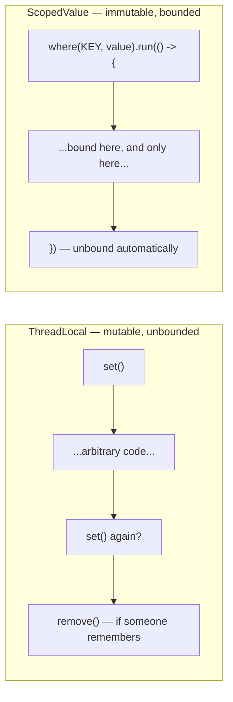
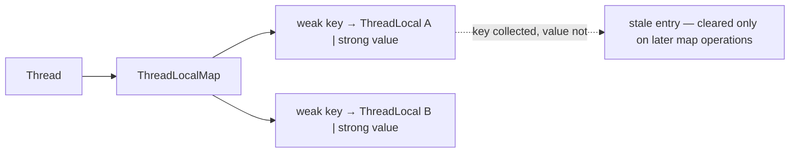
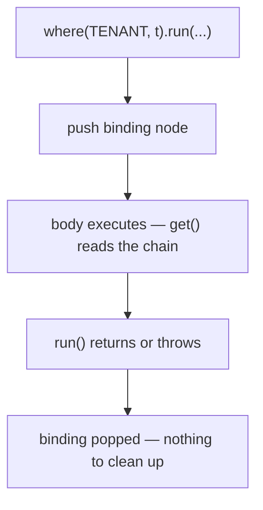

# ThreadLocal → ScopedValue

<!-- video:start -->
<figure class="pb-video">
<video controls playsinline preload="metadata">
<source src="../../videos/ch33.mp4" type="video/mp4">
<track kind="subtitles" srclang="en" label="English" src="../../videos/ch33.vtt">
</video>
<figcaption>Video walkthrough · 5:30 · subtitles via CC · <a href="../../videos/ch33.mp4" download>Download MP4</a></figcaption>
</figure>
<!-- video:end -->

## 1. Purpose & Audience

**Band:** L3 Enterprise · **Prerequisites:** [Threading Fundamentals](24-threading-fundamentals.md), [Virtual Threads](31-virtual-threads.md)

Every server application needs to carry context — a trace identifier, a tenant, an authenticated principal — through call layers that have no business taking it as a parameter. For twenty years the answer was `ThreadLocal`, and it worked well enough when threads were few and pooled.

Virtual threads broke both assumptions. `ScopedValue`, final in Java 25, is the replacement: an immutable binding with a lifetime you can see in the code.

This chapter answers three questions:

1. **What is actually wrong with `ThreadLocal`** — beyond the memory leak everyone mentions?
2. **How does a bounded, immutable binding change the model?**
3. **What still needs `ThreadLocal`**, because `ScopedValue` does not replace all of it.

---

## 2. The Problem

The order engine needs the tenant and trace identifier available anywhere in the call stack. Threading them through every signature is untenable:

```java title="ExplicitPassing.java"
// Every layer carries context it does not use
public Order confirm(Cart cart, Customer customer, RequestContext ctx) {
    inventory.reserveAll(cart.lines(), ctx);
    payments.charge(customer.id(), cart.total(), ctx);
    repository.save(order, ctx);
    return order;
}
```

Four layers deep, every method signature grows a parameter, every test constructs one, and adding a fifth field to the context touches nothing but still feels like it should.

So we use ambient storage:

```java title="ThreadLocalContext.java"
public final class RequestContextHolder {
    private static final ThreadLocal<RequestContext> CONTEXT = new ThreadLocal<>();

    public static void set(RequestContext ctx) { CONTEXT.set(ctx); }
    public static RequestContext get()         { return CONTEXT.get(); }
    public static void clear()                 { CONTEXT.remove(); }
}
```

```java title="Filter.java"
RequestContextHolder.set(contextFrom(request));
try {
    handle(request);
} finally {
    RequestContextHolder.clear();      // forget this and you have a bug
}
```

This works, and it has four problems that compound.

**Unbounded lifetime.** A `ThreadLocal` has no scope. It is set until someone removes it, and "someone" is a `finally` block that any refactor can drop.

**Leaks in pooled threads.** A pooled thread outlives the request. If `remove()` is missed, the next request on that thread sees the previous tenant's context — a correctness bug that looks like a security incident, because it is one.

**Anyone can write to it.** `set()` is public by construction. Context can be mutated three layers down and the caller cannot tell.

**Inheritance is a copy.** `InheritableThreadLocal` copies the entire map into every child thread at creation. At two hundred threads that is invisible. At a million, it is not.

---

## 3. Mental Model



A `ScopedValue` is bound for the **dynamic extent of a block**: everything that block calls can read it, and when the block returns the binding is gone. There is no `set`, no `remove`, and no way for callee code to change what the caller bound.

| | `ThreadLocal` | `ScopedValue` |
|---|---|---|
| Mutability | `set` anywhere, any time | Bound once per scope, immutable |
| Lifetime | Until `remove()` | The enclosing block |
| Cleanup | Manual, easy to miss | Automatic |
| Who can write | Anyone with the reference | Only the code opening the scope |
| Inheritance | Copied per child thread | **Shared**, no copy |
| Cost per thread | A map entry per value | Nothing — the binding lives on the stack |
| Read cost | Map lookup | Cached, near-field-access |

### 3.1 Why immutability is the key change

Because the value cannot change while bound, it does not need to be per-thread storage at all. Subtasks can **share** the caller's binding rather than receiving a copy — which is what makes it viable at a million threads, and what makes it work correctly with [structured concurrency](32-structured-concurrency.md).

---

## 4. Core API & Syntax

### 4.1 The whole API

| Member | Purpose |
|---|---|
| `ScopedValue.newInstance()` | Create the key — always `static final` |
| `ScopedValue.where(key, value)` | Build a binding |
| `.run(Runnable)` | Execute with the binding, no result |
| `.call(Callable<T>)` | Execute with the binding, returning a result |
| `key.get()` | Read — throws `NoSuchElementException` if unbound |
| `key.isBound()` | Test before reading |
| `key.orElse(default)` | Read with a fallback |
| `key.orElseThrow(supplier)` | Read or throw your exception |

```java title="Basic.java"
private static final ScopedValue<RequestContext> CONTEXT = ScopedValue.newInstance();

ScopedValue.where(CONTEXT, ctx).run(() -> handle(request));
```

That is the entire surface. There is deliberately no `set`.

### 4.2 Multiple and nested bindings

```java title="Bindings.java"
// Several values in one scope
ScopedValue.where(TENANT, tenant)
           .where(TRACE_ID, traceId)
           .run(() -> handle(request));

// Rebinding for an inner section — the outer value is restored on exit
ScopedValue.where(TENANT, systemTenant).run(() -> {
    runMaintenanceTask();          // sees systemTenant
});                                 // outer binding intact again
```

Rebinding shadows; it does not mutate. The outer scope's value is untouched and reappears when the inner block exits.

!!! note "Final in Java 25"
    `ScopedValue` was incubating from Java 20 and in preview through 21–24. It is **final in Java 25 (JEP 506)** — no `--enable-preview`. Samples showing `ScopedValue.where(...)` with a third argument, or `ScopedValue.callWhere`, are from earlier previews and no longer compile.

---

## 5. Worked Examples

### 5.1 Request context

```java title="RequestContext.java"
public record RequestContext(TenantId tenant, String traceId, CustomerId customer) {}

public final class Context {
    public static final ScopedValue<RequestContext> CURRENT = ScopedValue.newInstance();

    private Context() {}

    public static RequestContext current() {
        return CURRENT.orElseThrow(() -> new IllegalStateException("no request context bound"));
    }
}
```

```java title="RequestHandler.java"
public void handle(HttpExchange exchange) {
    RequestContext ctx = new RequestContext(
        TenantId.of(exchange.getRequestHeaders().getFirst("X-Tenant")),
        exchange.getRequestHeaders().getFirst("X-Trace-Id"),
        customerFrom(exchange));

    ScopedValue.where(Context.CURRENT, ctx)
               .run(() -> orderService.confirm(cartFrom(exchange)));
}
```

```java title="DeepInTheStack.java"
public final class OrderRepository {
    public void save(Order order) {
        TenantId tenant = Context.current().tenant();     // four layers down
        // ... write to the tenant's schema
    }
}
```

No `finally`, no `remove`, and nothing between the handler and the repository carries a parameter it does not use. When `run` returns, the binding is gone — including on the exception path.

### 5.2 Inheritance into subtasks

This is where `ScopedValue` and structured concurrency were designed to fit together:

```java title="WithStructuredConcurrency.java"
ScopedValue.where(Context.CURRENT, ctx).run(() -> {
    try (var scope = StructuredTaskScope.open(Joiner.<Object>allSuccessfulOrThrow())) {

        scope.fork(() -> inventory.statusFor(cart));      // sees CURRENT
        scope.fork(() -> pricingEngine.snapshot(cart));   // sees CURRENT
        scope.fork(() -> customers.profile(customerId));  // sees CURRENT

        scope.join();
    }
});
```

Every forked subtask reads the same binding. **Nothing is copied** — the value is immutable, so all three share one reference. With `InheritableThreadLocal` this would copy the whole inherited map into each of the three threads at creation.

### 5.3 Rebinding for privileged work

```java title="Rebinding.java"
public void runNightlyReconciliation() {
    RequestContext system = new RequestContext(
        TenantId.SYSTEM, TraceId.generate(), CustomerId.NONE);

    ScopedValue.where(Context.CURRENT, system).run(() -> {
        for (TenantId tenant : allTenants()) {
            ScopedValue.where(Context.CURRENT, system.withTenant(tenant))
                       .run(() -> reconcile(tenant));      // per-tenant binding
        }
    });
}
```

Each inner `run` shadows the outer binding for the duration of that iteration, then restores it. Doing this with `ThreadLocal` means saving the old value, setting the new one, and restoring in a `finally` — three lines and a bug waiting for the next refactor.

### 5.4 Migrating from `ThreadLocal`

```java title="Before.java"
// Before
private static final ThreadLocal<RequestContext> CONTEXT = new ThreadLocal<>();

void handle(Request request) {
    CONTEXT.set(contextFrom(request));
    try {
        process(request);
    } finally {
        CONTEXT.remove();
    }
}

RequestContext ctx = CONTEXT.get();        // may be null
```

```java title="After.java"
// After
private static final ScopedValue<RequestContext> CONTEXT = ScopedValue.newInstance();

void handle(Request request) {
    ScopedValue.where(CONTEXT, contextFrom(request))
               .run(() -> process(request));
}

RequestContext ctx = CONTEXT.get();        // throws if unbound — never null
```

The mapping is mechanical where the `ThreadLocal` is genuinely set-once-per-request:

| `ThreadLocal` | `ScopedValue` |
|---|---|
| `set(v)` + `try`/`finally` + `remove()` | `where(KEY, v).run(...)` |
| `get()` returning null | `get()` throwing, or `orElse(default)` |
| `get() != null` | `isBound()` |
| `InheritableThreadLocal` | Automatic inheritance into subtasks |

What does **not** map: any `ThreadLocal` written more than once during a request. That is mutable per-thread state, and `ScopedValue` deliberately cannot express it — see §5.5.

### 5.5 What `ScopedValue` cannot replace

```java title="StillThreadLocal.java"
// A reusable per-thread buffer — mutable by design
private static final ThreadLocal<ByteBuffer> SCRATCH =
    ThreadLocal.withInitial(() -> ByteBuffer.allocate(8192));

void encode(Order order) {
    ByteBuffer buffer = SCRATCH.get();
    buffer.clear();
    // ... fill and write
}
```

This is not context propagation — it is a per-thread cache used to avoid allocation. `ScopedValue` bindings are immutable, so they cannot express it.

But note the interaction with [virtual threads](31-virtual-threads.md): one 8 KB buffer per platform thread was 1.6 MB at 200 threads, and 8 GB at a million virtual threads. On a virtual-thread service this pattern needs rethinking regardless — pool the buffers explicitly, or allocate per call and let escape analysis handle it.

---

## 6. Internals

### 6.1 How `ThreadLocal` stores values

Each `Thread` holds a `ThreadLocalMap`: keys are **weak** references to `ThreadLocal` objects, values are **strong**.



That asymmetry is the leak. When the `ThreadLocal` itself becomes unreachable the key is collected, but the value is held strongly until the map happens to clean stale entries during a subsequent `get`, `set`, or `remove`. On a pooled thread that sees no further activity, the value is retained for the thread's lifetime.

In an application-server context this is how a single `ThreadLocal` holding an object from a redeployed application's classloader pins the entire classloader — the classic "PermGen/Metaspace leak after hot redeploy".

### 6.2 How `ScopedValue` stores bindings

There is no per-thread map. A binding is a small immutable node in a linked structure associated with the current thread's execution, pushed when `run` is entered and popped when it exits — conceptually a stack, physically tied to the stack frame that established it.



Three consequences:

- **No cleanup is possible or required.** The binding cannot outlive the frame, so there is no leak to have.
- **Reads are fast.** The chain is short and the JDK maintains a small per-thread cache of recent bindings, so `get()` approaches field-access cost rather than a hash lookup.
- **Inheritance is free.** Because the value cannot change, a subtask shares the caller's binding rather than copying it.

### 6.3 Why inheritance is the virtual-thread argument

`InheritableThreadLocal` copies the parent's inheritable map into every child thread at construction.

| Threads | `InheritableThreadLocal` | `ScopedValue` |
|---|---|---|
| 200 platform | 200 map copies — negligible | 200 shared references |
| 1,000,000 virtual | **1,000,000 map copies** | 1,000,000 shared references |

The copy is per thread and per inheritable value. At virtual-thread scale, request-context propagation through `InheritableThreadLocal` is a memory and allocation problem in itself — which is precisely why `ScopedValue` was developed alongside Loom rather than separately.

### 6.4 The immutability guarantee

```java title="ImmutabilityIsShallow.java"
// The BINDING is immutable. The OBJECT need not be.
public class MutableContext {
    private String tenant;
    public void setTenant(String t) { this.tenant = t; }   // ✗
}

ScopedValue.where(CONTEXT, new MutableContext()).run(() -> {
    CONTEXT.get().setTenant("other");     // compiles, and defeats the design
});
```

`ScopedValue` guarantees that the *binding* cannot be reassigned. It cannot stop you mutating the object you bound, and a mutable context shared across forked subtasks is a data race.

**Bind records or otherwise deeply immutable values.** The record in §5.1 is not stylistic — it is what makes the guarantee meaningful.

### 6.5 Unbound reads fail loudly

`ThreadLocal.get()` returns null when unset, so a missing context becomes a `NullPointerException` somewhere unrelated. `ScopedValue.get()` throws `NoSuchElementException` at the point of the read, naming the problem.

Choose deliberately:

```java
CONTEXT.get()                           // absence is a bug — fail here
CONTEXT.orElse(RequestContext.ANONYMOUS)  // absence is normal
CONTEXT.isBound()                        // branch on it
```

Code that runs both inside and outside a request scope — a scheduled job reusing service code — needs `orElse` or `isBound`, not `get`.

---

## 7. Production Patterns & Anti-Patterns

### Do this

- **Declare every `ScopedValue` as `private static final`.** It is a key, not state.
- **Bind at the boundary** — the request filter, the message handler, the job runner — and nowhere else.
- **Bind immutable values.** Records are the natural fit; the guarantee is only as deep as the object.
- **Wrap access in an accessor** (`Context.current()`) so the failure mode and default are decided once.
- **Use `orElse` for code that runs both inside and outside a scope**, `get()` where absence really is a bug.
- **Rebind rather than mutate** when an inner section needs different context.
- **Keep the number of `ScopedValue` keys small.** One context record beats six separate keys.
- **Audit `ThreadLocal` usage before adopting virtual threads** — see [Ch 31](31-virtual-threads.md).

### Never do this

- **Never bind a mutable object.** The binding is immutable; the object is not, and subtasks share it.
- **Never use `ScopedValue` as a general parameter-passing mechanism.** Two layers deep, an explicit parameter is clearer. Ambient context is for genuinely cross-cutting concerns.
- **Never expect it to replace mutable per-thread caches.** Those still need `ThreadLocal` — or rethinking under virtual threads.
- **Never call `get()` in code that may run unbound.** Use `orElse` or `isBound`.
- **Never bind inside a library** on the caller's behalf. Binding is the application's decision at its own boundary.
- **Never keep `InheritableThreadLocal` for context propagation** on a virtual-thread service. The copy is per thread.
- **Never assume a `ThreadLocal` was cleaned up** because a `finally` exists somewhere. Grep for `remove()` and check every path.

---

## 8. Version Evolution (Java 8 → 26)

| Version | What changed | Impact |
|---|---|---|
| **8** | `ThreadLocal.withInitial` | Lambda-friendly initialisation; the leak remains |
| **20** | `ScopedValue` incubator (JEP 429) | First appearance, alongside virtual threads |
| **21–24** | Successive previews; API refinement | `callWhere`/`runWhere` static forms appeared and were removed |
| **24** | JEP 491 — `synchronized` no longer pins virtual threads | Removes a related virtual-thread caveat |
| **25** | **`ScopedValue` final (JEP 506)** | Production-ready; no `--enable-preview` |
| **26** | Structured concurrency still preview | `ScopedValue` inheritance into subtasks is stable; the scope API is not |

### Migration note

Do this in two passes.

**Pass one — classify.** Every `ThreadLocal` is one of three kinds: request context set once per operation (migrate), a mutable per-thread cache (keep, but reconsider under virtual threads), or a legacy accumulator written repeatedly (redesign — it is shared mutable state wearing a disguise).

**Pass two — migrate the first kind.** The change is mechanical: `set` + `finally` + `remove` becomes `where(...).run(...)`, and every `get()` needs a decision about whether absence is an error. Expect the compiler to find all read sites; expect it *not* to find code that relied on the value being null when unbound.

One caution: a `ScopedValue` bound in one thread is not visible to a thread started with `new Thread(...)` outside a structured scope. If code currently relies on `InheritableThreadLocal` propagating into manually-created threads, that path needs restructuring — usually into a `StructuredTaskScope`, which is where the inheritance works.

---

## 9. Interview Questions

### L1 — Foundations

**Q1. What is a `ThreadLocal`?** ⭐ *high frequency*
A variable whose value is separate per thread, stored in a map held by the `Thread` object itself. It is used for ambient context — a trace identifier, a user principal — that would otherwise have to be threaded through every method signature. Each thread reads and writes its own value with no synchronisation needed.

**Q2. Why does `ThreadLocal` leak memory?**
The per-thread map holds weak references to the `ThreadLocal` keys but strong references to the values. When the key is collected, the value remains until the map happens to clean stale entries during a later operation, so on a pooled thread that sees no further activity the value is retained for the thread's lifetime. Calling `remove()` in a `finally` block is the fix, and forgetting it is the common bug.

**Q3. What is a `ScopedValue`?**
An immutable value bound for the duration of a block: `ScopedValue.where(KEY, value).run(() -> ...)`. Anything the block calls can read it, and the binding disappears automatically when the block exits, including on exceptions. There is no `set` and no `remove` — the lifetime is the code structure.

### L2 — Professional

**Q4. Why is `ScopedValue` better than `ThreadLocal` for request context?** ⭐ *high frequency*
Because the lifetime is bounded by the block rather than by someone remembering to call `remove()`, so context cannot leak into the next request on a pooled thread. The binding is immutable, so callee code cannot change what the caller established. And reads of an unbound value throw at the read site rather than returning null and failing somewhere unrelated.

**Q5. How do you provide a different value for part of a scope?**
Nest another `where(...).run(...)`. The inner binding shadows the outer one for the duration of that block and the outer value is restored on exit — no save-and-restore, no `finally`. With `ThreadLocal` the same thing requires reading the old value, setting the new one, and restoring it in a `finally`, which is three lines and a refactoring hazard.

**Q6. Can you still use `ThreadLocal` after Java 25?**
Yes, and for some things you must. `ScopedValue` bindings are immutable, so it cannot express a mutable per-thread cache such as a reusable buffer. Those remain `ThreadLocal` — though under virtual threads the per-thread-cache pattern needs rethinking anyway, since one buffer per thread stops being cheap at a million threads.

### L3 — Enterprise

**Q7. Why does `ScopedValue` matter specifically for virtual threads?**
Two reasons. `InheritableThreadLocal` copies the parent's map into every child thread at creation, which is negligible at two hundred threads and a real memory and allocation cost at a million. And `ThreadLocal` values are per thread, so any non-trivial value — an 8 KB buffer, a cached formatter — multiplies by the thread count. `ScopedValue` bindings are immutable and therefore shared rather than copied, with nothing stored per thread at all.

**Q8. How does a `ScopedValue` reach a forked subtask?**
Subtasks forked inside a `StructuredTaskScope` inherit the bindings in effect where the scope was opened. Because the value is immutable, they share the same reference — no copy, no synchronisation. This is the intended pairing: structured concurrency provides the task tree and `ScopedValue` provides the context that flows down it. A thread started with `new Thread(...)` outside a scope does *not* inherit bindings.

**Q9. What does `ScopedValue` not guarantee?**
That the object you bound is immutable. The binding cannot be reassigned, but nothing stops code calling a setter on the bound object, and since forked subtasks share the reference that becomes a data race. Bind records or otherwise deeply immutable values — the guarantee is about the binding, not the graph behind it.

### L4 — Architect

**Q10. When is ambient context the wrong design?**
When the dependency is real and shallow. Two layers deep, an explicit parameter is clearer, testable without setup, and visible in the signature — ambient context hides a dependency that the type system could have shown. It earns its place for genuinely cross-cutting concerns that most of the stack does not care about: tracing, tenancy, security principal, locale. The test is whether the intermediate layers would ever act on the value; if they would, pass it.

**Q11. How would you plan a migration from `ThreadLocal` to `ScopedValue` in a large service?**
Classify first, because the three kinds of `ThreadLocal` have different answers: set-once request context migrates mechanically, mutable per-thread caches stay, and anything written repeatedly during a request is shared mutable state that needs redesigning rather than porting. Then migrate the first kind at the binding boundary — the request filter or job runner — and let the compiler find every read site. The part the compiler will not find is code that depended on `get()` returning null when unbound, so each read needs a decision between `get()`, `orElse`, and `isBound()`. Finally, check for any reliance on `InheritableThreadLocal` propagating into manually-created threads, since that path only works through a structured scope now.

**Q12. What is the underlying design principle here, and where else does it appear?**
Replacing unbounded mutable state with an immutable binding whose lifetime follows lexical structure — the same argument as structured concurrency, applied to data rather than tasks. In both cases the old mechanism gave power with no guarantees (a task could outlive its caller; a value could persist past its request) and the fix was to make the code's shape enforce the lifetime. The cost is that genuinely unstructured cases no longer fit, which is why mutable per-thread caches keep `ThreadLocal` and long-lived background workers keep executors. The gain is that the common case becomes impossible to get wrong.

---

!!! abstract "Cheat Sheet"
    **`ScopedValue.where(KEY, v).run(...)`** — bound for the block, unbound automatically

    **No `set`, no `remove`** — immutable binding, lifetime is the code structure

    **`get()` throws when unbound** · `orElse(default)` · `isBound()`

    **Nest `where(...)` to rebind** — shadows, then restores; never mutates

    **`ThreadLocal` leaks:** weak keys, **strong values** — stale entries survive on pooled threads

    **`InheritableThreadLocal` copies per child thread** — a problem at a million virtual threads

    **`ScopedValue` bindings are shared, not copied** — immutability is what makes that safe

    **Subtasks inherit bindings** inside a `StructuredTaskScope`; plain `new Thread(...)` does not

    **The binding is immutable, the object is not** — bind records

    **Still `ThreadLocal`:** mutable per-thread caches — and rethink those under virtual threads

    **Declare `private static final`** · bind only at the boundary

    **Final in Java 25 (JEP 506)** — no `--enable-preview`
