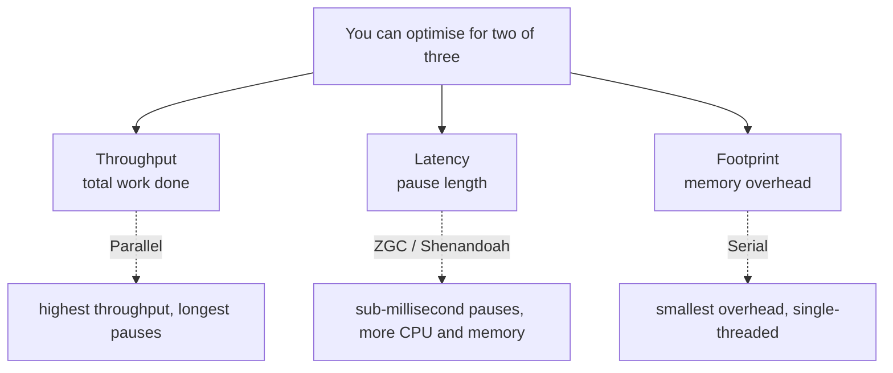
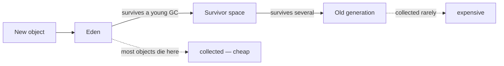
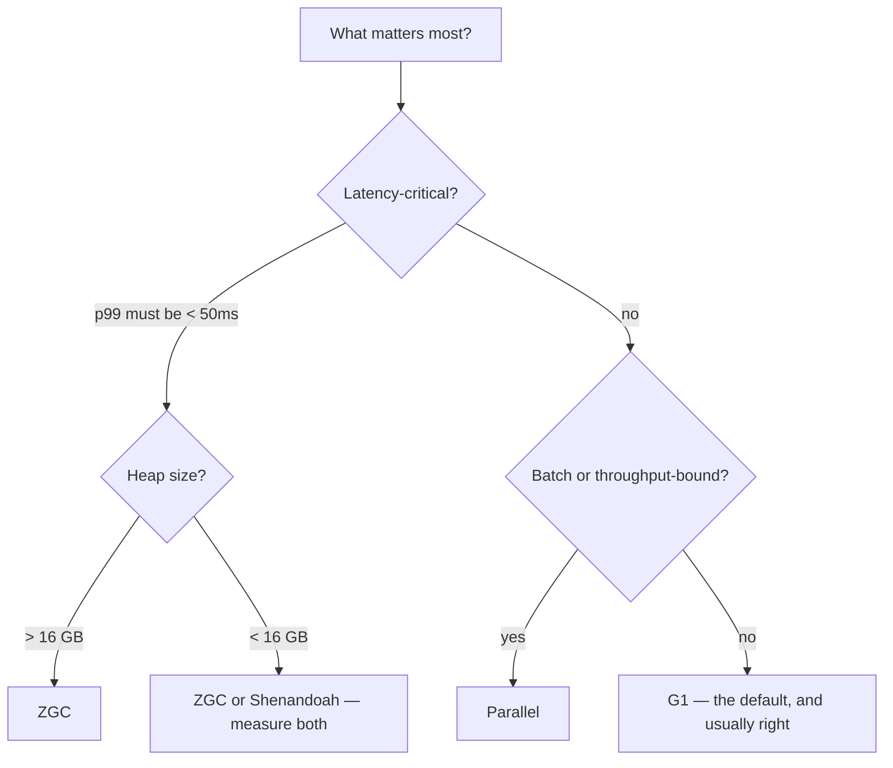
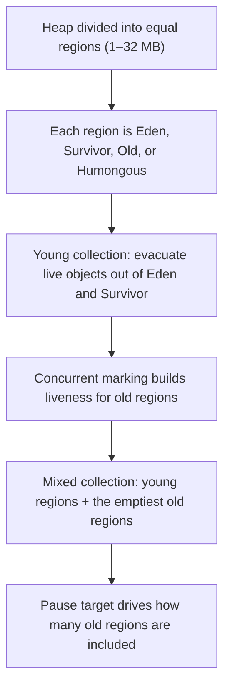
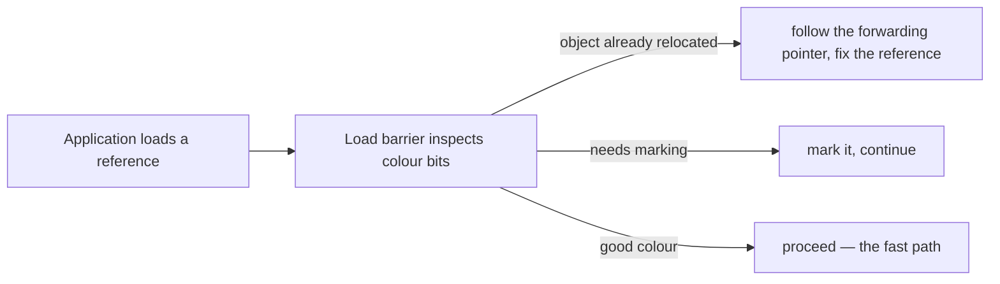
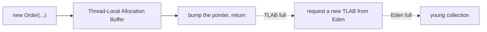

# Garbage Collection

## 1. Purpose & Audience

**Band:** L4 Architect · **Prerequisites:** [JVM Runtime Model](../01-platform/02-jvm-runtime-model.md)

Garbage collection is the part of the JVM most surrounded by folklore. Flags get copied between projects for a decade after the collector they configured was removed, and "we tuned the GC" usually means someone added six options without measuring any of them.

The modern reality is narrower and more useful: **choose the right collector, set the heap size, set a pause target, and measure.** Almost everything else is either automatic or a mistake.

This chapter answers three questions:

1. **Which collector should you use**, and what are you trading?
2. **What do you actually tune**, and what should you leave alone?
3. **How do you read a GC log** and tell a real problem from normal operation?

---

## 2. The Problem

Three symptoms that all get called "a GC problem".

**Latency spikes at p99:**

```text
p50:   12 ms
p99:  840 ms      ← every request unlucky enough to land during a pause
p999: 2,100 ms
```

**Gradual death:**

```text
[45.231s][info][gc] GC(412) Pause Full 3890M->3878M(4096M) 8420.331ms
[53.904s][info][gc] GC(413) Pause Full 3878M->3876M(4096M) 8661.204ms
java.lang.OutOfMemoryError: GC overhead limit exceeded
```

Repeated full collections reclaiming almost nothing. The application is alive and doing no work.

**"The upgrade made it slower."** No code changed, no flags changed — but the default collector changed from Parallel to G1 in Java 9, and the workload preferred throughput.

---

## 3. Mental Model

### 3.1 The three-way trade



Every collector is a position in this space. G1 is the default because it sits in the middle: predictable pauses, good throughput, moderate overhead.

### 3.2 The generational hypothesis



**Most objects die young.** That single empirical observation is why generational collection works: collecting a small young region and copying out the few survivors is far cheaper than examining the whole heap.

The corollary matters for tuning. A young collection's cost is proportional to the **survivors**, not to the garbage — so a high allocation rate of short-lived objects is much cheaper than it sounds, and a moderate rate of medium-lived objects can be much worse.

### 3.3 Where the pause goes

| Phase | Stop-the-world? |
|---|---|
| Mark roots | Yes, briefly |
| Trace the object graph | Concurrent in G1, ZGC, Shenandoah |
| Copy or compact | STW in G1; **concurrent** in ZGC and Shenandoah |
| Update references | Concurrent in ZGC and Shenandoah |

The difference between G1 and the low-latency collectors is almost entirely about whether **evacuation** — moving surviving objects — happens while the application runs.

---

## 4. Core Reference

### 4.1 The collectors

| Collector | Flag | Pause | Throughput | Best for |
|---|---|---|---|---|
| **Serial** | `-XX:+UseSerialGC` | Long | Good for tiny heaps | Small containers, single core, CLI tools |
| **Parallel** | `-XX:+UseParallelGC` | Long | **Highest** | Batch work, throughput-bound jobs |
| **G1** | `-XX:+UseG1GC` | ~10–200 ms | High | **The default** — most services |
| **ZGC** | `-XX:+UseZGC` | **< 1 ms** | Slightly lower | Large heaps, latency-critical |
| **Shenandoah** | `-XX:+UseShenandoahGC` | **< 10 ms** | Slightly lower | Latency-critical, mid-size heaps |
| **Epsilon** | `-XX:+UseEpsilonGC` | None — never collects | — | Benchmarking, short-lived jobs |

G1 is the default from Java 9 onward. ZGC has been generational since Java 21 and Shenandoah since Java 25, which substantially improved both.

### 4.2 The flags you should set

| Flag | Purpose |
|---|---|
| `-XX:MaxRAMPercentage=70` | Heap as a share of the container limit |
| `-XX:MaxGCPauseMillis=200` | Pause goal for G1 — a target, not a guarantee |
| `-Xlog:gc*:file=/var/log/gc.log:time,uptime:filecount=5,filesize=20M` | GC logging — always on |
| `-XX:+HeapDumpOnOutOfMemoryError` | Dump on OOM |
| `-XX:HeapDumpPath=/var/log/` | Where |

### 4.3 The flags you should not set

| Flag | Why not |
|---|---|
| `-XX:NewRatio`, `-XX:SurvivorRatio` | G1 sizes generations adaptively; fixing them defeats it |
| `-XX:+UseConcMarkSweepGC` | **CMS was removed in Java 14** — the JVM will not start |
| `-XX:PermSize`, `-XX:MaxPermSize` | PermGen is gone; ignored with a warning |
| `-XX:+UseGCOverheadLimit` and friends | Defaults are correct |
| A block of flags copied from a blog | Especially one older than the collector you are using |

**The honest default:** set the heap size, set a pause target, enable logging, and change nothing else until a measurement tells you to.

### 4.4 Reading a GC log

```text
[12.345s][info][gc] GC(42) Pause Young (Normal) (G1 Evacuation Pause) 512M->48M(2048M) 14.221ms
             │      │            │                                      │     │   │       │
             │      │            │                                      │     │   │       └─ pause duration
             │      │            │                                      │     │   └───────── heap capacity
             │      │            │                                      │     └───────────── after
             │      │            │                                      └─────────────────── before
             │      │            └────────────────────────────────────────────────────────── cause
             │      └─────────────────────────────────────────────────────────────────────── collection type
             └────────────────────────────────────────────────────────────────────────────── uptime
```

What to look at, in order:

1. **Live set after collection** — the "48M" figure. If it climbs steadily across collections, that is a leak.
2. **Pause duration distribution**, not the average. p99 is what users feel.
3. **Frequency** — young collections every few seconds is normal; every 200 ms means the allocation rate or Eden size needs attention.
4. **Any `Pause Full`** — with G1 this is a failure signal, not routine.

---

## 5. Worked Examples

### 5.1 Choosing a collector



Three practical rules:

- **Start with G1.** It is the default, it is well-tuned, and for most services the answer is to leave it.
- **Move to ZGC when pause time is the binding constraint**, particularly above ~16 GB where G1's evacuation pauses grow.
- **Move to Parallel when total throughput is the only goal** — a nightly reconciliation job does not care about a 500 ms pause.

The cost of ZGC is a few percent of throughput and somewhat more memory, spent on the barriers that make concurrent relocation possible.

### 5.2 Diagnosing a latency spike

```bash
-Xlog:gc*:file=/var/log/gc.log:time,uptime:filecount=5,filesize=20M
```

```text
[08:14:02][3421.882s][info][gc] GC(8842) Pause Young (Normal) 1840M->1612M(2048M) 412.338ms
[08:14:03][3422.401s][info][gc] GC(8843) Pause Young (Normal) 1900M->1698M(2048M) 448.119ms
[08:14:04][3423.002s][info][gc] GC(8844) Pause Young (Concurrent Start) 1950M->1801M(2048M) 502.774ms
```

Three signals in three lines. Pauses of 400–500 ms against a 200 ms target. The live set after collection climbing — 1612 → 1698 → 1801 MB. And collections roughly every second.

The diagnosis is not "GC is slow" but **the heap is too small for the live set.** Each collection reclaims less, so they run more often and copy more survivors. The fixes, in order: find out why the live set is that large (heap dump), then raise the heap, then consider a different collector. Adding GC flags would change nothing.

### 5.3 The allocation-rate case

```text
[info][gc] GC(101) Pause Young (Normal) 2048M->24M(4096M) 8.112ms
[info][gc] GC(102) Pause Young (Normal) 2048M->26M(4096M) 8.339ms
[info][gc] GC(103) Pause Young (Normal) 2048M->25M(4096M) 8.001ms
```

Collections every few hundred milliseconds, but each reclaims 2 GB and pauses 8 ms. **This is healthy.** Almost everything allocated dies young, which is exactly what the generational design expects.

The contrast with §5.2 is the point: collection *frequency* means nothing on its own. What matters is pause duration and whether the live set is growing.

### 5.4 Humongous allocations in G1

G1 divides the heap into regions — 1 MB to 32 MB, sized automatically. An object larger than **half a region** is "humongous" and allocated directly into contiguous old-generation regions.

```java title="Humongous.java"
// With 2 MB regions, anything over 1 MB is humongous
byte[] batch = new byte[4 * 1024 * 1024];      // 3 regions, straight to old gen
```

Frequent humongous allocation causes fragmentation and full collections, because the contiguous space has to be found. The log names it:

```text
[info][gc] GC(77) Pause Young (Concurrent Start) (G1 Humongous Allocation)
```

Two fixes: reduce the allocation size — stream or chunk instead of materialising a large array — or raise `-XX:G1HeapRegionSize`. The first is nearly always better.

### 5.5 GC overhead limit exceeded

```text
java.lang.OutOfMemoryError: GC overhead limit exceeded
```

The JVM spent over 98% of recent time collecting and recovered under 2% of the heap. It is not a GC failure — it is the JVM reporting that the application has effectively stopped, rather than letting it thrash indefinitely.

The cause is nearly always a leak or an undersized heap. Diagnose with a heap dump:

```bash
jcmd <pid> GC.heap_dump /var/log/heap.hprof
jcmd <pid> GC.class_histogram | head -20
```

The histogram usually names the culprit immediately — an unbounded cache, a growing collection on a long-lived object, a `ThreadLocal` on a pooled thread.

### 5.6 Container configuration

```bash
java -XX:MaxRAMPercentage=70 \
     -XX:MaxGCPauseMillis=200 \
     -Xlog:gc*:file=/var/log/gc.log:time,uptime:filecount=5,filesize=20M \
     -XX:+HeapDumpOnOutOfMemoryError \
     -XX:HeapDumpPath=/var/log/ \
     -jar orders.jar
```

Two container-specific points beyond the heap:

**Available processors.** The JVM sizes GC thread counts from `availableProcessors()`, which reads the cgroup CPU limit since Java 10. A container with a 0.5 CPU quota reports 1 processor, which changes collector behaviour significantly — and is a reason very small containers often perform worse than expected.

**Headroom.** `MaxRAMPercentage=70` exists because the process needs metaspace, stacks, code cache and GC structures outside the heap ([Chapter 02](../01-platform/02-jvm-runtime-model.md)). G1's own remembered sets and region metadata are part of that.

---

## 6. Internals

### 6.1 How G1 works



Two mechanisms explain most of G1's behaviour.

**Regions, not contiguous generations.** Generations are sets of regions rather than fixed address ranges, so G1 can resize them per collection and choose which old regions to collect. "Garbage First" is the name: it picks the regions with the most garbage, because they yield the most space for the least copying.

**The pause target is a budget.** `MaxGCPauseMillis` tells G1 how much time it may spend; G1 then chooses how many regions to evacuate to fit. Setting an unachievable target — 5 ms on a large live set — does not produce 5 ms pauses. It produces very small collections, run very often, with worse total throughput.

**Remembered sets** track references from old regions into young ones so a young collection need not scan the whole old generation. They are what makes region-independent collection possible, and they are a real memory and CPU cost — a meaningful part of G1's overhead.

### 6.2 How ZGC achieves sub-millisecond pauses

ZGC does **all** the expensive work concurrently, including relocation. The enabling mechanism is **coloured pointers** plus **load barriers**.



Metadata bits are stored in unused bits of the 64-bit pointer. Every reference load passes through a barrier that checks them and, if needed, repairs the reference on the spot. Because the application fixes its own references lazily as it touches them, ZGC can move objects while the application runs.

The trade: **pauses become independent of heap size**, and the cost is a barrier on every reference load — a few percent of throughput — plus extra memory for the coloured-pointer scheme.

Generational ZGC (Java 21) added a young generation, which substantially reduced the CPU cost for typical workloads by applying the generational hypothesis that non-generational ZGC ignored.

### 6.3 Shenandoah

Shenandoah also relocates concurrently, using **load reference barriers** rather than coloured pointers, which means it does not depend on 64-bit pointer bits and works on more architectures.

It became generational in Java 25. In practice the choice between ZGC and Shenandoah is empirical — both deliver very low pauses, and which wins depends on the workload and the platform.

### 6.4 Allocation is nearly free



Each thread gets its own **TLAB**, a chunk of Eden it allocates from without synchronisation. Allocation in the common case is a pointer increment and a bounds check — a handful of instructions.

This is why "avoid allocation" advice needs measurement. Combined with escape analysis ([Chapter 02](../01-platform/02-jvm-runtime-model.md)), which may eliminate the allocation entirely, the cost of a short-lived object is frequently zero. What is expensive is an object that *survives* — it gets copied, possibly several times, and eventually promoted.

### 6.5 Premature promotion

When Survivor space is too small for a young collection's survivors, objects are promoted to the old generation early. They then have to be collected by the much more expensive old-generation machinery.

```text
[info][gc,age] GC(88) Desired survivor size 8M, new threshold 1 (max 15)
```

A tenuring threshold of 1 means objects are being promoted after a single collection — a symptom, usually of an undersized young generation relative to the allocation rate.

With G1 the fix is almost never a manual ratio. It is a larger heap, a more realistic pause target (a very aggressive one shrinks the young generation), or reducing the medium-lived allocation that is causing it.

### 6.6 What `System.gc()` does

It *suggests* a collection. With `-XX:+DisableExplicitGC` it does nothing; otherwise it typically triggers a full collection, which is the most expensive thing the JVM can do.

Calling it in application code is nearly always wrong: the JVM has better information than the caller about when to collect. The exception is a deliberate, measured pause at a known-idle moment — and even then, the alternative is usually to fix whatever made it seem necessary.

---

## 7. Production Patterns & Anti-Patterns

### Do this

- **Always enable GC logging**, with rotation. It costs almost nothing and it is the only record of what happened.
- **Start with G1** and change only if a measurement says to.
- **Set the heap with `MaxRAMPercentage`** and a pause target. Stop there.
- **Watch the live set after collection**, not the total heap graph. That is what reveals a leak.
- **Enable heap dumps on OOM**, with a path on a writable volume.
- **Measure before and after any GC change**, on production-like load and heap size.
- **Treat any `Pause Full` under G1 as a signal**, not as routine.
- **Check `availableProcessors()` in containers** — a low CPU quota changes collector behaviour.

### Never do this

- **Never copy GC flags from a blog post.** Many configure collectors that no longer exist.
- **Never set `-XX:+UseConcMarkSweepGC`** — CMS was removed in Java 14 and the JVM will not start.
- **Never fix `NewRatio` or `SurvivorRatio` under G1.** It sizes them adaptively; pinning them defeats that.
- **Never set an unachievable pause target.** G1 responds by collecting tiny amounts very often, which is worse.
- **Never call `System.gc()`** from application code.
- **Never conclude "GC is the problem" from frequency alone.** Frequent, short, high-yield collections are healthy.
- **Never tune GC to fix a leak.** A growing live set is an application bug; no collector setting helps.
- **Never benchmark GC changes on a small heap** and extrapolate. Collector behaviour is not linear in heap size.

---

## 8. Version Evolution (Java 8 → 26)

| Version | What changed | Impact |
|---|---|---|
| **8** | Parallel is the default; CMS available; PermGen replaced by metaspace | The baseline most legacy tuning assumes |
| **9** | **G1 becomes the default**; unified `-Xlog` logging | A silent latency/throughput profile change on upgrade |
| **11** | ZGC and Epsilon experimental; Shenandoah in some builds | Low-latency options appear |
| **14** | **CMS removed** | Flags referencing it prevent startup |
| **15** | ZGC and Shenandoah production-ready | Sub-10 ms pauses become supportable |
| **21** | **Generational ZGC (JEP 439)** | Large CPU-cost reduction for typical workloads |
| **23** | ZGC generational mode by default (JEP 474) | `-XX:+UseZGC` means generational |
| **24** | Late G1 barrier expansion (JEP 475); non-generational ZGC removed (JEP 490) | Lower G1 overhead; one ZGC mode |
| **25** | **Generational Shenandoah (JEP 521)**; compact object headers | Both low-latency collectors are now generational |
| **26** | G1 throughput via reduced synchronisation (JEP 522) | Fewer GC–application barriers on reference-heavy workloads |

### Migration note

The GC change that catches people upgrading from Java 8 is the **default switching from Parallel to G1 in Java 9**. Nothing in the diff shows it. A latency-sensitive service usually improves; a throughput-bound batch job may regress by a few percent, and the report arrives as "the upgrade made it slower".

Two actions: remove every GC flag inherited from the Java 8 era before upgrading — most configure CMS or PermGen and are at best ignored — and, if the workload is throughput-bound, measure `-XX:+UseParallelGC` explicitly rather than assuming either default is right.

---

## 9. Interview Questions

### L1 — Foundations

**Q1. Why is garbage collection generational?** ⭐ *high frequency*
Because most objects die young. Collecting a small young region and copying out the few survivors is far cheaper than examining the whole heap, so the heap is split and the young part collected frequently while the old part is collected rarely. The cost of a young collection is proportional to the survivors, not to the garbage.

**Q2. What is the default collector and why?**
G1, since Java 9. It divides the heap into regions and collects those with the most garbage first, aiming at a configurable pause target. It is the default because it sits in the middle of the trade-off space — predictable pauses and good throughput — which suits most services better than Parallel's long pauses or the extra cost of the low-latency collectors.

**Q3. What does `OutOfMemoryError: GC overhead limit exceeded` mean?**
That the JVM spent more than about 98% of recent time collecting and recovered less than 2% of the heap. It is not a collector failure; it is the JVM refusing to thrash indefinitely and reporting that the application has effectively stopped. The cause is a leak or an undersized heap, diagnosed with a heap dump.

### L2 — Professional

**Q4. How do you tell a healthy GC log from a problem?** ⭐ *high frequency*
Look at the live set after each collection and the pause distribution, not the frequency. Frequent short collections that reclaim most of the heap are healthy — that is the generational design working. A live set climbing steadily across collections is a leak, and pauses exceeding the target while reclaiming progressively less means the heap is too small for the live set.

**Q5. What does `MaxGCPauseMillis` actually do?**
It gives G1 a time budget, and G1 chooses how many regions to evacuate to fit within it. It is a goal, not a guarantee. Setting an unachievably low value does not produce short pauses; it makes G1 collect very small amounts very often, which reduces throughput and can shrink the young generation enough to cause premature promotion.

**Q6. When would you use ZGC instead of G1?**
When pause time is the binding constraint and the heap is large — above roughly 16 GB, where G1's evacuation pauses grow with the live set. ZGC relocates concurrently, so its pauses are sub-millisecond and largely independent of heap size. The cost is a few percent of throughput from the load barrier on every reference load, plus additional memory.

### L3 — Enterprise

**Q7. How does ZGC relocate objects without stopping the application?**
It stores metadata in unused bits of 64-bit pointers — coloured pointers — and puts a load barrier on every reference load. When the application loads a reference, the barrier checks the colour bits, and if the object has been relocated it follows the forwarding pointer and repairs that reference in place. Because the application lazily fixes its own references as it touches them, the collector can move objects concurrently.

**Q8. What are humongous allocations in G1 and why do they matter?**
G1 splits the heap into regions, and an object larger than half a region is allocated directly into contiguous old-generation regions rather than into Eden. Frequent humongous allocation causes fragmentation and can trigger full collections, because contiguous space has to be found. The log identifies the cause explicitly, and the better fix is usually to reduce the allocation size — chunk or stream rather than materialising a large array — rather than to enlarge the region size.

**Q9. A service upgraded from Java 8 and throughput dropped a few percent. What happened?**
The default collector changed from Parallel to G1 in Java 9. G1 optimises for pause time at a small cost in total throughput, which is an improvement for a latency-sensitive service and a regression for a throughput-bound batch job. Nothing appears in the diff, since no flag changed. The response is to measure `-XX:+UseParallelGC` explicitly against the workload and choose deliberately.

### L4 — Architect

**Q10. How would you approach GC configuration across a fleet?**
Standardise on a small set of decisions and forbid the rest: heap as a percentage of the container limit, a pause target, rotated GC logging, and heap dumps on OOM. Everything else stays at defaults unless a measurement justifies it, and that justification is recorded with the flag. Then classify workloads — latency-sensitive services, throughput-bound batch jobs, small utilities — and assign a collector per class rather than per service, because per-service tuning produces a fleet nobody can reason about. The most valuable output is the GC logs themselves, which is why enabling them everywhere matters more than any individual flag.

**Q11. When is allocation rate a problem, and when is it not?**
A high rate of objects that die in Eden is close to free — allocation is a pointer bump in a thread-local buffer, escape analysis may remove it entirely, and the young collection's cost depends on survivors rather than garbage. It becomes a problem when the objects survive: they get copied between survivor spaces, possibly promoted, and eventually collected by the expensive old-generation machinery. So the question is never "how much are we allocating" but "what fraction survives the first collection", which the GC log's promotion and tenuring output answers.

**Q12. Your p99 latency is dominated by GC pauses on a 64 GB heap. What are the options, in order?**
First establish that the live set justifies the heap, because a large heap holding mostly garbage is a different problem and a heap dump is cheaper than any tuning. Then move to a concurrent-relocation collector — ZGC or Shenandoah — since G1's evacuation pauses scale with the live set and that is exactly the constraint. If that is insufficient, the remaining options are structural rather than configurational: reduce the live set by moving data off-heap or into a cache outside the JVM, or partition the workload across more JVMs with smaller heaps, which also restores compressed oops if it brings each below the 32 GB threshold.

---

!!! abstract "Cheat Sheet"
    **Trade-off:** throughput · latency · footprint — pick two

    **Serial** tiny heaps · **Parallel** throughput · **G1** default · **ZGC** large heaps + low latency · **Shenandoah** low latency

    **G1 is the default since Java 9** — the silent change when upgrading from 8

    **Set:** `MaxRAMPercentage` · `MaxGCPauseMillis` · `-Xlog:gc*` · `HeapDumpOnOutOfMemoryError`

    **Don't set:** `NewRatio` · `SurvivorRatio` · anything copied from a blog · `UseConcMarkSweepGC` (removed in 14)

    **Pause target is a budget, not a guarantee** — an unachievable one makes things worse

    **Frequency means nothing** — watch the live set after collection and the pause distribution

    **Live set climbing = leak.** No collector setting fixes an application bug

    **Allocation is a TLAB pointer bump** — surviving is what costs, not allocating

    **Humongous = larger than half a G1 region** → straight to old gen, fragmentation risk

    **ZGC:** coloured pointers + load barriers → concurrent relocation, pauses independent of heap size

    **Generational ZGC in 21 · generational Shenandoah in 25**

    **Never call `System.gc()`**
