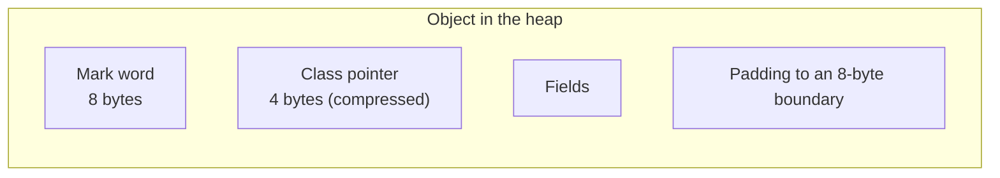
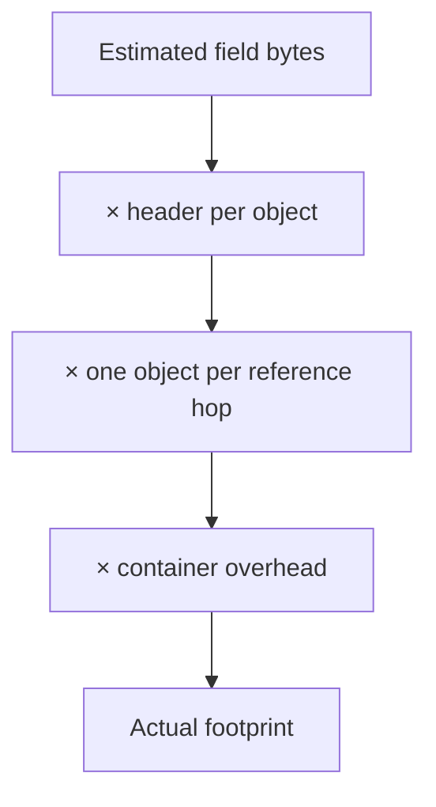
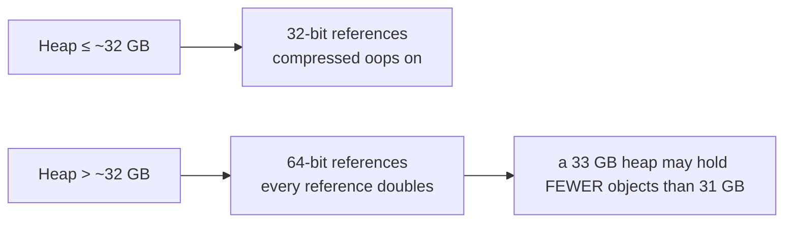
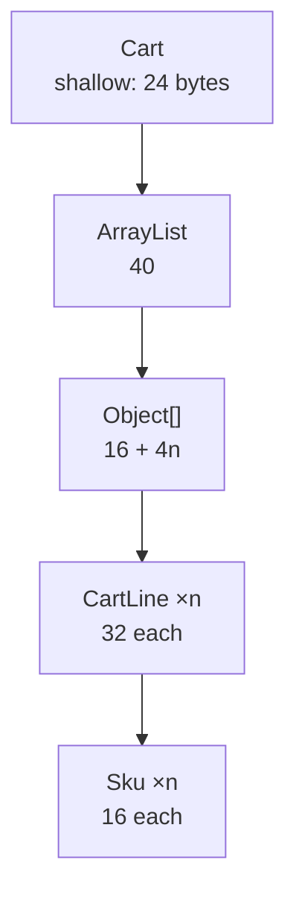

# Memory Footprint & Object Layout

## 1. Purpose & Audience

**Band:** L4 Architect · **Prerequisites:** [JVM Runtime Model](../01-platform/02-jvm-runtime-model.md), [Garbage Collection](34-garbage-collection.md)

Java hides memory layout, which is usually a feature. It stops being one when a cache of a million small objects takes 800 MB instead of the 200 MB you estimated, or when a heap dump shows that half the heap is `HashMap$Node` and boxed `Integer`.

This chapter answers three questions:

1. **What does an object actually cost** — header, fields, alignment, references?
2. **Where does the unexpected memory go** in real applications?
3. **What genuinely reduces footprint**, and what is folklore?

---

## 2. The Problem

The SKU catalogue holds a million entries. The estimate:

```java title="Estimate.java"
record InventoryItem(Sku sku, int available, int reserved, long priceInPaise) { }
// "4 + 4 + 8 = 16 bytes, plus the Sku. Say 50 MB for a million."
```

The measurement:

```text
jcmd <pid> GC.class_histogram | head -8

 num     #instances         #bytes  class name
----------------------------------------------
   1:       1,000,000     48,000,000  com.grocery.InventoryItem
   2:       1,000,000     32,000,000  java.util.HashMap$Node
   3:       1,000,000     24,000,000  com.grocery.Sku
   4:       1,000,000     56,000,000  java.lang.String
   5:       1,000,000     40,000,000  [B
   6:               1     16,777,232  [Ljava.util.HashMap$Node;
```

**216 MB, not 50.** Nothing is wrong — the estimate simply ignored object headers, references, the map's own nodes and table, and the fact that a `Sku` wrapping a `String` is three objects rather than one.

Estimating Java memory without knowing the layout is guessing.

---

## 3. Mental Model

### 3.1 What an object is made of



| Component | Size (64-bit, compressed oops) |
|---|---|
| Mark word | 8 bytes — hash, lock state, GC age |
| Class pointer | 4 bytes compressed, 8 otherwise |
| **Header total** | **12 bytes — 8 with compact headers (Java 25)** |
| Reference field | 4 bytes compressed, 8 otherwise |
| `int`, `float` | 4 |
| `long`, `double` | 8 |
| `boolean`, `byte` | 1 |
| `char`, `short` | 2 |
| Array header | 16 bytes (12 + 4 for length) |
| Alignment | Round the total up to a multiple of 8 |

**The minimum object is 16 bytes** — a 12-byte header padded to 16, even with no fields.

### 3.2 Three multipliers



The §2 gap comes entirely from these. A record with four components is one object; the `Sku` inside it is another; the `String` inside that is a third, with a `byte[]` as a fourth. Put them in a `HashMap` and each entry adds a `Node` plus a table slot.

**Object count matters more than field count.** That single idea drives every optimisation in §5.

---

## 4. Core Reference

### 4.1 Common sizes

| Type | Bytes | Note |
|---|---|---|
| `new Object()` | 16 | Header plus padding |
| `Integer` | 16 | Header + 4-byte int + padding |
| `Long`, `Double` | 24 | Header + 8 + padding |
| `String` (empty) | 40 | 24 for `String` + 16 for the `byte[]` |
| `String` (n ASCII chars) | 40 + n, rounded | Compact strings since Java 9 |
| `int[n]` | 16 + 4n | |
| `Object[n]` | 16 + 4n | Compressed oops |
| `HashMap.Node` | 32 | Header, hash, 3 references |
| `LinkedList.Node` | 24 | Header, 3 references — **plus the element** |
| `ArrayList` (empty) | 40 | Object plus a shared empty array |
| `HashMap` (empty) | 48 | Table allocated lazily |

### 4.2 Compressed oops

| Heap size | References | Effect |
|---|---|---|
| Under ~32 GB | 32-bit compressed | Half the size |
| Over ~32 GB | 64-bit | **Every reference doubles** |

A 33 GB heap can hold **fewer objects** than a 31 GB heap. Check the flag:

```bash
jcmd <pid> VM.flags | grep -i compressedoops
```

### 4.3 Measurement tools

| Tool | Answers |
|---|---|
| `jcmd <pid> GC.class_histogram` | What is on the heap, by class |
| `jcmd <pid> GC.heap_dump <path>` | Full dump for offline analysis |
| **JOL** (`org.openjdk.jol`) | **Exact layout of one object** |
| Eclipse MAT | Retained sizes, dominator tree, leak suspects |
| `jcmd <pid> VM.native_memory summary` | Non-heap footprint |

JOL is the one most people have not used and should:

```java title="UsingJol.java"
System.out.println(ClassLayout.parseClass(InventoryItem.class).toPrintable());
System.out.println(GraphLayout.parseInstance(item).toFootprint());
```

```text
com.grocery.InventoryItem object internals:
OFF  SZ                TYPE DESCRIPTION               VALUE
  0   8                     (object header: mark)
  8   4                     (object header: class)
 12   4                 int InventoryItem.available
 16   4                 int InventoryItem.reserved
 20   4                     (alignment/padding gap)
 24   8                long InventoryItem.priceInPaise
 32   4   com.grocery.Sku   InventoryItem.sku
 36   4                     (object alignment gap)
Instance size: 40 bytes
Space losses: 4 bytes internal + 4 bytes external = 8 bytes total
```

The "space losses" line is the point: 8 of 40 bytes are padding.

---

## 5. Worked Examples

### 5.1 Accounting for the catalogue

```java title="Catalogue.java"
record Sku(String code) { }
record InventoryItem(Sku sku, int available, int reserved, long priceInPaise) { }

Map<Sku, InventoryItem> catalogue = HashMap.newHashMap(1_000_000);
```

Per entry, on Java 21 with compressed oops:

| Object | Bytes |
|---|---|
| `InventoryItem` (header 12 + 4 + 4 + 8 + ref 4 = 32, padded) | 32 |
| `Sku` (header 12 + ref 4 = 16) | 16 |
| `String` (header 12 + ref 4 + int hash 4 + byte coder 1 + flags, padded) | 24 |
| `byte[]` for a 12-character SKU code (16 + 12, padded) | 32 |
| `HashMap.Node` | 32 |
| Table slot (1.33 slots × 4 bytes at load factor 0.75) | ~5 |
| **Total per entry** | **~141 bytes** |

**≈ 141 MB for a million SKUs**, against a naive estimate of 16 bytes of fields. The multiplier is roughly 9×, and it is entirely headers, references, and container overhead.

### 5.2 Removing objects, not fields

```java title="Flattened.java"
// Before: 5 objects per entry
record Sku(String code) { }
Map<Sku, InventoryItem> catalogue;

// After: parallel arrays keyed by an index — 0 objects per entry
final class FlatCatalogue {
    private final String[] codes;        // still one String per SKU
    private final int[] available;
    private final int[] reserved;
    private final long[] priceInPaise;
    private final Map<String, Integer> index;
}
```

| | Objects per entry | Bytes per entry |
|---|---|---|
| Record graph in a `HashMap` | 5 | ~141 |
| Parallel arrays + index | 2 (`String` + `byte[]`) | ~90 |
| Arrays with an interned or `byte[]`-encoded key | ~0 | ~25 |

This is a real technique with a real cost: the flattened version is harder to read, harder to change, and easy to get wrong. **Reach for it when a measurement says the footprint is the constraint**, never by default — and confine it behind an API that still speaks in domain terms.

### 5.3 Boxing

```java title="Boxing.java"
// 1M entries: Integer keys and values
Map<Integer, Integer> counts = new HashMap<>();     // ~1M × (16 + 16 + 32 + 5) ≈ 69 MB

// Primitive arrays
int[] countsBySkuIndex = new int[1_000_000];        // 4 MB
```

A 17× difference for the same information.

Two mitigations short of rewriting: the `Integer` cache covers −128 to 127 by default (`-XX:AutoBoxCacheMax` extends the upper bound), and primitive-collection libraries — Eclipse Collections, fastutil, HPPC — provide `IntIntHashMap` and similar with no boxing at all. For large numeric maps the library is usually the right answer, and Valhalla may eventually make it unnecessary.

### 5.4 Strings

Java 9 replaced `String`'s `char[]` with a `byte[]` plus a coder byte — **compact strings**. ASCII text takes one byte per character instead of two, roughly halving string memory in most applications. It is on by default and needs no configuration.

What remains expensive is **duplication**:

```bash
jcmd <pid> GC.class_histogram | grep -E 'String|\[B'
```

If a heap holds a million `String` objects but far fewer distinct values, duplication is the cost. Options:

| Approach | Trade |
|---|---|
| `-XX:+UseStringDeduplication` | G1 deduplicates backing arrays in the background; near-zero effort, no code change |
| `String.intern()` | Works, but interned strings live in a fixed-size native table and are effectively permanent — easy to make worse |
| Canonicalising map at the parse boundary | Explicit, bounded, and clearable — usually the best of the three |

String deduplication is the one to try first because enabling a flag costs nothing and the measurement tells you immediately whether duplication was the problem.

### 5.5 Field ordering and padding

The JVM reorders fields to minimise padding — longs and doubles first, then ints, then shorts and chars, then bytes and booleans, then references. Declaration order in source has no effect on layout.

```text
// From the JOL output in §4.3
 16   4   int InventoryItem.reserved
 20   4       (alignment/padding gap)      ← 4 bytes lost
 24   8  long InventoryItem.priceInPaise
```

Padding is usually a few bytes per object and not worth chasing. It becomes worth knowing in two cases: **many small objects**, where 8 bytes of padding on a 32-byte object is 25%; and **false sharing**, where two fields updated by different threads land on the same 64-byte cache line and the cores fight over it. `@Contended` (with `-XX:-RestrictContended`) pads a field onto its own cache line, and is justified only in measured high-contention code.

### 5.6 Compact object headers

Java 25 made compact object headers final (JEP 519), reducing the header from 12 bytes to 8.

| Object | Java 21 | Java 25 |
|---|---|---|
| `new Object()` | 16 | 16 (padding absorbs it) |
| `Integer` | 16 | 16 |
| `HashMap.Node` | 32 | **24** |
| `InventoryItem` (§5.1) | 32 | **24** |
| Catalogue entry total | ~141 | **~117** |

Roughly a 17% reduction on this object-heavy structure, for no code change. Objects whose size was already dominated by padding see nothing; object-dense structures see a real saving.

The practical consequence: **re-baseline heap sizing after upgrading to Java 25.** A heap sized for Java 21 has more headroom than it did, and the live set in your GC logs will drop.

---

## 6. Internals

### 6.1 The mark word

The 8-byte mark word is multi-purpose, and its contents depend on the object's state:

| State | Holds |
|---|---|
| Unlocked | Identity hash (once computed), GC age, flags |
| Lightweight locked | Pointer to a lock record on the owning thread's stack |
| Heavyweight locked | Pointer to a monitor |
| Being collected | Forwarding pointer |

Two consequences worth knowing. **Calling `hashCode()` on an object with no override writes the identity hash into the mark word** — so an object's header changes the first time it is hashed. And **the forwarding-pointer state is how copying collectors relocate objects**: the mark word of the old copy points at the new location.

Compact object headers work by packing the class pointer into the mark word, which is why the saving is 4 bytes rather than more.

### 6.2 Why 32 GB is a cliff

Compressed oops store a reference as a 32-bit value scaled by the 8-byte object alignment, giving 2³² × 8 = 32 GB of addressable heap.



The architectural consequence is that scaling past the threshold usually means **more JVMs rather than a bigger one** — which is a deployment decision, not a flag. `-XX:ObjectAlignmentInBytes=16` raises the limit to 64 GB at the cost of more padding on every object, and is rarely a good trade.

### 6.3 Retained versus shallow size



**Shallow size** is the object itself. **Retained size** is everything that becomes collectable when it is released — which is what actually matters for a cache or a leak.

A `Cart` with a shallow size of 24 bytes can retain megabytes. Eclipse MAT's dominator tree computes this, and it is the single most useful view when analysing a heap dump: it answers "what is actually holding this memory" rather than "what is there".

### 6.4 Where non-heap memory goes

| Region | Typical | Controlled by |
|---|---|---|
| Metaspace | 100–250 MB | `-XX:MaxMetaspaceSize` |
| Code cache | 50–250 MB | `-XX:ReservedCodeCacheSize` |
| Thread stacks | 1 MB × threads | `-Xss` |
| Direct buffers | Varies | `-XX:MaxDirectMemorySize` |
| GC structures | 5–15% of heap for G1 | Collector choice |

G1's remembered sets are the item people forget — they can be a meaningful fraction of the heap size, and they are one reason `MaxRAMPercentage=70` leaves the headroom it does ([Chapter 02](../01-platform/02-jvm-runtime-model.md)).

### 6.5 What does not reduce footprint

| Belief | Reality |
|---|---|
| "Records are smaller than classes" | Identical layout — same header, same fields |
| "`final` fields save memory" | No layout effect |
| "Setting a reference to null helps" | Only if it was the last reference to something large and long-lived |
| "`String.intern()` is free" | Interned strings are effectively permanent |
| "Smaller field types always help" | A `byte` field may be entirely absorbed by padding |
| "Avoiding allocation reduces the heap" | Short-lived objects die in Eden and may be eliminated by escape analysis |

The last one is worth restating. Footprint is about what **survives**, not what is allocated ([Chapter 34](34-garbage-collection.md)). Contorting code to avoid short-lived objects usually costs readability and saves nothing measurable.

---

## 7. Production Patterns & Anti-Patterns

### Do this

- **Measure before optimising.** `GC.class_histogram` for what is there, MAT's dominator tree for what retains it, JOL for a single object's layout.
- **Count objects, not fields.** One fewer object per entry beats four fewer bytes.
- **Use primitive arrays or a primitive-collections library** for large numeric structures.
- **Size collections correctly** — `HashMap.newHashMap(n)`, `new ArrayList<>(n)` — which avoids both growth copies and oversized tables.
- **Try `-XX:+UseStringDeduplication`** before any string-interning scheme.
- **Keep heaps under ~32 GB** so compressed oops stay on; partition across JVMs beyond that.
- **Re-baseline heap sizing after upgrading to Java 25** — compact headers shrink the live set.
- **Account for non-heap memory** when sizing a container.

### Never do this

- **Never estimate footprint from field sizes.** Headers, references, and container overhead typically multiply it several-fold.
- **Never flatten a domain model into parallel arrays** without a measurement showing footprint is the constraint.
- **Never use `String.intern()` as a general deduplication strategy.** The table is fixed-size and entries are effectively permanent.
- **Never set a heap just above 32 GB.** You lose compressed oops and may fit fewer objects than before.
- **Never chase padding** on objects you do not have millions of.
- **Never use `@Contended` without measuring false sharing.** It wastes a cache line per annotated field.
- **Never conclude "we need a bigger heap" from a histogram alone.** Check retained sizes first — the problem is often one structure, not the aggregate.

---

## 8. Version Evolution (Java 8 → 26)

| Version | What changed | Impact |
|---|---|---|
| **8** | PermGen → metaspace | Class metadata moves off-heap |
| **9** | **Compact strings** — `byte[]` plus coder | ASCII strings roughly halve |
| **9** | G1 string deduplication available | Backing arrays shared in the background |
| **11** | ZGC experimental | Different footprint profile for large heaps |
| **15** | Shenandoah and ZGC production-ready | Low-latency at some memory cost |
| **21** | Generational ZGC | Lower CPU and memory overhead than non-generational |
| **25** | **Compact object headers final (JEP 519)** | Header 12 → 8 bytes; a real saving on object-dense heaps |
| **26** | Valhalla continues | Value objects would remove header cost entirely — not delivered |

### Migration note

Upgrading to **Java 25** changes footprint measurably without any code change, because compact object headers reduce every object with more than a few fields. Structures dominated by small objects — a large `HashMap`, a graph of small records — see roughly 15–25%; objects whose size was already absorbed by padding see nothing.

Re-derive heap sizing rather than carrying the old value forward: the live set in the GC logs will drop, which either buys headroom or allows a smaller container.

The Java 8 → 9 equivalent was **compact strings**, which produced a similar one-off reduction for text-heavy applications and is often mistaken for an application improvement.

---

## 9. Interview Questions

### L1 — Foundations

**Q1. How much memory does a Java object use?** ⭐ *high frequency*
At minimum 16 bytes — a 12-byte header padded up to an 8-byte boundary, even with no fields. On top of that, 4 bytes per reference and per `int` with compressed oops, 8 per `long`, and padding to the next multiple of 8. Java 25's compact object headers reduce the header to 8 bytes, which shrinks objects that have enough fields for the saving not to be absorbed by padding.

**Q2. What are compressed oops?**
Storing object references as 32-bit values scaled by the object alignment rather than as full 64-bit pointers, which halves the size of every reference. It works while the heap fits in the addressable range — about 32 GB. Above that the JVM falls back to 64-bit references, so a heap just over the threshold can hold fewer objects than one just under.

**Q3. Why does a `HashMap` of a million entries use more than the data it holds?**
Because each entry is a separate `HashMap.Node` object — 32 bytes of header, hash, and three references — plus a slot in the backing table, plus the key and value objects themselves. The map's own overhead is roughly 37 bytes per entry before any data, and if the key is a wrapper around a `String` that is two more objects again.

### L2 — Professional

**Q4. Why is boxing expensive in memory terms?** ⭐ *high frequency*
An `int` in an array is 4 bytes; an `Integer` is a 16-byte object plus a 4-byte reference to it. In a `Map<Integer, Integer>` each entry costs two boxed objects, a node, and a table slot — around 69 bytes against 4 for a primitive array slot. For large numeric structures the answer is primitive arrays or a primitive-collections library such as Eclipse Collections or fastutil.

**Q5. How do you find out what is using the heap?**
`jcmd <pid> GC.class_histogram` gives counts and total bytes by class, which usually names the culprit immediately. For anything more subtle, take a heap dump and use Eclipse MAT's dominator tree, which shows retained size — what would actually be freed if an object were released — rather than shallow size. JOL gives the exact field-by-field layout of a single class when you need to understand one object's cost.

**Q6. What are compact strings?**
Since Java 9, `String` stores a `byte[]` plus a coder byte instead of a `char[]`, so ASCII text uses one byte per character rather than two. It is on by default, requires no configuration, and roughly halves string memory in most applications. It was one of the larger one-off footprint improvements in the JDK's history.

### L3 — Enterprise

**Q7. What is the difference between shallow and retained size?**
Shallow size is the object itself; retained size is everything that becomes collectable when that object is released. A `Cart` with a 24-byte shallow size can retain megabytes through a list of lines, each holding a SKU holding a string. Retained size is what matters for leaks and caches, and computing it is what makes MAT's dominator tree the most useful view of a heap dump.

**Q8. How would you reduce the footprint of a large in-memory cache?**
Start by measuring where it goes, because the answer is usually object count rather than field size — a record wrapping a record wrapping a string is four objects per entry. The first moves are cheap: size the map correctly, remove wrapper types that add nothing, and try string deduplication if the histogram shows duplication. Beyond that the options are structural — primitive arrays keyed by index, a primitive-collections library, or moving the data off-heap — each of which trades readability for bytes and needs a measurement to justify.

**Q9. Why might increasing the heap from 31 GB to 33 GB reduce capacity?**
Because compressed oops stop working above roughly 32 GB, so every reference in the heap doubles from 4 bytes to 8. In a reference-dense structure that can outweigh the 2 GB gained, leaving the larger heap holding fewer objects. The usual response is to partition across more JVMs with smaller heaps rather than to scale one upward, which is a deployment decision rather than a tuning flag.

### L4 — Architect

**Q10. When is flattening a domain model into primitive arrays justified?**
When a measurement shows footprint is the binding constraint and the structure is large enough for a several-fold reduction to matter — typically millions of entries, not thousands. The cost is real: the flattened form is harder to read, harder to change, and easy to corrupt, so it should sit behind an API that still speaks in domain terms and be covered by tests that would catch an index error. Doing it speculatively trades maintainability for memory nobody needed.

**Q11. What changes about capacity planning when upgrading to Java 25?**
Compact object headers reduce every object with enough fields for the 4-byte saving to survive alignment, which on object-dense structures such as large maps or graphs of small records is typically a 15–25% reduction in live set. That means the heap sizing carried forward from Java 21 now has more headroom than intended, so it should be re-derived rather than reused — either to reclaim container memory across a fleet or to raise the safety margin. The GC logs show it directly: the live set after collection drops with no code change.

**Q12. What would Valhalla change about this chapter?**
Value objects would remove the header and the indirection for types that do not need identity, so a `Money` or a `Point` could be stored inline in a containing object or array rather than as a separate heap object with a reference to it. That collapses the object-count multiplier which drives most of the footprint problems here — `Integer[]` could become as dense as `int[]`, and `List<Money>` would stop being a list of pointers. It is not delivered, and the practical position today is that the multiplier is real and must be designed around, not waited out.

---

!!! abstract "Cheat Sheet"
    **Minimum object = 16 bytes** — 12-byte header padded to 8-byte alignment

    **Header:** mark word 8 + class pointer 4 → **8 total with compact headers (Java 25)**

    **Compressed oops:** references are 4 bytes below ~32 GB, 8 above — a **cliff**, not a slope

    **Count objects, not fields** — one fewer object per entry beats four fewer bytes

    **`HashMap` costs ~37 B/entry** before keys and values · `Integer` 16 B · `LinkedList.Node` 24 B + element

    **`Map<Integer,Integer>` vs `int[]`** — roughly 17× for the same information

    **Compact strings (Java 9)** — `byte[]` + coder; ASCII halves

    **Try `-XX:+UseStringDeduplication`** before `intern()` — interned strings are permanent

    **Shallow vs retained** — retained size is what a leak actually costs; MAT's dominator tree

    **JOL** for exact layout · **`GC.class_histogram`** for what is there · **MAT** for what holds it

    **Records are not smaller than classes** — identical layout

    **Footprint is about what survives**, not what is allocated

    **Re-baseline heap sizing on Java 25** — compact headers shrink the live set
