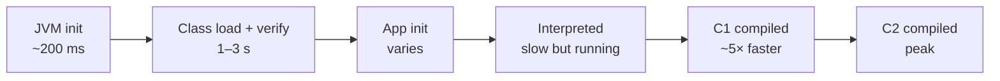
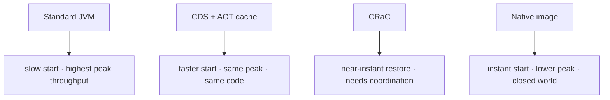
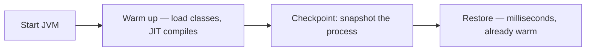
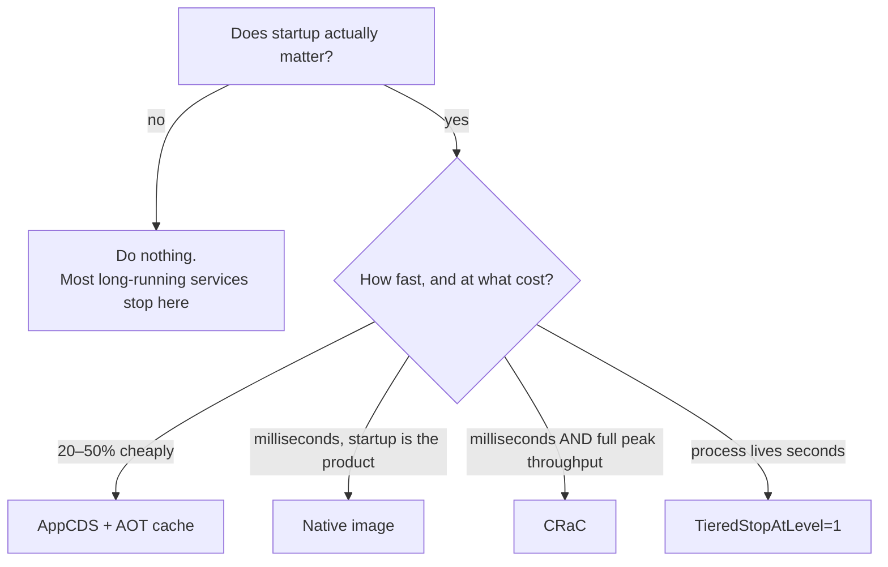
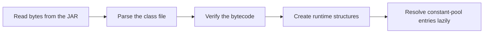
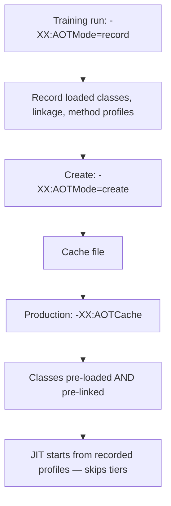
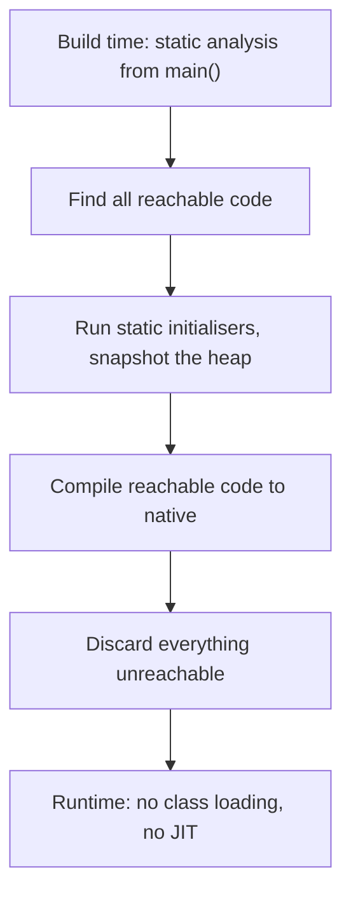

# Startup, Warmup & Project Leyden

## 1. Purpose & Audience

**Band:** L4 Architect · **Prerequisites:** [JVM Runtime Model](../01-platform/02-jvm-runtime-model.md), [Garbage Collection](34-garbage-collection.md)

Java's slow start was tolerable when a JVM was launched once and ran for months. It stopped being tolerable when the same JVM began launching per autoscaling event, per CI job, and per serverless invocation — and the eight seconds before the first request became the dominant cost.

This chapter answers three questions:

1. **Where do those seconds actually go?**
2. **What does each mitigation buy** — CDS, the AOT cache, native image, CRaC?
3. **When is startup worth optimising at all**, because for many services it is not?

---

## 2. The Problem

A typical service on a modern JVM:

```text
[0.000s] JVM starts
[0.180s] JVM initialised
[2.400s] classes loaded and linked        ← 12,000 classes
[3.100s] application context ready
[3.300s] first request served             ← "startup"
[  ...  ] running interpreted, then C1
[38.0s ] peak throughput reached          ← "warmup"
```

Two separate numbers, frequently conflated:

- **Startup** — 3.3 s to the first request.
- **Warmup** — a further 35 s to peak throughput, while the JIT profiles and compiles.

The consequences differ by deployment shape:

| Shape | What hurts |
|---|---|
| Long-running service, rare restarts | Neither. Ignore this chapter |
| Autoscaling under bursty load | Both — new instances are slow when most needed |
| Serverless / scale-to-zero | Startup dominates entirely |
| CI running thousands of short JVMs | Startup × thousands |
| Batch jobs of 30 seconds | Warmup never completes — the job runs interpreted |

---

## 3. Mental Model

### 3.1 The performance curve



| Phase | Dominated by | Mitigated by |
|---|---|---|
| JVM init | Fixed cost | Nothing much |
| Class loading and verification | Thousands of classes read, parsed, verified | **CDS** |
| Linking and initialisation | Constant-pool resolution, static initialisers | **AOT cache** |
| Interpretation → C1 | Waiting for invocation counts | **AOT method profiling** |
| C1 → C2 | Waiting for more counts | Native image (no JIT at all) |

Each mitigation targets a different phase. That is why they compose — and why picking one without knowing which phase dominates is guesswork.

### 3.2 The trade every approach makes



The key asymmetry: **CDS and the AOT cache are free** in the sense that they change nothing about how your application behaves. Native image is not — it changes the execution model, forbids some dynamic behaviour, and usually gives up peak throughput.

---

## 4. Core Reference

### 4.1 Class Data Sharing

| Form | What it archives |
|---|---|
| **Default CDS** | JDK classes; enabled automatically since Java 12 |
| **AppCDS** | Your application's classes too |
| **Dynamic archive** | Created on JVM exit from what was actually loaded |
| **Auto-create** | `-XX:+AutoCreateSharedArchive` (19+) — generate and reuse in one flag |

| Flag | Purpose |
|---|---|
| `-XX:ArchiveClassesAtExit=app.jsa` | Write a dynamic archive on exit |
| `-XX:SharedArchiveFile=app.jsa` | Use an archive |
| `-XX:+AutoCreateSharedArchive -XX:SharedArchiveFile=app.jsa` | Create if absent or stale, then use |
| `-Xshare:off` | Disable |
| `-Xlog:class+load` | Show which classes came from the archive |

### 4.2 The AOT cache (Project Leyden)

| Flag | Purpose |
|---|---|
| `-XX:AOTMode=record -XX:AOTConfiguration=app.aotconf` | Training run — record what is used |
| `-XX:AOTMode=create -XX:AOTConfiguration=app.aotconf -XX:AOTCache=app.aot` | Build the cache |
| `-XX:AOTCache=app.aot` | Use it |

Java 24 introduced AOT class loading and linking; Java 25 added simplified command-line ergonomics and method profiling, so the cache can also carry profile data that lets the JIT skip straight to higher tiers.

### 4.3 Comparison

| Approach | Startup | Peak throughput | Constraints |
|---|---|---|---|
| Plain JVM | Baseline | Highest | None |
| Default CDS | ~10–20% faster | Same | None — already on |
| AppCDS | ~20–40% faster | Same | Regenerate when the app changes |
| AOT cache | ~40–60% faster | Same or better | Training run required |
| CRaC | Near-instant | Same | Needs checkpoint coordination |
| Native image | **Milliseconds** | **Lower** | Closed-world; reflection must be declared |

Figures are indicative. Measure on your own application — the variation between applications is larger than the variation between techniques.

---

## 5. Worked Examples

### 5.1 Finding out where the time goes

```bash
java -Xlog:class+load:file=classes.log -jar orders.jar
wc -l classes.log         # how many classes, and from where
```

```bash
java -Xlog:startuptime -jar orders.jar
```

```text
[0.187s] Initializing VM                     187 ms
[2.401s] Loading classes                   2,214 ms      ← the target
[3.102s] Application initialization          701 ms
```

Before choosing a technique, establish which phase dominates. If class loading is two seconds of a three-second startup, CDS and the AOT cache are the answer. If application initialisation dominates — building caches, opening connection pools, scanning the classpath — no JVM feature helps and the work is in the application.

### 5.2 AppCDS with auto-creation

The simplest useful configuration, from Java 19 onward:

```bash
java -XX:+AutoCreateSharedArchive \
     -XX:SharedArchiveFile=/var/cache/orders.jsa \
     -jar orders.jar
```

The first run writes the archive; subsequent runs use it. If the application JAR changes, the archive is detected as stale and regenerated automatically — which removes the operational hazard of the older manual flow, where a forgotten regeneration silently disabled sharing.

In a container image, build the archive at image-build time so it ships in a layer:

```dockerfile title="Dockerfile"
FROM eclipse-temurin:25-jre AS builder
COPY orders.jar /app/orders.jar
RUN java -XX:ArchiveClassesAtExit=/app/orders.jsa -jar /app/orders.jar --exit-after-startup

FROM eclipse-temurin:25-jre
COPY --from=builder /app/orders.jar /app/orders.jsa /app/
ENTRYPOINT ["java", "-XX:SharedArchiveFile=/app/orders.jsa", "-jar", "/app/orders.jar"]
```

The archive must be built on the **same JDK version** that will use it. A base image bump invalidates it, which is another argument for building it inside the image rather than alongside.

### 5.3 The AOT cache

```bash
# 1. Training run — exercise a representative path
java -XX:AOTMode=record -XX:AOTConfiguration=orders.aotconf \
     -jar orders.jar --run-smoke-test

# 2. Build the cache
java -XX:AOTMode=create -XX:AOTConfiguration=orders.aotconf \
     -XX:AOTCache=orders.aot -jar orders.jar

# 3. Production
java -XX:AOTCache=orders.aot -jar orders.jar
```

The training run is the part that matters. The cache records what was **actually loaded and linked**, so a training run that only starts the application and exits captures startup but nothing about the request path. Running a smoke test that exercises real endpoints produces a far better cache — and with Java 25's method profiling, it also records JIT profile data so the compiler can skip tiers on the next start.

**The cache is invalidated by** a JDK change, a classpath change, or an application change. Treat it like the CDS archive: build it in CI as part of the artifact, never by hand on a server.

### 5.4 Short-lived JVMs

For a process that lives seconds — a CLI tool, a CI step, a small batch job — C2 compilation never pays for itself:

```bash
java -XX:TieredStopAtLevel=1 -XX:+UseSerialGC -jar tool.jar
```

Stopping at C1 skips the expensive compilations entirely, and Serial GC avoids the thread and memory overhead of a concurrent collector for a heap that will never be collected much. Both are **wrong for a long-running service** and clearly right for a JVM that exits in five seconds.

The Java 8 habit of `-client` no longer exists; this is its modern equivalent.

### 5.5 Native image, honestly

```bash
native-image -jar orders.jar --no-fallback -o orders
./orders          # starts in ~20 ms
```

| Gains | Costs |
|---|---|
| Startup in milliseconds | Peak throughput typically lower — no profile-guided JIT |
| No warmup at all | Build takes minutes and lots of memory |
| Much smaller memory footprint | Closed-world: reflection, proxies, and resources must be declared |
| Single binary, no JVM needed | Different GC options; some libraries unsupported |

The closed-world constraint is the real decision point. Anything discovered at runtime — reflective instantiation, dynamic proxies, service loading, classpath scanning — must be known at build time, through configuration or framework-generated metadata. Frameworks with native support generate most of it; anything outside that path is manual work.

**Choose native image when startup is the product requirement** — serverless, CLI tools, scale-to-zero. **Do not choose it for a long-running service** to save a few seconds of start time, because you will trade several percent of steady-state throughput for it, permanently.

### 5.6 CRaC

Checkpoint and restore: run the JVM until warm, snapshot the whole process, and restore from the snapshot later.



It is the only approach that skips **both** startup and warmup, because the restored process is already at peak. The cost is coordination: open files, sockets, and connection pools cannot survive a snapshot, so the application must implement hooks to close them before the checkpoint and reopen after. Frameworks with CRaC support handle most of that; bespoke resources do not.

It also requires a supporting JDK build, which is an additional operational dependency.

### 5.7 Deciding



The first branch is the one most often skipped. A service restarted during a weekly deploy does not benefit from any of this, and the effort is better spent elsewhere.

---

## 6. Internals

### 6.1 Why class loading is slow



**Verification** is the expensive step. The JVM proves that the bytecode is type-safe and cannot corrupt the stack — a real dataflow analysis, per method. Multiply by 12,000 classes and it is seconds.

CDS attacks this by storing classes in an archive in a **pre-parsed, pre-verified form**, memory-mapped directly into the JVM. Loading becomes mapping rather than parsing, and verification is skipped because it was done when the archive was built.

That is also why the archive is tied to the exact JDK version: the internal structures it contains are not a stable format.

### 6.2 What the AOT cache adds

CDS stops at loading. The AOT cache continues into **linking** — resolving constant-pool entries, preparing static structures, and (with Java 25's method profiling) carrying JIT profile data.



The profile data is the part with long-term significance. Without it, every JVM start rediscovers which methods are hot, and every restart pays warmup again. With it, the compiler can go straight to higher tiers for methods known to be hot — which attacks the warmup phase, not just startup.

This is Project Leyden's direction: shifting work earlier in time, incrementally, without changing the language or the execution model.

### 6.3 Why the JIT cannot just compile everything up front

Compiling every method at C2 quality before running would be slower to start, not faster. C2 compilation is expensive, most methods are never hot, and — critically — C2's best optimisations depend on **profile data that only exists at runtime**: which branch is taken, which implementation a call site sees, whether a value is ever null.

Devirtualisation is the clearest example. If profiling shows a call site only ever sees one implementation, C2 compiles a direct call with a guard. Without profile data it must emit a virtual dispatch, and much of the inlining that follows becomes impossible.

That is why AOT compilation trades peak throughput for startup, and why the AOT cache's approach — recording real profiles and replaying them — is more promising than compiling blind.

### 6.4 Native image's closed world



Reachability is computed statically, so anything reached only through reflection is invisible to the analysis and gets discarded — hence the configuration files. Frameworks with native support generate them from their own metadata, which is why the experience is good inside a supported framework and painful outside one.

The heap snapshot has a subtle consequence: static initialisers run at **build time**, so a static field capturing a timestamp, a hostname, or a random seed captures the *build machine's* value and ships it in the binary.

### 6.5 Measuring warmup honestly

```java title="NaiveBenchmark.java"
long start = System.nanoTime();
for (int i = 0; i < 1_000; i++) {
    service.priceCart(cart);
}
System.out.println((System.nanoTime() - start) / 1_000_000 + " ms");
```

This measures the interpreter, C1, some C2, and possibly a deoptimisation — averaged into one meaningless number. Worse, the JIT may eliminate the loop entirely if the result is unused.

Use JMH, which handles warmup iterations, dead-code elimination via blackholes, and fork isolation so one benchmark's profile does not contaminate the next. The general rule for any measurement: **discard the first interval**, in a benchmark and equally in production metrics after a deploy.

---

## 7. Production Patterns & Anti-Patterns

### Do this

- **Establish that startup matters** before optimising it. For most long-running services it does not.
- **Measure which phase dominates** — `-Xlog:startuptime` and `-Xlog:class+load` — before picking a technique.
- **Use `-XX:+AutoCreateSharedArchive`** as the cheap default; it is nearly free and needs no build pipeline.
- **Build CDS archives and AOT caches in CI**, on the same JDK that will run them, and ship them in the image.
- **Exercise a real path in the AOT training run**, not just startup.
- **Use `-XX:TieredStopAtLevel=1` and Serial GC for short-lived JVMs** — CI steps, CLI tools, small batch jobs.
- **Use JMH for any microbenchmark**, and discard the first interval of production metrics after a deploy.
- **Choose native image when startup is the requirement**, not as a general optimisation.

### Never do this

- **Never optimise startup for a service that restarts weekly.** The effort has no return.
- **Never ship a CDS archive or AOT cache built on a different JDK version.** It is silently ignored at best.
- **Never forget to regenerate after an application change** — or use auto-creation so it happens for you.
- **Never adopt native image without measuring peak throughput.** You are likely trading steady-state performance for start time.
- **Never assume reflection works under native image.** It must be declared, and the failure is at runtime.
- **Never put build-time-sensitive values in static initialisers** under native image — they are captured at build time.
- **Never benchmark without warmup.** The first thousand iterations measure the interpreter.
- **Never use `-XX:TieredStopAtLevel=1` on a long-running service.** You cap it at C1 permanently.

---

## 8. Version Evolution (Java 8 → 26)

| Version | What changed | Impact |
|---|---|---|
| **8** | Basic CDS for JDK classes, opt-in | Minor startup gain |
| **10** | **AppCDS (JEP 310)** | Application classes can be archived |
| **12** | Default CDS archive enabled out of the box | Everyone gets a free improvement |
| **13** | **Dynamic archives (JEP 350)** — `-XX:ArchiveClassesAtExit` | No separate class-list step |
| **19** | `-XX:+AutoCreateSharedArchive` | One flag; stale archives regenerate themselves |
| **24** | **AOT class loading and linking (JEP 483)** | Leyden's first delivery — linking, not just loading |
| **25** | **AOT command-line ergonomics (JEP 514)**; **AOT method profiling (JEP 515)** | Simpler workflow; profiles attack warmup, not just startup |
| **26** | **AOT object caching with any GC (JEP 516)** | The AOT cache now works with ZGC too, not only G1 |

### Migration note

On **Java 25**, the cheapest available startup improvement is `-XX:+AutoCreateSharedArchive` with a writable archive path — one flag, no pipeline changes, and it self-maintains. Measure before and after; if class loading was not the dominant phase, it will do little, and that is itself a useful result.

The AOT cache is worth the extra build step when startup is on the critical path — autoscaling, scale-to-zero, or a CI fleet launching thousands of JVMs. It needs a training run in the pipeline and cache invalidation handled on every JDK or application change, so it is a build-system commitment rather than a flag.

---

## 9. Interview Questions

### L1 — Foundations

**Q1. What is the difference between startup and warmup?** ⭐ *high frequency*
Startup is the time to the first request — JVM initialisation, class loading and verification, and application initialisation. Warmup is the further time to peak throughput, while the JIT profiles the running code and compiles the hot paths. A service can be serving requests in three seconds and still be several times slower than its steady state for another thirty.

**Q2. What is Class Data Sharing?**
A mechanism that stores classes in a pre-parsed, pre-verified archive which the JVM memory-maps at startup instead of reading and verifying them again. The JDK's own classes are archived by default since Java 12, and AppCDS extends it to application classes. It reduces startup without changing anything about how the application runs.

**Q3. Why is Java slow to start?**
Mostly class loading. A typical service loads many thousands of classes, and each must be read, parsed, and bytecode-verified, which is a real dataflow analysis per method. JVM initialisation is a fixed couple of hundred milliseconds, and application initialisation — context building, connection pools, classpath scanning — adds whatever it adds.

### L2 — Professional

**Q4. How would you reduce startup time?** ⭐ *high frequency*
First measure which phase dominates, with `-Xlog:startuptime` and `-Xlog:class+load`, because the answer determines the technique. If class loading dominates, AppCDS — via `-XX:+AutoCreateSharedArchive` — is nearly free and typically saves 20–40%. The AOT cache goes further by pre-linking and, on Java 25, replaying JIT profiles. If application initialisation dominates, no JVM feature helps and the work is in the application.

**Q5. What is the trade with GraalVM native image?**
Startup drops to milliseconds and footprint falls substantially, but peak throughput is usually lower because there is no profile-guided JIT, and the closed-world model requires reflection, proxies, and resources to be declared at build time. Builds are slow and memory-hungry. It is the right choice when fast start is the product requirement — serverless, CLI tools — and the wrong one for a long-running service where steady-state throughput matters more.

**Q6. Why is a CDS archive tied to a specific JDK version?**
Because it contains pre-parsed internal runtime structures rather than a stable serialisation format, so a different JDK cannot safely map them. The archive is detected as incompatible and ignored, which means a base-image bump silently disables the optimisation. Building the archive inside the image, or using auto-creation so it regenerates itself, avoids the silent regression.

### L3 — Enterprise

**Q7. Why can't the JIT just compile everything ahead of time?**
Because C2's strongest optimisations depend on profile data that only exists at runtime — which branch is taken, which implementation a call site actually sees, whether a value is ever null. Devirtualisation is the clearest case: a monomorphic call site becomes a direct call with a guard, enabling inlining that a static compiler cannot justify. Compiling everything at C2 quality up front would also be slower to start, since most methods are never hot.

**Q8. What does the AOT cache add beyond CDS?**
CDS pre-parses and pre-verifies classes; the AOT cache continues into linking — resolving constant-pool entries and preparing runtime structures — and on Java 25 also records JIT method profiles. The profile data is the significant part, because it attacks warmup rather than only startup: the compiler can go straight to higher tiers for methods known to be hot instead of rediscovering that on every restart. It requires a training run, which should exercise a representative request path rather than just starting and exiting.

**Q9. When would you use CRaC?**
When both startup and warmup must disappear and native image's throughput cost is unacceptable. CRaC snapshots a warmed-up process and restores it in milliseconds, already at peak performance — the only approach that eliminates both phases. The cost is coordination: open files, sockets, and connection pools cannot survive a snapshot, so the application needs hooks to close and reopen them, and it requires a supporting JDK build as an operational dependency.

### L4 — Architect

**Q10. A team wants native image for a long-running service. How do you evaluate it?**
Establish what problem it solves for them, because for a service restarted on deploys the answer is often none. Then quantify both sides: measure current startup, and measure steady-state throughput under native image against the JVM, since giving up profile-guided compilation typically costs several percent permanently. Weigh the ongoing costs too — slow memory-hungry builds, reflection configuration, reduced library compatibility, and a second runtime to support. If the real goal is faster autoscaling, AppCDS and the AOT cache usually deliver enough for a fraction of the commitment.

**Q11. How does Project Leyden differ from native image as a strategy?**
Native image changes the execution model wholesale — closed world, no JIT, no class loading — and asks the application to fit that model. Leyden shifts work earlier in time incrementally while keeping the JVM's dynamism: classes pre-loaded and pre-linked in Java 24, method profiles recorded and replayed in Java 25, with more to come. The trade is that Leyden's gains are smaller but cost nothing in throughput or compatibility, so it suits the large population of existing services that want faster starts without a rewrite. They are complementary rather than competing.

**Q12. How would you set startup policy across a fleet?**
Classify services by restart frequency and what a slow start costs, because most of them do not care and should be left alone. For those that do — autoscaled, scale-to-zero, or CI fleets — make AppCDS the standard, built in CI on the same JDK as the runtime and shipped in the image, since it is nearly free and invisible to the application. Reserve the AOT cache for services where startup is on the critical path, accepting that it adds a training run and cache invalidation to the pipeline. Treat native image as a per-service decision with an explicit throughput measurement, never as a platform default.

---

!!! abstract "Cheat Sheet"
    **Startup ≠ warmup** — time to first request vs time to peak throughput

    **Measure first:** `-Xlog:startuptime` · `-Xlog:class+load` — which phase dominates?

    **Class loading is dominated by verification** — CDS stores pre-parsed, pre-verified classes

    **`-XX:+AutoCreateSharedArchive` (19+)** — the cheap default; self-regenerating

    **AOT cache (24/25):** record → create → use; pre-links **and** replays JIT profiles

    **Archives and caches are tied to the exact JDK** — build them in CI, ship in the image

    **Training run must exercise a real path**, not just startup

    **Short-lived JVM:** `-XX:TieredStopAtLevel=1` + Serial GC — **never** on a long-running service

    **Native image:** milliseconds to start, lower peak, closed world, reflection must be declared

    **Static initialisers run at build time** under native image

    **CRaC** eliminates startup *and* warmup — needs checkpoint coordination

    **Most long-running services should do none of this**
