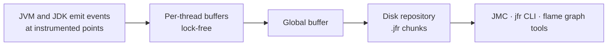
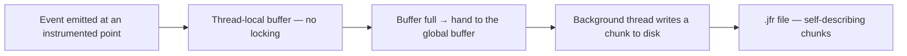
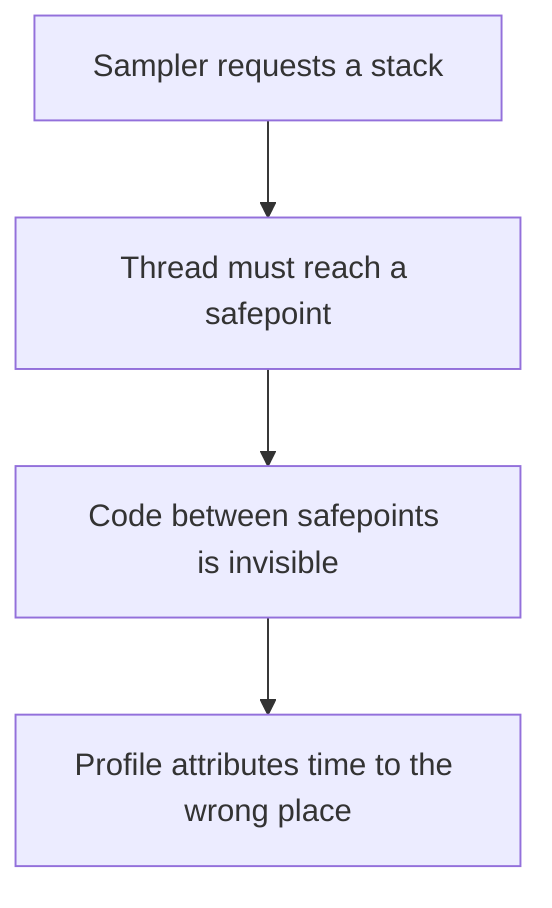

# Profiling with JFR

<!-- video:start -->
<figure class="pb-video">
<video controls playsinline preload="metadata">
<source src="../../videos/ch37.mp4" type="video/mp4">
<track kind="subtitles" srclang="en" label="English" src="../../videos/ch37.vtt">
</video>
<figcaption>Video walkthrough · 6:20 · subtitles via CC · <a href="../../videos/ch37.mp4" download>Download MP4</a></figcaption>
</figure>
<!-- video:end -->

## 1. Purpose & Audience

**Band:** L3 Enterprise · **Prerequisites:** [JVM Runtime Model](../01-platform/02-jvm-runtime-model.md), [Garbage Collection](34-garbage-collection.md)

Most performance problems cannot be reproduced locally. The data is different, the load is different, the heap is different, and the one instance behaving badly is in production. Flight Recorder exists for exactly that: a profiler built into the JVM, cheap enough to leave running, that records what actually happened rather than what you could reproduce.

This chapter answers three questions:

1. **What does JFR record**, and what does it cost?
2. **How do you run it continuously** and capture the incident rather than the aftermath?
3. **When is JFR the wrong tool**, and what do you use instead?

---

## 2. The Problem

```text
14:02  p99 latency 2.4s (normally 45ms)
14:09  recovered on its own
14:11  "can you look into it?"
```

The evidence available afterwards: metrics graphs showing that it happened, logs showing nothing unusual, and a service that is now behaving normally.

The conventional responses all fail here. **Reproducing locally** does not work — the load and data are different. **Adding logging** gives you nothing until it happens again, which may be next month. **Attaching a profiler** requires being attached when it occurs. **A thread dump** would have helped, if anyone had taken one at 14:04.

What is needed is a recording that was already running, with enough detail to answer questions you had not yet thought to ask.

---

## 3. Mental Model

### 3.1 JFR is an event recorder, not a sampler bolted on



The JVM and the JDK libraries are already instrumented with hundreds of event types — GC phases, lock contention, socket reads, class loading, allocations, exceptions. JFR turns subsets on and writes them to thread-local buffers with no locking.

Two properties follow:

- **Overhead is low** — roughly 1% with the default profile — because events are cheap to emit and nothing is instrumented on demand.
- **It records semantics, not just stacks.** A sampling profiler tells you a thread was in `SocketInputStream.read`. JFR tells you which socket, to which address, for how long, with the stack.

### 3.2 JFR versus the alternatives

| Tool | Strength | Weakness |
|---|---|---|
| **JFR** | Always-on, low overhead, in the JDK, rich event semantics | Java frames only; JMC has a learning curve |
| **async-profiler** | Wall-clock and native frames, excellent flame graphs | Separate install, agent attach |
| **Thread dumps** | Free, instant, shows every thread now | A single instant; no history |
| **Heap dump** | Definitive for memory | Large, pauses the JVM, memory only |
| **APM agents** | Distributed traces across services | Higher overhead, less JVM detail |

They are complements. JFR is the always-on baseline; async-profiler is what you reach for when you need native frames or wall-clock sampling; a heap dump answers memory questions neither can.

---

## 4. Core Reference

### 4.1 Starting a recording

| Form | Use |
|---|---|
| `-XX:StartFlightRecording=settings=profile,filename=app.jfr,duration=60s` | Fixed recording at launch |
| `-XX:StartFlightRecording=settings=profile,maxage=6h,maxsize=1g,disk=true` | **Continuous** — keep a rolling window |
| `jcmd <pid> JFR.start name=adhoc settings=profile` | Start on a running JVM |
| `jcmd <pid> JFR.dump name=adhoc filename=/tmp/now.jfr` | Dump what is buffered |
| `jcmd <pid> JFR.stop name=adhoc` | Stop |
| `jcmd <pid> JFR.check` | List active recordings |
| `-XX:FlightRecorderOptions=repository=/var/log/jfr` | Where chunks live |

### 4.2 Settings profiles

| Profile | Overhead | Use |
|---|---|---|
| `default` | ~1% | Continuous production recording |
| `profile` | ~2% | Investigation — more sampling, allocation events |
| Custom `.jfc` | Varies | Enable specific events at specific thresholds |

The difference matters: `default` does not enable allocation profiling, so a recording taken with it cannot answer "what is allocating". For an investigation, use `profile`.

### 4.3 Event categories worth knowing

| Category | Events | Answers |
|---|---|---|
| Execution | `ExecutionSample`, `CPUTimeSample` (25) | Where is CPU going? |
| Allocation | `ObjectAllocationSample` | What is allocating? |
| GC | `GarbageCollection`, `GCPhasePause` | Why are pauses long? |
| Locks | `JavaMonitorEnter`, `JavaMonitorWait` | What is contended? |
| I/O | `SocketRead`, `SocketWrite`, `FileRead`, `FileWrite` | Which calls are slow, and to where? |
| Threads | `ThreadPark`, `ThreadStart`, `VirtualThreadPinned` | What is blocked, and is anything pinning? |
| Class loading | `ClassLoad` | Why is startup slow? |
| Compilation | `Compilation`, `Deoptimization` | Is the JIT churning? |
| Exceptions | `JavaExceptionThrow` | Is something throwing in a loop? |

### 4.4 Reading a recording without a GUI

```bash
jfr summary app.jfr                                    # event counts — start here
jfr print --events GarbageCollection app.jfr
jfr print --events JavaMonitorEnter --stack-depth 20 app.jfr
jfr print --json --events SocketRead app.jfr | jq '...'
```

`jfr summary` is the right first command: the event count distribution usually points at the problem before you look at anything in detail.

---

## 5. Worked Examples

### 5.1 Continuous recording in production

```bash
java -XX:StartFlightRecording=settings=default,maxage=6h,maxsize=1g,disk=true,\
dumponexit=true,filename=/var/log/jfr/exit.jfr \
     -XX:FlightRecorderOptions=repository=/var/log/jfr \
     -jar orders.jar
```

This keeps a rolling six-hour window on disk at about 1% overhead. When the incident happens:

```bash
jcmd <pid> JFR.dump name=1 filename=/var/log/jfr/incident-1402.jfr
```

The dump contains the six hours **before** the command, which is the entire point. `dumponexit` additionally captures the window before a crash or an OOM kill.

This configuration should be the default for any service where a production performance investigation is plausible. The cost is 1% and a gigabyte of disk.

### 5.2 Investigating the latency spike

```bash
jfr summary incident-1402.jfr
```

```text
 Event Type                          Count   Size (bytes)
=========================================================
 jdk.ExecutionSample                 48,221      1,214,882
 jdk.JavaMonitorEnter                 8,904        445,200   ← unusual
 jdk.GarbageCollection                   61          4,270
 jdk.SocketRead                       2,104        118,224
```

Nearly nine thousand monitor-contention events is the anomaly. GC is unremarkable — 61 collections in six hours rules out the first hypothesis immediately.

```bash
jfr print --events JavaMonitorEnter --stack-depth 15 incident-1402.jfr | head -40
```

```text
jdk.JavaMonitorEnter {
  startTime = 14:02:31.447
  monitorClass = com.grocery.InventoryCache
  previousOwner = "http-nio-8080-exec-42"
  duration = 1.84 s
  eventThread = "http-nio-8080-exec-17"
  stackTrace = [
    com.grocery.InventoryCache.refreshIfStale line: 88
    com.grocery.InventoryService.availableQuantity line: 41
    ...
  ]
}
```

The answer, with the monitor, the blocking duration, the waiting thread, the previous owner, and the exact line. A `synchronized` cache refresh serialising every request thread for the duration of a reload.

No reproduction, no added logging, no guessing.

### 5.3 Finding an allocation problem

Allocation events need the `profile` settings:

```bash
jcmd <pid> JFR.start name=alloc settings=profile duration=120s filename=/tmp/alloc.jfr
```

```bash
jfr print --events ObjectAllocationSample --stack-depth 10 /tmp/alloc.jfr | head -30
```

```text
jdk.ObjectAllocationSample {
  objectClass = byte[]
  weight = 412 MB
  stackTrace = [
    java.lang.StringCoding.encode
    java.lang.String.getBytes
    com.grocery.AuditLogger.serialise line: 64
    com.grocery.OrderService.confirm line: 122
  ]
}
```

`weight` is the estimated total allocated along that path, not the size of one object. An audit logger serialising every order to a string — including when the audit level was disabled — was allocating 412 MB in two minutes.

This is the pattern that makes allocation profiling worth the extra 1%: the fix is one `if`, and nothing else would have found it.

### 5.4 Custom events

Instrument your own domain operations:

```java title="ReservationEvent.java"
@Name("com.grocery.Reservation")
@Label("Stock Reservation")
@Category({"Grocery", "Inventory"})
@Description("A stock reservation attempt against the inventory engine")
public final class ReservationEvent extends jdk.jfr.Event {

    @Label("SKU")          String sku;
    @Label("Quantity")     int quantity;
    @Label("Succeeded")    boolean succeeded;
    @Label("Vendor")       String vendor;
}
```

```java title="Usage.java"
public boolean reserve(Sku sku, int quantity) {
    ReservationEvent event = new ReservationEvent();
    event.begin();
    try {
        boolean ok = inventory.reserve(sku, quantity);
        event.sku = sku.code();
        event.quantity = quantity;
        event.succeeded = ok;
        return ok;
    } finally {
        event.commit();       // discarded cheaply if the event type is disabled
    }
}
```

Now a recording correlates your domain operations with GC pauses, lock contention, and socket reads **on the same timeline** — which is what turns "the service was slow" into "reservations for these SKUs were slow while that monitor was held".

Overhead when the event type is disabled is close to zero: `commit()` checks a flag and returns.

### 5.5 Virtual thread pinning

```bash
jfr print --events VirtualThreadPinned --stack-depth 20 app.jfr
```

```text
jdk.VirtualThreadPinned {
  duration = 240 ms
  stackTrace = [
    com.grocery.LegacyVendorClient.send line: 55
    ...
  ]
}
```

On Java 21–23 this is how you find `synchronized` blocks pinning carrier threads. Java 24's JEP 491 removed pinning for `synchronized`, so on 24+ remaining events point at native frames — see [Chapter 31](../04-concurrency/31-virtual-threads.md).

The older `-Djdk.tracePinnedThreads` flag is superseded by this event.

### 5.6 Flame graphs

JMC renders flame graphs directly. For the command line, convert execution samples:

```bash
jfr print --events ExecutionSample --json app.jfr > samples.json
# feed into a flamegraph tool
```

async-profiler produces better flame graphs and can also **read JFR files**, which is a useful combination: record continuously with JFR, render with async-profiler's tooling.

Reach for async-profiler directly when you need **wall-clock** profiling — time spent blocked, not just on CPU — or **native frames**, for a JNI call or a memory issue inside a native library. JFR sees Java frames.

---

## 6. Internals

### 6.1 Why the overhead is low



Three design choices keep the cost down. Emission writes to a **thread-local** buffer, so there is no contention. Events are **fixed-layout binary**, not formatted text. And the disk write happens on a **background thread**, off the application's path.

The format is self-describing: each chunk carries its own metadata, so a `.jfr` file can be read by tooling that knows nothing about the application or the JDK version that produced it.

### 6.2 Safepoint bias, and why JFR avoids it

Most older Java profilers sample by calling `getStackTrace`, which requires the target thread to reach a **safepoint** — a location where the JVM can inspect it safely. Safepoints are at method returns and loop back-edges, but the JIT removes them from tight counted loops.



The result is **safepoint bias**: the hottest loop may never appear, because samples land only where safepoints exist. It is why two profilers can disagree completely about the same application.

JFR's execution sampler walks stacks without requiring a safepoint, which is a substantive accuracy advantage over anything built on `Thread.getStackTrace`. async-profiler avoids it too, using OS-level signals and `AsyncGetCallTrace`.

### 6.3 Sampling versus accounting

| Event | Mechanism | Reliability |
|---|---|---|
| `ExecutionSample` | Periodic stack sample | Statistical — hot paths are reliable, rare ones are not |
| `CPUTimeSample` (25) | Sampled by CPU time rather than wall time | Better attribution on loaded machines |
| `ObjectAllocationSample` | Sampled, weighted by allocation volume | Directionally right; `weight` is an estimate |
| `GarbageCollection` | Every occurrence | Exact |
| `JavaMonitorEnter` | Every occurrence above a threshold | Exact above the threshold |
| `SocketRead` | Every occurrence above a threshold | Exact above the threshold |

The distinction matters when interpreting results. GC and lock events are **complete records** above their configured threshold — if a lock was contended for 2 seconds, the event exists. Execution and allocation samples are **statistical** — a path appearing in 40% of samples is genuinely hot, but a path appearing once means little.

Java 25's `CPUTimeSample` (JEP 509, **experimental** in 25) samples based on CPU time rather than wall-clock intervals, which gives more accurate attribution on machines where the JVM is competing for cores.

### 6.4 Thresholds

Most duration events have a threshold, and only events exceeding it are recorded:

```xml title="custom.jfc"
<event name="jdk.JavaMonitorEnter">
  <setting name="enabled">true</setting>
  <setting name="threshold">10 ms</setting>
</event>
```

This is why a recording may show no lock contention when contention exists — the default threshold is above the contention duration. When investigating short-but-frequent contention, lower the threshold and accept the extra volume.

The same applies to `SocketRead` and `FileRead`: a default threshold hides a thousand 5 ms calls that together dominate a request.

### 6.5 Method timing and tracing

Java 25 added method timing and tracing (JEP 520), which instruments specified methods to record invocation counts and timings without a separate agent.

It fills a real gap. Sampling answers "where is time spent" statistically; method timing answers "how many times was this called and how long did each take" exactly, for methods you nominate. That is the question sampling is worst at — a method called ten thousand times for 50 µs each may never appear in a sample-based profile while dominating the request.

Use it for a small number of nominated methods during an investigation. It is instrumentation, so it is not free, and it is not suitable for blanket application.

---

## 7. Production Patterns & Anti-Patterns

### Do this

- **Run JFR continuously in production** — `maxage=6h maxsize=1g disk=true dumponexit=true`, roughly 1% overhead.
- **Dump during or immediately after an incident.** The rolling window contains the period before the dump.
- **Start with `jfr summary`.** The event count distribution usually identifies the anomaly.
- **Use `settings=profile` for investigations**, `default` for continuous recording.
- **Add custom events for domain operations** — they correlate your work with JVM behaviour on one timeline.
- **Lower thresholds deliberately** when investigating short, frequent events.
- **Use async-profiler for wall-clock or native frames**, and for better flame graphs.
- **Keep `dumponexit=true`** so a crash or OOM kill still yields a recording.

### Never do this

- **Never rely on reproducing a production problem locally.** Different data, different load, different heap.
- **Never expect allocation data from a `default` recording.** Allocation events need `settings=profile`.
- **Never treat a single execution sample as evidence.** Sampling is statistical; one sample means nothing.
- **Never conclude there is no lock contention** without checking the event threshold.
- **Never leave `settings=profile` on continuously** without measuring the overhead on your workload.
- **Never use JFR for native frames.** It sees Java frames; use async-profiler.
- **Never benchmark with a profiler attached** and report the numbers as baseline performance.
- **Never use method tracing broadly.** It is instrumentation — nominate a few methods, not a package.

---

## 8. Version Evolution (Java 8 → 26)

| Version | What changed | Impact |
|---|---|---|
| **8** | JFR is a commercial Oracle JDK feature | Unavailable to most teams |
| **11** | **JFR open-sourced (JEP 328)**; JMC unbundled | Production profiling becomes free and universal |
| **14** | JFR event streaming (JEP 349) | Consume events in-process, in real time |
| **16** | JFR supports more event types and settings | Better default coverage |
| **21** | `VirtualThreadPinned`; JSON thread dumps | Virtual-thread-aware diagnostics |
| **25** | CPU-time profiling (JEP 509, **experimental**); cooperative sampling (JEP 518); **method timing and tracing (JEP 520)** | More accurate attribution; exact timing for nominated methods |
| **26** | Ongoing JFR work | — |

### Migration note

If your organisation still treats production profiling as something requiring a commercial agent, that assumption dates from Java 8. **JFR has been open-source and free since Java 11**, and JMC is a free download — so any service on Java 11 or later can run continuous production profiling at no licence cost.

The operational change is small: add the recording flags, give the repository a writable path with about a gigabyte of headroom, and add a dump command to the incident runbook. The return arrives the first time an incident is diagnosed from a recording instead of from speculation.

---

## 9. Interview Questions

### L1 — Foundations

**Q1. What is JFR?** ⭐ *high frequency*
Java Flight Recorder — an event-based profiler built into the JVM that records what the JVM and JDK libraries are doing: GC phases, lock contention, socket reads, allocations, class loading. It has been open-source and free since Java 11, and its overhead is low enough — around 1% with default settings — to leave running continuously in production.

**Q2. How do you start a recording on a running JVM?**
`jcmd <pid> JFR.start name=adhoc settings=profile`, then `jcmd <pid> JFR.dump name=adhoc filename=/tmp/out.jfr` to write it out. It can also be started at launch with `-XX:StartFlightRecording`, which is how continuous recording is configured.

**Q3. What is the difference between the `default` and `profile` settings?**
`default` is tuned for continuous use at about 1% overhead and omits the more expensive events — notably allocation profiling. `profile` enables more sampling and allocation events at roughly 2%. A recording taken with `default` cannot answer "what is allocating", which is the most common reason an investigation comes back empty.

### L2 — Professional

**Q4. How would you investigate a latency spike that already ended?** ⭐ *high frequency*
With a continuous recording that was already running. Configure `-XX:StartFlightRecording` with `maxage=6h maxsize=1g disk=true` so the JVM keeps a rolling window, then dump it after the incident — the file contains the period before the dump. Start the analysis with `jfr summary`, because the event count distribution usually identifies the anomaly before you look at any individual event.

**Q5. What can JFR tell you that a thread dump cannot?**
A thread dump is a single instant with no history and no durations. JFR records events over time with semantics attached: which monitor was contended, for how long, which thread held it previously, and the stack of the thread that waited. It also correlates that with GC pauses, socket reads, and allocation on one timeline, which a dump cannot do at all.

**Q6. Why add custom JFR events?**
Because they put your domain operations on the same timeline as JVM events. Knowing that reservations were slow is useful; seeing that they were slow while a specific monitor was held, during a particular GC phase, is a diagnosis. Custom events cost almost nothing when disabled — `commit()` checks a flag and returns — so they can be left in production code permanently.

### L3 — Enterprise

**Q7. What is safepoint bias and why does it matter?**
Profilers that sample by calling `getStackTrace` require the target thread to reach a safepoint, and the JIT removes safepoints from tight counted loops — so the hottest code can be systematically invisible and time gets attributed to the wrong place. It is why two profilers can disagree entirely about the same application. JFR's execution sampler walks stacks without requiring a safepoint, as does async-profiler, which is a substantive accuracy advantage over older tooling.

**Q8. Which JFR events are exact and which are statistical?**
GC events, lock events, and I/O events are complete records above their configured threshold — if a monitor was contended for two seconds, the event exists. Execution samples and allocation samples are statistical: a path appearing in a large fraction of samples is genuinely hot, but a single sample means nothing, and allocation `weight` is an estimate. Interpreting a sampled event as an exact count is the common analysis error.

**Q9. A recording shows no lock contention but you suspect there is some. What is the likely explanation?**
The event threshold. Duration events only record occurrences exceeding a configured minimum, and the default for monitor events is above short contention. A thousand 2 ms waits per second will not appear while dominating latency. Lowering the threshold in a custom settings file — accepting the extra event volume — is the way to see it.

### L4 — Architect

**Q10. How would you make production profiling standard across a fleet?**
Put continuous JFR in the base image or platform configuration, not in each service: `maxage`, `maxsize`, `disk=true`, `dumponexit=true`, and a repository path with headroom. Then add the dump command to the incident runbook and, ideally, automate it — dumping on an alert produces a recording of the incident rather than of the recovery. The cost is about 1% CPU and a gigabyte of disk per instance, which is small against one avoided unreproducible investigation.

**Q11. When is JFR the wrong tool?**
When the problem is not in Java frames. A memory leak inside a native library, time spent in a JNI call, or an off-heap allocation is invisible to JFR — async-profiler with native frames, or the OS-level tooling, is what sees those. It is also the wrong tool for exact call counts on a hot method, where sampling systematically underrepresents many short invocations; Java 25's method timing addresses that specific gap. And for memory questions a heap dump remains definitive, since JFR tells you what allocated but not what is retained.

**Q12. How do JFR, async-profiler, and APM tooling fit together?**
They answer different questions and should coexist. APM gives distributed traces across services and tells you *which* service and endpoint is slow. JFR is the always-on JVM-internal recorder that explains *why* within that JVM — contention, GC, I/O, allocation — with enough history to cover an incident that has ended. async-profiler is the sharper instrument you reach for deliberately, for wall-clock profiling, native frames, or better flame graphs. Choosing one and dismissing the others produces a blind spot in whichever layer it does not cover.

---

!!! abstract "Cheat Sheet"
    **Run it continuously:** `-XX:StartFlightRecording=settings=default,maxage=6h,maxsize=1g,disk=true,dumponexit=true` — ~1%

    **Dump after the incident** — the rolling window covers the period *before* the dump

    **`jfr summary` first** — the event count distribution names the anomaly

    **`settings=profile` for investigations** — `default` has **no allocation events**

    **Exact:** GC · locks · I/O (above threshold) — **statistical:** execution and allocation samples

    **No contention shown?** Check the event threshold before concluding there is none

    **Custom events** — `extends jdk.jfr.Event`, `begin()`/`commit()`; ~free when disabled

    **No safepoint bias** — unlike anything built on `Thread.getStackTrace`

    **`VirtualThreadPinned`** replaces `-Djdk.tracePinnedThreads`

    **Java 25:** CPU-time sampling (509, experimental) · method timing and tracing (520)

    **async-profiler** for wall-clock, native frames, better flame graphs — it can read `.jfr` too

    **Free and open-source since Java 11** — no licence, no agent
