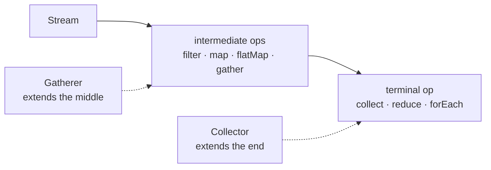
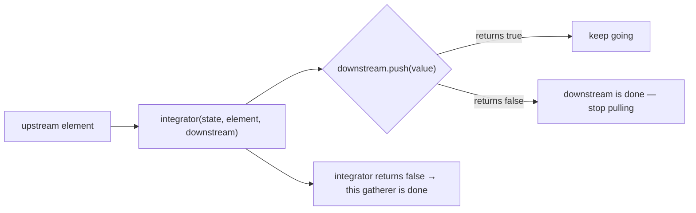
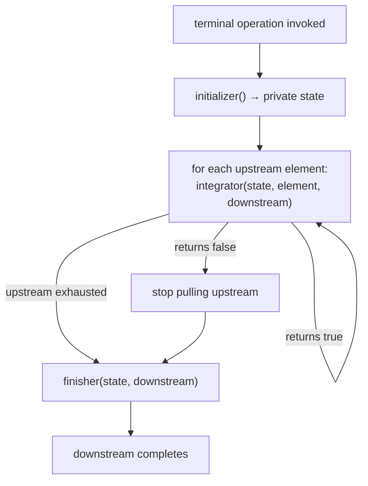
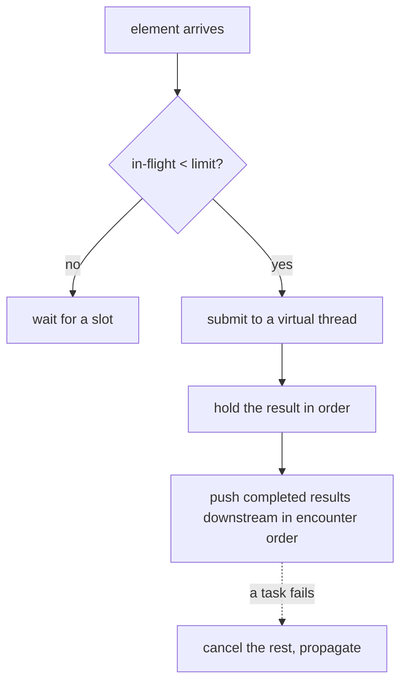

# Stream Gatherers

## 1. Purpose & Audience

**Band:** L3 Enterprise · **Prerequisites:** [The Stream API](../02-language/07-stream-api.md), [Collectors](../02-language/08-collectors.md)

Since Java 8 the set of intermediate stream operations has been closed. You could write a custom `Collector` to extend the terminal end of a pipeline, but `filter`, `map`, `flatMap` and their siblings were all you got in the middle — so windowing, running totals, batching, and deduplication by key all meant abandoning the stream and writing a loop.

Gatherers, final in Java 24, close that gap. A `Gatherer` is to an intermediate operation what a `Collector` is to a terminal one.

This chapter answers three questions:

1. **What can a gatherer express** that `map` and `filter` cannot?
2. **How do you write one**, and what are the four components?
3. **Which built-ins should you know** — particularly `mapConcurrent`, which is the one that changes how you write I/O-bound pipelines?

---

## 2. The Problem

Four requirements, none expressible as a stream operation before Java 24.

**Batch orders into groups of 100 for vendor dispatch:**

```java title="BatchingBefore.java"
List<List<Order>> batches = new ArrayList<>();
List<Order> current = new ArrayList<>();
for (Order order : orders) {
    current.add(order);
    if (current.size() == 100) {
        batches.add(current);
        current = new ArrayList<>();
    }
}
if (!current.isEmpty()) batches.add(current);     // the trailing partial batch
```

**A running total of cart value:**

```java title="ScanBefore.java"
List<Money> runningTotals = new ArrayList<>();
Money total = Money.ZERO;
for (CartLine line : cart.lines()) {
    total = total.plus(line.lineTotal());
    runningTotals.add(total);
}
```

**Deduplicate by SKU, keeping the first:**

```java title="DistinctByBefore.java"
Set<Sku> seen = new HashSet<>();
List<OrderLine> unique = new ArrayList<>();
for (OrderLine line : lines) {
    if (seen.add(line.sku())) unique.add(line);
}
```

**Call a vendor API for each SKU, at most 20 at a time.** No stream expression at all — `parallelStream()` uses the common pool and blocks it on I/O.

Each is a small, well-understood transformation. Each required leaving the pipeline, because the operation needed **state carried between elements** and the API had nowhere to put it.

---

## 3. Mental Model

### 3.1 The symmetry with `Collector`



| | `Collector` | `Gatherer` |
|---|---|---|
| Position | Terminal | **Intermediate** |
| Produces | One value | A stream |
| Components | supplier, accumulator, combiner, finisher | initializer, integrator, combiner, finisher |
| Invoked by | `collect(...)` | `gather(...)` |
| Composes with | Nothing after it | More operations after it |

The four components mirror `Collector` almost exactly. The difference is that a gatherer **pushes elements downstream** as it goes rather than accumulating into a container.

### 3.2 Push, and the ability to stop



Two return values carry the control flow. `Downstream.push` returns `false` when nothing downstream wants more elements — a `limit` or `findFirst` has been satisfied. The integrator itself returns `false` to say *this* gatherer has finished.

That is what preserves laziness and short-circuiting through a custom operation, which is the property a hand-written loop gives up.

---

## 4. Core Reference

### 4.1 The four components

| Component | Signature | Purpose |
|---|---|---|
| `initializer` | `() -> A` | Create private state (optional — `Gatherer.defaultInitializer()`) |
| `integrator` | `(A state, T element, Downstream<R>) -> boolean` | Process one element; return `false` to finish |
| `combiner` | `(A, A) -> A` | Merge state for parallel streams (optional) |
| `finisher` | `(A state, Downstream<R>) -> void` | Emit anything held back at the end |

### 4.2 Factory methods

| Method | Use |
|---|---|
| `Gatherer.of(integrator)` | Stateless |
| `Gatherer.of(initializer, integrator, combiner, finisher)` | Full form |
| `Gatherer.ofSequential(...)` | **Stateful** — no combiner, never parallelised |
| `Integrator.ofGreedy(...)` | Declares the integrator never short-circuits — allows optimisation |

### 4.3 Built-in gatherers (`java.util.stream.Gatherers`)

| Gatherer | Produces |
|---|---|
| `windowFixed(n)` | Non-overlapping lists of size `n`; a trailing partial window |
| `windowSliding(n)` | Overlapping windows, advancing one element at a time |
| `fold(initial, folder)` | A single accumulated value, emitted at the end |
| `scan(initial, scanner)` | The running accumulation, one element per input |
| `mapConcurrent(limit, fn)` | Applies `fn` on **virtual threads**, at most `limit` concurrently, preserving order |

### 4.4 Using one

```java
stream.gather(Gatherers.windowFixed(100))
      .map(this::dispatchBatch)
      .toList();
```

`gather` is an intermediate operation, so it composes with everything before and after it.

---

## 5. Worked Examples

### 5.1 Batching

```java title="Batching.java"
List<DispatchReceipt> receipts = orders.stream()
    .filter(Order::isConfirmed)
    .gather(Gatherers.windowFixed(100))
    .map(vendorClient::dispatchBatch)
    .toList();
```

The trailing partial batch is handled — `windowFixed` emits it from the finisher. That is the line most hand-written batching loops forget, and the bug only shows when the input size is not a multiple of the batch size.

### 5.2 Running totals

```java title="RunningTotal.java"
List<Money> runningTotals = cart.lines().stream()
    .gather(Gatherers.scan(() -> Money.ZERO,
                           (total, line) -> total.plus(line.lineTotal())))
    .toList();
```

```text title="Output"
[₹120.00, ₹570.00, ₹610.00]
```

`scan` emits one element per input — the accumulation so far. `fold` is the same operation emitting only the final value, which is `reduce` with a different shape.

### 5.3 Sliding windows

Moving average of orders per minute over a five-minute window:

```java title="MovingAverage.java"
List<Double> movingAverage = ordersPerMinute.stream()
    .gather(Gatherers.windowSliding(5))
    .map(window -> window.stream().mapToInt(Integer::intValue).average().orElse(0))
    .toList();
```

`windowSliding(5)` over ten elements yields six windows. Before gatherers this needed an indexed loop over a materialised list, which also gave up laziness over a large or infinite source.

### 5.4 `mapConcurrent` — the important one

```java title="ConcurrentLookup.java"
List<InventoryStatus> statuses = skus.stream()
    .gather(Gatherers.mapConcurrent(20, warehouseClient::statusFor))
    .toList();
```

Each `statusFor` call is a 200 ms blocking HTTP request. This runs **at most 20 concurrently, on virtual threads, preserving encounter order**, and integrates into an ordinary sequential pipeline.

Compare what it replaces:

=== "parallelStream — wrong"
    ```java
    skus.parallelStream().map(warehouseClient::statusFor).toList();
    ```
    Runs on the shared common ForkJoinPool, sized for CPU work. Blocking I/O there starves every other parallel stream in the JVM, and there is no way to bound concurrency per call.

=== "executor + futures — verbose"
    ```java
    try (var executor = Executors.newVirtualThreadPerTaskExecutor()) {
        var futures = skus.stream()
            .map(sku -> executor.submit(() -> warehouseClient.statusFor(sku)))
            .toList();
        return futures.stream().map(Future::resultNow).toList();   // safe: close() has already waited
    }
    ```
    Correct, but it leaves the pipeline, needs a semaphore to bound concurrency, and handles exceptions awkwardly.

`mapConcurrent` gives bounded concurrency, order preservation, and proper cancellation — a failing element cancels the rest — in one operation. For I/O-bound fan-out inside a stream it is the right default on Java 24+.

### 5.5 A custom gatherer: `distinctBy`

The most-wanted missing operation:

```java title="DistinctBy.java"
public static <T, K> Gatherer<T, ?, T> distinctBy(Function<? super T, ? extends K> keyFn) {
    return Gatherer.ofSequential(
        HashSet::new,                                   // initializer
        (seen, element, downstream) -> {                 // integrator
            if (seen.add(keyFn.apply(element))) {
                return downstream.push(element);         // propagate short-circuit
            }
            return true;                                  // skipped; keep going
        });
}
```

```java
List<OrderLine> firstPerSku = lines.stream()
    .gather(distinctBy(OrderLine::sku))
    .toList();
```

Three details that matter:

- **`ofSequential`** because the state is a mutable set with no sensible combiner. It is never parallelised, which is correct rather than a limitation.
- **Returning `downstream.push(...)`** rather than `true` propagates short-circuiting — a `limit(10)` downstream stops the whole pipeline.
- **No finisher**, because nothing is held back.

### 5.6 A gatherer with a finisher

Emit each element until a predicate matches, **including** the matching one — `takeWhile` excludes it:

```java title="TakeUntilInclusive.java"
public static <T> Gatherer<T, ?, T> takeUntilInclusive(Predicate<? super T> predicate) {
    return Gatherer.of((_, element, downstream) -> {
        boolean wantsMore = downstream.push(element);
        return wantsMore && !predicate.test(element);    // false stops the pipeline
    });
}
```

```java
List<Order> upToFirstFailure = orders.stream()
    .gather(takeUntilInclusive(o -> o.status() == OrderStatus.FAILED))
    .toList();
```

The unnamed parameter `_` (Java 22) marks the unused state — see [Chapter 14](../02-language/14-java-21-to-26.md).

---

## 6. Internals

### 6.1 How `gather` executes



Note that the finisher runs whether the stream was exhausted **or** short-circuited. That is how `windowFixed` emits a trailing partial window even when a downstream `limit` stopped the pipeline early.

### 6.2 Greedy versus non-greedy integrators

| Kind | Declares | Effect |
|---|---|---|
| `Integrator.ofGreedy` | Never returns `false` | The implementation can optimise, knowing this stage never short-circuits |
| Ordinary | May return `false` | Each element's return value must be checked |

Declaring greedy is a promise. A greedy integrator that returns `false` is a contract violation, and the behaviour is unspecified — so use `ofGreedy` only when the integrator genuinely always returns `true` (or the result of `push`, for a stage that merely forwards short-circuiting).

### 6.3 Why most gatherers are sequential

A parallel stream splits the source, runs a gatherer instance per split, and merges state with the combiner. That only works when the operation is **associative and order-independent**.

| Operation | Parallelisable? |
|---|---|
| `map`-like, stateless | Yes |
| `fold` with an associative folder | Yes |
| `scan` | **No** — each output depends on all prior elements |
| `windowFixed` | **No** — window boundaries depend on position |
| `distinctBy` | **No** — "first occurrence" is order-dependent |

`Gatherer.ofSequential` states this explicitly, and the stream will not parallelise that stage. This is better than the `Collector` situation, where a missing or wrong combiner produces a gatherer that passes every sequential test and corrupts under `parallel()` ([Chapter 08](../02-language/08-collectors.md)).

### 6.4 How `mapConcurrent` works



Three properties make it the right default for I/O fan-out:

- **Virtual threads**, so blocking costs almost nothing ([Chapter 31](../04-concurrency/31-virtual-threads.md)) and the common ForkJoinPool is untouched.
- **Bounded concurrency**, expressing the real constraint — the downstream service tolerates 20 concurrent calls — rather than a thread budget.
- **Order preserved**, so the output matches the input sequence even though completion order does not.

It is `Semaphore` plus virtual threads plus ordered collection, as one operation.

### 6.5 Composition

```java title="Composed.java"
Gatherer<Order, ?, List<Order>> confirmedBatches =
    distinctBy(Order::id)
        .andThen(Gatherers.windowFixed(100));

List<DispatchReceipt> receipts = orders.stream()
    .gather(confirmedBatches)
    .map(vendorClient::dispatchBatch)
    .toList();
```

`andThen` composes two gatherers into one, so a domain-specific pipeline stage can be built once, named, tested in isolation, and reused. That is the structural argument for gatherers over loops: a loop cannot be composed or named as a pipeline stage.

---

## 7. Production Patterns & Anti-Patterns

### Do this

- **Use `mapConcurrent` for I/O-bound fan-out inside a pipeline.** Bounded, ordered, on virtual threads.
- **Use `windowFixed` for batching** — it handles the trailing partial window you would forget.
- **Use `ofSequential` for any stateful gatherer** unless you can write a genuinely associative combiner.
- **Return `downstream.push(...)` from the integrator** rather than `true`, so short-circuiting propagates.
- **Name and extract custom gatherers** into a utility class, and test them in isolation.
- **Compose with `andThen`** to build reusable domain pipeline stages.
- **Prefer a loop when the operation is one-off and simple.** A gatherer earns its place through reuse or composition.

### Never do this

- **Never write a combiner you have not reasoned about.** If the operation is order-dependent, use `ofSequential`.
- **Never declare `ofGreedy` for an integrator that can return `false`.** It is a contract violation with unspecified behaviour.
- **Never use `parallelStream` for blocking I/O.** It occupies the shared common pool; `mapConcurrent` exists for this.
- **Never put side effects in a gatherer** beyond its own private state.
- **Never set `mapConcurrent`'s limit arbitrarily.** It should express what the downstream service actually tolerates.
- **Never reach for a gatherer where a `Collector` fits.** If the result is one value at the end of the pipeline, that is a collector.
- **Never nest gatherers deeply** to avoid a loop. Three composed stages are readable; six are not.

---

## 8. Version Evolution (Java 8 → 26)

| Version | What changed | Impact |
|---|---|---|
| **8** | Stream API with a closed set of intermediate operations | Windowing and batching require loops |
| **9** | `takeWhile`, `dropWhile` | Two of the missing operations, hard-coded |
| **12** | `Collectors.teeing` | Extensibility at the terminal end improves |
| **16** | `Stream.toList`, `mapMulti` | `mapMulti` is a push-style `flatMap` — a partial precursor |
| **22** | **Gatherers preview (JEP 461)** | The intermediate end opens |
| **23** | Second preview (JEP 473) | API refinement |
| **24** | **Gatherers final (JEP 485)** | Production-ready; `mapConcurrent` included |
| **25–26** | No changes | — |

### Migration note

On Java 24+, three loop patterns convert cleanly and are worth looking for:

1. **Manual batching** → `Gatherers.windowFixed(n)`, which also fixes the trailing-batch bug if the loop had it.
2. **Running accumulation into a list** → `Gatherers.scan(...)`.
3. **`Set`-based deduplication by key** → a small `distinctBy` gatherer, written once and reused.

The higher-value change is the fourth: **executor-and-futures blocks doing bounded parallel I/O become `mapConcurrent`.** That usually removes a semaphore, a try-with-resources executor, and a block of exception handling, and it is the pattern with the most code to delete.

What not to convert: a loop that does several unrelated things, or one whose body throws checked exceptions. Both read worse as a gatherer.

---

## 9. Interview Questions

### L1 — Foundations

**Q1. What is a Gatherer?** ⭐ *high frequency*
A user-defined intermediate stream operation, final in Java 24. Before it, the set of intermediate operations was closed — `map`, `filter`, `flatMap` and a few others — so anything needing state carried between elements meant leaving the stream and writing a loop. A gatherer is to an intermediate operation what a `Collector` is to a terminal one.

**Q2. What do the built-in gatherers do?**
`windowFixed(n)` groups elements into non-overlapping lists of size `n` with a trailing partial window; `windowSliding(n)` produces overlapping windows; `scan` emits the running accumulation, one element per input; `fold` emits only the final accumulated value; and `mapConcurrent(limit, fn)` applies a function on virtual threads with bounded concurrency, preserving order.

**Q3. How do you use one?**
`stream.gather(Gatherers.windowFixed(100))`. `gather` is an intermediate operation, so it composes with everything before and after it in the pipeline, unlike a loop.

### L2 — Professional

**Q4. What are the four components of a Gatherer?** ⭐ *high frequency*
`initializer` creates private state; `integrator` processes one element and pushes results downstream, returning `false` when the gatherer is finished; `combiner` merges state for parallel streams; and `finisher` emits anything held back once the upstream is exhausted. They mirror `Collector`'s four components, with the difference that a gatherer pushes elements onward rather than accumulating into a container.

**Q5. Why would you use `Gatherer.ofSequential`?**
Because the operation is order-dependent or holds state with no sensible way to merge — `scan`, `windowFixed`, and deduplication by key are all examples. `ofSequential` declares that explicitly, so the stage is never parallelised. That is safer than the `Collector` situation, where a missing or wrong combiner passes every sequential test and corrupts only under `parallel()`.

**Q6. What does `mapConcurrent` do that `parallelStream` does not?**
It runs on virtual threads rather than the shared common ForkJoinPool, so blocking I/O costs almost nothing and does not starve every other parallel stream in the JVM. It also bounds concurrency to a limit you choose, which expresses the real constraint — what the downstream service tolerates — and it preserves encounter order. For I/O-bound fan-out it is correct where `parallelStream` is actively harmful.

### L3 — Enterprise

**Q7. How does short-circuiting work through a gatherer?**
Through two return values. `Downstream.push` returns `false` when nothing downstream wants more elements, because a `limit` or `findFirst` has been satisfied, and the integrator returns `false` to say it has finished itself. A well-written integrator returns the result of `push` rather than a bare `true`, which propagates the signal upward and preserves laziness through a custom operation — something a hand-written loop gives up entirely.

**Q8. When does the finisher run?**
When the upstream is exhausted **or** when the pipeline short-circuits. That is how `windowFixed` emits a trailing partial window even if a downstream `limit` stopped the stream early. It is also why a gatherer that buffers elements must have a finisher — anything held in state when the stream ends would otherwise be silently dropped.

**Q9. What is a greedy integrator?**
One declared with `Integrator.ofGreedy`, asserting that it never returns `false` — it never short-circuits. That lets the implementation optimise, since it need not check the return value per element. It is a contract: a greedy integrator that does return `false` produces unspecified behaviour, so it should only be used where the integrator genuinely always continues.

### L4 — Architect

**Q10. When is a gatherer better than a loop, and when is it not?**
A gatherer wins when the operation is reusable, composable, or needs to preserve laziness and short-circuiting through a pipeline — batching, windowing, deduplication by key, bounded concurrent I/O. It can be named, tested in isolation, and composed with `andThen`, none of which a loop offers. A loop wins when the operation is one-off, does several unrelated things, or throws checked exceptions, all of which read worse wrapped in a gatherer. The test is whether the transformation deserves a name.

**Q11. How does `mapConcurrent` change the design of I/O-bound pipelines?**
It collapses a pattern that previously needed a virtual-thread executor, a semaphore to bound concurrency, ordered result collection, and cancellation handling into a single pipeline stage. That matters beyond brevity: the bound now expresses a real constraint — the downstream service's tolerance — rather than a thread-pool size chosen for thread economics, and cancellation on failure is handled rather than forgotten. It makes the stream the right place for fan-out I/O, which it previously was not.

**Q12. How do Gatherers and Collectors together change the Stream API's extensibility story?**
They make both ends of a pipeline user-extensible. `Collector` opened the terminal end in Java 8, but the intermediate set stayed closed for sixteen years, so any stateful transformation forced code out of the stream — which is why real codebases mix pipelines and loops awkwardly. With both, a domain can define its own vocabulary of pipeline stages and terminal reductions and compose them, so the Stream API becomes a framework rather than a fixed set of operations. The cost is the same as any extensibility: the pipeline can now be made unreadable in more ways.

---

!!! abstract "Cheat Sheet"
    **Gatherer : intermediate :: Collector : terminal** — `stream.gather(...)`

    **Four parts:** initializer · integrator · combiner · finisher

    **Integrator returns `false`** to finish · **`Downstream.push` returns `false`** when downstream is done

    **Return `downstream.push(...)`**, not `true` — propagates short-circuiting

    **Built-ins:** `windowFixed` · `windowSliding` · `fold` · `scan` · **`mapConcurrent`**

    **`mapConcurrent(n, fn)`** — virtual threads, bounded, order-preserving, cancels on failure

    **Use it instead of `parallelStream` for blocking I/O** — never occupies the common pool

    **`ofSequential` for stateful, order-dependent gatherers** — no combiner, never parallelised

    **Finisher runs on exhaustion *and* short-circuit** — that is how trailing windows emit

    **`ofGreedy` is a promise** that the integrator never returns `false`

    **Compose with `andThen`** — name and reuse domain pipeline stages

    **Final in Java 24 (JEP 485)** — preview in 22 and 23
