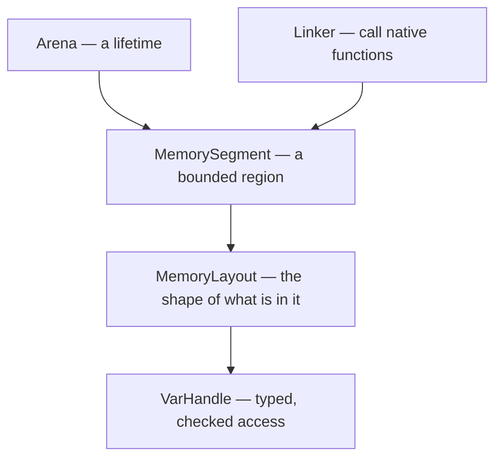
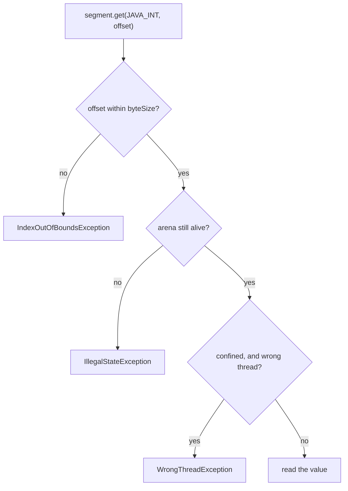
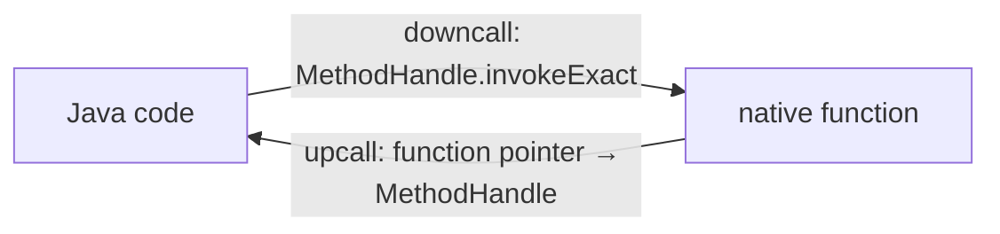

# FFM API & Vector API

## 1. Purpose & Audience

**Band:** L4 Architect · **Prerequisites:** [JVM Runtime Model](../01-platform/02-jvm-runtime-model.md), [Memory Footprint](35-memory-footprint.md)

Two long-standing gaps in Java: calling native code was painful enough that people used `sun.misc.Unsafe` instead, and the SIMD instructions in every modern CPU were unreachable except through whatever the JIT happened to vectorise on its own.

The Foreign Function & Memory API closed the first, and is final as of Java 22. The Vector API is still incubating after a decade, for reasons worth understanding.

This chapter answers three questions:

1. **What replaces JNI and `Unsafe`**, and why is it safer rather than just newer?
2. **How do you manage off-heap memory** with deterministic lifetimes?
3. **Is the Vector API usable**, and what is it waiting for?

---

## 2. The Problem

**Calling a native library meant JNI:**

```c title="OrderNative.c"
JNIEXPORT jlong JNICALL Java_com_grocery_Compression_compress
  (JNIEnv *env, jclass cls, jbyteArray input, jbyteArray output) {
    jbyte *in = (*env)->GetByteArrayElements(env, input, NULL);
    /* ... */
    (*env)->ReleaseByteArrayElements(env, input, in, 0);
    return result;
}
```

A C file, a header generated by `javah`, a shared library built per platform, and a build pipeline for all of it. Every mistake is a JVM crash rather than an exception.

**Off-heap memory meant `ByteBuffer` or `Unsafe`:**

```java title="OffHeapBefore.java"
ByteBuffer buffer = ByteBuffer.allocateDirect(1024 * 1024);
// 2 GB limit. Freed whenever the GC gets round to it. No struct layouts.

long address = unsafe.allocateMemory(size);     // no bounds checks, no lifetime,
unsafe.putLong(address + offset, value);         // use-after-free crashes the JVM
```

`Unsafe` was never public API, is now deprecated for removal, and is exactly the kind of thing strong encapsulation was introduced to stop.

**SIMD was invisible.** A modern CPU can add eight integers in one instruction. Java had no way to ask for that — you wrote a loop and hoped the JIT auto-vectorised it, which it sometimes did and sometimes did not, with no way to tell from the source.

---

## 3. Mental Model

### 3.1 FFM: three concepts



| Concept | What it is |
|---|---|
| **`Arena`** | Controls when memory is freed and who may touch it |
| **`MemorySegment`** | A region with a known size and lifetime — on or off heap |
| **`MemoryLayout`** | A description of structure — fields, padding, arrays |
| **`VarHandle`** | Typed access derived from a layout, with bounds and lifetime checks |
| **`Linker`** | Binds a native function to a Java method handle |

The design point is that **safety is not optional**. Every access through a segment checks bounds and checks that the arena is still alive, so a use-after-free is an exception rather than a corrupted heap. That is the substantive difference from `Unsafe`, not the API shape.

### 3.2 Arena lifetimes

| Arena | Freed when | Accessible from |
|---|---|---|
| `Arena.ofConfined()` | `close()` — deterministic | **One thread only** |
| `Arena.ofShared()` | `close()` — deterministic | Any thread |
| `Arena.ofAuto()` | The GC decides | Any thread |
| `Arena.global()` | Never | Any thread |

Confined is the default choice: deterministic deallocation via try-with-resources, and single-thread confinement that makes the lifetime check cheap.

---

## 4. Core Reference

### 4.1 FFM memory

| Operation | Form |
|---|---|
| Allocate | `arena.allocate(1024)` / `arena.allocate(layout)` |
| Primitive access | `segment.get(ValueLayout.JAVA_INT, offset)` |
| Write | `segment.set(ValueLayout.JAVA_LONG, offset, value)` |
| Slice | `segment.asSlice(offset, length)` |
| Copy | `MemorySegment.copy(src, srcOffset, dst, dstOffset, bytes)` |
| Wrap an array | `MemorySegment.ofArray(byteArray)` |
| To a `ByteBuffer` | `segment.asByteBuffer()` |
| Size | `segment.byteSize()` |

### 4.2 Layouts

| Layout | Describes |
|---|---|
| `ValueLayout.JAVA_INT`, `JAVA_LONG`, `JAVA_DOUBLE`… | Primitives |
| `ValueLayout.ADDRESS` | A pointer |
| `MemoryLayout.structLayout(...)` | A C struct |
| `MemoryLayout.sequenceLayout(n, element)` | An array |
| `MemoryLayout.paddingLayout(bits)` | Explicit padding |
| `layout.varHandle(PathElement.groupElement("field"))` | Typed accessor for one field |

### 4.3 Calling native code

```java
Linker linker = Linker.nativeLinker();
SymbolLookup stdlib = linker.defaultLookup();

MethodHandle strlen = linker.downcallHandle(
    stdlib.find("strlen").orElseThrow(),
    FunctionDescriptor.of(ValueLayout.JAVA_LONG, ValueLayout.ADDRESS));
```

| Direction | API |
|---|---|
| Java → native | `Linker.downcallHandle(...)` |
| Native → Java (callback) | `Linker.upcallStub(...)` |
| Find a symbol | `SymbolLookup.libraryLookup("z", arena)` or `defaultLookup()` |
| Generate bindings from headers | **`jextract`** — a separate tool |

### 4.4 Restricted methods

Native access is a **restricted operation**. From Java 24 onward, using it without permission produces a warning, and it is intended to become an error:

```bash
java --enable-native-access=ALL-UNNAMED -jar orders.jar
java --enable-native-access=com.grocery.orders -jar orders.jar    # modular
```

This is the same integrity-by-default direction as the encapsulation changes in [Chapter 11](../02-language/11-java-9-to-11.md): the JVM wants to know, explicitly, which code may step outside its safety guarantees.

---

## 5. Worked Examples

### 5.1 Off-heap with a deterministic lifetime

```java title="OffHeapIndex.java"
try (Arena arena = Arena.ofConfined()) {
    MemorySegment prices = arena.allocate(ValueLayout.JAVA_LONG, 1_000_000);

    for (int i = 0; i < 1_000_000; i++) {
        prices.setAtIndex(ValueLayout.JAVA_LONG, i, priceOf(i));
    }

    long total = 0;
    for (int i = 0; i < 1_000_000; i++) {
        total += prices.getAtIndex(ValueLayout.JAVA_LONG, i);
    }
    return total;
}   // freed here, deterministically — not when the GC decides
```

Eight megabytes, outside the heap, freed at the closing brace. Compare `ByteBuffer.allocateDirect`, which is capped at 2 GB per buffer and freed only when the buffer becomes unreachable and a collection happens to run — a well-known source of "off-heap leaks" that are really deferred frees.

Access outside the arena's lifetime fails loudly:

```java title="UseAfterFree.java"
MemorySegment escaped;
try (Arena arena = Arena.ofConfined()) {
    escaped = arena.allocate(1024);
}
escaped.get(ValueLayout.JAVA_INT, 0);
// IllegalStateException: Already closed
```

That is the entire safety argument. With `Unsafe` the same mistake corrupts memory or crashes the JVM; here it is a checked exception at the point of the error.

### 5.2 A C struct

```c
struct InventoryRecord {
    long  sku_id;
    int   available;
    int   reserved;
    double price;
};
```

```java title="StructLayout.java"
static final MemoryLayout RECORD = MemoryLayout.structLayout(
    ValueLayout.JAVA_LONG.withName("skuId"),
    ValueLayout.JAVA_INT.withName("available"),
    ValueLayout.JAVA_INT.withName("reserved"),
    ValueLayout.JAVA_DOUBLE.withName("price"));

static final VarHandle SKU_ID    = RECORD.varHandle(PathElement.groupElement("skuId"));
static final VarHandle AVAILABLE = RECORD.varHandle(PathElement.groupElement("available"));

try (Arena arena = Arena.ofConfined()) {
    MemorySegment records = arena.allocate(RECORD, 10_000);

    MemorySegment first = records.asSlice(0, RECORD.byteSize());
    SKU_ID.set(first, 0L, 40012L);
    AVAILABLE.set(first, 0L, 250);
}
```

The layout describes the struct once; the `VarHandle`s give typed, bounds-checked access to named fields. Offsets are computed from the layout rather than hard-coded, so adding a field does not silently shift every subsequent read — which is exactly the class of bug manual offset arithmetic produces.

### 5.3 Calling a native function

```java title="NativeCall.java"
static final Linker LINKER = Linker.nativeLinker();
static final SymbolLookup STDLIB = LINKER.defaultLookup();

static final MethodHandle STRLEN = LINKER.downcallHandle(
    STDLIB.find("strlen").orElseThrow(),
    FunctionDescriptor.of(ValueLayout.JAVA_LONG, ValueLayout.ADDRESS));

public static long nativeStrlen(String s) throws Throwable {
    try (Arena arena = Arena.ofConfined()) {
        MemorySegment cString = arena.allocateFrom(s);
        return (long) STRLEN.invokeExact(cString);
    }
}
```

No C file, no generated header, no platform-specific build step. The Java code describes the function's signature and calls it.

For a real library, generate the bindings:

```bash
jextract --output src/main/java -t com.grocery.native /usr/include/zlib.h
```

`jextract` reads C headers and emits the layouts, handles, and constants, which removes the most error-prone part — transcribing signatures by hand.

### 5.4 Choosing your off-heap mechanism

| | `byte[]` | `ByteBuffer.allocateDirect` | `MemorySegment` |
|---|---|---|---|
| On heap | Yes | No | Either |
| Size limit | 2 GB | 2 GB | None |
| Deterministic free | GC | **No** | **Yes**, with `close()` |
| Struct layouts | No | No | Yes |
| Bounds checked | Yes | Yes | Yes |
| Thread confinement | No | No | Optional |
| Native interop | Via JNI | Limited | First class |

The honest default remains a plain array or collection. Off-heap earns its place when the data is genuinely large, long-lived, and GC pressure is measured to be the problem — or when it must be shared with native code.

### 5.5 The Vector API

```java title="VectorSum.java"
import jdk.incubator.vector.*;

static final VectorSpecies<Integer> SPECIES = IntVector.SPECIES_PREFERRED;

public static int sum(int[] values) {
    int i = 0;
    IntVector acc = IntVector.zero(SPECIES);

    int upper = SPECIES.loopBound(values.length);
    for (; i < upper; i += SPECIES.length()) {
        acc = acc.add(IntVector.fromArray(SPECIES, values, i));
    }
    int total = acc.reduceLanes(VectorOperators.ADD);

    for (; i < values.length; i++) {      // the tail
        total += values[i];
    }
    return total;
}
```

```bash
javac --add-modules jdk.incubator.vector VectorSum.java
java  --add-modules jdk.incubator.vector VectorSum
```

`SPECIES_PREFERRED` selects the widest vector the hardware supports — 8 ints on AVX2, 16 on AVX-512 — so the same source uses the best available instruction set. The loop tail is manual because the array length is rarely a multiple of the vector width; masks can handle it, at some cost.

!!! warning "Still incubating"
    The Vector API has been in **incubation since Java 16** and is not final. It requires `--add-modules jdk.incubator.vector` at compile and run time, the API may change, and incubator modules are explicitly not for production. Its finalisation is tied to Project Valhalla, which it depends on for value types.

### 5.6 When SIMD is worth it

| Fits | Does not fit |
|---|---|
| Large primitive arrays, one operation applied uniformly | Branchy, element-dependent logic |
| Numeric aggregation, distance, dot products | Object graphs and references |
| Image, signal, and vector-similarity work | Small arrays — setup cost dominates |
| Bulk comparison and filtering with masks | Anything the JIT already auto-vectorises well |

Before writing any of it, check whether the JIT is already doing it:

```bash
java -XX:+UnlockDiagnosticVMOptions -XX:+PrintAssembly ...   # requires hsdis
```

The JIT auto-vectorises simple counted loops over primitive arrays. If it already does, the explicit version adds an incubating dependency for nothing.

---

## 6. Internals

### 6.1 Spatial and temporal safety



Three checks: **spatial** (in bounds), **temporal** (not freed), and **confinement** (right thread). Every one of them is a category of bug that `Unsafe` turns into memory corruption.

The performance question is whether the checks cost anything. In practice the JIT hoists them out of loops when it can prove bounds and liveness, so a loop over a confined segment approaches array performance — which is what makes the safe API acceptable as a replacement rather than a compromise.

### 6.2 Why confined arenas are faster than shared

A confined arena is owned by one thread, so closing it requires no coordination — no other thread can be mid-access. A shared arena must ensure no thread is accessing the segment when it closes, which requires a synchronisation mechanism at close time.

The consequence: **use confined unless you genuinely need cross-thread access**, and prefer handing off a slice to one thread over sharing one segment across many.

### 6.3 Downcalls and upcalls



The `Linker` generates a stub matching the platform's calling convention from the `FunctionDescriptor`, so argument marshalling is derived from a declaration rather than hand-written. `invokeExact` requires the call site's static types to match the handle exactly — hence the casts in §5.3, and a `WrongMethodTypeException` when they do not.

Upcalls — passing a Java method to native code as a callback — are the harder direction, since the stub must outlive the call and its lifetime is tied to an arena.

### 6.4 The `Unsafe` endgame

| Stage | Status |
|---|---|
| Never public API | `sun.misc.Unsafe` was always internal |
| Java 9 | Encapsulated by modules, accessible with warnings |
| Java 17 | Strong encapsulation enforced |
| Java 23 | **Memory-access methods deprecated for removal (JEP 471)** |
| Future | Removed |

The replacements are specific: **FFM for off-heap memory**, **`VarHandle` for atomic and ordered on-heap access**, and the standard concurrency utilities for everything else. A library still using `Unsafe` for memory access in 2026 is a supply-chain item, not just a compatibility one — and `jdeps -jdkinternals` ([Chapter 03](../01-platform/03-toolchain.md)) finds them.

### 6.5 Why the Vector API is still incubating

It is waiting on **Valhalla**. A `Vector` is conceptually a value — no identity, ideally stored in registers rather than the heap — and without value types the implementation depends on the JIT reliably scalarising vector objects and eliminating allocation.

That works, but it is fragile: a vector that escapes a method, or a call the JIT declines to inline, falls back to heap allocation and the performance advantage disappears. Finalising an API whose performance depends on optimisations that may not fire would be a poor trade, so it stays in incubation until value types make the representation guaranteed.

A decade of incubation is unusual, and it is a useful illustration of the point made in [Chapter 15](../02-language/15-string-templates-postmortem.md): incubating and preview features carry no commitment, and some wait a very long time.

---

## 7. Production Patterns & Anti-Patterns

### Do this

- **Use `Arena.ofConfined()` in try-with-resources** as the default. Deterministic free, cheapest checks.
- **Describe structs with `MemoryLayout`** and access fields through `VarHandle`s, never hand-computed offsets.
- **Use `jextract`** to generate bindings from headers rather than transcribing signatures.
- **Pass `--enable-native-access`** explicitly for the module or classpath that needs it.
- **Replace `sun.misc.Unsafe` memory access with FFM**, and atomic on-heap access with `VarHandle`.
- **Measure before going off-heap.** GC pressure has to be a demonstrated problem, not an assumed one.
- **Check whether the JIT already auto-vectorises** before reaching for the Vector API.

### Never do this

- **Never use `sun.misc.Unsafe` in new code.** Its memory-access methods are deprecated for removal.
- **Never let a `MemorySegment` outlive its arena.** It throws — which is the design — but the bug is yours.
- **Never use a shared arena where confined works.** Closing it needs cross-thread coordination.
- **Never use `Arena.global()` for anything sizeable.** It is never freed.
- **Never ship the Vector API in production.** It is an incubator module, requires `--add-modules`, and may change.
- **Never go off-heap to "reduce GC" without measuring.** You trade the collector's work for manual lifetime management and a new class of bug.
- **Never hand-write JNI for new work.** FFM does the same job without a C toolchain.
- **Never assume vectorised code is faster.** Setup and tail handling can exceed the gain on small arrays.

---

## 8. Version Evolution (Java 8 → 26)

| Version | What changed | Impact |
|---|---|---|
| **8** | JNI and `sun.misc.Unsafe` are the only options | Painful and unsafe |
| **9** | `VarHandle` (JEP 193) | A supported replacement for `Unsafe`'s atomic operations |
| **14** | Foreign-Memory Access incubator | The first piece of FFM |
| **16** | **Vector API incubator (JEP 338)**; Foreign Linker incubator | SIMD becomes reachable, provisionally |
| **19–21** | FFM preview; API refinement | Arenas and layouts settle |
| **22** | **FFM final (JEP 454)** | Production-ready native interop and off-heap memory |
| **23** | **`Unsafe` memory methods deprecated for removal (JEP 471)** | The migration path becomes explicit |
| **24** | Prepare to restrict JNI (JEP 472); warnings on `Unsafe` memory access (JEP 498) | `--enable-native-access` required to avoid warnings; `Unsafe` use now warns at runtime |
| **25–26** | Vector API still incubating | Waiting on Valhalla |

### Migration note

Two migrations are now well-defined and worth planning:

**JNI → FFM.** New native interop should use FFM, with `jextract` generating bindings. Existing JNI keeps working, so this is an opportunistic migration — take it when the native layer needs changes anyway, since the payoff is deleting a C toolchain from the build.

**`Unsafe` → FFM and `VarHandle`.** This one has a deadline. Memory-access methods are deprecated for removal, so the work is finding the uses — `jdeps -jdkinternals` — and mapping each: off-heap allocation and access to `MemorySegment`, atomic and ordered field access to `VarHandle`. Most of the uses will be in dependencies rather than your own code, which makes it a dependency-upgrade task.

The Vector API needs no migration plan, because it should not be in production yet.

---

## 9. Interview Questions

### L1 — Foundations

**Q1. What is the FFM API?** ⭐ *high frequency*
The Foreign Function & Memory API, final in Java 22, which lets Java allocate and access memory outside the heap and call native functions without JNI. It replaces both `ByteBuffer.allocateDirect` for off-heap memory and hand-written JNI glue for native calls, and unlike `sun.misc.Unsafe` it is safe — every access is bounds- and lifetime-checked.

**Q2. What is an Arena?**
An object that controls the lifetime of memory segments allocated from it. A confined arena is owned by one thread and freed deterministically when closed, typically via try-with-resources; a shared arena allows any thread; an automatic arena defers to the GC; and the global arena is never freed. Confined is the usual choice.

**Q3. Why is `MemorySegment` better than `ByteBuffer`?**
It has no 2 GB size limit, it can be freed deterministically rather than whenever the GC collects it, it supports structured layouts describing C structs, and it is the basis for native interop. Direct `ByteBuffer`s being freed only on collection is a well-known source of apparent off-heap leaks that are really deferred frees.

### L2 — Professional

**Q4. How does FFM make off-heap memory safe?** ⭐ *high frequency*
Through three checks on every access: spatial, that the offset is within the segment's size; temporal, that the owning arena has not been closed; and confinement, that the accessing thread is permitted. A use-after-free throws `IllegalStateException` at the point of the error rather than corrupting memory. The JIT hoists these checks out of loops where it can prove them, so the cost is usually negligible.

**Q5. What replaces `sun.misc.Unsafe`?**
FFM for off-heap allocation and access, and `VarHandle` for atomic and ordered access to on-heap fields and array elements. `Unsafe`'s memory-access methods were deprecated for removal in Java 23, so this is a deadline rather than a preference. Most uses in a typical application are inside dependencies, which makes it a dependency-upgrade problem.

**Q6. Why is the Vector API still incubating?**
Because it depends on Project Valhalla. A vector is conceptually a value that should live in registers, and without value types its performance relies on the JIT scalarising vector objects and eliminating allocation — which works but is fragile, failing if a vector escapes a method or a call is not inlined. Finalising an API whose performance depends on optimisations that may not fire would be a poor trade.

### L3 — Enterprise

**Q7. When should you move data off-heap?**
When the data is large, long-lived, and GC pressure has been measured as the problem — a big cache or index whose objects survive every young collection and are repeatedly copied. Off-heap removes them from the collector's work entirely. The cost is manual lifetime management, a new class of bug, and losing the ability to hold ordinary Java objects, so it should follow a measurement rather than a suspicion.

**Q8. What is the difference between a confined and a shared arena, and why does it matter?**
A confined arena is owned by a single thread, so closing it needs no coordination — no other thread can be mid-access — and the liveness check is cheap. A shared arena permits access from any thread and therefore requires synchronisation at close time to ensure no access is in flight. Use confined unless cross-thread access is genuinely needed; handing a slice to one thread is usually better than sharing one segment.

**Q9. What does `--enable-native-access` do?**
It grants a module or the classpath permission to call restricted methods — native downcalls and unsafe memory operations. From Java 24 using them without it produces a warning, and the intent is for it to become an error. It is part of the same integrity-by-default direction as the strong encapsulation changes: the JVM wants an explicit declaration of which code may step outside its safety guarantees.

### L4 — Architect

**Q10. How would you plan a migration away from `sun.misc.Unsafe`?**
Start with `jdeps -jdkinternals` across the application and its dependencies, because the uses are usually in libraries rather than your own code, which makes it largely a dependency-upgrade exercise. For code you own, map each use to its replacement: off-heap allocation and access become `MemorySegment` with an arena, and atomic or ordered field access becomes `VarHandle`. Treat it as having a deadline rather than as opportunistic, since the memory-access methods are deprecated for removal, and track the remaining uses as a visible backlog rather than discovering them at upgrade time.

**Q11. When is FFM the right choice over a pure-Java implementation?**
When the functionality genuinely exists only in a native library — a compression or crypto implementation, a hardware interface, a vendor SDK — or when the data must be shared with native code without copying. It is not a general performance technique: crossing the boundary has a cost, the code becomes platform-dependent, and you lose the JIT's ability to optimise across the call. The honest test is whether a competent pure-Java implementation would be materially worse, and the answer is less often yes than people assume.

**Q12. What does the Vector API's decade of incubation illustrate?**
That incubating and preview features carry no commitment and no timeline, and that some depend on other unfinished work in ways that are not visible from the API. The Vector API cannot be finalised sensibly until Valhalla provides value types, because its performance model assumes a representation the JVM cannot yet guarantee. The practical lesson is the same as with preview features generally: evaluate them, build spikes, and keep them out of anything you cannot rewrite — a decade is longer than most systems' useful life.

---

!!! abstract "Cheat Sheet"
    **FFM final in Java 22** — replaces JNI and `Unsafe` memory access

    **`Arena.ofConfined()` in try-with-resources** — deterministic free, one thread, cheapest checks

    **Arenas:** confined · shared · auto (GC) · global (never freed)

    **`MemorySegment`** — no 2 GB limit, deterministic free, struct layouts, native interop

    **Three checks on every access:** spatial (bounds) · temporal (not closed) · confinement (thread)

    **Use-after-free throws** `IllegalStateException` — not memory corruption

    **`MemoryLayout` + `VarHandle`** — never hand-compute struct offsets

    **`jextract`** generates bindings from C headers

    **`--enable-native-access`** required from Java 24 to avoid warnings

    **`Unsafe` memory methods deprecated for removal (23)** → FFM and `VarHandle`

    **Vector API incubating since Java 16** — needs `--add-modules jdk.incubator.vector`, waiting on Valhalla

    **Check whether the JIT already auto-vectorises** before writing SIMD by hand
