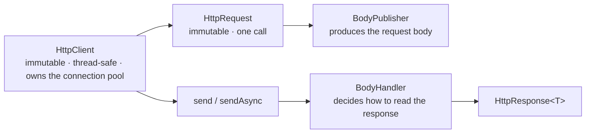
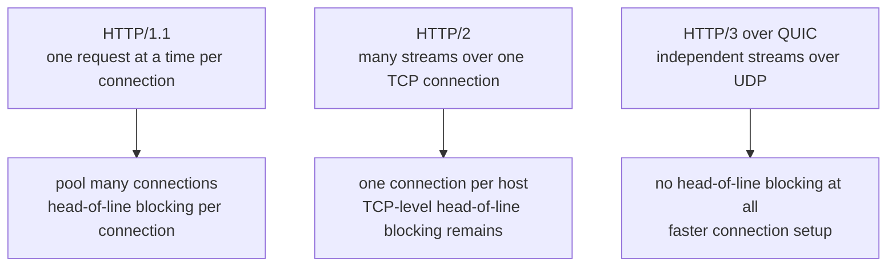
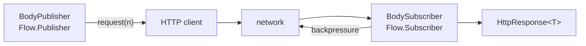
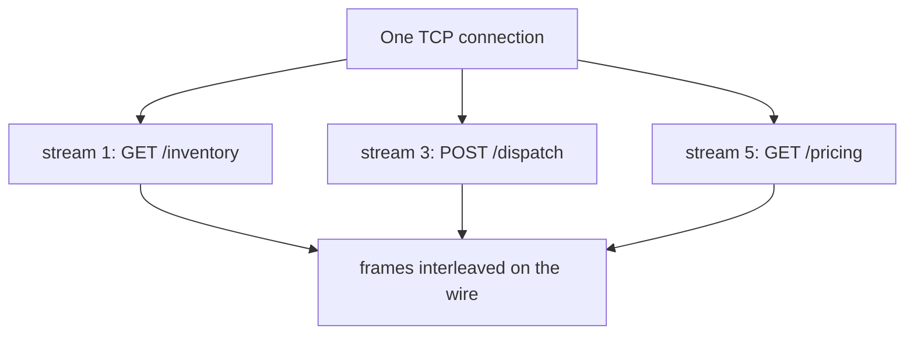
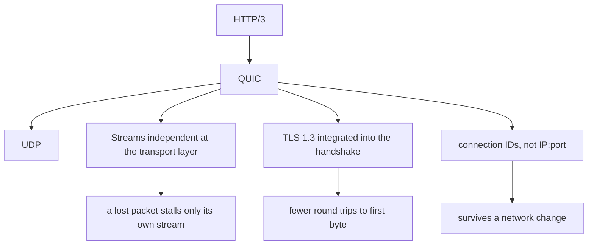

# The HTTP Client (HTTP/3)

<!-- video:start -->
<figure class="pb-video">
<video controls playsinline preload="metadata">
<source src="../../videos/ch40.mp4" type="video/mp4">
<track kind="subtitles" srclang="en" label="English" src="../../videos/ch40.vtt">
</video>
<figcaption>Video walkthrough · 5:26 · subtitles via CC · <a href="../../videos/ch40.mp4" download>Download MP4</a></figcaption>
</figure>
<!-- video:end -->

## 1. Purpose & Audience

**Band:** L3 Enterprise · **Prerequisites:** [Java 9–11](../02-language/11-java-9-to-11.md), [Virtual Threads](../04-concurrency/31-virtual-threads.md)

For twenty years, making an HTTP call from Java meant either `HttpURLConnection` — an API designed around 1997 assumptions — or adding a dependency. Java 11 standardised a real HTTP client, and by Java 26 it speaks HTTP/3.

Two things have changed the calculus since then. Virtual threads made the synchronous API the right default again, undoing a decade of asynchronous habit. And HTTP/2 multiplexing means connection pool sizing no longer works the way people assume.

This chapter answers three questions:

1. **How do you configure a client correctly**, including the timeouts people forget?
2. **Sync or async**, now that virtual threads exist?
3. **What do HTTP/2 and HTTP/3 change** about how your requests actually travel?

---

## 2. The Problem

`HttpURLConnection` in its natural habitat:

```java title="LegacyClient.java"
HttpURLConnection conn = (HttpURLConnection) new URL(url).openConnection();
conn.setRequestMethod("POST");
conn.setDoOutput(true);
conn.setConnectTimeout(5000);
conn.setReadTimeout(10000);
conn.setRequestProperty("Content-Type", "application/json");

try (OutputStream os = conn.getOutputStream()) {
    os.write(body.getBytes(UTF_8));
}

int status = conn.getResponseCode();
InputStream in = status >= 400 ? conn.getErrorStream() : conn.getInputStream();
String responseBody = new String(in.readAllBytes(), UTF_8);
conn.disconnect();
```

Mutable and not thread-safe. Errors arrive on a **different stream** from successes, so forgetting the ternary loses every error body. No HTTP/2, no async, no WebSocket. Timeouts exist but are easy to set only partially.

Most teams added OkHttp or Apache HttpClient instead — a reasonable choice that added a dependency, a transitive tree, and its own CVE feed for something the platform should have provided.

---

## 3. Mental Model

### 3.1 Three objects



| Object | Lifetime | Note |
|---|---|---|
| `HttpClient` | **Application** | Owns connections, the executor, SSL context. One per application |
| `HttpRequest` | Per call | Immutable; reusable if identical |
| `BodyPublisher` | Per call | Supplies the request body |
| `BodyHandler` | Per call | Chooses the response representation |
| `HttpResponse<T>` | Per call | Status, headers, and the body as `T` |

The asymmetry matters: **the client is expensive and shared; everything else is cheap and per-call.** Creating a client per request leaks connection pools and defeats HTTP/2 entirely.

### 3.2 What each protocol version changes



| | HTTP/1.1 | HTTP/2 | HTTP/3 |
|---|---|---|---|
| Transport | TCP | TCP | **QUIC over UDP** |
| Concurrency | One connection per in-flight request | Multiplexed streams | Multiplexed streams |
| Head-of-line blocking | Per connection | At the TCP layer | **None** |
| Header compression | None | HPACK | QPACK |
| Handshake | TCP + TLS | TCP + TLS | Combined, fewer round trips |
| Connection migration | No | No | Yes — survives a network change |

The consequence for pool sizing: under HTTP/1.1 you need many connections because each carries one request. Under HTTP/2 a **single connection** carries hundreds of concurrent streams, so the pool is nearly irrelevant and tuning it does nothing.

---

## 4. Core Reference

### 4.1 Client configuration

| Method | Purpose |
|---|---|
| `.version(Version.HTTP_2)` | Preferred version — negotiated, with fallback |
| `.connectTimeout(Duration)` | **Connection establishment only** |
| `.followRedirects(Redirect.NORMAL)` | Default is `NEVER` — see §5.2 |
| `.executor(Executor)` | For async callbacks and HTTP/2 bookkeeping |
| `.proxy(ProxySelector)` | Proxy |
| `.authenticator(Authenticator)` | Basic auth |
| `.sslContext(SSLContext)` | Custom trust or client certificates |
| `.cookieHandler(CookieHandler)` | Cookie store |

### 4.2 Request configuration

| Method | Purpose |
|---|---|
| `.uri(URI)` | Target |
| `.GET()` / `.POST(publisher)` / `.PUT(...)` / `.DELETE()` / `.method(name, publisher)` | Method |
| `.header(k, v)` / `.headers(k, v, k, v)` | Add |
| `.setHeader(k, v)` | Replace |
| `.timeout(Duration)` | **Whole exchange** — set this too |
| `.expectContinue(true)` | 100-continue for large bodies |

### 4.3 Bodies

| Publisher | Sends |
|---|---|
| `BodyPublishers.ofString(s)` | A string |
| `BodyPublishers.ofByteArray(b)` | Bytes |
| `BodyPublishers.ofFile(path)` | A file, streamed |
| `BodyPublishers.ofInputStream(supplier)` | A stream |
| `BodyPublishers.noBody()` | Nothing |

| Handler | Receives the body as |
|---|---|
| `BodyHandlers.ofString()` | `String` — **buffers it all** |
| `BodyHandlers.ofByteArray()` | `byte[]` — buffers it all |
| `BodyHandlers.ofInputStream()` | `InputStream` — streamed, **must be closed** |
| `BodyHandlers.ofLines()` | `Stream<String>` — streamed |
| `BodyHandlers.ofFile(path)` | Written to disk |
| `BodyHandlers.discarding()` | Discarded |
| `BodyHandlers.buffering(h, n)` | Wraps another handler |

### 4.4 Response

| Method | Returns |
|---|---|
| `statusCode()` | `int` — **no exception for 4xx or 5xx** |
| `body()` | `T` |
| `headers()` | `HttpHeaders` |
| `uri()` | Final URI after redirects |
| `version()` | The protocol actually negotiated |
| `previousResponse()` | The redirect chain, if any |

---

## 5. Worked Examples

### 5.1 A correctly configured client

```java title="VendorHttpClient.java"
public final class VendorHttpClient {

    private static final HttpClient CLIENT = HttpClient.newBuilder()
        .version(HttpClient.Version.HTTP_2)
        .connectTimeout(Duration.ofSeconds(5))
        .followRedirects(HttpClient.Redirect.NORMAL)
        .build();

    private final URI baseUri;

    public DispatchReceipt dispatch(Order order) throws IOException, InterruptedException {
        HttpRequest request = HttpRequest.newBuilder(baseUri.resolve("/v2/dispatch"))
            .header("Content-Type", "application/json")
            .header("Idempotency-Key", order.id().toString())
            .timeout(Duration.ofSeconds(10))                  // the whole exchange
            .POST(HttpRequest.BodyPublishers.ofString(toJson(order)))
            .build();

        HttpResponse<String> response = CLIENT.send(request, BodyHandlers.ofString());

        return switch (response.statusCode() / 100) {
            case 2 -> parse(response.body());
            case 4 -> throw new VendorRejectedException(response.statusCode(), response.body());
            default -> throw new VendorUnavailableException(response.statusCode());
        };
    }
}
```

Four things doing real work:

**`static final` client.** It owns the connection pool and the executor. Per-request creation leaks both and prevents HTTP/2 connection reuse.

**Both timeouts.** `connectTimeout` covers establishing the connection; `timeout` covers the whole exchange. Setting only the first leaves a hung read waiting indefinitely, which is the most common misconfiguration.

**`followRedirects` set explicitly.** The default is `NEVER`.

**Status code checked.** A 500 is a perfectly successful `send()` — see §5.2.

### 5.2 The two defaults that surprise people

```java title="Defaults.java"
// 1. No exception for error status codes
HttpResponse<String> response = CLIENT.send(request, BodyHandlers.ofString());
// A 500 returns normally, with the error body in response.body().
// Code that only catches IOException treats every failure as success.

// 2. Redirects are NOT followed by default
HttpClient client = HttpClient.newHttpClient();
// A 301 is returned as a 301 with an empty body, not followed.
```

Both are defensible — the client reports what the server said and does not guess — and both catch people migrating from libraries that behave differently. **Always set `followRedirects`, and always check `statusCode()`.**

### 5.3 Retry with backoff

There is no built-in retry:

```java title="Retry.java"
public DispatchReceipt dispatchWithRetry(Order order) throws InterruptedException {
    IOException last = null;
    for (int attempt = 1; attempt <= 3; attempt++) {
        try {
            HttpResponse<String> response = CLIENT.send(request(order), BodyHandlers.ofString());
            if (response.statusCode() < 500) {
                return handle(response);              // don't retry 4xx
            }
        } catch (IOException e) {
            last = e;                                  // connection failure — retryable
        }
        Thread.sleep(Duration.ofMillis(200L << (attempt - 1)));   // 200, 400, 800
    }
    throw new VendorUnavailableException(last);
}
```

Two rules the code encodes. **Only retry what is safe to retry** — a 4xx means the request was wrong, and retrying it just repeats the mistake. And **only retry idempotent operations**, which is why the request carries an `Idempotency-Key`: without one, a retried POST can create two orders.

For anything beyond this, a resilience library gives you circuit breaking and bulkheads as well.

### 5.4 Streaming a large response

```java title="Streaming.java"
// WRONG for a large body — buffers the whole thing in memory
HttpResponse<String> all = CLIENT.send(request, BodyHandlers.ofString());

// Streamed, line by line
HttpRequest request = HttpRequest.newBuilder(catalogueUri).GET().build();
HttpResponse<Stream<String>> response = CLIENT.send(request, BodyHandlers.ofLines());

try (Stream<String> lines = response.body()) {
    lines.map(Sku::parse).forEach(catalogue::index);
}

// Straight to disk
CLIENT.send(request, BodyHandlers.ofFile(Path.of("/var/cache/catalogue.json")));
```

`ofString` and `ofByteArray` materialise the entire body, which is fine for a JSON response and an OOM for a 2 GB export. `ofLines` and `ofInputStream` stream — and **both must be closed**, or the connection is not returned to the pool.

### 5.5 Sync or async — the answer changed

```java title="AsyncThenAndNow.java"
// Pre-Java-21 idiom: async to avoid blocking a platform thread
CompletableFuture<DispatchReceipt> future =
    CLIENT.sendAsync(request, BodyHandlers.ofString())
          .thenApply(HttpResponse::body)
          .thenApply(this::parse)
          .exceptionally(this::handleFailure);
```

```java title="ModernIdiom.java"
// Java 21+: blocking on a virtual thread costs almost nothing
try (var executor = Executors.newVirtualThreadPerTaskExecutor()) {
    List<Future<DispatchReceipt>> results = orders.stream()
        .map(order -> executor.submit(() -> dispatch(order)))    // plain blocking send
        .toList();
}
```

Or, on Java 24+, as a pipeline stage ([Chapter 38](38-stream-gatherers.md)):

```java title="WithGatherers.java"
List<DispatchReceipt> receipts = orders.stream()
    .gather(Gatherers.mapConcurrent(20, this::dispatch))     // bounded, ordered, virtual threads
    .toList();
```

The blocking version keeps stack traces, `try`/`catch`, and the debugger. `sendAsync` still earns its place where you genuinely need composition — fan-out with `allOf`, a timeout race with `anyOf` — but "avoid blocking" is no longer the reason to reach for it.

### 5.6 HTTP/2 and connection pooling

```java title="ProtocolCheck.java"
HttpResponse<String> response = CLIENT.send(request, BodyHandlers.ofString());
System.out.println(response.version());      // HTTP_2 or HTTP_1_1
```

Version selection is negotiated, not commanded. Over TLS it uses **ALPN**; over plaintext it attempts an upgrade. Requesting HTTP/2 against a server that does not support it silently yields HTTP/1.1 — checking `response.version()` is how you find out, and it is worth logging once at startup.

The pooling consequence:

| | HTTP/1.1 | HTTP/2 |
|---|---|---|
| Concurrent requests per connection | 1 | Hundreds of streams |
| Connections for 100 concurrent requests | ~100 | **1** |
| Pool tuning | Matters | Largely irrelevant |

So a team migrating from Apache HttpClient and looking for the max-connections-per-route setting will not find one, and does not need it. If throughput seems capped, check `response.version()` before tuning anything — the likely cause is a silent fallback to HTTP/1.1.

---

## 6. Internals

### 6.1 Bodies are reactive streams

`BodyPublisher` extends `Flow.Publisher<ByteBuffer>` and `BodySubscriber` extends `Flow.Subscriber<List<ByteBuffer>>` — the Java 9 Flow API.



Backpressure is built in: a slow consumer causes the client to stop requesting bytes from the network. That is why `ofLines()` can process a stream larger than the heap, and why a handler that never consumes its body stalls the connection rather than buffering indefinitely.

Custom handlers are possible — `BodyHandlers.fromSubscriber(...)` — and are the right tool for parsing directly off the wire into a domain object without materialising a string first.

### 6.2 HTTP/2 multiplexing



Requests become **streams**, each split into frames, interleaved on one connection. Application-level head-of-line blocking disappears: a slow response no longer delays the ones behind it.

**TCP-level head-of-line blocking remains**, though. A lost packet stalls the entire connection at the transport layer, because TCP delivers bytes in order — so all multiplexed streams wait for the retransmission. On a lossy network HTTP/2 can be *worse* than several HTTP/1.1 connections, which is precisely the problem QUIC was designed to solve.

Header compression via HPACK also helps: repeated headers — auth tokens, user agents, content types — are sent once and referenced by index afterwards.

### 6.3 HTTP/3 and QUIC



QUIC moves stream multiplexing **into the transport**, so each stream has independent delivery. A lost packet affects only the stream it belonged to. It also folds the TLS handshake into connection setup, cutting round trips, and identifies connections by an ID rather than an address tuple — so a client moving between networks keeps its connection.

The JDK client gains HTTP/3 in Java 26 (JEP 517). Practical caveats worth knowing before enabling it: it runs over UDP, which some corporate networks block or deprioritise, and it consumes more CPU than TCP because congestion control and loss recovery happen in user space rather than the kernel. The gains are largest on lossy or high-latency links and smallest inside a data centre.

### 6.4 What the client does not do

| Missing | Because |
|---|---|
| Retry | Retry policy is application-specific; a wrong default is dangerous |
| Circuit breaking | Same |
| Connection pool tuning knobs | HTTP/2 makes most of it unnecessary |
| Request or response logging | Use a wrapper, or `-Djdk.httpclient.HttpClient.log=requests,headers` |
| JSON | Bring a serializer |
| Metrics | Wrap `send` |

The client is deliberately a transport, not a framework. That is the right boundary — but it means a production wrapper usually adds retry, metrics, and structured logging, and that wrapper is the right place for them rather than scattered through call sites.

### 6.5 Diagnostics

```bash
-Djdk.httpclient.HttpClient.log=requests,headers,errors
```

Logs requests, headers, and errors through `System.Logger`. Add `frames` for HTTP/2 frame-level detail when debugging a protocol problem.

JFR also records `SocketRead` and `SocketWrite` events with addresses and durations ([Chapter 37](37-profiling-jfr.md)), which is usually the better tool in production — it answers "which call was slow and to where" without turning on request logging.

---

## 7. Production Patterns & Anti-Patterns

### Do this

- **One `HttpClient` per application**, in a `static final` field or a singleton bean.
- **Set both timeouts** — `connectTimeout` on the client, `timeout` on every request.
- **Set `followRedirects` explicitly.** The default is `NEVER`.
- **Check `statusCode()`.** No exception is thrown for 4xx or 5xx.
- **Stream large bodies** with `ofLines` or `ofInputStream`, and close them.
- **Prefer synchronous `send` on virtual threads**; use `sendAsync` only for genuine composition.
- **Send an idempotency key** on any request you might retry.
- **Log `response.version()` once at startup** to confirm which protocol you actually got.
- **Wrap the client** for retry, metrics, and logging rather than repeating them at call sites.

### Never do this

- **Never create an `HttpClient` per request.** It owns a connection pool and an executor.
- **Never assume `send()` throwing means success otherwise.** A 500 returns normally.
- **Never use `ofString()` for an unbounded response.** It buffers the whole body.
- **Never leave a streaming body unclosed.** The connection is not returned to the pool.
- **Never retry a non-idempotent request** without an idempotency key.
- **Never retry a 4xx.** The request was wrong; repeating it repeats the mistake.
- **Never tune connection pool size for HTTP/2.** One connection carries hundreds of streams.
- **Never assume you got HTTP/2** because you asked for it. Negotiation can silently fall back.

---

## 8. Version Evolution (Java 8 → 26)

| Version | What changed | Impact |
|---|---|---|
| **8** | `HttpURLConnection` only | Mutable, HTTP/1.1, no async |
| **9** | HTTP client incubator (`jdk.incubator.http`) | First preview of the API |
| **11** | **Standard (JEP 321)** — `java.net.http`; HTTP/2 and WebSocket | A real client in the platform |
| **12** | `BodyHandlers.buffering`, minor additions | |
| **16** | Better `HttpHeaders`, timeout handling | |
| **21** | Virtual threads | **Synchronous `send` becomes the right default again** |
| **24** | `mapConcurrent` groundwork; JFR socket events | Better fan-out and observability |
| **26** | **HTTP/3 over QUIC (JEP 517)** | No transport-level head-of-line blocking |

### Migration note

Moving from Apache HttpClient or OkHttp, three expectations need resetting:

1. **Redirects are not followed by default.** Both libraries follow them; this client does not.
2. **Error status codes do not throw.** Code that relied on an exception for 4xx and 5xx will silently treat failures as successes.
3. **There is no retry and no circuit breaker.** Those come from your wrapper or a resilience library.

And one expectation to drop: **connection pool tuning.** Under HTTP/2 a single connection carries hundreds of concurrent streams, so the settings you are looking for do not exist and are not needed. If throughput looks capped, check `response.version()` before anything else.

---

## 9. Interview Questions

### L1 — Foundations

**Q1. Why was `HttpClient` added to the JDK?** ⭐ *high frequency*
Because `HttpURLConnection` predates modern HTTP: it is mutable and not thread-safe, supports only HTTP/1.1, has no async or WebSocket support, and delivers error responses on a separate stream from successful ones. `HttpClient`, standard since Java 11, is immutable and thread-safe, negotiates HTTP/2 by default, and offers both synchronous and `CompletableFuture`-based calls.

**Q2. How many `HttpClient` instances should an application create?**
One. It owns the connection pool, the executor, and the SSL context, so creating one per request leaks all three and prevents connection reuse — which under HTTP/2 means giving up multiplexing entirely. Hold it in a `static final` field or a singleton bean.

**Q3. What happens when the server returns a 500?**
`send()` returns normally with `statusCode()` of 500 and the error body in `body()`. No exception is thrown for any 4xx or 5xx status — the client reports what the server said. Code that only catches `IOException` will treat every server error as a success.

### L2 — Professional

**Q4. Which timeouts do you need to set?** ⭐ *high frequency*
Two. `connectTimeout` on the client builder bounds establishing the connection, and `timeout` on each request bounds the whole exchange. Setting only the first is the common misconfiguration: the connection succeeds, the server never responds, and the call waits indefinitely.

**Q5. Are redirects followed by default?**
No — the default policy is `NEVER`, so a 301 is returned as a 301 with an empty body. This surprises people migrating from OkHttp or Apache HttpClient, which follow redirects by default. Set `followRedirects(Redirect.NORMAL)` explicitly, which follows redirects except from HTTPS to HTTP.

**Q6. When should you use `sendAsync` rather than `send`?**
Since Java 21, only when you genuinely need composition — fanning out with `allOf`, racing with `anyOf`, or chaining dependent calls. Before virtual threads, `sendAsync` was how you avoided blocking a scarce platform thread; now blocking on a virtual thread costs almost nothing, and the synchronous version keeps stack traces, `try`/`catch`, and the debugger.

### L3 — Enterprise

**Q7. What does HTTP/2 change about connection pooling?**
Under HTTP/1.1 each connection carries one request at a time, so a hundred concurrent requests need roughly a hundred connections and pool sizing matters. HTTP/2 multiplexes hundreds of streams over a single TCP connection, so the pool becomes nearly irrelevant and there are no knobs to tune. If throughput appears capped, the likely cause is a silent fallback to HTTP/1.1 — check `response.version()` before tuning anything.

**Q8. What problem does HTTP/3 solve that HTTP/2 does not?**
Transport-level head-of-line blocking. HTTP/2 multiplexes streams over TCP, which delivers bytes in order, so a single lost packet stalls every stream on that connection until it is retransmitted. QUIC moves multiplexing into the transport over UDP, giving each stream independent delivery, so a lost packet affects only its own stream. It also folds the TLS handshake into connection setup and identifies connections by ID rather than address, so they survive a network change.

**Q9. How do you handle a large response body?**
With a streaming handler — `ofLines()` for text or `ofInputStream()` for bytes — rather than `ofString()`, which materialises the entire body in memory. Both must be closed, or the connection is not returned to the pool. Backpressure is built in, because the body handlers are Flow subscribers, so a slow consumer causes the client to stop requesting from the network rather than buffering.

### L4 — Architect

**Q10. The JDK client has no retry or circuit breaking. Is that a gap?**
It is a deliberate boundary. Retry policy is application-specific and a wrong default is dangerous — retrying a non-idempotent POST can duplicate an order, and retrying a 4xx just repeats a mistake. What it means in practice is that a production codebase needs a thin wrapper around the client carrying retry, metrics, and structured logging, and that wrapper is the right place for them rather than scattered through call sites. For anything needing circuit breaking or bulkheads, a resilience library on top is the answer.

**Q11. How has the rise of virtual threads changed HTTP client design?**
It removed the main reason for asynchronous APIs. A decade of Java networking was shaped by the fact that a blocking call occupied a platform thread costing a megabyte of stack, so scaling meant callbacks or reactive chains and giving up stack traces and debuggability. With virtual threads, blocking is cheap, so the synchronous `send` on a virtual thread scales to the same concurrency while keeping ordinary control flow. `sendAsync` remains useful for genuine composition, but as a choice rather than an obligation — and `mapConcurrent` in Java 24 makes bounded fan-out a single pipeline stage.

**Q12. Would you adopt HTTP/3 for service-to-service calls?**
Probably not first. Its gains are largest on lossy, high-latency, or mobile links where transport-level head-of-line blocking and connection migration matter, and smallest inside a data centre where packet loss is low and HTTP/2 already multiplexes well. It also runs over UDP, which some corporate and cloud networks block or deprioritise, and costs more CPU because congestion control runs in user space. The sensible order is client-facing edges first, where the network is hostile, and internal calls later if measurement justifies it.

---

!!! abstract "Cheat Sheet"
    **One `HttpClient` per application** — it owns the pool, executor, and SSL context

    **Two timeouts:** `connectTimeout` (client) + `timeout` (request) — setting only one leaves a hung read

    **`followRedirects` defaults to `NEVER`** — set it explicitly

    **4xx and 5xx do not throw** — check `statusCode()`

    **Streaming:** `ofLines` / `ofInputStream` — **must be closed** or the connection leaks

    **`ofString` buffers the whole body** — never for an unbounded response

    **Sync `send` on virtual threads** is the modern default; `sendAsync` for composition only

    **`mapConcurrent(n, this::call)`** for bounded fan-out (Java 24+)

    **HTTP/2:** one connection, hundreds of streams — **pool tuning is irrelevant**

    **Check `response.version()`** — negotiation falls back to HTTP/1.1 silently

    **HTTP/3 (Java 26)** over QUIC — no transport head-of-line blocking, survives network changes

    **No retry, no circuit breaker** — wrap the client; send an idempotency key
