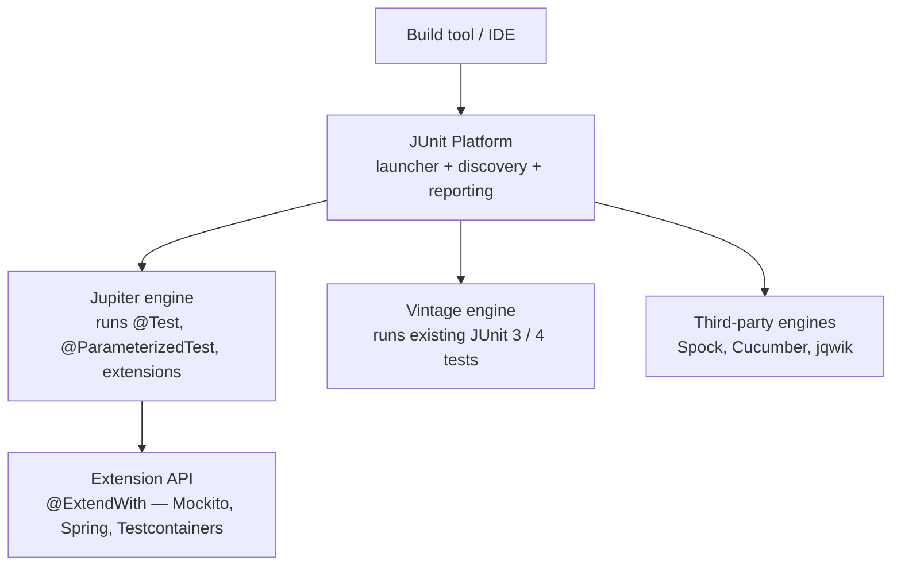
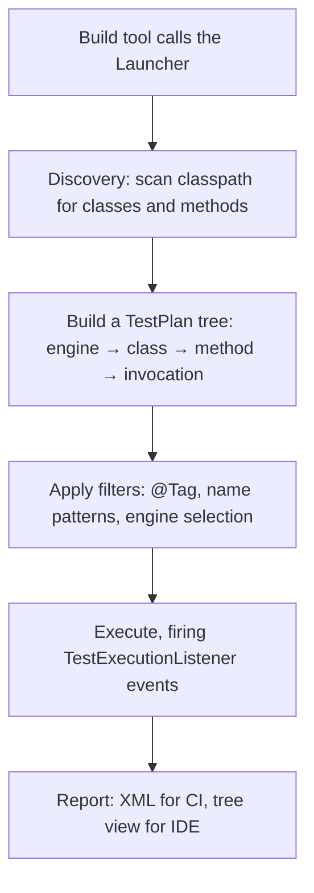

# JUnit 5

## 1. Purpose & Audience

**Band:** L1 Foundations · **Prerequisites:** none beyond core Java

JUnit 5 is not JUnit 4 with new annotation names. It is a different architecture with a different extension model, and teams that migrate by find-and-replacing `@Before` with `@BeforeEach` end up with JUnit 4 habits running on a JUnit 5 engine — missing parameterized tests, nested contexts, and the extension API that makes the rest of the stack work.

This chapter answers three questions:

1. **What are the pieces** — Platform, Jupiter, Vintage — and why does the split matter?
2. **How do you write a test that fails usefully** rather than just failing?
3. **When do you reach for parameterized, nested, or dynamic tests** instead of writing the same test five times?

Mocking is [Chapter 42](42-mockito.md). Tests against real databases and services are [Chapter 43](43-integration-testing.md).

---

## 2. The Problem

The cart total calculator applies pricing rules, bulk discounts, and delivery charges. It is pure logic with no dependencies — exactly the code that should be trivially testable:

```java title="CartTotalCalculator.java"
public final class CartTotalCalculator {

    public Money total(Cart cart, List<PricingRule> rules) {
        if (cart.lines().isEmpty()) {
            throw new IllegalArgumentException("Cart is empty");
        }
        Money subtotal = cart.lines().stream()
            .map(CartLine::lineTotal)
            .reduce(Money.ZERO, Money::plus);

        return rules.stream()
            .reduce(subtotal, (running, rule) -> rule.apply(running), Money::plus);
    }
}
```

Verifying it by hand means a `main` method, printed output, and a human comparing numbers. That does not run in CI, does not fail a build, and does not tell you which of eleven rules broke when someone edits rule six.

A test framework gives you three things that `main` cannot: a **standard way to declare** what should be checked, **isolation** so one failure does not hide the next, and a **machine-readable result** a build can act on.

---

## 3. Mental Model

JUnit 5 is three components that are versioned and released together but do different jobs.



| Component | Role | Artifact |
|---|---|---|
| **Platform** | Discovers and launches tests; the API build tools talk to | `junit-platform-launcher` |
| **Jupiter** | The programming model you write against | `junit-jupiter` (aggregator) |
| **Vintage** | Runs JUnit 4 tests on the Platform | `junit-vintage-engine` |

The practical consequence: **you can migrate gradually.** Add Vintage and your existing JUnit 4 suite keeps running while new tests use Jupiter. There is no big-bang cutover.

### 3.1 The extension model

JUnit 4 had `@RunWith` — and you got exactly one runner, so Mockito's runner and Spring's runner could not coexist. JUnit 5 replaced it with composable `@ExtendWith`:

```java
@ExtendWith(MockitoExtension.class)
@ExtendWith(SomeOtherExtension.class)
class OrderServiceTest { }
```

This single change is why Mockito, Spring, and Testcontainers integrate cleanly in the same test class.

---

## 4. Core API & Syntax

### 4.1 Dependencies

Use the BOM and let it manage versions — pinning each artifact separately is how you end up with a Jupiter API that does not match its engine.

=== "Maven"
    ```xml title="pom.xml"
    <dependencyManagement>
      <dependencies>
        <dependency>
          <groupId>org.junit</groupId>
          <artifactId>junit-bom</artifactId>
          <version><!-- current 5.x --></version>
          <type>pom</type>
          <scope>import</scope>
        </dependency>
      </dependencies>
    </dependencyManagement>

    <dependencies>
      <dependency>
        <groupId>org.junit.jupiter</groupId>
        <artifactId>junit-jupiter</artifactId>
        <scope>test</scope>
      </dependency>
    </dependencies>
    ```

=== "Gradle"
    ```groovy title="build.gradle"
    dependencies {
        testImplementation platform('org.junit:junit-bom:<current 5.x>')
        testImplementation 'org.junit.jupiter:junit-jupiter'
    }

    test {
        useJUnitPlatform()
    }
    ```

!!! note "Frameworks may manage this for you"
    Most application frameworks ship a test starter that brings Jupiter, AssertJ, and Mockito with compatible versions already resolved. Where one exists, declare it and specify no test versions at all.

### 4.2 Lifecycle

| Annotation | Runs | Notes |
|---|---|---|
| `@Test` | One test method | No `public` required in Jupiter |
| `@BeforeEach` | Before every test | Fresh state per test |
| `@AfterEach` | After every test | Cleanup |
| `@BeforeAll` | Once per class | Must be `static` unless `@TestInstance(PER_CLASS)` |
| `@AfterAll` | Once per class | Same rule |
| `@TestInstance(PER_CLASS)` | Changes instance lifecycle | Allows non-static `@BeforeAll`; shares state — use deliberately |

**By default JUnit creates a new instance of the test class for every test method.** That isolation is the point: a field mutated by one test cannot leak into the next.

### 4.3 Assertions

| Assertion | Use |
|---|---|
| `assertEquals(expected, actual)` | Value equality — **expected first** |
| `assertSame` / `assertNotSame` | Reference identity |
| `assertTrue` / `assertFalse` | Boolean conditions |
| `assertNull` / `assertNotNull` | Null checks |
| `assertThrows(Class, Executable)` | Returns the exception for further assertions |
| `assertDoesNotThrow(Executable)` | Explicit no-throw |
| `assertAll(Executable...)` | Runs all, reports **every** failure |
| `assertTimeout(Duration, Executable)` | Fails if slow; lets it finish |
| `assertTimeoutPreemptively(...)` | Aborts on timeout — **runs on another thread** |
| `assertIterableEquals` / `assertArrayEquals` | Element-wise |

Every assertion takes an optional last argument for a failure message. Prefer the `Supplier<String>` form so the message is built only on failure:

```java
assertEquals(expected, actual, () -> "Total mismatch for cart " + cart.id());
```

### 4.4 Parameterized tests

| Source | Supplies |
|---|---|
| `@ValueSource` | Literals of one type |
| `@CsvSource` | Inline rows, multiple columns |
| `@CsvFileSource` | Rows from a classpath CSV |
| `@MethodSource` | A static method returning `Stream<Arguments>` |
| `@EnumSource` | Enum constants, with include/exclude filters |
| `@NullSource` / `@EmptySource` / `@NullAndEmptySource` | Edge cases |
| `@ArgumentsSource` | Custom provider |

### 4.5 Structure and control

| Annotation | Purpose |
|---|---|
| `@DisplayName` | Human-readable name in reports |
| `@Nested` | Inner class grouping a context |
| `@Tag("slow")` | Filter at build time |
| `@Disabled("reason")` | Skip — always give a reason |
| `@RepeatedTest(10)` | Run repeatedly |
| `@Timeout(5)` | Fail if it exceeds the limit |
| `@TempDir` | Injected temporary directory, auto-deleted |
| `@TestFactory` | Dynamic tests generated at runtime |
| `@EnabledOnOs` / `@EnabledOnJre` / `@EnabledIfEnvironmentVariable` | Conditional execution |

---

## 5. Worked Examples

### 5.1 A test that fails usefully

```java title="CartTotalCalculatorTest.java"
@DisplayName("CartTotalCalculator")
class CartTotalCalculatorTest {

    private CartTotalCalculator calculator;

    @BeforeEach
    void setUp() {
        calculator = new CartTotalCalculator();
    }

    @Test
    @DisplayName("sums line totals when no rules apply")
    void total_noRules_returnsSubtotal() {
        // Arrange
        Cart cart = cartWith(
            line("MILK-1L", 2, Money.rupees(60)),
            line("ATTA-10KG", 1, Money.rupees(450)));

        // Act
        Money total = calculator.total(cart, List.of());

        // Assert
        assertEquals(Money.rupees(570), total);
    }

    @Test
    @DisplayName("rejects an empty cart")
    void total_emptyCart_throws() {
        Cart empty = cartWith();

        IllegalArgumentException ex = assertThrows(
            IllegalArgumentException.class,
            () -> calculator.total(empty, List.of()));

        assertEquals("Cart is empty", ex.getMessage());
    }
}
```

Two conventions doing real work here.

**`methodName_scenario_expectedResult`.** When CI reports `total_emptyCart_throws` failed, you know what broke before opening anything.

**`assertThrows` returns the exception.** Asserting only that *something* threw is weak — a `NullPointerException` from a typo would pass. Checking the message confirms you triggered the path you meant to.

### 5.2 `assertAll` — report every failure at once

```java title="OrderTest.java"
@Test
void confirmedOrder_hasAllFieldsPopulated() {
    Order order = orderService.confirm(cart, customer);

    assertAll("confirmed order",
        () -> assertNotNull(order.id()),
        () -> assertEquals(OrderStatus.CONFIRMED, order.status()),
        () -> assertEquals(customer.id(), order.customerId()),
        () -> assertEquals(3, order.lines().size()));
}
```

Without `assertAll`, the first failing assertion stops the method and hides the other three. With it, one run tells you that both `status` and `lines` are wrong — which is usually a different diagnosis from either alone.

### 5.3 Parameterized: one test, many cases

```java title="BulkDiscountRuleTest.java"
@ParameterizedTest(name = "{0} units → {1}% discount")
@CsvSource({
    "1,   0",
    "9,   0",
    "10,  5",
    "49,  5",
    "50,  10",
    "500, 10"
})
void discountPercent_byQuantity(int quantity, int expectedPercent) {
    assertEquals(expectedPercent, BulkDiscountRule.percentFor(quantity));
}
```

```text title="Output"
✓ 1 units → 0% discount
✓ 9 units → 0% discount
✓ 10 units → 5% discount
✗ 49 units → 5% discount    ← boundary bug, isolated immediately
```

Each row is an independent test with its own result. The boundary values — 9/10 and 49/50 — are the entire point; a single test with a loop would report one failure and leave you to find which iteration.

`@MethodSource` when the arguments are objects rather than literals:

```java title="PricingRuleTest.java"
static Stream<Arguments> pricingScenarios() {
    return Stream.of(
        Arguments.of(Money.rupees(500),  new FlatDiscount(50),      Money.rupees(450)),
        Arguments.of(Money.rupees(500),  new PercentDiscount(10),   Money.rupees(450)),
        Arguments.of(Money.rupees(0),    new PercentDiscount(10),   Money.ZERO));
}

@ParameterizedTest
@MethodSource("pricingScenarios")
void apply_variousRules(Money subtotal, PricingRule rule, Money expected) {
    assertEquals(expected, rule.apply(subtotal));
}
```

### 5.4 `@Nested` for context

```java title="StockReservationTest.java"
@DisplayName("StockReservation")
class StockReservationTest {

    private InventoryItem item;

    @BeforeEach
    void setUp() {
        item = new InventoryItem(new Sku("MILK-1L"), 10);
    }

    @Nested
    @DisplayName("when stock is available")
    class WhenStockAvailable {

        @Test
        @DisplayName("reserves the requested quantity")
        void reservesRequested() {
            assertTrue(item.reserve(4).succeeded());
            assertEquals(6, item.available());
        }
    }

    @Nested
    @DisplayName("when stock is insufficient")
    class WhenStockInsufficient {

        @BeforeEach
        void drainStock() {
            item.reserve(10);          // outer @BeforeEach runs first
        }

        @Test
        @DisplayName("refuses the reservation")
        void refuses() {
            assertFalse(item.reserve(1).succeeded());
        }

        @Test
        @DisplayName("leaves available quantity unchanged")
        void leavesQuantityUnchanged() {
            item.reserve(1);
            assertEquals(0, item.available());
        }
    }
}
```

Lifecycle methods nest outward-in: the outer `@BeforeEach` runs, then the inner one. The report reads as a specification:

```text
StockReservation
  when stock is available
    ✓ reserves the requested quantity
  when stock is insufficient
    ✓ refuses the reservation
    ✓ leaves available quantity unchanged
```

### 5.5 Assumptions versus disabling

```java title="AssumptionExample.java"
@Test
void usesVendorSandbox() {
    assumeTrue(System.getenv("VENDOR_SANDBOX_URL") != null,
        "vendor sandbox not configured");

    // only runs when the environment supports it
}
```

`@Disabled` means *this test is broken or irrelevant*. An assumption means *this test is fine but its preconditions are absent here*. An aborted test reports as skipped rather than passed, so it does not quietly inflate your green count.

### 5.6 Dynamic tests

When cases are not known until runtime — driven by files, a catalogue, or a database:

```java title="PricingRuleFileTest.java"
@TestFactory
Stream<DynamicTest> everyRuleFileParses() throws IOException {
    return Files.list(Path.of("src/test/resources/pricing-rules"))
        .map(path -> DynamicTest.dynamicTest(
            path.getFileName().toString(),
            () -> assertDoesNotThrow(() -> PricingRuleParser.parse(path))));
}
```

Use `@TestFactory` only when `@ParameterizedTest` cannot express the cases. Dynamic tests skip the normal lifecycle callbacks, which surprises people.

---

## 6. Internals

### 6.1 Discovery and execution



The `TestPlan` is a tree, which is what makes `@Nested` classes and parameterized invocations first-class nodes rather than a naming convention. Your IDE's test tree is that structure rendered directly.

### 6.2 Why a new instance per test

The default `PER_METHOD` lifecycle constructs the test class afresh for every method. This makes cross-test contamination structurally impossible: a field mutated in `testA` cannot be observed by `testB`.

`@TestInstance(PER_CLASS)` keeps one instance for the whole class, which permits non-static `@BeforeAll` and shared expensive setup — but reintroduces the contamination it was designed to prevent. Use it for a genuinely expensive fixture, and only when the tests do not mutate it.

### 6.3 Extensions replace runners and rules

| JUnit 4 | JUnit 5 | Why it is better |
|---|---|---|
| `@RunWith(X.class)` | `@ExtendWith(X.class)` | Composable — you get as many as you want |
| `@Rule` / `@ClassRule` | Extension callbacks | One model instead of three |
| Custom runner | `ParameterResolver`, `TestInstancePostProcessor`, … | Fine-grained hooks |

Extensions implement callback interfaces — `BeforeEachCallback`, `ParameterResolver`, `TestExecutionExceptionHandler` — and the engine invokes them at the corresponding phase. `MockitoExtension` uses `TestInstancePostProcessor` to inject `@Mock` fields; Spring's `SpringExtension` uses `ParameterResolver` to inject beans into test method parameters.

### 6.4 `assertTimeout` versus `assertTimeoutPreemptively`

```java
assertTimeout(Duration.ofSeconds(1), () -> dispatch(order));              // waits, then reports
assertTimeoutPreemptively(Duration.ofSeconds(1), () -> dispatch(order));  // aborts at 1s
```

`assertTimeoutPreemptively` runs the code **on a different thread**, which has two consequences people hit painfully:

- `ThreadLocal` state — Spring's transaction context, security context, MDC — is not visible to it.
- A transaction started in the test does not apply, so a `@Transactional` test body behaves differently.

Prefer plain `assertTimeout` unless you specifically need to abort a hang.

### 6.5 Parallel execution

Off by default. Enable it in `src/test/resources/junit-platform.properties`:

```properties title="junit-platform.properties"
junit.jupiter.execution.parallel.enabled = true
junit.jupiter.execution.parallel.mode.default = same_thread
junit.jupiter.execution.parallel.mode.classes.default = concurrent
```

This runs classes in parallel while keeping methods within a class sequential — the conservative setting that catches most of the wall-clock win without exposing every shared fixture at once. Opt individual classes in with `@Execution(CONCURRENT)`.

Parallel execution surfaces every hidden dependency in a suite: static state, shared temp files, fixed ports, database rows assumed unique. Turning it on is a good audit and a bad thing to do the day before a release.

---

## 7. Production Patterns & Anti-Patterns

### Do this

- **Name tests `method_scenario_expectedResult`.** The CI failure line should be the diagnosis.
- **Follow Arrange–Act–Assert** with a blank line between phases. If the Arrange block is huge, the design is telling you something.
- **One logical assertion per test** — one behaviour, verified. Use `assertAll` when a single behaviour has several observable parts.
- **Test boundaries with `@ParameterizedTest`.** Off-by-one bugs live at 9/10 and 49/50.
- **Use `@Nested` to group by precondition**, so the report reads as a specification.
- **Assert on exception messages**, not just exception types.
- **Tag slow tests** and exclude them from the fast build loop.
- **Use AssertJ** alongside Jupiter for fluent, readable assertions on collections and objects — `assertThat(order.lines()).hasSize(3).extracting(OrderLine::sku).contains(milk)`.

### Never do this

- **Never depend on test execution order.** Tests must pass in any order and in isolation. `@TestMethodOrder` exists for reporting, not for chaining state.
- **Never share mutable state between tests** via static fields or `@TestInstance(PER_CLASS)` unless the fixture is immutable.
- **Never write `assertTrue(result.equals(expected))`.** On failure it prints `expected true, was false`. `assertEquals` prints both values.
- **Never use `@Disabled` without a reason string.** A disabled test with no explanation is deleted code with extra steps.
- **Never assert on wall-clock timing** in a unit test. CI machines are loaded and variable; use `@Timeout` for hang detection only.
- **Never put logic in a test.** Loops and conditionals mean the test needs testing. Parameterize instead.
- **Never let a test depend on the system clock or timezone.** Inject a `Clock`.
- **Never catch an exception to assert on it.** `assertThrows` passes when nothing is thrown only if you check — a bare try/catch with a `fail()` you forgot to add passes silently.

---

## 8. Version Evolution (Java 8 → 26)

| Version | What changed | Impact |
|---|---|---|
| **JUnit 5.0 (2017)** | Platform/Jupiter/Vintage split; `@ExtendWith`; `@Nested`; `@ParameterizedTest` | Composable extensions replace the single-runner limit |
| **5.4** | `junit-jupiter` aggregator artifact; `@TempDir` | One dependency instead of three |
| **5.5** | `assertThrows` message improvements; `@Timeout` | Better failure output |
| **5.7** | `@EnabledIf` conditions; parallel execution stabilised | Environment-aware suites |
| **5.8+** | `@ParameterizedTest` argument conversion and naming improvements | Clearer parameterized reports |
| **Java 8** | Lambdas make `Executable` and `assertAll` possible | The whole assertion style depends on it |
| **Java 16** | Records | Test fixtures become one-liners |
| **Java 21** | Virtual threads | Parallel test execution scales further |

### Migration note

Migrating from JUnit 4, the mapping is mostly mechanical — `@Before` → `@BeforeEach`, `@BeforeClass` → `@BeforeAll`, `@Ignore` → `@Disabled`, `@RunWith` → `@ExtendWith`. Two are not:

- **`@Test(expected = X.class)` has no equivalent.** Rewrite as `assertThrows`, which is better anyway because it scopes the expectation to one statement rather than the whole method.
- **`@Rule` has no direct equivalent.** Most common rules have an extension already (`TemporaryFolder` → `@TempDir`); custom rules need rewriting against the extension API.

Add `junit-vintage-engine` so the old suite keeps running, then migrate class by class. There is no reason for a big-bang cutover.

---

## 9. Interview Questions

### L1 — Foundations

**Q1. What is the difference between `@BeforeEach` and `@BeforeAll`?** ⭐ *high frequency*
`@BeforeEach` runs before every test method, giving each test a fresh fixture. `@BeforeAll` runs once for the whole class and must be static by default, because JUnit creates a new instance of the test class per test method. Use `@BeforeAll` only for genuinely expensive shared setup that tests do not mutate.

**Q2. How do you test that a method throws an exception?**
Use `assertThrows`, passing the expected type and a lambda that invokes the code. It returns the thrown exception, so you can then assert on its message or fields. Asserting only the type is weak — an unrelated `NullPointerException` would satisfy it.

**Q3. What does `assertAll` do?**
It runs a group of assertions and reports every failure rather than stopping at the first. Without it, a failing first assertion hides the state of the rest, so you fix one thing, rerun, and discover the next. It is the right tool when one behaviour has several observable parts.

### L2 — Professional

**Q4. When would you use `@ParameterizedTest` over separate test methods?** ⭐ *high frequency*
When the same logic is verified against different inputs — especially boundary values, where the bugs are. Each argument set becomes an independent test with its own pass or fail, so a failure identifies the exact input. Separate methods are still better when the *scenarios* differ rather than just the data, because then the names carry meaning.

**Q5. What is the difference between `@Disabled` and an assumption?**
`@Disabled` means the test should not run at all — broken, obsolete, or pending. An assumption means the test is valid but its preconditions are not met in this environment, so it aborts rather than fails. Both report as skipped, but the intent differs, and assumptions let one suite adapt to CI, local, and sandboxed environments without duplication.

**Q6. Why does JUnit create a new test class instance for each test?**
To guarantee isolation: a field mutated by one test cannot be observed by another, so tests cannot develop hidden ordering dependencies. `@TestInstance(PER_CLASS)` opts out, allowing non-static `@BeforeAll` and shared state, but it reintroduces exactly the contamination the default prevents.

### L3 — Enterprise

**Q7. How does the JUnit 5 extension model differ from JUnit 4 runners, and why does it matter?**
JUnit 4 allowed one `@RunWith` per class, so Mockito's runner and Spring's runner were mutually exclusive and teams worked around it with rules and custom composite runners. JUnit 5 replaced it with `@ExtendWith`, which is composable and hooks into fine-grained callbacks — parameter resolution, instance post-processing, exception handling. That single change is why Spring, Mockito, and Testcontainers coexist in one test class today.

**Q8. What is the risk of `assertTimeoutPreemptively`?**
It executes the code on a separate thread so it can abort a hang, which means `ThreadLocal`-based context does not carry over — Spring's transaction and security contexts, and logging MDC, are all absent. A `@Transactional` test body will not participate in the test's transaction. Use the non-preemptive `assertTimeout` unless aborting is genuinely required.

**Q9. You enable parallel test execution and tests start failing intermittently. What is happening?**
Parallelism exposes shared state that sequential execution hid: static fields, singletons, fixed ports, temp files with fixed names, or database rows the tests assumed they owned. The failures are real bugs in the suite, not in the framework. Start with classes-parallel and methods-sequential, fix what surfaces, and only then consider going further.

### L4 — Architect

**Q10. How would you structure a test suite so the fast feedback loop stays under a minute?**
Separate by cost, not by layer. Tag tests — unit, integration, end-to-end — and run only the unit tier on every save and every push, with the slower tiers on merge or nightly. Keep unit tests free of framework context, databases, and network, since container and context startup dominate their runtime. Enforce the boundary in the build so an integration test cannot accidentally land in the fast tier and quietly add thirty seconds.

**Q11. A team's suite is green but production bugs keep shipping. How do you diagnose the suite itself?**
Look for tests that cannot fail: assertions on mocks rather than behaviour, tests that assert the implementation they just called, and coverage that exercises lines without checking outcomes. Mutation testing — PIT — is the direct measurement: it changes the production code and reports which mutants the suite fails to catch. High line coverage with low mutation score is the signature of a suite that executes code without verifying it.

**Q12. When is `@TestFactory` the right choice over `@ParameterizedTest`?**
When the set of cases is not known until runtime — generated from files on disk, rows in a reference dataset, or a remote contract — and cannot be expressed as a static argument source. It is more powerful and correspondingly more expensive: dynamic tests skip the normal lifecycle callbacks, so `@BeforeEach` does not run per dynamic test, and the fixture has to be built inside the factory. If `@MethodSource` can express it, use `@MethodSource`.

---

!!! abstract "Cheat Sheet"
    **Three parts:** Platform (launcher) · Jupiter (the model you write) · Vintage (runs JUnit 4)

    **Lifecycle:** `@BeforeAll` (static) → `@BeforeEach` → `@Test` → `@AfterEach` → `@AfterAll`

    **New instance per test method** — `@TestInstance(PER_CLASS)` opts out, reintroducing shared state

    **`assertThrows` returns the exception** — assert on the message too

    **`assertAll`** reports every failure, not just the first

    **Parameterized sources:** `@ValueSource` `@CsvSource` `@MethodSource` `@EnumSource` `@NullAndEmptySource`

    **`@Nested`** groups by precondition; lifecycle nests outward-in

    **Assumption = skip (environment)** · `@Disabled` = skip (broken) — always give a reason

    **`assertTimeoutPreemptively` runs on another thread** — no `ThreadLocal`, no transaction

    **Parallel execution is off by default** — enable in `junit-platform.properties`

    **Migration:** add `junit-vintage-engine`, migrate class by class; `@Test(expected=)` → `assertThrows`
