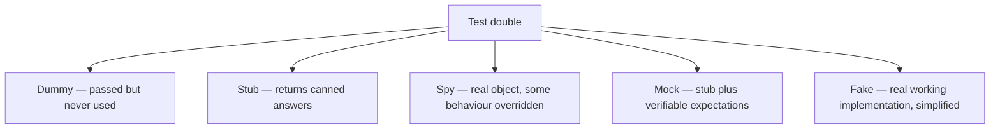
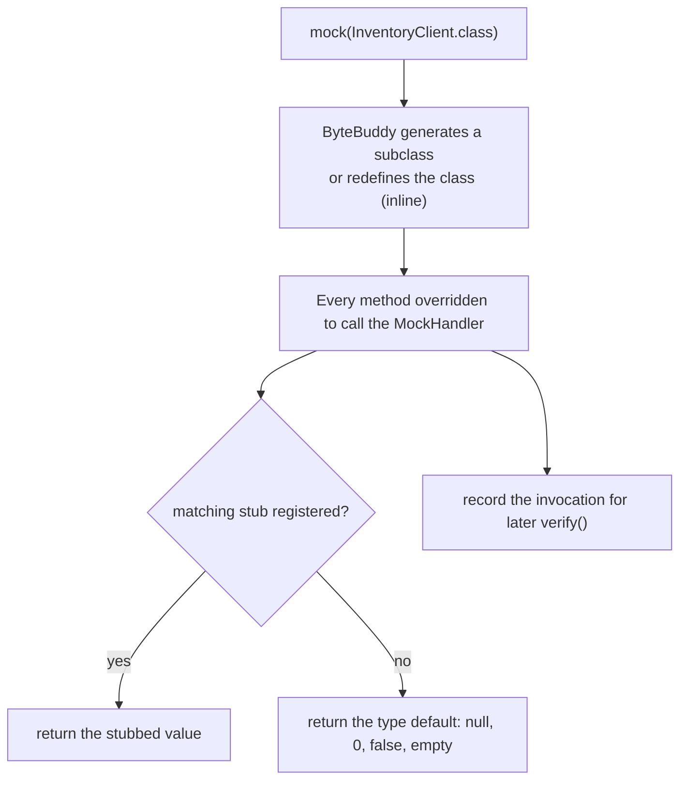

# Mockito & Test Doubles

## 1. Purpose & Audience

**Band:** L2 Professional · **Prerequisites:** [JUnit 5](41-junit5.md)

Mockito is easy to start with and easy to overuse. A suite that mocks everything reaches high coverage while verifying almost nothing — every test asserts that the code called the methods the test told it to call, which is a tautology, not a test.

This chapter answers three questions:

1. **What are the kinds of test double**, and which does Mockito actually give you?
2. **What should you mock**, and — more importantly — what should you never mock?
3. **How do you verify behaviour** without pinning the test to the implementation?

Tests against real databases and services are [Chapter 43](43-integration-testing.md).

---

## 2. The Problem

`OrderService` confirms an order: it reserves stock, charges the customer, persists the order, and emails a confirmation.

```java title="OrderService.java"
public final class OrderService {

    private final InventoryClient inventory;
    private final PaymentGateway payments;
    private final OrderRepository repository;
    private final EmailSender emailSender;

    // constructor omitted

    public Order confirm(Cart cart, Customer customer) {
        if (!inventory.reserveAll(cart.lines())) {
            throw new OutOfStockException(cart.id());
        }
        PaymentResult result = payments.charge(customer.id(), cart.total());
        if (!result.successful()) {
            inventory.releaseAll(cart.lines());
            throw new PaymentFailedException(result.reason());
        }
        Order order = repository.save(Order.from(cart, customer, result.reference()));
        emailSender.send(customer.email(), "Order confirmed", order.summary());
        return order;
    }
}
```

Testing this for real means a warehouse API, a payment gateway, a database, and an SMTP server. That is slow, flaky, and — for the payment charge — actually expensive.

A test double stands in for a collaborator so you can test *this* class's logic: does it release stock when payment fails? Does it refuse to charge when stock is unavailable?

---

## 3. Mental Model

### 3.1 The five kinds of double



| Kind | Behaviour | Example |
|---|---|---|
| **Dummy** | Never actually called; fills a parameter | `null`, or a bare `mock()` |
| **Stub** | Returns preprogrammed values | `when(inventory.reserveAll(any())).thenReturn(true)` |
| **Spy** | Real object with selected methods overridden | `spy(new PricingRuleEngine())` |
| **Mock** | A stub you also assert against | `verify(emailSender).send(any(), any(), any())` |
| **Fake** | A working simplified implementation | `InMemoryOrderRepository` |

Mockito's `mock()` produces something that serves as dummy, stub, and mock depending on how you use it. **Fakes it does not provide** — you write those yourself, and for repositories they are frequently the better choice.

### 3.2 State verification versus behaviour verification

| | Ask | Tool |
|---|---|---|
| **State** | What is the result? | `assertEquals` on the return value |
| **Behaviour** | What did it do? | `verify(collaborator).method(...)` |

Prefer state verification. It survives refactoring; behaviour verification pins the test to *how* the code works, so a harmless restructuring breaks tests that should not care.

Behaviour verification earns its place when the effect is invisible from the return value — an email sent, stock released, an event published. That is exactly the case in `OrderService`, which is why it is a good example rather than a cautionary one.

---

## 4. Core API & Syntax

### 4.1 Setup

```xml title="pom.xml"
<dependency>
  <groupId>org.mockito</groupId>
  <artifactId>mockito-junit-jupiter</artifactId>
  <scope>test</scope>
</dependency>
```

!!! warning "`mockito-inline` is obsolete"
    On Mockito 4 and earlier, mocking final classes and static methods required the separate `mockito-inline` artifact. **Since Mockito 5 the inline mock maker is the default in `mockito-core`**, so that dependency should be removed. If your build still declares it, delete it — carrying it forward can pin you to an older mock maker.

### 4.2 Creating mocks

| Form | Use |
|---|---|
| `@ExtendWith(MockitoExtension.class)` | Enable annotation processing and strict stubs |
| `@Mock` | Field injected with a mock |
| `@Spy` | Field wrapped as a partial mock |
| `@InjectMocks` | Class under test, constructed with the mocks above |
| `@Captor` | An `ArgumentCaptor` field |
| `Mockito.mock(X.class)` | Programmatic creation |
| `mock(X.class, RETURNS_DEEP_STUBS)` | Chained stubbing — see anti-patterns |

### 4.3 Stubbing

| Form | Use |
|---|---|
| `when(m.call()).thenReturn(v)` | The default |
| `when(m.call()).thenReturn(a, b, c)` | Successive calls |
| `when(m.call()).thenThrow(new X())` | Error paths |
| `when(m.call()).thenAnswer(inv -> ...)` | Result depends on arguments |
| `doReturn(v).when(m).call()` | **Required for spies** and for `void` |
| `doThrow(x).when(m).voidCall()` | Stubbing a `void` method |
| `doNothing().when(spy).voidCall()` | Suppress real `void` behaviour |
| `given(m.call()).willReturn(v)` | BDDMockito — reads better with given/when/then |

### 4.4 Argument matchers

| Matcher | Matches |
|---|---|
| `any()` / `anyString()` / `anyInt()` | Anything of that type |
| `eq(value)` | Exact equality |
| `argThat(predicate)` | Custom condition |
| `isNull()` / `isNotNull()` | Null checks |
| `same(ref)` | Reference identity |

!!! danger "All or nothing"
    If you use a matcher for one argument, **every** argument must be a matcher. `verify(sender).send(eq("a@b.com"), "Subject", any())` throws `InvalidUseOfMatchersException`. Wrap the literal: `eq("Subject")`.

### 4.5 Verification

| Form | Asserts |
|---|---|
| `verify(m).call()` | Exactly once |
| `verify(m, times(n)).call()` | Exactly n times |
| `verify(m, never()).call()` | Never |
| `verify(m, atLeastOnce()).call()` | One or more |
| `verify(m, timeout(500)).call()` | Within a deadline — for async |
| `verifyNoInteractions(m)` | Nothing at all was called |
| `verifyNoMoreInteractions(m)` | Nothing beyond what is already verified |
| `inOrder(a, b).verify(a)...` | Ordered across mocks |

---

## 5. Worked Examples

### 5.1 The happy path

```java title="OrderServiceTest.java"
@ExtendWith(MockitoExtension.class)
class OrderServiceTest {

    @Mock InventoryClient inventory;
    @Mock PaymentGateway payments;
    @Mock OrderRepository repository;
    @Mock EmailSender emailSender;

    @InjectMocks OrderService orderService;

    @Test
    void confirm_stockAvailableAndPaymentSucceeds_savesOrder() {
        Cart cart = cartWith(line("MILK-1L", 2, Money.rupees(60)));
        Customer customer = customer("priya@example.com");

        when(inventory.reserveAll(cart.lines())).thenReturn(true);
        when(payments.charge(customer.id(), cart.total()))
            .thenReturn(PaymentResult.success("PAY-1001"));
        when(repository.save(any(Order.class)))
            .thenAnswer(inv -> inv.getArgument(0));

        Order order = orderService.confirm(cart, customer);

        assertEquals(OrderStatus.CONFIRMED, order.status());
        assertEquals("PAY-1001", order.paymentReference());
    }
}
```

The `thenAnswer(inv -> inv.getArgument(0))` on `save` is a common idiom: repositories usually return what they were given, and echoing the argument keeps the test honest about what flows through.

### 5.2 The compensation path — where behaviour verification earns its place

The important business rule is not the happy path. It is: **if payment fails, stock must be released.**

```java title="OrderServiceTest.java"
@Test
void confirm_paymentFails_releasesReservedStock() {
    Cart cart = cartWith(line("MILK-1L", 2, Money.rupees(60)));
    Customer customer = customer("priya@example.com");

    when(inventory.reserveAll(cart.lines())).thenReturn(true);
    when(payments.charge(any(), any()))
        .thenReturn(PaymentResult.declined("insufficient funds"));

    assertThrows(PaymentFailedException.class,
        () -> orderService.confirm(cart, customer));

    verify(inventory).releaseAll(cart.lines());     // the rule under test
    verify(repository, never()).save(any());
    verifyNoInteractions(emailSender);
}
```

Releasing stock has no return value and no observable state from the caller's side. The only way to assert it is to verify the interaction — this is what `verify` is for.

### 5.3 Capturing arguments

When you need to assert on an object the code constructed internally:

```java title="OrderServiceTest.java"
@Captor ArgumentCaptor<Order> orderCaptor;

@Test
void confirm_persistsOrderWithCustomerAndLines() {
    // ... stubbing as above ...

    orderService.confirm(cart, customer);

    verify(repository).save(orderCaptor.capture());
    Order saved = orderCaptor.getValue();

    assertAll(
        () -> assertEquals(customer.id(), saved.customerId()),
        () -> assertEquals(1, saved.lines().size()),
        () -> assertEquals(OrderStatus.CONFIRMED, saved.status()));
}
```

**Captor for assertions after the fact; `argThat` for matching during stubbing.** The distinction matters: `argThat` failures report only "no matching invocation", while a captor lets you assert on the real object and get a proper diff.

### 5.4 Spies and partial mocks

```java title="SpyExample.java"
@Test
void applyRules_usesRealLogicButStubsRemoteLookup() {
    PricingRuleEngine engine = spy(new PricingRuleEngine(remoteCatalogue));

    // Note: doReturn().when() — NOT when().thenReturn()
    doReturn(Money.rupees(500)).when(engine).basePriceFor(any(Sku.class));

    Money result = engine.evaluate(new Sku("MILK-1L"));

    assertEquals(Money.rupees(450), result);     // 10% rule applied by real code
}
```

`when(engine.basePriceFor(...)).thenReturn(...)` would **call the real method** while setting up the stub — hitting the remote catalogue you were trying to avoid. On a spy, always use the `doReturn(...).when(spy).method(...)` form, which never invokes the real implementation.

A spy is usually a sign the class does too much. Consider splitting it before reaching for one.

### 5.5 Strict stubs

`MockitoExtension` defaults to `Strictness.STRICT_STUBS`, which catches two real problems:

```java title="StrictStubs.java"
@Test
void unnecessaryStub() {
    when(emailSender.isAvailable()).thenReturn(true);   // never called
    orderService.confirm(cart, customer);
}
// UnnecessaryStubbingException
```

An unused stub means either the test is wrong about what the code does, or the code changed and nobody updated the test. Both are worth failing on.

```java title="StrictStubs.java"
@Test
void argumentMismatch() {
    when(inventory.reserveAll(cartA.lines())).thenReturn(true);
    orderService.confirm(cartB, customer);          // different argument
}
// PotentialStubbingProblem — shows both the stubbed and actual arguments
```

Under lenient mode this would silently return `false` (the default for `boolean`) and you would debug the wrong thing entirely. If a specific stub is legitimately conditional, mark that one `lenient()` — never relax strictness for the whole class.

### 5.6 Static methods — and why to avoid needing to

```java title="StaticMockExample.java"
@Test
void createOrder_usesGeneratedReference() {
    try (MockedStatic<OrderReferences> refs = mockStatic(OrderReferences.class)) {
        refs.when(OrderReferences::next).thenReturn("ORD-9001");

        Order order = orderService.confirm(cart, customer);

        assertEquals("ORD-9001", order.reference());
    }
}
```

The try-with-resources is mandatory — the static mock is scoped to the current thread and leaks into other tests if not closed.

Mocking statics is nearly always a design smell. `Instant.now()`, `UUID.randomUUID()`, and `System.currentTimeMillis()` are the usual culprits, and all three have a better fix: **inject the dependency.**

```java title="ClockInjection.java"
public final class OrderService {
    private final Clock clock;

    public Order confirm(Cart cart, Customer customer) {
        Instant placedAt = Instant.now(clock);      // testable, no static mock
        // ...
    }
}

// In the test:
Clock fixed = Clock.fixed(Instant.parse("2026-09-20T10:00:00Z"), ZoneOffset.UTC);
```

A `Clock` field is also better production code — it makes time an explicit dependency rather than ambient state.

### 5.7 When a fake beats a mock

Repositories are the clearest case:

```java title="InMemoryOrderRepository.java"
public final class InMemoryOrderRepository implements OrderRepository {

    private final Map<OrderId, Order> store = new ConcurrentHashMap<>();

    @Override public Order save(Order order) {
        store.put(order.id(), order);
        return order;
    }

    @Override public Optional<Order> findById(OrderId id) {
        return Optional.ofNullable(store.get(id));
    }

    @Override public List<Order> findByCustomer(CustomerId customerId) {
        return store.values().stream()
            .filter(o -> o.customerId().equals(customerId))
            .toList();
    }
}
```

Compare a test using it with the same test mocked. The mocked version needs a `when(...)` for every query and breaks whenever the service calls a different finder. The fake behaves like a repository: save something, find it, and the test reads as a description of behaviour rather than a script of calls. For a collaborator with real state and a small interface, a fake is usually less code and far less brittle.

---

## 6. Internals

### 6.1 How Mockito builds a mock



Two consequences follow directly.

**Unstubbed methods return type defaults**, not errors. `null` for objects, `0` for numbers, `false` for booleans, and empty collections with `RETURNS_DEEP_STUBS` off. A `NullPointerException` in a test using mocks is almost always a method you forgot to stub.

**Every invocation is recorded**, which is what makes `verify` work after the fact rather than requiring expectations up front — the difference from older record-replay frameworks like EasyMock.

### 6.2 Inline mock maker

Mockito 5 made the **inline** mock maker the default. Instead of generating a subclass, it uses the instrumentation API to redefine the class in place.

| | Subclass mock maker (legacy) | Inline mock maker (default since 5) |
|---|---|---|
| `final` classes | Cannot mock | Can mock |
| `final` methods | Silently calls the real method | Can mock |
| `static` methods | Cannot mock | `mockStatic` |
| Constructors | Cannot intercept | `mockConstruction` |
| Extra dependency | — | None — it is in `mockito-core` |

The silent failure on `final` methods under the legacy maker was a notorious bug source: the stub appeared to be set, the real method ran anyway, and the test failed somewhere unrelated.

### 6.3 Why matchers are all-or-nothing

Matchers do not compare anything at call time. `any()` pushes a matcher onto a thread-local stack and returns a dummy value; Mockito then pops the stack when the stubbed method is invoked and pairs matchers with arguments by position.

If you mix a matcher with a raw value, the stack has fewer entries than the method has parameters, and Mockito cannot tell which argument the matcher belonged to. Hence `InvalidUseOfMatchersException` — and hence the rule that one matcher means all matchers.

This also explains a confusing failure mode: a matcher used outside a `when` or `verify` leaves a stale entry on the stack, and the error surfaces in the *next* test. If a test fails with a matcher error that makes no sense, look at the test before it.

### 6.4 `@InjectMocks` resolution

Mockito tries, in order: **constructor injection**, then setter injection, then field injection. Constructor injection is the only one that is predictable.

```java title="InjectMocks.java"
// Predictable — one constructor, all dependencies required
public OrderService(InventoryClient inventory, PaymentGateway payments,
                    OrderRepository repository, EmailSender emailSender) { ... }
```

With field injection and two fields of the same type, Mockito matches by field name — silently, and wrongly if the names differ from the mock field names. It also swallows construction failures, leaving `@InjectMocks` null and producing an NPE in the test body rather than a useful error.

For anything with more than a couple of dependencies, constructing the class explicitly in `@BeforeEach` is clearer than `@InjectMocks` and fails loudly when the constructor changes.

### 6.5 Static mock scoping

`mockStatic` is **thread-local** and active until closed. Two rules follow:

- Always use try-with-resources. A leaked static mock affects every subsequent test on that thread — and with parallel execution, the failure is intermittent and looks unrelated.
- You cannot register two static mocks for the same class simultaneously; the second throws.

---

## 7. Production Patterns & Anti-Patterns

### Do this

- **Mock at the architectural boundary** — the payment gateway, the warehouse client, the message publisher. Things that are slow, remote, non-deterministic, or expensive.
- **Prefer state verification.** Assert the return value and the resulting state; verify interactions only for effects invisible from the outside.
- **Use constructor injection** so `@InjectMocks` is predictable and the class is honest about its dependencies.
- **Write a fake for stateful collaborators** with small interfaces — repositories especially.
- **Inject `Clock`, ID generators, and random sources.** It makes them testable without static mocks and makes the production code better.
- **Keep strict stubs on.** Unnecessary stubs and argument mismatches are real defects.
- **Name mocks in the failure output** with `@Mock(name = "...")` when several of the same type make a report ambiguous.

### Never do this

- **Never mock value objects.** `Money`, `Sku`, `Order` — construct real ones. A mocked value object with unstubbed `equals` breaks in ways that take an hour to find.
- **Never mock types you do not own.** Mocking a third-party client encodes your assumption about its behaviour, and the test keeps passing after the library changes. Wrap it in your own interface and mock that.
- **Never use `RETURNS_DEEP_STUBS`.** `when(a.getB().getC().getD()).thenReturn(x)` hides a Law of Demeter violation behind a convenience feature.
- **Never mock the class under test.** If you need to, it does too much — split it.
- **Never call `reset(mock)`.** It means one test is testing two things. Write two tests.
- **Never use `verifyNoMoreInteractions` routinely.** It fails on every harmless added call, making the suite a maintenance burden. Reserve it for cases where "nothing else happened" is the actual requirement.
- **Never stub a spy with `when().thenReturn()`.** It executes the real method during setup. Use `doReturn().when(spy)`.
- **Never mix matchers and raw values** in one call. All matchers, or none.

### The coverage trap

A suite where every collaborator is mocked and every test ends in `verify` has high line coverage and near-zero defect detection: it asserts that the code calls the methods the test told it to call. The signal is a test that has to change whenever the implementation is refactored without any behaviour changing. When you notice that, replace mocks with real objects or fakes and assert on outcomes.

---

## 8. Version Evolution (Java 8 → 26)

| Version | What changed | Impact |
|---|---|---|
| **Mockito 2** | ByteBuddy replaces CGLIB; `RETURNS_SMART_NULLS`; `any()` no longer matches null | Java 8 support; stricter matcher semantics |
| **Mockito 3** | Java 8+ baseline; lambda-friendly `Answer` | `thenAnswer(inv -> ...)` becomes idiomatic |
| **Mockito 4** | Deprecated APIs removed; `mockito-inline` available separately | Final/static mocking possible but opt-in |
| **Mockito 5** | **Inline mock maker becomes the default**; Java 11+ baseline | `final` classes and `static` methods mockable out of the box; drop `mockito-inline` |
| **JUnit 5** | `MockitoExtension` replaces `MockitoJUnitRunner` | Composable with Spring and Testcontainers |
| **Java 16** | Records | Value objects become trivial to construct — fewer reasons to mock them |
| **Java 21** | Sealed types and pattern matching | Test doubles for closed hierarchies become unnecessary; construct the real variant |

### Migration note

Two mechanical changes when moving to Mockito 5:

1. **Remove `mockito-inline` from the build.** It is redundant and can pin an older mock maker.
2. **Expect new failures from strict stubs** if the suite previously ran under `MockitoJUnitRunner.Silent` or lenient settings. Each `UnnecessaryStubbingException` is a real finding — either the stub is dead or the test's model of the code is wrong. Fix them rather than switching strictness off globally.

Also worth a sweep: tests that mock a `final` class and passed under the legacy maker were silently calling the real method. Under the inline maker they now actually mock — which can change behaviour and reveal that the test never tested what it claimed.

---

## 9. Interview Questions

### L1 — Foundations

**Q1. What is the difference between a mock and a stub?** ⭐ *high frequency*
A stub supplies canned answers so the code under test can proceed; you never assert against it. A mock is a stub you also verify — you assert that it was called, how many times, and with what arguments. Mockito's `mock()` object serves as both; which one it is depends on whether your test ends in a `verify`.

**Q2. What does an unstubbed mock method return?**
The type's default: `null` for objects, `0` for numeric types, `false` for `boolean`, and empty for collections under the default answer. It does not throw, which is why a `NullPointerException` inside a test using mocks almost always means a method you forgot to stub.

**Q3. What is `@InjectMocks`?**
It constructs the class under test and supplies the `@Mock` fields as its dependencies. Mockito tries constructor injection first, then setters, then fields. Constructor injection is the only predictable path — with field injection it matches by name and can silently leave a dependency null.

### L2 — Professional

**Q4. Why must you use `doReturn().when(spy)` instead of `when(spy.method())`?** ⭐ *high frequency*
Because `when(spy.method())` evaluates its argument, which calls the real method on the spy before any stub exists. If that method hits a database or throws, the stubbing itself fails. The `doReturn(...).when(spy).method()` form never invokes the real implementation, which is also why it is required for stubbing `void` methods.

**Q5. What is strict stubbing and why is it the default?**
`MockitoExtension` enables `STRICT_STUBS`, which fails a test for a stub that is never used and reports when a stubbed method is called with different arguments than stubbed. Both are genuine defects: an unused stub means the test's model of the code is wrong, and an argument mismatch would otherwise silently return a type default and send you debugging the wrong thing.

**Q6. When should you use `ArgumentCaptor` rather than a matcher?**
Use a matcher when you want the stub or verification to *match* a condition. Use a captor when you want to *inspect* an object the code constructed internally — one you have no other handle on. The captor gives you the real object so assertions produce a proper diff, where an `argThat` failure reports only that nothing matched.

### L3 — Enterprise

**Q7. What should you never mock, and why?**
Value objects — construct real ones; a mocked `Money` with unstubbed `equals` fails bafflingly. Types you do not own — mocking a third-party client encodes your belief about its behaviour, so the test stays green after the library's semantics change; wrap it in your own interface instead. And the class under test itself, which signals the class does too much.

**Q8. Your test suite has 90% coverage and production bugs keep shipping. How do mocks contribute?**
Over-mocking produces tests that verify the code called the methods the test configured — a tautology with full line coverage and no defect detection. The diagnostic signal is tests that must change when the implementation is refactored without any behaviour changing. The fix is to push mocks out to architectural boundaries, use real objects and fakes inside, and assert on outcomes rather than interactions.

**Q9. How does Mockito's matcher mechanism work, and why can't you mix matchers with raw values?**
A matcher call like `any()` does not compare anything — it pushes a matcher onto a thread-local stack and returns a dummy value. When the stubbed method is invoked, Mockito pops the stack and pairs matchers to arguments by position. Mixing in a raw value leaves fewer matchers than parameters, so the pairing is ambiguous and Mockito throws. It also explains a confusing symptom: a stray matcher leaves a stale stack entry and the error surfaces in the *next* test.

### L4 — Architect

**Q10. When is a fake better than a mock, and what does it cost?**
For stateful collaborators with small, stable interfaces — repositories, caches, in-memory queues — a fake is usually less test code and far less brittle, because tests describe behaviour rather than scripting call sequences. The cost is that the fake is production-grade code you must maintain and keep semantically aligned with the real implementation; a fake that diverges gives false confidence. Contract tests run against both the fake and the real implementation are the standard way to keep them honest.

**Q11. A team wants to mock `Instant.now()` throughout the codebase. What do you propose instead?**
Inject a `Clock` and call `Instant.now(clock)`. It removes the need for static mocking entirely, makes time an explicit dependency rather than ambient state, and lets tests use `Clock.fixed` for determinism or `Clock.offset` to simulate elapsed time. The same argument applies to ID generation and randomness. Static mocking works, but it is scoped to a thread, must be closed carefully, and leaks intermittent failures under parallel test execution.

**Q12. What changed in Mockito 5 and what breaks on upgrade?**
The inline mock maker became the default in `mockito-core`, so final classes, final methods, static methods, and constructors are mockable without the separate `mockito-inline` artifact, and the baseline moved to Java 11. The upgrade surfaces two classes of latent bug: tests that mocked a final method previously called the real implementation silently and now actually mock it, and suites moving off lenient settings hit `UnnecessaryStubbingException` on every dead stub. Both are findings worth fixing rather than suppressing.

---

!!! abstract "Cheat Sheet"
    **Doubles:** dummy · stub · spy · mock · fake — Mockito gives the first four, you write fakes

    **Prefer state verification** — `verify` only for effects invisible from the return value

    **Unstubbed methods return type defaults** — NPE in a mock test means a missing stub

    **Spies need `doReturn().when(spy)`** — `when(spy.m())` calls the real method

    **`void` methods:** `doNothing()` / `doThrow()` — never `when()`

    **Matchers are all-or-nothing** — wrap literals in `eq(...)`

    **Captor to inspect · `argThat` to match**

    **Strict stubs on** — `UnnecessaryStubbingException` and `PotentialStubbingProblem` are real findings

    **`mockStatic` needs try-with-resources** — thread-local, leaks otherwise

    **Mockito 5:** inline mock maker is default — delete `mockito-inline`

    **Never mock:** value objects · types you don't own · the class under test

    **Inject `Clock`** instead of mocking `Instant.now()`
