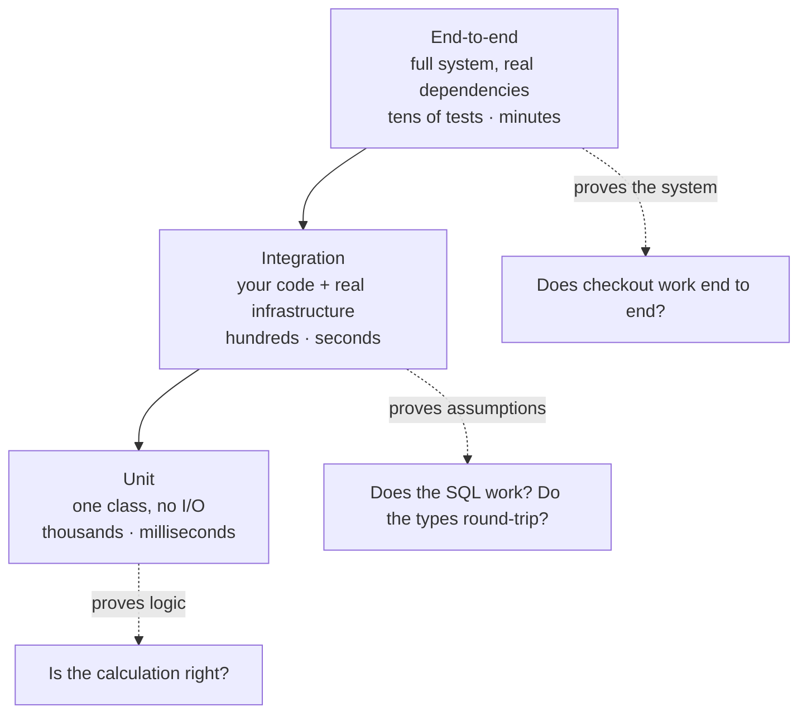
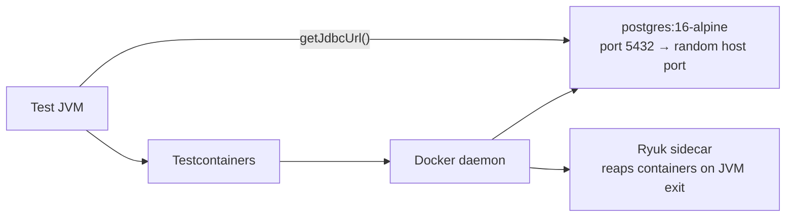
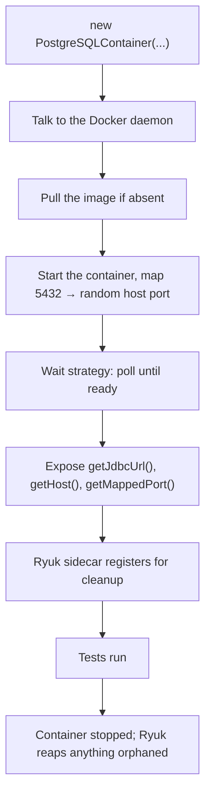

# Integration Testing & Testcontainers

<!-- video:start -->
<figure class="pb-video">
<video controls playsinline preload="metadata">
<source src="../../videos/ch43.mp4" type="video/mp4">
<track kind="subtitles" srclang="en" label="English" src="../../videos/ch43.vtt">
</video>
<figcaption>Video walkthrough · 6:02 · subtitles via CC · <a href="../../videos/ch43.mp4" download>Download MP4</a></figcaption>
</figure>
<!-- video:end -->

## 1. Purpose & Audience

**Band:** L3 Enterprise · **Prerequisites:** [JUnit 5](41-junit5.md), [Mockito & Test Doubles](42-mockito.md)

Unit tests prove your logic is right. Integration tests prove your *assumptions* are right — that the SQL is valid, the JDBC types round-trip, the transaction boundary is where you drew it, and the vendor's error response does what your handler expects. Mocks cannot catch any of these, because a mock always behaves the way you told it to.

This chapter answers three questions:

1. **What belongs in an integration test**, and where is the line against unit tests above?
2. **How do you test against real infrastructure** without a shared environment everyone breaks?
3. **Why is the suite slow**, and what actually fixes it?

!!! info "Scope: plain Java only"
    This chapter uses the JDK and Testcontainers — JDBC, `java.net.http`, JUnit 5. Framework-specific integration testing (Spring's test slices, application-context caching, bean overrides) is deliberately out of scope and belongs in a Spring handbook. Everything here applies underneath any framework.

!!! warning "H2 is not your database"
    The most common integration-testing mistake is swapping Postgres for H2 in tests. Different SQL dialect, different constraint handling, different date and JSON semantics, different locking. Every difference is a class of bug your suite cannot see. Testcontainers exists to remove this compromise.

---

## 2. The Problem

`OrderJdbcRepository` finds recent orders for a customer:

```java title="OrderJdbcRepository.java"
public final class OrderJdbcRepository {

    private static final String FIND_RECENT = """
        select id, customer_id, placed_at, total_paise
        from orders
        where customer_id = ?
          and placed_at >= ?
        order by placed_at desc
        """;

    private final DataSource dataSource;

    public OrderJdbcRepository(DataSource dataSource) {
        this.dataSource = dataSource;
    }

    public List<OrderRecord> findRecent(UUID customerId, Instant since) throws SQLException {
        try (Connection c = dataSource.getConnection();
             PreparedStatement ps = c.prepareStatement(FIND_RECENT)) {

            ps.setObject(1, customerId);
            ps.setObject(2, OffsetDateTime.ofInstant(since, ZoneOffset.UTC));

            try (ResultSet rs = ps.executeQuery()) {
                List<OrderRecord> results = new ArrayList<>();
                while (rs.next()) {
                    results.add(map(rs));
                }
                return results;
            }
        }
    }

    private OrderRecord map(ResultSet rs) throws SQLException {
        return new OrderRecord(
            rs.getObject("id", UUID.class),
            rs.getObject("customer_id", UUID.class),
            rs.getObject("placed_at", OffsetDateTime.class).toInstant(),
            rs.getLong("total_paise"));
    }
    // save() and findById() follow the same shape
}

public record OrderRecord(UUID id, UUID customerId, Instant placedAt, long totalPaise) {
    public Money total() { return Money.paise(totalPaise); }
}
```

A unit test with a mocked `DataSource` proves nothing about this. You stub `executeQuery` to return a fake `ResultSet`, and the test passes whether the SQL is valid, references a dropped column, or binds the timestamp in the wrong timezone.

The questions only a real database can answer:

- Does the SQL parse and execute against the current schema?
- Does the unique constraint on `(customer_id, idempotency_key)` actually fire?
- Does `Instant` survive the round trip through `timestamptz` without losing precision or shifting?
- Does `setObject` with a `UUID` work on this driver, or does it need `setString`?

Each of those has shipped as a production incident somewhere, in a codebase with excellent unit-test coverage.

---

## 3. Mental Model

### 3.1 Where integration tests sit



The useful definition: **an integration test crosses at least one boundary you do not control** — a database, a broker, an HTTP service, the filesystem. Everything else is a unit test, however many of your own classes it touches.

### 3.2 What Testcontainers gives you



Real Postgres, started per test run, on a random port, torn down automatically. No shared test database, no migration conflicts between developers, no "who broke staging".

---

## 4. Core API & Syntax

### 4.1 Dependencies

```xml title="pom.xml"
<dependencyManagement>
  <dependencies>
    <dependency>
      <groupId>org.testcontainers</groupId>
      <artifactId>testcontainers-bom</artifactId>
      <version><!-- current 1.x --></version>
      <type>pom</type>
      <scope>import</scope>
    </dependency>
  </dependencies>
</dependencyManagement>

<dependencies>
  <dependency>
    <groupId>org.testcontainers</groupId>
    <artifactId>junit-jupiter</artifactId>
    <scope>test</scope>
  </dependency>
  <dependency>
    <groupId>org.testcontainers</groupId>
    <artifactId>postgresql</artifactId>
    <scope>test</scope>
  </dependency>
  <dependency>
    <groupId>org.postgresql</groupId>
    <artifactId>postgresql</artifactId>
    <scope>runtime</scope>
  </dependency>
</dependencies>
```

### 4.2 Testcontainers annotations and types

| Element | Purpose |
|---|---|
| `@Testcontainers` | Enables the JUnit 5 extension |
| `@Container` on a **static** field | One container per class |
| `@Container` on an **instance** field | One container **per test method** — rarely what you want |
| `GenericContainer<>` | Any image |
| `PostgreSQLContainer<>` etc. | Module with database-aware helpers |
| `.withExposedPorts(n)` | Map a container port to a random host port |
| `.waitingFor(Wait.forLogMessage(...))` | Explicit readiness check |
| `.withReuse(true)` | Keep the container alive between runs (local only) |

### 4.3 Getting connection details

| Method | Returns |
|---|---|
| `getJdbcUrl()` | Full JDBC URL including the mapped port |
| `getHost()` | Usually `localhost`, but not always in CI |
| `getMappedPort(5432)` | The random host port |
| `getUsername()` / `getPassword()` | Credentials |
| `getLogs()` | Container output, for diagnosing startup failures |

!!! tip "The `jdbc:tc:` URL scheme"
    Testcontainers ships a JDBC driver wrapper that starts the container for you from the URL alone — no container object, no annotations:

    ```java
    String url = "jdbc:tc:postgresql:16-alpine:///orders";
    try (Connection c = DriverManager.getConnection(url)) { ... }
    ```

    Add `?TC_INITSCRIPT=schema.sql` to run a script on startup, or `TC_DAEMON=true` to keep it alive for the JVM's lifetime. This is the lowest-ceremony option for pure JDBC tests and needs no framework at all.

### 4.4 Build phase separation

| Suffix | Plugin | Phase |
|---|---|---|
| `*Test` | Surefire | `test` — the fast loop |
| `*IT` / `*ITCase` | Failsafe | `verify` — after packaging |

Separating them is what keeps `mvn test` fast. With Gradle, use a dedicated `integrationTest` source set and task.

---

## 5. Worked Examples

### 5.1 A repository test against real Postgres

```java title="OrderJdbcRepositoryIT.java"
@Testcontainers
class OrderJdbcRepositoryIT {

    @Container
    static final PostgreSQLContainer<?> postgres =
        new PostgreSQLContainer<>("postgres:16-alpine");

    static DataSource dataSource;
    OrderJdbcRepository repository;

    @BeforeAll
    static void createSchema() {
        dataSource = dataSourceFor(postgres);
        Flyway.configure()
              .dataSource(dataSource)
              .locations("classpath:db/migration")
              .load()
              .migrate();                      // the real migrations, tested
    }

    @BeforeEach
    void cleanAndSeed() throws SQLException {
        truncate("orders", "order_lines");
        repository = new OrderJdbcRepository(dataSource);
    }

    @Test
    void findRecent_returnsOnlyOrdersAfterCutoff() throws SQLException {
        UUID customerId = UUID.randomUUID();
        insertOrder(customerId, Instant.parse("2026-09-01T10:00:00Z"));
        insertOrder(customerId, Instant.parse("2026-09-18T10:00:00Z"));

        List<OrderRecord> recent =
            repository.findRecent(customerId, Instant.parse("2026-09-15T00:00:00Z"));

        assertThat(recent)
            .hasSize(1)
            .extracting(OrderRecord::placedAt)
            .containsExactly(Instant.parse("2026-09-18T10:00:00Z"));
    }

    private static DataSource dataSourceFor(PostgreSQLContainer<?> container) {
        PGSimpleDataSource ds = new PGSimpleDataSource();
        ds.setUrl(container.getJdbcUrl());
        ds.setUser(container.getUsername());
        ds.setPassword(container.getPassword());
        return ds;
    }
}
```

Running the real Flyway migrations is not incidental — **it makes the migration scripts themselves a tested artifact.** A migration that fails on an empty database fails this test rather than a deployment.

### 5.2 Testing the constraint, not the code

```java title="OrderJdbcRepositoryIT.java"
@Test
void save_duplicateIdempotencyKey_violatesUniqueConstraint() throws SQLException {
    UUID customerId = UUID.randomUUID();
    repository.save(orderWithKey(customerId, "IDEM-1"));

    SQLException ex = assertThrows(SQLException.class,
        () -> repository.save(orderWithKey(customerId, "IDEM-1")));

    assertEquals("23505", ex.getSQLState());     // unique_violation
}
```

The SQLState check matters. `23505` is the SQL standard code for a unique violation, and asserting on it rather than on a message string keeps the test stable across driver versions. This is also exactly the assertion H2 would get wrong — its error codes differ.

### 5.3 Type round-tripping

The bug class nobody tests for:

```java title="TypeRoundTripIT.java"
@Test
void instant_survivesRoundTripWithMicrosecondPrecision() throws SQLException {
    Instant original = Instant.parse("2026-09-20T14:30:45.123456Z");

    repository.save(orderPlacedAt(original));
    OrderRecord loaded = repository.findById(orderId).orElseThrow();

    assertEquals(original, loaded.placedAt());
}

@Test
void money_survivesRoundTripWithoutFloatingPointDrift() throws SQLException {
    Money original = Money.rupees(new BigDecimal("1234.56"));

    repository.save(orderWithTotal(original));

    assertEquals(original, repository.findById(orderId).orElseThrow().total());
}
```

Postgres `timestamptz` stores microseconds; `Instant` carries nanoseconds. A value with nanosecond precision is silently truncated, and the test tells you before production does. The `Money` test catches the other classic: a `double` column quietly turning ₹1234.56 into ₹1234.5599999999999.

### 5.4 An outbound HTTP client, with the JDK client

The vendor dispatch API is someone else's service. A stub HTTP server in a container gives you a real round trip with controlled responses:

```java title="VendorClientIT.java"
@Testcontainers
class VendorClientIT {

    @Container
    static final GenericContainer<?> wiremock =
        new GenericContainer<>("wiremock/wiremock:3.9.1")
            .withExposedPorts(8080)
            .waitingFor(Wait.forHttp("/__admin/mappings").forStatusCode(200));

    VendorClient client;

    @BeforeEach
    void setUp() {
        String baseUrl = "http://%s:%d".formatted(
            wiremock.getHost(), wiremock.getMappedPort(8080));
        client = new VendorClient(HttpClient.newHttpClient(), URI.create(baseUrl));
    }

    @Test
    void send_vendorReturns503_retriesThreeTimesThenFails() {
        stubFor(post("/dispatch").willReturn(serviceUnavailable()));

        assertThrows(VendorUnavailableException.class, () -> client.send(anOrder()));

        verify(exactly(3), postRequestedFor(urlEqualTo("/dispatch")));
    }

    @Test
    void send_vendorRespondsSlowly_timesOut() {
        stubFor(post("/dispatch")
            .willReturn(ok().withFixedDelay(5_000)));

        assertThrows(HttpTimeoutException.class, () -> client.send(anOrder()));
    }
}
```

This is how you test retry policies, timeouts, and circuit breakers — behaviour that only exists in the interaction with a slow or failing peer. A Mockito mock of the client cannot express "responds after five seconds" or "fails twice then succeeds".

### 5.5 Asynchronous effects

```java title="DispatchQueueIT.java"
@Test
void confirm_enqueuesDispatchJob() {
    orderService.confirm(cart, customer);

    await().atMost(Duration.ofSeconds(5))
           .untilAsserted(() -> assertThat(dispatchQueue.pending()).hasSize(1));
}
```

Awaitility polls until the condition holds or the deadline passes. The alternative — `Thread.sleep(2000)` — is slower than necessary on a fast machine and flaky on a loaded CI runner. Never sleep in a test.

---

## 6. Internals

### 6.1 The container lifecycle



**Random port mapping.** The container's 5432 is mapped to an arbitrary free host port, which is why tests run in parallel and on shared CI agents without conflicts. Never hard-code a port; always ask the container.

**Ryuk.** A sidecar container holding a connection to your JVM that destroys every registered container when that connection drops — including on `kill -9`. It is why an aborted run leaves nothing behind. Some CI environments block it; `TESTCONTAINERS_RYUK_DISABLED=true` exists for those, at the cost of doing your own cleanup.

### 6.2 Wait strategies

A container being *started* is not the same as being *ready*. Testcontainers blocks until a wait strategy passes:

| Strategy | Use |
|---|---|
| `Wait.forListeningPort()` | Default — the port accepts connections |
| `Wait.forLogMessage(regex, times)` | The service logs a ready marker |
| `Wait.forHttp("/health").forStatusCode(200)` | HTTP readiness endpoint |
| `Wait.forSuccessfulCommand(...)` | Run a check inside the container |

The default is weak: Postgres accepts connections during startup and then restarts, so a test can connect and immediately lose the connection. The module containers override this with a proper check — a reason to prefer `PostgreSQLContainer` over a raw `GenericContainer` where a module exists.

For an image with no module, set a strategy explicitly. Leaving it to the default is the most common source of "works locally, times out in CI".

### 6.3 Static versus instance containers

```java
@Container static PostgreSQLContainer<?> db = ...;   // once per class
@Container        PostgreSQLContainer<?> db = ...;   // once per TEST METHOD
```

The instance form restarts the container for every test method. At two seconds of startup and forty tests, that is eighty seconds of pure waiting. Use static unless a test genuinely needs a pristine container.

### 6.4 The singleton container pattern

Across many test classes, one container for the whole JVM:

```java title="AbstractPostgresIT.java"
public abstract class AbstractPostgresIT {

    protected static final PostgreSQLContainer<?> POSTGRES =
        new PostgreSQLContainer<>("postgres:16-alpine");

    protected static DataSource dataSource;

    static {
        POSTGRES.start();          // deliberately never stopped — Ryuk handles cleanup
        dataSource = dataSourceFor(POSTGRES);
        migrate(dataSource);
    }

    @BeforeEach
    void truncateAll() throws SQLException {
        try (Connection c = dataSource.getConnection();
             Statement s = c.createStatement()) {
            s.execute("truncate table order_lines, orders restart identity cascade");
        }
    }
}
```

Every integration test extends this and shares one database. The trade is isolation: you now need truncation, transactional rollback, or per-test schemas. For a large suite the time saved is worth managing that — and truncation with `restart identity cascade` is fast enough to run before every test.

Locally, reuse skips even the first start:

```properties title="~/.testcontainers.properties"
testcontainers.reuse.enable=true
```

with `.withReuse(true)` on the container. Developer-machine optimisation only — leave it off in CI, where a fresh container per run is the point.

### 6.5 Isolation strategies compared

| Strategy | Speed | Isolation | Catches commit-time failures |
|---|---|---|---|
| Container per method | Slowest | Perfect | Yes |
| Truncate before each test | Fast | Good | Yes |
| Transaction + rollback | Fastest | Good | **No** |
| Per-test schema | Medium | Perfect | Yes |

The rollback row is the one to understand. Wrapping each test in a transaction and rolling back is the cheapest isolation, but constraint violations, deferred checks, and flush-time errors surface **at commit** — which never happens. A test that passes under rollback can fail in production on the same data. Where the commit itself is what you are testing, truncation is the safer default.

### 6.6 Why not H2

| | H2 | Real Postgres |
|---|---|---|
| SQL dialect | Compatibility mode, approximate | Exact |
| `jsonb`, arrays, `ltree` | Absent or emulated | Native |
| Window functions and CTEs | Partial | Full |
| SQLState error codes | Different | Same as production |
| Locking and isolation | Different implementation | Same as production |
| `timestamptz` semantics | Different | Same as production |
| Startup | Instant | ~2 seconds, once per run |

The saved two seconds buys a suite that validates a database you do not run. Every dialect-specific query — and most non-trivial applications have several — is effectively untested.

---

## 7. Production Patterns & Anti-Patterns

### Do this

- **Match the production database and version.** Testing on Postgres 16 while running 14 reintroduces the problem Testcontainers solved.
- **Pin image tags** — `postgres:16-alpine`, never `postgres:latest`. A floating tag makes CI a moving target.
- **Run the real migrations** in test setup. It makes the migration scripts a tested artifact.
- **Static containers, or a singleton base class.** Never instance-level `@Container`.
- **Set an explicit wait strategy** for any image without a Testcontainers module.
- **Assert on SQLState codes**, not exception messages — messages change between driver versions.
- **Truncate between tests** rather than relying on rollback, so commit-time failures still surface.
- **Separate build phases** — `*Test` in Surefire, `*IT` in Failsafe — so the fast loop stays fast.
- **Use Awaitility for async assertions.** Never `Thread.sleep`.

### Never do this

- **Never use H2 as a stand-in for a real database.** Different engine, different bugs.
- **Never hard-code a container port.** Ports are mapped randomly; ask the container.
- **Never call real third-party services.** Slow, rate-limited, sometimes billed, and red builds when someone else deploys.
- **Never share a database between concurrently running test classes** without per-test isolation.
- **Never depend on test execution order** for data setup. Each test creates what it needs.
- **Never leave the wait strategy to chance** on a slow-starting service — this is the classic CI-only failure.
- **Never enable container reuse in CI.** A fresh container per run is the point there.
- **Never let integration tests run in the inner loop.** If `mvn test` takes four minutes, developers stop running it.

---

## 8. Version Evolution (Java 8 → 26)

| Version | What changed | Impact |
|---|---|---|
| **Java 8** | Lambdas | Testcontainers' fluent builder API and Awaitility conditions become readable |
| **Java 11** | `java.net.http.HttpClient` standard (JEP 321) | Outbound HTTP testable without a third-party client |
| **Java 15/16** | Text blocks and records | SQL literals and test fixtures become readable inline |
| **Java 19** | `Duration` overloads on `Thread.sleep` / `join` | Typed timeouts in test helpers |
| **Java 21** | Virtual threads | Container startup waits and blocking test I/O stop consuming platform threads |
| **Testcontainers 1.15+** | Reusable containers, richer module catalogue | Faster local loops |
| **Testcontainers 1.17+** | `jdbc:tc:` scheme improvements, better CI detection | Zero-ceremony JDBC tests |

### Migration note

Migrating a suite off H2 will surface real bugs that H2 was masking — dialect-specific SQL that never worked, error-code assertions that were wrong, and type round-trips that silently truncated. Budget for that: **the failures are findings, not regressions.**

Do it one repository class at a time rather than flipping the whole suite, and start with the class that has the most hand-written SQL, since that is where the H2 divergence is largest.

---

## 9. Interview Questions

### L1 — Foundations

**Q1. What is the difference between a unit test and an integration test?** ⭐ *high frequency*
A unit test exercises one unit of logic with no external dependencies, so it is fast and deterministic and proves the logic is correct. An integration test crosses a boundary you do not control — a database, a broker, an HTTP service — and proves your assumptions about that boundary hold. Mocks make unit tests possible but also mean they can never catch a wrong SQL query or a broken type mapping.

**Q2. What is Testcontainers?**
A library that starts real services in Docker containers for the duration of a test run — Postgres, Kafka, Redis, or anything with an image. It replaces in-memory substitutes so tests run against the same engine as production, and it exposes the container's randomly-mapped host port so tests can run in parallel without conflicts.

**Q3. Why do integration tests use a random port?**
Because a fixed port collides — with another test class running concurrently, with a developer's local database, or with another job on a shared CI agent. Testcontainers maps the container's internal port to a free host port and exposes it through `getMappedPort`, so nothing needs to coordinate.

### L2 — Professional

**Q4. Why not use H2 instead of a Postgres container?** ⭐ *high frequency*
Because H2 is a different database. Its SQL dialect is an approximation, it lacks or emulates `jsonb`, arrays, and several window features, and its error codes, locking, and timestamp semantics differ. Every dialect-specific query is effectively untested and the bugs surface in production. The container costs about two seconds once per run.

**Q5. What is a wait strategy and why does it matter?**
It is the readiness check Testcontainers blocks on before handing the container to your test. The default only waits for the port to accept connections, which is not the same as ready — Postgres accepts connections during startup and then restarts, so a test can connect and immediately lose it. An explicit log-message or HTTP check is the fix, and its absence is the usual cause of tests that pass locally and time out in CI.

**Q6. Static or instance `@Container` — what is the difference?**
A static field starts one container for the whole test class; an instance field restarts it for every test method. The instance form multiplies container startup by the number of tests, which turns a two-second cost into minutes. Use static unless a test genuinely requires a pristine container.

### L3 — Enterprise

**Q7. How do you isolate tests that share one database?**
Truncating the affected tables before each test is the usual answer — fast, and it preserves commit behaviour. Transactional rollback is cheaper still but hides commit-time failures, since constraint violations and deferred checks surface at commit, which never happens. Per-test schemas give perfect isolation at the cost of setup complexity, and are worth it when tests run in parallel against one container.

**Q8. Your integration suite takes 25 minutes. Where do you look?**
Container startup count first: instance-level `@Container` fields restarting Docker per method, and one container per test class where a singleton would do. Then image pulls in CI without a layer cache, missing wait strategies causing timeout-then-retry cycles, and tests doing setup through the API rather than direct inserts. Measure before changing — container logs and test timings tell you exactly where the time goes, and teams usually guess wrong.

**Q9. How do you test retry and timeout behaviour against a third-party API?**
Run a stub HTTP server — WireMock in a container works well — and program it to fail, return 503, or respond slowly. Then assert on the observable outcome and on the number of requests the stub received. A Mockito mock of the client cannot express "responds after five seconds" or "fails twice then succeeds", which is exactly the behaviour retry policies and circuit breakers exist to handle.

### L4 — Architect

**Q10. When is a contract test the right tool instead of an integration test?**
When the boundary is another team's service that changes independently. An integration test against their sandbox couples your build to their availability and only proves the version you ran against. A consumer-driven contract records your expectations as an artifact the provider verifies in their own pipeline, so a breaking change fails on their side before it reaches you. The same reasoning applies to any fake you maintain — run the contract against both the fake and the real implementation so they cannot drift.

**Q11. How do you keep an integration suite fast enough to run on every merge?**
Treat container count and startup time as budgets. Use a singleton container per JVM rather than per class, parallelise at the class level once shared-state leaks are fixed, cache images in CI so pulls are not on the critical path, and keep the tiers separated so the unit loop stays under a minute. The structural decision is that integration tests run on merge rather than on save — optimising them into the inner loop usually means cutting the coverage that made them worth having.

**Q12. A team reports integration tests that pass locally and fail intermittently in CI. How do you diagnose it?**
Start with what differs: CI is slower and more loaded, so fixed sleeps and weak wait strategies that pass locally time out there. Then look for shared state — a singleton container with parallel classes and no per-test isolation, fixed identifiers that collide, or leftover rows from a test that failed before its cleanup. Test ordering is the third: a suite that depends on execution order passes in the IDE's order and fails in the build's. The fix is almost always to make each test create and clean its own data, and to replace every sleep with a polled condition.

---

!!! abstract "Cheat Sheet"
    **Integration test = crosses a boundary you don't control** — DB, broker, HTTP, filesystem

    **Never H2** as a Postgres stand-in — dialect, error codes, `timestamptz` all differ

    **`@Container` static, not instance** — instance restarts Docker per test method

    **Singleton container + truncate between tests** — the usual large-suite pattern

    **Rollback isolation hides commit-time failures** — constraint violations never surface

    **Set an explicit wait strategy** — the default port check is weak; this is the CI-only failure

    **Never hard-code ports** — `getMappedPort(5432)`

    **Pin image tags**, match the production version

    **Run real migrations in setup** — makes them a tested artifact

    **Assert on SQLState** (`23505` = unique violation), not exception messages

    **`jdbc:tc:postgresql:16-alpine:///db`** — zero-ceremony container from a JDBC URL

    **Awaitility, never `Thread.sleep`** · **`*Test` → Surefire, `*IT` → Failsafe**
