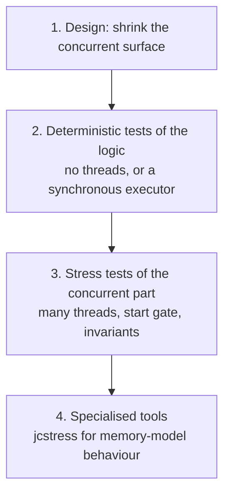
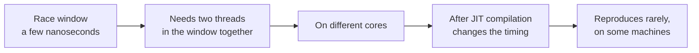
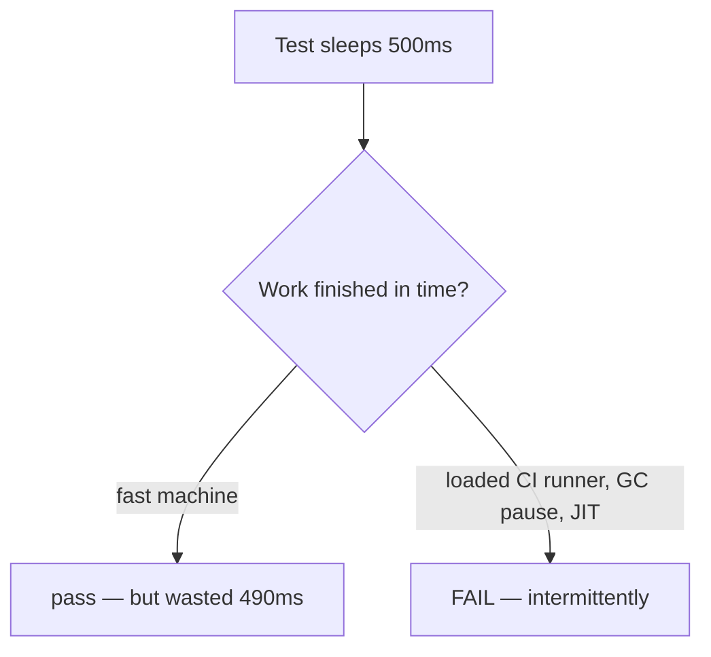

# Testing Concurrent Code

<!-- video:start -->
<figure class="pb-video">
<video controls playsinline preload="metadata">
<source src="../../videos/ch44.mp4" type="video/mp4">
<track kind="subtitles" srclang="en" label="English" src="../../videos/ch44.vtt">
</video>
<figcaption>Video walkthrough · 6:35 · subtitles via CC · <a href="../../videos/ch44.mp4" download>Download MP4</a></figcaption>
</figure>
<!-- video:end -->

## 1. Purpose & Audience

**Band:** L4 Architect · **Prerequisites:** [JUnit 5](41-junit5.md), [The Java Memory Model](../04-concurrency/26-java-memory-model.md), [Locks, Atomics & java.util.concurrent](../04-concurrency/27-locks-and-atomics.md)

A test of sequential code that passes once will pass forever. A test of concurrent code that passes once has proved almost nothing: the interleaving that breaks it may occur once in ten thousand runs, only on an eight-core machine, only after the JIT has compiled the method.

Testing cannot prove the absence of races. What it can do is make the concurrent surface small, test the logic deterministically, and raise the probability of exposing a race high enough that it shows up before production does.

This chapter answers three questions:

1. **How do you design code so that most of it can be tested without threads at all?**
2. **How do you write concurrent tests that are deterministic** — neither flaky nor slow?
3. **When do you need a specialised tool** like jcstress, and what does it find that ordinary tests cannot?

---

## 2. The Problem

Three tests that look reasonable.

```java title="SleepyTest.java"
@Test
void confirm_publishesDispatchEvent() throws Exception {
    orderService.confirm(cart, customer);
    Thread.sleep(500);                                // hope 500ms is enough
    assertThat(dispatchQueue.pending()).hasSize(1);
}
```

Slow on every run, and flaky whenever the CI machine is loaded enough that 500 ms is not enough.

```java title="NaiveRaceTest.java"
@Test
void counter_isThreadSafe() throws Exception {
    Counter counter = new Counter();
    Thread t1 = new Thread(() -> { for (int i = 0; i < 1000; i++) counter.increment(); });
    Thread t2 = new Thread(() -> { for (int i = 0; i < 1000; i++) counter.increment(); });
    t1.start(); t2.start();
    t1.join(); t2.join();
    assertEquals(2000, counter.get());
}
```

Passes against a counter with no synchronisation at all, most of the time — the first thread often finishes before the second starts, so there is no overlap to race.

```java title="MockedConcurrency.java"
@Test
void reserve_isThreadSafe() {
    when(inventory.reserve(any(), anyInt())).thenReturn(true);
    assertTrue(service.reserve(sku, 1));
}
```

Tests nothing about concurrency whatsoever. The mock is the thing that would have had the race.

---

## 3. Mental Model

### 3.1 Four layers



| Layer | Finds | Cost |
|---|---|---|
| **Design** | Nothing — it prevents | Upfront thought |
| **Deterministic** | Logic bugs | Cheap, fast, reliable |
| **Stress** | Races, lost updates, deadlocks | Slower; probabilistic |
| **jcstress** | Visibility and reordering bugs | Specialist; slow |

Most of the value is in the first two. A codebase where concurrency is confined to a few small components, with the business logic testable synchronously, needs stress testing for a handful of classes rather than everywhere.

### 3.2 Why races hide



A race requires two threads to be inside a window of a few instructions at the same moment. Whether that happens depends on core count, scheduler behaviour, CPU cache timing, and whether the JIT has compiled the code — interpreted code is slower and has wider, differently-shaped windows.

A test's job is to **maximise the chance** of that coincidence: more threads, more iterations, all released at once, running warm code.

---

## 4. Core Reference

### 4.1 Tools

| Tool | Use |
|---|---|
| **Awaitility** | Poll for an asynchronous condition with a deadline — replaces `Thread.sleep` |
| **`CountDownLatch`** | A start gate — release all threads at once |
| **`CyclicBarrier`** | Line threads up repeatedly across rounds |
| **`@RepeatedTest(n)`** | Run a stress test many times |
| **`@Timeout`** | Fail a test that deadlocks, instead of hanging CI |
| **`ThreadMXBean`** | Detect deadlocked threads programmatically |
| **jcstress** | Explore memory-model outcomes exhaustively — OpenJDK's own harness |
| **Lincheck** | Linearizability checking for concurrent data structures (JVM) |

### 4.2 Test-friendly seams

| Inject | Instead of | So tests can |
|---|---|---|
| `Executor` | `Executors.newFixedThreadPool(...)` internally | Pass a synchronous executor |
| `Clock` | `Instant.now()` | Control time without sleeping |
| `ScheduledExecutorService` | Internal scheduling | Trigger scheduled work directly |
| A queue or event sink | Direct thread handoff | Observe what was produced |

---

## 5. Worked Examples

### 5.1 Separate the logic from the threading

```java title="Separated.java"
// The logic — pure, synchronous, trivially testable
public final class ReservationPolicy {
    public ReservationResult decide(int available, int requested) {
        if (requested <= 0) return ReservationResult.invalid();
        if (requested > available) return ReservationResult.insufficient(available);
        return ReservationResult.reserved(requested);
    }
}

// The concurrency — small, and the only part needing stress tests
public final class InventoryItem {
    private final Sku sku;
    private final ReservationPolicy policy = new ReservationPolicy();
    private int available;

    public InventoryItem(Sku sku, int available) {
        this.sku = sku;
        this.available = available;
    }

    public synchronized int available() { return available; }

    public synchronized ReservationResult reserve(int requested) {
        ReservationResult result = policy.decide(available, requested);
        if (result.succeeded()) available -= requested;
        return result;
    }
}
```

`ReservationPolicy` gets ordinary unit tests — boundaries, invalid input, every branch — with no threads. `InventoryItem` needs only one question answered under concurrency: does `synchronized` keep `available` consistent? That is one stress test, not a dozen.

**The most effective concurrency-testing technique is having less concurrent code.**

### 5.2 A synchronous executor for deterministic tests

```java title="DirectExecutor.java"
public final class DispatchService {
    private final Executor executor;
    private final VendorClient vendorClient;

    public DispatchService(Executor executor, VendorClient vendorClient) {
        this.executor = executor;
        this.vendorClient = vendorClient;
    }

    public void dispatchAll(List<Order> orders) {
        orders.forEach(o -> executor.execute(() -> vendorClient.send(o)));
    }
}
```

```java title="DirectExecutorTest.java"
@Test
void dispatchAll_sendsEveryOrder() {
    Executor sameThread = Runnable::run;            // runs each task immediately, inline
    DispatchService service = new DispatchService(sameThread, vendorClient);   // vendorClient: a Mockito mock

    service.dispatchAll(List.of(order1, order2, order3));

    verify(vendorClient, times(3)).send(any());      // no waiting — it already happened
}
```

`Runnable::run` is an `Executor` that runs tasks on the calling thread. The test becomes fully deterministic: no sleeps, no polling, no flakiness. It verifies the **logic** of dispatching; whether the real pool behaves concurrently is a separate question for a separate test.

The same idea applies to time: inject a `Clock` and use `Clock.fixed` or `Clock.offset` instead of waiting ([Chapter 10](../02-language/10-java-time.md)).

### 5.3 Awaitility instead of `sleep`

```java title="AwaitilityTest.java"
@Test
void confirm_publishesDispatchEvent() {
    orderService.confirm(cart, customer);

    await().atMost(Duration.ofSeconds(5))
           .pollInterval(Duration.ofMillis(20))
           .untilAsserted(() -> assertThat(dispatchQueue.pending()).hasSize(1));
}
```

Awaitility polls until the assertion passes or the deadline expires. On a fast machine it returns in milliseconds; on a loaded CI runner it waits as long as needed up to the limit. Both properties `Thread.sleep` gets wrong: a fixed sleep is always as slow as its worst case and still fails when the worst case is exceeded.

Set the deadline generously — it only costs time when the test is failing.

### 5.4 A stress test that actually stresses

```java title="StressTest.java"
@RepeatedTest(20)
@Timeout(30)
void reserve_neverOversells() throws Exception {
    InventoryItem item = new InventoryItem(new Sku("MILK-1L"), 1_000);
    int threads = 32;
    int attemptsPerThread = 100;

    CountDownLatch startGate = new CountDownLatch(1);
    AtomicInteger reservedUnits = new AtomicInteger();

    try (ExecutorService pool = Executors.newFixedThreadPool(threads)) {
        for (int t = 0; t < threads; t++) {
            pool.submit(() -> {
                startGate.await();                       // everyone waits here...
                for (int i = 0; i < attemptsPerThread; i++) {
                    if (item.reserve(1).succeeded()) reservedUnits.incrementAndGet();
                }
                return null;
            });
        }
        startGate.countDown();                           // ...then all start together
    }

    // Invariants, not exact values
    assertEquals(1_000, reservedUnits.get(), "every unit reserved exactly once");
    assertEquals(0, item.available(), "nothing left, nothing negative");
}
```

Four details that make this effective where §2's version was not:

- **The start gate.** Without it, threads start one at a time and often finish before the next begins, so they never overlap. The latch releases all 32 simultaneously.
- **More threads than cores**, and many iterations each, to keep the race windows occupied.
- **Invariants rather than a timing-dependent result.** 3,200 attempts against 1,000 units must yield exactly 1,000 successes and zero remaining — regardless of interleaving. A lost update or an oversell breaks it.
- **`@RepeatedTest` and `@Timeout`.** Repetition multiplies the chance of exposure; the timeout turns a deadlock into a failure instead of a hung build.

Remove `synchronized` from `reserve` and this test fails within a few repetitions.

### 5.5 Detecting deadlock

```java title="DeadlockDetection.java"
@Test
@Timeout(10)
void transfers_doNotDeadlock() throws Exception {
    // ... start threads transferring stock between items in both directions ...

    ThreadMXBean mx = ManagementFactory.getThreadMXBean();
    await().during(Duration.ofSeconds(2))
           .atMost(Duration.ofSeconds(5))
           .until(() -> mx.findDeadlockedThreads() == null);
}
```

`findDeadlockedThreads` reports threads deadlocked on monitors or ownable synchronizers — both `synchronized` and `java.util.concurrent` locks. Checking it during a stress test turns a hang into a precise failure naming the threads involved.

The `@Timeout` is the backstop: a test that deadlocks before the check runs still fails rather than stalling the CI job indefinitely.

### 5.6 jcstress: testing the memory model

Ordinary tests cannot reliably catch visibility and reordering bugs ([Chapter 26](../04-concurrency/26-java-memory-model.md)). jcstress, OpenJDK's own concurrency harness, can:

```java title="PublicationTest.java"
@JCStressTest
@Outcome(id = "0, 0", expect = ACCEPTABLE, desc = "reader ran first")
@Outcome(id = "1, 42", expect = ACCEPTABLE, desc = "reader saw the publish")
@Outcome(id = "1, 0", expect = FORBIDDEN, desc = "saw ready but not value — REORDERED")
@State
public class PublicationTest {
    int value;
    boolean ready;               // NOT volatile — the bug under test

    @Actor
    public void writer() {
        value = 42;
        ready = true;
    }

    @Actor
    public void reader(II_Result r) {
        r.r1 = ready ? 1 : 0;
        r.r2 = value;
    }
}
```

```text title="Output (on ARM)"
  RESULT      SAMPLES     FREQ       EXPECT  DESCRIPTION
    0, 0   48,221,004   61.43%   Acceptable  reader ran first
   1, 42   30,262,117   38.55%   Acceptable  reader saw the publish
    1, 0       14,882    0.02%    Forbidden  saw ready but not value — REORDERED
```

jcstress runs the two actors concurrently hundreds of millions of times across forked JVMs and counts each observed outcome. The forbidden result appeared **14,882 times** — a reordering that an ordinary test would essentially never see. Making `ready` volatile drives it to zero.

jcstress is the right tool for **low-level concurrent primitives** — a lock-free structure, a custom publication scheme, anything relying on JMM reasoning. It is overkill for application code built on `java.util.concurrent`, whose guarantees are already tested.

---

## 6. Internals

### 6.1 Why `Thread.sleep` tests are flaky



A sleep encodes a guess about how long something takes. The guess is wrong in both directions: too long on a fast machine, making the suite slow; too short on a slow or loaded one, making it flaky. Increasing the sleep trades flakiness for slowness and fixes neither.

Polling with a deadline — Awaitility, or a latch with `await(timeout)` — is correct in both cases, because it waits exactly as long as needed.

### 6.2 Why the naive race test passes

Starting a thread takes tens to hundreds of microseconds. A loop of 1,000 increments takes a few microseconds. So in §2's test, `t1` frequently runs to completion before `t2` has even started, and **the threads never overlap** — there is no race to expose.

The start gate forces overlap: all threads are created and blocked on the latch, then released at the same instant, so they genuinely execute the critical section concurrently.

### 6.3 The JIT changes the races

Interpreted code runs slowly and differently: race windows are wider in wall-clock time but the timing between operations differs from compiled code, and the JIT's optimisations — hoisting reads out of loops, reordering independent writes — **do not happen at all** until compilation.

Several classes of bug therefore appear only in compiled code:

- A non-volatile flag hoisted out of a loop, making it spin forever ([Chapter 26](../04-concurrency/26-java-memory-model.md)).
- Reordered writes publishing a half-constructed object.

This is why stress tests need **many iterations** — enough to warm the code past C2 compilation — and why jcstress forks fresh JVMs and runs long enough to test compiled paths.

### 6.4 Hardware matters

| Factor | Effect on reproduction |
|---|---|
| **Core count** | A 2-core CI runner exercises far less true parallelism than a 64-core production host |
| **Memory model** | ARM exposes reorderings that x86 hides |
| **Load** | A busy machine changes scheduling and timing |
| **Virtualisation** | vCPU scheduling adds its own interleavings |

A concurrency test that passes on a developer's x86 laptop and a 2-core CI container has been run against the two environments least likely to expose most races. Where it matters, run stress tests on hardware resembling production — and on ARM if production is ARM.

### 6.5 Flaky tests are findings

A concurrent test that fails intermittently is, most of the time, **correctly detecting a real race** that manifests intermittently. Retrying it until it passes — `@RetryingTest`, or a CI rerun policy — converts a detected bug into a hidden one.

The right response is to quarantine it, reproduce it (raise iterations, threads, and repetitions until it fails reliably), and fix the code. Only after establishing that the *test* is wrong — a sleep, a timing assumption, shared fixture state — is changing the test the fix.

---

## 7. Production Patterns & Anti-Patterns

### Do this

- **Shrink the concurrent surface.** Put business logic in pure classes testable without threads.
- **Inject executors, clocks, and schedulers** so tests can substitute deterministic versions.
- **Use `Runnable::run` as an executor** for deterministic tests of logic.
- **Use Awaitility or latches with timeouts**, never `Thread.sleep`.
- **Use a start gate** so stress-test threads genuinely overlap.
- **Assert invariants**, not timing-dependent values — conservation, no negatives, no duplicates.
- **Repeat stress tests and give every concurrent test a `@Timeout`.**
- **Check `ThreadMXBean.findDeadlockedThreads()`** in tests of lock-ordering code.
- **Use jcstress for low-level primitives** that rely on memory-model reasoning.
- **Treat an intermittent failure as a probable real race** until proven otherwise.

### Never do this

- **Never use `Thread.sleep` to wait for asynchronous work.** It is slow and flaky at once.
- **Never start stress-test threads without a start gate.** They may never overlap.
- **Never assert on exact interleavings** or output order from concurrent threads.
- **Never mock the component whose thread-safety you are testing.**
- **Never retry a flaky concurrent test until it passes.** You are hiding a bug.
- **Never run a concurrent test without a timeout.** A deadlock hangs the whole build.
- **Never conclude code is thread-safe because a test passed.** Absence of failure is weak evidence.
- **Never use jcstress for application code** built on `java.util.concurrent` — test your invariants instead.

---

## 8. Version Evolution (Java 8 → 26)

| Version | What changed | Impact |
|---|---|---|
| **5** | `java.util.concurrent` latches and barriers; `ThreadMXBean` | Start gates and deadlock detection become possible |
| **8** | `CompletableFuture`, `LongAdder` | More concurrency to test |
| **9** | `ProcessHandle`, improved `ThreadMXBean` | Better introspection |
| **JUnit 5** | `@RepeatedTest`, `@Timeout`, parallel execution | First-class support for stress and hang protection |
| **21** | **Virtual threads** | Stress tests can use thousands of threads cheaply |
| **21** | JFR `VirtualThreadPinned` event | Detect pinning in tests on 21–23 |
| **24** | JEP 491 — `synchronized` no longer pins | Pinning tests become largely unnecessary |
| **25** | `StructuredTaskScope` (preview) | Fan-out whose lifetime is testable — failures cancel siblings deterministically |

### Migration note

Two changes worth making to an existing test suite:

1. **Replace every `Thread.sleep` in tests** with Awaitility or a latch. This is usually the single largest reduction in both suite runtime and flakiness available.
2. **Add a start gate to every multi-threaded test** that lacks one. Without it, many existing "concurrency tests" are silently testing sequential execution.

Virtual threads make one improvement cheap: stress tests can use hundreds or thousands of concurrent tasks without the cost of platform threads, which raises the probability of exposing races considerably.

---

## 9. Interview Questions

### L1 — Foundations

**Q1. Why is `Thread.sleep` a bad way to wait in a test?** ⭐ *high frequency*
Because it encodes a guess about how long the work takes, and the guess is wrong in both directions: on a fast machine the test wastes time, and on a loaded CI runner the work may not finish in time, so the test fails intermittently. Polling with a deadline — Awaitility, or a latch with a timeout — waits exactly as long as needed, so it is both faster and reliable.

**Q2. Can testing prove code is thread-safe?**
No. A race may manifest once in millions of runs, only on certain hardware, only after JIT compilation. A passing test is weak evidence. Testing can raise the probability of exposure high enough to be useful, but correctness comes from design — minimal shared state, immutability, and established concurrency utilities — with tests as a check.

**Q3. What is Awaitility?**
A library that polls an asynchronous condition until it holds or a deadline passes. It replaces `Thread.sleep` in tests of asynchronous behaviour, returning as soon as the condition is met on a fast machine while tolerating slow or loaded ones up to the configured limit.

### L2 — Professional

**Q4. Why can a two-thread race test pass against unsynchronised code?** ⭐ *high frequency*
Because the threads may never actually overlap. Starting a thread takes far longer than a short loop takes to run, so the first thread often finishes before the second begins, and there is no concurrent access to race. A start gate — a `CountDownLatch` all threads await before beginning — forces them to execute together, and more threads and iterations increase the overlap further.

**Q5. How do you test code that uses an executor deterministically?**
Inject the executor rather than creating it internally, then pass `Runnable::run` in tests — an executor that runs each task immediately on the calling thread. The test becomes fully synchronous: no sleeps, no polling, no flakiness, and assertions run after the work has definitely happened. It tests the logic; whether the real pool behaves correctly concurrently is a separate, smaller test.

**Q6. What should a concurrency stress test assert?**
Invariants that must hold regardless of interleaving — total stock conserved, no negative balances, no duplicate allocations, every submitted item processed exactly once. Asserting a specific order or intermediate value makes the test depend on timing and fail spuriously. A good invariant fails reliably on a real race and never fails without one.

### L3 — Enterprise

**Q7. How would you design a system so it is easier to test for concurrency?**
Confine concurrency to a small number of components and keep business logic pure and synchronous, so the bulk of the code needs only ordinary unit tests. Inject executors, clocks, and schedulers so tests can substitute deterministic versions. Prefer immutable values and message passing over shared mutable state, which removes whole categories of race rather than requiring tests for them. The goal is that only a handful of classes need stress testing at all.

**Q8. What does jcstress find that an ordinary test does not?**
Visibility and reordering bugs at the memory-model level — a reader observing a flag set but the data it guards not yet written. jcstress runs small concurrent actors hundreds of millions of times across forked JVMs and reports the frequency of every observed outcome against declared acceptable and forbidden results. Outcomes that occur in a tiny fraction of runs, and only on weakly-ordered hardware, become visible. It is the right tool for low-level primitives, not for application code built on `java.util.concurrent`.

**Q9. A concurrent test fails once in fifty runs. What do you do?**
Assume it is a real race until shown otherwise, because intermittent failure is exactly how races manifest. Quarantine it rather than retrying it, then raise threads, iterations, and repetitions until it fails reliably, which makes it debuggable. Only after establishing that the test itself is wrong — a sleep, a timing assumption, shared fixture state — is changing the test the fix. Retrying until green converts a detected bug into a hidden one.

### L4 — Architect

**Q10. How would you set concurrency-testing standards for an organisation?**
Make the cheap, high-value practices mandatory: no `Thread.sleep` in tests, a timeout on every concurrent test, and a start gate in every multi-threaded test — all checkable by lint or review. Require injected executors and clocks in new code so logic is testable synchronously. Reserve stress tests for the small set of components that genuinely share mutable state, assert invariants in them, and run them repeatedly on hardware resembling production. Finally, forbid automatic retries for concurrent tests, because the retry policy is where real races go to hide.

**Q11. Why might concurrency bugs appear only in production, even with good tests?**
Because production differs from test environments along every axis that affects races. It has more cores, so more true parallelism; it may run on ARM, which exposes reorderings that x86 hides; it runs warm, JIT-compiled code where optimisations such as read hoisting are active; and it sees load patterns that shift scheduling and timing. A test suite run on a two-core x86 container has exercised the environment least likely to expose most races. Running stress tests on production-like hardware narrows the gap, but design is what closes it.

**Q12. How do virtual threads and structured concurrency change concurrency testing?**
Virtual threads make large stress tests cheap — thousands of concurrent tasks cost roughly what a few platform threads did — which raises the probability of exposing a race substantially. Structured concurrency makes fan-out lifetimes deterministic: a scope cannot be exited while subtasks run, and a failure cancels siblings, so tests can assert that failure propagation and cleanup happen rather than hoping they do. And on Java 24+ the removal of `synchronized` pinning eliminates a category of virtual-thread behaviour that previously needed its own tests.

---

!!! abstract "Cheat Sheet"
    **Testing cannot prove the absence of races** — it raises the probability of exposing them

    **Best technique: less concurrent code** — keep logic pure, confine threading to a few classes

    **Inject executors and clocks** — `Runnable::run` as a same-thread executor in tests

    **Never `Thread.sleep`** — Awaitility or a latch with a timeout

    **Start gate** — a `CountDownLatch` so threads genuinely overlap

    **More threads than cores, many iterations** — warm code past JIT compilation

    **Assert invariants** — conservation, no negatives, no duplicates — not timing

    **`@RepeatedTest` + `@Timeout` on every concurrent test**

    **`ThreadMXBean.findDeadlockedThreads()`** — turn a hang into a named failure

    **jcstress** for memory-model bugs in low-level primitives — not application code

    **Flaky concurrent test = probable real race** — quarantine and reproduce, never retry-until-green

    **Test on production-like hardware** — core count and ARM change what reproduces
