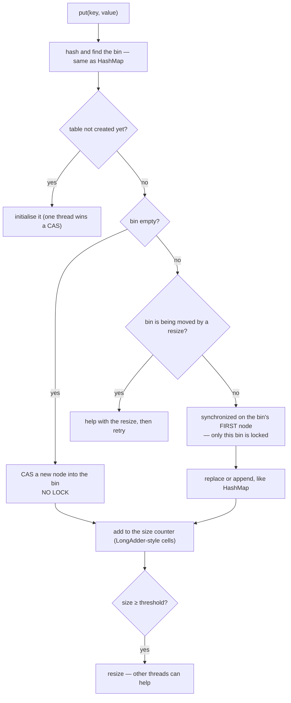

# How ConcurrentHashMap Works Inside

`ConcurrentHashMap` has the **same shape as `HashMap`** — an array of bins, chains, and trees for long chains.
What differs is how it lets many threads use that array at once **without one big lock**.

## `put(key, value)` step by step



| Operation | How it stays thread-safe | Cost |
|---|---|---|
| `get` | Volatile reads only — **no lock at all** | As fast as `HashMap` |
| `put` into an **empty** bin | One CAS (compare-and-swap) | No blocking |
| `put` into an **occupied** bin | `synchronized` on that bin's first node | Blocks only threads using the **same bin** |
| `compute`, `merge`, `putIfAbsent` | Run entirely under that bin's lock | **Atomic** read-modify-write |
| Resize | Threads that hit a moved bin help copy | Work is shared |
| `size()` | Summed from striped counter cells | An estimate while updates are running |

## Why it beats the alternatives

| Map | Locking | Two threads writing different keys |
|---|---|---|
| `Hashtable` | One lock for the whole map | Wait for each other |
| `Collections.synchronizedMap` | One lock for the whole map | Wait for each other |
| `ConcurrentHashMap` (Java 7) | 16 fixed segments | Usually parallel |
| **`ConcurrentHashMap` (Java 8+)** | **One lock per bin**, CAS for empty bins | **Parallel** unless they hash to the same bin |

## The lesson that catches everyone

A thread-safe map does **not** make your *logic* thread-safe. Each single method is atomic — but
`get()` followed by `put()` is two calls, and another thread can run in between. The first two examples show this;
the third shows the atomic methods that fix it.

!!! tip "Every example here is real"
    Each program below compiles and runs as shown, and the output is exactly what it printed on JDK 21.
    Copy one into a file and run it with the command shown underneath — no build tool needed.

---

## 1. Thread-safe map ≠ thread-safe logic

Eight threads count orders. `HashMap` loses updates — and so does `ConcurrentHashMap` when you use `get` then `put`. Only the single atomic `merge` gets the right total.

!!! note "Why there is a `Thread.yield()`"
    The output was captured on a single-core machine, where threads rarely interleave on their own.
    The `yield()` makes the switch happen exactly inside the unsafe window — which is what a real
    multi-core server does without help. Exact numbers vary from run to run; the conclusion does not.


```java title="LostUpdates.java"
--8<-- "code/examples/concurrenthashmap/LostUpdates.java"
```

```text title="Output"
--8<-- "code/examples/concurrenthashmap/LostUpdates.out"
```

<small>Run it: `java LostUpdates.java`</small>

---

## 2. The check-then-act race

"If absent, then put" lets several threads all believe they won. `putIfAbsent` does the check and the insert as one atomic step, so exactly one wins.

!!! note "Why there is a `Thread.yield()`"
    The output was captured on a single-core machine, where threads rarely interleave on their own.
    The `yield()` makes the switch happen exactly inside the unsafe window — which is what a real
    multi-core server does without help. Exact numbers vary from run to run; the conclusion does not.


```java title="CheckThenAct.java"
--8<-- "code/examples/concurrenthashmap/CheckThenAct.java"
```

```text title="Output"
--8<-- "code/examples/concurrenthashmap/CheckThenAct.out"
```

<small>Run it: `java CheckThenAct.java`</small>

---

## 3. The atomic methods, one by one

`putIfAbsent`, `merge`, `compute`, `computeIfPresent` and `replace(key, old, new)` — each is one call that runs under the bin's lock, so no other thread can interleave.

```java title="AtomicOperations.java"
--8<-- "code/examples/concurrenthashmap/AtomicOperations.java"
```

```text title="Output"
--8<-- "code/examples/concurrenthashmap/AtomicOperations.out"
```

<small>Run it: `java AtomicOperations.java`</small>

---

## 4. Load a value exactly once

Sixteen requests ask for the same uncached price at the same moment. Get-then-put calls the slow loader sixteen times; `computeIfAbsent` calls it once. Because the loader runs while the bin is locked, keep it fast and never touch the same map inside it.

```java title="ComputeIfAbsentOnce.java"
--8<-- "code/examples/concurrenthashmap/ComputeIfAbsentOnce.java"
```

```text title="Output"
--8<-- "code/examples/concurrenthashmap/ComputeIfAbsentOnce.out"
```

<small>Run it: `java ComputeIfAbsentOnce.java`</small>

---

## 5. Iterating while the map changes

`HashMap` iterators are **fail-fast** and throw. `ConcurrentHashMap` iterators are **weakly consistent**: they never throw, and may or may not see changes made during iteration.

```java title="IterationWhileModifying.java"
--8<-- "code/examples/concurrenthashmap/IterationWhileModifying.java"
```

```text title="Output"
--8<-- "code/examples/concurrenthashmap/IterationWhileModifying.out"
```

<small>Run it: `java IterationWhileModifying.java`</small>

---

## 6. Why nulls are not allowed

With concurrent updates, `get() == null` followed by `containsKey()` can give inconsistent answers, so `ConcurrentHashMap` forbids `null` entirely — `null` from `get` always means *absent*. This also means swapping `HashMap` for it can break code that stored nulls.

```java title="NoNulls.java"
--8<-- "code/examples/concurrenthashmap/NoNulls.java"
```

```text title="Output"
--8<-- "code/examples/concurrenthashmap/NoNulls.out"
```

<small>Run it: `java NoNulls.java`</small>

---

## 7. Inside the real ConcurrentHashMap

The same lazy table as `HashMap`, with `sizeCtl` holding the next resize threshold. One real difference shows up here: `ConcurrentHashMap` resizes when the size **reaches** the threshold (the 12th `put`), while `HashMap` waits until it is **exceeded** (the 13th).

```java title="PeekInsideConcurrentHashMap.java"
--8<-- "code/examples/concurrenthashmap/PeekInsideConcurrentHashMap.java"
```

```text title="Output"
--8<-- "code/examples/concurrenthashmap/PeekInsideConcurrentHashMap.out"
```

<small>Run it: `java --add-opens java.base/java.util.concurrent=ALL-UNNAMED PeekInsideConcurrentHashMap.java`</small>

---

!!! abstract "Remember"
    **Same array of bins as HashMap** · empty bin → **CAS, no lock** · occupied bin → **lock that one bin**
    · `get` never locks · `compute`/`merge`/`putIfAbsent` are **atomic** · `get` + `put` is **not**
    · iterators never throw · **no nulls** · `size()` is an estimate under load

For the full treatment — resize internals, `computeIfAbsent` rules, `LongAdder` — see [Chapter 30](../04-concurrency/30-concurrent-collections.md).
