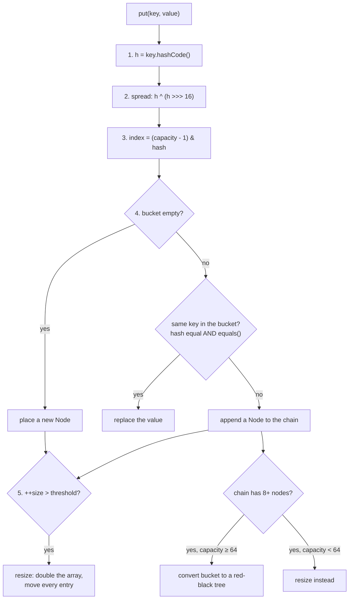

# How HashMap Works Inside

A `HashMap` is an **array of buckets**. Every `put` and `get` does the same few steps to decide which bucket a key
belongs in. Once you can follow those steps, every HashMap behaviour — fast lookups, resizing, collisions, the
mutable-key bug — follows from them.

## `put(key, value)` step by step



| Step | What happens | Why |
|---|---|---|
| **1. hashCode** | Ask the key for its `int` hash | Equal keys must give equal hashes — the `equals`/`hashCode` contract ([Ch 23](../03-collections/23-equality-and-ordering.md)) |
| **2. spread** | `h ^ (h >>> 16)` mixes high bits into low bits | The index uses only the low bits; this stops keys that differ only in high bits from colliding |
| **3. index** | `(capacity - 1) & hash` | Capacity is a power of two, so this is a fast modulo |
| **4. bucket** | Empty → store. Occupied → compare with each node | Compare the stored `hash` first (cheap), then `equals()` |
| **5. resize** | When `size > capacity × 0.75`, double the array | Keeps chains short so lookups stay O(1) |

`get(key)` repeats steps 1–3, then walks that one bucket comparing `hash` and `equals()`. That is why a lookup is
O(1) on average: it examines one short bucket, not the whole map.

## The numbers to remember

| Constant | Value | Meaning |
|---|---|---|
| Default capacity | 16 | Buckets in a new map (allocated on the first `put`) |
| Load factor | 0.75 | Resize when size exceeds 75% of capacity |
| First threshold | 12 | 16 × 0.75 — the 13th `put` triggers a resize |
| Treeify threshold | 8 | A bucket with 8+ nodes becomes a tree… |
| Min treeify capacity | 64 | …but only if the table has 64+ buckets; otherwise it resizes |
| Untreeify threshold | 6 | A tree that shrinks to 6 nodes becomes a list again |

The examples below take you through this in order: the index arithmetic, a working hash map you can read in one
screen, and then the real `java.util.HashMap` observed from the inside.

!!! tip "Every example here is real"
    Each program below compiles and runs as shown, and the output is exactly what it printed on JDK 21.
    Copy one into a file and run it with the command shown underneath — no build tool needed.

---

## 1. From key to bucket

Steps 1–3 — the exact arithmetic `HashMap` uses. The second half shows why spreading matters: two hashes that differ only in their high bits would land in the same bucket without it.

```java title="HashSpreading.java"
--8<-- "code/examples/hashmap/HashSpreading.java"
```

```text title="Output"
--8<-- "code/examples/hashmap/HashSpreading.out"
```

<small>Run it: `java HashSpreading.java`</small>

---

## 2. Build your own hash map in 50 lines

The same core ideas as `java.util.HashMap` — array of buckets, chaining, replace-on-equal-key, resize at 0.75 — small enough to read in one sitting. It starts with 4 buckets so you can watch two resizes happen.

```java title="SimpleHashMap.java"
--8<-- "code/examples/hashmap/SimpleHashMap.java"
```

```text title="Output"
--8<-- "code/examples/hashmap/SimpleHashMap.out"
```

<small>Run it: `java SimpleHashMap.java`</small>

---

## 3. Inside the real HashMap: lazy table and resize

Reflection opens up a real `HashMap`. The table does not exist until the first `put`, and the 13th `put` doubles it from 16 to 32 buckets — exactly the threshold rule above. Note that keys land in scattered buckets, not in insertion order.

```java title="PeekInsideHashMap.java"
--8<-- "code/examples/hashmap/PeekInsideHashMap.java"
```

```text title="Output"
--8<-- "code/examples/hashmap/PeekInsideHashMap.out"
```

<small>Run it: `java --add-opens java.base/java.util=ALL-UNNAMED PeekInsideHashMap.java`</small>

---

## 4. What a collision costs

A key with a constant `hashCode()` sends every entry to one bucket. Counting `equals()` calls shows the lookup becoming a linear search — which is why a good `hashCode` matters.

```java title="CollisionsDemo.java"
--8<-- "code/examples/hashmap/CollisionsDemo.java"
```

```text title="Output"
--8<-- "code/examples/hashmap/CollisionsDemo.out"
```

<small>Run it: `java CollisionsDemo.java`</small>

---

## 5. When a bucket becomes a tree

Watch the 8-and-64 rule happen. With the default table, a long chain triggers **resizes** first (16 → 32 → 64); only then does the bucket become a `TreeNode`. A map created with capacity 64 treeifies straight away.

```java title="TreeifyDemo.java"
--8<-- "code/examples/hashmap/TreeifyDemo.java"
```

```text title="Output"
--8<-- "code/examples/hashmap/TreeifyDemo.out"
```

<small>Run it: `java --add-opens java.base/java.util=ALL-UNNAMED TreeifyDemo.java`</small>

---

## 6. The null key, and why iteration order looks random

`HashMap` allows one `null` key (it is stored in bucket 0). Iteration follows bucket order, not insertion order — use `LinkedHashMap` for insertion order or `TreeMap` for sorted order ([Ch 17](../03-collections/17-choosing-a-collection.md)).

```java title="NullKeyAndOrder.java"
--8<-- "code/examples/hashmap/NullKeyAndOrder.java"
```

```text title="Output"
--8<-- "code/examples/hashmap/NullKeyAndOrder.out"
```

<small>Run it: `java NullKeyAndOrder.java`</small>

---

## 7. Why keys must be immutable

Change a field used by `hashCode()` after inserting the key and the entry is still in its **old** bucket, so every lookup searches the wrong one. The entry cannot be found or removed. Records make ideal keys ([Ch 22](../03-collections/22-immutability.md)).

```java title="MutableKeyBug.java"
--8<-- "code/examples/hashmap/MutableKeyBug.java"
```

```text title="Output"
--8<-- "code/examples/hashmap/MutableKeyBug.out"
```

<small>Run it: `java MutableKeyBug.java`</small>

---

!!! abstract "Remember"
    **Array of buckets** · index = `(capacity - 1) & (h ^ h >>> 16)` · compare `hash` then `equals()`
    · resize at **size > capacity × 0.75** · bucket → tree at **8 nodes and 64+ buckets**
    · keys must be **immutable** · iteration order is **not** insertion order

For the full treatment — resize splitting, memory per entry, Java 8 changes — see [Chapter 19](../03-collections/19-hashmap-internals.md).
