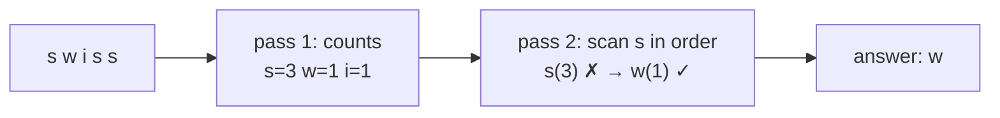

# 1. First Non-Repeating Character

<span class="level l1">L1</span> ★☆☆ · Counting, `LinkedHashMap`, streams `groupingBy`

## Problem

> Given a string, return the first character that appears **exactly once**. `"swiss"` → `'w'`.
> Return "none" if every character repeats.

## Key idea

You can't know whether a character is unique until you have seen the **whole** string, so it takes two passes:
count first, then scan in the original order. Keep the order either by **re-scanning the string**
(array version) or by using an **insertion-ordered map** (`LinkedHashMap`).



## Solution

```java title="FirstNonRepeating.java"
--8<-- "coding-interview/src/FirstNonRepeating.java"
```

## Walkthrough

| Code | Why |
|---|---|
| `int[] counts = new int[Character.MAX_VALUE + 1]` | A direct-index histogram for every `char`: O(1) per update, no boxing. For lowercase-only input, `new int[26]` and `c - 'a'` is enough. |
| `for (char c : s.toCharArray()) if (counts[c] == 1) return ...` | The second pass walks the **string**, not the counts, so the original order decides which unique character comes first. |
| `groupingBy(identity(), LinkedHashMap::new, counting())` | The three-argument `groupingBy` lets you choose the map type. `LinkedHashMap` keeps first-seen order, which a plain `HashMap` doesn't. |
| `findFirst()` | On an ordered stream, `findFirst` respects encounter order. `findAny` might not. |

## Complexity

| Approach | Time | Space |
|---|---|---|
| int[] histogram | O(n) | O(1) (fixed alphabet) |
| LinkedHashMap + stream | O(n) | O(k) distinct chars |

## Run it

```bash
java coding-interview/src/FirstNonRepeating.java      # JDK 21+ single-file launcher, no build needed
```

```text
--8<-- "coding-interview/outputs/FirstNonRepeating.txt"
```

## Common mistakes

* Using `s.indexOf(c) == s.lastIndexOf(c)` inside a loop. It's correct but **O(n²)**.
* Counting into a `HashMap` and then iterating the **map**. `HashMap` order is not insertion order.
* Forgetting the empty string and all-repeating inputs. Return `Optional.empty()` rather than a sentinel like `'\0'`.

## Follow-up questions

??? question "What if the input is a huge stream you can only read once?"
    Keep a `LinkedHashMap<Character, Integer>` (or count array + a doubly linked list of candidates, like an LRU). Remove a character from the candidate list when its count hits 2. The head of the list is always the current answer, in O(1) per character.

??? question "How do you handle Unicode characters outside the BMP (emoji)?"
    Iterate **code points** (`s.codePoints()`) instead of `char`s. A surrogate pair is two `char`s but one character. Use a `Map<Integer, Long>` keyed by code point.
