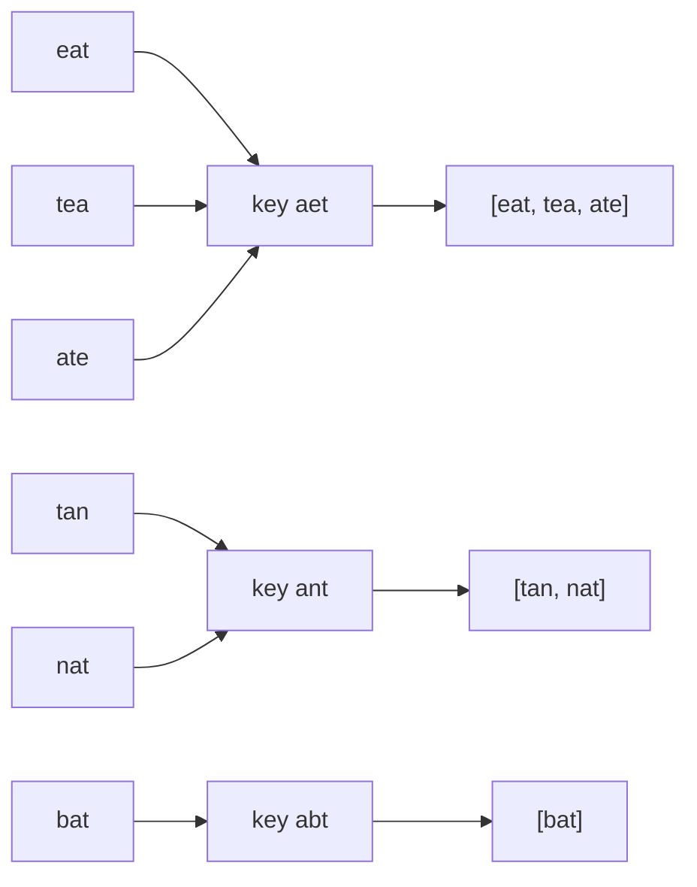

# 2. Group Anagrams

<span class="level l1">L1</span> ★★☆ · Canonical keys, `computeIfAbsent`, `groupingBy`

## Problem

> Group the words that are anagrams of each other:
> `["eat","tea","tan","ate","nat","bat"]` → `[[eat, tea, ate], [tan, nat], [bat]]`.

## Key idea

Anagrams share a **canonical form**. Map every word to a key that is identical for all its anagrams, then group by
that key. Two keys work: the **sorted letters** (`"aet"`) or a **letter-count signature** (`[1,0,0,0,1,...]`).



## Solution

```java title="GroupAnagrams.java"
--8<-- "coding-interview/src/GroupAnagrams.java"
```

## Walkthrough

| Code | Why |
|---|---|
| `Arrays.sort(letters); new String(letters)` | The sorted letters are the canonical key. `char[]` has identity `equals`, so convert it to a `String` before using it as a map key. |
| `groups.computeIfAbsent(key, k -> new ArrayList<>()).add(w)` | The idiomatic "get or create, then add". It replaces the `if (!map.containsKey) put` dance. |
| `Arrays.toString(counts)` | The count signature as a string key. It's O(k) per word instead of O(k log k), which pays off for long words. |
| `LinkedHashMap` | Groups come out in first-seen order, so the result is deterministic and easy to assert. |

## Complexity

| Approach | Time | Space |
|---|---|---|
| Sorted key | O(n · k log k) | O(n · k) |
| Count key | O(n · k) | O(n · k) |

## Run it

```bash
java coding-interview/src/GroupAnagrams.java      # JDK 21+ single-file launcher, no build needed
```

```text
--8<-- "coding-interview/outputs/GroupAnagrams.txt"
```

## Common mistakes

* Using `char[]` or `int[]` directly as a `HashMap` key. Arrays don't override `equals`/`hashCode`, so every key is unique.
* Comparing every pair of words. That's O(n² · k).
* Assuming lowercase a–z for the count key without saying so. Ask, or fall back to the sorted key.

## Follow-up questions

??? question "Can you avoid building strings for the key?"
    Yes. Use a `record Key(int[] counts)` with `Arrays.equals`/`Arrays.hashCode` overrides, or encode the counts as a product of primes (watch for overflow) or a 26-digit base-k number.

??? question "How would this run on 1 billion words?"
    It's a classic MapReduce: the map step emits `(key, word)` and the shuffle groups by key. In a single JVM, use `parallelStream()` with `groupingByConcurrent`.
