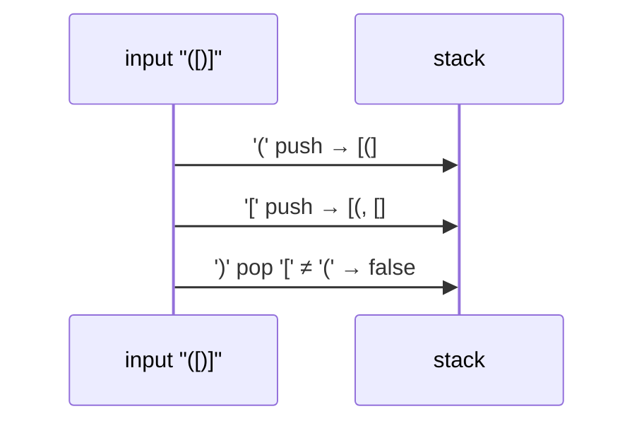

# 3. Balanced Brackets

<span class="level l1">L1</span> ★☆☆ · `ArrayDeque` as a stack

## Problem

> Return whether every `(`, `[` and `{` in a string is closed by the matching bracket in the right order.
> Other characters are ignored. `"a(b[c]{d}e)f"` → true, `"([)]"` → false.

## Key idea

The most recent unclosed opener must be closed first. That's last-in, first-out, so use a **stack**. Push openers;
on a closer, pop and check that it matches. At the end the stack must be empty.



## Solution

```java title="BalancedBrackets.java"
--8<-- "coding-interview/src/BalancedBrackets.java"
```

## Walkthrough

| Code | Why |
|---|---|
| `Deque<Character> stack = new ArrayDeque<>()` | `java.util.Stack` extends `Vector`: it's synchronized and exposes index access. `ArrayDeque` is the recommended stack. |
| `Map.of(')', '(', ']', '[', '}', '{')` | Maps each closer to its opener, so adding `<>` later is one map entry instead of another `if`. |
| `if (stack.isEmpty() \|\| stack.pop() != OPEN_FOR.get(c)) return false` | This handles both a closer with nothing open (`")"`) and a mismatched pair (`"(]"`). |
| `return stack.isEmpty()` | Catches unclosed openers such as `"((())"`. |

## Complexity

| Approach | Time | Space |
|---|---|---|
| Stack | O(n) | O(n) worst case (all openers) |

## Run it

```bash
java coding-interview/src/BalancedBrackets.java      # JDK 21+ single-file launcher, no build needed
```

```text
--8<-- "coding-interview/outputs/BalancedBrackets.txt"
```

## Common mistakes

* Only counting brackets. `"([)]"` has equal counts but is invalid, because order matters.
* Forgetting the empty-stack check before `pop()`. `ArrayDeque.pop()` throws `NoSuchElementException`.
* Returning `true` without checking that the stack is empty at the end.

## Follow-up questions

??? question "Only one bracket type: can you do it in O(1) space?"
    Yes. Keep a counter: +1 for `(`, -1 for `)`. Fail if it ever goes negative, and require 0 at the end.

??? question "Return the index of the first error instead of a boolean."
    Push indices instead of characters. On a mismatch, return the current index. At the end, if the stack isn't empty, the bottom element is the first unclosed opener.
